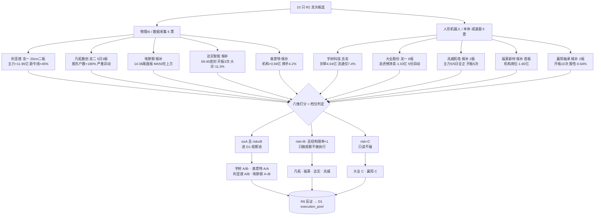

# 2026-10-26 · **个股画像（R5）**

> **数据源新鲜度**: ok · **降级状态**: yes（3 项标的属性型降级，见文末） · **置信度**: 0.75（0.75 × 1.0 × 1.0）

## 一句话结论
10 只龙头六维画像完成：宇树资金最硬但次新+霸榜封顶 B-，奥普特基本面唯一无瑕却结构赔率仅 0.16，大业 6 板已进兑现区、襄阳板型与股性双否。

## 详细分析

### 一、候选池总表（按 composite 排序）

| 名称 代码 | 主线 | R2 角色 | 板型 | 开板 | 封单 | 主力 5 日（正日） | 龙虎榜 38 日 | 机构席位 | 距牛线 | 结构盈亏比 | α/风险 | 综合 |
|---|---|:--:|---|--:|--:|---|--:|--:|--:|--:|:--:|--:|
| 宇树科技 `688836.SH` | 人形机器人  | 龙二 | 1 板 · 首封 14:15 | 0 次 | 4.04 亿 | +10.05 亿（3/5） | +6.27 亿 | +4.01 亿 | +31.3% | 3.20 | **A / B-** | 66.9 |
| 奥普特 `688686.SH` | 物理AI  | 候补 | 1 板 · 首封 14:42 | 1 次 | 0.46 亿 | +1.44 亿（4/5） | +0.21 亿 | +0.94 亿 | +25.1% | 0.16 | **A / A** | 65.9 |
| 兆威机电 `003021.SZ` | 人形机器人  | 候补 | 2 板 · 首封 09:43 | 5 次 | 1.26 亿 | +4.70 亿（5/5） | +5.90 亿 | +1.02 亿 | +29.8% | N/A | **B+ / B-** | 61.4 |
| 埃斯顿 `002747.SZ` | 物理AI  | 候补 | 1 板 · 首封 14:38 | 0 次 | 0.95 亿 | +4.38 亿（5/5） | +1.72 亿 | +0.17 亿 | +10.1% | 5.75 | **A- / B** | 59.9 |
| 利亚德 `300296.SZ` | 物理AI  | 龙一 | 1 板 · 首封 13:43 | 1 次 | 2.22 亿 | +11.96 亿（4/5） | +5.97 亿 | -0.18 亿 | +45.0% | N/A | **A / B** | 59.8 |
| 凡拓数创 `301313.SZ` | 物理AI  | 龙二 | 1 板 · 首封 13:24 | 1 次 | 0.87 亿 | +4.12 亿（4/5） | +2.78 亿 | +0.52 亿 | +58.9% | N/A | **A / B-** | 53.2 |
| 福莱新材 `605488.SH` | 人形机器人  | 候补 | 1 板 · 首封 13:37 | 0 次 | 0.6 亿 | +2.59 亿（4/5） | +1.44 亿 | -1.60 亿 | +27.7% | N/A | **B+ / B-** | 51.9 |
| 达实智能 `002421.SZ` | 物理AI  | 候补 | 1 板 · 首封 09:45 | 3 次 | 0.85 亿 | +6.29 亿（3/5） | +0.00 亿 | +0.00 亿 | +6.2% | 2.25 | **B- / B-** | 45.7 |
| 大业股份 `603278.SH` | 人形机器人  | 龙一 | 6 板 · 首封 13:09 | 0 次 | 0.95 亿 | +0.44 亿（4/5） | -1.03 亿 | +0.00 亿 | +41.7% | N/A | **A- / C** | 44.3 |
| 襄阳轴承 `000678.SZ` | 人形机器人  | 候补 | 2 板 · 首封 10:03 | 10 次 | 0.48 亿 | +4.11 亿（2/5） | +4.76 亿 | +0.08 亿 | +18.4% | 0.33 | **C / C** | 40.9 |

> 口径说明：**主力**=大单+特大单净额（与 R2/R7 同口径）；**结构盈亏比**=（最近上方结构压力−收盘）/（收盘−MA20/牛线取高者），创新高票不虚构目标价故记 N/A。本表不含任何盘前入场价，定价权在 D1。

### 二、这份画像最重要的一个发现：资金口径差点把结论带反

初版计算用的是 tushare `net_mf_amount`（全口径，含中小单），得到「凡拓 -0.20 亿、兆威 -3.67 亿、襄阳 -1.65 亿、大业 -0.12 亿 = 主力在撤」的结论。复核时按 R2/R7 口径改为**大单+特大单**重算，四票全部翻正（+4.12 / +4.70 / +4.11 / +0.44 亿），且逐票与 R2 披露值精确对齐。

因果推论随之改写：凡拓、兆威是「**大单在买、中小单在卖**」（筹码向大单集中，偏多），而不是「主力撤退」；真正支持看空的独立证据只剩龙虎榜 3 日净卖（凡拓 -0.62 亿）、机构席位净卖（福莱 -1.60 亿）、大宗折价派发（达实 -11.27%），以及股性负期望（襄阳 -0.64%）。这也说明：**同一只票的两个资金口径可以符号相反，混用会让整条推理链反向**，D1/R7 消费时必须先对齐口径。

### 三、10 票的六维分档（谁在什么位置）

| 档位 | 票 | 依据 |
|---|---|---|
| 🟢 资金+基本面双硬 | 宇树（A/B-）、奥普特（A/A） | 宇树主力 +10.05 亿且封单 4.04 亿最实；奥普特毛利 58.6%/负债 17.2%/股东户数 -10.65%，机构席位 +0.94 亿 |
| 🟡 资金硬、结构存疑 | 兆威（B+/B-）、利亚德（A/B）、埃斯顿（A-/B） | 三票主力净流入均 4/5 日以上，但分别是「开板 5 次」「距牛线 +45%」「MA50/60 仍在上方」 |
| 🟠 高度高、赔率差 | 凡拓（A/B-）、福莱（B+/B-） | 凡拓 5 日 3 板但股东户数 +180%、「严重异常波动」；福莱机构席位 -1.60 亿 |
| 🔴 只读不碰 | 大业（A-/C）、襄阳（C/C）、达实（B-/B-） | 大业 6 板+5 份异动+龙虎榜净卖 -1.03 亿；襄阳股性负期望+开板 10 次；达实大宗折价派发+股性负 |

### 四、龙头判定（高度 + 上榜时间 + 板块效应三维）

| 票 | 连板高度 | 首封时间 | 开板 | 行业涨停家数 | 判定 |
|---|--:|:--:|--:|--:|---|
| 宇树科技 | 1 | 14:15 | 0 | 5 | 龙头（启动日+板块效应） |
| 大业股份 | 6 | 13:09 | 0 | 5 | 龙头（高度+板块效应） |
| 利亚德 | 1 | 13:43 | 1 | 1 | 孤军（行业内仅 1 家涨停） |
| 凡拓数创 | 1 | 13:24 | 1 | 2 | 龙头候选 |
| 兆威机电 | 2 | 09:43 | 5 | 2 | 分歧弱（开板 ≥4 次） |
| 襄阳轴承 | 2 | 10:03 | 10 | 6 | 分歧弱（开板 ≥4 次） |
| 埃斯顿 | 1 | 14:38 | 0 | 5 | 跟风/候补（非龙一身位） |
| 达实智能 | 1 | 09:45 | 3 | 6 | 跟风/候补（非龙一身位） |
| 奥普特 | 1 | 14:42 | 1 | 5 | 跟风/候补（非龙一身位） |
| 福莱新材 | 1 | 13:37 | 0 | 2 | 跟风/候补（非龙一身位） |

> 「孤军」= 所属行业当日仅 1 家涨停（板块效应来自跨行业概念而非同行业）；「分歧弱」= 盘中开板 ≥4 次；「龙头（高度+板块效应）」= 连板 ≥2 且行业涨停 ≥3 家。

### 五、决策传导图

## 关键证据

### 宇树科技 `688836.SH` · 总龙 · 资金最认 · 结构最贵

**六维速览**：催化 78 · 筹码 80 · 板块 78 · 估值 18 · 技术 60 · 机构 80 → 综合 66.9 · **α A / 风险 B-**

- **大资金意图**: R4 事件直接点名「总龙」+ R2 总分 75 + 行业 5 家涨停三重共振；主力 5 日 +10.05 亿（3/5 日净流入）、机构专用席位 10-23 单日 +4.01 亿、封单 4.04 亿（封单/成交 8.5%，全池最实）——拉升是**机构+超大单同向**，不是游资对倒。
- **为什么走强**: 次新 20cm 涨停收 624（20 日新高），日/60 分/15 分均线多头，但受限于 42 根 K 线无法构建缠论笔/中枢；距上市首日高 1100 仍 -43%，形态=次新第二波启动，上方无有效 K 线压力、下方亦无有效支撑（历史太短）
- **逻辑够不够硬**: 多维共振数 = 4/4（催化/筹码/板块/机构）；hard 锚 = 有机构覆盖 + 无业绩支撑。证伪路径：三季报预约披露。

**思维链**：
- **买入理由①（产业逻辑）**: 人形机器人整机是物理 AI 落地的最终载体，宇树本体是链内唯一「整机+大模型智能体」双重身份标的，NVIDIA Isaac 与银河通用生态同时覆盖，属叙事最纯的整机位。
- **买入理由②（数据锚）**: 10-23 封单 4.04 亿 / 成交 47.5 亿 = 8.5% 承接比，全池最实；机构席位净买 4.01 亿与主力 10.05 亿同向，且 10-21、10-22 连续两日龙虎榜净买 +1.82 亿、+2.33 亿，三日合计 +6.27 亿无一日为负。
- **风险点①（短期）**: 上市仅 42 个交易日、流通盘仅 7.4%（187.7/2,523.9 亿），PE 432、PB 87.6、PS 121.6 三位数估值无锚；一旦次新解禁或情绪退潮，跌幅无结构支撑可依。
- **风险点②（中期反证）**: 净利 yoy +955.6% 但扣非 yoy -19.34%，利润增长主要来自非经常性损益；若三季报（10-29）扣非继续为负，则 432 倍 PE 的「扭亏」定价会被直接证伪。
- **止损条件（结构失效位）**: 跌破 60 分 MA20 约 530 元 且当日收盘失守，视为本轮加速被破坏；具体止损价由 D1 定价后落地，R5 只给失效位。
- **可验证假设（24-72h）**: ①10-26 封单 ≥2 亿且开盘溢价 ≥3% → 总龙地位确认；②三季报扣非为负 → α 档由 A 下调至 B-；③换手率单日 >35% 且收盘价低于前一日 → 出货启动信号。
### 奥普特 `688686.SH` · 基本面唯一无瑕 · 但结构位置最差

**六维速览**：催化 55 · 筹码 76 · 板块 70 · 估值 52 · 技术 62 · 机构 86 → 综合 65.9 · **α A / 风险 A**

- **大资金意图**: 全池唯一「毛利 58.6% + 负债 17.2% + 营收 +32.5%」三项同时为正的票，25 篇研报（买入 12 / 增持 9）、机构席位净买 0.94 亿、股东户数 -10.65%（筹码集中）——这是**机构在做基本面对冲**，不是情绪票。
- **为什么走强**: 20cm 涨停收 153.20 逼近 60 日高 157.42（-2.68%），日线全周期均线多头排列；但 14:42 尾盘才封板、换手仅 4.21%、封单 0.46 亿，形态=惜售型尾盘板（筹码锁定好但市场参与度低），关键在次日能否放量确认
- **逻辑够不够硬**: 多维共振数 = 3/4（催化/筹码/板块/机构）；hard 锚 = 有机构覆盖 + 有业绩支撑。证伪路径：三季报预约披露（明日）。

**思维链**：
- **买入理由①（产业逻辑）**: 机器视觉是物理 AI 数据采集的「眼睛」，工业相机+光源+软件全栈国产替代，属主线里最不受概念波动影响的中游卡位。
- **买入理由②（数据锚）**: 机构专用席位 4 行合计 +0.94 亿（涨停日机构大幅净买）；H1 营收 +32.5%、扣非 +18.4%、毛利 58.6%、资产负债率 17.2%，全池财务质量第一；股东户数 8,806 → 7,868（-10.65%）。
- **风险点①（短期）**: PE 88.9 处 3 年 84.3% 分位、PB 5.87 处 95.9% 分位，估值已透支；14:42 才尾盘封板、换手仅 4.21%、封单 0.46 亿（全池最小），说明**市场参与度极低**，次日一旦无接力盘，尾盘板最容易直接低开。
- **风险点②（中期反证）**: 距 60 日高 157.42 仅 -2.68%，处于 60 日区间 93% 位置；结构盈亏比仅 0.16（上行 2.8% vs 下行 17.4%），意味着「基本面最好」不等于「赔率最好」。
- **止损条件（结构失效位）**: 失守 60 分 MA5 约 135 元，或收盘跌破 MA20 126.67，视为涨停被吞没。
- **可验证假设（24-72h）**: ①10-27 三季报营收增速 ≥30% 且扣非正增长 → 机构逻辑加固；②10-26 换手率仍 <6% → 属惜售但无人接，D1 不应给溢价；③若放量至 10% 以上仍收阳 → 参与度问题解除。
### 兆威机电 `003021.SZ` · 资金最认 · 盘口最不认

**六维速览**：催化 72 · 筹码 55 · 板块 72 · 估值 42 · 技术 62 · 机构 60 → 综合 61.4 · **α B+ / 风险 B-**

- **大资金意图**: 主力 5 日 +4.70 亿且 5/5 日全为正（全池唯一满勤+全正），龙虎榜 3 次净买 +5.90 亿、机构席位 +1.02 亿；但 09:43 早封后**开板 5 次**、封单仅 1.26 亿 —— 大单在买、盘口在砸，是链内分歧最直白的一票。
- **为什么走强**: 2 连板收 91.73 创 20/60 日新高，09:43 早封显示竞价后即抢筹，但盘中反复开板 5 次、换手仅 12.57%，形态=分歧中的早封板（抢筹意愿强但封板承接弱）
- **逻辑够不够硬**: 多维共振数 = 3/4（催化/筹码/板块/机构）；hard 锚 = 有机构覆盖 + 有业绩支撑。证伪路径：三季报预约披露。

**思维链**：
- **买入理由①（产业逻辑）**: 灵巧手是人形机器人价值量最高的零部件之一（单机 12-24 个自由度），微型驱动模组具备「量价齐升」弹性，R4 事件直接点名。
- **买入理由②（数据锚）**: 主力 5/5 日全为正 + 10 日 +4.38 亿，龙虎榜三日 +5.90 亿（10-23 单日 +2.14 亿涨幅榜 +2.34 亿三日榜），机构席位 10 行 +1.02 亿；全口径 5 日 -3.67 亿 = 大单进、中小单出，筹码向大单集中。
- **风险点①（短期）**: 开板 5 次是链内最差板型之一，换手仅 12.57% 却反复被砸，说明封单承接不足；PE 114 且净利 yoy -34.1%，估值与业绩反向。
- **风险点②（中期反证）**: 行业口径「电机Ⅱ」当日仅 2 家涨停，板块效应弱于物理 AI（IT 服务 6 家、自动化设备 5 家）；所属人形机器人概念已被 R3 列入「霸榜出货」警戒，按红线 5 不给正向共振加分。
- **止损条件（结构失效位）**: 收盘跌破 MA5 78.14 且次日不能收回，或失守牛线 70.66，视为 2 连板结构瓦解。
- **可验证假设（24-72h）**: ①10-26 若开板次数 ≤1 且封单 >2 亿 → 分歧转一致；②若再次开板 ≥3 次 → R6 应按「分歧弱」反向处理；③主力 5 日转负 → 大单撤退确认。
### 埃斯顿 `002747.SZ` · 机构覆盖最厚 · 结构最弱

**六维速览**：催化 55 · 筹码 62 · 板块 70 · 估值 40 · 技术 58 · 机构 78 → 综合 59.9 · **α A- / 风险 B**

- **大资金意图**: 21 篇研报（全池第二）、主力 5 日 +4.38 亿且 5/5 日全为正、机构席位小幅净买 +0.17 亿；但价格仍在 MA20/MA50/MA60 之下、牛线（26.50）仍在熊线（26.68）之下 —— 机构在买「便宜」，不是在买「强势」。
- **为什么走强**: 长期下跌后的首个放量涨停（14:38 尾盘封板），价格仍在 MA20/MA50/MA60 之下、距 60 日高 -27%，形态=下跌旗形内的反弹第一阳，尚未构成趋势反转；牛线仍在熊线之下
- **逻辑够不够硬**: 多维共振数 = 3/4（催化/筹码/板块/机构）；hard 锚 = 有机构覆盖 + 有业绩支撑。证伪路径：三季报预约披露。

**思维链**：
- **买入理由①（产业逻辑）**: 国产工业机器人本体份额第一，物理 AI 从「数据采集」走向「本体执行」时，本体厂是必经环节，且公司已布局具身智能控制器。
- **买入理由②（数据锚）**: 中报净利 yoy +2314%、扣非 +498.6%（低基数修复），21 篇研报中含 6 篇增持、3 篇买入；主力 5/5 日净流入 +4.38 亿，是链内资金最连续的一只。
- **风险点①（短期）**: 14:38 尾盘封板、换手 10.51%，距 60 日高 40.04 仍 -27.1%，属深跌 27% 后的反弹第一阳；MA50 30.22 / MA60 30.40 就在头顶 3-5%，是最直接的技术压力。
- **风险点②（中期反证）**: 商誉 9.75 亿占净资产 29.75%（逼近 30% 红线）、资产负债率 68.22%，股东户数 6-01 至 6-30 由 11.95 万增至 17.15 万（+43.5%），筹码在分散而非集中。
- **止损条件（结构失效位）**: 收盘跌破 MA20 27.29，视为反弹结束；跌回牛线 26.50 下方则为趋势重新走坏。
- **可验证假设（24-72h）**: ①10-26 能否站上 MA50 30.22 → 决定是反弹还是反转；②三季报（10-30）扣非是否延续正增长；③主力净流入是否延续至第 6 日（5/5 已满勤，第 6 日转负即减速）。
### 利亚德 `300296.SZ` · 龙一 · 资金最猛 · 基本面最空

**六维速览**：催化 62 · 筹码 70 · 板块 78 · 估值 30 · 技术 72 · 机构 25 → 综合 59.8 · **α A / 风险 B**

- **大资金意图**: 主力 5 日 +11.96 亿（链内第一，4/5 日正）+ 龙虎榜三日连续净买 +5.97 亿 + 东财人气 10→2，资金与情绪双确认；但 38 日研报覆盖 **0 篇**、H1 净利 -59.7%、PE 97 —— 这是一轮**没有卖方背书的资金行情**。
- **为什么走强**: 20cm 放量长阳突破 60 日新高（7.32 即 20 日与 60 日最高），日线 MACD/量能同步放大，60 分与 15 分均线多头排列；周线刚站上长期震荡区上沿但未回踩确认——形态=趋势启动后的第一根加速柱
- **逻辑够不够硬**: 多维共振数 = 3/4（催化/筹码/板块/机构）；hard 锚 = 无机构覆盖 + 无业绩支撑。证伪路径：三季报预约披露（H1 净利 -59.7%，为本周最大变量）。

**思维链**：
- **买入理由①（产业逻辑）**: Micro LED + 动作捕捉是物理 AI 数据采集的硬件入口，公司具备显示与采集一体化产能，属主线里「设备端」最直接受益的 A 股标的。
- **买入理由②（数据锚）**: 20cm 二连板、封单 2.22 亿、成交 42.23 亿；主力 5 日 +11.96 亿、10 日 +11.75 亿；龙虎榜 10-21/10-22/10-23 连续三日净买 +2.39/+1.83/+1.76 亿，**三日无一日为负**。
- **风险点①（短期）**: 收盘距牛线 +45.0%（全池第二超买）、换手 27.92%、PB 处 3 年 95.3% 分位；机构专用席位 6 行合计 -0.18 亿（小幅反向），说明机构在这个位置是小幅减的。
- **风险点②（中期反证）**: H1 净利 yoy -59.7%、扣非 -88.8%、营收 -18.3%，10-29 三季报是本周内**最硬的证伪窗口**；0 篇研报意味着一旦资金撤退没有任何基本面买盘承接。
- **止损条件（结构失效位）**: 跌破 6.5 元（60 分低吸参考位）且收盘不回，或单日跌幅 >8% 收在 MA5 5.66 下方，视为加速段结束。
- **可验证假设（24-72h）**: ①10-29 三季报净利降幅是否收窄至 -20% 以内；②10-26 主力是否延续第 5 日净流入；③若换手 >35% 且未封板 → 兑现盘主导。
## 其余 5 票（简洁版）

| 票 | 一句话 | 板型 / 龙头 | 结构赔率 | 禁止清单命中 |
|---|---|---|---|---|
| **凡拓数创** `301313.SZ` | 5 日内 3 个 20cm、60 日新高，但 3 日龙虎榜净卖 -0.62 亿、股东户数 +180%，高度是散户与游资抬的 | 1 板 · 首封 13:24 · 龙头候选 | N/A · 已创 60 日新高，上方无结构压力位，不虚构目标价（由 D1 竞价后定价） | no_pe_loss_making |
| **福莱新材** `605488.SH` | 涨停新高但机构席位净卖 -1.60 亿、PE 分位 92.7%、R2 判杂毛，是可转债联动炒作的跟风位而非主线核心 | 1 板 · 首封 13:37 · 跟风/候补（非龙一身位） | N/A · 已创 60 日新高，上方无结构压力位，不虚构目标价（由 D1 竞价后定价） | distribution_alert、valuation_stretched |
| **达实智能** `002421.SZ` | 09:45 抢到全市场最早首封却开板 3 次，大宗 3 笔均折价 -11.3% 派发，股性次日中位 -0.08%，早盘强度是假象 | 1 板 · 首封 09:45 · 跟风/候补（非龙一身位） | 2.25 · 目标 3.88（+13.1%）/ 失效 3.23（5.8%） | block_trade_distribution、weak_seal、no_pe_loss_making |
| **大业股份** `603278.SH` | 6 连板高度龙，但 5 次异动/风险提示公告 + 龙虎榜净卖 -1.03 亿 + 机构 0 参与 + 10/31 披露首亏三季报，是纯情绪高度 | 6 板 · 首封 13:09 · 龙头（高度+板块效应） | N/A · 已创 60 日新高，上方无结构压力位，不虚构目标价（由 D1 竞价后定价） | distribution_alert、lhb_net_sell、no_pe_loss_making |
| **襄阳轴承** `000678.SZ` | R2 已判杂毛：开板 10 次、股性次日中位 -0.64%（负期望）、主力仅 2/5 日为净流入，涨停质量与资金节奏同时反对 | 2 板 · 首封 10:03 · 分歧弱（开板 ≥4 次） | 0.33 · 目标 13.90（+5.1%）/ 失效 11.17（15.6%） | distribution_alert、main_force_uneven、weak_seal、no_pe_loss_making |

### 补充：其余 5 票的思维链要点

**凡拓数创**（α A / 风险 B-）：买入理由①（产业逻辑）→物理 AI 数据采集需要 3D 数字化与虚拟仿真实景建模，公司是东财「物理AI」题材 lead_stock（hot 1178 全市场第 1），题材辨识度最强。；买入理由②（数据锚）→主力 5 日 +4.12 亿（4/5 日正）、全口径 -0.20 亿 = 大单进中小单出；机构专用席位 61 行合计 +0.52 亿；5 日 +89% 的涨幅是链内唯一。；风险点①（短期）→10-23 涨停日量比仅 1.14（缩量板）+ 封单 0.87 亿（封单/成交 1.7%，全池第二虚）+ 换手 39.32%，是典型的「加速末段缩量封板」，最容易被次日一根阴线吞掉。；风险点②（中期反证）→PE 为空（连续亏损）、PB 处 3 年 99.9% 分位、PS 11.6；股东户数由 9,476 增至 26,574（+180.4%），筹码彻底散户化；「严重异常波动」公告意味着已进入交易所重点监控档，随时可能停牌核查。。
**福莱新材**（α B+ / 风险 B-）：买入理由①（产业逻辑）→橡胶骨架材料+机器人皮肤/密封件想象空间，属人形机器人「材料端」延伸，且有可转债提供弹性工具。；买入理由②（数据锚）→主力 5 日 +2.59 亿（4/5 日正）、龙虎榜 2 次净买 +1.44 亿、13:37 封板 open_times=0（未开板）。；风险点①（短期）→PE 146.1 处 3 年 92.7% 分位、扣非 yoy -8.13%（估值与盈利反向）；周线仍在长期震荡区上沿（20 周高 38.6 即压力），涨停后一天不确认就回到震荡。；风险点②（中期反证）→机构席位净卖 1.60 亿与研报买入评级方向完全相反；可转债与正股同日异动+控股股东回函，说明交易所已在问询，博弈结构复杂于普通个股。。
**达实智能**（α B- / 风险 B-）：买入理由①（产业逻辑）→物理 AI 数据采集需要数据中心与物联网底座，公司是 IDC+智能化双主业，主线内属「基础设施」位。；买入理由②（数据锚）→主力 5 日 +6.29 亿（3/5 日正）大单买得凶；行业 6 家涨停，板块效应全池第二。；风险点①（短期）→开板 3 次+换手 26.5%+封单 0.85 亿，早盘强度被反复砸穿；10-26 三季报已披露（H1 仍亏 -1.78% ROE），业绩无支撑。；风险点②（中期反证）→三笔大宗折价均值 -11.27% 是典型**分销减持**信号，与主力净流入方向相反；2025 年报首亏 -8.95~-7.15 亿，PB 处 3 年 94.1% 分位但 ROE 为负（PB-ROE 最差象限）。。
**大业股份**（α A- / 风险 C）：买入理由①（产业逻辑）→人形机器人减速器/本体结构件，R2 主线总分 75，行业口径「通用设备」5 家涨停。；买入理由②（数据锚）→6 板全程 open_times=0、封单 0.95 亿、换手 33.42%（6 板中最高），说明每一板都在巨量换手中完成接力。；风险点①（短期）→毛利率 6.83%（全池最低）、资产负债率 77.30%（全池最高）、中报首亏 -6,000 万（-241.5%），PB 处 3 年 99.2% 分位；控股股东质押率 36.78%。；风险点②（中期反证）→10-20 至 10-24 连发 5 份异动/风险提示公告，交易所关注度已达最高档；6 板累计涨幅巨大，一旦断板按 15.96 元计算回落空间远超上行空间（已创 60 日新高，上方无压力位可参照）。。
**襄阳轴承**（α C / 风险 C）：买入理由①（产业逻辑）→汽车轴承+机器人关节轴承想象空间，行业口径「汽车零部件」6 家涨停，板块效应在。；买入理由②（数据锚）→主力 5 日 +4.11 亿（但仅 2/5 日为正）、龙虎榜 11 次合计 +4.76 亿。；风险点①（短期）→开板 10 次是链内最差板型，早封 10:03 完全被砸穿；未破 20 日高 13.90（上方 4.8% 即压力），结构盈亏比 0.44。；风险点②（中期反证）→中报增亏 -57.8%（-2,450 万）、2025 续亏，PB 7.82 无盈利支撑；机构席位 39 行合计仅 +0.08 亿（几乎零参与）；股性次日中位为负 = 历史上「打这个板」是亏钱的。。

## 数据源审计

| 源 | 日期 | 状态 | 备注 |
|---|---|:--:|---|
| tushare/daily（10 票） | 2026-10-23 | 🟢 | 627 条 · 20260601–20261023 日线，算 MA/牛线/股性次日收益 |
| tushare/daily_basic（10 票） | 2026-10-23 | 🟢 | 6,585 条 · 20231024–20261023 PE/PB/PS/市值/换手，3 年分位 |
| tushare/moneyflow | 2026-10-23 | 🟢 | 200 条（20 日×10 票）· 大单+特大单口径主力净额 |
| tushare/limit_list_d + 全市场 | 2026-10-23 | 🟢 | 42 条个股 + 82 条全市场 · 首封时间/开板/封单/行业涨停家数 |
| tushare/top_list + top_inst（38 日逐日全量） | 2026-10-23 | 🟢 | 41 条个股上榜 + 410 条机构席位明细 |
| tushare/block_trade | 2026-10-23 | 🟢 | 3 条（达实 3 笔折价 -11.27%）· 其余 7 票零大宗（非缺失） |
| tushare/margin_detail | 2026-10-23 | 🟡 | 194 条 · 大业/福莱非两融标的 → 该维 null（标的属性，已在 JSON 标 degraded） |
| tushare/fina_indicator + balancesheet + forecast | 2026-09-30 | 🟢 | 75 + 10 + 10 条 · 商誉/负债率/净利 yoy/审计意见 |
| tushare/anns_d + disclosure_date | 2026-10-26 | 🟢 | 87 条公告（40 日窗口）+ 10 票三季报预约披露日 |
| tushare/report_rc（研报） | 2026-10-23 | 🟢 | 88 条 · 近 5 个月卖方评级分布 |
| tushare/stk_holdernumber + pledge_stat | 2026-10-23 | 🟢 | 72 + 40 条 · 股东户数环比、控股股东质押率 |
| canghai-charts/MCP chart_vision | 2026-10-23 | 🟢 | 10/10 覆盖（快照 5 + MCP 直调 5），fq=2 前复权 |
| czsc 缠论（0.10.12） | 2026-10-23 | 🟡 | 9/10 可用 · 宇树上市 42 日无法成笔，已标 chanlun_confirmed=null |
| R2/R3/R4 上游 artifact | 2026-10-26 | 🟢 | 主线分/角色/霸榜出货警戒/事件催化 |

## 不确定性 / 反证

1. **结构盈亏比是「静态收盘口径」，会显著低估次日真实赔率**：奥普特 0.16、襄阳 0.44 都建立在「压力位=60 日高」的假设上，若次日跳空高开轻松越过高点，则该数字失去意义。真正的 RR 必须由 D1 在竞价后重算，本表只用于**排序**，不能直接当决策依据。
2. **六维评分里有两维是本 Agent 的主观判断**（催化强度、板块联动），不是纯数据产物。特别是「催化 62 分」这类分值不来自任何公式，D1/E1 引用时应只看方向（≥60 视为有催化），不要把它当精确定量。
3. **数据口径陷阱已修正一次，但仍可能有同类问题**：本轮把 `net_mf_amount` 误当主力净额，导致 4 票结论反向；已改为大单+特大单并逐票对齐 R2。但龙虎榜「机构专用席位」的净额并不等于公募净买入（含量化/私募），把它读成「机构看好」会高估。
4. **霸榜出货是板块级判定，不是个股级**：宇树/大业/兆威/福莱/襄阳 5 票被标 `distribution_alert`，依据是 R3 把「人形机器人」列入 3 日霸榜出货警戒（红线 5）。但板块级警戒不等于这 5 只都在出货 —— 宇树封单 4.04 亿、机构净买 4.01 亿就是反例，故风险档封顶 B- 属**保守处理**，不等于判定出货成立。
5. **三季报是本周最大变量**：大业 10-31、利亚德 10-29、凡拓 10-28、宇树 10-29、兆威 10-29、奥普特 10-27、埃斯顿 10-30 陆续披露，其中 4 票中报净利为负。本画像的估值/风险档在财报落地后**会整体失效**，需 D1 在 10-27 起按日重估。
6. **降级声明**：①大业/福莱非两融标的 → 筹码维缺两融趋势（标的属性）；②宇树上市 42 日 → 无 MA50/60 与缠论笔；③快照仅覆盖 5 票，另 5 票走 MCP 直调（数据同源同时点，非缺失）。

## 与其他 R/D/E 的关系

- **依赖**：`R2_main_sectors.json`（候选池唯一来源，10 只，6-15 区间内）、`R3_sentiment.json`（霸榜出货警戒 → distribution_alert）、`R4_news.json`（个股级催化点名）、`data/raw/20261026/chart_vision_snapshot.json`（图形判读 5 票）
- **被消费**：`R6 反证`（模式七估值陷阱消费 `fundamental_flags[]`；模式六霸榜出货消费 `flags`）、`D1 决策`（α/风险双档 + `leader_verdict` + 结构赔率排序，按 skill 契约缺失档位按 B 降级）、`E1 复盘`（`event_timeline` 供 T+N 回填、`grade_basis` 供档位校准）
- **不产出**：入场价/止损价/仓位（属 D1）；板块排序（属 R2）；风格判断（属 R1）

## Sub-Agent 元数据

- skill: `analyze_stock_profile_v1`（v1.5 · 含龙头判定维度）
- artifact: `data/research/20261026/R5_stock_profiles.json`（120 KB · 10 票 · 六维全字段）
- 覆盖：R2 候选 10 只 → 画像 10 只，失败 0；chart_vision 快照命中 5 + MCP 直调 5
- 契约：`check_r5_candidate_pool` = PASS；α/风险双档 10/10 无缺失；`fundamental_flags` 10/10 透传
- 生成耗时: 约 46 分钟（含 38 个交易日龙虎榜逐日回溯 + 10 票 chart_vision）
- 用 model: `seed-2-0-lite-260228`（chart_vision 视觉层） + 主 Agent 推理层
