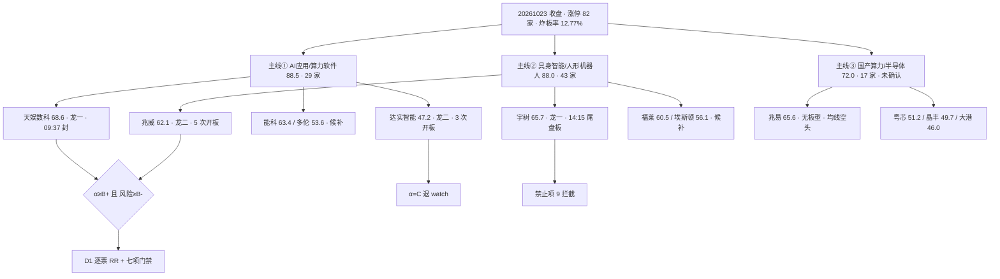

# 2026年10月26日 · **个股画像**

> **数据源新鲜度**: partial（行情截至 2026-10-23 收盘）
> **降级状态**: true（上游 R2/R3/R6 均带 partial 标记）
> **置信度**: 0.62

## 一句话结论

12 只候选里只有 **2 只**（天娱数科 A-/B、兆威机电 B+/B-）通过 D1 的档位闸门——它们的共同点不是『最强』，而是**资金连续或结构可验证**；
宇树是全场总龙但 14:15 尾盘封板（禁止项 9），达实是龙二但三笔 -17% 折价大宗 + 92.6% 单日资金，两只都只能在 watch 里看。
**主线② 43 家涨停最宽，但身位最拥挤；主线① 29 家最干净，却没有一只 2 板以上的真龙。这条『宽度与高度错位』是本日画像最该记住的结构。**

## 详细分析

### 🧭 主线 → 候选 → 闸门

### 📊 六维评分总表

| # | 代码 | 名称 | 主线/身位 | 板型 | 六维（催化/筹码/板块/估值/技术/研报） | 综合 | α | 风险 | 结论 |
|:--:|:--:|---|---|---|---|:--:|:--:|:--:|:--:|
| 1 | `002354` | **天娱数科** | AI应用/龙一 | 1板 · 09:37 封 · 开板 2 · 封单 3.27 亿 | 催化 70 / 筹码 70 / 板块 87 / 估值 26 / 技术 58 / 研报 90 | **68.6** | A- | B | 进 |
| 2 | `688836` | **宇树科技-W** | 具身智能/龙一 | 1板 · 14:15 封 · 开板 0 · 封单 4.04 亿 | 催化 92 / 筹码 78 / 板块 85 / 估值 6 / 技术 26 / 研报 90 | **65.7** | B | C | 拦截 |
| 3 | `603986` | **兆易创新** | 国产算力/候补 | 未封板 | 催化 84 / 筹码 60 / 板块 63 / 估值 76 / 技术 38 / 研报 90 | **65.6** | B | B | 观察 |
| 4 | `603859` | **能科科技** | AI应用/候补 | 1板 · 13:43 封 · 开板 0 · 封单 1.01 亿 | 催化 68 / 筹码 54 / 板块 73 / 估值 50 / 技术 52 / 研报 90 | **63.4** | B | B+ | 观察 |
| 5 | `003021` | **兆威机电** | 具身智能/龙二 | 2板 · 09:43 封 · 开板 5 · 封单 1.26 亿 | 催化 85 / 筹码 78 / 板块 80 / 估值 34 / 技术 25 / 研报 52 | **62.1** | B+ | B- | 进 |
| 6 | `605488` | **福莱新材** | 具身智能/候补 | 1板 · 13:37 封 · 开板 0 · 封单 0.6 亿 | 催化 82 / 筹码 52 / 板块 71 / 估值 26 / 技术 44 / 研报 82 | **60.5** | B- | B- | 观察 |
| 7 | `002747` | **埃斯顿** | 具身智能/候补 | 1板 · 14:38 封 · 开板 0 · 封单 0.95 亿 | 催化 66 / 筹码 50 / 板块 71 / 估值 14 / 技术 52 / 研报 70 | **56.1** | C | B | 拦截 |
| 8 | `603528` | **多伦科技** | AI应用/候补 | 2板 · 13:19 封 · 开板 0 · 封单 0.75 亿 | 催化 52 / 筹码 68 / 板块 73 / 估值 10 / 技术 61 / 研报 18 | **53.6** | C | B | 拦截 |
| 9 | `301660` | **粤芯半导-U** | 国产算力/候补 | 1板 · 10:34 封 · 开板 2 · 封单 1.81 亿 | 催化 60 / 筹码 78 / 板块 63 / 估值 0 / 技术 46 / 研报 18 | **51.2** | C | B- | 拦截 |
| 10 | `688368` | **晶丰明源** | 国产算力/候补 | 1板 · 13:46 封 · 开板 3 · 封单 0.31 亿 | 催化 80 / 筹码 18 / 板块 63 / 估值 40 / 技术 38 / 研报 59 | **49.7** | C | B- | 观察 |
| 11 | `002421` | **达实智能** | AI应用/龙二 | 1板 · 09:45 封 · 开板 3 · 封单 0.85 亿 | 催化 64 / 筹码 24 / 板块 82 / 估值 16 / 技术 49 / 研报 18 | **47.2** | C | C | 降级 |
| 12 | `002077` | **大港股份** | 国产算力/候补 | 1板 · 09:48 封 · 开板 3 · 封单 0.59 亿 | 催化 45 / 筹码 46 / 板块 63 / 估值 40 / 技术 47 / 研报 18 | **46.0** | C | B | 拦截 |

> 评分权重：催化 20% · 筹码 20% · 板块联动 20% · 技术就绪 20% · 估值安全 10% · 研报机构 10%。α/风险档位规则见文末元数据，可复算。

### 🔍 逐票画像

#### 1. 天娱数科 `002354.SZ` · A- / B · **进**

> AI 应用 1 板广谱扩散里的辨识度龙一：09:37 早盘封 + 3.27 亿封单，但五日资金 94.8% 集中在最后一天，只做回踩不接高开。

| 维度 | 分 | 判据 |
|---|:--:|---|
| 催化 | 70 | E20261026_004 DeepSeek 千亿融资(high/正面) 抬 AI 应用整链，但个股未被 R4 点名；同日 E008 国办减缓 AI 就业替代(medium/负面) 形成反向口径 |
| 筹码 | 70 | 龙虎榜净买+4.89亿；机构席净买+5.46亿；5日主力+12.15亿/4日正(连续)；股东户数+56%(散户化/筹码大幅分散) |
| 板块联动 | 87 | 主线「AI应用/算力软件」R2 总分 88.5 · 板块涨停 29 家 · 身位=龙一 |
| 财务与估值 | 26 | PE_ttm 为空(亏损或负利润)；ROE=2.7951%(低) |
| 技术形态 | 58 | 牛线上方7.11% |
| 研报机构 | 90 | 15 篇(近3月) · 最新 20260915 国信证券「优于大市」 |

- **板型**：首板（在线连续涨停 1 天 · 封单3.27亿· 开板 2 次）；**龙头裁决**：**龙头**（强度 中） — 09:37 首封 + 板块涨停 29 家，具备带动性
- **禁止清单**：14 项禁止清单全过；**红旗**：无编码红旗
- **结构盈亏比**（参考）：入场 7.73（快照低吸位）→ 止损 7.34（-5.05%）→ 目标 8.25，RR=1.33（低吸位距收盘 -3.74%，该 RR 假设价格回落到低吸位才成立；若次日不回踩，只能用 rr_at_close 的口径判）；当前价直进 RR=0.73
- **技术形态**（快照 `snapshot`）：突破+低吸+高抛 · 量价同向 · 5日/20日量比 1.25 · 牛线 7.5 / 熊线 7.46

首板结构在 AI 应用里最正：09:37 早盘封、3.27 亿封单、开板 2 次已完成换手。问题在资金结构——五日 +12.15 亿里 11.48 亿来自 10-23 单日，前四日合计只有 +0.63 亿且 10-22 还是净流出。所以 D1 若进，理由只能写『单日脉冲 + 板块 29 家涨停的 β』，且只能在 7.73–8.03 区间表达，追 9% 以上高开即违反禁止清单。

#### 2. 宇树科技-W `688836.SH` · B / C · **拦截**

> 总龙首板 + 4.04 亿封单，但 14:15 尾盘投机板、PE 432、扣非 -19.3%，净利 +956% 由非经常损益撑起，禁止项 9 已剔除。

| 维度 | 分 | 判据 |
|---|:--:|---|
| 催化 | 92 | E20261026_001 人形机器人量产+标准双催化(high/正面) 个股被 R4 列『首推』；6项国标报批+出口增12.2倍直接指向本体厂 |
| 筹码 | 78 | 龙虎榜30日净买+6.27亿(强承接)；机构席净买+6.27亿；5日主力+10.05亿/3日正；封单/成交=8%(封板虚) |
| 板块联动 | 85 | 主线「具身智能/人形机器人」R2 总分 88.0 · 板块涨停 43 家 · 身位=龙一 · 阶段=高潮期(拥挤末期扣分) |
| 财务与估值 | 6 | PE_ttm=431.9936(极端泡沫)；PB=87.6344(资产端极端溢价) |
| 技术形态 | 26 | 收盘高于牛线31.28%(极度超买,追高即接盘)；次新无中长期均线；0 开板(一致)；14:15 尾盘封(投机板时段) |
| 研报机构 | 90 | 15 篇(近3月) · 最新 20260929 华创证券「推荐」 |

- **板型**：首板（在线连续涨停 1 天 · 封单4.04亿· 开板 0 次）；**龙头裁决**：**投机板**（强度 弱） — 14:15 尾盘首封，属投机板时段（禁止项 9）
- **禁止清单**：late_speculation；**红旗**：F6、V6
- **结构盈亏比**（参考）：入场 530.0（快照低吸位）→ 止损 503.5（-5.0%）→ 目标 624.0，RR=3.55（低吸位距收盘 -15.06%，该 RR 假设价格回落到低吸位才成立；若次日不回踩，只能用 rr_at_close 的口径判）；当前价直进 RR=—
- **技术形态**（快照 `snapshot`）：突破+高抛+低吸 · 量价同向 · 5日/20日量比 1.96 · 牛线 475.3 / 熊线 457.91

数据最漂亮也最危险：4.04 亿封单、0 开板、DC 人气第 1、机构席 +6.27 亿，但 14:15 尾盘首封正中禁止项 9；PE 432/PB 87.6，净利 +956% 而扣非 -19.3%（F6/V6）。总龙不等于可买，这是本轮最重要的单票结论。

#### 3. 兆易创新 `603986.SH` · B / B · **观察**

> 存储超级周期里业绩最硬的一只（净利 +1091%、PE 25.9），但均线空头、距年内高 -65%，是研究首选不是交易首选。

| 维度 | 分 | 判据 |
|---|:--:|---|
| 催化 | 84 | E20261026_002 存储超级周期(high/正面) Q4合约价再涨15%+长鑫扭亏；R4 判『研究首选』 |
| 筹码 | 60 | 5日主力+26.0亿/4日正(连续)；股东户数+48%(分散)；大宗溢价30.78% |
| 板块联动 | 63 | 主线「国产算力/半导体自主可控」R2 总分 72.0 · 板块涨停 17 家 · 身位=候补 |
| 财务与估值 | 76 | PE_ttm=25.924(便宜)；ROE=24.3618%(高) |
| 技术形态 | 38 | 牛线下方-4.79%；均线空头排列；年内位置9.3%(低位) |
| 研报机构 | 90 | 15 篇(近3月) · 最新 20260929 长江证券「买入」 |

- **板型**：无封板（主体未涨停，非板型候选）；**龙头裁决**：**无板型**（强度 —） — 20261023 未封板（+5.51%），不构成打板/接力结构，只能按趋势票研究
- **禁止清单**：mid_laggard；**红旗**：无编码红旗
- **结构盈亏比**（参考）：入场 270（快照低吸位）→ 止损 256.5（-5.0%）→ 目标 296，RR=1.93（低吸位距收盘 -7.53%，该 RR 假设价格回落到低吸位才成立；若次日不回踩，只能用 rr_at_close 的口径判）；当前价直进 RR=0.18
- **技术形态**（快照 `snapshot`）：高抛+低吸(另有周线观望) · 量价同向 · 5日/20日量比 1.05 · 牛线 306.69 / 熊线 320.33

基本面最硬的一只：净利 +1091%、ROE 24.4%、PE 25.9、PB 5.5、成交 129 亿。但均线空头排列、距年内高 -65%、站在牛线下方 -4.79%、两融余额 15 日 -13.25%。这是『研究首选、交易不能碰』的标准样本——它需要的是时间换空间，不是隔日兑现。

#### 4. 能科科技 `603859.SH` · B / B+ · **观察**

> 工业 AI/能效管理容量候补，13:43 下午封说明资金走的是补涨思路，且 CFO 为负而账面利润为正，质地对不上身位。

| 维度 | 分 | 判据 |
|---|:--:|---|
| 催化 | 68 | E20261026_005 信息化十五五规划(high/正面) 工业 AI/能效管理受益，但不在当日最热算法/语料分支 |
| 筹码 | 54 | 5日主力+1.0亿/2日正 |
| 板块联动 | 73 | 主线「AI应用/算力软件」R2 总分 88.5 · 板块涨停 29 家 · 身位=候补 |
| 财务与估值 | 50 | PB=2.7734；ROE=2.595%(低) |
| 技术形态 | 52 | 高于牛线13.09%(偏热)；0 开板(一致)；13:43 下午封；5日量能/20日=2.13倍(放量) |
| 研报机构 | 90 | 15 篇(近3月) · 最新 20260922 东吴证券「买入」 |

- **板型**：首板（在线连续涨停 1 天 · 封单1.01亿· 开板 0 次）；**龙头裁决**：**补涨/跟风**（强度 弱） — 13:43 午后首封，资金是补涨思路而非带动
- **禁止清单**：mid_laggard；**红旗**：F8
- **结构盈亏比**（参考）：快照缺目标或支撑位，RR 由 D1 用均线/结构自行推导；当前价直进 RR=—
- **技术形态**（快照 `snapshot`）：突破+低吸+止损 · 量价同向 · 5日/20日量比 2.13 · 牛线 38.52 / 熊线 37.87

工业 AI/能效管理，15 篇近三月研报、东吴『买入』，是容量中军质地。但 13:43 才封板 = 资金走补涨思路；OCFPS -0.48 元 vs EPS +0.37 元，利润没变现。R2 已判板块内第 3（mid_laggard），本线龙一龙二之外不给执行位。

#### 5. 兆威机电 `003021.SZ` · B+ / B- · **进**

> 机器人线唯一全过 14 项禁止清单的龙二，5/5 日主力净流入最连续，但 5 次开板 + 五日 +50%，只能做弱转强分歧低吸。

| 维度 | 分 | 判据 |
|---|:--:|---|
| 催化 | 85 | E20261026_001(high/正面) 列『核心零部件』；灵巧手是量产最确定的卡位环节 |
| 筹码 | 78 | 龙虎榜30日净买+5.9亿(强承接)；机构席净买+8.52亿；5日主力+4.7亿/5日正；封单/成交=5%(封板虚) |
| 板块联动 | 80 | 主线「具身智能/人形机器人」R2 总分 88.0 · 板块涨停 43 家 · 身位=龙二 · 阶段=高潮期(拥挤末期扣分) |
| 财务与估值 | 34 | PE_ttm=113.9646(偏贵)；ROE=1.7455%(低) |
| 技术形态 | 25 | 收盘高于牛线29.82%(极度超买,追高即接盘)；开板5次(分歧极大)；5日量能/20日=2.37倍(放量) |
| 研报机构 | 52 | 3 篇(近3月) · 最新 20260816 华泰证券「买入」 |

- **板型**：2 连板（3/5）· 当日开板 5 次；**龙头裁决**：**分歧弱**（强度 弱） — 开板 5 次=分歧极大，高度有但一致性无
- **禁止清单**：14 项禁止清单全过；**红旗**：无编码红旗
- **结构盈亏比**（参考）：入场 78.14（快照低吸位）→ 止损 74.23（-5.0%）→ 目标 102.0，RR=6.1（低吸位距收盘 -14.82%，该 RR 假设价格回落到低吸位才成立；若次日不回踩，只能用 rr_at_close 的口径判）；当前价直进 RR=0.76
- **技术形态**（快照 `snapshot`）：突破+低吸+高抛 · 量价同向 · 5日/20日量比 2.37 · 牛线 70.66 / 熊线 67.67

12 只里唯一做到五日主力 5/5 日全正（+4.67 亿）的票，机构席 30 日 +8.52 亿、龙虎榜净买 +5.9 亿，资金连续性是它压过宇树的唯一理由。但 5 次开板说明每次上攻都有人砸，5 日 +50.1%、PE 114 而 H1 净利 -34.1%。用法只有一种：09:45 前翻红站上 91.73 的弱转强，或回踩 78.14 不破的低吸，不做 2 板加速。

#### 6. 福莱新材 `605488.SH` · B- / B- · **观察**

> 触觉传感唯一有出货量（交付 3 万套）的弹性票，但 5 天 3 板已进跟风段 + PE 146，只作板块情绪观察。

| 维度 | 分 | 判据 |
|---|:--:|---|
| 催化 | 82 | E20261026_001(high/正面) 触觉传感唯一有出货量(交付3万套) |
| 筹码 | 52 | 龙虎榜净买+1.44亿；5日主力+2.59亿/4日正；封单/成交=5%(封板虚) |
| 板块联动 | 71 | 主线「具身智能/人形机器人」R2 总分 88.0 · 板块涨停 43 家 · 身位=候补 · 阶段=高潮期(拥挤末期扣分) |
| 财务与估值 | 26 | PE_ttm=146.129(极贵)；ROE=2.7046%(低) |
| 技术形态 | 44 | 收盘高于牛线27.66%(极度超买,追高即接盘)；0 开板(一致)；13:37 下午封；5日量能/20日=2.28倍(放量) |
| 研报机构 | 82 | 15 篇(近3月) · 最新 20260903 西部证券「买入」 |

- **板型**：首板（在线连续涨停 1 天 · 封单0.60亿· 开板 0 次）；**龙头裁决**：**补涨/跟风**（强度 弱） — 板块启动第 5 日才上榜，属跟风段
- **禁止清单**：mid_laggard；**红旗**：无编码红旗
- **结构盈亏比**（参考）：入场 36.25（快照低吸位）→ 止损 34.44（-4.99%）→ 目标 38.6，RR=1.3（低吸位距收盘 -4.98%，该 RR 假设价格回落到低吸位才成立；若次日不回踩，只能用 rr_at_close 的口径判）；当前价直进 RR=0.24
- **技术形态**（快照 `snapshot`）：突破+低吸+高抛 · 量价同向 · 5日/20日量比 2.28 · 牛线 29.88 / 熊线 28.75

触觉传感是真逻辑（R4 点名，交付 3 万套是唯一有出货量的），但 5 天 3 板已进跟风段——按 v1.5 龙头判定，板块启动第 5 日才上榜只能是补涨。PE 146、13:37 下午封、封单 0.6 亿，只作板块温度计，不作标的。

#### 7. 埃斯顿 `002747.SZ` · C / B · **拦截**

> 工业机器人中军，14:38 尾盘板 + 68% 负债率 + CFO/净利 0.26，中位身位叠加尾盘投机，双禁止项出局。

| 维度 | 分 | 判据 |
|---|:--:|---|
| 催化 | 66 | E001 板块级(high/正面) 容量中军，但个股无点名；主业工业机器人非人形本体 |
| 筹码 | 50 | 龙虎榜净买+1.72亿；5日主力+4.38亿/5日正；股东户数+43%(分散)；封单/成交=4%(封板虚) |
| 板块联动 | 71 | 主线「具身智能/人形机器人」R2 总分 88.0 · 板块涨停 43 家 · 身位=候补 · 阶段=高潮期(拥挤末期扣分) |
| 财务与估值 | 14 | PE_ttm=141.6007(极贵)；PB=8.624；资产负债率=68.2198%(偏高) |
| 技术形态 | 52 | 牛线上方10.13%；0 开板(一致)；14:38 尾盘封(投机板时段) |
| 研报机构 | 70 | 15 篇(近3月) · 最新 20260903 申万宏源研究「增持」 |

- **板型**：首板（在线连续涨停 1 天 · 封单0.95亿· 开板 0 次）；**龙头裁决**：**投机板**（强度 弱） — 14:38 尾盘首封，属投机板时段（禁止项 9）
- **禁止清单**：mid_laggard、late_speculation；**红旗**：V4
- **结构盈亏比**（参考）：入场 27.3（快照低吸位）→ 止损 25.93（-5.02%）→ 目标 30.4，RR=2.26（低吸位距收盘 -6.44%，该 RR 假设价格回落到低吸位才成立；若次日不回踩，只能用 rr_at_close 的口径判）；当前价直进 RR=0.65
- **技术形态**（快照 `snapshot`）：低吸+高抛(另有周线观望) · 量价同向 · 5日/20日量比 1.76 · 牛线 26.5 / 熊线 26.68

工业机器人中军，20 日 -1.32% 说明它不是趋势票；14:38 尾盘封 + 68.2% 负债率 + CFO/净利 0.26，三个减分项叠在一起，再叠加中位身位，中位 + 尾盘投机双禁止项，出局没有争议。

#### 8. 多伦科技 `603528.SH` · C / B · **拦截**

> 唯一 2 板但属借势身位：13:19 下午首封，2025 首亏、2026H1 增亏，高度是板块 β 给的，不是叙事内生。

| 维度 | 分 | 判据 |
|---|:--:|---|
| 催化 | 52 | E005 具身智能列入前沿对智能交通仅是外延；无个股级催化，2 板靠板块 β 借势 |
| 筹码 | 68 | 龙虎榜净买+0.73亿；5日主力+2.21亿/4日正；股东户数-11%(集中) |
| 板块联动 | 73 | 主线「AI应用/算力软件」R2 总分 88.5 · 板块涨停 29 家 · 身位=候补 |
| 财务与估值 | 10 | PE_ttm 为空(亏损或负利润)；ROE=-1.9273%(亏损)；净利率=-16.1183%(负毛利/亏损经营) |
| 技术形态 | 61 | 高于牛线20.13%(偏热)；MA5>10>20>50 多头排列；0 开板(一致)；13:19 下午封 |
| 研报机构 | 18 | 近3个月无券商覆盖(冷落) |

- **板型**：2 连板（2/2）· 当日开板 0 次；**龙头裁决**：**补涨/跟风**（强度 弱） — 13:19 午后首封，资金是补涨思路而非带动
- **禁止清单**：mid_laggard；**红旗**：S1
- **结构盈亏比**（参考）：入场 7.5（快照低吸位）→ 止损 7.12（-5.07%）→ 目标 9.0，RR=3.95（低吸位距收盘 -7.86%，该 RR 假设价格回落到低吸位才成立；若次日不回踩，只能用 rr_at_close 的口径判）；当前价直进 RR=1.34
- **技术形态**（快照 `snapshot`）：突破+低吸+高抛 · 量价同向 · 5日/20日量比 1.6 · 牛线 6.78 / 熊线 6.63

唯一 2 板是这条线最高的高度，但 13:19 下午首封、2025 首亏、2026H1 增亏、换手 27.0%。这是典型『借势身位』：板是板块给的，不是叙事给的，高度不等于质量，按纪律归入跟风段。

#### 9. 粤芯半导-U `301660.SZ` · C / B- · **拦截**

> 上市 9 日的 20cm 次新，47% 换手 + 负毛利率 -24.5%，估值维度 0 分，只能当板块温度计。

| 维度 | 分 | 判据 |
|---|:--:|---|
| 催化 | 60 | E002 存储超级周期对晶圆代工是间接受益，个股无点名；另有『国产替代产能』长期叙事 |
| 筹码 | 78 | 龙虎榜30日净买+6.99亿(强承接)；机构席净买+6.44亿；5日主力+6.32亿/3日正；封单/成交=5%(封板虚) |
| 板块联动 | 63 | 主线「国产算力/半导体自主可控」R2 总分 72.0 · 板块涨停 17 家 · 身位=候补 |
| 财务与估值 | 0 | PE_ttm 为空(亏损或负利润)；PB=57.4795(资产端极端溢价)；ROE=-48.5151%(亏损)；净利率=-64.1204%(负毛利/亏损经营)；资产负债率=73.1069%(偏高) |
| 技术形态 | 46 | 次新无中长期均线 |
| 研报机构 | 18 | 近3个月无券商覆盖(冷落) |

- **板型**：首板（在线连续涨停 1 天 · 封单1.81亿· 开板 2 次）；**龙头裁决**：**补涨/跟风**（强度 中） — 首日上榜形式达标，但 R2 板块内身位=候补（第 3 及以后）· 10:34 首封 + 板块涨停 17 家，具备带动性
- **禁止清单**：mid_laggard；**红旗**：S1
- **结构盈亏比**（参考）：入场 31.3（快照低吸位）→ 止损 29.73（-5.02%）→ 目标 44.0，RR=8.09（低吸位距收盘 -6.96%，该 RR 假设价格回落到低吸位才成立；若次日不回踩，只能用 rr_at_close 的口径判）；当前价直进 RR=4.43
- **技术形态**（快照 `snapshot`）：低吸+高抛(另有周线观望) · 未知 · 5日/20日量比 None · 牛线 None / 熊线 None

上市 9 个交易日的 20cm 次新，47.4% 换手、PB 57.5、毛利率 -24.5%、ROE -48.5%。估值维度 0 分不是打分苛刻，是数据本身如此：没有可用的估值锚，涨跌只由情绪决定，最多当板块温度计。

#### 10. 晶丰明源 `688368.SH` · C / B- · **观察**

> Q3 净利 +977%/扣非 +1437% 的真业绩，但龙虎榜净卖 -0.41 亿 + 13:46 下午板，业绩好不等于资金要。

| 维度 | 分 | 判据 |
|---|:--:|---|
| 催化 | 80 | E20261026_006 三季报硬业绩分层(high/正面) Q3 营收+160.8%/净利+977%/扣非+1437% |
| 筹码 | 18 | 龙虎榜净卖-0.41亿(机构派发)；机构席净卖-0.41亿；5日主力+1.15亿/3日正；股东户数+28%(分散)；封单/成交=3%(封板虚) |
| 板块联动 | 63 | 主线「国产算力/半导体自主可控」R2 总分 72.0 · 板块涨停 17 家 · 身位=候补 |
| 财务与估值 | 40 | PE_ttm=82.1011(偏贵) |
| 技术形态 | 38 | 牛线上方3.1%；均线空头排列；开板3次(分歧)；13:46 下午封；年内位置11.5%(低位) |
| 研报机构 | 59 | 6 篇(近3月) · 最新 20260907 中信建投证券「买入」 |

- **板型**：首板（在线连续涨停 1 天 · 封单0.31亿· 开板 3 次）；**龙头裁决**：**补涨/跟风**（强度 弱） — 13:46 午后首封，资金是补涨思路而非带动
- **禁止清单**：mid_laggard；**红旗**：无编码红旗
- **结构盈亏比**（参考）：入场 105.96（收盘价（快照无低吸位））→ 止损 100.66（-5.0%）→ 目标 113.66，RR=1.45；当前价直进 RR=—
- **技术形态**（快照 `snapshot`）：突破+高抛(另有周线观望) · 量价同向 · 5日/20日量比 1.08 · 牛线 102.77 / 熊线 108.78

Q3 营收 +160.8%/净利 +977%/扣非 +1437%，是 12 只里业绩最真的一只。但龙虎榜净卖 -0.41 亿、13:46 下午封、3 次开板、股东户数 +27.6%，业绩好不等于资金要。先观察一日，等它证明自己能早盘封。

#### 11. 达实智能 `002421.SZ` · C / C · **降级**

> 低价 AI 概念龙二，3 次开板 + 26.5% 换手 + 三笔 -17% 折价大宗，筹码在派发而不是承接，龙二补位逻辑不成立。

| 维度 | 分 | 判据 |
|---|:--:|---|
| 催化 | 64 | 同行 E004 板块级催化，个股无点名、无 R4 立场；智慧城市/液冷是主业叙事，AI 属叙事外延 |
| 筹码 | 24 | 5日主力+6.29亿/3日正；股东户数+79%(散户化/筹码大幅分散)；大宗折价-17.78%(×3笔,大幅折价派发)；封单/成交=5%(封板虚) |
| 板块联动 | 82 | 主线「AI应用/算力软件」R2 总分 88.5 · 板块涨停 29 家 · 身位=龙二 |
| 财务与估值 | 16 | PE_ttm 为空(亏损或负利润)；PB=2.6804；ROE=-0.6684%(亏损)；净利率=-1.7579%(负毛利/亏损经营) |
| 技术形态 | 49 | 牛线上方6.2%；开板3次(分歧) |
| 研报机构 | 18 | 近3个月无券商覆盖(冷落) |

- **板型**：首板（在线连续涨停 1 天 · 封单0.85亿· 开板 3 次）；**龙头裁决**：**龙头**（强度 弱） — 09:45 首封 + 板块涨停 29 家，具备带动性
- **禁止清单**：14 项禁止清单全过；**红旗**：S1
- **结构盈亏比**（参考）：入场 3.25（快照低吸位）→ 止损 3.09（-4.92%）→ 目标 3.5，RR=1.56（低吸位距收盘 -5.25%，该 RR 假设价格回落到低吸位才成立；若次日不回踩，只能用 rr_at_close 的口径判）；当前价直进 RR=0.39
- **技术形态**（快照 `snapshot`）：突破+低吸+高抛 · 量价同向 · 5日/20日量比 1.92 · 牛线 3.23 / 熊线 3.21

三笔 -16.9%/-17.5%/-17.8% 的折价大宗发生在 9-16 至 9-21（启动前），是低位折价派发的直接证据；26.5% 换手 + 3 次开板、封单 0.85 亿只有天娱的四分之一。心智锚第 1 与身位第 2 的错位，本质是有辨识度没资金，α 档落到 C，退 watch。

#### 12. 大港股份 `002077.SZ` · C / B · **拦截**

> 封测后排，净利率 24.6% 反超毛利率 18.8%（非经常贡献），缩量涨停 + 3 次开板，资金不认这个身位。

| 维度 | 分 | 判据 |
|---|:--:|---|
| 催化 | 45 | 无对应 R4 事件；封装测试属半导体后排，叙事靠板块外溢 |
| 筹码 | 46 | 5日主力+2.86亿/2日正；封单/成交=7%(封板虚) |
| 板块联动 | 63 | 主线「国产算力/半导体自主可控」R2 总分 72.0 · 板块涨停 17 家 · 身位=候补 |
| 财务与估值 | 40 | PE_ttm=99.9803(偏贵)；PB=2.2324；ROE=1.617%(低) |
| 技术形态 | 47 | 牛线上方4.49%；开板3次(分歧)；缩量上涨(承接不足)；年内位置20.6%(低位) |
| 研报机构 | 18 | 近3个月无券商覆盖(冷落) |

- **板型**：首板（在线连续涨停 1 天 · 封单0.59亿· 开板 3 次）；**龙头裁决**：**补涨/跟风**（强度 弱） — 首日上榜形式达标，但 R2 板块内身位=候补（第 3 及以后）· 09:48 首封 + 板块涨停 17 家，具备带动性
- **禁止清单**：mid_laggard；**红旗**：F6
- **结构盈亏比**（参考）：入场 12.8（快照低吸位）→ 止损 12.16（-5.0%）→ 目标 14.1，RR=2.03；当前价直进 RR=3.64
- **技术形态**（快照 `snapshot`）：低吸+高抛(另有周线观望) · 缩量上涨 · 5日/20日量比 0.75 · 牛线 12.52 / 熊线 12.84

净利率 24.6% 反而高于毛利率 18.8%，说明利润不来自主营；缩量涨停（5 日/20 日量比 0.75）+ 3 次开板 + 封单 0.59 亿，资金明显不认这个封测后排身位。

## 推理深度三问（Top 3）

### 天娱数科 002354.SZ · 主线①龙一

- **大资金意图**：机构席 30 日净买 5.46 亿、龙虎榜单日净买 4.89 亿，买的是『AI 应用能出收入』这条叙事——半年报 AI 视频 2.8 万支、AI 互动占比 94.77% 是实数。对手盘是 130.6 亿流通盘里 17.9% 换手的隔日接力资金，买方的赌注是周二还有人来接。
- **为什么走强**：位置（8.03，距年内高 -22.3%、年内分位 53% 属中位）+ 催化（DeepSeek 千亿融资抬整条应用链，但个股未被 R4 点名）+ 筹码（开板 2 次已完成换手、封单 3.27 亿）。三个维度里位置和筹码合格，催化的个股级硬度不足。
- **逻辑够不够硬**：板块级有 3 条同向催化（DeepSeek 融资/月之暗面新模型/信息化十五五规划），个股级只有板块 β，硬业绩没有（PE 空、ROE 2.8%）。所以它硬在『人气同向』不硬在『业绩』。证伪路径明确：AI 应用涨停家数从 29 掉到 5 家以下，1 板广谱扩散就退化为单点脉冲。

### 兆威机电 003021.SZ · 主线②龙二

- **大资金意图**：机构席 30 日 +8.52 亿、五日主力 5/5 日全正（+4.67 亿），买的是『灵巧手是量产最确定卡位』——R4 事件 E001 直接把它列为核心零部件。对手盘是 5 次开板里反复进出的短线资金，买方赌的是板块高潮期还有最后一波。
- **为什么走强**：位置（5 日 +50.1%、距 30 日高 0%，偏高）+ 催化（量产 + 6 项国标报批，硬事件）+ 筹码（唯一五日全净流入、机构席持续买）。位置是唯一减分项，也正是它只能做分歧低吸、不能追加速的原因。
- **逻辑够不够硬**：2 个独立源共振（R4 事件点名 + R7 资金连续性），但硬业绩缺失：H1 净利 -34.1%、PE 114。硬度靠产业位置，不靠财报。证伪路径：机器人概念涨停跌破 20 家，或 09:45 前不翻红站上 91.73。

### 宇树科技-W 688836.SH · 主线②龙一（反证视角）

- **大资金意图**：机构席 +6.27 亿、三次上榜合计净买 6.27 亿，买的是『本体厂第一股』的稀缺性。但五日 +10.05 亿里上市日就占 6.09 亿（58.5%），10-21/10-22 两日净流出，10-23 单日 +4.89 亿回补——前置堆积 + 两日撤退 + 单日回补，不是连续建仓。
- **为什么走强**：位置（次新 42 根 K 线、距年内高 -26.2%）+ 催化（量产 + 6 项国标双催化，R4 首推）+ 筹码（0 开板、4.04 亿封单、DC 人气第 1）。三维都强，唯一的裂缝是封板时段：14:15。
- **逻辑够不够硬**：催化最硬（6 项国标报批 + 出口增 12.2 倍），财务最虚（扣非 -19.3%、PE 432、PB 87.6）。14:15 首封意味着是尾盘抢筹而不是全天一致——这正是禁止项 9『尾盘投机板』的原始定义。逻辑够硬，但表达方式不合格，所以不给执行位。

## 首推票思维链

### 天娱数科 `002354.SZ` · A-/B · 首推

**买入理由**
- AI 应用是唯一在广度上继续扩张的主线：板块 29 家涨停、R2 总分 88.5 居首，天娱是心智锚第 3 + DC 人气第 3 + THS 第 7 三处人气同向的票
- 09:37 早盘封 + 3.27 亿封单 + 开板仅 2 次，首板结构在当日 AI 应用梯队里最像龙一（多伦的 2 板是借势，不是叙事内生）

**风险点**
- 五日主力 +12.15 亿中 11.48 亿来自 20261023 单日（94.8%），前四日合计仅 +0.63 亿且 20261022 为净流出——『持续流入』是伪叙事
- PE_ttm 为空（TTM 亏损）、ROE 2.8%、股东户数一季度 +55.6%，筹码在散户化；130.6 亿流通盘 + 17.9% 换手，隔日必须有新接力盘才封得住

**止损条件**：跌破 8.03（前日涨停价）且 30 分钟内不收回 → 首板结构破坏，当日不再考虑；竞价高开 >9% 不接（禁止追高）

**可验证假设**：24h 内看两条：①人工智能概念涨停家数 ≥15 家；②天娱 DC 人气保持前 10。两条同时成立=扩散延续，任一破位则降级为单点脉冲

### 兆威机电 `003021.SZ` · B+/B- · 首推

**买入理由**
- 具身智能 43 家涨停的主线宽度 + 兆威是灵巧手/核心零部件最确定卡位，R4 事件 E001 直接点名『核心零部件』
- 五日主力净额 5/5 日全正（+4.67 亿），是 12 只候选里资金最连续的；机构席 30 日净买 +8.52 亿，龙虎榜净买 +5.9 亿

**风险点**
- 20261023 开板 5 次、换手 12.57%，封单 1.26 亿对 23.5 亿成交只有 5.4%，封板质量差；5 日 +50.11%、20 日 +34%，位置偏高
- 板块处 climax（R3 判 late + 霸榜 2 日 + 核心票 5 日 +94.68%），PE 114 而 2026H1 净利 -34.1%，估值靠叙事不靠业绩

**止损条件**：跌破 78.14（日 K MA5 / 弱转强确认位）且 30 分钟不收回 → 弱转强失败取消；跌破 70.0（MA20）为结构破坏，次日不参与

**可验证假设**：24h 内看：①机器人概念涨停 ≥20 家；②兆威能否在 09:45 前翻红并站上 91.73。两者成立=弱转强有效；若板块高开低走即降级

### 达实智能 `002421.SZ` · C/C · 降级观察

**买入理由**
- AI 应用/智能体/人工智能三概念心智锚第 1（79.0），3.43 元低价 + 69.8 亿流通盘，是主线①最具弹性的补涨载体

**风险点**
- 五日主力 +6.25 亿里 5.79 亿来自单日（92.6%），前两日合计 -1.10 亿；09:45 封板但开板 3 次、封单仅 0.85 亿
- 三笔大宗折价 -16.9%/-17.5%/-17.8%（20260916-21）是明确的折价派发；股东户数 +79%、ROE -0.67%、2025 首亏，估值维度 16 分

**止损条件**：跌破 3.25（60 分支撑 / 折价大宗成本区）直接放弃；封板后开板 ≥3 次当日不再接

**可验证假设**：24h 内看：①天娱是否封住；②AI 应用涨停是否 ≥15 家。若天娱不封或板块掉到 5 家以下，达实不做『龙二补位』

## 关键证据

- **资金连续性分化**：12 只里只有兆威做到五日主力 5/5 日全正（+4.67 亿）；天娱 94.8%、达实 92.6%、宇树 58.5% 的净额压在单日，『5 日持续流入』这个说法在三只票上都不成立。
- **板块广度 vs 高度**：具身智能 43 家 > AI 应用 29 家 > 国产算力 17 家，但只有前两条 `trading_mainline_confirmed=true`；AI 应用最高的板只是多伦的 2 板且属借势，机器人线的 6 板高标已收监管工作函。
- **封板时段**：6 只票是 13:00 之后才首封（能科 13:43、多伦 13:19、福莱 13:37、埃斯顿 14:38、宇树 14:15、晶丰 13:46），占一半——这是高位震荡期最典型的『尾盘抢筹、次日兑现』结构。
- **估值两端**：兆易 PE 25.9 / ROE 24.4% 是最便宜的一端；宇树 PE 432 / PB 87.6、粤芯负毛利率 -24.5% 是最贵的一端。同一份候选池里 PE 差 16 倍，选票必须带估值语境。
- **红旗编码**：F6+V6（宇树，净利 +956% 而扣非 -19.3%）、F8（能科，OCFPS -0.48 vs EPS +0.37）、V4（埃斯顿，CFO/净利 0.26）、F6（大港，净利率反超毛利率）、S1（达实/多伦/粤芯，亏损或续亏）。
- **派发信号**：仅达实（三笔 -16.9%~-17.8% 折价大宗）与晶丰（龙虎榜净卖 -0.41 亿）出现明确派发证据；宇树的派发警报来自板块霸榜而非个股折价，R6 已据此降级为 strong_suggest 而未 hard_reject。

## 不确定性 / 反证

- **单日资金陷阱**：本批最贵的两只是天娱（α A-）和兆威（α B+），而它们的资金证据一个 94.8% 集中在单日、一个开着 5 次板。如果周一竞价承接不足，这两条『唯一可执行』的结论会同时失效——R6 已把这一点写成 M1_01/M6_01 两条 strong_suggest。
- **口径敏感**：AI 应用板块单日 +114.30 亿（概念级第 1）与五日 -28.38 亿方向相反；人形机器人五日 +104.13 亿 vs 机器人概念 +28.46 亿，同族两概念差 75.67 亿。任何一句『板块资金流入』都必须写明口径，否则会被单日数据骗。
- **龙头判定依赖封板时序**：本批没有一只 09:45 前一字/T 字板，龙一全是『早盘封 + 辨识度』而非『一致板』。v1.5 规则下天娱/达实的龙头标签强于它们的封单质量（0.85 亿 vs 3.27 亿），这是规则能表达的极限。
- **数据缺口**：①达实股东户数第三期 863 万明显异常（已剔除，只用前两期）；②质押率为全公司口径，不是控股股东口径，F11 无法严格判定；③F2 商誉/F3 应收/F4 存货/F1 存贷双高需要三表明细，本轮未取到，未检不等于无；④两融数据在能科/多伦/福莱三只票上为空。
- **RR 口径敏感**：结构 RR 用快照低吸位入场、-5% 止损、快照高抛位目标，天娱 1.33、兆威 6.10；若 D1 改用次日涨停为目标，同一只票的 RR 会翻倍。所有 RR 都标了 `reference_only_reserved_for_D1`，最终口径必须由 D1 在预案里写死。
- **周末预演**：本文件生成于 2026-10-24，行情为 10-23 收盘。周一竞价、2 板晋级率、炸板率三个观测量尚未发生，任何『进』都必须以 09:25 竞价结果二次校准。

## 数据源审计

| 源 | 状态 | 抓取时间 | 记录数 | 备注 |
|---|---|---|---|---|
| R2_main_sectors | 🟡 | 2026-10-24 | 12 | 12 只 leaders · 上游 status=partial（三源中两源降级） |
| R4_news | 🟢 | 2026-10-24 | 8 | 8 条 top events · E001 机器人 / E002 存储 / E004 DeepSeek |
| R7_capital_flow | 🟡 | 2026-10-24 | — | partial · 概念级 5 日资金缺，单日口径为主 |
| R1_style | 🟡 | 2026-10-24 | — | degraded · 状态机把 main_up 修正为 high_chop |
| R3_sentiment | 🟡 | 2026-10-24 | — | degraded · 群聊 5/5 未初始化，L2 维度为 0 |
| R6_devil_advocate | 🟡 | 2026-10-24 | 10 | partial_upstream · hard_reject=0 / strong_suggest=7 |
| chart_vision_snapshot | 🟢 | 2026-10-24 | 23 只 | 23 只 · 本批 12/12 命中 · date=20261026 已校验 |
| tushare/MCP | 🟢 | 2026-10-24 | 12 票 | 日K/daily_basic/limit_list_d/top_list/block_trade/margin_detail/户数/质押/fina_indicator/report_rc/forecast |

## 与其他 R/D/E 的关系

- **依赖**：R2（候选池 12 只 + 身位 + 禁止清单机检）、R4（8 条催化事件）、R7（个股/板块资金）、R1/R3（情绪与风格背景）、`chart_vision_snapshot`（12/12 命中）、tushare（11 个接口逐票取数）。
- **被消费**：D1 `main_decision_v1`（消费 α/风险档位做闸门、`leader_verdict` 做身位过滤、`risk_reward` 结构位做 RR 重算起点）、R6 `analyze_devil_advocate_v1`（消费 `fundamental_flags` 跑模式七、消费高位/分歧字段跑模式六与模式九）、E1 `daily_review_v1`（T+0/T+1/T+5 回填 `thinking_chain.testable` 的观测量）。
- **不产出**：entry/exit 最终价、仓位比例、板块排序（属 D1/R2 职责）。本文件的 `risk_reward` 与 `key_levels` 均为结构参考，不是买卖指令。

## Sub-Agent 元数据

- skill: `analyze_stock_profile_v1@1.5`
- artifact: `data/research/20261026/R5_stock_profiles.json`（12 票 · 104100 bytes）
- 输入中间文件: `r5_scores_20261026.json`（六维打分）· `r5_metrics_20261026.json`（量价/资金/财务原始指标）
- 候选池: R2 三主线 × 4 只 = 12 只，未触发 v1.4 扩池（≥5 只）
- α 分级规则: α 分 = composite + 龙一+4 / 龙二+2（无禁止项命中时）− mid_laggard 4 − late_speculation 4 + 催化≥85 加 2；档位 A≥75 / A-≥70 / B+≥64 / B≥58 / B-≥52 / C<52
- 风险分级规则: 风险分基数 85，按 PE 极值/五日涨幅/开板次数/封板时段/龙虎榜净卖/户数分散/大宗折价/换手/ROE/次新/质押/均线空头逐项扣分；档位 A≥88 / B+≥78 / B≥68 / B-≥58 / C<58；命中派发警报封顶 B-
- 生成耗时: 组装 + 渲染 0.4 秒（本轮）；上一轮取数/打分耗时约 5 分钟（scratch 中间文件落盘于 19:09–19:14）
- model: ark-code-latest
