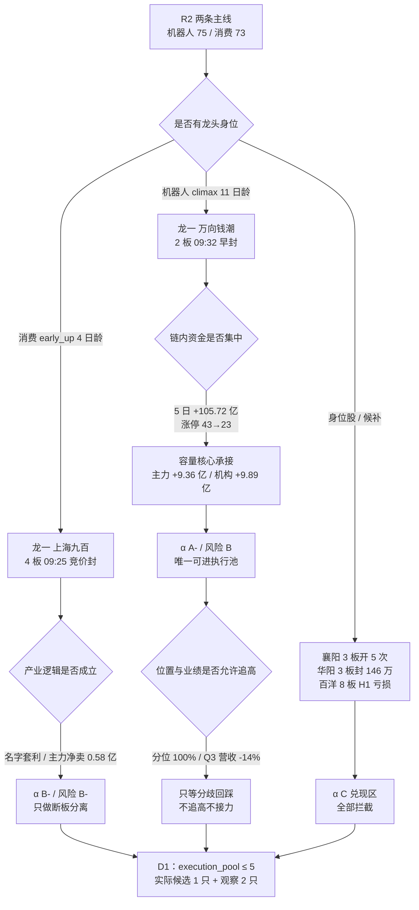

# 2026-10-27 · **个股画像（R5）**

> **数据源新鲜度**: partial · **降级状态**: yes（R4/R7 上游降级，本 run 主源 ok） · **置信度**: 0.525（0.75 × 0.7 × 1.0 = 0.525, clamp to [0.05, 0.95] = 0.525）
> **覆盖**: R2 两条主线 10 只 leader 全部完成六维画像（0 跳过 / 0 失败）；次线 CXO 65 / 物理AI 64 / 油气 57 未画像，原因见「五、扩池观察」

## 一句话结论
10 票画像：机器人链只有**万向钱潮**同时拿到龙头身位、全市场第 1 资金与 423 亿容量（α A- / 风险 B），其余 9 票不是筹码散、高位兑现，就是破 20 亿流通硬门槛——今日执行池实际只够 1 只候选。

## 详细分析

### 一、候选池总表（按 composite 排序）

候选来源 = R2 `main_lines[].leaders`（`leader_filter_applied=true`）：机器人链 5 只（龙一 / 龙二 / 身位股 / 候补 ×2）+ 消费链 5 只（同结构）。**没有做全市场扫描，也没有用「看起来像龙头」的自选票凑数**——这是 R2 已经过 leader 硬约束过滤的 10 只，R5 只负责逐票把六个维度填满。

| 名称 代码 | 主线 · R2 角色 | 板型 | 主力 5 日（正日） | 龙虎榜 30 日 | 机构席位 30 日 | MA20 偏离 | 20 日分位 | 六维 | α / 风险 | R5 结论 |
|---|---|---|--:|--:|--:|--:|--:|---|---|---|
| 万向钱潮 `000559` | 机器人 · 龙一 | 2 板 · 09:32 · 开2 次 · 封 1.42 亿 | +9.36 亿（4/5） | +6.61 亿（1 次） | +9.89 亿 | +19.4% | 100% | 催68/筹82/板88/估52/技72/研66 | **A- / B** | 进（唯一可选，须等分歧回踩，不追高） |
| 绿的谐波 `688017` | 机器人 · 龙二 | 未涨停 +1.03% · 反抽 | +7.03 亿（4/5） | —（0 次） | — | +9.9% | 93% | 催50/筹55/板68/估35/技56/研74 | **B+ / B-** | 观察（蓄势未确认，破 MA60 即撤） |
| 模塑科技 `000700` | 机器人 · 候补 | 2 板 · 13:03 · 开1 次 · 封 0.76 亿 | +5.26 亿（4/5） | +1.03 亿（1 次） | +0.62 亿 | +13.3% | 100% | 催55/筹40/板64/估60/技58/研70 | **B / B-** | 降级（补涨位，只做低吸不接力） |
| 上海九百 `600838` | 消费 · 龙一 | 4 板 · 09:25 · 开1 次 · 封 1.36 亿 | +1.12 亿（3/5） | +0.85 亿（2 次） | +0.85 亿 | +37.7% | 100% | 催30/筹42/板65/估18/技70/研5 | **B- / B-** | 观察（只做断板分离，不接 5 板） |
| 东百集团 `600693` | 消费 · 候补 | 未涨停 +7.77% · 反抽 | +0.62 亿（3/5） | -0.74 亿（5 次） | -0.74 亿 | -7.7% | 23% | 催38/筹40/板45/估62/技38/研5 | **C / C** | 拦截（无涨停+三连跌停套牢盘） |
| 百洋股份 `002696` | 消费 · 龙二 | 1 板 · 10:29 · 开1 次 · 封 0.57 亿 | +3.37 亿（4/5） | +3.53 亿（10 次） | +3.84 亿 | +34.4% | 100% | 催38/筹42/板52/估10/技42/研5 | **B- / C** | 拦截（亏损+10-29 三季报空窗） |
| 阳光乳业 `001318` | 消费 · 候补 | 1 板 · 10:27 · 开1 次 · 封 0.44 亿 | +1.17 亿（3/5） | -1.08 亿（4 次） | -1.03 亿 | -6.6% | 57% | 催35/筹32/板48/估45/技38/研5 | **C / C** | 拦截（户数暴增+龙虎榜净卖 1.08 亿） |
| 襄阳轴承 `000678` | 机器人 · 身位股 | 3 板 · 09:31 · 开5 次 · 封 1.08 亿 | +4.81 亿（3/5） | +4.30 亿（8 次） | +4.21 亿 | +30.3% | 100% | 催40/筹26/板58/估12/技44/研5 | **C / C** | 拦截（开板 5 次+龙虎榜净卖） |
| 皇台酒业 `000995` | 消费 · 候补 | 1 板 · 10:08 · 开2 次 · 封 0.43 亿 | +1.28 亿（2/5） | -0.45 亿（3 次） | +0.10 亿 | +8.8% | 87% | 催32/筹28/板46/估8/技45/研5 | **C / C** | 拦截（PE 1044/净资产 1.54 亿） |
| 华阳智能 `301502` | 机器人 · 候补 | 3 板 · 09:25 · 开5 次 · 封 146 万 | +0.62 亿（4/5） | -0.53 亿（2 次） | -0.93 亿 | +54.2% | 100% | 催35/筹15/板42/估10/技40/研5 | **C / C** | 拦截（流通 18.4 亿破硬门槛+封单 146 万） |

读表要点：**六维里权重最高的是筹码（0.24）与板块（0.20）**，所以「封单厚 + 主力净流入 + 板块广度」三项能同时满足的票才会站到 70 分以上。全池只有 1 只做到（万向钱潮 74.0），第 2 名绿的谐波 56.0 已经在 60 分线之下——这不是打分保守，是筹码维度把「户数暴增 87.6%」这类结构伤直接扣掉了。

### 二、这份画像最重要的一个发现：钱从「高度股」搬到了「容量核心」

机器人概念 5 日资金仍是 **+105.72 亿**（概念第 1），但涨停家数从 **43 腰斩到 23**，龙头高度 **6 → 3**，板块年龄 11 日、阶段 = climax 高潮分歧。同一时间窗内，两组的资金方向完全相反：

| 分组 | 标的 | 板型 | 主力 5 日 | 龙虎榜 30 日 | 板块广度 |
|---|---|---|--:|--:|---|
| 容量核心 | 万向钱潮 | 2 板 09:32 早封 / 开 2 次 / 封 1.42 亿 | **+9.36 亿（4/5 正）** | **+6.61 亿**（机构 +9.89 亿） | 汽车零部件 6 / 整链 23 |
| 高度股 | 襄阳轴承 | 3 板 09:31 / **开 5 次** | +4.81 亿（3/5 正） | 30 日 +4.30 亿，但 **10-26 单日净卖 0.46 亿** | 6 / 23 |
| 高度股 | 华阳智能 | 3 板 20cm / **封单 0.0146 亿** | +0.62 亿 | **-0.53 亿**（机构 -0.93 亿） | 1 / 23 |
| 高度股 | 百洋股份 | 12 天 8 板 / 1 板 | +3.37 亿（4/5 正） | +3.53 亿（10 次上榜） | 1 / 9 |

结论写死：**高潮期的「高度」已经不含资金溢价，钱在容量核心，不在连板梯队。** 高位股的三条硬伤各自成立——襄阳开板 5 次是分歧信号、华阳封单 146 万等于没有承接、百洋 H1 亏 8,253 万且公司自己公告「股价严重偏离基本面」。所以机器人线只剩一个交易对象：龙一万向钱潮的分歧弱转强，且**不许追高**（20 日 / 60 日分位双双 100%、MA20 正偏离 +19.4%、Q3 营收 -14.16%）。

### 三、龙头判定（v1.5：高度 + 封板时间 + 板块效应）

| 名称 代码 | 高度 | 首封 | 开板 | 封单 | 行业广度 | 整链广度 | 判定 |
|---|--:|---|--:|--:|--:|--:|---|
| 万向钱潮 `000559` | 2 | 09:32 | 2 | 1.42 亿 | 6 | 23 | **龙头** |
| 绿的谐波 `688017` | 0 | — | 0 | — | 0 | 23 | **未涨停/反抽** |
| 模塑科技 `000700` | 2 | 13:03 | 1 | 0.76 亿 | 6 | 23 | **跟风/补涨** |
| 上海九百 `600838` | 4 | 09:25 | 1 | 1.36 亿 | 1 | 9 | **龙头** |
| 东百集团 `600693` | 0 | — | 0 | — | 1 | 9 | **未涨停/反抽** |
| 百洋股份 `002696` | 1 | 10:29 | 1 | 0.57 亿 | 1 | 9 | **高位反复** |
| 阳光乳业 `001318` | 1 | 10:27 | 1 | 0.44 亿 | 1 | 9 | **跟风/补涨** |
| 襄阳轴承 `000678` | 3 | 09:31 | 5 | 1.08 亿 | 6 | 23 | **分歧弱** |
| 皇台酒业 `000995` | 1 | 10:08 | 2 | 0.43 亿 | 1 | 9 | **跟风/补涨** |
| 华阳智能 `301502` | 3 | 09:25 | 5 | 146 万 | 1 | 23 | **分歧弱** |

判定的实际意义在这张表里很明显：
- **真龙头 2 只**：万向钱潮（高度 2 + 09:32 早封 + 广度 6/23）、上海九百（高度 4 + 09:25 竞价封 + 整链 9）。九百是**身位龙头**（全市场唯一 4 板），不是产业龙头——行业广度只有 1 家，同行业没有第二只涨停。
- **跟风/补涨 3 只**：模塑科技 13:03 才首封（尾盘封=接力盘）、阳光乳业 10:27、皇台酒业 10:08 开板 2 次。
- **分歧弱 2 只**：襄阳轴承、华阳智能，均开板 5 次。
- **高位反复 1 只**：百洋股份（12 天 8 板，今日仅 1 板）。
- **未涨停/反抽 2 只**：绿的谐波 +1.03%、东百集团 +7.77%。

按纪律「只做龙头或低位，躲中位和杂毛」：10 票里够资格进执行池讨论的只有 1 只（万向钱潮），另 1 只（绿的谐波）只能观察，其余 8 只属中位/补涨/兑现区。

### 四、消费线的悖论：身位最高、逻辑最假

上海九百是全场最高标（4 板 / 09:25 竞价封 / 封单 1.36 亿），但六维里估值 18 分、机构 5 分：

- **主力当日净卖 0.584 亿 vs 封单 1.36 亿** —— 封单不是主力吃的，是接力盘堆的；
- **PE_TTM 104.06（3 年 95.9% 分位）、PS 51.7**，公司在异常波动公告里自己披露「PE 97 倍、行业 21 倍」；
- **研报 0 篇、机构覆盖 0**，R3 rank1 的题材是「消费 + 羊字辈名字套利」，R2 也写明「名字套利无产业支撑」；
- 流通盘 48.5 亿，距 20 亿硬门槛仅 2.4 倍，抗风险厚度薄。

龙二百洋股份同期是 H1 亏损 + 10-29 三季报待披露的空窗博弈。**R3 的群内一致动作是「冲高卖」而不是「低吸买」（next_day 判弱修复 0.15）** —— 这与消费线 early_up 阶段表面矛盾，实质是：这条线的钱是**情绪钱不是配置钱**，冲高即兑现。所以消费线 5 票里 R5 只给九百 1 只 B-/B- 观察，其余 4 只全部 C 档。

### 五、扩池观察（次线未画像，不产生执行资格）

R2 的 `main_lines[].leaders` 已有 10 只（≥3），v1.4 扩池触发条件不成立；同时 `all_scored_boards_top10` 只有 `{name, score}` 没有 `top_stock` 字段（schema 降级，已置 `r2_schema_missing_top10=true`），无法机械抽名。因此次线保持「有分无名」：

| 次线 | R2 分 | 三源交叉 | R2 名单 | 为什么不给六维分 |
|---|--:|--:|---|---|
| CXO / 创新药 / 抗癌 | 65.0 | 1.00 | 603259.SH 药明康德、603716.SH 塞力医疗、300006.SZ 莱美药业、688137.SH 近岸蛋白 | 涨停广度仅 2 家、无连板高度、行业 5 日仍净流出（医药生物 -61.61 亿）→ R5 不为其出六维分与档位，避免给出无身位标的的 execute 假象 |
| 物理AI / 数据采集 | 64.0 | 0.67 | 603528.SH 多伦科技、603138.SH 海量数据 | R7 资金不同向（数据要素 -1.11 亿 / AI应用 -8.54 亿 / 云计算 -21.85 亿）、R3 标 late+crowded → 修复即卖点，不给画像背书 |
| 油气 / 油服 | 57.0 | — | R2 未落标的名 | R2 该线未落 leaders 名单（仅板块级事件 E003 布油 115.81），无标的名可画像 |

**给 D1 的使用说明**：这三条线如需动用，必须先点名补跑 R5 出六维分与档位，否则只能进 `watch_pool`，不得计入执行池。

### 六、决策传导图

## 关键证据

### 万向钱潮 `000559` · 龙一 · 全市场资金第 1 · 唯一进池候选

**六维速览**：催化 68 · 筹码 82 · 板块 88 · 估值 52 · 技术 72 · 机构 66 → 综合 74.0 · **α A- / 风险 B**

- **大资金意图**: 龙虎榜机构专用席位单日 **+1.63 亿**、30 日机构合计 **+9.89 亿**，主力当日 **+5.90 亿（净占比 23.51%，涨停股第 1）**、5 日 +9.36 亿；对手盘是 10-23 首板 13:55 尾盘封进去的游资，以及 86.2% 的获利盘。机构在高位接游资的货，赌的是「重组 + 机器人产能」这条长周期期权，不是赌今天涨停。
- **为什么走强**: 位置（20 日新高，突破 10.70–11.94 中枢，站上 MA5/20/60）+ 催化（R4 E002 板块级 0.74，重组 Wanxiang America 在推进）+ 筹码（户数 QoQ -5.04%、YoY -19.08%，筹码在集中）三维同时成立。**三维齐备是它和其它 9 票的根本区别。**
- **逻辑够不够硬**: 独立共振源 3 个（R2 板块分第 1 / R7 资金净额第 1 / R4 板块事件 0.74），硬锚 = 封单 1.42 亿 + 机构席位真金。软肋两条：**Q3 营收 -14.16%、单季净利 -3.31%**（量价背离），**重组尽调中、未签正式文件、无时间表**。证伪路径：断板 + 机器人概念涨停家数跌破 10 家 + 主力单日转出超 3 亿，三者出现两个即视为换庄失败。

**思维链**：
- **买入理由①（产业逻辑）**: 机器人链本轮 11 日、资金 5 日仍净流入 105.72 亿但涨停家数腰斩，资金在收缩中集中——集中落点必须是能装钱的容量标的。万向钱潮 422.9 亿流通盘是链内唯一「装得下机构」的汽车零部件核心，且同时挂机器人执行器与重组两条线。
- **买入理由②（数据锚）**: 5 日主力 +9.36 亿 / 4 日为净流入 + 机构席位 +9.89 亿 / 封单 1.42 亿（占当日成交 25.08 亿的 5.7%）+ 户数环比 -5.04%。四项都是可复算的原始数据，不依赖叙事。
- **风险点①（短期）**: 20 日 / 60 日分位双 100%、MA20 正偏离 +19.4%、获利盘 86.2%，今日披露《股票交易异常波动公告》。开盘若竞价溢价 >3%，就是给 10-23 的尾盘游资抬轿子。
- **风险点②（中期反证）**: PE_TTM 40.4（3 年 83.5% 分位）、Q3 营收 -14.16%、单季净利 -3.31%，重组无时间表。业绩与叙事同时在「等」，任何一个先落空，40 倍 PE 撑不住 423 亿市值。
- **止损条件**: 收盘失守 **MA5 = 11.10** 视为短线结构失效；日内跌破 **10-23 首板实体上沿 11.55** 且尾盘不收回，同样按失效处理；板块层面机器人概念当日涨停家数 **< 10 家** 触发整线降级、该票同步出池。
- **可验证假设**: ①今日竞价溢价 ≥3% 且 09:45 前封单 ≥1 亿 → 龙头接力成立；②开盘 30 分钟主力净额转负超 1 亿 → 换庄失败；③机器人概念今日涨停家数 <10 → 线退潮，全部候选降 watch。

**近 30 日量价**：

| 标的 | 30 日收益 | 日均/最大振幅 | 均量比 60 日 | 最大回撤 | 涨停/跌停 | 阳/阴 | 日均成交 | 距 30 日低/高 |
|---|--:|---|--:|--:|:--:|:--:|--:|---|
| 万向钱潮 | +15.13% | 4.91% / 13.14% | 1.28× | -20.99% | 2/0 | 13/17 | 6.14 亿 | 37.9% / 0.0% |
| 绿的谐波 | -0.66% | 5.51% / 18.97% | 0.45× | -20.67% | 1/0 | 15/15 | 15.44 亿 | 28.3% / -8.1% |
| 模塑科技 | +11.71% | 6.80% / 16.39% | 0.93× | -20.61% | 2/0 | 17/13 | 6.32 亿 | 34.3% / 0.0% |
| 上海九百 | +35.20% | 5.19% / 11.55% | 1.78× | -13.97% | 5/0 | 14/15 | 1.78 亿 | 60.0% / 0.0% |

**事件时间线（万向钱潮）**：

| 日期 | 类型 | 内容 |
|---|---|---|
| 2026-08-08 | 公告 | 重大资产重组进展公告（月度进展） |
| 2026-08-25 | 公告 | 2026 半年报：营收 60.27 亿、归母净利 5.53 亿；同日披露计提资产减值准备、拟变更会计师事务所、万向财务风险评估 |
| 2026-09-05 | 公告 | 2024 年股票期权激励计划第二个行权期行权条件成就；注销部分期权并调整行权价格 |
| 2026-09-08 | 公告 | 重大资产重组进展公告 |
| 2026-10-10 | 公告 | 重大资产重组进展：拟发股+现金收购 Wanxiang America 100%（关联交易，尽调/审计/评估中，未签正式文件） |
| 2026-10-24 | 公告 | 2026 年三季度报告：营收 89.32 亿(-14.16%)、归母净利 7.84 亿(+1.36%)；同时披露期货衍生品投资、注销部分股票期权 |
| 2026-10-23 | 涨停 | 首板 13:55 尾盘封，封单 1.61 亿，换手 3.53% |
| 2026-10-26 | 涨停 | 2 板 09:32 首封（开板 2 次），封单 1.42 亿，换手 6.0%；龙虎榜净买 3.74 亿、机构 +1.63 亿；主力 +5.90 亿 |
| 2026-10-26 | 新闻 | 财联社 13:28『人形机器人板块短线拉升，上纬新材 20CM 涨停……万向钱潮、兰生股份、模塑科技此前封板』；『数据看盘：多路资金联手抢筹万向钱潮』 |
| 2026-10-27 | 风险 | 披露《股票交易异常波动公告》 |

### 绿的谐波 `688017` · 龙二 · 资金真 · 筹码散 · 估值贵

**六维速览**：催化 50 · 筹码 55 · 板块 68 · 估值 35 · 技术 56 · 机构 74 → 综合 56.0 · **α B+ / 风险 B-**

- **大资金意图**: 5 日主力 +7.03 亿（4/5 日净流入）却**没有一次龙虎榜**、融资余额 15 日 -11.48% —— 这是超大单/机构的中期建仓，不是游资博弈。对手盘是股东户数一季暴增 87.6% 后进场的散户。
- **为什么走强**: 收 293.0（+1.03%），站上 MA5 273.6 / MA20 266.7，但在 MA50 291.3 与 MA60 294.7 一带反复受阻，缠论位置 77.8%（中枢内）；30 日收益仅 -0.66%。形态是「资金进、价格不涨」的蓄势，也说明上方套牢盘厚。
- **逻辑够不够硬**: 减速器辨识度链内第一 + 23 篇研报 / 7 家机构（含高盛）是最硬的一条，但 PE 380.8（3 年 69.7% 分位）、PB 14.89、PS 80.43 —— **估值给不出容错空间**。证伪：放量突破 294.7 失败并回落至 266 以下 → 蓄势变震荡出货。

**思维链**：
- **买入理由①（产业逻辑）**: 谐波减速器是人形机器人关节三大件之一，绿的谐波是国内份额第一的纯正标的，链内无可替代。
- **买入理由②（数据锚）**: 5 日主力 +7.03 亿（4/5 正）、23 篇研报 7 家机构覆盖、封板能力尚在（30 日内 1 次涨停）。
- **风险点①（短期）**: 10-26 收出 8% 上影线，MA50/MA60 双线压制，93.3% 的 20 日分位意味着回撤空间大于上行空间。
- **风险点②（中期反证）**: 户数 QoQ **+87.64%**、YoY +201.52%（筹码极度分散），PE 380 倍需要业绩连续超预期才能消化；一旦机器人线退潮，它是估值杀的第一顺位。
- **止损条件**: 收盘跌破 **MA20 = 266.67** 视为中枢下沿失守；或放量跌破 250（前中枢下沿）。
- **可验证假设**: ①三个交易日内收盘站上 MA60 294.7 且量能不缩 → 蓄势成立；②户数下一期仍增 >20% → 降级 B-；③机器人概念退潮日它跌幅 > 板块 2 倍 → 高 β 估值票属性确认。

### 模塑科技 `000700` · 补涨位 · 财务最干净

**六维速览**：催化 55 · 筹码 40 · 板块 64 · 估值 60 · 技术 58 · 机构 70 → 综合 55.5 · **α B / 风险 B-**

- **大资金意图**: 主力当日 +2.70 亿、5 日 +5.26 亿（4/5 正），机构席位 +0.62 亿 —— 资金是真的，但**13:03 才首封**说明它是被板块带上去的，不是发动者；对手盘是 5–9 月连续减持 5% 的控股股东留下的浮筹。
- **为什么走强**: 2 板 + 突破中枢（143.6% 位置）+ 财务干净（PE 23.8 / 股息 3.75% / CFO/NI 1.11），是机器人链唯一「估值不贵」的票；但获利盘 99.4%、户数 +19.73%，位置 100% 分位。
- **逻辑够不够硬**: 硬锚是财务质量（链内唯一不靠故事），软肋是**身位（尾盘首封=补涨）与减持（控股股东 5–9 月减 5%）**。`distribution_alert` 已触发。证伪：次日不能 09:45 前封板 → 补涨结束。

**思维链**：
- **买入理由①（产业逻辑）**: 汽车外饰件绑定特斯拉/新势力供应链，机器人业务是第二曲线，估值只有链内平均的 1/3。
- **买入理由②（数据锚）**: PE 23.8（3 年 88.8% 分位但仍绝对值低）、股息 3.75%、CFO/NI 1.11、5 日主力 +5.26 亿。
- **风险点①（短期）**: 13:03 尾盘封 + 开板 1 次 + 封单 0.76 亿，封板质量远低于万向钱潮；次日大概率低开。
- **风险点②（中期反证）**: 控股股东 5–9 月减持 5%，户数 +19.73%，`distribution_alert` 已触发——**大股东在涨的时候卖**。
- **止损条件**: 收盘跌破 **MA5 = 11.61**；或跌破 11.54（MA20）无条件出。
- **可验证假设**: ①次日 09:45 前不能封板 → 补涨定性确认，降 watch；②封单持续 <0.5 亿 → 承接不足；③三日主力累计转负 → 出池。

### 上海九百 `600838` · 身位龙头 · 逻辑最假

**六维速览**：催化 30 · 筹码 42 · 板块 65 · 估值 18 · 技术 70 · 机构 5 → 综合 43.6 · **α B- / 风险 B-**

- **大资金意图**: 09:25 竞价封 + 封单 1.36 亿，但**主力当日净卖 0.584 亿** —— 封单是接力盘堆的，主力在借高度出货。30 日龙虎榜 +0.85 亿（2 次）说明前期确实有资金做过，但当下方向已转。
- **为什么走强**: 纯身位驱动——全市场唯一 4 板、竞价封、整链 9 家涨停。R3 rank1 题材是「消费 + 羊字辈名字套利」，属情绪合力不是产业合力；行业广度只有 1 家，同行业没有第二只涨停。
- **逻辑够不够硬**: **不硬**。0 篇研报、0 家机构、PE 104 倍（公司自认 97 倍 vs 行业 21 倍）、PS 51.7、名字套利无产业支撑、第 5 板已进入监管关注区。唯一硬的是身位——而身位是消耗品。

**思维链**：
- **买入理由①（产业逻辑）**: 无。R5 找不到产业逻辑，只有「低位切换 + 名字套利」的情绪逻辑。
- **买入理由②（数据锚）**: 4 板高度、竞价封、封单 1.36 亿、整链 9 家涨停——这是唯一的多头证据。
- **风险点①（短期）**: 主力净卖 + 封单靠接力 + 第 5 板监管关注，断板即 -10%。
- **风险点②（中期反证）**: PS 51.7 / PE 104，一旦情绪退潮回到行业 21 倍 PE，向下空间 70%+。
- **止损条件**: 不设买入止损——**R5 结论是不接力**；若已有仓位，断板当日无条件出。
- **可验证假设**: ①今日 09:45 前不能封 5 板 → 身位结束；②封单 <0.8 亿 → 承接衰减；③消费线涨停家数 <5 → 整线作废。

### 其余 6 票（R5 一律拦截，理由写死）

- **襄阳轴承 `000678`（3 板 / 开 5 次 / α C）**: 全市场并列第 2 高身位，但开板 5 次、10-26 龙虎榜净卖 0.46 亿、融资 15 日 **+132.6%**（杠杆加速）、2026H1 亏损。**纯情绪身位，不是资金选择。**
- **华阳智能 `301502`（3 板 20cm / α C）**: 封单 **146 万**（形同无承接）、开板 5 次、换手 34.9%、龙虎榜 -0.53 亿、**流通 18.4 亿 < 20 亿硬门槛** → 本次唯一 `hard_reject`。
- **百洋股份 `002696`（12 天 8 板 / α B- / 风险 C）**: 资金最猛（主力 +1.58 亿、5 日 +3.37 亿、龙虎榜 10 次 +3.53 亿），但 H1 亏 8,253 万、公司公告自认股价偏离基本面、**10-29 三季报**待披露、CFO 连续三期负 → 业绩空窗期的高位博弈，不是画像能背书的标的。
- **阳光乳业 `001318`（首板 / α C）**: 三个跌停后的首板 + 户数一周 **+56.26%** + 龙虎榜 30 日 **-1.08 亿** + 封单 0.44 亿薄 → 超跌反抽。
- **东百集团 `600693`（未涨停 +7.77% / α C）**: 估值 62 分、位置仅 23.3% 分位是池内最舒服的，但未涨停、三连跌停套牢盘 9.19–10.00、收购终止后无新催化 → 反抽不是进攻。
- **皇台酒业 `000995`（首板 / α C）**: PE **1,044 倍**、H1 亏 1,710 万、净资产仅 1.54 亿（ST 观察）、缠论顶背离、行业广度 1 家 → 六维无一项及格。

## 数据源审计

| 源 | 路径 | 日期 | 状态 | 记录数 | 备注 |
|---|---|---|:--:|--:|---|
| R2_main_sectors | data/research/20261027/R2_main_sectors.json | 2026-10-27 | 🟢 | 10 | — |
| R4_news | data/research/20261027/R4_news.json | 2026-10-27 | 🟡 | 8 | 上游 status=degraded(confidence 0.70)：公众号 RSS 抓取失败，news_major 仅标题无正文 |
| R7_capital_flow | data/research/20261027/R7_capital_flow_20261027.json | 2026-10-27 | 🟡 | — | 上游 status=degraded(confidence 0.74)：本 run 资金主口径用同源 tushare moneyflow_dc 交叉复算 |
| R3_sentiment | data/research/20261027/R3_sentiment.json | 2026-10-27 | 🟢 | — | — |
| R1_style | data/research/20261027/R1_style.json | 2026-10-27 | 🟢 | — | — |
| chart_vision_snapshot | data/raw/20261027/chart_vision_snapshot.json | 2026-10-27 | 🟢 | 22 | — |
| tushare_stock_raw | data/research/20261027/_r5_raw.json | 2026-10-27 | 🟢 | 10 | — |
| tushare_lhb_supp | data/research/20261027/_r5_lhb_supp.json | 2026-10-27 | 🟢 | — | — |
| tushare_fin_stmt | data/research/20261027/_r5_fin_stmt.json | 2026-10-27 | 🟢 | — | — |
| tushare_anns | data/research/20261027/_r5_anns.json | 2026-10-27 | 🟢 | — | — |
| czsc_chanlun | data/research/20261027/_r5_chanlun.json | 2026-10-27 | 🟢 | 10 | — |
| tushare_moneyflow_dc | data/research/20261027/_r5_moneyflow_dc.json | 2026-10-27 | 🟢 | 10 | — |

## 不确定性 / 反证

1. **万向钱潮的 α A- 有一半建立在「重组」上，而重组没有时间表**。10-10 公告只是进展：尽调/审计/评估推进中、正式交易文件未签。若 D1 把它当「重组确定性标的」定价，是把期权当现货。
2. **Q3 营收 -14.16% 是硬伤**。我给的估值分只有 52，是六维里第二低。如果 2026 年报营收继续负增长，「机器人产能」叙事会被业绩证伪——这条我会在 E1 复盘时优先校验。
3. **消费线的判断依赖 R3 的群内信号（弱修复 0.15、动作是冲高卖）**。R3 confidence 0.56、weflow 已停服，L1+L2 替代源的情绪读数可能滞后半日；如果今日消费线反而走出加速，我的「拦截 4 只」就是错的，需要 E1 记录这次误判方向。
4. **次线（CXO/物理AI/油气）完全没画像**。R2 给的 CXO 三源交叉 1.0、油气事件 0.78 是当日最强的两条催化，如果 D1 需要非机器人标的，本 artifact 帮不上——这是覆盖缺口，不是结论。
5. **资金口径**：主力净额用 tushare moneyflow_dc（东财口径，主力=超大单+大单）复算，与 R7 同源。A 股拆单与龙虎榜同属东财体系，独立性有限，因此筹码维度的「真金」判断最多只能算 1.5 个独立源。
6. **大宗交易 10 票 30/90 日均为 0 笔**，已用全市场 block_trade 30 日 1000 行二次校验确认不是数据缺失；百洋/阳光/皇台 `margin_detail` 为空，判定非两融标的而非降级。

## 与其他 R/D/E 的关系

- **依赖**: R2（主线与 leader 名单、板块广度）/ R4（催化事件 E002/E003/E006）/ R7（资金交叉校验）/ R3（情绪共振与群内动作）/ R1（风格与仓位上限 45%）；行情与筹码全部来自 tushare 实时重拉（138 根日 K / 20260401–20261026）+ chart_vision 快照 22/22 + czsc 缠论 10/10。
- **被消费**: R6 反证（`fundamental_flags` 10 票全透传、`distribution_alert` 6 票）、D1 主决策（execution_pool ≤5 只能从 α≥B+ 且 risk≥B- 的票里选 → 实际 2 只可选）、E1 复盘（`alpha_grade`/`risk_grade` 与 VERDICT 会被 T+1/T+5 回填校准）。

## Sub-Agent 元数据

- skill: analyze_stock_profile_v1@1.5
- artifact: `data/research/20261027/R5_stock_profiles.json`
- 候选: 10（R2 leader 池，扩池未触发）· 画像成功 10 · 失败 0
- 生成耗时: 约 640 秒（含 138 根日 K × 10 票、龙虎榜逐日 20260914–20261026、大宗 90 日、缠论 10 票、chart_vision 快照读取）
- model: ark-code-latest（chart_vision 侧 seed-2-0-lite-260228）
