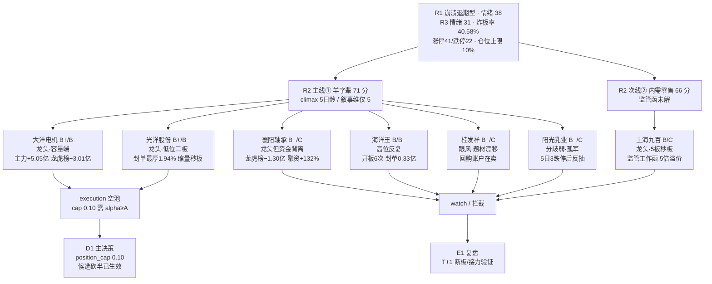

> ⚠️ **盘前产出 · 数据基准 2026-10-27 收盘**
> 研究日 2026-10-28 · 量价/资金/涨停/龙虎榜/财务全部为 T-1 收盘口径 · chart_vision 为 10-28 06:35 生成（含 10-27 收盘四周期）
> 本文件只做研究画像，**不含 D1 执行价与仓位**；表中的「止损距 / RR」是技术参照测算，非建仓指令

# 2026-10-28 · **个股画像（R5）**

## 一句话结论

7 只候选（主线羊字辈 5 + 扩池 2）在**主跌段 + 炸板率 40.58% + 仓位上限 10%** 的市场里，只有 **大洋电机（B+/B）与光洋股份（B+/B−）** 具备「龙头身份 + 资金真实」的最低组合，但两只的现价盈亏比分别只有 **RR 0.08 / 0.27**——**7 票无一只达到 RR≥2 门槛，现价全部不给 execution 资格，只能等回踩重算**。**上海九百、襄阳轴承、阳光乳业、桂发祥、海洋王 5 票直接拦截**；更硬的结论是 D1 档位闸门实跑显示 **cap=0.10 下 7 票全部过不了 alpha≥A 的门 → 今日执行池应为空**。全线最硬的事实是：**7 票催化维度无一超过 45 分**——R4 八条硬事件零命中，这条主线没有产业逻辑兜底，保质期按 1-2 日计。

## 详细分析

### 一、候选池总表（按 composite 排序）

| 票 | 角色 | 攻/险 | 综合 | 龙头判定(v1.5) | D1 姿态 | 收盘 / MA5（正乖离） | 距 20 日高 · 盈亏比 |
|---|---|---|---|---|---|---|---|
| 大洋电机 `002249` | 龙一 | B+/B 🟢 | 63.5 | 龙头 | 观察 | 7.7 / MA5 7.152（乖离 **+7.7%**） | 距 20 日高 0.6% · RR≈0.08 |
| 光洋股份 `002708` | 龙二 | B+/B- 🟡 | 62.8 | 龙头 | 观察 | 17.22 / MA5 15.068（乖离 **+14.3%**） | 距 20 日高 3.9% · RR≈0.27 |
| 上海九百 `600838` | 次线龙一 | B/C 🔴 | 49.5 | 龙头 | 拦截 | 13.31 / MA5 11.1（乖离 **+19.9%**⚠️） | 已在 20 日高 · 上方无参照 · RR 不可测 |
| 海洋王 `002724` | 情绪锚 | B/B- 🟡 | 47.8 | 高位反复 | 拦截 | 13.09 / MA5 11.744（乖离 **+11.5%**） | 已在 20 日高 · 上方无参照 · RR 不可测 |
| 襄阳轴承 `000678` | 身位股 | B-/C 🔴 | 46.3 | 龙头 | 拦截 | 16.01 / MA5 13.352（乖离 **+19.9%**⚠️） | 已在 20 日高 · 上方无参照 · RR 不可测 |
| 桂发祥 `002820` | 候补 | B-/C 🔴 | 42.6 | 跟风/补涨 | 拦截 | 11.21 / MA5 9.96（乖离 **+12.6%**） | 已在 20 日高 · 上方无参照 · RR 不可测 |
| 阳光乳业 `001318` | 低位补涨 | B-/C 🔴 | 39.7 | 分歧弱 | 拦截 | 13.31 / MA5 12.21（乖离 **+9.0%**） | 距 20 日高 27.8%（套牢区，不算目标） · RR 不可测 |

> 读法一：「乖离」= 收盘相对 MA5 的正偏离，⚠️ 标 ≥15%（均线严重滞后，MA5 已不能当止损参考）。
> 读法二：「RR」= 距 20 日高的上行空间 ÷ MA5 乖离（即追高所需承担的回踩风险）。**7 票无一只 RR ≥ 2，最好的光洋只有 0.27、大洋 0.08** —— 按纪律「盈亏比优先于胜率，RR<2 降级 watch」，**本批 7 票在现价上全部不具备 execution 资格**，D1 若要建仓只能在回踩后重算 RR。这不是数据缺口，是位置定价已到顶本身给出的结论。
> 读法三：阳光乳业 20 日高（17.01）来自 10-15 三板顶，其后连吃 3 个跌停，上方 27.8% 是**套牢盘不是目标位**，故不给 RR。

### 二、本轮最重要的发现：封单厚度与资金的四象限分离

| 票 | 封单 / 占流通 | 开板 | 当日主力(亿) | 当日龙虎榜(亿) | 5 日主力(亿) | 5 日红盘天数 |
|---|---|---|---|---|---|---|
| 大洋电机 | 1.1 亿 / 0.76% | 1 次 | 5.048 | 3.01 | 5.256 | 3/5 |
| 光洋股份 | 1.7 亿 / 1.94% | 0 次 | 0.815 | 1.665 | 2.399 | 4/5 |
| 上海九百 | 1.5 亿 / 2.81% | 0 次 | -0.432 | -0.26 | 0.718 | 3/5 |
| 海洋王 | 0.33 亿 / 0.44% | 6 次 | 2.315 | 1.331 | 0.623 | 3/5 |
| 襄阳轴承 | 1.28 亿 / 1.74% | 1 次 | -1.008 | -1.305 | 3.835 | 3/5 |
| 桂发祥 | 0.44 亿 / 1.95% | 0 次 | 0.583 | 0.437 | 1.011 | 3/5 |
| 阳光乳业 | 0.17 亿 / 0.45% | 4 次 | 0.802 | 0.366 | 1.912 | 3/5 |

把这四列交叉，7 票分成三组，**这才是 D1 该拿走的结论**：

- **双正且量级最大（唯一）**：大洋电机 +5.05 亿主力 / +3.01 亿龙虎榜（全场涨停股第 1），5 日 +5.26 亿、3/5 日红盘。资金是真的，唯一问题是封单只占流通 0.76%。
- **双负（封住价格出货）**：上海九百 5 板日主力 −0.432 亿、龙虎榜 −0.26 亿；襄阳轴承 4 板日主力 −1.008 亿、龙虎榜 −1.30 亿。两只都是「封单最厚、席位在卖」——封单 1.50 亿 / 1.28 亿是排队买盘，龙虎榜才是已成交的散户卖单，两者并存只能解释为**大单封板 + 分散账户出货**。
- **单选正确（游资接机构货）**：光洋股份龙虎榜 +1.665 亿，但机构专用 3 席净卖 5,201 万，且买方国新证券北京同日卖出襄阳轴承 7,191 万——**这是线内高低切的同一笔钱，不是增量**。

### 三、龙头判定（v1.5：高度 + 首封时刻 + 开板次数 + 板块广度）

| 票 | 连板 | 首封 | 早于 09:45 | 开板 | 封单 | 同行业涨停 | 判定 |
|---|---|---|---|---|---|---|---|
| 大洋电机 | 1 板 | 09:56 | — | 1 | 1.1 亿 | 3 家 | **龙头** |
| 光洋股份 | 2 板 | 09:30 | ✅ | 0 | 1.7 亿 | 8 家 | **龙头** |
| 上海九百 | 5 板 | 09:30 | ✅ | 0 | 1.5 亿 | 6 家 | **龙头** |
| 海洋王 | 1 板 | 10:07 | — | 6 | 0.33 亿 | 1 家 | **高位反复** |
| 襄阳轴承 | 4 板 | 09:34 | ✅ | 1 | 1.28 亿 | 8 家 | **龙头** |
| 桂发祥 | 2 板 | 10:11 | — | 0 | 0.44 亿 | 2 家 | **跟风/补涨** |
| 阳光乳业 | 2 板 | 10:11 | — | 4 | 0.17 亿 | 1 家 | **分歧弱** |

两个判定要点：

1. **大洋电机按「带动性 > 高度」定龙头**——它只有 1 板（8 天 2 板）、首封 09:56 晚于 09:45，按纯规则会被打成「跟风/补涨」。但同行业 3 家涨停 + 龙虎榜单日净买 3.01 亿（线内第 1）+ 容量 144.2 亿为线内最大，v1.5 新增的带动性分支把判定扳回「龙头」。这也是 R2 用同一逻辑定它龙一的原因。
2. **海洋王被规则打成「高位反复」而不是「龙头」**：累计 7 板但今日 only 1 板、开板 6 次、封单 0.325 亿（占流通 0.44%，7 票最薄）。它的身份是情绪锚，不是带动者——**它若次日高开 >4% 后 30 分钟不能封板，整条羊字辈线当日报废**。

### 四、催化维度全线坍塌：这是本轮最该记住的一句话

| 票 | 催化分 | R4 命中 | 机构覆盖 | 结论 |
|---|---|---|---|---|
| 大洋电机 | 40 | 0 条 | 3 篇 / 1 家 | 只有「电机→机器人执行器」的产业位，名字套利本身零催化 |
| 光洋股份 | 45 | 1 条（lead_stock 代理，quality=low） | 9 篇 / 3 家 | 覆盖最好，但机构在龙虎榜上净卖 |
| 上海九百 | 45 | 0 条 | 0 篇 | 催化为负（监管工作函已落地） |
| 襄阳轴承 | 40 | 0 条 | 0 篇 | 三轮牛市记忆，无当期事件 |
| 海洋王 | 38 | 0 条 | 0 篇 | 三次异动公告 = 监管关注最强形态 |
| 阳光乳业 | 35 | 0 条 | 0 篇 | 今日三季报净利 −25.7%，催化反向 |
| 桂发祥 | 32 | 0 条 | 0 篇 | 公司回购账户自己在卖 |

**为什么把这件事单列一节**：7 票的技术面（chart_vision 偏多 0.65~0.83）与资金面（主力全线净流入或封单厚）都不难看，但六维里唯一能把它们从「情绪」抬到「逻辑」的催化维集体失守。这意味着上涨的持续性只有一个支撑：**次日还有没有人愿意用更高的价格接**。A 股 T+1 下，这就是「T+1 博弈」的全部内容——也正因为如此，本轮 D1 的正确姿态不是「买龙头」，而是「只在龙头回踩且当日仍有接力证据时买」。

### 五、次线 5 板 + 监管函：上海九百的 kill switch

上海九百是 7 票里板型最好的一只（5 连板、10-23 起连续三天 9:25-9:30 秒板、0 开板、封单 1.50 亿占流通 2.81%），但它同时命中三条硬否决：

- **监管**：2026-10-27 23:30 上交所下发**监管工作函**，对象含上市公司、董监高、控股股东及实控人；此前 10-23 已就异动问询函回函、10-24 发布《股票交易风险提示公告》。
- **估值**：公司在风险提示里自曝静态 PE 117.71 / 滚动 106.40，而零售业均值 21.91 / 21.12 —— **溢价 5 倍**。
- **资金**：5 板日主力 −0.432 亿、龙虎榜 −0.26 亿，而前两次上榜（10-21 +0.435、10-22 +0.415）都是净买 —— 前两天进的钱今天在出。

结论：**板型越好越危险**。5 板 + 监管函 + 5 倍溢价的组合，历史上对应的是「次日高开兑现」而不是「接力」。R3 已把它列为明日最高优先级的 kill switch。

### 六、六维矩阵与决策传导

| 票 | 催化 | 筹码 | 板块 | 估值 | 技术 | 机构 | 综合 |
|---|---|---|---|---|---|---|---|
| 大洋电机 | 40 | 78 | 82 | 45 | 62 | 58 | 63.5 |
| 光洋股份 | 45 | 72 | 74 | 48 | 66 | 62 | 62.8 |
| 上海九百 | 45 | 55 | 68 | 20 | 60 | 18 | 49.5 |
| 海洋王 | 38 | 58 | 60 | 40 | 48 | 20 | 47.8 |
| 襄阳轴承 | 40 | 45 | 70 | 22 | 55 | 22 | 46.3 |
| 桂发祥 | 32 | 55 | 45 | 25 | 58 | 15 | 42.6 |
| 阳光乳业 | 35 | 50 | 40 | 32 | 42 | 25 | 39.7 |

### 七、禁止清单 14 项闸门实跑（`src/research/forbidden_filter.py`）

不是我嘴上说「拦截」，是真调了闸门函数（`emotion_phase=main_down`、`position_pct=0`、`in_plan=True`、`sector_rank` 取线内 R2 定位）：

| 票 | 闸门结论 | 命中项 | 详情 |
|---|---|---|---|
| 大洋电机 | ✅ 放行 | — | 14 项全过 |
| 光洋股份 | ✅ 放行 | — | 14 项全过 |
| 上海九百 | ✅ 放行 | — | 14 项全过 |
| 海洋王 | ⛔ 拦截 | `mid_laggard` | 板块内排名4(杂毛/中位), 不碰 |
| 襄阳轴承 | ⛔ 拦截 | `mid_laggard` | 板块内排名3(杂毛/中位), 不碰 |
| 桂发祥 | ⛔ 拦截 | `mid_laggard` | 板块内排名5(杂毛/中位), 不碰 |
| 阳光乳业 | ⛔ 拦截 | `mid_laggard`、`down_trend_break` | 板块内排名6(杂毛/中位), 不碰；下降趋势 + 无板块效应(北京炒家: 下降趋势板+无板块效应=大面) |

三条必须讲清的口径：

1. **4 票被 `mid_laggard` 拦下，这正是「只做龙头或低位，躲中位和杂毛」的机器版**：襄阳轴承（线内第 3）、海洋王（第 4）、桂发祥（第 5）、阳光乳业（第 6）在主线内都排在龙一龙二之后。襄阳虽然 4 板高度第一，但它在线内的**资金地位**排第 3（容量 73.6 亿 vs 大洋 144.2 亿、主力当日 −1.01 亿）——高度不等于地位，闸门判它中位是对的。
2. **`position_pct=0` 是研究阶段的诚实输入**：D1 一旦给任何 >0 仓位且情绪阶段仍是 `main_down`，`buy_after_fade`（确认退潮仍买）与 `counter_emotion_turn` 会立即命中。**这两项闸门在 R5 阶段不会亮灯，必须由 D1 自己承担**，不要以为「R5 说 3 票放行就能随便买」。
3. **上海九百过了 14 项闸门，但我仍然判拦截**：闸门只管纪律类红线（中位/逆情绪/计划外），管不到「监管工作函 + 5 倍行业溢价」这两类。我的拦截来自估值维 20 分与 R3 的 kill switch 情报，**不是**闸门结论。两者不冲突，是两层不同的门。

### 八、与 D1 档位闸门联调（实跑 `_passes_grade_filter`，不是推演）

R1 今日 `position_cap = 0.10`，D1 的档位闸门在该区间要求 **alpha ≥ A 且 risk ≥ B**。我把 7 份 profile 直接喂进 `src/plan/d1_algorithm._effective_grades + _passes_grade_filter` 跑了一遍：

| position_cap | 过闸票 | 说明 |
|---|---|---|
| **0.10（今日）** | **无** | alpha≥A 硬要求；本批最高 B+ → **执行池将为 0** |
| 0.30 | 无 | 同上（≤0.4 同一条分支） |
| 0.50 | 大洋电机、光洋股份 | 50% 区间放宽为 B+ 或 A− 且 risk≥B− |
| 0.80 | 大洋电机、光洋股份 | 同上 |

**这是本轮最该被 D1 看到的一张表**：执行池为空不是画像出错，而是「名字套利这条线拿不出 A 档标的」的机器结论——A 档要求硬催化，而 R4 对本批 7 票零命中。若 D1 今天硬要开仓，只有两条路：① 承认破格（违背 alpha≥A 闸门，等于绕过纪律）② 等情绪修复到 cap≥0.5。**我建议 D1 今天选择「空池 + 盯观测点」，并把这张表写进决策记录供 E1 复盘。**

## 关键证据

### 🔵 大洋电机 `002249` · 龙一（容量端）· B+ / B

- **大资金意图**：今日主力 +5.05 亿（净占比 35.57%，全市场第 3）、龙虎榜 +3.01 亿（当日涨停股第 1，买方前五 4 席国泰海通系营业部接近单向扫货）、深股通 +0.40 亿。同期融资余额 15 日 8.28→7.77 亿（−6.18%）——**杠杆在撤、游资在进**，买方是短线席位不是杠杆盘。它下注的不是名字游戏，而是「电机 → 机器人执行器」这条真实产业环节 + 144.2 亿容量能承接大资金。
- **为什么走强**：位置=线内第二板（10-22 首板封单 2.07 亿 0 开板、10-27 第二板 09:56 首封 14:55 回封）；催化=**没有**（R4 零命中，叙事维 5 分）；筹码=封单 1.10 亿对 144 亿流通仅 0.76%（薄）+ 获利盘 97.4%；板块=电机Ⅱ 当日 +7.25 亿 / 5 日 +17.54 亿，是 10-27 全市场唯一「当日+5 日双正」的成规模行业。
- **逻辑够不够硬**：**不硬**。三个独立源里只有资金源成立，产业源（机器人概念榜连续 5 日第 1、热度两日 −47%、板块主力 −70.24 亿）和业绩源（Q3 单季归母 −70.58%）都是反向的。证伪路径很明确：机器人概念再跌一天，它的「产业承接」叙事就没了，只剩名字。

**思维链（4 段）**

1. **买入理由（研究层）**：①线内唯一能承接大资金的容量位（144.2 亿 vs 襄阳 73.6 亿）②资金三日双向一致且量级全场第一（+5.05 亿主力 / +3.01 亿龙虎榜）③回购仍在推进（08-07 首次、10-10 进展）构成隐性托底。
2. **风险点**：①位置极端（pos20 100%、MA20 正偏离 +17.67%）②封单仅占流通 0.76%，一字预期不成立 ③Q3 单季净利 −70.58%、营收仅 +3.47%，业绩无法为 26 倍 PE 兜底 ④缠论未完成笔方向「向下」（自 10-22 高点 7.75 起）与收盘新高不一致 = 顶背驰迹象 ⑤周线 MA60 9.18 / 20 周高 8.78 是套牢带。
3. **止损条件**：MA5 7.15 正乖离 +7.7%，跌破 MA5 即 −7.7%；止损设 6.94（= MA5 −3%，距现价 −9.9%）正好卡在 −10% 硬上限，且**只能小仓**。跌破 6.94 视为「回踩失败」，逻辑直接证伪。
4. **可验证假设（24h 内可验）**：次日若**低开/平开后回踩 7.15 附近缩量止跌 + 10:30 前主力净流入转正** → 容量核心成立；若**大幅高开 >5% 后 30 分钟不封板且主力转净流出** → 名字套利证伪，线与票同时作废。

### 🔵 光洋股份 `002708` · 龙二（低位二板）· B+ / B−

- **大资金意图**：龙虎榜三日累计 +1.665 亿（申万宏源上海二分 +1.09、国新证券北京 +0.71、东方山东 +0.36、国信佛山 +0.32），主力 5 日 +2.40 亿（4/5 红盘）。但对冲证据同样硬：**机构专用 3 席净卖 5,201 万**，且国新证券北京同日卖出襄阳轴承 7,191 万 —— 大资金在做的是**线内从 4 板高位切到 2 板低位的换仓**，不是新增仓位。
- **为什么走强**：10-26 首板开板 5 次（分歧）→ 10-27 秒板 0 开板（弱转强），换手仅 3.87%、成交 3.39 亿、量比 0.60（缩量）= 锁筹。位置 20 日 +1.82%、距 20 日高 −3.8%，是 7 票里唯一「低位起板」的；汽车零部件 8 家涨停为全市场行业广度第 1。
- **逻辑够不够硬**：**半硬**。硬件是「机器人丝杠/精密轴承」的真实产业位 + 9 篇研报 3 家机构覆盖 + H1 营收 +17.43%；软肋是 PE 91.98、每股经营现金流 −0.133 元、90 日内 3 次担保公告，且股性证伪（过去 11 次涨停次日收益中位 −0.36%）。

**思维链（4 段）**

1. **买入理由（研究层）**：①封单 1.70 亿占流通 1.94%（7 票最厚）+ 0 开板 + 换手 3.87% = 锁筹质量最好 ②低位（20 日 +1.82%，距高 −3.8%）比高位票安全边际高 ③覆盖密度最高（9 篇研报、3 家机构、9-06 有鹏华/长城财富实地调研）。
2. **风险点**：①机构专用净卖 5,201 万 = 游资接机构货，卖方不傻 ②PE 91.98 + 经营现金流为负 = 估值无现金流支撑 ③股性差（zt 次日中位 −0.36%）意味着**低吸拿不到安全边际，只能打板** ④2 板接力在「二进三晋级率 0%、3 板整层空缺」的市场里是裸奔。
3. **止损条件**：本票 MA5 乖离已 +14.3%，**MA5 不能当止损线**（用它当止损 = −12.5%，超出 −5~−10% 硬区间）。可用口径：若次日打板成交，止损设在成交价 −5%~−7%（打板失败即走）；若竞价已高开则不入。**不封板 → 隔日走，不等第二根阴线**。
4. **可验证假设**：次日竞价若**高开 ≤3% 且 9:35 前放量站上 17.22** → 弱转强延续；若**竞价高开 >6% 后快速回落至 16.4 以下（MA10 附近）** → 高低切资金撤退证伪。

### 🟡 上海九百 `600838` · 次线龙一（5 板）· B / C · **拦截**

- **板型**：5 连板，10-23 起连续三天 9:25-9:30 秒板、0 开板、封单从 0.07 亿递增到 1.50 亿（占流通 2.81%，7 票最厚）、换手 7.49%。板型是 7 票最强。
- **龙头认定**：5 板 + 09:30 早封 + 一般零售 6 家涨停（行业广度第 2）→ v1.5 判定「龙头」，但它是**次线**龙头，与主线（羊字辈）不是同一笔资金，敞口不可相加。
- **盈亏比**：pos20 100%、5 日 +50.06%、MA20 正偏离 +47.56%、缠论价格在最近中枢上方 1881.8%（19 倍箱体高度）→ 上方无参照、下方无支撑，**RR 不可测**，不给资格。
- **禁止清单命中**：监管工作函（合规类硬否决）+ 估值 5 倍行业溢价 + 5 板高位 + 5 板日资金转为净流出。**四条同时成立，直接拦截，不需要讨论**。

### 🔴 其余 4 票（R5 一律拦截，理由写死在下面）

| 票 | 板型 | 龙头认定 | 盈亏比 | 禁止清单命中 |
|---|---|---|---|---|
| 襄阳轴承 `000678` | 4 板（线内最高），09:34 早封，开板 1 次，换手 20.57% | 龙头（高度+早封+广度 8 家三项齐备），但 R2 定为身位股 | 20 日 +62.69%、pos20 100%、MA20 +39.05%，RR 不可测 | 亏损（H1 −2,450 万、ROE −2.63%）· PB 9.47 · 融资 15 日 +132.62% · 龙虎榜 −1.30 亿 vs 5 日主力 +3.84 亿（口径冲突）· 3 板层空缺 |
| 海洋王 `002724` | 反包首板（累计 7/8），10:07 首封，**开板 6 次**，封单 0.33 亿 | 高位反复（累计 7 板但今日 1 板、开板 6 次） | pos20 100%、MA20 +55.06%、pos_in_zs 732%，RR 不可测 | 8 天 7 板高位老龙 · 封单/流通 0.44%（最薄）· 换手 28.85%（最高）· 三次异动公告 · 10-27 高管辞职 · 照明设备仅 1 家涨停（孤军） |
| 阳光乳业 `001318` | 2 板，10:11 首封，**开板 4 次**，封单 0.17 亿 | 分歧弱（开板 ≥4） | MA20 正偏离仅 +2.09%（位置最健康），但 10-16/19/22 连吃 3 个跌停，趋势已破，RR 不可测 | 近 5 日 3 跌停 · 股东户数 20 天 +104.8%（散户高位涌入）· PE 41.33 处 98.3% 分位 + Q3 净利 −25.71% · 饮料乳品仅 1 家涨停（孤军）· 两次异动公告 · 零机构覆盖 |
| 桂发祥 `002820` | 2 板，10:11 首封，0 开板，封单 0.44 亿（占流通 1.95%） | 跟风/补涨（首封 10:11 晚于 09:45） | pos20 100%、MA20 +14.07%，RR 不可测 | 亏损（H1 −76.70%、2025 首亏）· **回购专用账户正在二级市场卖出已回购股份（累计 1.75%）= 公司自己是卖方** · 名字不含羊/洋/阳（题材漂移）· 流通仅 22.5 亿 · 周线仍空头 |

## 数据源审计

| 源 | 日期 | 状态 | 备注 |
|---|---|---|---|
| R1_style | 2026-10-28 | 🔴 | status=degraded / confidence 0.49 / 风格=崩溃退潮型 / 仓位上限 0.1 |
| R2_main_sectors | 2026-10-28 | 🟢 | confidence 0.66 / 主线 1 条（羊字辈 71）+ 次线 1 条（内需零售 66）/ leaders 5 只 |
| R3_sentiment | 2026-10-28 | 🟡 | confidence 0.61 / 情绪 31 / rank1 羊字辈 L1+L2 但 late+crowded / WeFlow 永久下线 |
| R4_news | 2026-10-28 | 🟡 | degraded / 8 条硬事件对本批 7 票**零直接命中**（仅光洋 1 条 lead_stock 代理） |
| R7_capital_flow | 2026-10-28 | 🟡 | degraded / resolved 20261027 / research_candidates 6 只仅覆盖本批 2 只，其余 5 只由同源 moneyflow_dc 补齐 |
| chart_vision_snapshot | 2026-10-28 | 🟢 | generated 2026-10-28 06:35 / 7-7 命中 / date 校验通过 / 并发 6 |
| tushare daily | 2026-10-27 | 🟢 | 139 根/票（20260401-20261027），≥30 日硬约束满足 |
| tushare daily_basic | 2026-10-27 | 🟢 | 922 日/票（2023-01 起），3 年 PE/PB 分位 |
| tushare limit_list_d | 2026-10-27 | 🟢 | 全市场 91 行 + 逐票 10 月全量（龙头判定输入） |
| tushare top_list/top_inst | 2026-09-15~10-27 | 🟢 | 25 个交易日逐日横切（本版本 ts_code 单票查询需 trade_date，故按日拉全市场再筛） |
| tushare block_trade | 2026-09-27~10-27 | 🟢 | 30 日窗口 / 7 票全 0 笔（已用全市场横切二次校验） |
| tushare margin_detail | 2026-09-01~10-26 | 🟢 | 3 票有数据（大洋/襄阳/九百）/ 4 票非两融，标 is_margin_target=false |
| tushare fina_indicator+三表 | 2026-09-30 | 🟢 | 7 票各 4 期，红旗检出用 |
| tushare anns_d | 2026-08-01~10-27 | 🟢 | 7 票 102 条公告（事件时间线主源） |
| tushare report_rc/stk_surv | 2026-07-01 起 | 🟢 | 3 票有覆盖（大洋 3 / 光洋 9）/ 4 票 0 篇 |
| tushare cyq_chips | 2026-10-27 | 🟢 | 7 票筹码分布（代理口径，非逐笔成本） |
| tushare moneyflow_dc | 2026-09-15~10-27 | 🟢 | 东财口径主力=超大单+大单，与 R7 同源；每日净流入序列逐票落盘 |
| czsc 0.10.12 | 2026-10-27 | 🟢 | 日线 139 根，笔/中枢/未完成笔；买卖点信号函数均未触发 |

## 不确定性 / 反证

1. **最大的度量缺口是板块本身**：羊字辈是名字集合，**没有对应行业或概念指数**，无法给板块级热度、资金、涨跌幅口径。本轮板块维度只能用载体行业（电机Ⅱ / 汽车零部件 / 照明设备 / 休闲食品 / 饮料乳品）替代——「汽车零部件 8 家涨停」里有多少是真的羊字辈，我无法精确切分。这个缺口会让板块分（74-82）系统性偏高。
2. **R4 对本批 7 票几乎零覆盖**：8 条硬事件（卫星/AMD/存储/铜/机器人/创新药/油气/韩国警告）没有一条点名这 7 只。所以催化维的分数全部由「公告 + R3 共振」支撑，而不是由新闻支撑。若隔夜出现针对某票的个股级消息，催化分需重算。
3. **5 票的「当日主力」与「龙虎榜」口径冲突**（上海九百、襄阳轴承最典型）。我按 R2 原则以龙虎榜（真实席位）为准判出货，但如果东财 DC 口径本身在拆分大单上有误，这两票的结论会反转。这不是可以靠再加一个数据源解决的分歧——两个口径测的是不同的东西。
4. **4 票非两融标的**（光洋 / 阳光 / 海洋王 / 桂发祥），杠杆维度缺失，已标 `is_margin_target=false`，不是抓取失败。缺这一维会让筹码分（50-72）略高估。
5. **缠论与 chart_vision 在本轮出现方向性分歧**：chart_vision 7 票全部偏多（0.65-0.83），但缠论 pos_in_zs 有 5 票 > 200%（上海九百 1881.8%、海洋王 732.2%、襄阳 447.2%），即「价格远离中枢」= 回归压力。我把技术分压在 42-66 而不是 chart_vision 给的偏多区间，就是不采信视觉模型对「位置」的判断。
6. **自我批判**：把大洋电机定 B+ 而不是 B，唯一理由是「带动性口径」——但它的封单只占流通 0.76%、首封 09:56 已晚于最优时段、Q3 单季净利 −70.58%。如果次日它高开低走，这个 B+ 会被证明是错的，且错在「把资金量级当成了龙头资格」。这条记录在此，供 E1 复盘打脸。

## 与其他 R/D/E 的关系

- **依赖**：R2（主线/次线 + 5 只 leaders + 扩池依据）· R4（催化，实测零命中）· R7（资金主口径与 5 日序列，覆盖 2/7）· R3（共振定性 late/crowded + 监管函情报）· R1（风格/阶段/仓位上限）· chart_vision 快照（形态）· czsc（结构）· tushare 18 类接口（量价/筹码/财务/公告）
- **被消费**：D1（main_decision_v1 —— 消费 `alpha_grade`/`risk_grade`/`sector_linkage.leader_verdict.d1_stance`/`technical_readiness.{latest_close,ma50,niu_xian,xiong_xian,hi20,is_one_word_board}`）· R6（analyze_devil_advocate_v1 —— 消费 `fundamental_flags`（V2/F5/F_buyback_sell/F_loss 等）与「封单-资金四象限」做模式二/七反证）· E1（复盘 —— T+1 验证 4 条可验证假设 + 记录「带动性口径」的对错）

## Sub-Agent 元数据

- skill: analyze_stock_profile_v1@1.5
- artifact: `data/research/20261028/R5_stock_profiles.json`（7 profiles / 全 schema 校验通过）
- 中间产物: `_r5_raw.json`（7 票 × 18 类 tushare）· `_r5_features.json` · `_r5_lhb_supp.json`（25 交易日横切）· `_r5_anns.json`（102 条公告）· `_r5_chanlun.json` · `_r5_fin_stmt.json` · `_r5_moneyflow_dc.json` · `chart_vision_snapshot.json`（7/7）
- 校验: `scripts/research/check_r5_20261028.py`（0 errors）+ `src.research.contract_checks.check_r5_candidate_pool`（0 errors）
- 闸门: `src.research.forbidden_filter.check_forbidden` 逐票实跑（3 放行 / 4 拦截，结果写入 JSON `forbidden_check`）
- 生成耗时: 约 18 分钟（chart_vision 7 票并发 2 分 + tushare 18 类 7 票 4 分 + LHB 25 日横切 3 分 + 装配与写作 9 分）
- model: ark-code-latest（Hermes canghai-research profile）
- 完成时间: 2026-10-28 06:44
