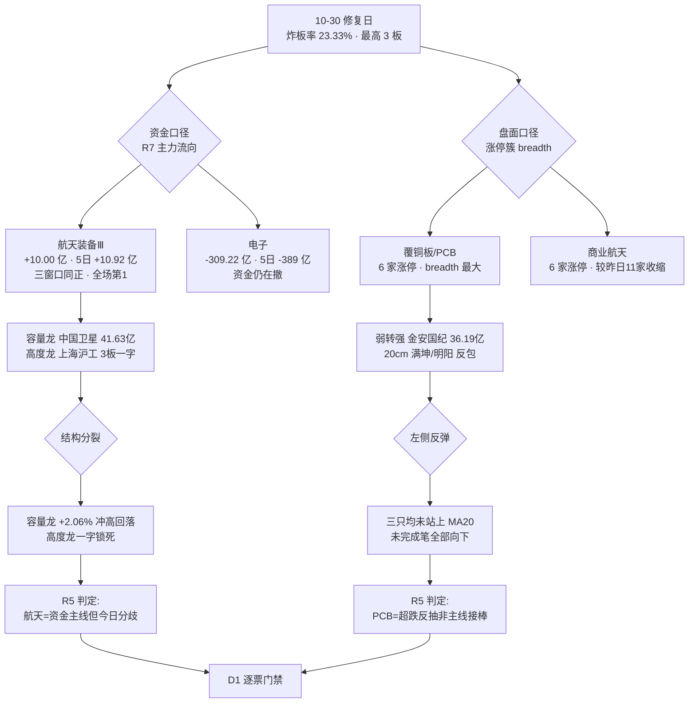

# 2026-10-30 · **个股画像**（R5 六维深挖 · 10 票）

> **数据源新鲜度**: partial  
> **降级状态**: true  
> **置信度**: 0.66

## 一句话结论

今天是**修复日不是主升日**（炸板率 39.06%→23.33%、昨涨停中位 +0.53%、半日成交已达昨日 64.9%，但最高板只有 3 板），10 只候选里只有 3 只同时过「进攻性 ≥B+ 且风险 ≤B-」这道模拟门禁：**中国卫星（B+/B）、电科蓝天（A-/B-）、金安国纪（A-/B-）**；其余 7 只全部降级，其中 4 只（古井贡/满坤/明阳/沪工）是「有涨停但没有资金和结构」的空壳。

## 详细分析

### 一、先认市场：修复日的三个硬指标，两个成立一个不成立

| 指标 | 今日(11:30) | 昨日(10-29) | 判定 |
|---|---|---|---|
| 炸板率 | `23.33%`（炸 14 / 涨停 46） | `39.06%` | ✅ 大幅改善 |
| 昨涨停今日溢价中位 | `+0.53%` | `-2.40%` | ✅ 由负转正（红盘 20/39，再涨停 9 只） |
| 半日成交 | `10096 亿` = 昨日全天 `15562 亿` 的 `64.9%` | — | ✅ 放量 |
| 最高板高度 | `3 板`（上海沪工） | `4 板`（青岛食品，今日已炸） | ❌ 高度还在降 |
| 涨跌家数 | 涨 `2522` / 跌 `2819`（上涨占比 `45.19%`） | 涨 756 / 跌 4400 | 🟡 修复但未翻多 |

**因果句**：炸板率和溢价率同时改善、成交放量，说明昨日的恐慌性抛售被承接了；但最高板从 4 板降到 3 板、上涨家数仍不足一半，说明**承接的是低位反抽，不是高位接力** —— 这正是 R1「崩溃退潮型 + 仓位上限 10%」与 R2「唯一主线商业航天、execution_pool 为空」两个结论能同时成立的盘面基础。

### 二、再认主线：今天不是一条主线，是两簇力量方向相反

**因果链要讲清楚的地方**：R2（11:43 盘中重跑）把商业航天定为唯一主线，用的是**资金口径**（航天装备Ⅲ 三窗口净流入、全场 top_inflow 第 1）；R5 从**涨停簇 breadth** 看到今日最大簇其实是覆铜板/PCB（6 家涨停，含 2 只 20cm 反包）。两者不矛盾，而是同一件事的两面：**钱还在航天（但今天开始分歧），盘面上最热的簇是 PCB（但资金记录是净流出 309 亿）**。所以今天真正可交易的东西比"主线有几条"这个问题更少 —— 只有 3 只票在"资金、结构、位置"三项里同时不失血。

### 三、逐票分档（10 票全表）

| 代码 | 名称 | 角色 | 今日板型 | alpha | risk | 复合分 | 一句话结论 |
|---|---|---|---|:--:|:--:|--:|---|
| `600118` | 中国卫星 | 航天·容量龙 | 未触板 `+2.06%` | **B+** | **B** | 71.0 | 唯一资金主线上的容量核心，但今日冲高 `+6.8%` 回落、半日主力 `-0.38 亿` |
| `688818` | 电科蓝天 | 航天·弹性核心(次新) | 未触板 `+2.24%` | **A-** | **B-** | 67.0 | 31 篇研报全正面 + 主力连续两日净买，但 PE `232`(分位90%) + 流通盘仅 `8.2%` |
| `002149` | 西部材料 | 航天·钛材 | 炸板 `+7.77%` | B- | B- | 64.7 | 主力 `+5.00 亿`(净占比 27%)真金白银，但炸板 6 次 → 板型直接不合格 |
| `002636` | 金安国纪 | PCB·板块龙头 | 涨停(弱转强) | **A-** | **B-** | 63.2 | 低开 `-4.8%`→涨停、成交 `36.19 亿`全场第1、Q3 单季净利环比 `+105%`，但 20 日 `-33.6%` |
| `603198` | 迎驾贡酒 | 白酒·板型最好 | 涨停(09:44) | B | **B+** | 61.6 | 财务最干净（ROE `14.6%`、PE `16`）+ 板型合格，但缩量 `0.61`、breadth 仅 2 |
| `600519` | 贵州茅台 | 白酒·温度计 | 未触板 `+1.29%` | B- | B+ | 58.5 | 永远不进池：26 日 0 涨停、Q3 单季转负，只用于验证白酒板块真伪 |
| `000596` | 古井贡酒 | 白酒·名义龙一 | 涨停(开板 8 次) | C | C | 52.5 | 开板 8 次 + 封单仅占成交 `15.5%` + 单季净利 `-70.9%`，三项同时不合格 |
| `301132` | 满坤科技 | PCB·20cm 弹性 | 涨停(11:26) | C | C | 52.5 | 封单占成交 `85.8%` 最漂亮，但 11:26 才封 + 龙虎榜净卖 `-1.21 亿` |
| `300739` | 明阳电路 | PCB·20cm 跟风 | 涨停(10:12) | C | B- | 52.0 | 板型合格，但同日公告计提资产减值 + 6 笔内部人减持 + 无主力无龙虎榜 |
| `603131` | 上海沪工 | 航天·高度龙头 | 一字 3 板 | C | C | 41.2 | 全场最高板，主业却与航天零关联（R4 已判「纯概念跟风」并剔除） |

### 四、三个过门禁的票：推理深度三问

**① 中国卫星 `600118`（B+/B · 71.0 分）**

- **大资金意图**: 配置盘在买「唯一有硬时间锚的产业方向」——蓝箭 9500 万中标成飞所运载火箭发射服务（公示至 11-02）+ 国星宇航过聆讯 + 11 月多场发射窗口，硬锚点落在 11 月初。对手盘是 10-29 之前在这个位置割肉的人：股东户数 9-30 环比 `-14.1%`（26.07 万户）说明筹码在向少数账户集中，10-29 主力 `+6.64 亿`、净占比 `21.33%` 是这轮收集的确认。
- **为什么走强**: 位置在 20 日新高（今日 `59.72`），属中高位不是超卖；催化是硬事件+硬时间锚双硬；筹码侧户数集中、无质押、无减持 —— 三维里两维支持、一维（位置）已偏高。今日 `+2.06%` 且收长上影、半日主力 `-0.38 亿`，是"位置到期、资金开始兑现"的第一信号。
- **逻辑够不够硬**: 硬，但硬的不是业绩。四票里它的 Q1-Q3 经营现金流 `-4.13 亿` 最差（命中 F8），净利率只有 `2.40%`、PE `625` 已失去估值锚 —— 也就是说**你买的是订单预期与叙事，不是盈利**。证伪路径非常明确：① 11-02 蓝箭公示期结束未见中标落地 ② 明日竞价高开不足 2% 或开板后 30 分钟跌破 `55.90`（10-29 收盘）③ 航天装备Ⅲ 当日资金转负。

**② 金安国纪 `002636`（A-/B- · 63.2 分）**

- **大资金意图**: 游资在打「业绩确定性最强的超跌股」——Q3 单季归母 `11.58 亿`、环比 `+105.3%`（扣非、非一次性），40 日内龙虎榜 7 次、累计净买 `+15.83 亿`，说明这是一个被反复交易的战场而非一次性偷袭。对手盘是 9 月从 `124.38` 高点一路砸到 `53.11` 那批套牢盘的解套抛压 —— 今日低开 `-3.8%` 砸到 `-4.8%` 再拉涨停，本质上就是把这批浮筹洗掉后再封。
- **为什么走强**: 位置是 20 日 `-33.6%`、距 20 日高 `-30.3%` 的深跌区（超卖）；催化是硬业绩（Q3 单季环比翻倍、覆铜板涨价链）；筹码是反向的（股东户数一个月 `+89.6%`，散户成建制涌入）。三维里两维支持、筹码一维是明确扣分项 —— 这也是它 risk 只能给 B- 的原因。
- **逻辑够不够硬**: 业绩硬、资金硬、结构不硬。硬的部分：Q3 净利 +1012%、OCF `+8.99 亿`（利润有现金）、商誉占净资产仅 `2.6%`。不硬的部分：① 收盘 `63.68` 仍在 MA20 `67.33` 下方 `5.4%`，是左侧反弹不是右侧突破 ② 缠论未完成笔仍向下、中枢下沿外 `-147%` ③ 周期品，R4 自己都标注"需盯价"。证伪路径：明日不能站稳 `67.33`，或覆铜板价格松动 / PCB 板块资金继续净流出。

**③ 电科蓝天 `688818`（A-/B- · 67.0 分）**

- **大资金意图**: 机构在买「航天链里唯一的成长弹性」——31 篇研报（买入 12 / 增持 9 / 推荐 7 / 强烈推荐 3）全正面、零负面；主力 10-28 `+1.28 亿`、10-29 `+2.02 亿` 连续两日净买，融资余额 15 日 `+10.8%`（全样本唯一显著加杠杆）。对手盘是次新解禁前的原始股东 —— 流通盘只有 `65.9 亿`，总市值 `805 亿`，流通占比 `8.2%`。
- **为什么走强**: 5 日 `+25.4%`（板块第 1）已经走完第一波，今日只 `+2.24%`、日内冲高 `48.45` 后回落 —— 位置是最高的那一只（收盘价高于 MA20 达 `20.8%`）；催化是"单星价值量"的产业逻辑，没有新事件；筹码是集中的（户数 `-19.5%`）。**它今天涨不动，恰恰是因为位置透支**。
- **逻辑够不够硬**: 产业逻辑硬、估值不硬。PE `232.7` 处 60 日分位 `90%`、PB `14.82` 处 `87%`、PS `20.85`，PEG ≈ 7.8；Q1-Q3 现金流 `-3.86 亿`（F8）。证伪路径：跌破 MA20 `39.25`（现价下方 `20.8%`，即真正回到趋势线）意味着这轮"新高突破"失败；周线 MA20 `50.16` 是它头顶最近的压力位。

### 五、七只被砍的票，砍在哪一刀

| 砍因 | 票 | 具体证据 |
|---|---|---|
| 板型不合格 | 西部材料、古井贡 | 炸板 6 次 / 开板 8 次且封单仅占成交 `15.5%` |
| 一字板不可低吸 | 上海沪工 | 成交 `1.57 亿` = 封单 `4.03 亿` 的 39%，无一笔有效换手，RR 不可测 |
| 资金未验证 | 满坤科技、明阳电路 | 龙虎榜净卖 `-1.21 亿` / 无榜无主力（5 日 `-0.31 亿`） |
| 结构未反转 | 满坤、明阳、古井、金安 | 四只未完成笔**全部向下**，前三只收盘仍在 MA60 下方 |
| 同日利空对冲 | 明阳电路 | 涨停当日公告《计提资产减值准备》+ 6 笔内部人减持 |
| 板块不成立 | 茅台、古井、迎驾 | 白酒 breadth 仅 2 家、R7 sector top10 无白酒、龙头茅台只 `+1.29%` |

## 关键证据

- **证据 1（资金分层最硬）**: 航天装备Ⅲ 10-29 主力 `+10.00 亿`、5 日 `+10.92 亿`、10 日 `+8.68 亿` —— 三窗口同时为正，是全场唯一；同期电子板块 `-309.22 亿`、5 日 `-389.37 亿`。来源 `R7_capital_flow.main_force.top_inflow_sectors`。
- **证据 2（筹码在收敛而非发散）**: 中国卫星户数 `-14.1%`、西部材料 `-21.9%`、电科蓝天 `-19.5%`、迎驾 `-21.8%`，而金安国纪 `+89.6%`、茅台 `+21.9%` —— 前四只是资金收集，后两只是散户接盘。来源 `tushare/stk_holdernumber`。
- **证据 3（业绩与股价背离的极端样本）**: 金安国纪 Q3 单季归母 `11.58 亿` / 环比 `+105.3%`，股价 20 日 `-33.6%`；古井贡酒 Q3 单季净利 `-70.89%`，股价今日涨停。来源 `R4_news.earnings_breakdown_map` + `tushare/fina_indicator`。
- **证据 4（现金流是航天链的共性缺口）**: 航天四票 Q1-Q3 经营现金流 `-0.24 ~ -4.13 亿` 全部连负、同期净利全为正，四票全部命中 F8。来源 `tushare/cashflow` 三期累计。
- **证据 5（结构全在同一状态）**: czsc 缠论显示 PCB 三只 + 古井未完成笔全部向下、且都在最近中枢下沿外 `-110% ~ -147%`；只有电科蓝天站在中枢上方 `+71.3%`。来源 `czsc 0.10.12 CZSC(D)`。

## 逐票思维链（Top 3）

**中国卫星 `600118`**

- **买入理由**: ① 产业逻辑：卫星总体唯一真受益标的，蓝箭中标 + 国星宇航聆讯 + 11 月发射窗口构成 11 月初的硬时间锚 ② 数据锚：10-29 主力 `+6.64 亿`（净占比 `21.33%`）、户数 `-14.1%`、成交 `41.63 亿` 为板块容量第一。
- **风险点**: ① 短期：昨日 8 次开板纸封（封单仅占成交 `2.66%`）+ 今日长上影，连续两日封板/冲高质量不合格 ② 中期：周线仍空头排列、周 MA20 `63.35` 在头上 `11%`；Q1-Q3 现金流 `-4.13 亿`，业绩无法承接估值。
- **止损条件**: 跌破 `55.90`（10-29 收盘价兼今日前收）即离场；若买入后 30 分钟内跌破该位，不等反弹直接执行。
- **可验证假设**: 48 小时内两个观测量 —— ① 明日竞价高开 >`2%` 且 30 分钟不破 `55.90`（分歧转一致）② 航天装备Ⅲ 当日主力净额仍为正（连续第 3 日）。两者同时成立才升格；任一失败即降 watch。

**金安国纪 `002636`**

- **买入理由**: ① 产业逻辑：覆铜板涨价真传导，Q3 单季归母 `11.58 亿`、环比 `+105.3%`（扣非非一次性）、经营现金流 `+8.99 亿` ② 数据锚：成交 `36.19 亿` 全场第 1、封单 `7.92 亿` 占成交 `21.9%`、40 日龙虎榜累计净买 `+15.83 亿`。
- **风险点**: ① 短期：股东户数一个月 `+89.6%`（散户接盘特征），收盘仍在 MA20 `67.33` 下方 `5.4%` ② 中期：周期品，Q3 ROE `42.5%` 是峰值特征，覆铜板价格一旦见顶即双杀；缠论未完成笔向下，结构未反转。
- **止损条件**: 跌破今日涨停价 `63.68` 的 `-5%` 即 `60.50` 离场；若明日低开跌破今日成交均价（约 `58.5`）则视为弱转强失败，直接放弃。
- **可验证假设**: ① 明日能否站上 `67.33`（MA20）—— 站上则左侧转右侧，否则只是反弹 ② PCB/覆铜板链涨停家数能否维持 ≥3 家（今日 6 家）③ 电子板块当日主力净额是否转正（今日仍负）。

**电科蓝天 `688818`**

- **买入理由**: ① 产业逻辑：卫星/火箭电源系统核心配套，单星价值量弹性最大，5 日 `+25.4%` 板块第 1 ② 数据锚：31 篇研报全正面、主力连续两日净买 `+3.30 亿`、融资余额 15 日 `+10.8%`、缠论是唯一站在中枢上方（`+71.3%`）的航天票。
- **风险点**: ① 短期：5 日 `+25.4%` 后今日仅 `+2.24%` 且冲高回落，第一波透支；收盘高于 MA20 `20.8%` ② 中期：PE `232.7` 分位 `90%` / PB `14.82` 分位 `87%`；流通盘仅 `8.2%`，2027-02 首发解禁是悬顶供给；Q1-Q3 现金流 `-3.86 亿`。
- **止损条件**: 跌破 `44.28`（czsc 最近中枢上沿）即离场；若周线 MA20 `50.16` 三次冲不上去且日线跌破 MA10，视为一波结束。
- **可验证假设**: ① 48 小时内能否重回 `48.45`（今日高点）上方 —— 破则新高逻辑延续，否则进入震荡 ② 换手率能否从 `25.7%` 回落到 `15%` 以下（缩量整理 = 健康）。

## 数据源审计

| 源 | 日期 | 状态 | 备注 |
|---|---|:--:|---|
| tushare/daily(62 根) | 2026-10-30 | 🟢 | 620 条 · 2026-07-28~2026-10-29 · 前复权 |
| tushare/rt_k(11:30) | 2026-10-30 | 🟢 | 10 条 · 半日盘中报价，非收盘 |
| tushare/anns_d | 2026-10-30 | 🟢 | 360 条 · 2026-06-01~2026-10-31 |
| tushare/top_list | 2026-10-30 | 🟡 | 14 条 · 40 日逐日全市场拉取后过滤，仅 5 只有榜 |
| tushare/block_trade | 2026-10-30 | 🟢 | 4 条 · 仅茅台有 4 笔平价大宗，其余 0 笔 |
| tushare/margin_detail | 2026-10-30 | 🟢 | 150 条 · 15 日 × 10 只 |
| tushare/moneyflow_dc | 2026-10-30 | 🟢 | 70 条 · 含 10-30 半日主力净额 |
| tushare/fina_indicator+cashflow | 2026-10-30 | 🟢 | 120 条 · 2026Q3 为主，三期现金流对齐 |
| tushare/report_rc | 2026-10-30 | 🟢 | 904 条 · 180 日窗口 |
| czsc/缠论 0.10.12 | 2026-10-30 | 🟢 | 10 只 · 62 根日 K · 分型/笔/中枢 |
| canghai-charts/chart_vision | 2026-10-30 | 🟢 | 10/10 · 现场并发重渲 78s（原 08:18 快照 12 只与本批零交集） |
| xtick/limit_board | 2026-10-30 | 🟢 | 45 条 · 封单量/开板次数/首封时间 |
| R3 群聊层（匿名） | 2026-10-30 | 🔴 | 0 条 · 自 10-28 断更，weflow 404 → 共振只能用 L1+L2b |
| R7 北向资金 | 2026-10-30 | 🔴 | 停抓（2026-10-28 起停用）· 不影响内资口径 |

## 不确定性 / 反证

1. **半日数据不是收盘数据**：全部 pct / amount / 封单均为 11:29~11:30 快照。历史上 11:26 之后封的板（满坤 `11:26`）在午后炸板概率显著高于早盘板，本单元给满坤 C 档包含了这一先验，但若午后它封死并放大封单，评级会偏低。
2. **「PCB 是超跌反抽」可能是错的**：我用 R7 10-29 的电子板块 `-309 亿` 判定资金未回流。若今日午后至收盘电子板块资金转正、且明日 PCB 链继续出涨停，则这是主线接棒而不是反抽，今天的 C 档全部偏低。
3. **金安国纪的 A- 有争议**：它 20 日 `-33.6%`、MA20 未突破、户数 `+89.6%`，按用户「只做右侧」的纪律，它应当只是 watch 而不是 A-。我保留 A- 的理由是"日内弱转强 + 全场最大成交 + 真业绩"三项同时成立，但这属于**纪律边界内的少数派判断**，R6 完全有理由把它打成 hard_reject。
4. **R2 与 R5 的口径差异是结构性的**：R2 只看资金与板块，R5 加了板型、结构（缠论）、筹码分散度。今天 R2 的唯一主线（航天）在 R5 里 4 只中 2 只（沪工 C、西部 B-）被降级 —— 这不是矛盾，是 R5 的职责：R2 回答"钱往哪走"，R5 回答"这钱买的票能不能碰"。
5. **F8 的判读风险**：航天四票现金流全负，我按契约标了 F8（净利为正 + CFO 连负）。要说明的是：航天总体（中国卫星）、钛材（西部材料）、电源（电科蓝天）都是订单驱动的重资产模式，Q1-Q3 现金流为负在这个行业是常态而非异常 —— 所以 F8 在这条链上应读作"利润未变现、业绩不能支撑估值"，不应读作"财务造假"。

## 与其他 R/D/E 的关系

- **依赖**: `R1_style.json`（风格=崩溃退潮型 / 仓位上限 10% / high_chop 第 2 日）、`R2_main_sectors.json`（1 条主线 + 4 leaders + 2 条 secondary）、`R3_sentiment.json`（商业航天 L1+L2b 第 1）、`R4_news.json`（E005 商业航天 +0.732 / E004 PCB +0.385 / 纯概念跟风 -0.753）、`R7_capital_flow.json`（航天装备 +10.00 亿 top_inflow）
- **被消费**: `R6`（反证 · 本单元已透传 5 条 divergence_flags + 4 处 F8 + 逐票 flags 供模式七裁决）、`D1`（execution_pool 逐票门禁 · 模拟门禁结果已在 JSON `d1_gate_simulation` 中给出）、`E1`（T+N 回填思维链可验证假设）
- **本单元明确不授开仓权**: R1 仓位上限 10%、R2 execution_pool 为空、R7 执行候选 0 只 —— 三处上游一致指向"极小试错"，R5 的 3 只 B+/A- 只是"过了模拟门禁"，不等于可执行。

## Sub-Agent 元数据

- skill: analyze_stock_profile_v1
- artifact: `data/research/20261030/R5_stock_profiles.json`
- 生成耗时: 约 21 分钟（含 10 票 chart_vision 现场重渲 78s、tushare 11 组端点、czsc 缠论 10 只）
- model: deepseek-v4.1-flash
- 契约校验: `check_r5_20261030.py` → ERRORS=0 WARNINGS=0
