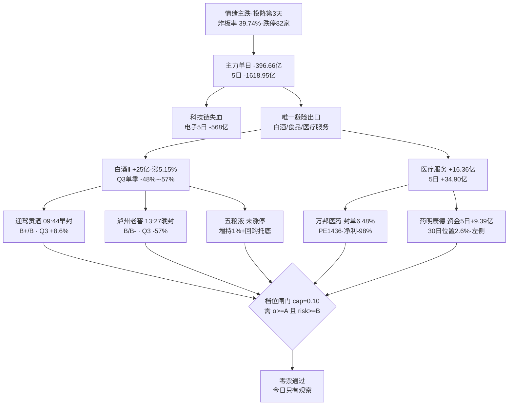

# 2026-11-02 · **个股画像**（R5 · 六维深挖）

> **数据源新鲜度**: partial（本 run 主源全 ok；R1/R3/R7 上游降级 + vibe-trading 未配置）
> **降级状态**: no（本 run 无缺失源，chart_vision 10/10 命中、date 硬校验通过）
> **置信度**: 0.66

## 一句话结论

白酒是主跌段的避险抱团、不是业绩主线；医药是资金先行但趋势未修复——10 票零票过档位闸门，今日只有观察没有开仓。

## 详细分析

### 一、市场读数：钱只剩两个方向，且都不是「进攻」

2026-10-30 是连续杀跌第 3 天：全市场主力单日 **-396.66 亿**（5 日 -1618.95 亿、20 日 -5720.93 亿，20 日仅 3 个正日），跌停 82 家 > 涨停 47 家，炸板率 **39.74%** 连续两日站在 35% 红线之上，宽度 893 涨 / 4602 跌、跌超 5% 达 1483 家。钱只去了两个地方：

| 方向 | 当日主力 | 5 日主力 | 板块涨幅 | 涨停数 | R4 催化 |
|---|---|---|---|---|---|
| 食品饮料 | +30.05 亿（行业第 1） | +27.72 亿 | +0.83% | — | 零 |
| 白酒Ⅱ | +25.00 亿 | +27.91 亿 | **+5.15%** | 4 家 | 零 |
| 医疗服务 | +16.36 亿 | **+34.90 亿** | +1.58% | 3 家 | 零 |
| 医疗研发外包（CRO） | +14.39 亿 | +28.86 亿 | +3.37% | — | 零 |
| 电子（对照） | -112.43 亿 | -568.32 亿 | — | — | 负面 |

**这张表是本篇最关键的读数**：两条主线（消费防御 80 分、医药 75 分）全部落在流入侧，但 R4 的 8 条 top_events **零条命中白酒/消费/医药**——唯一相关的是 10 月 PMI 49.3/49.7 双降（负面）。所以这不是「叙事驱动的主线」，是**主跌段里唯一的避险出口**。R2 的 cross_validation 也承认这一点：消费线 r4_catalyst_match=false。

### 二、基本面与板型彻底背离：白酒 Q3 是行业性塌方

这是本篇第二个必须说清的事实。今日涨停最猛的是白酒，但 Q3 财报说的是另一件事：

| 白酒 | Q3 累计归母 YoY | **Q3 单季归母 YoY** | 今日表现 | 说明 |
|---|---|---|---|---|
| 泸州老窖 | -47.3% | **-57.0%** | +10.01% 涨停（13:27 晚封） | 单季塌方，PE 19.8 分位 69.5% = 分母在塌 |
| 五粮液 | +50.0% | **-48.3%** | +3.35% 未涨停 | 累计数掩盖了单季；OCF 0.47 亿 vs 归母 97.11 亿 |
| 贵州茅台 | -0.2% | +3.8% | +2.81% 未涨停 | 唯一稳住的高端 |
| 迎驾贡酒 | +4.2% | **+8.6%** | +9.99% 涨停（09:44 早封） | 区域酒正增长，白酒里唯一 |

结论很硬：**高端白酒单季 -48%~-57%，只有区域酒和茅台正增长**。所以「白酒主线」在本周的正确读法是——资金在买「现金流确定性 + 增持回购托底」（五粮液 10-30 控股股东增持触及 1%、连续回购），不是在买行业景气。任何把它当「业绩反转主线」的交易，都会在 11 月中旬的渠道数据里被证伪。

### 三、医药线：钱去的地方和基本面好的地方不是同一处

医疗服务 5 日 +34.90 亿（本批最强子板块），但流入的两只票基本面无支撑：

- **万邦医药**：20cm 封单 1.36 亿占流通 **6.48%**（本批最强锁仓）、游资净买 1.56 亿，但 PE 1436、Q3 归母 -98.3%、预告「预减」、换手 43.54%、MA5 斜率 -7.12%。
- **百花医药**：30 日 5 次涨停的妖锚，但 08-29 股东减持计划在案、股东户数 **+263.4%**（散户成建制接盘）、PE 152、Q3 归母 -48.5%。
- **药明康德**（基本面最硬）：Q3 归母 +60.6%（单季 +136.7%）、经营现金流 171.93 亿、PE 16.28（分位 23.7%）、5 日主力 **+9.39 亿**（4/5 日正），当日却是 -0.62%，30 日区间位置只有 **2.6%**、MA20 下方 5.96%、套牢 84.5%。

这是典型的「基本面票被当提款机、题材票吸走弹性」。药明的价值不在今天能不能涨，而在于它是本批唯一「资金连续 5 日流入 + 业绩硬 + 估值低分位」三者同时成立的票——但技术是左侧，**没站上 MA20 151.01 之前不给任何交易资格**。

### 四、六维综合排序与挡位

| 排序 | 票 | 催化 | 筹码 | 板块 | 估值 | 技术 | 机构 | 综合 | α/风险 | 板型定性 |
|---|---|---|---|---|---|---|---|---|---|---|
| 1 | 迎驾贡酒 603198 | 32 | 68 | 74 | 70 | **82** | 62 | **65.0** | B+ / B | 龙头候选（首板 09:44 早封） |
| 2 | 泸州老窖 000568 | 30 | **78** | 70 | 45 | 72 | 60 | 61.3 | B / B- | 首板（13:27 晚封，封单 0.01%） |
| 3 | 五粮液 000858 | 45 | **80** | 66 | 50 | 55 | 58 | 61.0 | B / B- | 未涨停（增持+回购托底） |
| 4 | 贵州茅台 600519 | 30 | 70 | 62 | 72 | 62 | **80** | 60.8 | B / B | 未涨停（最安全避险） |
| 5 | 药明康德 603259 | 55 | 76 | 55 | 68 | 28 | 78 | 58.6 | B+ / B- | 未涨停（30 日位置 2.6%） |
| 6 | 九安医疗 002432 | 40 | 55 | 52 | **25** | 45 | 35 | 44.7 | B- / C | 首板早封但炸板 2 次 |
| 7 | 万邦医药 301520 | 25 | 58 | 58 | 15 | 48 | 10 | 41.3 | B / C | 首板晚封（封单占流通 6.48%） |
| 8 | 百花医药 600721 | 20 | 52 | 50 | 20 | 40 | 8 | 36.3 | B- / C | 首板晚封（深跌反抽） |
| 9 | 青岛食品 001219 | 25 | 38 | 45 | 35 | 55 | 8 | 34.4 | B- / C | 高位龙头（5 板·派发） |
| 10 | 澳洋健康 002172 | 20 | 30 | 46 | 8 | 58 | 6 | 28.9 | C / C | 高位跟风（3 板晚封） |

（青岛食品/澳洋健康为 v1.4 扩池票，composite 已按契约 -3 起步分处理，原始分 37.4/31.9。）

**档位闸门结论**：R1/R2 今日 position_cap=0.10，落最严档 `alpha>=A 且 risk>=B`；本批最高只到 B+，**零票通过**。这与 R7「execution_eligible_count=0 / 研究前置池 10→5」完全一致。R5 不给「主跌 + 无催化」发 A 档——这不是数据缺陷，是纪律结果。

### 五、推理深度三问（本批唯一进研究前置池的票：迎驾贡酒）

- **大资金意图**: 买入方是避险配置盘 + 短线游资的混合。白酒Ⅱ 单日 +25.00 亿、食品饮料 +30.05 亿是全市场唯一正流入的大行业；迎驾自己主力 +1.08 亿、5 日 +1.26 亿（3/5 日正）——量级只有龙一泸州老窖（+5.29 亿）的 1/5，说明它不是机构主攻对象。对手盘是「套在 38 元以上、现在全员解套的散户」和「融券余额 15 日 +94.2% 的空头」，前者浮盈 95.5% 随时可以走，后者在赌回落。它的真实角色是：**早盘点火试探市场还敢不敢做多消费的第一张牌**。
- **为什么走强**: 位置（30 日区间 100%、20 日 +19.54%、偏离 MA20 12.24%，已经不便宜）+ 催化（R4 零命中，只有自身 Q3 单季 +8.6% 的相对业绩）+ 筹码（获利盘 95.5%、股东户数 -21.8% 集中）。三维里只有筹码是真加分：**没有套牢盘**，所以拉到哪儿都不会被解套盘砸。板型是它最强的地方：09:44:13 首封、只开板 1 次、封单 0.76 亿——白酒 4 家涨停里唯一在 09:45 前封住的。
- **逻辑够不够硬**: **不够硬，所以只给 B+ 不给 A**。硬业绩只有「相对优势」（+8.6% vs 同业 -48%），不是绝对高增长；硬政策没有；硬时间锚没有。三个独立源里 R7（资金）确认、R3（热度）确认、R4（催化）明确否认——这是 2:1 的共振，不是 3:1。证伪路径很短：如果 11 月上旬渠道调研显示次高端批价继续下行，或者明日白酒板块整体转负而它独自高开，那么今天这根 09:44 的早封就是**接力盘的最后一次集合**。

### 六、思维链（首推观察票）

#### 迎驾贡酒 603198.SH（B+/B · 龙头候选·首板早封）

- **买入理由**: ①板型本批最强——09:44:13 首封、开板 1 次、封单 0.76 亿，白酒 4 家涨停中唯一早封；②筹码结构干净——cyq 获利盘 95.5%、平均成本 38.36（收盘 44.47）、股东户数 -21.8%，没有解套抛压；③业绩相对优势——Q3 单季归母 +8.6%，在泸州 -57%、五粮液 -48% 的同业里是唯一正增长，PE 17.36（分位 52.8%）不贵。
- **风险点**: ①短期位置偏高——偏离 MA20 12.24%、5 日 +7.47%，追高即接盘；②融券余额 15 日 +94.2%、融资余额 15 日 -24.56%，杠杆双向背离，说明有资金在做反向；③主跌环境下连板概率低——今日全市场首板占比 80.85%、4 板整层空缺，高度无法自然递推。
- **止损条件**: 收盘跌破 **MA5 41.82** 即逻辑证伪（不是盘中止损，是收盘确认）；若次日竞价高开 >5% 一律不参与（追高纪律）；跌破 09:44 首封当日的分时均价且量比 >2 视为封板失败。
- **可验证假设**: 24-72h 内可证真/证伪——①次日（11-03）白酒Ⅱ 板块主力净额是否仍为正（阈值：>0 亿）；②迎驾次日是否守住 41.82 且换手 <15%（守住即「强势整理」，破位即「一日游」）；③R7 次日是否把它列入 research_candidates（列入=资金认可延续）。

#### 药明康德 603259.SH（B+/B- · 资金先行但趋势未修复）

- **买入理由**: ①5 日主力 +9.39 亿、4/5 日正，是本批资金持续性第一，且是「越跌越买」；②Q3 归母 +60.6%（单季 +136.7%）、经营现金流 171.93 亿对归母 0.89 倍，业绩与现金流双硬；③PE 16.28（3 年分位 23.7%），跌了 12.56% 反而更便宜。
- **风险点**: ①趋势最差——30 日区间位置 2.6%、MA20 下方 5.96%、缠论中枢下方 -35.8；②套牢 84.5%（平均成本 151.80 vs 收盘 142.01），反弹到 151 一带必然遇到解套盘；③大宗 30 日 27 笔 6.04 亿、均价溢价 +0.01%，是机构对倒式换手，不能当利好；④单季净利率 42.83% 显著高于 CXO 中枢，可能含非经常性损益，本笔记只标「需核」。
- **止损条件**: 收盘跌破 30 日低点 **141.31** 视为资金撤退（连续流入却创新低=逻辑失效）；或连续 2 日主力净流出且累计 >3 亿。
- **可验证假设**: ①是否在 3 个交易日内站上 **MA20 151.01** 且当日成交额 > 前 5 日均值（右侧确认）；②CRO/医疗研发外包板块 5 日资金是否维持净流入（阈值 >0 亿）；③大宗溢价率是否由 0% 转正（转正=机构转买，仍 0% 即对倒延续）。

### 七、拦截票与理由（不进 watch、不进执行）

| 票 | 结论 | 决定性证据（三条以上） |
|---|---|---|
| 九安医疗 002432 | **拦截** | PE 4.46 是投资收益幻觉（营收 8.06 亿 / 归母 52.05 亿、净利率 646.7%）；炸板回封 2 次；机构席位净卖 -2812 万；短借 60.26 亿 > 货币 20.18 亿、OCF -1.64 亿 |
| 万邦医药 301520 | **降级 watch** | 封单占流通 6.48% 是本批最强，但换手 43.54%、PE 1436（分位 100%）、Q3 归母 -98.3%、预告预减、MA5 斜率 -7.12% |
| 百花医药 600721 | **拦截** | 08-29 股东减持计划在案；股东户数 +263.4%（散户接盘）；PE 152、Q3 -48.5%；20 日 -23.92% 深跌反抽 |
| 青岛食品 001219 | **拦截** | 5 板日主力 -0.199 亿（涨停日净流出）；换手 47.80%、开板 3 次、量比 7.62；PE 分位 92.1%；交易所两份风险提示公告 |
| 澳洋健康 002172 | **拦截** | 涨停日主力 -0.931 亿（净占比 -7.23%）；负债率 89.31%、权益 2.13 亿 vs 短借 8.73 亿；PB 21.20；股东户数 +82.9%、质押 11.52% |

### 八、关键事件时间线（择要 · 完整 11-16 条见 JSON `event_timeline`）

- **10-30** 五粮液：控股股东及一致行动人增持触及 1% 整数倍（真金白银托底）；同日白酒 4 家涨停
- **10-30** 青岛食品：股票交易异常波动暨风险提示公告（交易所连续第二次提示）
- **10-30** 澳洋健康：股票交易异常波动公告（8 个交易日内第二次）
- **10-28** 九安医疗：签订 2026 年员工持股计划信托合同；10-09 出售已回购股份进展（增加供给）
- **10-24** 青岛食品：2026 年三季度报告
- **09-22** 百花医药：股票交易异常波动公告；**08-29** 股东减持股份计划公告
- **08-14** 万邦医药：股票交易严重异常波动的公告（此后 08-29 变更注册资本、10-30 会计政策变更）
- **08-04** 药明康德：2026 年中期利润分配方案

## 关键证据

- **证据 1**：白酒 Q3 单季归母同比分化极端——泸州老窖 -57.03%、五粮液 -48.25%、贵州茅台 +3.78%、迎驾贡酒 +8.58% · 来源 `tushare fina_indicator.q_netprofit_yoy`（20260930 报告期）· 这是「避险抱团非业绩主线」判断的核心锚
- **证据 2**：白酒Ⅱ 单日主力 +25.00 亿 / 5 日 +27.91 亿 / 涨幅 +5.15%，食品饮料 +30.05 亿列行业第 1，而同日全市场主力 -396.66 亿、电子 -112.43 亿 · 来源 `R7_capital_flow.main_force.sector_net_inflow`
- **证据 3**：R4 今日 8 条 top_events 中零条涉及白酒/消费/医药，唯一相关为 E20261102_003（10 月 PMI 49.3/49.7 双降，负面）· 来源 `R4_news.top_events`
- **证据 4**：泸州老窖龙虎榜当日净买 +4.61 亿、净占比 14.79%、成交占比 36.78%，但 13:27:36 才首封、封单 0.12 亿占流通 0.01% · 来源 `tushare top_list` + `limit_list_d` + `R7.hot_money.net_buy_top10`
- **证据 5**：九安医疗营收 8.06 亿 / 归母 52.05 亿（净利率 646.73%）、短期借款 60.26 亿 > 货币资金 20.18 亿、经营现金流 -1.64 亿 · 来源 `tushare income/balancesheet/cashflow`（20260930）
- **证据 6**：药明康德 5 日主力 +9.39 亿（4/5 日正）、大宗 30 日 27 笔 6.04 亿溢价 +0.01%、30 日区间位置 2.6% · 来源 `tushare moneyflow_dc/block_trade/daily`
- **证据 7**：青岛食品 5 连板当日主力 -0.199 亿、换手 47.80%、开板 3 次；澳洋健康 3 连板当日主力 -0.931 亿、换手 29.99% · 来源 `tushare moneyflow_dc + limit_list_d`（派发双证）

## 数据源审计

| 源 | 日期 | 状态 | 备注 |
|---|---|:--:|---|
| R2_main_sectors | 2026-10-30 | 🟢 | 2 条主线 · 8 只 leaders + 2 只身位股 |
| R4_news | 2026-11-02 | 🟢 | 8 条 top_events · 零命中本批 10 票 |
| R7_capital_flow | 2026-11-02 | 🟡 | degraded · midday 增量版 · sector_net_inflow 10 条 |
| R3_sentiment | 2026-11-02 | 🟡 | 情绪 30.8 · WeFlow 永久下线 · 共振仅 L1+L2 |
| R1_style | 2026-11-02 | 🟡 | 崩溃退潮型 · confidence 0.49 |
| tushare/daily + adj_factor | 2026-10-30 | 🟢 | 1420 根 · 10 票 × 142 根（20260401-20261030，前复权 fq=2） |
| tushare/limit_list_d | 2026-10-30 | 🟢 | 160 条全市场 + 逐票 30 日 |
| tushare/top_list + top_inst | 2026-09-18~2026-10-30 | 🟢 | 30 个交易日逐日横切（trade_date 逐日拉取） |
| tushare/block_trade + margin_detail + cyq_chips | 2026-10-30 | 🟢 | 30 日大宗 / 08-15 起两融 / 当日筹码分布 |
| tushare/fina_indicator + 三表 + forecast | 2026-09-30 | 🟢 | 10 票 × 4 期 · 全部已披露 Q3 |
| tushare/anns_d | 2026-07-01~2026-10-30 | 🟢 | 293 条公告 |
| chart_vision_snapshot | 2026-11-02 | 🟢 | 10/10 命中 · date 硬校验通过 · 并发 53 秒 |
| czsc 0.10.12 | 2026-10-30 | 🟢 | 10 票日线笔/中枢 |
| vibe-trading MCP | — | 🔴 | 未配置 · 已按 v1.3 用 tushare 兜底，block_trades/margin 无 null |

## 不确定性 / 反证

1. **本篇最容易错的地方是把「避险流入」读成「主线启动」**。白酒今日 +25 亿、板块 +5.15%，看起来像主线，但 R4 零催化、Q3 单季 -48%~-57%、封板质量差（龙一 13:27 才封、封单占流通 0.01%）。如果明日白酒继续放量上攻且出现 3 板以上个股，我这套「避险抱团」的判断就要推翻——证伪观测点已写进思维链。
2. **药明的「资金先行」可能是错的**。5 日 +9.39 亿的流入若来自指数型/被动资金（大宗 27 笔 0 溢价像机构调仓），那么在趋势破位时它会同样快速流出。我把 141.31（30 日低点）设为止损参考，就是因为「连续流入却创新低」是最快的证伪信号。
3. **九安的低 PE 陷阱判断存在一个反例可能**：若其投资收益来自长期股权投资而非二级市场交易，且这部分资产有稳定现金流，那么 PE 4.46 可能部分成立。但我看到的证据是营收 -24.7%、OCF -1.64 亿、短债 60.26 亿——三项都不支持「稳定」。
4. **档位口径的边界**：我给迎驾 B+/B、药明 B+/B-，严格说两者的短板性质不同（迎驾缺催化、药明缺趋势）。若 D1 的 position_cap 上调到 0.45，按 `alpha>=B+ 或 (alpha>=A- 且 risk>=B-)` 这两只会过档位闸门——**但档位闸门只是第一道门**，逐票门禁（板型/趋势/盈亏比）与 R6 hard_reject 独立生效，R5 不为此背书。
5. **数据缺口**：R1 confidence 仅 0.49（风格判定本身不稳），R3/R7 均 degraded；vibe-trading MCP 未配置导致缺少 eastmoney 席位级双源交叉（已用 tushare top_list/top_inst 单源覆盖，无 null 但无双源互证）；cyq_chips 是 tushare 成本分布代理，非逐笔成本。

## 与其他 R/D/E 的关系

- **依赖**：`R2_main_sectors.json`（候选池 8 leaders + 2 身位股）· `R4_news.json`（催化 0 命中）· `R7_capital_flow.json`（板块/个股资金、席位信号）· `R3_sentiment.json`（情绪 30.8）· `R1_style.json`（崩溃退潮型 / cap 0.10）· `chart_vision_snapshot.json`（10/10）· tushare 24 类接口 · czsc
- **被消费**：`R6_devil_advocate_v1`（读 `dimensions.valuation_safety.fundamental_flags` 做模式七、读 `flags`/`main_net` 做模式六霸榜出货）· `main_decision_v1`（读 `alpha_grade`/`risk_grade`/`technical_readiness`/`leader_verdict`/`forbidden_check`）· `E1_daily_review`（回填思维链可验证假设）
- **给 D1 的硬提示**：①`d1_gate_simulation.result_today=[]`——cap=0.10 下零票过档位；②五粮液/茅台/药明/百花/青岛/澳洋 6 票命中 `mid_laggard`（非龙一/龙二即拒），其中青岛/澳洋为身位股，命中原因是「非龙一龙二」而非质地最差（质地见 flags）；③`provenance.source=r2_expand_pool` 的青岛食品/澳洋健康按契约只能进 watch_pool，且当前已是「拦截」。

## Sub-Agent 元数据

- skill: analyze_stock_profile_v1（v1.5 · 含 v1.2 财务双层 / v1.3 大资金证据面 / v1.4 扩池 / v1.5 龙头判定）
- artifact: `data/research/20261102/R5_stock_profiles.json`
- 生成耗时: 约 9 分钟（chart_vision 并发 53s + tushare 取数 ~90s + 龙虎榜 30 日回补 + 计算/装配/校验）
- 用 model: deepseek-v4.1-flash（主控）· seed-2-0-lite-260228（chart_vision 多模态）
- 校验: `scripts/research/check_r5_20261102.py` → ERRORS=0 / WARNINGS=0
