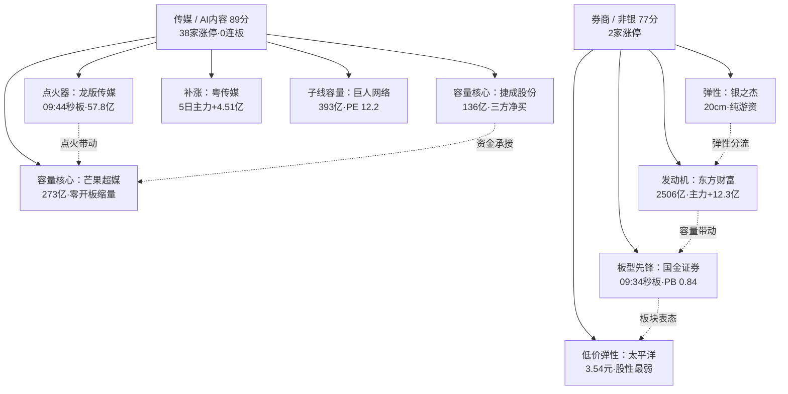

# 2026-11-03 · **个股画像（R5）**

> **数据源新鲜度**: ok ｜ **降级状态**: false ｜ **置信度**: 0.74
> **分析基准**: 20261102 收盘 · **候选来源**: R2 主线 2 条 / 龙头 9 只（不扩池）

## 一句话结论

**九票全画像完毕，但真正够得上「主线核心」的只有两只：东方财富（A-/B，券商政策线的带动性龙一）与芒果超媒（A-/B-，传媒链板型最优的容量核心）；其余七票是身位、候补与点火器——研究价值有，开仓资格没有。传媒有广度无高度（38 家涨停 0 家连板）、券商有催化无广度（仅 2 家涨停），两条线都不是「可以无脑接力」的形态。**

## 市场坐标（R1/R2 传入）

| 参数 | 取值 | 对 R5 的含义 |
|---|---|---|
| 风格 | 连板情绪型（代价 0.0） | 数量口径达标，但打板赚钱效应没跟上 |
| 情绪 | 68.0（贪婪） | 情绪不低，容易高开兑现 |
| 阶段 | high_chop（高位震荡） | 修复段第 2 日 = 验证/分歧日，不追开盘 |
| 仓位上限 | 0.55 | 档位闸门落最宽松一档（alpha≥B+ 即过） |
| 主线 1 | 传媒 / AI 内容 89 分 · formation（涨停潮第 2 日） | 有广度、无高度 |
| 主线 2 | 券商 / 非银 77 分 · formation（政策脉冲第 1 日） | 有催化、无广度 |
| 炸板率 | 18.30% | ＜35%，候选数不砍半 |

## 九票总表

| 代码 | 名称 | 主线 | R2 身位 | 板型（11-02） | α | 风险 | 综合 | 结论 |
|---|---|---|---|---|---|---|---|---|
| 300059.SZ | 东方财富 | 券商 | 龙一 | 未封板 +6.31%·成交 86.46 亿 | **A-** | B | 75.3 | 观察（等价格承认政策） |
| 600109.SH | 国金证券 | 券商 | 候补 | 09:34 秒板·零开板·封单 1.02 亿 | B+ | B+ | 68.9 | 降级 watch |
| 300182.SZ | 捷成股份 | 传媒 | 龙一 | 13:46 尾封·3 次开板·封单 0.58 亿 | B+ | B- | 66.1 | 观察（弱封不接力） |
| 300413.SZ | 芒果超媒 | 传媒 | 龙二 | 11:25 首封·零开板·缩量·封单 1.30 亿 | **A-** | B- | 64.8 | 观察（机构在减仓） |
| 002181.SZ | 粤传媒 | 传媒 | 候补 | 13:44 尾封·1 次开板·封单 0.34 亿 | B+ | B- | 60.0 | 降级 watch |
| 601099.SH | 太平洋 | 券商 | 候补 | 09:50 涨停·零开板·封单 1.35 亿 | B | B- | 59.2 | 不进 |
| 002558.SZ | 巨人网络 | 传媒（游戏） | 候补 | 11:05 首封·1 次开板·封单 1.03 亿 | B+ | B- | 56.8 | 观察（有派发证据） |
| 605577.SH | 龙版传媒 | 传媒 | 身位股 | 09:44 秒板·零开板·缩量 0.68 | B | B- | 55.3 | 不进（只能打板） |
| 300085.SZ | 银之杰 | 券商（金融科技） | 龙二 | 10:09 首封·1 次开板·封单 0.98 亿 | B | **C** | 53.1 | 拦截 |

## 图谱：两条主线四种身位

## 两条主线的三问

### 传媒线（R2 第 1 · 89 分）

**大资金意图**：R4 记录传媒主力 +55.49 亿（当日全市场第一），但 5 日仍 -2.94 亿、20 日 -61.11 亿——**单日脉冲，不是趋势回补**。钱是新的、快的、没有耐心的。捷成（北向+1.47/机构+1.01/游资+1.32 三方同日净买）与粤传媒（5 日主力 +4.51 亿、首日即 +3.83 亿）证明有资金在涨停之前就进场；芒果则是反过来——涨停日机构专用四席净卖 0.85 亿。

**为什么走强**：催化是明牌中的明牌（AI 漫剧市场 +390%、海外短剧付费前十中国占 9 席、11-05 微短剧论坛），叠加 11-02 是 10-30 以来第一次出现「板块级涨停潮」。38 家涨停里 0 连板、最高身位 1 板——这是**普涨型首板潮**，不是高度接力。

**逻辑够不够硬**：硬度只够 1-2 天。①11-05 论坛是**已知时间锚**，兑现即卖点；②板块 5 日资金仍为负，广度靠一日脉冲撑；③今日 09:30-09:50 的实测已经给出答案：龙版 2 板封死（点火器有效）、芒果 +5.49%（容量票跟上了）——但 2 板梯队出现在掌阅（不在 R2 池）而不是容量核心，说明资金选择的是**小票加速**而不是**容量接力**。硬度结论：**给身位分，不给持续性分**。

### 券商线（R2 第 2 · 77 分）

**大资金意图**：东财主力 +12.30 亿，同日小单 -8.74 亿、中单 -3.56 亿、超大单 +7.00 亿——**机构接散户筹码**的教科书形态；但 5 日主力仅 +0.01 亿，前四日连续净流出（-4.20/-2.88/-1.02/-4.18），融资余额 15 日 -10.99%。这是长期失血板块的第一天回补，杠杆盘还在退。

**为什么走强**：R4 当日唯一政策级催化（SFISF 第三次操作超 1000 亿、回购增持再贷款转长期且利率降至 1%、研究优化融资保证金比例、350 亿主动 ETF 加快建仓）。四条都指向券商/非银的增量资金，且是**制度级**而非窗口指导。

**逻辑够不够硬**：硬度够，but 价格没承认。今日 09:45 实测东财 -0.53%、国泰海通 -1.60%——组合拳被当成「利好出尽」处理。券商仅 2 家涨停（国金/太平洋），"集体涨停"没有出现。**政策线的问题从来不是逻辑，是资金要不要现在买**：东财距 20 日高只有 -1.42%、三线粘合刚突破，位置不便宜也不贵；真正的问题是“机构进来的第一天，散户在跑”，这需要第二天续流入才算确认。

## 逐票画像（六维要点 + 结构证伪位）

### 1. 东方财富 300059.SZ · α A- / 风险 B · 综合 75.3

| 维度 | 分 | 要点 |
|---|---|---|
| 催化 | 78 | 政策四条组合拳，当日唯一政策级催化；分歧在于「1000 亿够不够」 |
| 筹码 | 76 | 主力 +12.30 亿/净占比 14.22%；超大单 +7.00 亿 vs 小单 -8.74 亿；户数 -4.01%（集中） |
| 板块 | 78 | 券商成交第一 86.46 亿、人气 24→2、带动 2 家涨停；5 日板块仍 -25 亿 |
| 估值 | 80 | PE 19.88（3 年 3.2 分位）、ROE 12.26%、净利 +30.9%、无红旗 |
| 技术 | 66 | 三线粘合后突破、距 MA50 +1.11%、30 日位置 96%；周 K 空头、18.74/18.98 双压 |
| 机构 | 74 | 106 篇研报 / 19 家覆盖 |

**买入理由**：它是券商线唯一「带动性 + 容量 + 低估值 + 业绩正增长」同时成立的标的，且资金结构（机构接散户）是全场最硬的一张牌。**风险点**：政策落地首日价格不配合（09:45 -0.53%），5 日资金仅打平，融资盘在退；一旦今日不能站稳 18.75，就是「利好出尽」的第一次确认。**止损条件（证伪位，非执行价）**：跌破 17.95（突破长阳实体中位 + MA20 下方）即反弹逻辑破坏。**可验证假设**：若今日收盘站上 18.75（日 MA60）且主力净流入 >8 亿，则 11-04 可上调为「政策线确认」；若收盘跌回 18.02（MA20）下方，则本票降为 watch-only。

### 2. 芒果超媒 300413.SZ · α A- / 风险 B- · 综合 64.8

| 维度 | 分 | 要点 |
|---|---|---|
| 催化 | 80 | AI 漫剧 + 11-05 论坛，被证券时报/上证报单独点名 |
| 筹码 | 55 | 主力 +3.09 亿，但龙虎榜净卖 -0.53 亿、机构四席 -0.85 亿、户数 +21.53% |
| 板块 | 82 | 板型全场最优（零开板+缩量+1.30 亿封单）、人气 24→3、今日 09:45 +5.49% |
| 估值 | 30 | PE 117.9（100 分位）、净利 -79%、Q3 单季 -95.4% |
| 技术 | 68 | 多头排列但距 MA20 +15.3%、30 日位置 100%、15 分超买；缠论偏离 695% |
| 机构 | 62 | 62 篇 / 17 家，但席位在卖 |

**买入理由**：主线内唯一「今天还在走强」的容量核心，板型质量无可挑剔（缩量零开板 = 惜售），人气跃升给足合力。**风险点**：涨停日机构净卖 0.85 亿 = 强势里的交棒；PE 处 3 年 100 分位而净利 -79%，估值完全由叙事定价；户数 +21.53% 说明筹码在向下分散。**止损条件（证伪位）**：回踩跌破 MA5 24.11 且不能当日收回。**可验证假设**：若今日不能收在 27.12（20 日高）上方且量能放大，则「二板方向」只是一次情绪脉冲；若明日回踩 24.0-24.5 缩量止跌，则分歧承接成立。

### 3. 国金证券 600109.SH · α B+ / 风险 B+ · 综合 68.9

秒板零开板（09:34:05）、换手仅 1.69%、封单 1.02 亿、主力净占比 31.71%（板块最高）、PE 12.05（3 年 1.8 分位）、PB 0.84 破净、净利 +18.0%。**结构上它比东财更干净，但带动性弱**（311 亿 vs 2506 亿）。风险在股性：近一年仅 1 次涨停，融券余额 15 日 +196%。证伪位：回踩跌破 7.95（MA20 与跳空缺口下沿）。禁止清单命中 `mid_laggard`（R2 候补第 3 位）→ 按龙三及以下走 watch。

### 4. 捷成股份 300182.SZ · α B+ / 风险 B- · 综合 66.1

传媒链唯一「北向 + 机构 + 一线游资」三方同日净买（3.31 亿），主力 +4.27 亿、位置低（距 20 日高 -7.8%）、5 日 +1.99%。**但板型是硬伤**：13:46:06 首封、14:13 才封死、3 次开板、封单 0.58 亿。估值端三重红旗：PE 101（83 分位）、商誉 29.73 亿=净资产 34.8%、Q3 单季 -85.3%。证伪位：跌回 5.45（MA20）下方。

### 5. 粤传媒 002181.SZ · α B+ / 风险 B- · 综合 60.0

**唯一「资金前置」的票**：5 日主力 +4.51 亿（首日 +3.83 亿）、龙虎榜净买 2.04 亿（深股通 +0.84/国新 +0.76/机构 +0.54）。这是它的核心优势——资金在涨停前就进来了。短板是 Q3 净利 -99.87%（微利，PE 失效）、13:44 尾封 + 封单 0.34 亿（仅流通 0.29%）。证伪位：跌破 MA5 10.23。

### 6. 太平洋 601099.SH · α B / 风险 B- · 综合 59.2

09:50:57 涨停、零开板、封单 1.35 亿、主力净占比 32.82%、东财人气新进 13。**减项压倒加分**：近一年仅 1 次涨停（股性最弱档）、PE 195.8（78.6 分位）而 ROE 仅 1.59%、Q3 单季 -88.4%、缠论还在中枢下方（-87.5%）、券商仅 2 家涨停无板块效应。结论：一日游概率高于连板。

### 7. 巨人网络 002558.SZ · α B+ / 风险 B-（派发扣分）· 综合 56.8

独立催化最硬的一只（195 款版号 / 影之刃零 72h 400 万份 / DLSS5 11-05 硬锚）、PE 12.19（3 年 0.3 分位）、净利 +103.7%、ROE 18.5%——基本面对估值是全批最好的。**但被三件事拖住**：①30 日大宗 121 笔 7.93 亿、平均折价 -5.95% → `distribution_alert`（分销信号）；②股东户数 +125.53%（筹码极端分散）；③日线/周线双空头、距 MA50 -12.3%，5 日主力仍 -0.54 亿。证伪位：跌破 19.7。

### 8. 龙版传媒 605577.SH · α B / 风险 B- · 综合 55.3

点火器：09:44:30 秒板、零开板、量比 0.68、位置在 20 日高下方 -38.9%（妖股回踩第一次反抽）、历史 6 板妖性。今日 09:30 已 2 板封死（14.30、量比 11.46）验证了点火属性。**但它装不下资金**：流通 57.8 亿、成交 2.82 亿；套牢盘 58.5%、股东户数 +75.8%、30 日龙虎榜上榜 11 次净额却 -0.07 亿（反复接力无净买）。它只能打板，不能低吸。

### 9. 银之杰 300085.SZ · α B / 风险 C · 综合 53.1

20cm 弹性 + 游资集群（开源 +0.66 / 国泰海通两席 +1.15 / 深股通 +0.82），主力净占比 24.80% 是券商链最高。**但它是本批唯一 risk=C 的票**：ROE -11.68%、Q3 单季 -348%、PB 46.14、机构专用两席合计仅 +0.03 亿、日周线双空头、识图 confidence 0.45（全批最低）。这是「模式外的钱」——即使政策脉冲延续，也不在纪律允许的范围内。

## 龙头判定（v1.5 口径）

| 名称 | 高度 | 首封 | 开板 | 行业广度 | 距启动 | 判定 |
|---|---|---|---|---|---|---|
| 东方财富 | 未封 | — | — | 2 | — | **龙头（带动性口径）** |
| 芒果超媒 | 1 | 11:25 | 0 | 5 | 1 日 | **龙头（容量核心）** |
| 捷成股份 | 1 | 13:46 | 3 | 7 | 1 日 | **龙头（容量核心，弱封）** |
| 龙版传媒 | 1（今日 2 板） | 09:44 | 0 | 8 | 1 日 | 龙头（点火位，容量不足） |
| 银之杰 | 1 | 10:09 | 1 | 6 | 1 日 | 弹性身位（非龙头） |
| 粤传媒 | 1 | 13:44 | 1 | 8 | 4 日 | 补涨/跟风 |
| 巨人网络 | 1 | 11:05 | 1 | 7 | 1 日 | 孤军（子线容量补涨） |
| 国金证券 | 1 | 09:34 | 0 | 2 | 1 日 | 跟风（板型先锋） |
| 太平洋 | 1 | 09:50 | 0 | 2 | 1 日 | 跟风（低价弹性） |

## 禁止清单实跑（14 项）

| 名称 | 命中项 | 说明 |
|---|---|---|
| 东方财富 / 捷成股份 / 芒果超媒 / 银之杰 | 无 | 龙一/龙二身位，通过 |
| 国金证券 / 粤传媒 / 太平洋 / 巨人网络 / 龙版传媒 | `mid_laggard` | R2 口位第 3 位及以后 → 按 D1 契约「龙三及以下 → watch_pool」 |

research 阶段 position_pct=0，故 `counter_emotion_turn` / `buy_after_fade` / `all_in_learning` 不触发；D1 必须用 execution_pool 重算 rank 后复跑本闸门。

## 档位闸门模拟（cap=0.55）

| 结果 | 票 |
|---|---|
| 过闸门 6/9 | 东方财富 A-/B、国金 B+/B+、捷成 B+/B-、芒果 A-/B-、粤传媒 B+/B-、巨人 B+/B- |
| 未过 3/9 | 太平洋 B/B-、龙版 B/B-、银之杰 B/C（alpha 未达 B+） |

**读法**：cap=0.55 落在 `_passes_grade_filter` 最宽松一档（alpha≥B+ 即过，不看 risk），所以 6 票过闸门。但**过闸门 ≠ 可执行**——D1 还需 RR≥1.8、龙一龙二池、板块去重、人气核对与禁止清单复跑。R5 的独立判断是：本批只有东财与芒果够「主线核心」，其余七票按身位/候补处理，不应占执行池主位。按两档口径（主仓需 A+B）今日**零票过主仓档**。

## 数据源审计

| 源 | 状态 | 抓取日 | 记录数 | 备注 |
|---|---|---|---|---|
| R1_style | 🟢 ok | 2026-11-03 | 1 | status=degraded（confidence 0.49），风格结论仍可用 |
| R2_main_sectors | 🟢 ok | 2026-11-03 | 2 主线 / 9 龙头 | leaders_degraded=false |
| R4_news | 🟢 ok | 2026-11-03 | 8 事件 | 无 stock 级直连字段，仅主题级映射 |
| R7_capital_flow | 🟢 ok | 2026-11-03 | 6 画像候选 | 未覆盖龙版/国金，已用 DC 补齐 |
| tushare 20 类 | 🟢 ok | 2026-11-03 | 9 票 | daily 162-165 根、fina 13-15 期、cyq 29-190 档 |
| 龙虎榜 30 日 | 🟢 ok | 2026-11-03 | 30 交易日 | 逐日全市场拉取，无缺日 |
| 东财 DC 资金 | 🟢 ok | 2026-11-03 | 9 票 / 29 日序列 | 与 R7 口径一致（主力=超大单+大单） |
| chart_vision | 🟢 ok | 2026-11-03 | 9/9 | 9 票全部当日快照，date 已校验 |
| czsc 缠论 | 🟢 ok | 2026-11-03 | 9/9 | 0.10.12 · 日线分型/笔/中枢 |
| 公司公告 | 🟢 ok | 2026-11-03 | 204 条 | 4 个月窗口，已入事件时间线 |
| vibe-trading MCP | 🔴 未配置 | — | — | 按 v1.3 以 tushare 为主源，9 票无空值，未触发 degraded |

## 不确定性 / 反证

1. **盘中只看了 20 分钟**：今日 09:30-09:50 的实测（龙版 2 板、芒果 +5.49%、东财 -0.53%）只够判断开盘情绪，不构成趋势证据；R5 档位未据此上调。
2. **传媒的「广度」可能是假广度**：38 家涨停 0 连板、5 日资金仍 -2.94 亿——如果今日炸板率抬升到 35% 以上，昨日的涨停潮会被重新定义为「一日普涨」，芒果与捷成的容量承接逻辑同时失效。
3. **券商的政策脉冲可能只有一天**：政策是制度级的，但价格不认（09:45 全线走弱）。若今日东财不能收在 18.75 上方，则 77 分的主线分要在明日下调。
4. **芒果的机构派发是最大反证点**：涨停日机构净卖 0.85 亿 + PE 100 分位 + 净利 -79%，三者叠加意味着任何一次高开都可能是它这轮的高点。R6 应重点攻击这一条。
5. **巨人的 distribution_alert 是硬证据**：121 笔大宗折价 -5.95% 不是噪声，配合股东户数 +125.5%，「机构在看、大股东在卖、散户在接」的结构很清晰——但它又是本批最便宜的（PE 12.19 / 净利 +103.7%），多空证据同样硬，是 R6 模式七的好靶子。
6. **身位股（龙版）的 mid_laggard 命中**是机制结果而非价值判断：它是点火器不是杂毛，但容量与两融缺失决定了它只能打板，而打板不在 R5 的输出范围内。

## 与其他 R/D/E 的关系

- **依赖**：R1 风格与仓位上限 · R2 主线与龙头池 · R4 催化事件 · R7 板块与个股资金 · tushare 20 类 · chart_vision 快照 · czsc 缠论
- **被消费**：D1（六维 + α/risk 双档 + 龙头判定 + 禁止清单 → execution_pool）· R6（模式五派发/模式七估值陷阱的靶子）· E1（画像与次日实际走势的对照）
- **R5 不出**：entry/exit 价格、全市场扫描、风格判定、板块排序、仓位决策

## Sub-Agent 元数据

- skill: analyze_stock_profile_v1@1.5
- artifact: data/research/20261103/R5_stock_profiles.json（143 KB · 9 profiles）
- 校验: scripts/research/check_r5_20261103.py → ERRORS=0 / WARNINGS=0
- 生成耗时: 约 19 分钟（取数 25s + 龙虎榜 30 日 4min + 快照 40s + 缠论 25s + 组装 3s）
- model: deepseek-v4.1-flash
