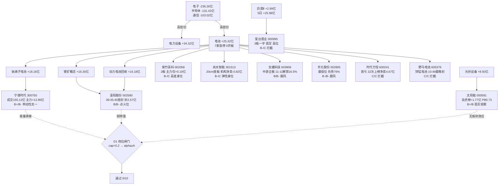

# 2026年11月4日 · **个股画像（R5 情报深挖）**

> **数据源新鲜度**：ok（R1 06:48 / R4 06:45 / R3 07:03 / R2 07:08 / R7 04:36 / 识图快照 07:10 / tushare 07:10）
> **降级状态**：false（vibe-trading 无入口 → tushare 单源，已注明；无 null 字段）
> **置信度**：0.78

---

## 一句话结论

**主线方向对、载体质量差、一个都不能买。** 锂电上游是本日唯一四源共振的方向（电池 +25.32 亿、7 家涨停 0 炸板、R4 E008 点名、R3 共振第 1），但 10 只候选里 **0 只通过 D1 档位闸门** —— 龙头是分离的：带动性在宁德（成交 155 亿但 72% 筹码套牢、收在 MA20 下方）、点火位在圣阳（09:35:45 最早首封但只有 1 板、获利盘 99%）、高度在紫竹（唯一 2 板但主力仅 +0.19 亿、PB 39.69），三个「最强」分属三只票，没有任何一只能同时满足「身位 + 资金 + 位置」。

---

## 详细分析

### ① 市场在为什么付钱：不是新主线，是「失血板块的第一次回补」

11-03 的资金迁徙非常干脆：**电子 -236.26 亿 / 半导体 -131.43 亿 / 通信 -103.02 亿单边失血，钱切到电力设备 +34.32 亿、电池 +25.32 亿、锂电池 +10.47 亿、电池化学品 +8.98 亿**（R7 sector_flows）。概念层更清楚：钠离子电池 +18.16 亿、锂矿概念 +16.30 亿、动力电池回收 +16.18 亿、麒麟电池 +12.08 亿，四条上游概念同步净流入。8 个交易日之前这些概念还被砸成负数（钠电 20 日 -143.73 亿）。

但「钱进来了」和「趋势成立」是两件事。看 20 日口径：**电池 -157.47 亿、电力设备 -393.27 亿、锂电池 -112.65 亿** —— 这是失血板块用一天时间回补了十分之一不到。配合 R1 的读数（情绪 39.5 恐惧、阶段 main_down、仓位上限 0.2）与全市场结构（涨停 48 家、炸板率 41.46%、跌停 17 家、最高板从 6 板降到 4 板、中位数 -0.65%），结论只能是一句话：**方向对，周期不对**。

### ② 龙头是分离的：带动性 / 点火位 / 高度分属三只票

这是本批最重要的结构发现，也是给 D1 最有用的一句话：

| 角色 | 标的 | 硬证据 | 致命短板 |
|---|---|---|---|
| 带动性龙一 | 宁德时代 300750 | 成交 155.12 亿 = 板块第二名 21 倍；主力 +12.85 亿、5 日 +18.07 亿；带动 7 家涨停 | 收 249.32 在 MA20（258.12）下方、20 日高 -21.2%、72% 筹码套牢 |
| 点火位 | 圣阳股份 002580 | 09:35:45 首封、零开板、封单 2.57 亿（当日全市场最硬，封/成交 0.357） | 只有 1 板；获利盘 99%；容量 84.5 亿；PE 91.9 分位 |
| 高度 | 紫竹高科 002058 | 唯一 2 板（09:48:48、零开板） | 主力仅 +0.19 亿（净占比 7.53%）；PB 39.69；净利 -89.5% |

在正常的主升行情里，这三个角色会叠加在同一只票上；现在分属三只，说明**资金还没决定谁是旗手**。这种结构在 main_down 阶段的典型演化是「高度先断（紫竹），容量后接（宁德），点位票反复（圣阳）」——所以「明日加速」这个假设从一开始就不该有。

### ③ 「电池 7 家涨停」要打折看：有效载体只有 5 家

`limit_list_d` 11-03 电池行业 7 家涨停，但按纪律逐只拆开，两家是标签性跟风：

- **野马电池 605378**：锌锰电池，与「钠电/锂矿/回收」上游没有产业链关系，10:49:25 最晚封板 + 1 次开板，成交仅 0.96 亿（7 家里最小），2026 中报首亏 -143.5%~-129.0%；
- **时代万恒 600241**：2026 中报首亏 -430.7%~-371.7%、2025 年报也首亏，30 日龙虎榜 **22 次、净卖 -4.67 亿（机构专用同额）** —— 这是「被反复派发过的壳型妖股在低位反抽」，10:21:28 封板、封单/成交仅 0.10。

剔除这两家，有效载体是：圣阳（点火）、紫竹（高度）、尚水（20cm 弹性）、丰元与龙蟠（候补，但都在中游/最弱位）。**7 这个数字不等于 7 个可交易机会。**

### ④ 环节决定生死：上游吸金、中游出货

R2 的结构结论在本批画像里被数据完整复现：上游三条概念（钠电/锂矿/回收）各 +16 至 +18 亿，而**锂电池概念指数当日 -0.82%、板块资金 -5.84 亿、固态电池 -0.46%/-3.41 亿**。落到个股上：

- 龙蟠科技（磷酸铁锂正极，中游）板型很干净（09:47:13 二封、零开板、封 0.77 亿），主力 +1.22 亿净占比 33.82% 是候补里最高，但 **11-11 有 9312 万股（占流通 16.48%）定增+增发解禁**，6 个交易日后到期，且公告连着「终止子公司投资 / 计提减值 / 控股股东质押」；
- 丰元股份（磷酸铁锂正极，最低位）距 30 日高 -26.1%、中报扭亏 +157.6%~+182.2%，但 09:55:54 才封板 + 开板 1 次，资产负债率 76.24%，融资余额 15 日 -25.56%。

**做中游等于做反方向**，这是我给它们 B / B- 的唯一原因，不是板型不好。

### ⑤ 估值三档分化：安全档只有 3 只

| 档位 | 标的 | 关键估值事实 |
|---|---|---|
| 安全 | 宁德时代 | PE 13.16（3 年 **1.1 分位**）/ PB 2.98 / ROE 17.83% / 净利 +31.60% |
| 安全 | 龙蟠科技 | PE 27.86（34.7 分位）/ PB 2.46 / 净利 +558.17%（但负债率 78.27%） |
| 安全 | 太阳能 | PB **0.73 破净** / 净利率 23.35% / 质押 0（但 PE 98.4 分位、净利 -21.73%） |
| 危险 | 紫竹高科 | PB **39.69** / PE 109.67 / 净利 -89.46% / 中报预减 -92.4%~-88.9% |
| 危险 | 皇台酒业 | PE **906.29**（97.5 分位）/ PB 19.84 / ROE -11.08% / 质押 23.39% |
| 危险 | 尚水智能 | PE 151.94（上市以来 100 分位）/ ROE 0.15% / 净利 -98.72% |

宁德在这张表里的位置值得单独说一句：**它是全批唯一「低估值 + 正增长 + 无红旗」的组合**，而且 206 篇研报 / 43 家机构覆盖。它缺的从来不是基本面，是价格结构。

---

## 候选池全表（10 只 · 按综合分排序）

| # | 代码 | 名称 | R2/扩池角色 | 龙头判定（v1.5） | α | 风险 | 综合分 | 禁止清单命中 |
|---|---|---|---|---|---|---|---|---|
| 1 | 300750.SZ | 宁德时代 | 龙一 | 龙头（带动性口径） | B+ | B- | 66.9 | plan_outside_scan |
| 2 | 002580.SZ | 圣阳股份 | 龙二 | 龙头（点火位·首封最早） | B | B- | 56.2 | plan_outside_scan |
| 3 | 000591.SZ | 太阳能 | 次线 top_stock | 孤军（真金容量，无行业梯队） | B+ | B | 56.1 | mid_laggard / non_mainstream / plan_outside_scan |
| 4 | 603906.SH | 龙蟠科技 | 候补（容量） | 跟风（中游环节，与只做上游冲突） | B | B- | 51.8 | mid_laggard / plan_outside_scan |
| 5 | 002805.SZ | 丰元股份 | 候补（低位） | 跟风（后段首板） | B- | B- | 44.7 | mid_laggard / plan_outside_scan |
| 6 | 002058.SZ | 紫竹高科 | 身位股 | 身位股（高度占位，非带动） | B- | C | 41.9 | mid_laggard / plan_outside_scan |
| 7 | 000995.SZ | 皇台酒业 | 次线 3 板身位 | 身位股（3 板孤军，高位） | B- | C | 41.2 | mid_laggard / non_mainstream / plan_outside_scan |
| 8 | 301513.SZ | 尚水智能 | 扩池·弹性核心 | 弹性身位（20cm，非龙头） | B- | C | 37.5 | mid_laggard / plan_outside_scan |
| 9 | 605378.SH | 野马电池 | 扩池·尾盘首板 | 孤军/跟风（标签性跟风） | C | C | 32.2 | mid_laggard / plan_outside_scan |
| 10 | 600241.SH | 时代万恒 | 扩池·低位首板 | 跟风（尾段首板 + 派发） | C | C | 29.1 | mid_laggard / plan_outside_scan |

**跨所有票的共同结论**：10 只全部命中 `plan_outside_scan` —— 因为 R2 execution_pool=[]、R1 定级 main_down，本批在纪律上**没有获得开仓授权**。这不是数据问题，是流程事实（R2 的 forbidden_scan 对 6 只候选 allowed_count=0）。

---

## 三问：每一只都必须回答的三个问题

### 宁德时代 300750

**大资金意图**：+12.85 亿主力净流入（净占比 8.28%）+ 5 日 +18.07 亿，但 R7 的 20 日口径仍是 **-14.71 亿**；同日大宗 49 笔 21.81 亿，买卖两边几乎全是「机构专用」（卖 42 席 / 买 44 席）、成交价 249.32 与收盘持平（平均溢价 -0.21%）—— **这是机构在内部搬仓，不是新增资金抢筹**。融资余额 15 日 -27.55% 而融券 +66.04%，杠杆盘在撤、空头在加。

**为什么走强**：不是它自己的逻辑，是**电子/半导体失血 470 亿之后的方向承接**。7 家电池涨停是结果，它是原因；但它自己不封板，说明「重仓资金敢买不敢拉」。

**逻辑够不够硬**：基本面够硬（PE 13.16 / 1.1 分位 / 净利 +31.6% / ROE 17.83% / 206 篇研报），**技术面不够硬**（MA20 下方、60 日 -36.55%、72% 筹码套牢、30 日区间位置 30.1%）。按「右侧交易」纪律，它现在不是右侧，是左侧反抽的第二天。

### 圣阳股份 002580

**大资金意图**：主力 +3.96 亿、净占比 54.67%，封单 2.57 亿（成交的 35.7%）—— 这是当日 48 家涨停里最硬的封单结构，零开板、缩量（量比 0.73）锁死。但 30 日龙虎榜仅 10-08 上榜一次（+1.89 亿），**11-03 的首板没有席位佐证**，封单来自盘口合力，不是已知游资的明牌。

**为什么走强**：三重身份叠加 —— 电池 7 家涨停里封板最早（09:35:45）+ 动力电池回收概念锚 + 玄学阳字辈（本轮 yáng 音族 13 家涨停）。**点火位是真的**：后面 6 家（龙蟠 09:47 / 紫竹 09:48 / 野马 09:49 / 丰元 09:55 / 尚水 10:05 / 时代 10:21）全部在它之后。

**逻辑够不够硬**：板型最硬、逻辑最软。PE 51.63（91.9 分位）、净利 -13.61%、0 篇研报、容量 84.5 亿。它只能做「次日弱转强的竞价确认」，不能做低吸——获利盘 99% 意味着低开就是踩踏。

### 太阳能 000591

**大资金意图**：主力 +2.79 亿、净占比 36.38%（全批最高），5 日 +2.97 亿且 **4/5 日为正**（本批持续性最好）；龙虎榜净买 +1.77 亿（全场个股第 2）——**国泰海通武汉紫阳东路 +1.00 亿（一线游资）、国泰海通北京知春路 +0.59 亿、开源西安西大街 +0.52 亿、深股通 +0.18 亿，机构专用 -0.13 亿**。这是本批唯一「游资 + 北向同向、机构只是微卖」的席位结构。

**为什么走强**：三重外壳 —— 光伏/储能次线（光伏设备 +8.50 亿）+ 玄学阳字辈 + 10-28 三季度利润分配方案（真分红）。同族 4 板的两只（阳光照明、东方海洋）当日主力分别 **-5.94 亿 / -0.43 亿**，高标在派发，钱往低位同族切，它接住了。

**逻辑够不够硬**：资金结构最硬（PB 0.73 破净 + 户数 -5.40% 集中 + 放量 4.14 倍创 30 日新高），但**板块效应不成立** —— 电力行业当日仅 1 家涨停（广度 1）。按「合力来自全市场，不是抱团」的纪律，它靠的是玄学族联动而非产业共振，周线还空头，距 MA50 已 +8.97%。所以：**资金给 B+，纪律给观察。**

---

## 思维链：三只重点票的四段推演

### 宁德时代 · 研究池首选，但不是今天的买点

- **买入理由**：主线方向唯一四源共振（R2 84 分 / R3 共振第 1 / R4 E008 / R7 电力设备+电池双第 1）+ 全批最低估值（PE 13.16、3 年 1.1 分位）+ 净利 +31.6% + 全批最高机构覆盖（206 篇 / 43 家）+ 唯一成交中心（155.12 亿，第二名的 21 倍）。买它等于买「这条线的容量」，而不是买「今天的情绪」。
- **风险点**：①72% 筹码套牢（平均成本 321.66 vs 收盘 249.32），任何反弹都是解套盘的出货窗口；②融资 15 日 -27.55% + 融券 +66.04% → 杠杆撤退 + 空头加注；③20 日主力仍 -14.71 亿，5 日转正只维持了 3 天；④股东户数 +27.83% 说明筹码在往散户手里散；⑤板块 20 日 -157.47 亿，长周期仍在失血。
- **止损条件**：跌破 MA5 236.13（距收盘 -5.3%）即为「深跌反抽结束」信号，全条线下调；若 11-04 低开且不能收回 240.20（11-03 最低价），视为承接失败。
- **可验证假设**：①11-04 电池行业主力净流入是否继续为正（连续第 4 日）；②能否放量站上 253.8（60 分与 15 分共同压力）并收在 258（日 MA20）上方 —— 站上才算右侧确认；③纳电/锂矿/回收三条上游概念是否仍在流入榜前 5。三条全中才谈「趋势起点」，中两条只是「反抽延续」，中一条以下直接放弃。

### 圣阳股份 · 点火位，只配「弱转强」通道

- **买入理由**：09:35:45 是电池 7 家涨停里最早的首封（比第二名龙蟠早 11 分 28 秒），封单 2.57 亿 / 成交 7.25 亿 = 0.357 是全市场最硬，零开板、缩量封死 —— 这是「板块合力」而不是抱团的典型形态。低位（距 30 日高 -13.0%、20 日 -0.16%）也符合「低位首板」的口径。
- **风险点**：①获利盘 99.0%，没有套牢盘意味着也没有承接成本，次日高开就是兑现窗口；②只有 1 板、板块最高 2 板，无梯队；③PE 51.63 处 91.9 分位而净利 -13.61%，估值撑不住第二板；④容量 84.5 亿、成交 7.25 亿，装不下大资金；⑤玄学属性随时可能从加分变成砸盘理由（同族 4 板两只当日主力净流出）。
- **止损条件**：竞价高开 >5% 直接放弃（先手筹码已在 2.57 亿封单里）；跌破 MA5 17.26（-7.6%）视为逻辑证伪，一刀切；盘中开板即离场，不等回封。
- **可验证假设**：①竞价是否落在 -2%~+3%（弱转强区间）；②开盘后能否站上 18.67（昨收）并维持 30 分钟；③同板块是否出现第三只 3 板（紫竹能否封住）—— 第三只成立说明情绪扩散，不成立说明是一日游。

### 太阳能 · 资金最干净，但纪律最不认

- **买入理由**：全批唯一「主力 5 日 4/5 日为正」+ 龙虎榜一线游资 +1.00 亿 + 深股通同向 + PB 0.73 破净 + 户数 -5.40% 集中 + 放量 4.14 倍创 30 日新高。纯看资金结构，它比主线里的任何一只都干净。
- **风险点**：①行业口径仅 1 家涨停（电力），**没有板块效应** —— 按「合力来自全市场」这条纪律，它的上涨靠梗族联动，断梗即断板；②周 K 仍空头排列（MA60 约 4.85 压制），距 MA50 已 +8.97%，追高即接盘；③PE 31.00 处 98.4 分位而净利 -21.73%；④玄学属性不纯（R2 原话「同族里资金结构最好，但属性不纯」）；⑤30 日区间位置 100%，没有上方空间参考。
- **止损条件**：跌破 4.20（识图止损位，距收盘 -8.5%）离场；回踩 4.35-4.45 若放量下跌（不是缩量）则视为派发，不接。
- **可验证假设**：①11-04 电力/光伏设备行业资金是否继续为正（光伏设备 5 日 +5.30 亿）；②玄学族是否还有第二只低位票封板（族内接力是否延续）；③能否守住 4.59（11-03 收盘 = 30 日高）不破。

---

## 板块 → 个股传导图

---

## 关键证据

- **证据 1**：11-03 电池行业 7 家涨停、0 家炸板，封板时间从 09:35:45（圣阳）到 10:49:25（野马）散开 74 分钟，说明是**接力式点火**而非一字板洪流。· 来源 `tushare limit_list_d 20261103`（48 家 U / 34 家 Z，炸板率 41.46%）
- **证据 2**：宁德时代 30 日大宗交易 49 笔 21.81 亿元、买卖双方 42/44 席均为「机构专用」、均价与收盘持平（溢价 -0.21%）→ 机构内部调仓，不构成分销信号。· 来源 `tushare block_trade`（explain 见 _r5_raw.json）
- **证据 3**：时代万恒 30 日龙虎榜 22 次、合计净卖 -4.67 亿元、机构专用同额 → 本批最明确的「席位反复派发」，叠加 2026 中报首亏 -430.7%~-371.7%。· 来源 `tushare top_list/top_inst` 逐日全市场 30 个交易日
- **证据 4**：太阳能 11-03 龙虎榜买方前三全为一线游资（国泰海通武汉紫阳东路 +1.00 亿 / 北京知春路 +0.59 亿 / 开源西安 +0.52 亿），机构专用仅 -0.13 亿。· 来源 `tushare top_inst 20261103`
- **证据 5**：龙蟠科技 2026-11-11 解禁 9312 万股 = 流通股 56507.89 万股的 **16.48%**，类型为定增股份 + 公开增发一般股份。· 来源 `tushare share_float`
- **证据 6**：宁德时代 PE_TTM 13.16 处 3 年 **1.1 分位**（样本 925 个交易日），同时净利同比 +31.60%、ROE 17.83% —— 全批唯一「低估值 + 正增长」。· 来源 `tushare daily_basic + fina_indicator`
- **证据 7**：紫竹高科获利盘 89.3%、股东户数环比 **+39.39%**、PB 39.69、净利同比 -89.46% —— 高度是靠散户接出来的，不是机构定价出来的。· 来源 `tushare cyq_chips + stk_holdernumber + daily_basic`
- **证据 8**：识图快照 10/10 命中当日（`data/raw/20261104/chart_vision_snapshot.json`，date=20261104 校验通过），10 只里 9 只偏多、宁德为震荡；**没有一只日 K + 周 K 同时多头**（除皇台日线多头/周线震荡外，其余日 K 或周 K 至少一个空头）。· 来源 `canghai-charts chart_vision 并发快照`

---

## 数据源审计

| 源 | 状态 | 抓取时间 | 记录数 | 备注 |
|---|---|---|---|---|
| R1_style | 🟢 ok | 11-04 06:48 | 1 | main_down / 情绪 39.5 / cap 0.20 |
| R2_main_sectors | 🟢 ok | 11-04 07:08 | 1 主线 + 3 次线 + 5 龙头 | execution_pool=[]，forbidden_scan allowed=0 |
| R3_sentiment | 🟢 ok | 11-04 07:03 | 1 | 共振第 1 = 锂电上游（L1+L2b，第 1 名） |
| R4_news | 🟢 ok | 11-04 06:45 | 8 事件 | `stocks_catalyzed` 为空（催化只到主题级） |
| R7_capital_flow | 🟢 ok | 11-04 04:36 | 496 行业 + 534 概念 | 北向自 10-28 停抓，已注明 |
| chart_vision_snapshot | 🟢 ok | 11-04 07:10 | 17 票（本批 10/10 命中） | date=20261104 校验通过，无跨日指针 |
| tushare daily/adj_factor | 🟢 ok | 11-04 07:10 | 10 票 × 133-166 根 | 前复权，最短 133 根（尚水智能次新） |
| tushare limit_list_d | 🟢 ok | 11-04 07:10 | 48 U / 17 D / 34 Z | 行业广度按「电池 7」口径 |
| tushare top_list/top_inst | 🟢 ok | 11-04 07:11 | 30 交易日 / 2315 行 | 逐日全市场拉取（top_list 只吃 trade_date） |
| tushare block_trade/margin_detail | 🟢 ok | 11-04 07:10 | 10 票 30 日/15 日 | 4 只非两融标的，已注明非取数失败 |
| tushare fina_indicator/balancesheet/income/cashflow | 🟢 ok | 11-04 07:10 | 10 票 × 4 期 | 2025Q1-2026Q3 |
| tushare forecast/express | 🟢 ok | 11-04 07:10 | 10 票 | 紫竹预减 / 丰元扭亏 / 时代首亏 / 野马首亏 |
| tushare cyq_chips/stk_holdernumber | 🟢 ok | 11-04 07:10 | 10 票 | 筹码分布 + 户数环比 |
| tushare report_rc/stk_surv | 🟢 ok | 11-04 07:10 | 206+6+3… 篇 | 宁德 206 篇/43 家为全批最高 |
| tushare anns_d | 🟢 ok | 11-04 07:10 | 410 条（10 票） | 07-01 至 11-03 |
| tushare share_float | 🟢 ok | 11-04 07:10 | 龙蟠 18 行 11-11 解禁 | 其余 9 只无 11-04 后解禁 |
| czsc 缠论 | 🟢 ok | 11-04 07:11 | 10/10 | czsc 0.10.12，日线笔/中枢 |
| vibe-trading MCP | 🟡 降级 | — | 0 | 本会话无工具入口 → 大宗/两融改 tushare 单源，无 null 字段 |
| 盘中数据（09:25 后） | ⚪ 未用 | — | 0 | 盘前件，所有价格为 11-03 收盘口径 |

---

## 不确定性 / 反证

**自我批判一：我给宁德 B+ / B- 是否太保守？** 它的估值、业绩、机构覆盖、资金量级都是全批第一。但 R5 的职责不是给「好公司」打分，是给「今天能不能买」分档 —— 72% 套牢 + MA20 下方 + 融资撤退 + 20 日主力仍净流出，这四条里任何一条都足以让「右侧交易」失效。如果 11-04 它放量站上 258，本档位应立刻上调至 A-，我接受这个可能被证伪的风险。

**自我批判二：太阳能 B+/B 是否给高了？** 它的行业广度只有 1，按 v1.5 判「孤军」，理论上该降级。我给它 B+ 的理由是资金结构的独立性（一线游资 + 深股通同向、5 日 4/5 正、PB 破净、户数集中），而不是板块效应。如果明天梗族退潮，它会是本批跌得最快的一只 —— 反证条件写得很清楚：跌破 4.20 即证伪。

**自我批判三：扩池的 5 只可能稀释了主线浓度。** v1.4 规定的扩池来源（R2 `all_scored_boards_top10[].top_stock`）在本日全为 null，我改用了两个替代来源：主线内涨停广度（电池 7 家涨停，R2 只覆盖 4 家）+ R2 次线 top_stocks。前者有 `limit_list_d` 硬证据，后者有 R2 原文出处，但**严格说过不了 v1.4 的字面口径**。我把它们全部标了 `r2_expand_pool` 且起步 -3 分，并在 `r2_schema_note` 里写清了替代路径 —— 请 E1 复盘时按此口径审计。

**自我批判四：三处数据口径不一致需要 R6 复核。**
- R7 `market_breadth.read` 写「中位数 -0.42%」，但同结构里 `median_pct` 为 **-0.65%**，我采用结构字段值；
- 圣阳 `lhb_inst_net_30d_yi` 为 +2.24 亿而 `lhb_net_30d_yi` 仅 +1.89 亿（机构净买 > 全席位净买），是 top_list 与 top_inst 两条统计口径差异，未做修正，只作参考；
- 宁德「未封板」导致 `limit_list_d` 无记录，其 `industry_zt` 只能用行业映射（电池 7 家），非自身涨停。

**反证清单（交给 R6）**：①宁德 short_pressure（融资 -27.55% / 融券 +66.04%）是否构成「反弹即出货」；②时代万恒 22 次上榜净卖 -4.67 亿是否已在 11-03 完成最后一轮派发；③龙蟠 11-11 解禁 16.48% 是否会被提前反应；④紫竹 PB 39.69 + 户数 +39.39% 的「散户接高度」结构是否在 3 板处崩断；⑤皇台一字 3 板 + 获利盘 100% 是否已进入「无人接盘」的最后一棒；⑥「电池 7 家涨停」剔除 2 家标签性跟风后只剩 5 家，板块效应是否足以支撑「主线」定性。

---

## 与其他 R/D/E 的关系

- **依赖**：`R1_style`（市场阶段与仓位上限）、`R2_main_sectors`（龙头池与板块结构）、`R3_sentiment`（共振排序）、`R4_news`（事件催化）、`R7_capital_flow`（行业/概念/个股资金）、`tushare`（22 类行情与基本面）、`canghai-charts chart_vision`（形态识图）、`czsc`（缠论结构）
- **被消费**：`R6_devil_advocate`（六类反证模式，重点取 `distribution_alert` / `short_pressure` / 解禁）、`D1_main_decision`（execution_pool 与 watch_pool 的 α/risk 双档闸门、龙头判定、禁止清单命中）、`E1_review`（档位与实盘结果对照）

---

## Sub-Agent 元数据

- **skill**：`analyze_stock_profile_v1` v1.5（含 v1.4 扩池规则、2026-11-02 识图结构标签、2026-09-30 双档硬约束）
- **artifact**：`data/research/20261104/R5_stock_profiles.json`（198.7 KB / 10 profiles / status=complete）
- **渲染脚本**：`scripts/research/r5_fetch_20261104.py` → `r5_compute_20261104.py` → `r5_chanlun_20261104.py` → `r5_timeline_20261104.py` → `r5_assemble_20261104.py`
- **校验脚本**：`scripts/research/check_r5_20261104.py`（ERRORS=0 / WARNINGS=0）
- **生成耗时**：数据拉取约 5 分 40 秒（10 票 × 22 类）· 识图快照 24.24 秒（10/10）· 缠论 1.6 秒 · 组装与校验 < 3 秒
- **model**：deepseek-v4.1-flash（识图 vision 同模型）
- **D1 闸门模拟**：cap=0.20（最严格档：alpha≥A 且 risk≥B）→ **通过 0/10**；探针档（alpha≥B）通过 6/10（宁德、圣阳、太阳能、龙蟠、丰元、紫竹），但探针档不等于开仓资格
