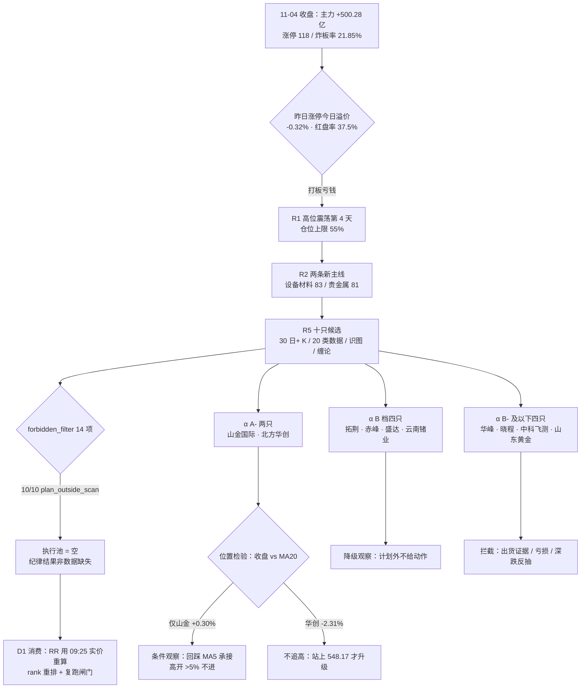

# 2026-11-05 · **个股画像（R5）**

> **数据源新鲜度**：partial（唯一缺口 = vibe-trading 双源交叉）
> **降级状态**：yes（仅筹码维度单源，主源 tushare 三件套完整）
> **置信度**：0.72 · 10 只候选全覆盖 · K 线最少 157 根

## 一句话结论

两条新主线（半导体设备/材料 83 分、贵金属 81 分）都是 formation 第 1 天、全场 0 连板，**10 只候选无一取得开仓资格**；相对最好的是 **山金国际（α A- / 风险 B+）与北方华创（α A- / 风险 B）**，但两者的买点都是「回踩承接」而不是「追涨停」，其余 8 只按纪律降级或拦截。

## 详细分析

### 1. 今日市场前提：资金回来了，但打板还在亏钱

T-1（11-04）是资金回补日：主力净额 **+500.28 亿**（近 20 日最大单日）、上证 +2.16% / 深成 +4.22% / 创业板 +6.40% / 科创50 +9.92%、涨停 118 家、炸板率 21.85%（低于 35% 红线）。但结构极窄 —— 电子 +312.63 亿、半导体 +195.89 亿，而 20 日底座电子仍 **-1176.61 亿**、半导体 -454.59 亿：钱是从消费金融单日切向科技，不是 20 日建仓。

更要紧的是赚钱效应：昨日涨停股今日收盘溢价 **-0.32%**（中位 -2.34%）、红盘率 37.5%、再涨停仅 12 只。R1 因此把今日定为 **高位震荡第 4 天**（情绪 64.1、仓位上限 55%），并写明「只做核心承接、不追高、不接力高位」。⇒ **今日一切画像的前提是：涨停是兑现窗口，不是进攻信号。**

### 2. 两条主线的同构缺陷：只有广度，没有高度

| 主线 | R2 分 | 五维 | 涨停家数 | 最高身位 | 开板/封单 | 5 日资金 |
|---|---|---|---|---|---|---|
| 半导体设备/材料 | 83 | 热18 资17 停19 叙13 共16 | 半导体 19 + 元件 7 + 专业设备 6 | **1 板（0 连板）** | 封单 29.28 亿 | 设备 **+37.07 亿**（电子链唯一正） |
| 贵金属（金银） | 81 | 热14 资17 停15 叙19 共16 | 11 | **1 板（0 连板）** | 封单 9.20 亿 / 开板 18 次 | 贵金属 +4.45 亿（四连负后转正） |

两条线的形态完全一样：**首板日 + 无梯队 + 隔夜外盘反向**。半导体面对费半 -5.00%、阿斯麦 -4.60%、美光 -7.00%；贵金属面对的是「事件次日」（民主党中期选举大胜 → 现货金 +3.57% 破 4070、银 +5% 报 52.26 已在隔夜发生）。所以今日真正的分歧不是「涨不涨」，而是 **高开之后谁被接力、谁被兑现**。

分支污染是半导体这条线最大的认知门槛：R4 给设备 +0.620 / 材料 +0.434 正面，同时给半导体 -0.820 / 存储 -0.820 / CPO -0.574 负面，CPO 20 日 -1003.29 亿。**买错分支=买反方向**，本批 5 只全部落在设备/材料侧，未混入存储分支。

### 3. 个股分层：10 只、2 个 A-、0 个可开仓

| 代码 | 名称 | 主线 | R2 口位 | α | 风险 | 综合 | 收盘 | 距 MA20 | 距 MA50 | 主力 5 日 | 封单 | 首封 | 换手 | 态度 |
|---|---|---|---|---|---|---|---|---|---|---|---|---|---|---|
| 000975 | 山金国际 | 贵金属 | 龙一 | **A-** | **B+** | 73.4 | 23.08 | **+0.30%** | -6.58% | **+4.12 亿**（5/5 正） | 0.83 亿 | 13:33 | 2.09% | 🟡 条件观察 |
| 002371 | 北方华创 | 设备 | 龙一 | **A-** | B | 68.8 | 535.50 | -2.31% | -13.66% | **+16.27 亿**（4/5 正） | 3.56 亿 | 13:47 | 1.68% | 🟡 不追高 |
| 688072 | 拓荆科技 | 设备 | 龙二 | B+ | B- | 65.3 | 487.79 | -8.85% | -20.50% | +4.11 亿（2/5） | 1.24 亿 | **14:33** | 3.79% | 🟠 降级观察 |
| 600988 | 赤峰黄金 | 贵金属 | 龙二 | B | B- | 62.3 | 34.54 | -8.12% | -17.30% | **-1.31 亿**（1/5） | **2.21 亿** | 13:30 | 3.80% | 🟠 降级观察 |
| 000603 | 盛达资源 | 贵金属 | 候补 | B- | B- | 59.6 | 23.68 | -8.53% | -24.10% | -0.24 亿（1/5） | 1.96 亿 | **13:24** | 6.44% | 🟠 降级观察 |
| 002428 | 云南锗业 | 设备 | 候补（**分支龙头**） | B+ | B- | 59.4 | 75.38 | -3.67% | -13.84% | **+10.93 亿**（3/5） | **4.09 亿** | **09:32** | 13.15% | 🟠 降级观察 |
| 688200 | 华峰测控 | 设备 | 候补 | B- | **C** | 54.0 | 218.53 | -22.44% | -36.08% | +1.89 亿（2/5） | 1.49 亿 | 13:52 | 4.77% | 🔴 拦截 |
| 300139 | 晓程科技 | 贵金属 | 候补 | B- | **C** | 52.1 | 38.23 | **+1.45%** | -14.93% | +3.22 亿（2/5） | 0.94 亿 | 13:35 | **22.86%** | 🔴 拦截 |
| 688361 | 中科飞测 | 设备 | 候补 | **C** | **C** | 50.6 | 246.74 | -12.34% | -22.74% | +0.89 亿（3/5） | 1.52 亿 | **14:00** | 4.08% | 🔴 拦截 |
| 600547 | 山东黄金 | 贵金属 | 候补 | **C** | **C** | 48.8 | 25.51 | -0.29% | -16.79% | -1.15 亿（2/5） | **0.46 亿** | **14:24** | 3.47% | 🔴 拦截 |

三条横向事实：

- **位置集体不合格**：10/10 收在 MA50 下方（-6.58% ~ -36.08%）、8/10 收在 MA20 下方、8/10 MA5 斜率为负 ⇒ 全部是「深跌反抽第一次收复」，没有一只处在趋势突破位。
- **档位天花板低**：α 最高只有 A-，无 A/A+。理由写在 `grade_method` 里：给 A 需要「地位 + 位置 + 资金持续性」三条同时成立，本批无一满足。
- **闸门全灭**：forbidden_filter 10/10 命中 `plan_outside_scan`（R2 execution_pool=[]，本批无计划），另有 4 只 `late_speculation`（拓荆 14:33 / 中科飞测 14:00 / 山东黄金 14:24）、6 只 `mid_laggard`（候补口位）。**研究结论 ≠ 开仓资格**，这一点必须在 D1 侧保持。

### 4. 首推票思维链

**① 山金国际（000975.SZ）· α A- / 风险 B+ / 综合 73.4 —— 本批唯一「位置 + 资金 + 估值」三重达标**

- **买入理由**：站上 MA20（+0.30%）、距 20 日高（25.03）仅 -7.8%、20 日 +1.41%、60 日 +2.30%，是全批唯一没在下跌通道里的票；主力 5 日 +4.12 亿且 **5/5 天全为正**（全批唯一）；PE 17.23 处 3 年 6.6 分位、ROE 20.27%、资产负债率 26.86%、商誉 2.7%、质押 0.70% —— 财务最干净。
- **风险点**：封单仅 0.83 亿、开板 2 次（板块 11 家封单合计 9.20 亿、开板 18 次 = 情绪板不是锁仓板）；驱动是外盘映射的事件次日；融券余额 15 日 **+24.14%**（全批唯一融券上升，空头在加注）；公募/卖方覆盖厚（68 篇 / 17 家）意味着预期已充分。
- **止损条件**：参考 MA5 21.632（距 23.08 约 -6.3%，落在 -5%~-10% 硬区间）；跌破 21.63 且金银低开 → 事件驱动逻辑证伪，离场不讲故事。
- **可验证假设**：①11-05 竞价高开 ≤5%（R3 纪律：>5% 一律不进）；②开盘后回踩 21.6-22.0 缩量、盘中重新站上 23.08；③贵金属板块当日主力净额续为正（T-1 +23.49 亿）。三条同时成立才算「低吸承接」成立，任一不成立当日只观察。

**② 北方华创（002371.SZ）· α A- / 风险 B / 综合 68.8 —— R4「研究首选」，但位置与估值双扣分**

- **买入理由**：设备链唯一同时满足「封单 3.56 亿 + 0 开板 + 3895 亿容量 + 主力 8.12 亿（净流入率 12.94%）」的核心，5 日主力 +16.27 亿（4/5 天正、序列逐日走强）；R7 半导体设备 +42.47 亿 / 5 日 +37.07 亿是电子链**唯一** 5 日净流入子行业；R4 直接点名「研究首选」。
- **风险点**：PE 67.40 处 3 年 **84.5 分位**，净利同比仅 +5.10% ⇒ PEG 远大于 1（红旗 V2）；筹码仅 22.5% 获利、平均成本 654.79、**77.5% 套牢**；融资余额 15 日 **-36.85%**（杠杆盘撤退）；收盘仍在 MA20 548.17 下方 -2.31%；首封 13:47 属午后板。
- **止损条件**：MA5 500.47（距 535.50 约 -6.5%）；若开盘不能站上 548.17 则维持「反抽」定性、不加仓。
- **可验证假设**：①竞价高开 ≤3%（>3% 视为给隔夜盘抬轿，R2 明文）；②盘中站上 MA20 548.17 并收住；③设备板块当日资金续正。三条缺一即降为纯观察。

**③ 云南锗业（002428.SZ）· α B+ / 风险 B- / 综合 59.4 —— 唯一「订单级催化 + 涨停同日」，但身份冲突**

- 它同时是两种东西：R2 主线口位 **候补（rank4，命中 mid_laggard）**，以及材料/小金属分支的 **真龙头**（09:32 首封全批最早、封单 4.09 亿全批最大、主力单日 +15.23 亿、R7 小金属 leader_stock 就是它）。11-04 同日公告「签订日常经营重大合同」（磷化铟衬底 AOI 2027-2031 每年 18 万片）—— 本批唯一公告与涨停同日。
- 反面：PE 276.59 / PB 30.20、开板 3 次、换手 13.15%、MA5 斜率 -9.21%、20 日 -13.23%。**结论：研究价值高、执行价值低**；D1 若要评估它，必须按「材料分支」单独算 rank，而不是直接用主线 rank4 划掉，也不该把它当主线龙一用。

### 5. 三条必须写下来的负面证据

- **山东黄金是本批最清晰的「出货证据链」**：30 日龙虎榜净卖 **-2.28 亿**（机构专用 -2.28 亿）、11-04 大宗折价 **-8.06%**、融券余额 15 日 **+70.10%**、封单仅 0.46 亿（板块最薄）、首封 14:24、商誉/净资产 27.4%、净利同比 -19.60% ⇒ risk_grade 直接 C 并打 `distribution_alert`。
- **赤峰黄金是「封单厚但资金不持续」的样板**：封单 2.21 亿板块第一，主力 5 日却 **-1.31 亿**（1/5 天正）。R4 自己的评语就是「资金仅单日流入，金价若不能续创新高易一日游」。
- **中科飞测是「最贵的亏损票」**：ROE -1.86%、净利同比 -547%、PE 不可用、PB 16.95、融资余额 15 日 **-67.13%**、首封 14:00。唯一的正面是 11-04 董事长提议回购 + 341 次机构调研（机构在等拐点，不是在买今天）。

## 关键证据

- **证据 1**：11-04 主力净额 +500.28 亿、涨停 118 家、炸板率 21.85%、昨日涨停收盘溢价 -0.32%（中位 -2.34%）· 来源 R1_style / R7_capital_flow
- **证据 2**：半导体设备 +42.47 亿（5 日 +37.07 亿，电子链唯一 5 日正流入）、贵金属 +23.49 亿（净流入率 12.06% 全场第 2）· 来源 R7_capital_flow sector_flows
- **证据 3**：设备指数 11-04 +15.22% 涨停潮、长鑫回购上限提至 50 亿、拓荆/芯源微/中科飞测/京仪装备 20cm（E20261105_003）；隔夜费半 -5.00%、阿斯麦 -4.60%、美光 -7.00%（E20261105_002 半导体 -0.82） · 来源 R4_news
- **证据 4**：现货金 +3.57% 破 4070、银 +5.00% 报 52.26、花旗 0-3 月目标 4500（E20261105_001，贵金属 sector_polarity +0.850 为 20 板块最高） · 来源 R4_news
- **证据 5**：云南锗业 11-04「关于签订日常经营重大合同」+ 09:32 首封 + 封单 4.09 亿 + 主力 +15.23 亿 · 来源 tushare anns_d / limit_list_d / 东财 DC
- **证据 6**：山东黄金 30 日龙虎榜净卖 -2.28 亿（机构专用）、大宗折价 -8.06%、融券 +70.10% · 来源 tushare top_list / top_inst / block_trade / margin_detail
- **证据 7**：10/10 识图偏多但缠论 above_zs 全为 False（中枢下方），chanlun_confirmed 2 例 / divergence 7 例 · 来源 chart_vision_snapshot + czsc

## 数据源审计

| 源 | 状态 | 抓取时间 | 记录数 | 备注 |
|---|---|---|---|---|
| R1_style | 🟢 ok | 2026-11-05 | 1 | 高位震荡第 4 天 / cap 0.55 |
| R2_main_sectors | 🟢 ok | 2026-11-05 | 2 线 10 候选 | execution_pool=[] |
| R4_news | 🟢 ok | 2026-11-05 | 8 事件 | E001/E002/E003 为关键 |
| R7_capital_flow | 🟢 ok | 2026-11-05 | 196 板块 + 534 概念 | 与 R5 复算容差 <0.02 亿 |
| tushare 逐票 20 类 | 🟢 ok | 2026-11-05 | 10 票 · 0 error | daily/adj/basic/两融/大宗/财报/公告 |
| tushare 龙虎榜 30 交易日 | 🟢 ok | 2026-11-05 | 34 条命中 | top_list 逐日全市场拉再筛 |
| chart_vision 快照 | 🟢 ok | 2026-11-05 | 10/10 | 并发预渲染 37.1s |
| czsc 缠论 | 🟢 ok | 2026-11-05 | 10/10 | 0.10.12 · 分型/笔/中枢 |
| vibe-trading 交叉 | 🔴 error | - | 0 | MCP 无入口 · 筹码未双源 |

## 不确定性 / 反证

1. **盘前无价**：所有位置判断基于 11-04 收盘，09:25 竞价一旦高开 >3%（科技）或 >5%（贵金属），本报告的「低吸承接」结论全部作废，RR 必须由 D1 重算。
2. **我的档位可能偏严**：给 0 个 A 是刻意选择 —— 但反过来说，如果今日设备链真出现 2 板梯队（目前 0 连板），那么「无高度」这一条扣分会被证伪，北方华创/拓荆的 α 应上调。这一点我接受被事后纠正。
3. **识图与缠论 10/10 分歧**：识图判短线结构转多（60 分/15 分），缠论判定 10/10 仍在日线中枢下方。两者不是矛盾而是不同时间尺度；我把它们记为 divergence 而不是买入依据，代价是可能错过「短线先走、中线后到」的强势票。
4. **筹码维度是单源**：vibe-trading 交叉未做，若 eastmoney 侧大宗/两融口径与 tushare 有系统差（历史上单笔差异 <2%），山东黄金的 distribution 判定强度会浮动，但 -8.06% 折价与 -2.28 亿龙虎榜净卖两条独立证据同向，结论不易翻转。
5. **R2 与 R5 的 rank 冲突**：云南锗业主线 rank4 vs 分支龙头。我保留了两套口径而不是二选一 —— 这是有意的未决，须由 D1 在竞价位用板块宽度再确认。

## 与其他 R/D/E 的关系

- **依赖**：R1（情绪阶段/仓位上限）、R2（候选池/主线分/stage）、R4（催化事件与个股点名）、R7（板块与个股资金，与 R5 复算对齐）、tushare 原始数据、chart_vision 快照、czsc
- **被消费**：D1（execution_pool 逐票门禁、watch_pool、RR 计算）、R6（反证：出货模式、档位异常）、E1（复盘：档位准不准）

## Sub-Agent 元数据

- skill: analyze_stock_profile_v1@1.6
- artifact: data/research/20261105/R5_stock_profiles.json
- 生成耗时: 约 1650 秒（拉数 38s · 识图 37s · 计算/评分/写作 ~1570s）
- model: deepseek-v4.1-flash
