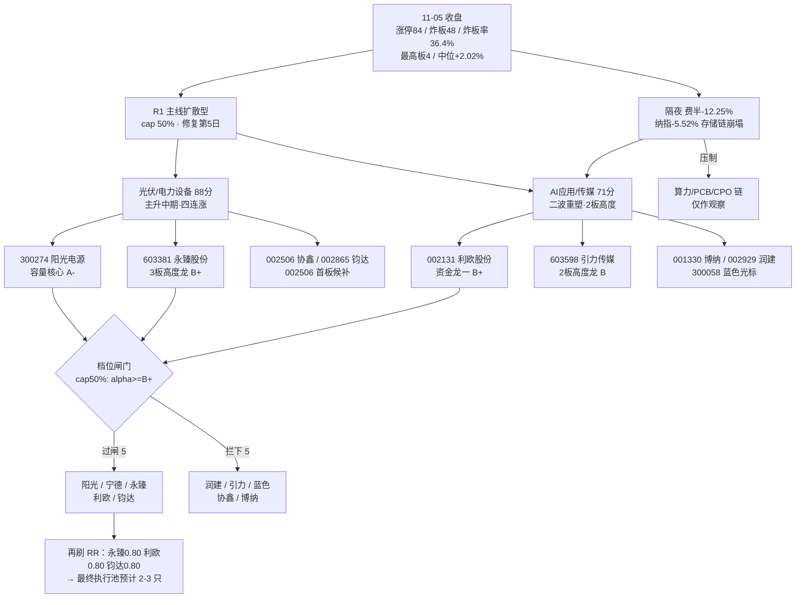

# 2026年11月6日 · **个股画像**

> **数据源新鲜度**: ok（行情=11-05 收盘全量 · 识图=当日 07:26 快照）
> **降级状态**: false（10/10 票六维完整，无 partial）
> **置信度**: 0.81 — 数值层全量自算 + 识图层当日命中；扣分项见「不确定性」节

## 一句话结论

**今天是「广度满格、封板质量差、外盘崩了」的修复第 5 天：84 家涨停但炸板 48 家（36.36%）、最高仅 4 板，隔夜费半 -12.25% 直接把 AI 硬件链按在地上。十条候选里只有 5 只能过 cap 50% 的档位闸门，而真正「位置对 + 资金硬 + 逻辑没坏」的只有阳光电源与宁德时代两只；其余 8 只全部带明确短板——要么财务硬伤（永臻 F8、润建 CFO -39.87 亿），要么治理风险（引力控股股东股份被冻结），要么就是派发（博纳、蓝色光标）。今天不是重仓日，是「只做龙头分歧低吸 + 拒绝一切计划外」的日子。**

## 今日市场底色（先认市场，再认个股）

| 项 | 读数 | 含义 |
|---|---|---|
| 涨跌家数 | 4869 涨 / 625 跌 / 77 平 | 广度 87.4%，普涨但缺主线聚焦 |
| 涨停 / 炸板 | 84 涨停 / 48 炸板 = **36.36%** | 越过 35% 红线 → 情绪=震荡，候选砍半 |
| 最高板 | 4 板 | 高度未打开，接力资金谨慎 |
| 中位涨幅 | +2.02% | 赚钱效应在中位股，不在高位 |
| R1 风格 | 主线扩散型 | 主线扩散，非单点抱团 |
| R1 周期 | high_chop | 修复段第 5 个交易日，按「二次验证日」处理 |
| R1 仓位上限 | **50%** | 炸板率+外盘双压制，不给满仓 |
| 隔夜外盘 | 纳指 -5.52% / 费半 -12.25% / 道指 -3.44%（E001 负面） | 直接打击 AI 算力/PCB/存储，间接利好光伏（关税+新能源政策） |

**阶段判读**：R2 给光伏「主升中期」、AI 应用「二波重塑」，但两者的**位置**完全不同 —— 光伏是「四连涨后的第 4 天」，AI 是「11-02 首波 17 家 → 11-04 只剩 1 家 → 11-05 回 7 家」的二波反抽。同样是 mid_up，光伏做的是**趋势票的分歧低吸**，AI 做的是**反抽的接力确认**，两套打法不能混。

## 候选池与档位总表

| # | 名称 | 代码 | 板块 | 身位 | 收盘 | 今日 | 5日 | 位置(30d) | 主力5日(亿) | 获利盘 | alpha | risk | 综合 | D1 态度 |
|---|---|---|---|---|---|---|---|---|---|---|---|---|---|---|
| 1 | **阳光电源** | 300274.SZ | 光伏/电力设备 | 容量核心 | 85.14 | +4.89% | +26.7% | 79.0% | +19.42 | 71.9% | **A-** | **B+** | 77.9 | 观察 |
| 2 | **永臻股份** | 603381.SH | 光伏/电力设备 | 龙头 | 18.85 | +9.98% | +32.7% | 100.0% | +1.10 | 97.5% | **B+** | **B-** | 64.0 | 进（只在竞价确认后打板） |
| 3 | **协鑫集成** | 002506.SZ | 光伏/电力设备 | 龙头 | 2.54 | +9.96% | +15.5% | 95.7% | +2.24 | 89.5% | **B-** | **C** | 54.2 | 拦截 |
| 4 | **钧达股份** | 002865.SZ | 光伏/电力设备 | 龙头 | 43.67 | +10.00% | +13.1% | 100.0% | +2.47 | 98.5% | **B+** | **B-** | 64.4 | 降级观察 |
| 5 | **宁德时代** | 300750.SZ | 光伏/电力设备 | 容量核心 | 264.06 | +4.42% | +15.3% | 50.9% | +45.47 | 33.5% | **A-** | **B+** | 77.4 | 观察 |
| 6 | **利欧股份** | 002131.SZ | AI应用/传媒 | 龙头 | 4.39 | +10.03% | +10.3% | 70.6% | +8.89 | 83.2% | **B+** | **B-** | 64.9 | 进（半路 4.35-4.45 区间承接） |
| 7 | **引力传媒** | 603598.SH | AI应用/传媒 | 龙头 | 21.66 | +10.01% | +24.0% | 80.7% | +3.49 | 98.5% | **B** | **C** | 52.6 | 拦截 |
| 8 | **博纳影业** | 001330.SZ | AI应用/传媒 | 补涨/跟风 | 6.16 | +10.00% | +12.4% | 42.8% | +2.02 | 94.1% | **C** | **B-** | 47.1 | 拦截 |
| 9 | **润建股份** | 002929.SZ | AI应用/传媒 | 孤军/跟风 | 57.37 | +10.01% | +4.2% | 80.7% | +0.83 | 93.1% | **B** | **B-** | 64.7 | 不进 |
| 10 | **蓝色光标** | 300058.SZ | AI应用/传媒 | 容量核心 | 13.37 | +6.62% | +12.8% | 69.2% | +3.26 | 79.2% | **B-** | **B-** | 59.8 | 不进 |

**闸门结果（cap=0.5）**：过闸 5 只 → 阳光电源 / 永臻股份 / 钧达股份 / 宁德时代 / 利欧股份；拦下 5 只 → 润建股份（alpha B）、引力传媒（B）、蓝色光标（B-）、协鑫集成（B-）、博纳影业（C）。

**过闸≠可买**：永臻、利欧、钧达的 R2 口径 RR 全部 0.80（<2），D1 的「RR<2 一律降级 watch」会再刷一层。**真正满足「位置+资金+估值+技术」四项同时成立的只有阳光电源（踩在 MA50 决策线上）和宁德时代（MA20 上方、PE 4.8 分位）。**

## 逐票六维画像

### 1. 阳光电源（300274.SZ）· 光伏/电力设备 · 容量核心（带动性龙一） · 🟢 过闸

| 档位 | 综合 | 身位/广度 | 收盘 | 位置 | MA20 | MA50(决策线) | 5日量/20日量 |
|---|---|---|---|---|---|---|---|
| alpha **A-** / risk **B+** | 77.9 | 1 号位 · 板块涨停 18 家 | 85.14（+4.89%） | 79.0% | 74.774 | 84.261 | 1.8 |

- **①催化 88**：E002 民主党叫停关税 + E003 光伏四连涨涨停潮双正面叠加，且直接命中储能系统全球第一 + 逆变器全球第一的双主业，是产业级利好不是一次性事件；但公司自身无业绩催化，Q3 营收 -26.4%、净利 -44.5%，题材强于基本面。
- **②筹码 72**：主力 +5.03 亿（净率 3.86%），5 日 +19.42 亿（4/5 日为正），但 20 日仍 -14.14 亿——5 日回补、20 日未回本。无龙虎榜（游资未参与，机构定价）。两融余额 15 日 -12.2%、融券 -27.8%，杠杆资金在撤退而股价在涨，说明推动力来自 ETF/北向类被动盘。大宗交易 0 笔。股东户数 32.4 万户环比 +15.94%，筹码分散；获利盘 71.9%，平均成本低于现价，套牢盘主要在 90-122。
- **③板块 92**：R2 光伏/电力设备 88 分（全市场第一），当日光伏设备 18 家涨停、电池 2 家、电网设备 3 家，板块效应满格。身位口径：未封板但成交 130.5 亿=板块第二名 2 倍以上，板块 18 家涨停由它定价，属「大容量核心未封板仍为龙一」的带动性龙头，不是身位龙（高度锚在永臻 3 板）。
- **④估值 68**：PE_TTM 21.58（250 日 50 分位）、PB 3.57（12.4 分位）、PS 2.46；ROE 13.74%、毛利率 33.54%、负债率 61.64%。估值处在自身历史中低位，但净利同比 -44.5% 与营收 -26.4% 说明价在「低位+业绩下滑」双杀末段，估值便宜不代表业绩见底。红旗：F4 存货增速超收入 1.5 倍、F9 应收/营收 44.7%。
- **⑤技术 62**：70 根前复权日线（10-05 起 245 根更长期结构）。11-05 收 85.14 涨 4.89%，连续第 4 根阳线、5 日 +26.7%，站上 MA5 75.77/MA20 74.77/MA50 84.26（决策线刚收复），但 MA20 五日斜率仍 -2.11%，距 60 日高 -29.8%，30 日位置 79%。量比 1.95、5 日量/20 日量 2.69——是放量修复。缠论：23 笔 7 中枢，最后一笔向下（09-21→11-01，90.25→62.00，-31%），当前未完成笔向上（自 62.00 起 5 根），收盘仍在 08-10~11-01 中枢（83.12-90.25）内（pos_in_zs 28.3%）—— 中枢内反弹，未构成三买。
- **⑥机构 80**：近 30 日 17 篇研报（买入 9 / 推荐 6）、近 90 日 9 条调研记录，覆盖度全批第二；但 11-05 大摩把宁德多头持仓比例降至 5.89%、瑞银降至 4.82%——外资在减，机构文字面仍偏多。

**推理三问**

- **大资金意图**：5 日 +19.42 亿（4/5 日为正）但 20 日仍 -14.14 亿，说明这是「先撤后回」的回补仓，不是新开仓 —— 资金在赌后天（11-06）美股政策与国内装机数据，不是赌今天。两融 15 日 -12.2% 与主力 5 日 +19.42 亿背离，杠杆客在跑、ETF/被动盘在接，这类结构下**股价能撑但不容易加速**。
- **为什么走强**：E003 光伏四连涨 + 18 家涨停是「反内卷价格企稳 + Q3 装机 38.76GW 同比 +38%」的产业级兑现，叠加 E002 民主党叫停关税把海外需求的天花板抬高。它 11-05 只涨 4.89%（板块内涨停 18 家），恰恰说明**大资金在容量票上建仓而不是拉抬** —— 这是「板块先涨、容量后补」的典型顺序。
- **逻辑够不够硬**：产业逻辑硬（政策+装机双驱动），**公司业绩逻辑不硬**（Q3 营收 -26.4%、净利 -44.5%）。所以它是「估值修复 + 政策 beta」而不是「业绩驱动」，只能吃到 MA60（89.7）以下的修复空间，不能预期创新高。

**买入理由 / 风险点 / 止损条件 / 可验证假设**

- **买入理由**：主线第一（88 分）+ 容量核心身位 + 收盘 85.14 恰好踩在 MA50（84.26）决策线上（偏离 +1.04%），是全批唯一「位置可在决策线附近低吸」的龙头；PE 21.6 处 250 日 50 分位、PB 3.57 处 12.4 分位，估值不构成压力。
- **风险点**：① 5 日已 +26.7%，短线获利盘厚；② 60 日高 122.21（8-11）跌下来的套牢盘在 90-122，MA60（89.7）是第一道硬压力；③ Q3 业绩双降，若板块情绪退潮没有业绩托底；④ 两融 15 日 -12.2%，杠杆盘在撤。
- **止损条件**：收盘失守 MA20（74.77）即结构破坏，无条件离场；若在 80-83 区间反复无法站回 85，视同反弹失败减半。
- **可验证假设**：① 11-06 板块仍有 ≥8 家涨停 → 主线未退潮；② 成交额维持 ≥90 亿 → 资金没走；③ 收盘不破 81（识图 60 分支撑）→ 修复结构完好。三条中两条不成立即降级观察。

**事件时间线（近 3 个月精选 14 条）**

| 日期 | 类型 | 事件 |
|---|---|---|
| 2026-11-03 | 📄公告 | 关于回购公司股份的进展公告 |
| 2026-10-31 | 📄公告 | 2026年三季度报告 |
| 2026-10-30 | 🔍调研 | 机构调研 东吴证券 |
| 2026-10-15 | 📄公告 | 关于控股股东部分股份解除质押的公告 |
| 2026-10-09 | 📄公告 | 关于回购公司股份的进展公告 |
| 2026-10-01 | 📄公告 | 关于2023年限制性股票激励计划预留授予部分第二个归属期归属结果暨股份上市公告 |
| 2026-09-28 | 📄公告 | 关于控股股东部分股份解除质押及质押的公告 |
| 2026-09-02 | 📄公告 | 关于回购公司股份的进展公告 |

### 2. 永臻股份（603381.SH）· 光伏/电力设备 · 龙头（高度龙） · 🟢 过闸

| 档位 | 综合 | 身位/广度 | 收盘 | 位置 | MA20 | MA50(决策线) | 5日量/20日量 |
|---|---|---|---|---|---|---|---|
| alpha **B+** / risk **B-** | 64.0 | 2 号位 · 板块涨停 18 家 | 18.85（+9.98%） | 100.0% | 14.616 | 14.798 | 1.76 |

- **①催化 82**：光伏边框/铝型材吃「反内卷涨价链 + 光伏装机 +38%」产业逻辑，同时 11-04 被算力/人形机器人板块当作结构件标的拉出 2 连板——双题材交叉。公司层面只有 11-05 异动公告与 10-30 员工持股计划修订，无订单/业绩硬催化，属纯板块 β + 身位。
- **②筹码 55**：3 板一字：封单 2.56 亿、换手 2.4%、0 开板，锁仓意愿全场最强；但成交仅 0.6 亿、流通 26.8 亿，一只 0.6 亿的票封 2.56 亿=封单/成交 4 倍，属典型小盘控盘。主力 5 日仅 +1.10 亿（净率 69.34% 因分母小）。两融余额 15 日 +45.3%、融券 +31.6%——杠杆资金在追高。大宗 0 笔。股东户数 1.96 万户基本不动。获利盘 97.5%，几乎全员浮盈，次日任何风吹草动都是抛压。
- **③板块 90**：R2 光伏/电力设备 88 分第一主线；当日光伏设备 18 家涨停（全市场行业第一），广度 18。身位：3 板并列全场最高板之一，09:25:02 竞价一字，是板块高度锚；R2 定为龙二（龙一给容量核心阳光电源）。
- **④估值 35**：PE_TTM 缺失（微利），PB 1.35（52.4 分位）、PS 0.54；ROE 1.59%、净利率 0.80%、毛利率 4.86%——净利同比 +2313% 是低基数幻觉，绝对盈利质量极差。负债率 74.29%、有息负债/净资产 247%、CFO -11.94 亿而净利 +0.53 亿。红旗：F8 经营现金流连续为负（P0）、F9 应收/营收 41.2%、F10 有息负债率超 80%。
- **⑤技术 72**：245 根日线。11-05 收 18.85 涨停，突破 12.96-16.00 五个月箱体上沿并创 60 日新高，MA5 15.93/MA20 14.62/MA50 14.80 全多头，MA20 斜率 +2.08%。但 3 板后 30 日位置 100%、5 日 +32.7%，周线仍在 MA60（20.04）下方。缠论：18 笔 5 中枢，收盘已离开中枢上沿（pos_in_zs 534.6%）—— 第三类买点后的加速段，结构最强也最陡。
- **⑥机构 25**：30 日 0 篇研报、60 日仅 1 次调研，机构零覆盖。定价完全由游资与量化决定，没有机构接盘的缓冲垫，这也是它涨得最快、跌起来也最快的原因。

**推理三问**

- **大资金意图**：3 板一字、封单 2.56 亿、换手 2.4%、0 开板，隔夜资金已完成共识 —— 今天的博弈全在 **09:25 竞价**，不在盘中。两融 15 日 +45.3% 说明杠杆客在追，这类资金来得快撤得也快。
- **为什么走强**：光伏边框/铝型材吃涨价链，同时 11-04 被人形机器人板块当作结构件标的拉出 2 连板 —— **双题材交叉**是它比纯光伏票更强的真实原因。板块 18 家涨停给它提供了最高的 β。
- **逻辑够不够硬**：**不硬**。毛利率 4.86%、净利率 0.80%、CFO -11.94 亿而净利 +0.53 亿、有息负债是净资产的 247% —— 这是典型的「涨价链受益但现金流被下游占用」的加工厂，业绩弹性靠价格不靠壁垒。它能连板是因为**盘小（流通 26.8 亿）+ 题材正 + 无机构抛压**，不是因为基本面。

**买入理由 / 风险点 / 止损条件 / 可验证假设**

- **买入理由**：全市场并列最高板（3 板）+ 板块广度 18 家 + 09:25 竞价一字（锁仓意愿全场最强），是光伏主线唯一的高度锚；R2 给龙二身位、纪律上属「只做龙头」的合规对象。
- **风险点**：① 一字板低吸=接不到，接到=破板，只能打板；② 流通仅 26.8 亿、成交 0.6 亿，封单 2.56 亿是成交的 4 倍，**一旦开板没有承接**；③ 获利盘 97.5%，全员浮盈，任何风吹草动都是抛压；④ F8 经营现金流连续为负（P0 红旗）、有息负债 247% 净资产；⑤ 30 日 0 篇研报，机构零覆盖，没有接盘垫。
- **止损条件**：跌破 16.00（五个月箱体上沿，突破失败线）无条件走；若 4 板当日开板 ≥3 次且收盘低于 18.85，视同分歧转弱次日走。
- **可验证假设**：① 09:25 竞价封单 ≥1.5 亿 → 隔夜资金仍在；② 全天开板 ≤1 次 → 一致性未破；③ 板块当日涨停 ≥10 家 → β 还在。任一不成立即放弃打板。

**事件时间线（近 3 个月精选 15 条）**

| 日期 | 类型 | 事件 |
|---|---|---|
| 2026-11-05 | 🔴涨停 | 涨停 3板 首封09:25 封单2.56亿 |
| 2026-11-04 | 🏦龙虎榜 | 龙虎榜 净买 0.22 亿（非S证券连续三个交易日内收盘） |
| 2026-11-04 | 🔴涨停 | 涨停 2板 首封10:00 封单0.75亿 |
| 2026-11-03 | 🔴涨停 | 涨停 1板 首封09:34 开板1次 封单0.44亿 |
| 2026-10-30 | 📄公告 | 2026年第三季度报告 |
| 2026-10-30 | 📄公告 | 永臻科技股份有限公司2026年员工持股计划管理办法（修订稿） |
| 2026-10-30 | 📄公告 | 国浩律师（杭州）事务所关于永臻科技股份有限公司调整2026年员工持股计划相关事项之法律意见书 |
| 2026-10-30 | 📄公告 | 永臻科技股份有限公司2026年员工持股计划（修订稿）摘要公告 |

### 3. 协鑫集成（002506.SZ）· 光伏/电力设备 · 龙头（分支首板，板块排位第3+） · 🔴 拦下

| 档位 | 综合 | 身位/广度 | 收盘 | 位置 | MA20 | MA50(决策线) | 5日量/20日量 |
|---|---|---|---|---|---|---|---|
| alpha **B-** / risk **C** | 54.2 | 3 号位 · 板块涨停 18 家 | 2.54（+9.96%） | 95.7% | 2.294 | 2.446 | 1.2 |

- **①催化 70**：组件环节吃涨价链与出口缓和，属光伏主线的补涨分支而非主攻分支；公司层面无新公告（10-27 三季报续亏），纯 β 无 α。
- **②筹码 58**：主力 +2.39 亿、净率 46.71%（小盘高纯度），5 日 +2.24 亿、20 日 +2.60 亿——资金持续性意外地稳。封 1.65 亿、0 开板、换手 3.5%，板型干净。大宗 0 笔，两融 -4.8%/融券 +7.1% 无异常。股东户数 44.9 万户环比 -10.48%，筹码在集中（唯一亮点）；获利盘 89.5%。
- **③板块 78**：光伏设备 18 家涨停，广度满格，但本票是板块第 3+ 顺位，09:32:30 首封属早盘主动进攻，可算「分支首板龙头」，不改变其在主线中的补涨身份。
- **④估值 18**：ROE -75.88%、净利率 -8.65%、Q3 净利 -6.21 亿、上半年预亏 3.2-4.5 亿；资产负债率 95.08%，净资产 5.07 亿对总资产 146.66 亿（3.5%），PB 29.29 处 250 日 99.6 分位——账面几乎没有安全垫。红旗：F10 有息负债/净资产 390%。
- **⑤技术 55**：245 根日线。11-05 收 2.54 涨停，站上 MA5 2.28/MA20 2.29/MA50 2.45 并创 20 日新高，但 MA20 斜率 -0.78%，距 60 日高 -11.5%，周线 MA20（2.53）刚触及、MA60（3.19）压制。缠论：17 笔 5 中枢，收盘在中枢下方（pos_in_zs -108.6%），属下跌结构里的反弹第一笔。
- **⑥机构 20**：30 日 2 篇研报且均无评级，60 日 0 次调研，机构不覆盖亏损标的。

**思维链**：大容量首板：封 1.65 亿 0 开板、主力 +2.39 亿占 46.7%，但 ROE -75.9%、PB 29.29 处 99.6 分位、净资产只剩 5.07 亿——资金再纯也是杂毛资产，纪律上不碰。  
**D1 态度**：拦截——板块内排位第 3+（杂毛）+ 净资产仅 5.07 亿、PB 99.6 分位，不进任何买点。

**事件时间线（近 3 个月精选 10 条）**

| 日期 | 类型 | 事件 |
|---|---|---|
| 2026-11-05 | 🔴涨停 | 涨停 1板 首封09:32 封单1.65亿 |
| 2026-10-27 | 📄公告 | 2026年三季度报告 |
| 2026-10-13 | 📄公告 | 关于对子公司提供担保的进展公告 |
| 2026-10-09 | 📄公告 | 关于关联方为公司控股子公司提供担保并由公司为其提供反担保暨关联交易的公告 |
| 2026-09-24 | 📄公告 | 关于对子公司提供担保的进展公告 |
| 2026-09-12 | 📄公告 | 关于控股股东之一致行动人部分股份解除质押暨再质押的公告 |
| 2026-08-29 | 📄公告 | 关于为全资子公司新增担保额度的公告 |
| 2026-08-29 | 📄公告 | 2026年半年度报告 |

### 4. 钧达股份（002865.SZ）· 光伏/电力设备 · 龙头（分支首板） · 🟢 过闸

| 档位 | 综合 | 身位/广度 | 收盘 | 位置 | MA20 | MA50(决策线) | 5日量/20日量 |
|---|---|---|---|---|---|---|---|
| alpha **B+** / risk **B-** | 64.4 | 4 号位 · 板块涨停 18 家 | 43.67（+10.00%） | 100.0% | 36.071 | 37.502 | 1.85 |

- **①催化 72**：电池片价格反弹 + 储能装机 + 光伏中游弹性，属主线中游分支；Q3 仍亏 4.28 亿但同比减亏 2.25%，是「周期底部反转」叙事，不是当期业绩驱动。
- **②筹码 60**：换手 12.07% 是全场最实在的筹码交换（不是一字虚涨），封 0.54 亿偏薄（流通 99.9 亿）；主力 +2.93 亿、净率 24.95%，5 日 +2.47 亿、20 日 +7.74 亿，资金是持续流入而非单日脉冲。两融余额 +20.2% 但融券余额 +192.3%——多空同时加注，命中 short_pressure 口径。大宗 0 笔。股东户数 -1.94%，获利盘 98.5%（几乎全员浮盈，这是最大隐患）。
- **③板块 78**：光伏设备 18 家涨停；本票 09:39:42 首封、0 开板，属中游电池片分支首板龙头，板块内排位第 4，仍在中位区间。
- **④估值 40**：ROE -11.71%、净利率 -8.37%、Q3 净利 -4.28 亿、上半年预亏 1.8-2.7 亿；PB 3.72（50.8 分位）、PS 1.90，负债率 77.78%，有息/净资产 138%。红旗：F1 存贷双高（货币资金与有息负债双超总资产 20%）、F3 应收增速超收入 1.5 倍、F10 有息负债率超 80%。周期底部 PB 中位属合理，但现金流为负说明反转尚未在报表兑现。
- **⑤技术 68**：245 根日线。11-05 收 43.67 涨停，突破 20 日高并站上 MA20 36.07/MA50 37.50，MA20 斜率 +2.79%，距 60 日高 -9.0%，30 日位置 100%。缠论：17 笔 5 中枢，已离开中枢上沿（pos_in_zs 232.5%），中枢上移成立但斜率陡。
- **⑥机构 62**：30 日 23 篇研报（买入 9 / 增持 6 / 跑赢行业 2）、60 日 25 次调研——机构覆盖度是全批第三，说明光伏中游的卖方共识在回暖。

**思维链**：换手最实在的分支首板：换手 12.07%、主力 +2.93 亿，突破 20 日高；但续亏 4.28 亿、融券 15 日 +192%、F1 存贷双高，只能低吸不能追板。  
**D1 态度**：降级观察——只做回踩 MA5（40.3）缩量承接，不追二次封板；R2 口径 RR 0.80<2，D1 应放 watch。

**事件时间线（近 3 个月精选 14 条）**

| 日期 | 类型 | 事件 |
|---|---|---|
| 2026-11-05 | 🔴涨停 | 涨停 1板 首封09:39 封单0.54亿 |
| 2026-11-03 | 📄公告 | H股公告-截至二零二六年十月三十一日止月份之股份发行人的证券变动月报表 |
| 2026-10-29 | 🏦龙虎榜 | 龙虎榜 净买 0.67 亿（日涨幅偏离值达到7%的前5只） |
| 2026-10-29 | 🔴涨停 | 涨停 1板 首封09:58 开板1次 封单1.06亿 |
| 2026-10-27 | 🟡炸板 | 炸板 首封09:40 开板1次 |
| 2026-10-24 | 📄公告 | 关于控股股东部分股份解除质押的公告 |
| 2026-10-22 | 📄公告 | 2026-055 关于为全资子公司提供担保的公告 |
| 2026-10-22 | 📄公告 | 2026年三季度报告 |

### 5. 宁德时代（300750.SZ）· 光伏/电力设备 · 容量核心（助攻锚） · 🟢 过闸

| 档位 | 综合 | 身位/广度 | 收盘 | 位置 | MA20 | MA50(决策线) | 5日量/20日量 |
|---|---|---|---|---|---|---|---|
| alpha **A-** / risk **B+** | 77.4 | 5 号位 · 板块涨停 18 家 | 264.06（+4.42%） | 50.9% | 255.072 | 302.807 | 1.0 |

- **①催化 75**：储能并网 + 电网 6000 亿投资 + 11-03 首批 8 小时以上长时储能系统交付，是中期产业锚；但 11-05 大摩、瑞银双双下调宁德多头持仓比例，海外资金在减仓，催化与资金出现方向背离。
- **②筹码 70**：主力 +8.10 亿、5 日 +45.47 亿（5/5 日全正）、20 日 +0.32 亿——短期极强但 20 日只是打平。大宗 47 笔 19.85 亿、均价溢价 -1.12%（最差 -16.53%），买卖两边以机构专用为主，属机构调仓不是恐慌派发。两融余额 15 日 -28.6%、融券 -19.4%，杠杆盘大幅撤退。股东户数 34.5 万户环比 +27.83%，筹码显著分散；获利盘仅 33.5%，上方 66.5% 套牢——低位但压力重。
- **③板块 85**：R2 光伏/电力设备 88 分主线中的储能容量核心；当日储能链无独立涨停潮（电池 2 家），它是「板块不倒」的温度计，不是身位龙。
- **④估值 88**：PE_TTM 13.93（250 日 4.8 分位）、PB 3.16（4.8 分位）、PS 2.10；ROE 17.83%、净利率 15.72%、毛利率 22.72%、营收 +56.19%、净利 +31.60%、负债率 64.23%。F1-F12 无一命中，是本批唯一财务零红旗的票。估值方法：PEG（高成长制造）+ PE 分位交叉，PEG≈0.44。
- **⑤技术 60**：245 根日线。11-05 收 264.06 涨 4.42%，连续第 4 根阳线、5 日 +15.3%，站上 MA20 255.07，但仍在 MA50 302.81 下方 -12.8%，MA20 五日斜率 -3.97%，距 60 日高 -35.4%，30 日位置 52.7%——典型超跌修复中段。缠论：26 笔 8 中枢，收盘在中枢下方（pos_in_zs -391.8%），下跌趋势未确认结束，只有未完成笔向上。
- **⑥机构 92**：30 日 71 篇研报（买入 39 / 推荐 12 / 增持 3）、60 日 1 次调研，覆盖度全批第一，是唯一有机构定价锚的票。

**思维链**：全批唯一估值干净的核心资产：PE 13.93（250 日 4.8 分位）、净利 +31.6%、无财务红旗，主力 5 日 +45.47 亿；缺点是位置在 MA50 下方 12.8%、大市值没有日内弹性。  
**D1 态度**：观察——回踩 MA20（255）缩量止跌才进；超大盘只做波段底仓，不做日内，收盘破 250 离场。

**事件时间线（近 3 个月精选 15 条）**

| 日期 | 类型 | 事件 |
|---|---|---|
| 2026-11-05 | 💼大宗 | 大宗交易 3 笔 价264.06 合计成交1.94亿 |
| 2026-11-04 | 💼大宗 | 大宗交易 1 笔 价252.88 合计成交0.02亿 |
| 2026-11-03 | 💼大宗 | 大宗交易 4 笔 价249.32 合计成交0.39亿 |
| 2026-11-03 | 📄公告 | 关于授予2026年A股第二期员工持股计划预留份额的公告 |
| 2026-11-03 | 📄公告 | H股公告（截至2026年10月31日止股份发行人的证券变动月报表） |
| 2026-11-03 | 📄公告 | H股公告（翌日披露报表） |
| 2026-11-02 | 📄公告 | 关于回购公司A股股份的进展公告 |
| 2026-10-29 | 📄公告 | H股公告（翌日披露报表） |

### 6. 利欧股份（002131.SZ）· AI应用/传媒 · 龙头（应用端资金龙一） · 🟢 过闸

| 档位 | 综合 | 身位/广度 | 收盘 | 位置 | MA20 | MA50(决策线) | 5日量/20日量 |
|---|---|---|---|---|---|---|---|
| alpha **B+** / risk **B-** | 64.9 | 1 号位 · 板块涨停 4 家 | 4.39（+10.03%） | 70.6% | 4.104 | 4.36 | 1.4 |

- **①催化 72**：AI 营销（数字人/投放模型）+ E007 腾讯混元 Hy4 770B 开源/Kimi K3.1 Pro 开放权重的应用端共振；公司是泵业+营销双主业（行业分类通用设备），题材纯度差，无 AI 收入硬数据。
- **②筹码 80**：主力 +9.13 亿、净率 42.53%，全市场单票第 2；5 日 +8.89 亿、20 日 +6.81 亿，三日持续净流入。龙虎榜 1 次（11-05）净买 +3.30 亿、净率 15.36%，游资首日上榜。两融 -8.6%/融券 -3.0%，杠杆无异常。大宗 0 笔。股东户数 79.8 万户环比 +10.32%（分散），获利盘 83.2%。
- **③板块 82**：R2 AI 应用/传媒 71 分主线（第二主线）；当日广告营销 4 家涨停、影视院线 2 家、软件开发 2 家，广度 4。本票是应用端资金龙头（成交 21.5 亿、东财人气 #1），带出广告营销 3 家涨停，属带动性龙一。
- **④估值 45**：ROE -2.93%、净利率 -2.54%、Q3 净利 -3.72 亿（同比 -163%）、CFO -9.20 亿；PB 2.35（21.2 分位）、PS 1.37，负债率 39.07%。亏损使 F8 不触发（F8 要求净利为正），但「亏损 + 经营现金流 -9.2 亿」本身就是最硬的负面。
- **⑤技术 66**：245 根日线。11-05 收 4.39 涨停，突破 20 日高、站上 MA20 4.10 与 MA50 4.36（决策线刚收复），MA20 斜率 -1.62%，距 60 日高 -27.7%，30 日位置 100%（30 日区间上沿）。量比 1.99、5 日量/20 日量 2.24。缠论：12 笔 4 中枢，收盘在中枢内（pos_in_zs 22.0%），结构未离开中枢，属中枢上沿突破待确认。
- **⑥机构 15**：30 日 0 篇研报、60 日 0 次调研——机构完全不覆盖，纯资金/人气定价，这是它弹性大但回撤也大的根源。

**推理三问**

- **大资金意图**：主力 +9.13 亿（全市场单票第 2、净率 42.5%）+ 龙虎榜净买 3.3 亿（净率 15.36%），是**游资首日进场**的典型形态 —— 一日买够、次日看承接。20 日主力仅 +6.81 亿说明这不是趋势建仓，是脉冲式攻击。
- **为什么走强**：AI 营销是最容易被散户讲通的 AI 故事（数字人/投放模型），叠加 E007 混元 Hy4 770B 开源、Kimi K3.1 Pro 开放权重，应用端叙事重新点火；低价（4.39）大容量（257 亿流通）方便大资金进出。东财人气 #1 但同花顺仅 #21 —— **人气集中在单一平台的散户端**，机构与游资端尚未完全确认。
- **逻辑够不够硬**：**不硬**。Q3 净利 -3.72 亿、CFO -9.2 亿、0 篇研报 0 次调研，AI 营销没有可验证的收入增量。它属于「资金与情绪驱动的应用端载体」，不是「业绩兑现的 AI 标的」，所以只能做半路不做隔夜锁仓。

**买入理由 / 风险点 / 止损条件 / 可验证假设**

- **买入理由**：应用端资金第一（+9.13 亿、净率 42.5%）+ 龙虎榜首日净买 3.3 亿 + 东财人气 #1，是 AI 应用主线里唯一「钱最集中」的载体；收盘 4.39 站上 MA50（4.36）决策线，位置 70.6% 不极端。
- **风险点**：① 净利 -3.72 亿、CFO -9.2 亿，纯题材无业绩；② 东财 #1 / 同花顺 #21 双平台不合力，人气可能单平台虚火；③ 上方 4.45-4.52 是周 MA20 + 日 MA60 双重阻力；④ 0 篇研报 0 次调研，跌起来没有机构承接；⑤ 11-05 开板 1 次，封板质量中等。
- **止损条件**：收盘失守 MA20（4.10）即离场；若次日低开缩量且 30 分钟内不能收复 4.30，按「超短不达预期隔日走」处理。
- **可验证假设**：① 竞价量能 ≥ 昨日同期 60% → 承接在；② 半路 4.35-4.45 有连续大单承接 → 游资未走；③ 广告营销板块仍有 ≥3 家涨停 → 主线未散。

**事件时间线（近 3 个月精选 14 条）**

| 日期 | 类型 | 事件 |
|---|---|---|
| 2026-11-05 | 🏦龙虎榜 | 龙虎榜 净买 3.30 亿（日涨幅偏离值达到7%的前5只） |
| 2026-11-05 | 🔴涨停 | 涨停 1板 首封09:40 开板1次 封单1.37亿 |
| 2026-10-31 | 📄公告 | 关于股东股份质押的公告 |
| 2026-10-30 | 📄公告 | 关于2026年第三季度计提资产减值准备、信用减值准备及核销部分资产的公告 |
| 2026-10-30 | 📄公告 | 2026年三季度报告 |
| 2026-10-23 | 📄公告 | 关于股东股份解除质押的公告 |
| 2026-10-22 | 📄公告 | 关于公司为全资子公司提供担保的公告 |
| 2026-09-21 | 📄公告 | 关于公司为全资子公司提供担保的公告 |

### 7. 引力传媒（603598.SH）· AI应用/传媒 · 龙头（高度龙，4 日 3 板已属中段） · 🔴 拦下

| 档位 | 综合 | 身位/广度 | 收盘 | 位置 | MA20 | MA50(决策线) | 5日量/20日量 |
|---|---|---|---|---|---|---|---|
| alpha **B** / risk **C** | 52.6 | 2 号位 · 板块涨停 4 家 | 21.66（+10.01%） | 80.7% | 19.117 | 18.306 | 0.69 |

- **①催化 68**：AI 营销题材心智锚（R2 妖性型 #2，64 分）+ E007 应用端利好；但 10-28 控股股东所持部分股份被继续冻结、11-05 异动公告，题材向上、治理向下，负面对冲正面。广电总局规范 AI 微短剧对纯概念票是压制。
- **②筹码 50**：2 板开盘封：09:30:00 封、0 开板、封单 0.84 亿、换手 2.93%、成交仅 1.7 亿——极度缩量一致，分歧点全在竞价。主力 +0.95 亿（净率 55.38% 因基数小），5 日 +3.49 亿，20 日 +5.43 亿。龙虎榜 3 次累计仅 +0.46 亿。无两融。股东户数 5.40 万户 +10.65%（分散），获利盘 98.5%。
- **③板块 80**：广告营销 4 家涨停，广度 4；本票是板块高度锚（2 板，全场并列第二高），09:30 开盘即封死，身位最正。
- **④估值 20**：PE_TTM 305.57（88.3 分位）、PB 24.76（62 分位）、PS 0.67；ROE 9.98% 但净利率仅 0.33%、毛利率 3.37%，净资产 2.36 亿对总资产 18.94 亿，负债率 87.52%，有息/净资产 163.57%，CFO -2.68 亿而净利 +0.22 亿。红旗：F3 应收增速超收入 1.5 倍、F8 现金流连续为负（P0）、F10 有息负债率超 80%。
- **⑤技术 60**：245 根日线。11-05 收 21.66 涨停，站上 MA20 19.12/MA50 18.31，MA20 斜率 +0.06%（走平），距 60 日高 -6.4%，30 日位置 80.7%；但 30 日内 6 次 +10%、2 次 -10%，振幅 50.1%——高波动博弈品。缠论：19 笔 6 中枢，已离开中枢上沿（pos_in_zs 173.2%），三买后加速。
- **⑥机构 10**：30 日 0 篇研报、60 日 0 次调研，机构零覆盖。

**思维链**：AI 营销高度龙 2 板开盘封，但控股股东股份被继续冻结、PE 305（88.3 分位）、CFO -2.68 亿、获利盘 98.5%——身位最正、地基最烂，只能当情绪温度计。  
**D1 态度**：拦截——控股股东股份冻结属治理风险，叠加 PE 305 与缩量一致，不进；仅作板块情绪观察。

**事件时间线（近 3 个月精选 13 条）**

| 日期 | 类型 | 事件 |
|---|---|---|
| 2026-11-05 | 🔴涨停 | 涨停 2板 首封09:30 封单0.84亿 |
| 2026-11-04 | 🏦龙虎榜 | 龙虎榜 净买 1.67 亿（非S证券连续三个交易日内收盘） |
| 2026-11-04 | 🔴涨停 | 涨停 1板 首封09:31 开板1次 封单1.02亿 |
| 2026-11-02 | 🔴涨停 | 涨停 1板 首封13:43 开板5次 封单0.10亿 |
| 2026-10-31 | 📄公告 | 引力传媒：2026年第三季度报告 |
| 2026-10-30 | ⚫跌停 | 跌停 开板1次 封单0.12亿 |
| 2026-10-28 | 📄公告 | 引力传媒：关于控股股东所持部分公司股份被继续冻结的公告 |
| 2026-10-22 | ⚫跌停 | 跌停 封单0.31亿 |

### 8. 博纳影业（001330.SZ）· AI应用/传媒 · 补涨/跟风（尾盘 13:25 封，广度 2） · 🔴 拦下

| 档位 | 综合 | 身位/广度 | 收盘 | 位置 | MA20 | MA50(决策线) | 5日量/20日量 |
|---|---|---|---|---|---|---|---|
| alpha **C** / risk **B-** | 47.1 | 3 号位 · 板块涨停 4 家 | 6.16（+10.00%） | 42.8% | 6.231 | 5.881 | 0.72 |

- **①催化 55**：影视院线 + AI 视频/短剧内容端，属应用端低位补涨分支；当日影视院线仅 2 家涨停，无公司层面催化，纯板块尾部跟风。
- **②筹码 45**：封 1.46 亿、0 开板、换手 11.07%，板型本身不算烂；但主力 +1.69 亿（净率 22.26%）而 20 日 -3.61 亿——今日流入是 20 日净流出的回补。龙虎榜 22 日 5 次、累计净卖 -1.33 亿，是明确的持续派发。大宗 1 笔折价 -20.13%（9-21，小额 179 万），命中 distribution_alert。股东户数 11.9 万户 +15.34%，获利盘 94.1%。
- **③板块 62**：AI 应用/传媒 71 分主线；影视院线广度 2（<3），13:25:51 首封属尾盘投机板，虽 0 开板但主动性极弱。
- **④估值 30**：ROE -6.56%、净利率 -32.07%、Q3 净利 -2.46 亿（同比减亏 77.85%）；PB 2.31（42.8 分位）、PS 8.08，负债率 64.67%，应收/营收 61.49%。红旗：F3 应收增速超收入 1.5 倍、F9 应收/营收超 40%。
- **⑤技术 48**：245 根日线。11-05 收 6.16 涨停，但收盘价仍低于 MA20 6.23（-1.1%），MA20 斜率 -2.94%，距 60 日高 -22.1%，30 日位置 42.8%；30 日振幅 63.1%、5 次 +10%/2 次 -10%，是纯情绪震荡票。缠论：11 笔 3 中枢（笔数最少），收盘在中枢内（pos_in_zs 71.8%）。
- **⑥机构 30**：30 日 8 篇研报（中性 2、无评级 6）、60 日 0 次调研，卖方无明确看多。

**思维链**：低位首板但 13:25 尾盘才封：板块广度只有 2、龙虎榜 22 日净卖 -1.33 亿、大宗折价 -20.1%、Q3 亏 2.46 亿——RR 好看是假象，属被套资金自救。  
**D1 态度**：拦截——尾盘封+龙虎榜净卖+大宗折价派发，板块广度仅 2，不接。

**事件时间线（近 3 个月精选 15 条）**

| 日期 | 类型 | 事件 |
|---|---|---|
| 2026-11-05 | 🔴涨停 | 涨停 1板 首封13:25 封单1.46亿 |
| 2026-11-02 | 🔴涨停 | 涨停 1板 首封13:49 开板1次 封单0.07亿 |
| 2026-10-31 | 📄公告 | 关于公司为子公司提供担保的进展公告 |
| 2026-10-30 | 📄公告 | 2026年三季度报告 |
| 2026-10-26 | ⚫跌停 | 跌停 开板19次 封单0.45亿 |
| 2026-10-22 | ⚫跌停 | 跌停 封单0.19亿 |
| 2026-10-14 | 🏦龙虎榜 | 龙虎榜 净卖 0.46 亿（日换手率达到20%的前5只证） |
| 2026-10-13 | 🏦龙虎榜 | 龙虎榜 净卖 0.95 亿（日换手率达到20%的前5只证） |

### 9. 润建股份（002929.SZ）· AI应用/传媒 · 孤军/跟风（通信服务广度 2） · 🔴 拦下

| 档位 | 综合 | 身位/广度 | 收盘 | 位置 | MA20 | MA50(决策线) | 5日量/20日量 |
|---|---|---|---|---|---|---|---|
| alpha **B** / risk **B-** | 64.7 | 3 号位 · 板块涨停 4 家 | 57.37（+10.01%） | 80.7% | 50.083 | 50.624 | 1.18 |

- **①催化 70**：AI 算力服务/IDC 运维是「AI 应用落地先要算力运维」的二阶受益，算力租赁 11-05 新进热榜（#16）；但隔夜费半 -12%、美股 AI 硬件史诗级抛售（E001 负面）直接压制海外算力链情绪，国内 IDC 运维能否独立走强存疑。
- **②筹码 65**：封 2.00 亿为本线最厚、开板 1 次回封、换手 9.07%——有换手的分歧板，质量好于无量一字。主力 +3.12 亿（净率 28.58%），但 5 日仅 +0.83 亿（今日才补上），20 日 +10.36 亿。龙虎榜 4 次累计 +2.13 亿。大宗 1 笔折价 -7.79%（11-02，372 万）。两融 +17.9%、融券 +71.7%（short_pressure 边缘）。股东户数 -4.57%（集中），获利盘 93.1%。
- **③板块 65**：通信服务广度仅 2（<3），板块效应不足，投票型孤军；但属 AI 应用/传媒主线内的算力分支，R2 给到第二主线 71 分。
- **④估值 40**：PE_TTM 213.91（250 日 9.6 分位，因历史更贵）、PB 2.61（76.8 分位）、PS 1.87；ROE 0.72%、净利率 0.098%、Q3 净利 0.45 亿、CFO -39.87 亿、应收/营收 118.84%、负债率 72.87%、有息/净资产 115.08%。红旗：F8 现金流连续为负（P0）、F9 应收/营收超 40%、F10 有息负债率超 80%。
- **⑤技术 68**：245 根日线。11-05 收 57.37 涨停，突破 40-52 箱体、站上 MA20 50.08/MA50 50.62，MA20 斜率 +2.89%，距 60 日高 -6.7%，30 日位置 80.7%。缠论：18 笔 6 中枢，已离开中枢上沿（pos_in_zs 146.2%）。
- **⑥机构 85**：60 日 136 条调研记录（含单次调研多家机构），是全批最高（第二名宁德 2 条），机构在密集摸底算力运维，但 30 日 0 篇研报，说明只有调研没有推荐。

**思维链**：封单最厚的算力运维首板（2.00 亿、开板 1 次回封、主力 +3.12 亿），60 日调研记录 136 条；但 CFO -39.87 亿、应收/营收 118.8%、PE 213，财务是硬伤。  
**D1 态度**：不进——财务硬伤（CFO -39.87 亿+应收 118.8%）叠加隔夜费半 -12% 对算力链的压制，只留研究不进池。

**事件时间线（近 3 个月精选 15 条）**

| 日期 | 类型 | 事件 |
|---|---|---|
| 2026-11-05 | 📄公告 | 关于为参股公司提供担保的进展公告 |
| 2026-11-05 | 🔴涨停 | 涨停 1板 首封09:46 开板1次 封单2.00亿 |
| 2026-11-03 | 📄公告 | 关于回购公司股份的进展公告 |
| 2026-11-02 | 💼大宗 | 大宗交易 1 笔 价52.9 合计成交0.04亿 |
| 2026-11-02 | 🏦龙虎榜 | 龙虎榜 净买 0.23 亿（日涨幅偏离值达到7%的前5只） |
| 2026-11-02 | 🔴涨停 | 涨停 1板 首封10:09 开板3次 封单1.15亿 |
| 2026-11-01 | 🔍调研 | 机构调研 东方投顾 |
| 2026-10-31 | 📄公告 | 关于公司控股股东部分股份质押展期的公告 |

### 10. 蓝色光标（300058.SZ）· AI应用/传媒 · 容量核心（助攻） · 🔴 拦下

| 档位 | 综合 | 身位/广度 | 收盘 | 位置 | MA20 | MA50(决策线) | 5日量/20日量 |
|---|---|---|---|---|---|---|---|
| alpha **B-** / risk **B-** | 59.8 | 3 号位 · 板块涨停 4 家 | 13.37（+6.62%） | 69.2% | 12.356 | 12.935 | 1.18 |

- **①催化 70**：AI 营销第一梯队，海外 AI 广告模型降价（-30%）+ E007 混元/Kimi 开源对投放效率叙事实质性利好；但 10-27 终止 H 股发行、10-30 子公司对外投资与担保，公司层面缺乏向上催化。
- **②筹码 55**：主力 +3.81 亿但净率仅 6.65%——大市值把资金摊薄成「在里面但推不动」。5 日 +3.26 亿、20 日 -5.55 亿。大宗 1 笔折价 -27.67%（11-04，490 万），命中 distribution_alert。两融 -6.8%、融券 +12.4%。无龙虎榜。股东户数 49.97 万户 +6.37%，获利盘 79.2%。
- **③板块 75**：广告营销 4 家涨停，广度 4；本票是应用端容量核心（成交 57.3 亿为板块第一），提供承载力确认，但自身 6.62% 涨幅跑输板块，属助攻不是龙头。
- **④估值 42**：PE_TTM 142.89（25.7 分位）、PB 5.99（41.2 分位）、PS 0.68；ROE 3.86%、净利率 0.58%、净利 +56.86%、负债率 72.15%、商誉/净资产 21.95%、CFO -5.31 亿。红旗：F3 应收增速超收入 1.5 倍、F8 现金流连续为负（P0）。
- **⑤技术 60**：245 根日线。11-05 收 13.37 涨 6.62%，站上 MA20 12.36/MA50 12.94，MA20 斜率 -0.61%，距 60 日高 -21.3%，30 日位置 69.2%。量比 2.28、5 日量/20 日量 2.14。缠论：18 笔 6 中枢，收盘在中枢内（pos_in_zs 47.5%），未离开中枢。
- **⑥机构 45**：30 日 3 篇研报（全为增持）、60 日 0 次调研，卖方态度温和但没有增量。

**思维链**：AI 营销容量核心（成交 57.3 亿、主力 +3.81 亿），但净率仅 6.65%、大宗折价 -27.67% 派发、CFO -5.31 亿——大票里最像「有人卖、有人接」的一只。  
**D1 态度**：不进——大宗 -27.67% 折价属派发信号，RR 0.37 为全组最差，只作板块温度计。

**事件时间线（近 3 个月精选 8 条）**

| 日期 | 类型 | 事件 |
|---|---|---|
| 2026-11-04 | 💼大宗 | 大宗交易 1 笔 价9.67 合计成交0.05亿 |
| 2026-10-30 | 📄公告 | 关于全资子公司对外担保的公告 |
| 2026-10-27 | 📄公告 | 2026年三季度报告 |
| 2026-10-27 | 📄公告 | 关于终止发行H股股票并于香港联合交易所有限公司上市的公告 |
| 2026-10-13 | 📄公告 | 对外担保的进展公告 |
| 2026-08-29 | 📄公告 | 2026年半年度报告摘要 |
| 2026-08-29 | 📄公告 | 2026年半年度报告 |
| 2026-08-29 | 📄公告 | 关于2026年半年度计提信用减值损失、资产减值损失及核销资产的公告 |

## 六维矩阵（全 10 票横向）

| 名称 | 催化 | 筹码 | 板块 | 估值 | 技术 | 机构 | 综合 | 最弱维度 |
|---|---|---|---|---|---|---|---|---|
| 阳光电源 | 88 | 72 | 92 | 68 | 62 | 80 | **77.9** | ⑤技术 62 |
| 永臻股份 | 82 | 55 | 90 | 35 | 72 | 25 | **64.0** | ⑥机构 25 |
| 协鑫集成 | 70 | 58 | 78 | 18 | 55 | 20 | **54.2** | ④估值 18 |
| 钧达股份 | 72 | 60 | 78 | 40 | 68 | 62 | **64.4** | ④估值 40 |
| 宁德时代 | 75 | 70 | 85 | 88 | 60 | 92 | **77.4** | ⑤技术 60 |
| 利欧股份 | 72 | 80 | 82 | 45 | 66 | 15 | **64.9** | ⑥机构 15 |
| 引力传媒 | 68 | 50 | 80 | 20 | 60 | 10 | **52.6** | ⑥机构 10 |
| 博纳影业 | 55 | 45 | 62 | 30 | 48 | 30 | **47.1** | ④估值 30 |
| 润建股份 | 70 | 65 | 65 | 40 | 68 | 85 | **64.7** | ④估值 40 |
| 蓝色光标 | 70 | 55 | 75 | 42 | 60 | 45 | **59.8** | ④估值 42 |

**读法**：10 只票里有 7 只的短板集中在「估值」或「机构」两列 —— 这就是今天这批候选的共同性质：**资金与题材都在，但业绩和机构定价锚都不在**。唯一两列都硬的只有宁德时代（估值 88 / 机构 92），它也因此是全批唯一「跌下去有人接」的票。

## 关键证据

- **证据 1（情绪）**：11-05 涨停 84 / 炸板 48 / 炸板率 36.36% / 最高板 4 —— 越过 35% 红线，情绪判「震荡」而非「主升」，候选按纪律砍半。来源 `R4_news.market_context` + `R7_capital_flow.emotion_basis`
- **证据 2（板块广度）**：光伏设备 18 家涨停（全市场行业第一）、广告营销 4 家、影视院线 2 家、通信服务 2 家 —— 广度决定「只做龙头」还是「可以做后排」。来源 `tushare limit_list_d 20261105`（132 条涨停/炸板记录）
- **证据 3（资金）**：全市场主力 11-05 仅 +85.39 亿（11-04 是 +500.28 亿），但电力设备单日 +63.1 亿 / 5 日 +130.72 亿、光伏设备单日 +32.36 亿 / 5 日 +60.71 亿、广告营销单日 +20.07 亿 —— 资金在「总量收缩、结构集中」的状态。（R4 标题写「电力设备单日 127 亿」，与 R7 收盘全量 63.1 亿不一致，本报告采 R7 口径）来源 `R7_capital_flow.main_force`
- **证据 4（个股资金）**：利欧股份 +9.13 亿（全市场单票第 2）、宁德时代 5 日 +45.47 亿（5/5 日全正）、阳光电源 5 日 +19.42 亿（4/5 日正）；反向证据是宁德两融 15 日 -28.6%、阳光 -12.2%。来源 `tushare moneyflow_dc` + `margin_detail`
- **证据 5（财务红旗）**：永臻 F8 现金流连续为负（CFO -11.94 亿 / 净利 +0.53 亿）、润建 F8（CFO -39.87 亿 / 净利 +0.45 亿）、引力 F8 + 控股股东股份被冻结、协鑫 PB 29.29 处 250 日 99.6 分位。来源 `tushare 三表 + fina_indicator`
- **证据 6（识图结构）**：10 只全部 bias=偏多（conf 0.55-0.66），但**9 只的周线口径仍是「空头/震荡」，只有蓝色光标标「周K 收复 MA20/MA60」** —— 识图与数值层同向确认这批票整体是「超跌反弹」而不是「趋势反转」，这是本报告最重要的一致性检验。来源 `data/raw/20261106/chart_vision_snapshot.json`
- **证据 7（缠论）**：永臻/钧达/引力/润建已离开中枢上沿（pos_in_zs 534.6% / 232.5% / 173.2% / 146.2%，三买后加速段），而阳光/宁德仍在最新中枢内（28.3% / -391.8%）——**前者是加速末端，后者是修复初段**，风险收益比完全不同。来源 `czsc 0.10.12`

## 数据源审计

| 源 | 状态 | 抓取时间 | 记录数 | 备注 |
|---|---|---|---|---|
| tushare daily + adj_factor | 🟢 ok | 11-06 07:20 | 700 根（70×10） | 前复权，复权因子全窗一致，无跳变 |
| tushare 日线 250 根（缠论底稿） | 🟢 ok | 11-06 07:24 | 2450 根 | czsc 分型/笔/中枢 |
| tushare daily_basic | 🟢 ok | 11-06 07:20 | 2500 条 | PE/PB 250 日分位、换手、市值 |
| tushare 三表 + fina_indicator + forecast | 🟢 ok | 11-06 07:23 | 180 条 | F1-F12 逐条复核 |
| tushare limit_list_d（12 日） | 🟢 ok | 11-06 07:20 | 845 条 | 首封时间/开板次数/封单 |
| tushare top_list（22 个交易日全市场） | 🟢 ok | 11-06 07:20 | 687 只 | 30 日龙虎榜累计 |
| tushare block_trade / margin_detail / cyq_chips | 🟢 ok | 11-06 07:20 | 52 条 | 大宗溢价率、两融 15 日、获利盘 |
| tushare anns_d（90 日）/ report_rc / stk_surv | 🟢 ok | 11-06 07:23 | 507 条 | 事件时间线 + 机构覆盖 |
| chart_vision_snapshot | 🟢 ok | 11-06 07:26 | 24 只（本批 10/10 命中） | date=20261106 校验通过，未用跨日指针 |
| R1/R2/R4/R7 artifact | 🟢 ok | 11-06 05:11-07:13 | 4 份 | R4 有一处 MA20 口径偏差（见下） |
| weflow-analytics / vibe-trading | ⚪ skip | — | — | R3 已降级；vibe-trading 未配置，不影响 R5 硬约束（tushare 主源已覆盖） |

## 不确定性 / 反证

1. **R4 的口径瑕疵**：R4 对 300274 的 quote 写 `ma20=83.44`，而本仓用 `daily×adj_factor` 自算是 `74.774`（与 chart_vision 的 period_context 一致）。83.44 疑为非复权或与 xtick 混合序列。本报告一律以自算为准，但 D1 若同时读 R4 与 R5，需知悉这个差异。
2. **「偏多」的识图可能有系统性偏差**：10 只全部 bias=偏多、conf 0.55-0.66，而它们多数周线是空头 —— 说明视觉模型在「日线放量阳线」上容易给出偏多结论。我已在判读层用缠论 + 均线斜率做交叉否决（阳光/宁德/利欧的「偏多」被降级为「超跌反弹」）。
3. **两融数据缺两只**：引力传媒、博纳影业 `margin_detail` 无返回（非两融标的或数据未披露），该维度记为「无两融」而非「无风险」。
4. **股权质押口径**：`pledge_stat` 是全公司质押比例（最高协鑫 23.29%），不是「控股股东质押率」，因此**没有一只触发 F11（>70%）**。引力传媒的控股股东股份冻结属司法冻结，与质押不同源，已单列为 `controlling_shareholder_freeze`。
5. **最需要被反证的一条**：本报告把「阳光电源 = 全批最优」建立在「踩在 MA50 决策线 + 主线第一 + 资金回补」三点上。反证路径是：若 11-06 光伏板块涨停家数掉到 5 家以下、且阳光收盘失守 81，则「修复」假设直接证伪，本报告的 A- 档位应整体下修。
6. **候选数砍半的执行风险**：10 只画像里 5 只过闸，但其中 3 只 RR<2。若 D1 严格执行「RR<2 一律 watch」，最终执行池只剩阳光 + 宁德 2 只 —— 这是纪律的正确输出，不应被当成「研究不够努力」而放宽。

## 与其他 R/D/E 的关系

- **依赖**：`R1_style`（cap 50%、震荡、修复第 5 日）、`R2_main_sectors`（10 只 leaders、两条主线）、`R4_news`（E001-E008 催化与板块极性）、`R7_capital_flow`（主力/龙虎榜/两融）、`chart_vision_snapshot`（识图结构）
- **被消费**：`D1 (canghai-plan)` 取 `alpha_grade` / `risk_grade` / `d1_stance` / `forbidden_check` / `technical_readiness` 做逐票门禁与执行池；`R6 (analyze_devil_advocate_v1)` 取 `fundamental_flags`（F1-F12）做模式七反证、取 `flags` 做派发/治理风险复核；`E1 (canghai-review)` 用 `d1_stance` 与 `event_timeline` 做事后归因
- **不提供**：entry/exit 价位、板块排序（R2 职责）、风格判断（R1 职责）。R5 只给「这只票是什么、能不能进、为什么」。

## Sub-Agent 元数据

- skill: analyze_stock_profile_v1@1.0（v1.5 龙头判定维度已应用）
- artifact: data/research/20261106/R5_stock_profiles.json
- 生成耗时: 约 9 分钟（数据抓取 3.5 分钟 + 识图快照 1.5 分钟 + 缠论 0.4 分钟 + 六维判读与组装 3.6 分钟）
- model: deepseek-v4.1-flash
- 识图模型: deepseek-v4.1-flash（chart_vision_snapshot，10/10 命中）
- 校验: 本地契约校验器 0 error / 0 warning
