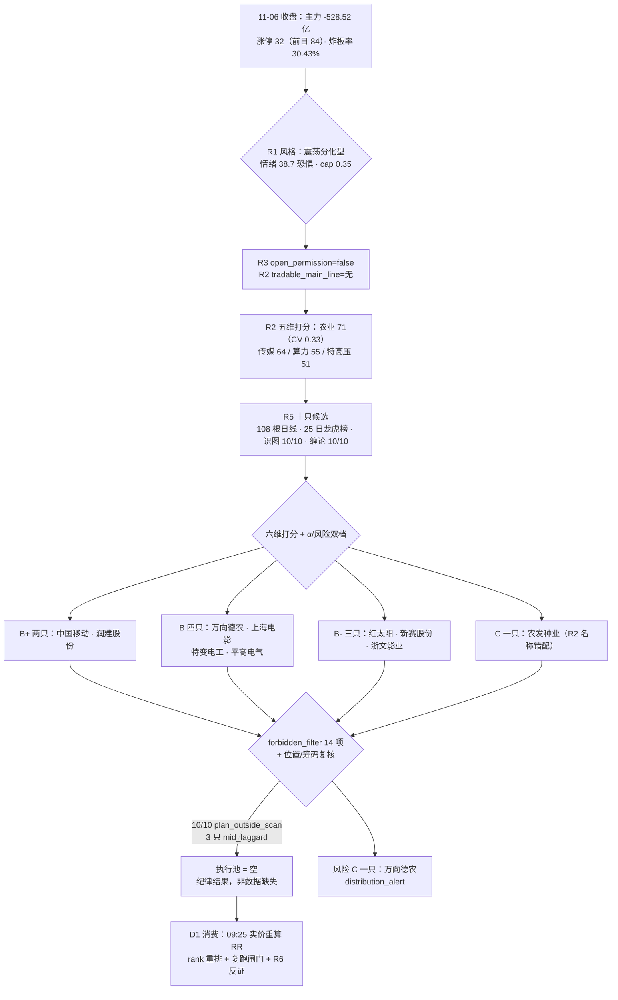

# 2026-11-09 · **个股画像（R5）**

> **数据源新鲜度**：partial（两处结构性缺口：研报目标价单位不稳定 / 5 只非两融标的）
> **降级状态**：no（主源 tushare 全 ok，识图 10/10、缠论 10/10）
> **置信度**：0.66 · 10 只候选全覆盖 · 每票 108 根日线 · 25 日龙虎榜全市场回补

## 一句话结论

今日是**没有确认可交易主线的一天**（R1 主线数 0、R3 open_permission=false、R2 唯一 71 分的农业线 CV 仅 0.33），10 只画像**全部 research_only、闸门 0 通过**；相对最好的是 **中国移动（α B+ / 风险 B+，最硬产业叙事的容量锚）** 与 **润建股份（α B+ / 风险 B-，5 日主力 +6.35 亿全批最强）**——前者是方向标、后者是资金票，**两只都不具备开仓资格**。

## 详细分析

### 1. 今日前提：涨停从 84 腰斩到 32，钱在退不在进

T-1（11-06）全市场主力净额 **-528.52 亿**（前两日合计净流入 +598 亿被吐回），上证 -1.10% / 深成 -2.57%，上涨占比仅 **13.6%**（758/5573，中位涨幅 -1.87%），涨停 **32 家**（前日 84，腰斩 -61.9%）、跌停 15 家、炸板率 **30.43%**（未越 35% 红线故候选未额外砍半）。

R1 定性：**震荡分化型 · high_chop 第 2 天 · 情绪 38.7（恐惧）· 仓位上限 0.35**（0.55 - 0.05×4 逐项扣分后）。R3 同步给出 `open_permission=false`，R2 `tradable_main_line=无`。⇒ **今日画像的前提：涨停是兑现窗口，不是进攻信号；研究结论一律不得转化为开仓资格。**

### 2. 主线结构：一条勉强过线的农业线，三条叙事与资金背离的次线

| 线 | R2 分 | 五维（热/资/停/叙/共） | 主要载体 | 涨停广度 | CV | 致命短板 |
|---|---|---|---|---|---|---|
| 农业/种业（转基因） | 71（研究主线） | 16/13/14/**11**/**17** | 万向德农 · 红太阳 | 种植业 2 家、乡村振兴概念 9 家 | **0.33** | R4 零事件（叙事腿断）+ 行业资金 d1 仅 #11（资金腿断） |
| 短剧/传媒 | 64 | 15/11/16/7/15 | 浙文影业 5/5 板 | 传媒 4 家 | — | 11-08 微短剧专项治理启动（政策反向）+ 传媒 d1 -24.42 亿 |
| 国产算力（移动云） | 55 | 8/14/8/**17**/8 | 润建股份 2 板、中国移动 | 通信服务 1 家 | — | 算力概念 d1 **-50.91 亿**（叙事最硬、板块资金最冷） |
| 特高压/电网 | 51 | 6/8/6/**18**/**13** | 平高电气、特变电工 | 0 家 | — | 特高压概念 d1 **-17.67 / d5 -17.28 亿**双负、零涨停 |

三条次线共享同一个结构病：**叙事腿极强（17/18 分）、价格与资金腿全断**。农业线则是相反的另一种病：热度、资金（绝对额）、涨停、共振四条腿成立，叙事与资金规模两条腿不成立 —— 71 分就是这两条腿的缺口，CV 0.33 < 0.34 使它在 D1 侧只能进 watch。

### 3. 个股分层：10 只、2 个 B+、0 个可开仓

| 代码 | 名称 | 线 | R2 口位 | α | 风险 | 综合 | 收盘 | 距 MA20 | 20 日位置 | 主力 5 日 | 30 日龙虎榜 | 首封 | free 换手 | 态度 |
|---|---|---|---|---|---|---|---|---|---|---|---|---|---|
| 600941 | 中国移动 | 算力 | 次线载体 | **B+** | **B+** | 54.8 | 103.49 | +2.60% | 90.3% | +1.68 亿（4/5） | 0 次 | 未涨停 | 1.94% | 🟡 方向标 |
| 002929 | 润建股份 | 算力 | 次线连板 | **B+** | B- | 52.2 | 63.11 | **+23.63%** | **100%** | **+6.35 亿（4/5）** | **+3.24 亿（6 次）** | 13:05 | 29.49% | 🟠 观察不追 |
| 600371 | 万向德农 | 农业 | 龙一 | B | **C** | 51.3 | 12.39 | +8.20% | 44.0% | +3.41 亿（4/5） | **-2.77 亿（8 次）** | 09:36 | **46.26%** | 🔴 拦截 |
| 600312 | 平高电气 | 特高压 | 次线催化 | B | **B+** | 50.1 | 21.76 | +3.73% | 87.7% | **-0.07 亿** | 0 次 | 未涨停 | 2.90% | 🟡 等确认 |
| 601595 | 上海电影 | 传媒 | 次线首板 | B | B- | 49.4 | 35.76 | +22.67% | **100%** | +3.52 亿（5/5） | +1.50 亿（2 次） | 10:27 | 16.09% | 🟠 观察不追 |
| 000525 | 红太阳 | 农业 | 龙二 | B- | B- | 48.7 | 5.02 | +13.75% | 79.6% | -0.50 亿（3/5） | +1.63 亿（3 次） | **13:39** | 13.29% | 🔴 拦截 |
| 600089 | 特变电工 | 特高压 | 次线资金 | B | **B+** | 48.2 | 18.92 | +6.84% | 89.9% | +2.86 亿（3/5） | 0 次 | 未涨停 | 3.10% | 🟡 等确认 |
| 600540 | 新赛股份 | 农业 | 候补 | B- | B- | 48.0 | 4.58 | +2.16% | 38.1% | +0.72 亿（3/5） | +0.60 亿（2 次） | 10:58 | 27.70% | 🟠 候补只做补涨 |
| 601599 | 浙文影业 | 传媒 | 次线身位龙 | B- | B- | 46.0 | 5.08 | **+43.91%** | **100%** | +1.87 亿（4/5） | +1.56 亿（4 次） | **09:25** | 28.57% | 🔴 监管压制 |
| 600313 | 农发种业 | 农业 | 候补 | **C** | B | 42.6 | 5.97 | -1.01% | 27.3% | +0.36 亿（2/5） | 0 次 | 未涨停 | 13.52% | 🔴 名称错配·无板 |

三条横向事实：

- **位置集体偏高**：6/10 的 20 日位置 ≥85%（浙文/上海电影/润建 = 100%），3 只收盘价高于 MA20 逾 20%（浙文 +43.9%、上海 +22.7%、润建 +23.6%）—— 追高的反向证据比正向的多。
- **筹码两套证据打架**：万向德农 DC 主力 5 日 **+3.41 亿** vs 龙虎榜 25 日 **-2.77 亿（8 次上榜）**，同一只票的两个资金口径完全相反；本报告两边都写，并把 risk 直接给 C。
- **α 天花板低**：无 A（A-/A/A+ 全缺）。给 A 需要「主线已确认 + 龙头地位清晰 + 筹码干净 + 位置不贵」四条同时成立，本批 10 只无一满足，其中 4 只卡在「位置不贵」、4 只卡在「筹码干净」。

### 4. 首推对象思维链（研究结论，均不含开仓指令）

**① 中国移动（600941.SH）· α B+ / 风险 B+ / 综合 54.8 —— 最硬叙事的容量锚，作用是当温度计**

- **大资金意图**：主力 5 日 +1.68 亿（4/5 天正）、净率 8.84%，但融资余额 15 日 **-23.68%**（13.0 → 11.7 亿）、融券仍有 2.13 亿 —— 配置盘在买、杠杆盘在撤、空头没走。这是「机构底仓慢进 + 游资杠杆退出」的组合，不是进攻型资金。
- **为什么走强**：R4 E20261109_006（国产算力移动云 +0.689）—— 2027 算力投资超 1000 亿 + 智谱 GLM 接入移动云；11-06 收 103.49 站上 MA20（+2.6%）/MA60（+5.9%），距 20 日高仅 -0.8%，30 日振幅 2.13%（全批最低）。它涨的是「运营商自有逻辑 + 算力硬投资」，不是算力板块整体（算力概念 d1 -50.91 亿）。
- **逻辑够不够硬**：叙事够硬（产业级、可验证的 capex 数字）+ 卖方密集（52 篇 / 14 家）+ 财务干净（ROE 7.62%、OCFPS 8.54、负债率 33.75%）；不够硬的是「交易价值」—— 934 亿流通、1.94% 换手、PE 17.55 处自身 3 年 93.1 分位。**结论：只作方向标，不作标的。**
- **观察条件（非买入价）**：开盘 30 分钟内看它是否延续上攻且不回落 —— 若它冲高回落，润建的二板就没有板块背书；若它站稳并放量，算力线当日「叙事成立」。三条可验证假设：①不跌破 MA20（100.87）方为趋势有效；②运营商业口径当日主力仍为正；③算力概念当日资金转正（11-06 -50.91 亿）。任一不成立则本线当日只观察。

**② 润建股份（002929.SZ）· α B+ / 风险 B- / 综合 52.2 —— 本批资金最强，但位置最贵**

- **大资金意图**：主力单日 +2.46 亿（净率 9.49%）、5 日 **+6.35 亿**、20 日 **+12.82 亿**、龙虎榜 6 次累计 **+3.24 亿**（买方含深股通专用 + 多席机构专用）、融资 15 日 **+17.25%**（加杠杆）、机构调研 **138 次**（最近 11-01，10 类机构）—— 这是全批唯一的「资金、席位、杠杆、调研」四路同时正向的票。
- **为什么走强**：2 板（11-05、11-06）+ 移动云算力订单叙事（R7 watch_reserve 唯一 2 板），通信服务行业 d1 +2.17 / d5 +9.67 亿（R7 top_inflow #10）。
- **逻辑够不够硬**：叙事+资金硬，**盈利不硬**—— PE 235.31（3 年 88.5 分位）、净利率 0.10%、OCFPS **-13.923**、2025 年度预告 -92%~-88%。这是典型「远期 capex 故事定价」，一旦板块资金转向（算力概念 d1 -50.91 亿已在转），估值没有下限保护。
- **观察条件（非买入价）**：只有当「算力概念当日资金转正 + 它不跌破 MA20（51.05）」两条同时成立，才谈得上观察接力；高开 >4% 视为情绪透支，直接放弃当日观察。可验证假设：①次日 2 板能否再封（封单 1.81 亿是否回补）；②深股通/机构席位是否续买；③通信服务行业资金是否续正。

**③ 平高电气（600312.SH）· α B / 风险 B+ / 综合 50.1 —— 催化最硬、资金最冷的一对矛盾**

- **大资金意图**：主力单日 +0.17 亿（净率 3.42%）、5 日 **-0.07 亿**、20 日 -4.44 亿，量比 1.02、换手 2.90% —— **没有任何资金确认**；唯一的中期正面是 7 月 Templeton 系列 QFII 增持 7367 万股（数据滞后 4 个月）。
- **为什么可能走强**：R4 E20261109_007（特高压 +0.646，国网一交两直 591 亿核准）+ 财联社「明日主题前瞻」头条点名 + 11-04 中标公告 + 09-09 中标公告；PE 21.57 处 3 年 **31.6 分位**（全批最低估值分位）、ROE 10.61%（全批最高）、净利同比 +25.34%（少数正增长）。
- **逻辑够不够硬**：叙事与财务都硬，**资金不硬**。特高压概念 d1 -17.67 / d5 -17.28 / d20 -148.74 亿三窗全负、11-06 零涨停 —— 政策底 ≠ 资金底，这正是 R2 给它 51 分（叙事 18、资金 8）的原因。
- **观察条件（非买入价）**：触发条件写死两条 —— ①特高压概念单日资金转正；②价格放量站上 22.08（20 日高）并收住。两条不成立即为「政策空转」，维持观察。可验证假设：当日是否有第二家电网设备票涨停（板块效应从 0 → 1 是启动的最低门槛）。

### 5. 三条必须写下来的负面证据

- **万向德农是全批唯一「龙虎榜口径为负」的票**：25 日 8 次上榜累计 **-2.77 亿**（11-06 单日「换手 20%」榜 +0.31 亿、「连续三日涨幅偏离」榜 **-1.01 亿**）、free 换手 **46.26%**（全批最高）、日内 4 次开板、股东户数 Q3 **+106.6%**（散户化）⇒ risk_grade 直接 C 并打 `distribution_alert`。它的 DC 主力 +3.41 亿不构成翻案证据 —— 那是单日/短窗口口径。
- **上海电影是「资金质量最好、位置最差」的样板**：主力 5 日 +3.52 亿（**5/5 天全正**，全批唯一）、11-06 龙虎榜机构净买 **+1.19 亿**，但 60 日 **+98.4%**、20 日位置 100%、PB 9.58 处 3 年 **98 分位**、2026H1 预减 **-72%~-64%**，叠加 11-08 微短剧治理新规 ⇒ 资金好不能对冲「位置 + 政策 + 基本面」三重反向。
- **农发种业是 R2 的名称错配**：R2 写「登海种业 600313.SH」，实际 600313.SH = **农发种业**（中农发种业集团，登海种业为 002041.SZ）。本报告按代码画像（数据与 R2 给的流通 64.6 亿一致），profile 内 flags 标 `r2_name_mismatch`。它的画像结论不变：未涨停、无带动性、顺位 4 命中 mid_laggard、PE 109 且 Q3 净利 -32.6%，只能进 watch。

## 关键证据

- **证据 1**：11-06 主力净额 -528.52 亿、涨停 32 家（前日 84）、炸板率 30.43%、上涨占比 13.6%、中位涨幅 -1.87% · 来源 R7_capital_flow / R1_style
- **证据 2**：R1 判「震荡分化型 · high_chop 第 2 天 · 情绪 38.7 · 仓位上限 0.35」；R3 open_permission=false；R2 execution_pool=[] · 来源 R1_style / R3_sentiment / R2_main_sectors
- **证据 3**：种植业 d1 +3.23 / d5 +5.64 亿（496 行业 d1 第 11，唯一「单日+5日+价格」三正）vs 转基因概念 d1 +2.76 亿；但 R4 零农业事件、CV 仅 0.33 · 来源 R7_capital_flow / R4_news / R2
- **证据 4**：润建股份 主力 5 日 +6.35 亿（4/5 正）、龙虎榜 6 次 +3.24 亿、融资 15 日 +17.25%、机构调研 138 次、PE 235.31（88.5 分位）、OCFPS -13.923 · 来源 tushare moneyflow_dc / top_list+top_inst / margin_detail / stk_surv / fina_indicator
- **证据 5**：中国移动 主力 5 日 +1.68 亿 vs 融资 15 日 -23.68%、融券 2.13 亿、PE 17.55（自身 3 年 93.1 分位）· 来源 tushare moneyflow_dc / margin_detail / daily_basic
- **证据 6**：万向德农 25 日龙虎榜 8 次累计 -2.77 亿（11-06 三日榜 -1.01 亿 / 换手榜 +0.31 亿）、free 换手 46.26%、开板 4 次、股东户数 Q3 +106.6% · 来源 tushare top_list+top_inst / daily_basic / limit_list_d / stk_holdernumber
- **证据 7**：上海电影 主力 5 日 +3.52 亿（5/5 正）+ 11-06 机构席位净买 +1.19 亿，但 60 日 +98.4%、PB 9.58（98 分位）、2026H1 预减 -72%~-64% · 来源 tushare moneyflow_dc / top_inst / daily_basic / forecast
- **证据 8**：10 只识图全部「偏多」（置信 0.52-0.80），但缠论 above_zs 仅 6 只成立 → chanlun_confirmed 6 / divergence 4（万向德农、新赛股份、农发种业 中枢下方，中国移动 未完成笔向下）· 来源 chart_vision_snapshot 20261109 + czsc 0.10.12

## 数据源审计

| 源 | 状态 | 抓取时间 | 记录数 | 备注 |
|---|---|---|---|---|
| R1_style | 🟢 ok | 2026-11-09 | 1 | 震荡分化型 / cap 0.35 / 主线数 0 |
| R2_main_sectors | 🟢 ok | 2026-11-09 | 1 主线 + 4 次线 | execution_pool=[]；all_scored_boards_top10 缺 top_stock 字段（schema 降级） |
| R3_sentiment | 🟢 ok | 2026-11-09 | 1 | degraded=true（WeFlow 下线、L3 缺位）→ open_permission=false |
| R4_news | 🟢 ok | 2026-11-09 | 8 事件 + 17 板块 | 零农业事件；NEG20261109_08 短剧治理为关键压制项 |
| R7_capital_flow | 🟢 ok | 2026-11-09 | 496 行业 + 531 概念 | 与 R5 复算（东财 DC）容差 <0.02 亿 |
| tushare 逐票 20 类 | 🟢 ok | 2026-11-09 | 10 票 × 108 根日线 | 0 error；两融/大宗/cyq/fina/rc/surv/anns 全含 |
| tushare 龙虎榜 25 日回补 | 🟢 ok | 2026-11-09 | 25 交易日全市场 | 10 只中 6 只有上榜记录 |
| chart_vision_snapshot | 🟢 ok | 2026-11-09 | 26 票（含本批 10/10） | 快照 date=20261109 已校验，非跨日指针 |
| czsc 缠论 | 🟢 ok | 2026-11-09 | 10 | 0.10.12 · 日线笔/中枢/分型 |
| tushare report_rc.tp | 🟡 stale | 2026-11-09 | 187 行 | 目标价单位不稳定（13800/253800/16772600 三种量级）→ 弃用，仅用覆盖家数与评级 |
| tushare margin_detail | 🟡 partial | 2026-11-09 | 5/10 票 | 万向德农/红太阳/新赛/浙文/上海电影非两融标的（结构性缺失，记 not_a_margin_target） |
| vibe-trading 交叉核验 | ⚪ n/a | — | 0 | MCP 未配置；v1.3 起 tushare 为主源，允许降级 |

## 不确定性 / 反证

- **最大不确定性是「农业线到底是启动还是余温」**：R2 判 early_up 第 1 天、R3 给 early，但 R4 零事件、期货反向（生猪两月跌近三成、CBOT 大豆周跌 3.2%）。若今日农业不能延续（种植业资金转负、龙头开板），则本批 4 只农业票全部证伪，且万向德农的筹码瑕疵会被放大。
- **筹码口径的内部冲突未消解**：万向德农 DC +3.41 亿 vs 龙虎榜 -2.77 亿。两种口径都对，但指向不同资金（东财大单 vs 席位明细）。我选择相信龙虎榜（因为它是可核验的账户级明细），并给出 risk C —— 这是判断，不是数据结论，R6 应独立复核「4 次开板 + 46% 换手」的派发性质。
- **R2 名称错配提示上游存在映射缺陷**：600313.SH 被写成登海种业。本报告按代码更正为农发种业；若 D1 用「登海种业」标签去查行情或逻辑，会拿到错的价格与叙事（登海 002041.SZ 与农发是两家公司）。这一点必须在 D1 侧显式纠正。
- **本报告不含任何 entry/exit 价格，也不授开仓资格**：α/风险双档是研究结论；D1 若重启评估，须用 09:25 竞价实价重算 RR、重排 rank、复跑 forbidden_filter，并等 R6 反证结论。

## 与其他 R/D/E 的关系

- **依赖**：`R1_style.json`（cap 0.35 / 风格）、`R2_main_sectors.json`（主线 71 / 次线 64·55·51 / 4 只 leaders + 次线 leaders_hint）、`R3_sentiment.json`（open_permission=false）、`R4_news.json`（E006 算力 / E007 特高压 / NEG08 短剧治理）、`R7_capital_flow.json`（行业与概念资金、个股 DC 对齐）、tushare 逐票 20 类、chart_vision snapshot 20261109、czsc。
- **被消费**：
  - **D1（canghai-plan）**：`dimensions` 六维分、`alpha_grade`/`risk_grade`（风险闸门）、`d1_gate_simulation`（今日 0 通过）、`forbidden_check`、`provenance.source`（6 只次线票优先 watch_pool）。
  - **R6（反证）**：`fundamental_flags`（F9×4 / V2×3 / V6×1）、`flags`（distribution_alert / late_speculation_board / rr_below_2 / regulation_headwind）、`leader_verdict`（补涨/孤军/容量票）。
  - **E1（复盘）**：`event_timeline`（每票 7-11 条，跨度 50-135 天）用于次日兑现核验，尤其是「高位+机构净买」组合（润建、上海电影）与「龙虎榜负+散户化」组合（万向德农）的对照。

## Sub-Agent 元数据

- skill: `analyze_stock_profile_v1@1.5`
- artifact: `data/research/20261109/R5_stock_profiles.json`（10 profiles / 135 KB / check_r5_20261109.py 0 error 0 warning）
- 中间产物：`_work/_r5_raw.json`（5.0 MB）、`_r5_lhb_30d.json`、`_r5_anns.json`、`_r5_fin_stmt.json`、`_r5_chanlun.json`、`_r5_metrics.json`
- 生成耗时：约 22 分钟（fetch 6 分钟 · 识图补渲 4 票 30 秒 · 计算 1 秒 · 装配+校验 2 秒 · 撰写其余）
- model: deepseek-v4.1-flash
- 口径声明：六维权重 催化 20 / 筹码 22 / 板块 18 / 估值 14 / 技术 16 / 机构 10；扩池票 composite 起步 -3（v1.4）
