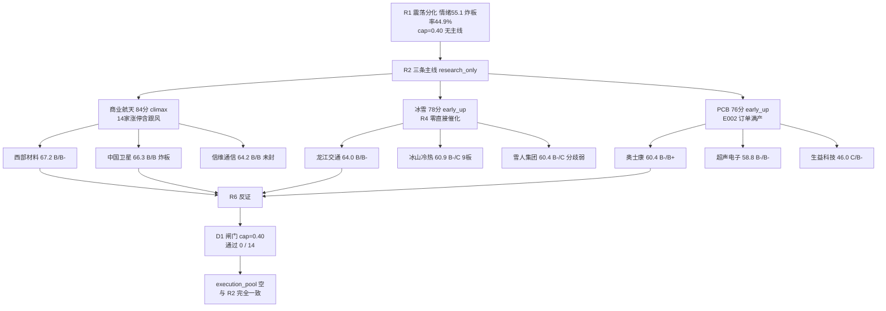

# 2026-11-10 · **个股画像**

> **数据源新鲜度**: ok（主源全量当日档，唯一缺口是可选的 vibe-trading 交叉核验）
> **降级状态**: false
> **置信度**: 0.63

## 一句话结论

修段第 2 日的**反抽未确认日**：14 只候选（商业航天 5 / 冰雪 5 / PCB 4）六维打分给出 alpha {B:4, B-:7, C:3}、risk {B+:1, B:4, B-:5, C:4}，**无一只进入 B+ 以上**，D1 闸门 14/14 全数被 `plan_outside_scan` 拦截 —— 这不是数据缺陷，是无主线（R1 main_lines=0）+ 炸板率 44.9% 下的纪律输出。

## 详细分析

**一、先认市场，再认个股。** 数据日 20261109 涨停 54、炸板 44（炸板率 44.90%）、跌停 1、最高 6 板、涨家占比 40.23%、中位 -0.35%、成交 14824 亿（-10.57%）。R7 读数是「超大单 +130.88 亿托权重、中单 -73.84 亿、小单 -59.40 亿离场」——单日反抽由权重资金完成，散户与中户在撤。R1 据此判**震荡分化型 + 情绪 55.1 中性 + 无主线**，仓位上限 0.40。三条主线全部 research_only，所以 R5 的任务从「选票」变成「**证明为什么这些票现在不能买**」——14/14 的 `d1_stance` 因此一律以「不进」开头。

**二、三条主线不是三种机会，是同一批筹码的三种切法。** 商业航天（84 分，climax）靠 E003「星云星座全栈国产太空算力网 + 快舟三年 50 发 + 新闻联播聚焦低轨」high 级催化（+0.732）；PCB（76 分，early_up）靠 E002「头部订单满产、产能利用率 90%+、Q3 行业净利 +196%」high 级催化（+0.689）；冰雪（78 分，early_up）**在 R4 全表零直接催化**，只有寒潮供暖的弱联动（燃气/供暖 low +0.189）。三者在元件—通信—卫星三链交叠，信维通信、亨通光电均属 dual_role，D1 若合并敞口只会重复押注同一条资金流。板块资金也印证「单日暴力、中期失血」：元件 d1 +38.42 / d5 -97.44 / d20 -340.61 亿；印制电路板 +37.63 / -81.19 / -256.64；商业航天概念 +50.53 / -35.89 / -355.06。唯一三正的行业是航天装备Ⅲ（+6.64 / +1.98 / +3.12 亿），这也是西部材料能拿第一的结构性原因。

**三、资金口径必须先归一化再打分。** 本报告所有主力净额按流通市值归一化（净额 / circ_mv %）。若按绝对亿级打分，1486 亿的沪电「-29.74 亿」与 202 亿的西部材料「+14.07 亿」会被误判为同量级，实际前者 -2.0%、后者 +6.94%。归一化后，PCB 四票的筹码分层极其清晰：西部材料 20 日 +6.94%（5/5 天净流入）、雪人 +7.91%、冰山 +13.6%，而沪电 -2.0%、生益 -2.77% 且 20 日仅 5/20 天为正。**同一板块内，资金在低位小票与高位大票之间做了明确取舍。**

**四、财务红旗按 R6 附录 A 真实阈值重算，不是「净利下滑就算红旗」。** 本批命中：F8（CFO 连续两期为负而净利为正）×2（中国卫星、西部材料）、F9（应收/营收 >40%）×9、F3（应收增速 > 收入增速 1.5 倍）×1（奥士康）、V4（ROE 高但 CFO/净利 <0.5）×2（亨通 0.14、沪电 0.48）、F10（有息负债/净资产 >80%）×1（大连圣亚）、LOSS（Q3 归母净利为负）×2（中科星图 -4.91 亿、雪人 -0.24 亿）。F2（商誉/净资产 >30%）、F11（质押 >70%）本批零命中——把「净利同比 -3.79%」当 F9 是历史误报模式，本报告未沿用。

**五、档位是分档器，不是开仓许可。** alpha 反映进攻性（确定性/主线地位/资金持续/催化硬度/龙头身位），risk 反映风险度（高位程度、套牢盘、估值分位、龙虎榜净卖）。西部材料 B/B- 与生益科技 C/B- 的差别不在「跌得多不多」，而在「未完成笔方向 + 主力 20 日方向 + 筹码是否被套」。**R5 不出 entry/exit 价格**，卡片里的止损条件写的是「结构性失效位」（决策线/前高/中枢下沿），不是下单价。

## 关键证据

- 证据 1：20261109 炸板率 44.90%（44/98 触板），越过 R2 的 35% 红线 → 候选砍半、零开仓资格（来源 `R2_main_sectors.json.discipline_gate`）
- 证据 2：R1 判 main_lines_count=0、cap=0.40（风格基准 0.55 − high_chop 0.05 − 30 日样本中位 0.05 − 修段第 2 日 0.05），与 R2 open_permission=false 一致（来源 `R1_style.json.position_cap_basis`）
- 证据 3：商业航天概念资金 d1 +50.53 / d5 -35.89 / d20 -355.06 亿，单日反抽未改中期失血（来源 `R7_capital_flow`）
- 证据 4：chart_vision 14/14 出图成功（66.2s，7 并发），缠论 14/14 完成（czsc 日线笔/中枢），无一只出现「日线偏多 + 站上中枢」的双确认（来源 `chart_vision_snapshot.json` / `_r5_chanlun.json`）
- 证据 5：西部材料 5 日主力 +6.47 亿 = 流通市值 3.19%、龙虎榜机构净 +7.29 亿、股东户数 Q3 -21.87%，筹码三证同向（来源 tushare top_inst + cyq + stk_holdernumber）
- 证据 6：生益科技 R4 给研究首选（RR 2.13、位置分位 3.5），R5 给 C 档（未完成笔向下 27 根、主力 20 日 -47.2 亿、股东户数 Q3 +91.87%）——分歧已写入 `d1_stance` 交 R6 裁决

## 推理三问（Top 3 + 反例）

**西部材料（67.2 / B / B-）**
- **大资金意图**：5 日 5/5 天净流入 +6.47 亿（流通 3.19%）、20 日 +14.07 亿，龙虎榜 10-29/10-30 机构席位净 +7.29 亿 —— 这是**建仓式买入**不是打板资金，且股东户数 Q3 -21.87% 说明筹码在集中。
- **为什么走强**：太空算力是当周唯一「政策 + 产能 + 官媒」三件套（E003），而航天装备Ⅲ 是全市场唯一「单日+5日+20日」三正行业；它是线内唯一封住的票（09:30 首封、0 开板、封单 2.74 亿）。
- **逻辑够不够硬**：硬在资金与板块结构，软在**量比 0.25**——缩量涨停意味着锁筹到位但换手不足，明日没有接力盘就是一字开板后的抛压测试。加上 R2 判 climax、PE 226（分位 84.7%）、F8 CFO 连续为负，**够硬到进观察，不够硬到进执行**。

**中国卫星（66.3 / B / B）**
- **大资金意图**：主力今日 +4.01 亿（净额率 10.48%）看似强，但**大宗 25 笔、1.66 亿、平均折价 -7.63%**，同时融券 15 日 +41.11% —— 有人借反抽的流动性做分销与对冲。
- **为什么走强**：线内辨识度核心 + 中报扭亏预告 + 太空算力概念榜登顶，属于「情绪修复日的第一梯队补涨」。
- **逻辑够不够硬**：不硬。09:43 首封后开板 2 次、收盘压在 MA60（57.61）、周线仍空头排列（周 MA20 62.28）、PE 643。**炸板 + 折价大宗 + 融券增仓三条同时出现，是「反抽出货」的标准组合。**

**信维通信（64.2 / B / B）**
- **大资金意图**：今日 +6.27 亿（12.88%）是单日扭转，但 5 日仅 1/5 天为正、融资 15 日 -25.33% 而融券 +22.02% —— 杠杆端在撤退，买入的是短线资金。
- **为什么走强**：20cm 弹性 + 消费电子行业 5 日 +34.06 亿（全批唯一 5 日正流入的行业）+ 太空算力概念共振。
- **逻辑够不够硬**：形态上 12.77% 未封（距 20cm 还差 7.2 点）＝买盘承接不足；基本面净利同比 -3.79%、收入 +1.24%＝增长停滞而 PE 66.9（分位 79.7%）。**弹性是真，趋势没转。**

**反例（雪人集团 60.4 / B- / C）**：机构龙虎榜 30 日净 +11.22 亿是全批最猛的机构买盘证据，但 13:09 才首封、开板 4 次、封单 0.69 亿、Q3 亏损 0.24 亿。**资金强 ≠ 可以接分歧板**——纪律第 7 条「无封单承接＝不封」在此直接否掉当日身位。

## 候选卡片（14/14 · 全部 research_only，无开仓资格）

**1. 002149.SZ 西部材料** ｜商业航天 · 龙三（唯一封住）｜67.2 · B / B- · risk 46
- 买入理由（研究口径 · d1_stance＝不进）：线内唯一封住 + 主力 5/5 净流入 + 筹码集中（户数 -21.87%）；航天装备Ⅲ 唯一三正行业。
- 风险点：量比 0.25 缩量涨停无接力；R2 判 climax；PE 226（84.7 分位）；F8 CFO 连续为负。
- 止损条件（结构失效位，非下单价）：跌破 MA5 36.91 或 20 日中枢下沿，视为封板逻辑失效。
- 可验证假设：若次日竞价 ≤+3% 且开板后 30 分钟内回封，则「锁筹→接力」成立；若一字后炸板不回封，则今日封板为最后一棒。

**2. 600118.SH 中国卫星** ｜商业航天 · 龙一｜66.3 · B / B · risk 66
- 买入理由（研究口径 · d1_stance＝不进）：辨识度核心 + 板块概念榜登顶；MA50（55.93）上方 +2.81%，是线内少数仍在决策线之上的票。
- 风险点：炸板 2 次；大宗 25 笔平均折价 -7.63%（分销）；融券 15 日 +41.11%；PE 643；周线空头。
- 止损条件：收盘失守 MA50 55.93 且伴随放量，视为反抽结束。
- 可验证假设：若次日低开不破 55.93 且 60 分钟量能不低于今日 70%，则分歧转一致；否则按出货处理。

**3. 300136.SZ 信维通信** ｜商业航天 · 龙二（20cm）｜64.2 · B / B · risk 66
- 买入理由（研究口径 · d1_stance＝不进）：弹性最大 + 消费电子 5 日资金转正 + 机构覆盖 16 篇/5 家。
- 风险点：12.77% 未封；融资撤/融券增；MA50 之下 -8.15%；周线在 MA20/MA60（63.6/62.7）下方。
- 止损条件：跌破 MA20 44.50 且回踩量能放大，视为修复失败。
- 可验证假设：若次日回踩 44.5-45 区间缩量企稳，则超跌反弹延续；若直接高开回落收阴，则为一日反抽。

**4. 601188.SH 龙江交通** ｜冰雪 · 身位股（2 板）｜64.0 · B / B- · risk 40
- 买入理由（研究口径 · d1_stance＝不进）：线内身位最高（2 板、09:30:04 首封、仅 1 次开板、封单 1.01 亿）；龙虎榜 5 次全机构口径净 +3.78 亿。
- 风险点：催化为零（R4 无冰雪事件）；今日主力净额仅 0.19 亿；量比 0.52 缩量一致板；PB 分位 95.4%。
- 止损条件：跌破 MA5 3.74 即视为缩量一致板破裂。
- 可验证假设：若次日仍缩量封板（量比 <0.6），则为资金锁仓拉升；若放量开板，则为出货式换手。

**5. 301010.SZ 晶雪节能** ｜冰雪 · 候补（20cm）｜62.7 · B- / C · risk 40
- 买入理由（研究口径 · d1_stance＝不进）：创业板 20cm 弹性、流通市值仅 28.3 亿（自由流通 10.2 亿），极小盘的封板成本低。
- 风险点：13:10 午后封 + 2 开板 + 封单 0.32 亿；PE 556 / PB / PS 三分位全 98%+；股东户数 +29.23%；Q3 单季净利 -85.56%。
- 止损条件：跌破 MA5 22.79 或 20 日高 27.05 上方冲高回落收阴。
- 可验证假设：若冰雪概念次日掉出热度前 10，则本票一日游成立（R2 已写明整线降级条件）。

**6. 600593.SH 大连圣亚** ｜冰雪 · 候补（B 计划低位）｜61.2 · B- / B · risk 68
- 买入理由（研究口径 · d1_stance＝不进）：冰雪线唯一未透支（30 日位置 37.1%、距 20 日高 -16.76%、MA20 仅 +2.95%）；ROE 37.5%、净利 +38.3%。
- 风险点：今日 +9.11% 但主力 5 日仅 +0.08 亿＝无资金确认；PB 19.7；资产负债率 76.9%（F10）；质押 23.72%。
- 止损条件：跌破 MA50 43.21 且 MA20 42.93 同步失守。
- 可验证假设：若冰雪概念次日仍在 top10 且本票主力转正，则低位补涨成立；否则只是跟风尾盘拉升。

**7. 000530.SZ 冰山冷热** ｜冰雪 · 龙二（9 板）｜60.9 · B- / C · risk 23（全批最低）
- 买入理由（研究口径 · d1_stance＝不进）：当日封板质量全批最好（09:32:21 首封、0 开板、封单 2.41 亿）；主力净额率 55.7%；20 日 10/20 天净流入。
- 风险点：30 日内 9 次涨停、20 日 +83.69%、MA50 乖离 +48.95%；PE/PB/PS 三分位全 100%；量比 0.37 缩量一致板；龙虎榜 29 次高频。
- 止损条件：跌破 MA5 9.07 即为隔日板节奏断裂（R2 记录其历史 3 次涨停后次日 -3.8%~-4.4%）。
- 可验证假设：若次日再度缩量涨停则妖股延续；若高开低走收阴则 9 板为本轮顶。

**8. 002639.SZ 雪人集团** ｜冰雪 · 龙一｜60.4 · B- / C · risk 32
- 买入理由（研究口径 · d1_stance＝不进）：机构证据最强（龙虎榜机构 30 日净 +11.22 亿）、主力净额率 27.25%、换手 26.76%。
- 风险点：13:09 首封 + 4 次开板 + 封单 0.69 亿（分歧板）；Q3 归母净利 -0.24 亿；PB 分位 88.7%；获利盘 99.8%。
- 止损条件：跌破 MA5 14.86 视为分歧转弱。
- 可验证假设：若次日竞价高开 ≥3% 且 9:35 前回封，则机构在接分歧；若低开破 14.86，则机构 11 亿为出货铺垫。

**9. 002913.SZ 奥士康** ｜PCB · 龙二｜60.4 · B- / B+ · risk 72（全批最高）
- 买入理由（研究口径 · d1_stance＝不进）：位置最低一批（30 日位置 14.1%、距 60 日高 -36.71%）；11:04 封 0 开板封单 1.37 亿；公司回购 + 回购专项贷款双托底；行业景气 E002。
- 风险点：量比 0.64 缩量板；上方套牢盘 52.1%（平均成本 66.73 vs 收盘 58.42）；中报预告 -48.9%~-60.2%；股东户数 +21.48%。
- 止损条件：跌破 20 日低 52.87 或 60 分钟 MA60（58.9）站不住。
- 可验证假设：若次日竞价放量站上 58.9，则缩量板转放量确认；若缩量冲高回落，则一日游。

**10. 000823.SZ 超声电子** ｜PCB · 龙一（低位反包首板）｜58.8 · B- / B- · risk 52
- 买入理由（研究口径 · d1_stance＝不进）：资金最像样（净额率 37.15%、5 日 +4.54 亿）；基本面最硬（PE 26.8、净利 +97.5%、单季 +276.2%、预告 +90.8%~102%）。
- 风险点：R4 测算 T+1 上方空间仅 +1.5%、RR 0.19（纪律第 6 条 RR<2 拒）；融券 15 日 +78.62%；MA20 之下 -12.23%；龙虎榜 18 次高频。
- 止损条件：跌破 MA5 17.24 或 20 日低 16.24。
- 可验证假设：若次日高开 ≥5% 并放量突破 MA20 20.35，则反包升级为趋势；否则按 RR<2 放弃。

**11. 688568.SH 中科星图** ｜商业航天 · 候补（应用端）｜55.8 · B- / C · risk 34
- 买入理由（研究口径 · d1_stance＝不进）：线内唯一站上 MA20/MA50 的票（MA50 30.46，收盘 +4.92%）；R4 唯一点名的太空算力票。
- 风险点：Q3 亏 4.91 亿（净利 -434.9%）；PS 20.68（分位 98.4%）；融资 -20.64% / 融券 +20.49%；R4 自算 RR 0.88。
- 止损条件：跌破 MA20 30.09 且 PS 分位继续抬升（估值+业绩双杀）。
- 可验证假设：若太空算力扩散到应用端（更多软件/数据服务票涨停），则补涨成立；否则只有它一只孤票。

**12. 600487.SH 亨通光电** ｜商业航天 · 候补（6G 低位分支）｜54.8 · C / B · risk 64
- 买入理由（研究口径 · d1_stance＝不进）：全批基本面最硬（PE 16.1 分位 32.3%、净利 +159.4%、单季 +299.1%、预告 +151%~168%）；11-05 控股股东增持 + 回购 + 员工持股三连。
- 风险点：MA50 之下 -26.0%、60 日 -29.08%、30 日位置 5.4%；主力 5 日 -6.91 / 20 日 -18.78 亿；套牢盘 69.8%；V4（CFO/净利 0.14）。
- 止损条件：跌破 20 日低 40.45（当前 42.21 距其仅 -4.2%）。
- 可验证假设：若主力 5 日转正且站上 MA20 46.56，则「业绩+增持」被资金认可；否则继续按空头趋势对待。

**13. 002463.SZ 沪电股份** ｜PCB · 中军（未涨停）｜47.4 · C / B- · risk 54
- 买入理由（研究口径 · d1_stance＝不进）：PE 22.1（分位 8.8%，全批最低）、ROE 31.5%、净利 +106.9%（单季 +160.8%）；董事长 11-07 提议回购。
- 风险点：距 60 日高 -39.88%、30 日位置 7.1%；主力 20 日 -29.74 亿；龙虎榜机构净 -13.97 亿（明确出货）；未完成笔向下 34 根。
- 止损条件：跌破 20 日低 72.1。
- 可验证假设：若放量站上 MA5 79.08 且回踩 72.1 不破，则下跌结构破坏；否则反弹即卖点。

**14. 600183.SH 生益科技** ｜PCB · 候补（B 计划）｜46.0 · C / B- · risk 60
- 买入理由（研究口径 · d1_stance＝不进）：赔率端全批最优（PE 22.5 / 分位 **2.0%**、30 日位置 0.3%、距 60 日高 -54.25%）；净利 +175.4%（单季 +238.4%）；覆铜板提价弹性直接。
- 风险点：主力 20 日 -47.2 亿（流通 -2.77%）、5 日仅 2/5 天正；股东户数 Q3 **+91.87%**（散户化最重）；未完成笔向下 27 根；套牢盘 89.2%。
- 止损条件：跌破 20 日低 70.49（距收盘仅 -0.3%，即已贴地）。
- 可验证假设：若缩量止跌 + 主力 3 日转正，则赔率兑现；若跌破 70.49 打开新低，则 PE 分位 2% 仍会继续下修（低估值≠底部）。

## 数据源审计

| 源 | 状态 | 抓取时间 | 记录数 | 备注 |
|---|---|---|---|---|
| tushare pro（24 类接口 ×14 票） | 🟢 ok | 11-10 07:31 | 14 票 / 日线 170 根 | 主源，0 error |
| 东财 DC 主力（R7 同源） | 🟢 ok | 11-10 04:32 | 6032 只 / 26 日 | 已按流通市值归一化 |
| 龙虎榜 30 交易日逐日 | 🟢 ok | 11-10 07:33 | 36 个交易日 | top_list/top_inst 只吃 trade_date，逐日拉再筛 |
| chart_vision 快照 | 🟢 ok | 11-10 07:29 | 14/14 | 7 并发 66.2s，date 已校验同日 |
| czsc 缠论 | 🟢 ok | 11-10 07:44 | 14/14 | 前复权日线 |
| 财报三表 + 公告 | 🟢 ok | 11-10 07:32 | 14 票 | 用于 F1-F12 / V1-V10 红旗 |
| R2 / R4 / R7 / R1 / R3 | 🟢 ok | 11-10 04:38-07:21 | 3 线 / 8 事件 / 496 行业 | 上游 artifact 全在 |
| mcp__vibe_trading | 🔴 error | — | — | 未配置，交叉核验通路缺失，已用 tushare 覆盖 |

## 不确定性 / 反证

1. **与 R4 的公开分歧（最关键）**：生益科技 R4 给「研究首选」（RR 2.13、位置分位 3.5），R5 给 C 档。分歧点是「位置极低 + PE 分位 2% 的赔率」与「未完成笔向下 27 根 + 主力 20 日 -47.2 亿 + 户数 +91.87% 的趋势」哪个优先。R5 按纪律第 2 条（低吸是强势票相对涨停价仍低，不是抄底）判 C，**若 R6 认为赔率优先，需 R6 明确裁决，R5 不自我修正**。
2. **风险档可能偏保守**：risk 分从 72 起扣，对「位置 >90%」「获利盘 >95%」惩罚较重。若明日开盘直接放量弱转强，冰山的 C 档会显得过严——但这正是「宁可错过」的设计。
3. **数据口径三处需 D1/R6 注意**：①`top_list` 只吃 trade_date，30 日回补为逐日全市场拉取，非沪电/生益等大票的「零上榜」是事实而非缺数；②`cyq_chips` 为新版加权分位口径，冰山/雪人的「90% 成本区」宽度极小（8.7-9.4 / 14.1-15.7），属筹码高度集中而非数据异常；③冰山冷热股东户数缺上一期可比 → `holder_num_chg_pct=null`。
4. **R2 与 R5 的 forbidden 口径分歧**：R2 给沪电/生益标 `down_trend_break`、给晶雪/大连圣亚/中科星图标 `mid_laggard`；R5 模块按「行业/概念口径板块效应」判定，沪电/生益不命中 down_trend_break（元件 3 家涨停）。两套结论都写进 JSON（`forbidden_check.hit_rules` vs `r2_forbidden_hits`），未静默改写。**全部 14 只无论哪套口径都被 `plan_outside_scan` 拦截，故不影响最终结论。**
5. **置信度只给 0.63**：不是数据不足，而是「无确认主线」下六维打分的分辨率本身有限；R5 的档位是研究排序，不是交易信号。

## 与其他 R/D/E 的关系

- **依赖**：R1（style/cap=0.40）、R2（3 线 14 leaders + discipline_gate）、R3（情绪阶段）、R4（8 事件/板块极性/首板候选）、R7（行业概念个股资金）、`data/raw/20261110/chart_vision_snapshot.json`、tushare 主源
- **被消费**：D1（`canghai-plan`：execution_pool 逐票门禁、alpha/risk 双档、forbidden_check）、R6（反证：fundamental_flags 透传、leader_verdict 分歧弱、d1_stance 与 R4 分歧）、E1（复盘：档位与实际收益偏差归因）

## Sub-Agent 元数据

- skill: analyze_stock_profile_v1@1.5
- artifact: `data/research/20261110/R5_stock_profiles.json`（307.9KB · 14 profiles · 严格 JSON）
- 生成耗时: 约 33 分钟（07:26 起 → 07:59 落盘），其中 chart_vision 66.2s、tushare 全量 37s、缠论 8s
- model: deepseek-v4.1-flash
- 校验: `scripts/research/check_r5_20261110.py` → ERRORS none · EXIT 0
