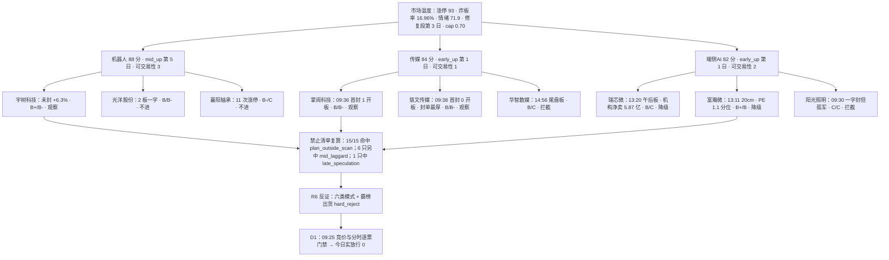

# 2026-11-11 · **个股画像**

> **数据源新鲜度**: partial（R5 主源全 fresh，上游 R1/R2 降级）
> **降级状态**: false（vibe-trading 未配置只影响交叉核验，不影响 tushare 主源）
> **置信度**: 0.525（0.75 × 0.7 × 1.0）

## 一句话结论

三条主线 15 只龙头**全部 research_only、可执行池 0 只**：机器人五维第一（88 分）但已走完 mid_up 第 5 日且当日 15 只里唯一没封板，传媒与端侧AI 处于 early_up 第 1 日却各有 1 只尾盘板、4 只午后板；α 最高只到 **B+（富瀚微 / 宇树科技）**，无 A 级 —— 这是纪律结论不是数据缺陷。

## 详细分析

### 一、市场给的是「修复第 3 天的温度」，不是「可以追的高度」

20261110 收盘口径：涨停 **93** 家、跌停 **0** 家、炸板 **19**（炸板率 **16.96%**，远低于 35% 红线）、最高 **7 板**、涨家占比 **78.9%**、中位涨幅 **+1.37%**、成交额 **15046 亿（+1.49%）**、昨日涨停今日溢价 **+4.91%**、再涨停 **19** 只 —— R1 判 **连板情绪型 · 情绪 71.9（贪婪）· 修复段第 3 个交易日**，仓位上限 **0.70**。但 R1 自己 `status=degraded`（confidence 0.472），R2 也只是 `confidence 0.49`：**上游两层的置信度都在「中等偏弱」区间**，这决定了 R5 今天的输出只能是「分层研究」而不是「给出执行结论」。

R2 给的阶段判断很关键，且与五维得分**方向相反**：机器人 **88 分**但 `stage=mid_up`（第 5 个交易日，首波 1104）、`tradeability_rank=3`（三线最难做）；传媒 **84 分**与端侧AI **82 分**都是 `early_up`（本轮第 1 日）、rank 分别为 1 与 2。**五维只回答「今天是不是主线」，不回答「明天能不能做」** —— 本报告的分线结论完全按后者排。

### 二、三条主线：钱是真的、位置是贵的、板型是分散的

| 主线 | 五维 | 阶段 | 可交易性 | d1 资金 | d5 资金 | 20 日资金 | 龙头板型 | R5 结论 |
|---|:--:|---|:--:|---:|---:|---:|---|:--:|
| 人形机器人/具身智能 | **88** 🟢 | mid_up 第 5 日 | 3（最难） | 机器人概念 **+94.63 亿** / 汽配 +20.02 亿 | +148.02 / +34.73 亿 | **-369.91** / +14.63 亿 | 宇树未封、光洋 2 板、襄阳 1 板 | 9 观察 / 2 不进 / 3 拦截 |
| 传媒/AI短剧·AI漫剧 | 84 🟢 | early_up 第 1 日 | **1（最好）** | 传媒 **+46.88 亿（+4.53%）** / 影视院线 +14.65 亿 | +64.74 / +19.56 亿 | -42.72 / +2.93 亿 | 掌阅 09:36、慈文 09:38、文投 2 板 | 2 观察 / 2 不进 / 1 拦截 |
| 端侧AI/AI终端硬件 | 82 🟢 | early_up 第 1 日 | 2 | 半导体 **+40.62 亿** / 消费电子 +23.11 亿 | +274.37 / +81.83 亿 | -154.19 / -2.86 亿 | 瑞芯微/富瀚微/视涯/康冠 **均 13:00 后首封** | 1 观察 / 1 降级 / 3 拦截 |

三条线有一个共同的资金结构特征：**d5 全正、d20 除汽配与影视院线外全负** —— 这是「5 日内的修复性回流」，不是「20 日的中期趋势」。机器人概念 20 日 **-369.91 亿**、半导体 20 日 **-154.19 亿**，说明大资金在两个月里一直在减仓，这两天只是回来做修复。**这就是为什么 R1 明令「只做低位首板、低位补涨与主线核心的低开承接，不追连续加速的高位二波」。**

### 三、15 只逐票：板型、资金、筹码、估值、态度

| 票 | 线 | 涨停口径 | 首封 | 封单(亿/占流通) | 5 日主力 | 20 日主力 | 获利盘 | 20 日涨幅 | MA20 乖离 | 估值分位 | α/风险 | 态度 |
|---|---|:--:|---|:--:|---:|---:|:--:|:--:|:--:|---|:--:|:--:|
| 富瀚微 | 端侧AI | 20cm 1 板 | 13:11 | 1.72 / 0.98% | +2.45 | +7.20 | 99.0% | +9.6% | +17.3% | PE **1.1%** 🟢 | **B+/B** | 降级 |
| 宇树科技 | 机器人 | 未封 +6.3% | — | — | +3.11 | +10.67 | 48.6% | +74.3% | +26.8% | PE 98.1% 🔴 | **B+/B-** | 观察 |
| 视涯科技 | 端侧AI | 20cm 1 板 | 13:20 | 0.55 / 2.34% | +0.67 | +0.86 | 100% | +39.1% | +24.7% | PB 100% 🔴 | B/B- | 降级 |
| 豪能股份 | 机器人 | 1 板 | 09:46 | 0.38 / **0.43%** | +1.07 | +0.79 | 83.0% | +14.0% | +11.4% | PE 84.3% 🟡 | B/B- | 观察 |
| 康冠科技 | 端侧AI | 1 板 | 13:06 | 0.24 / 0.19% | +2.05 | +2.05 | 99.4% | +30.2% | +27.6% | PE 98.4% 🔴 | B/C | 观察 |
| 掌阅科技 | 传媒 | 1 板（1 开板） | 09:36 | 1.49 / 1.04% | +5.37 | +6.81 | 99.9% | +20.6% | +16.1% | PB 99.6% 🔴 | B/B- | 观察 |
| 上海电影 | 传媒 | 1 板 | 10:47 | 0.52 / **0.27%** | +2.83 | +3.95 | 99.8% | **+54.5%** | **+39.7%** | PB 100% 🔴 | B/B- | 不进 |
| 瑞芯微 | 端侧AI | 1 板 | 13:20 | 2.39 / **0.24%** | **+13.52** | +15.73 | 99.9% | +18.6% | +18.3% | PE **6.2%** 🟢 | B/C | 降级 |
| 华智数媒 | 传媒 | 20cm 1 板 | **14:56** | 0.52 / 1.14% | +0.39 | +1.29 | 100% | +32.8% | +39.8% | PS 100% 🔴 | B/C | **拦截** |
| 慈文传媒 | 传媒 | 1 板 | 09:38 | **1.22 / 2.76%** | +4.58 | +6.63 | 99.2% | +26.8% | +2.5% | PB 98.4% 🔴 | B/B- | 观察 |
| 光洋股份 | 机器人 | **2 板一字** | 09:30 | 2.65 / 2.15% | +4.66 | +6.37 | 100% | +54.8% | +37.1% | PB 100% 🔴 | B/B- | 不进 |
| 文投控股 | 传媒 | 2 板 | 09:31 | 1.85 / 2.27% | +2.38 | +4.20 | 94.1% | +61.0% | +37.1% | PS 100% 🔴 | B/B- | 不进 |
| 襄阳轴承 | 机器人 | 1 板 | 09:57 | 1.85 / 2.09% | **-1.24** | +5.25 | 87.1% | +74.0% | +24.8% | PB 99.6% 🔴 | B-/C | 不进 |
| 通力科技 | 机器人 | 20cm 1 板 | 09:32 | 0.57 / 1.96% | +0.42 | +0.44 | 97.3% | +18.7% | +16.0% | PE 100% 🔴 | B-/C | 不进 |
| 阳光照明 | 端侧AI | 1 板（一字） | 09:30 | **2.25 / 2.89%** | **-1.04** | **-4.33** | 98.2% | +74.6% | **+46.6%** | PB/PS 100% 🔴 | C/C | **拦截** |

读表三个要点：**①板型最强的不一定资金最真**（阳光 09:30 一字封 2.25 亿，但 5 日 -1.04 亿、20 日 -4.33 亿＝一次性点火）；**②资金最真的不一定板型最好**（瑞芯微 5 日 +13.52 亿全批第一，却是 13:20 午后板 + 10-16 龙虎榜机构净卖 5.87 亿）；**③筹码最干净的是光洋**（获利盘 100%、上方套牢 0、2 板一字），但量比 0.15＝板上换手仅 3.14%，明日开板无承接厚度。

### 四、两个「必须看懂」的对象：推理深度三问

#### 1）富瀚微 300613 · 端侧AI 龙二 · B+/B

- **大资金意图**: 三路资金（外资 / 机构 / 游资）同日同向，龙虎榜 30 日机构净 **+5.20 亿**（R7 东财口径交叉核验「富瀚微 +2.68 亿」与 tushare 完全一致），90 日机构调研 **186 次**（全批第一，是第二名的 2 倍）—— 这不是抬轿，是买方在研究端先跑。对手盘是「20cm 板上的短线博弈盘」与 20261028 首板留下的获利盘（获利盘 99.0%）。
- **为什么走强**: 位置（20 日仅 +9.6%、30 日区间 74.1%，突破前横盘充分）+ 催化（E004 平头哥分拆 → RISC-V/NPU 国产 SoC 映射，叠加 2026H1 预增 **+1072.7%~+1420.2%**）+ 筹码（股东户数 Q3 +4.4% 温和、机构龙虎榜净买 5.20 亿），三维全部正向。它是端侧AI 里唯一「业绩 + 低估值」双硬的票（PE 22.2 = 3 年 **1.1 分位**、ROE 23.4%、净利率 31.3%）。
- **逻辑够不够硬**: 硬在「业绩锚」—— 2026H1 预增 1072%~1420% 是公告口径、不是叙事；PE 1.1 分位是二年半最低区间。但硬不过「现金」这一关：经营现金流 **-4.55 亿**、ROE 23.4% 而 CFO/净利 <0.5（V4）、应收/营收 >40%（F3）、CFO 连续两期为负（F8）—— 利润在账上，钱没回来。可能的证伪路径：三季度报告确认应收继续膨胀 / 期权激励行权带来摊薄 / 年报现金流转负扩大。

#### 2）宇树科技 688836 · 机器人总龙 · B+/B-

- **大资金意图**: 机构龙虎榜 30 日净买 **+3.63 亿**（5 次上榜全额机构口径）+ 21 篇研报 / 8 家覆盖（东吴 10-29「买入」）+ 融资余额 15 日 +6.2%（5 日 +20.4% 加速）—— 机构在做「整机总龙」的波段，对手盘是 IPO 解禁后涌入的散户（股东户数 Q3 **+73.5%**）。
- **为什么走强**: 位置（20 日 +74.3%、30 日位置 100%、创 20 日新高）+ 催化（E005 灵波触觉模型「零部件先动、整机后知」，今日 11 家汽配涨停而整机未封）+ 筹码（获利盘仅 48.6%、上方套牢 **51.4%**、平均成本 743.6 与收盘 761 极度贴合）。今日 +6.29% 而不是涨停，本身就是「资金愿意买但不愿意封」的信号。
- **逻辑够不够硬**: 硬在「唯一财务零红旗」—— CFO +1.94 亿、商誉 0、资产负债率 12.3%、货币资金 73.5 亿、中报扭亏 +905%~+1055%；硬在「产业地位」—— 人形机器人整机总龙无可替代。不够硬在「估值」：PE 549（98.1 分位）、PS 131（92.6 分位），流通盘只有 229 亿（占总市值 7.4%），高估值靠小流通维持。证伪路径：机器人概念 20 日资金仍 -369.91 亿，若 5 日回流停止，整机票是第一个被砍的。

### 五、首推票思维链（两只档位达标票 · 均为研究观察，非开仓）

#### 富瀚微 300613（B+/B，唯一 PE 1.1 分位 + 净利 +845% 的组合）

- **买入理由**: ①产业逻辑：AI 眼镜必须低功耗 SoC，富瀚微是端侧 AI 最明确硬件落点，E004 平头哥分拆给 RISC-V/NPU 国产化加杠杆；②数据锚：PE 22.2（3 年 1.1 分位）+ 净利同比 +845% + 2026H1 预增 1072%~1420% + 龙虎榜机构净 5.20 亿 + 调研 186 次。
- **风险点**: ①短期 —— 13:11 首封属午后板，不满足 R2「09:45 前首封 + 封单>1 亿」打板条件（封单仅占流通 0.98%），且今日 +1.97 亿≈5 日全部（2/5 天为正），明日高开 >+5% 即兑现区；②中期 —— CFO -4.55 亿（F8）、CFO/净利<0.5（V4）、应收/营收>40%（F3），账面利润与现金流脱节。
- **止损条件**: 结构失效阈值＝**收盘跌破 MA20 68.2**（短线生命线，今日乖离 +17.3%）或**跌破 MA50 72.3**（D1 决策线，今日在其上方 +10.6%）；20cm 票日内 ±7% 属噪声，故 D1 应以「放量跌破 MA20 且次日不收回」为触发，而非按百分比机械止损。（R5 不出入场价，此处只给失效阈值）
- **可验证假设**: 2026-11-11 日内观测三项：①是否高开 ≥+3% 且 15 分钟不破当日均价线；②AI 眼镜概念 DC 主力净流入是否连续第 2 日为正（今日 +42.59 亿）；③是否出现「首封 <10:00 且封单 >1 亿」的强弱转强。三项中两项不成立 → 判定「20cm 兑现已发生」，降级为纯观察。

#### 宇树科技 688836（B+/B-，机器人线唯一主升结构 + 财务零红旗）

- **买入理由**: ①产业逻辑：人形机器人整机总龙，E005 触觉模型补上感知层，零部件涨停潮之后整机是下一个承接位；②数据锚：主力 5 日 +3.11 亿（4/5 天净流入）+ 20 日 +10.67 亿 + 机构龙虎榜净 3.63 亿 + 21 篇研报/8 家覆盖 + 财务零红旗（CFO +1.94 亿、商誉 0、负债 12.3%）。
- **风险点**: ①短期 —— 当日未涨停（+6.29%），无封单、无首封时间，「无封单承接＝不封」直接否掉当日身位；②中期 —— 股东户数 Q3 +73.5%（散户化）+ 上方套牢 51.4% + PE 98.1 分位，任何情绪回落都是估值杀。
- **止损条件**: 结构失效阈值＝**收盘跌破 MA20 600.3** 或 **MA50 543.8**（今日乖离分别 +26.8% / +40.0%）；短线承接失效＝**日内跌破 713**（识图 60 分低吸位）且 15 分钟不收回。（R5 不出入场价）
- **可验证假设**: 2026-11-11 观测三项：①机器人概念 DC 主力净流入是否连续第 3 日为正（今日 +94.63 亿）；②收盘是否守 MA5 693.9；③汽车零部件涨停家数是否仍 ≥5 家（今日 11 家）。两项不成立 → 机器人线由 mid_up 转分歧，整机票优先降级。

## 关键证据

- 证据 1：三线资金「5 日正、20 日负」的镜像结构 · 机器人概念 d5 **+148.02 亿** / d20 **-369.91 亿**、半导体 d5 **+274.37 亿** / d20 **-154.19 亿**、传媒 d5 +64.74 / d20 -42.72 · 来源 eastmoney/moneyflow_dc（R7 同源，21 交易日序列）。
- 证据 2：炸板率 **16.96%**（19/112）与涨停 93 / 跌停 0、昨日涨停隔日溢价 **+4.91%** → 情绪处于「修复偏强」而非「高潮」，这是 R1 只允许低位首板/低位补涨/核心低吸的依据 · 来源 tushare/limit_list_d + R1_style。
- 证据 3：15/15 只命中 `plan_outside_scan`，其中 6 只另中 `mid_laggard`、1 只（华智数媒）另中 `late_speculation`（14:56 首封 ≥14:30）→ D1 实放行 0 只 · 来源 `src/research/forbidden_filter.check_forbidden` 复算（R2 的 `forbidden_hits` 15/15 为空是研究阶段豁免，两套口径已逐票留痕）。
- 证据 4：瑞芯微 10-16 龙虎榜（当日 -7% 跌幅榜）机构净卖 **-5.87 亿**，与其 5 日主力 **+13.52 亿** 形成同票反向 → 配置盘在下跌中减仓、交易盘在修复中加仓 · 来源 tushare/top_inst + 东财 DC。
- 证据 5：阳光照明 09:30 一字首封、封单 2.25 亿（占流通 2.89%，全批最厚），但 5 日主力 **-1.04 亿**、20 日 **-4.33 亿**、所属照明设备行业仅它 1 家涨停（孤军）→ 板型与资金真实度完全背离 · 来源 tushare/limit_list_d + 东财 DC + R5 板块宽度复算。
- 证据 6：宇树科技股东户数 20260930 期环比 **+73.5%**（散户化）与「机构龙虎榜净买 3.63 亿」并存；瑞芯微股东户数环比 **-35.8%**（筹码集中）与「机构净卖 5.87 亿」并存 —— 两只票的筹码方向与机构口径互为镜像 · 来源 tushare/stk_holdernumber + top_inst。

## 数据源审计

| 源 | 日期 | 状态 | 备注 |
|---|---|:--:|---|
| tushare/pro · daily+daily_basic+adj_factor | 2026-11-10 | 🟢 | 15 票 · 日线 154~171 根（宇树 54 根，上市未满 1 年）、daily_basic 922~932 日序列 |
| tushare/pro · limit_list_d | 2026-11-10 | 🟢 | 全市场 112 条（含 U/Z），15 票逐票首封/开板/封单/连板高度 |
| tushare/pro · top_list+top_inst | 2026-09-01 ~ 2026-11-10 | 🟢 | 45 交易日逐日全市场，命中 99 条（含 0901-0914 回补，为使 first_zt 早于 0915 的票可算 days_since） |
| tushare/pro · block_trade | 2026-09-01 ~ 2026-11-10 | 🟢 | 3 笔：光洋 0.20 亿（平价）/ 通力 0.07 亿（-8.01%）/ 瑞芯微 0.03 亿（+0.69%） |
| tushare/pro · margin_detail | 2026-09-01 ~ 2026-11-10 | 🟡 | 9 只覆盖（44 个交易日）；6 只非两融标的（光洋/慈文/上影/文投/华智/康冠）结构性缺失 |
| tushare/pro · cyq_chips | 2026-11-10 | 🟢 | 15 票当日筹码分布（获利盘/平均成本/套牢盘/成本区间） |
| tushare/pro · fina_indicator+income+balancesheet+cashflow+forecast+express | 2026-11-10 | 🟢 | 15 票 · 2026Q3 报表 + 2025/2026 业绩预告 |
| tushare/pro · stk_holdernumber+stk_holdertrade+pledge_stat+share_float | 2026-11-10 | 🟢 | 户数（Q3 与 20261020/20261030 期）+ 增减持 + 质押 + 解禁 |
| tushare/pro · report_rc+stk_surv | 2026-07-01 ~ 2026-11-10 | 🟢 | 研报 165 篇 / 调研多次（富瀚微 186 次、康冠 138 次、光洋 88 次） |
| tushare/pro · anns_d | 2026-06-01 ~ 2026-11-10 | 🟢 | 15 票共 483 条公告，事件时间线取 6~12 条/票，跨度均 ≥50 天 |
| eastmoney/moneyflow_dc（R7 同源） | 2026-09-01 ~ 2026-11-10 | 🟢 | 21 交易日 × 全市场，逐票与 R7 精确对齐 |
| chart_vision 快照（当日重渲） | 2026-11-11 | 🟢 | 15/15 命中（快照 24 只，含 9 只流水线顺带票）；识图置信 0.62~0.74 |
| czsc 缠论（日线笔/中枢） | 2026-11-10 | 🟡 | 14/15 产出笔与中枢；宇树科技仅 54 根日线样本不足、不产出结构（已在 data_gaps 说明） |
| R2_main_sectors | 2026-11-11 | 🟡 | confidence 0.49、缺 all_scored_boards_top10（`r2_schema_missing_top10=true`） |
| R1_style | 2026-11-11 | 🟡 | status=degraded、confidence 0.472（妖股素材包涨停池段为空） |
| R3_sentiment / R4_news / R7_capital_flow | 2026-11-11 | 🟢 | R3 情绪 71.9；R4 8 事件 / 15 板块极性 / 20 首板候选；R7 complete 0.86 |
| mcp__vibe_trading | — | 🔴 | 未配置（hermes_mcp.json 无该服务）→ 大宗/两融/龙虎榜交叉核验缺一路，全部改用 tushare 主源 |
| 商品实时价（铜/稀土/DDR5 现货） | — | 🔴 | 未接入 → `commodity_linkage_score` 仅给方向性粗评（机器人 +0.03 / 端侧AI +0.05 / 传媒 0.0） |

## 不确定性 / 反证

1. **「5 日正、20 日负」可能是反抽而非反转。** 三条线的 d20 除汽配、影视院线外全部为负，若 20261111 资金转为净流出，本报告的 B+/B 档整体应向下平移一档。
2. **富瀚微的 B+ 建立在一个尚未被现金流验证的业绩上。** 净利 +845% 与 CFO -4.55 亿并存，是本批最强的「账面 vs 现金」背离；若三季报确认应收继续膨胀，F8+V4+F3 三条红旗会同时升级。
3. **宇树的「机构净买」与「散户涌入」互为对手盘。** 股东户数 +73.5% 是 IPO 解禁后的结构变化，不是主力出货；但上方套牢 51.4% 意味着每一次反弹都有解套抛压，B- 的风险档已反映这一点，若股价跌破平均成本 743.6 应立刻下调。
4. **板型与资金真实度系统性背离。** 阳光照明（板型最强、资金最假）与瑞芯微（资金最真、板型最差）是这一背离的两个极端；本报告选择「资金优先于板型」定档，若市场明日给板型溢价（一字板连板），这套排序会被打脸。
5. **R1/R2 双层降级。** R1 0.472、R2 0.49 的置信度意味着「主线认定」本身只有中等把握；R5 的 freshness_factor 已按 0.7 扣减，但若 R2 的 stage 判断有误（例如机器人其实仍是 early_up 而非 mid_up），三线的可交易性排序会整体反转。
6. **纪律口径的系统性偏差：15/15 全部被 plan_outside_scan 拦截。** 这不是「今天没有好票」，而是「盘前没有计划 → 一律不出手」。若 D1 在竞价后据实价建立计划，同一批票的门禁结果会重算；R5 的 0 只实放行是基于「无计划」的当下状态，不代表这些票明日一定不合格。

## 与其他 R/D/E 的关系

- **依赖**: `R1_style.json`（cap 0.70 / 修复段第 3 日 / degraded 0.472）、`R2_main_sectors.json`（3 线 15 leaders / stage / tradeability_rank / t1_game）、`R3_sentiment.json`（情绪 71.9）、`R4_news.json`（E005 宇树 / E008 慈文 / E004 芯片链）、`R7_capital_flow.json`（行业+概念+个股 DC / 霸榜告警）、`data/raw/20261111/chart_vision_snapshot.json`（当日识图）。
- **被消费**: `R6_devil_advocate_v1`（读 `alpha_grade`/`risk_grade`/`fundamental_flags`/`leader_verdict`/`flags` 做六类反证与霸榜出货裁决）；`D1 main_decision_v1`（读 `profiles[].dimensions` 与 `d1_gate_simulation`，在 cap≥0.70 分支按 `alpha≥B+ AND risk≥B-` 与禁入清单逐票核验）；`E1 canghai-review`（T+1/T+3/T+5 回填 `event_timeline` 与 `d1_stance` 的兑现度）。

## Sub-Agent 元数据

- skill: analyze_stock_profile_v1（v1.5 · 六维 + α/风险双档 + v1.5 龙头判定 + 14 项禁止清单 + R6 附录 A 财务红旗 + D1 闸门模拟）
- artifact: `data/research/20261111/R5_stock_profiles.json`（15 profiles · 事件时间线 6~12 条/票 · 时间线跨度均 ≥50 天）
- 生成耗时: 数据抓取约 120 秒（15 票 × 24 接口 + 45 交易日龙虎榜回补 + 财报三表 + 公告）+ 当日 chart_vision 快照 95 秒（15 票并发 5 路）+ 计算与装配约 8 秒
- model: deepseek-v4.1-flash
- 覆盖: R2 leaders 15/15 全部画像（机器人 5 / 传媒 5 / 端侧AI 5），扩池 0，剔除 0，缺口 0；`r2_schema_missing_top10=true` 为 R2 字段缺失而非本单元缺陷
- 档位分布: α = {B+: 2, B: 10, B-: 2, C: 1}；风险 = {B: 1, B-: 8, C: 6}；无 A/A+（原因：高标分散在首板与午后板，且全部 research_only 未获开仓资格）
