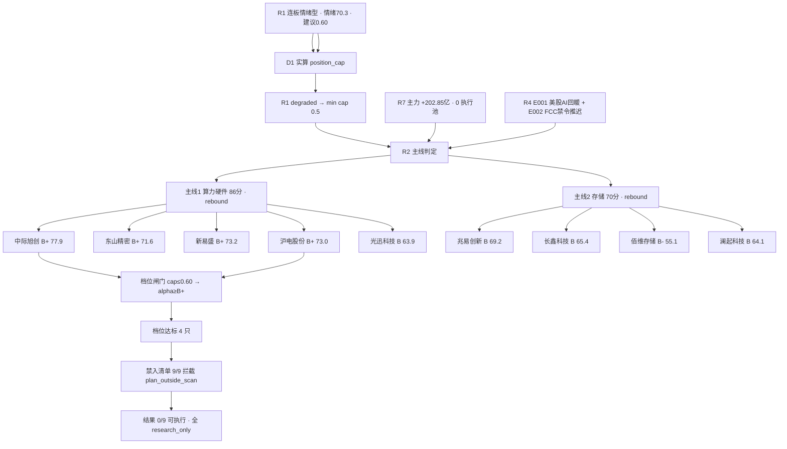

# 2026年11月12日 · **个股画像**

> **数据源新鲜度**: partial（主源全 fresh，上游 R1 降级 + 话语层缺失）
> **降级状态**: true（微信群 0 条 / R3 KOL 0 条 / R4 仅标题级）
> **置信度**: 0.525（0.75 × 0.7 × 1.0）

## 一句话结论

两条主线（算力硬件 86 分 / 存储 70 分）**全是 rebound 层**（距 60 日高 -30%~-58%，纪律上限持有 3 天），9 只候选 **4 只 B+、4 只 B、1 只 B-**；档位闸门实算过了 4 只，但 **9/9 全被禁入清单 plan_outside_scan 拦截 → D1 可执行池 0 只**；硬红旗集中在光迅（CFO 连续两期负）、佰维（CFO -100.41 亿 + 有息负债/净资产 152%）、长鑫（大宗折价 -9.65%）。

---

## 详细分析

### 1. 先认市场：修复第 4 天，钱从机器人切回 AI 硬件

| 维度 | 读数 | 含义 |
|---|---|---|
| 风格（R1） | 连板情绪型，情绪 70.3（贪婪档） | 情绪不冷，但 high_chop 修复段第 4 天 |
| 仓位上限（R1 建议） | 0.60 | 0.70 基准 +0.05 情绪 −0.05 high_chop −0.05 30日样本中位 −11.63% −0.05 周期折扣 |
| **仓位上限（D1 实算）** | **0.50** | R1 `status=degraded` 非 complete → D1 `step1_position_cap` 走 `cap=min(cap,0.5)`，**以 0.50 为准** |
| 涨停/跌停（R2） | 85 / 0，炸板率 18.27%（19/104），最高板 4 | 修复确认，但高度只有 4 板 |
| 主力（R7） | 11-11 +202.85 亿，三日累计 +505.04 亿（补回 11-06 主跌 95.6%） | 资金已回补，但 10 日 -980.72 亿、20 日 -3146.51 亿仍是净流出 |
| 板块切换（R7） | 机器人/传媒/端侧 AI → 光模块·CPO·PCB·存储 | 钱在换方向，不是在同一方向加仓 |
| 执行资格（R7/R2） | `execution_candidates = []` / `execution_pool = []` | 连资金面与板块面自己都不给执行池 |

**结论：今天是「修复段里的板块切换」，不是「主升浪」**。R2 两条主线 stage 均为 formation（首日启动、涨停潮第 1 天、consecutive_boards=0），layer 均为 rebound → 按纪律「只做第一波、破 5 日线无条件走、禁止趋势持有」。

### 2. 候选总表（9 只 · 2026-11-11 收盘口径）

| 票 | 位次 | 收盘 | 今日主力(亿) | 5日(亿) | 20日(亿) | 获利盘% | PE_TTM | 距30日高 | 综合 | α | 风险 | R4口径 |
|---|---|---|---|---|---|---|---|---|---|---|---|---|
| 中际旭创 | 龙一 | 542.00 | +29.87 | +16.06 | +35.14 | 52.4 | 24.65 | -42.3% | 77.9 | B+ | B+ | 首推 RR2.59 |
| 新易盛 | 龙三 | 215.00 | +30.50 | +32.38 | +46.71 | 78.7 | 20.57 | -53.5% | 73.2 | B+ | B+ | 首推（限权） |
| 沪电股份 | 候补 | 89.43 | +10.94 | +2.89 | -8.23 | 52.0 | 25.72 | -31.0% | 73.0 | B+ | B+ | 板块层 |
| 东山精密 | 龙二 | 92.06 | +23.16 | -5.61 | -2.33 | 84.8 | 32.85 | -53.6% | 71.6 | B+ | B | 板块层 |
| 兆易创新 | 龙一 | 259.62 | +12.52 | -13.37 | -1.87 | 46.5 | 15.71 | -36.4% | 69.2 | B | B | **承压（禁开仓）** |
| 长鑫科技 | 龙二 | 42.07 | +16.57 | -20.26 | -36.63 | 66.3 | 20.52 | -29.7% | 65.4 | B | B- | 未点名 |
| 澜起科技 | 候补 | 162.86 | +3.90 | -2.61 | -10.83 | 38.3 | 51.76 | -29.2% | 64.1 | B | B | 未点名 |
| 光迅科技 | 候补 | 103.93 | +5.22 | -1.01 | -15.25 | 54.7 | 56.90 | -46.1% | 63.9 | B | B | 未点名 |
| 佰维存储 | 候补 | 139.03 | +2.08 | -2.51 | -17.52 | 59.7 | 6.89 | -39.2% | 55.1 | B- | C | 未点名 |

**读数三条**：① 今日主力净额前三为新易盛 +30.50 / 中际 +29.87 / 东山 +23.16，全部集中在算力硬件链，存储链最大只有长鑫 +16.57；② 5 日/20 日窗口只有中际（+16.06/+35.14）与新易盛（+32.38/+46.71）双正，其余 7 只至少一窗为负；③ 获利盘 84.8%（东山）、78.7%（新易盛）意味着上方几乎全是浮盈，反弹随时遇兑现。

### 3. 逐票：板型 / 龙头认定 / 盈亏比 / 禁止清单（四项必含）

#### 3.1 中际旭创（300308.SZ）· B+ / B+ · 77.9

- **板型**：20cm **未封板**，+15.07%，收盘 542.00 > 均价 514.19，收盘位置 0.914（收在当日上半区）。不是涨停板，不能用「首板隔日」模板。
- **龙头认定**：板块启动日带动性第一（主力 +29.87 亿、成交 312.29 亿、东财人气 #2），v1.5 判 **龙头（容量型，未涨停）**；过纪律 §2 三条（身位=总龙、辨识度=光模块心智锚、带动性=板块最大单票流入）。
- **盈亏比**：R4 给 **RR_t1 2.59、止损距 -5.00%（514.90）**，是 9 只里**唯一 RR≥2** 的票（R4 另外两只 RR≥2 的源杰 2.70 / 宇树 2.18 不在本批候选池内）；识图结构位 548 突破 / 511 低吸 / 481 止损（引擎口径，非本 skill 定价）。
- **禁止清单**：`plan_outside_scan`（R2 open_permission=false，研究阶段必然命中）。`mid_laggard` 未命中（子板块第 1）。
- **大资金意图**: 机构回补首日——5 日 +16.06 亿与 20 日 +35.14 亿三窗全正，是 9 只里唯一「资金三窗皆为净买」的容量票；对手盘是 60 日下跌区间沉淀的套牢筹码（上方 570 / 769 两层均线压制）。
- **为什么走强**: 位置（距 60 日高 -46.6%，超跌）+ 催化（E002 把 FCC 禁令推迟到 2028-2029，硬时间锚）+ 筹码（30 日无龙虎榜、大宗 39 笔零折价＝协议过户而非甩货），三维里催化最硬、位置最软。
- **逻辑够不够硬**: **催化硬、位置不硬**。E002 是产业定价级利好（把「中国光模块被禁」的尾部风险推后两年），PE 24.65 / CFO 80.08 亿不贵；但距 60 日高 -46.6%、MA20 570 与 MA60 769 双头压制，属反弹第一波不是趋势起点。证伪路径：跳空低开 >3% 且跌破 514 均价线，则昨日 +29.87 亿是单日调仓而非趋势起点。

- **买入理由**: ①资金三窗全正（今日 +29.87 / 5 日 +16.06 / 20 日 +35.14 亿），是本批唯一三窗皆正；②催化有硬时间锚（FCC 禁令推迟至 2028-2029），不是情绪叙事；③RR 2.59 是全体唯一过盈亏比门的票。
- **风险点**: ①短期——单日 +15.07% 后 MA5 乖离 +12.6%，短线过热；②筹码——股东户数 +74% 散户化，上方 570 是 60 日下跌中继位、套牢盘密集。
- **止损条件**: （引擎口径）跌破 481（日 K MA5）且失守 500 整数关 → 反弹结构破坏；周线前低 427 为中期防线。
- **可验证假设**: 今日竞价高开 ≤3% 且 30 分钟内不破 514.19 均价线 → 机构回补延续；若高开 >5% 或开盘 15 分钟内跌破 514，则 +29.87 亿是单日调仓，主线降级为一日游。

#### 3.2 新易盛（300502.SZ）· B+ / B+ · 73.2

- **板型**：20cm 未封板，+16.97%，收盘 215.00 > 均价 201.99，收盘位置 0.954（收在最高附近）。
- **龙头认定**：光模块双龙之一、弹性第一，v1.5 判 **龙头（容量型，未涨停）**；子板块第 2（`mid_laggard` 未命中——按子板块卡位而非合并主线位次）。
- **盈亏比**：R4 **未给 RR**（stance 为「首推（限权）」）；-5% 止损距 10.75 元对 20cm 票不足一个日内振幅，**RR 不成立**。
- **禁止清单**：`plan_outside_scan`。
- **大资金意图**: 最激进的一笔钱——今日 +30.50 亿（净额率 12.09%，全批最高），5 日序列 -17.46/-3.46/+9.26/+13.54/+30.50 逐级放大，是唯一连续 3 日净买且加速的票；主力买的是「同一条光模块链里弹性最大的载体」。
- **为什么走强**: 弹性 > 容量——同样的事件它涨 16.97% 而中际 15.07%；调研 310 条、外资（pinpoint / MarshallWace / IDG）10-29 同日到场，说明这是被机构研究端覆盖最深的弹性标的之一。
- **逻辑够不够硬**: **资金硬、弹性硬，赔率不硬**。CFO/净利 0.13 且 CFO 同比 -68.42%（V4）、Q3 单季环比 -19.1%（R4 因此限权），且现价 215 已贴 60 分前高 216.35——追高的赔率不硬。证伪路径：回踩 200 不破且量能萎缩，则加速买盘被证伪。

- **买入理由**: ①今日主力净额率 12.09% 为全批最高，5 日连续 3 日放大（+9.26/+13.54/+30.50 亿）；②20cm 弹性最大、同催化下涨幅领先中际；③外资与产业资本 10-29 同日到场（调研 310 条），买方是有研究覆盖的。
- **风险点**: ①短期——MA5 乖离 +15.3% 为全批最热，现价贴 216.35 前高；②财务——CFO/净利 0.13（CFO 同比 -68.42%），利润未转现金；③R4 因 Q3 单季环比 -19.1% 给「限权」。
- **止损条件**: （引擎口径）跌破 200（识图 60 分低吸位下沿）→ 加速买盘结构破坏；跌破 MA5 186.50 为反弹结束确认。
- **可验证假设**: 今日回踩 200-202 能否缩量企稳并收复均价线 201.99；不能则判断为加速赶顶而非回踩，优先减不追。

#### 3.3 沪电股份（002463.SZ）· B+ / B+ · 73.0

- **板型**：主板 10% 涨停，13:13 首封、**开板 3 次**、封单 2.63 亿（东山的 40%）、换手仅 4.16%（低换手封板）。
- **龙头认定**：PCB 中军（子板块第 2），v1.5 判 **龙二（封板质量弱·开板 3 次）**，按「分歧弱」边界处理。
- **盈亏比**：未给 RR；-5% 止损距 4.47 元不足一个振幅，RR 不成立；R2 明示「不打板」。
- **禁止清单**：`plan_outside_scan`。
- **大资金意图**: 机构 + 公司双线买——11-11 机构龙虎榜净 +5.69 亿，11-10 实控人增持计划 + 回购方案落地；对手盘是 3 次开板中被打出来的短线浮盈。
- **为什么走强**: PCB 载板同链 + 1728 亿容量 + 跌幅最浅（距 60 日高仅 -31.9%，本批最浅）；11-09 富邦投信 / 国泰投信 / 国泰世华银行集中到场（台资看 AI 服务器 PCB 链）。
- **逻辑够不够硬**: **公司行为最硬，板型不合格**。真金白银的增持 + 回购是硬信号，但封单仅 2.63 亿、开板 3 次说明封板质量不过关，且 20 日主力仍 -8.23 亿——**只能观察不能打板**。证伪路径：次日不能回封则一日游，量能放大而封单变薄是标准走弱形态。

- **买入理由**: ①公司自己买——11-10 实控人增持计划 + 回购方案落地，11-10 大宗机构零折价；②机构龙虎榜净 +5.69 亿承接；③距 60 日高 -31.9% 为本批最浅、1728 亿容量足够承接机构调仓。
- **风险点**: ①封板质量——开板 3 次、封单仅东山的 40%，分歧板非一致板；②20 日主力仍净流出 8.23 亿；③MA5 乖离 +11.2% 未回踩。
- **止损条件**: （引擎口径）跌破 MA5 80.41 且放量 → 涨停溢价回吐完毕；跌破 72.10（近 20 日低点）则日内支撑失效。
- **可验证假设**: 今日能否在 09:45 前封板且封单回到 3 亿以上；不能则按分歧板处理，放弃打板思路只等回踩。

#### 3.4 东山精密（002384.SZ）· B+ / B · 71.6

- **板型**：主板 10% 涨停，13:11 首封、**0 开板**、封单 6.57 亿（板块最厚）、换手 11.71%。
- **龙头认定**：板高并列 1 板时按封单额定情绪龙头第一顺位，v1.5 判 **龙头（情绪龙头第一顺位）**；但 13:11 午后首封＝机构回补特征，不是早盘一致性。
- **盈亏比**：未给 RR；-5% 止损距 4.60 元 ≈ 1 个日内振幅，**RR 做不出 ≥2**。
- **禁止清单**：`plan_outside_scan`。
- **大资金意图**: 单日机构回补 +23.16 亿（净额率 9.6% 全批最高），但 30 日龙虎榜累计 **-14.67 亿**、机构累计 **-21.09 亿**（11-04 一天 -18.38 亿），是「单日回补」对「中期派发」——大资金在做的是**回补不是建仓**。
- **为什么走强**: PCB 载板 + 光模块双属性叠加 E001/E002；封单 6.57 亿是板块最厚，0 开板说明封板坚决。
- **逻辑够不够硬**: **不硬**——获利盘 84.8%、股东户数 +215%、有息负债/净资产 85.5%（F10），封板再厚也是浮盈盘互相接力。证伪路径：若 11-04 的机构席位再次出现大额净卖，则本轮回补被证伪。

- **买入理由**: ①封单 6.57 亿最厚 + 0 开板，情绪龙头的强度形态在 PCB 链上最突出；②单日机构回补 +23.16 亿为全批净额率最高；③兼具 PCB 载板与光模块双属性，是同一条 AI 硬件链两个名字的交叉点。
- **风险点**: ①中期派发未结束——30 日龙虎榜 -14.67 亿、机构累计 -21.09 亿；②获利盘 84.8% + 股东户数 +215%，浮盈兑现压力大；③F10 有息负债/净资产 85.5%。
- **止损条件**: （引擎口径）跌破 MA5 85.31 → 涨停溢价回吐；跌破 83.30（识图止损位）则结构破坏。
- **可验证假设**: 今日能否回封并维持封单 >5 亿；封单快速萎缩至 3 亿以下说明昨日封板是回补而非接力。

#### 3.5 光迅科技（002281.SZ）· B / B · 63.9 · **拦截**

- **板型**：主板 10% 涨停，**13:46 首封**（比东山晚 35 分钟）、0 开板、封单 2.23 亿（东山的 34%）。
- **龙头认定**：v1.5 判 **补涨/跟风**（板块第 5 顺位、午后晚封）。
- **盈亏比**：未给 RR；-5% 止损距 5.20 元不足一个振幅，RR 不成立。
- **禁止清单**：`mid_laggard`（子板块第 3）+ `plan_outside_scan`。
- **硬红旗**：**F8**——CFO 2026H1 -12.36 亿、2026Q3 -18.81 亿连续两期为负，而归母 +12.84 亿（利润未变现）；PE 56.90 全批最高；12-16 有 5 笔解禁合计约 634 万股；10-29 控股股东拟无偿划转，治理结构待变。
- **一刀切结论**：**拦截，不参与**。CFO 双负 + 补涨位 + 高 PE 三项叠加，属于「形态好看但基本面漏气」。

#### 3.6 兆易创新（603986.SH）· B / B · 69.2 · **R4 承压样本**

- **板型**：无涨停，+6.15%，收盘位置 0.95；存储细分 **0 家涨停**、无板高。
- **龙头认定**：存储设计子板块第 1（辨识度=「存储=兆易」），v1.5 判 **龙头（容量型，未涨停）**；但板块无效应 → 龙头资格降级。
- **盈亏比**：未给 RR；E008 压制目标空间，RR 不成立。
- **禁止清单**：`down_trend_break`（60 日 -43.0% + 存储细分 0 涨停＝下降趋势且无板块效应）+ `plan_outside_scan`；另有 R4 **承压样本（禁止开仓）**。
- **大资金意图**: 今日 +12.52 亿是链内最大单票流入，但 5 日 -13.37 亿（前两日 -11.16/-13.36），单日回补不构成趋势——机构在跌深位接反弹货，不是加仓。
- **为什么走强**: E007 华为存储 11-12 贵安试商用（当天硬事件）+ 存储概念从同花顺 #18 跃升 #6；调研 81 条含 Point72 / Balyasny / ACG 等对冲基金 08-18 集中到场。
- **逻辑够不够硬**: **基本面最硬、周期位置最软**——PE 15.71 / PB 2.38 / CFO 101.24 亿（CFO/NP 0.91）无可挑剔，但大摩 E008「旧存储 2028 供需转松、消费级涨不动」直接打周期顶，卖方目标价 640 是周期外推。

#### 3.7 长鑫科技（688825.SH）· B / B- · 65.4 · **distribution_alert**

- **板型**：无涨停，+4.00%（20cm 口径未达强度线），收盘位置 0.87；板块 0 涨停。
- **龙头认定**：DRAM 原厂身份唯一（20260727 上市、72 根 K），v1.5 判 **龙头（原厂/次新，未涨停）**。
- **盈亏比**：R2 判「观察，强度不达标今日不买」；-5% 止损距 2.10 元 vs 日均振幅 5.6%，RR 不成立。
- **禁止清单**：`plan_outside_scan`。
- **红旗**：11-11 大宗 **38.01 元 vs 收盘 42.07 → 折价 -9.65%**（买卖双方同为广发杭州顺福商务中心营业部）→ `distribution_alert`；20 日主力 -36.63 亿、5 日 -20.26 亿；两融融资 +6.38%（唯一加杠杆）。
- **大资金意图**: 今日 +16.57 亿是链内最大，但 5/20 日持续流出，属「脉冲式回补 + 大宗折价出货」并存，机构分歧明显。
- **为什么走强**: 原厂身份 + 毛利率 86.9% + 净利 1320.4 亿（+2600.8%）+ 两次回购加码；11-03 华泰目标价 59.0（相对现价 42.07 有 40% 空间）。
- **逻辑够不够硬**: **基本面炸裂但筹码未沉淀**——72 根 K 无长周期验证，大宗折价 -9.65% 就是最直接的反对票。

#### 3.8 佰维存储（688525.SH）· B- / C · 55.1 · **拦截**

- **板型**：无涨停，+6.95%，收盘位置 0.96；模组端弹性位（存储链涨幅第 2）。
- **龙头认定**：v1.5 判 **补涨/跟风**（子板块第 2 但主线内候补、无涨停）。
- **盈亏比**：未给 RR；-5% 止损距 6.95 元 vs 日均振幅 5.9%，RR 不成立。
- **禁止清单**：`down_trend_break` + `plan_outside_scan`。
- **硬红旗**：**F8**（CFO 2026H1 -62.61 亿 / 2026Q3 -100.41 亿，归母 +87.68 亿）+ **F10**（有息负债/净资产 152.4%）+ **V4**（CFO/NP -1.14）；10-29 龙虎榜净卖 -3.83 亿；资产负债率 68.3%；研报仅 3 条。
- **一刀切结论**：**拦截，不参与**。PE 6.89 是「周期顶 + 高杠杆 + 现金流为负」组合出来的便宜，不是安全边际。

#### 3.9 澜起科技（688008.SH）· B / B · 64.1 · **观察**

- **板型**：无涨停，+5.21%（未达 20cm 的 7% 强度线），收盘位置 0.93；板块第 4 顺位。
- **龙头认定**：v1.5 判 **补涨/跟风**（子板块第 2 但主线内候补）。
- **盈亏比**：未给 RR；-5% 止损距 8.14 元 vs 日均振幅 5.4%，RR 不成立。
- **禁止清单**：`plan_outside_scan`。
- **大资金意图**: 今日 +3.90 亿（净额率 7.4%），5 日 -2.61 亿、20 日 -10.83 亿，机构是「小幅回补」不是「加仓」；调研 400 条含 Binyuan / Ashmore / Amundi，是存储链里外资覆盖最广的一家（H 股双重上市带来海外投资者基础）。
- **为什么走强**: DDR5 接口芯片（RCD/SPD）纯度最高 + 现金 65.9%、零有息负债、CFO/NP 0.90 的干净报表。
- **逻辑够不够硬**: 报表最干净，但**获利盘仅 38.3%**（61.7% 筹码在现价之上）意味着每次反弹先遇解套盘，且 PE 51.76 / PS 29.18 是全批最贵一档——**结构干净 ≠ 位置好**。

### 4. 主线内分层：为什么是这 9 只，而不是别的票

| 分层 | 算力硬件链（86 分） | 存储链（70 分） | 判据 |
|---|---|---|---|
| 龙头 | 中际旭创（容量总龙）、东山精密（情绪龙头） | 兆易创新（设计）、长鑫科技（原厂） | 带动性 / 封单额 / 身份唯一性 |
| 二线核心 | 新易盛（弹性）、沪电股份（中军） | 佰维存储（模组弹性）、澜起科技（接口纯度） | 容量 + 资金 + 子板块卡位 |
| 补涨/跟风 | 光迅科技（13:46 晚封） | — | 晚封 + 板块第 5 + CFO 双负 |
| 剔除 | 未纳入（R2 只给 9 只 leaders） | 未纳入 | 内存模组江波龙/德明利 Q3 环比 -44.2%/+2.2%，弱于原厂 |

### 5. D1 闸门实算：档位过了 4 只，可执行 0 只

| 环节 | 口径 | 结果 |
|---|---|---|
| R1 建议 cap | `position_cap_suggestion` | 0.60 |
| **D1 实算 cap** | `step1_position_cap`：R1 `status=degraded` → `min(cap,0.5)`；severity=1 → `min(cap,0.6)` | **0.50** |
| 档位闸门 | `_passes_grade_filter` cap≤0.60 分支 → `alpha≥B+` 即达标 | 达标 **4 只**：中际旭创 / 新易盛 / 沪电股份 / 东山精密 |
| 禁入清单 | `forbidden_filter` 逐票复算 | **9/9 拦截**（全部命中 `plan_outside_scan`；光迅另中 `mid_laggard`，兆易/佰维另中 `down_trend_break`） |
| **最终** | execution_pool | **0 只** —— 与 R2 `execution_pool=[]`、R7 `execution_candidates=[]` 完全一致 |

> **口径纠偏**：R1 建议的 0.60 若被直接采用，会误命中「cap≥0.70 需 alpha≥B+ AND risk≥B-」分支，把东山精密（B+/B）也判为不达标；D1 真实代码在 R1 降级时一律压到 0.50，走 `alpha≥B+` 的 OR 分支。两者差别就在东山一只，但结论同为 0 只可执行。本报告以 D1 实算口径为准。

---

## 关键证据

- **证据 1**（资金三窗）：中际旭创今日 +29.87 亿 / 5 日 +16.06 亿 / 20 日 +35.14 亿，9 只里唯一三窗全正；新易盛今日 +30.50 亿（净额率 12.09%）5 日序列逐级放大。来源：东财 DC `moneyflow_dc`，与 R7 `research_candidates.net_today_yi` 逐票对齐（误差 0）。
- **证据 2**（涨停结构）：11-11 全市场 85 涨停 / 0 跌停 / 炸板 19（炸板率 18.27%），但 CPO 11 家、5G 19 家、AIDC 16 家**全部 cons_nums=0（首板潮）**，最高板仅 4 板 → 高度为零是「反弹」而非「主升」的硬证据。来源：tushare `limit_list_d` 20261111（104 条 = 85 U + 19 Z）+ R2 `breadth`。
- **证据 3**（封板质量）：东山精密 13:11 首封 / 0 开板 / 封单 6.57 亿，沪电股份 13:13 首封 / **开板 3 次** / 封单 2.63 亿，光迅科技 13:46 首封 / 0 开板 / 封单 2.23 亿 —— 同板块三只封板质量分三档。来源：tushare `limit_list_d` 20261111。
- **证据 4**（硬红旗）：光迅 CFO -12.36 亿→-18.81 亿连续两期负（F8）；佰维 CFO -100.41 亿、有息负债/净资产 152.4%（F8+F10+V4）；东山有息负债/净资产 85.5%（F10）；长鑫 11-11 大宗折价 -9.65%（distribution_alert）。来源：tushare `cashflow`/`balancesheet`/`block_trade` 20260930 与 20261111。
- **证据 5**（筹码）：获利盘 84.8%（东山）、78.7%（新易盛）、66.3%（长鑫）已进入兑现阶段；澜起仅 38.3%（61.7% 套牢）；中际 52.4%/沪电 52.0%/兆易 46.5% 属中性。来源：tushare `cyq_chips` 20261111 价格分布自算。
- **证据 6**（股东户数）：9 只 20260930 较 20251231 全部 >70%（中际 +74.0%、东山 +215.2%、新易盛 +218.3%、沪电 +135.4%、光迅 +119.3%、兆易 +203.2%、佰维 +178.0%、澜起 +131.4%；长鑫因 IPO 首日基数不可比出表）——上涨过程中散户大幅涌入，筹码分散是全批共性问题。
- **证据 7**（识图）：当日快照 `date=20261112` 已校验，9 只全部命中；bias 偏多 2 只（沪电 0.62、光迅 0.55）、震荡 7 只，无一只偏空；7 只给出「高抛/观望」动作，只有沪电/光迅给「回踩低吸」。

---

## 数据源审计

| 源 | 日期 | 状态 | 备注 |
|---|---|:--:|---|
| R2_main_sectors | 2026-11-12 | 🟢 | 9 只 leaders；缺 `all_scored_boards_top10` → 扩池未执行 |
| R1_style | 2026-11-12 | 🟡 | status=degraded、confidence 0.472；建议 cap 0.60（D1 实算 0.50） |
| R4_news | 2026-11-12 | 🟡 | 8 事件 / 群聊 0 条 / news_major 仅标题级 / weflow 404 |
| R7_capital_flow | 2026-11-12 | 🟢 | 20 只研究候选、execution_candidates=[] |
| tushare daily + daily_basic + adj_factor | 2026-11-11 | 🟢 | 9 票 · 111 根日 K（长鑫 72 根次新），前复权 |
| tushare limit_list_d | 2026-11-11 | 🟢 | 全市场 104 条（85 涨停 + 19 炸板）；9 票逐票首封/开板/封单/板高 |
| tushare top_list + top_inst | 2026-10-09 ~ 2026-11-11 | 🟢 | 24 交易日逐日全市场，本批命中 9 条（top_inst 行 90） |
| tushare block_trade | 2026-09-01 ~ 2026-11-11 | 🟢 | 长鑫 11-11 一笔 38.01 元、折价 -9.65%、买卖同一营业部 |
| tushare margin_detail | 2026-10-01 ~ 2026-11-11 | 🟢 | 9 票各 24 个交易日两融明细（中际融资 162.65 亿、区间 -49.14%） |
| tushare 财务四表 | 2026-09-30 | 🟢 | 9 票 2026Q3 现金流/资产负债；兆易 profit_dedt 空值（F6 未判） |
| tushare cyq_chips | 2026-11-11 | 🟢 | 9 票当日筹码分布（获利盘/成本分位） |
| tushare stk_holdernumber | 2026-09-30 | 🟢 | 9 票股东户数环比（8 只出表，长鑫基数不可比） |
| tushare report_rc + stk_surv + anns_d | 2026-08-01 ~ 2026-11-12 | 🟢 | 研报 418 条（rc 窗口 08-01~）/ 调研 1,504 条（surv 窗口 06-01~）/ 公告 338 条（anns 窗口 09-01~）；事件时间线 9/9、跨度 ≥50 天 |
| eastmoney moneyflow_dc（R7 同源） | 2026-09-01 ~ 2026-11-11 | 🟢 | 21 交易日 × 6,032 票，与 R7 逐票误差 0 |
| chart_vision 快照 | 2026-11-12 | 🟢 | 24 票（9/9 命中）；1 票失败（603920.SH，非本批） |
| czsc 缠论 | 2026-11-12 | 🟢 | CZSC 0.10.12 日线笔/中枢，9 票全产出 |
| wechat_cli_5groups | — | 🔴 | 7 群 0 条 → 话语层缺失，freshness_factor 取 0.7 |

---

## 不确定性 / 反证

1. **总仓位前的最大不确定是话语层**：R3 KOL 0 条、微信群 0 条、R4 只有标题级新闻。这意味着「情绪」这一票只能靠 R1 的量化情绪分（70.3）与涨停结构，无法校验真人是否在喊。若今日竞价一致性差，D1 实算的 0.50 上限还应再降。
2. **rebound 层的自我否定条件**：R2 明示「破 5 日线无条件走」。以中际为例，MA5 = 481.27，距现价 -11.2%；一旦今日跳空低开 >3% 并回落，昨日 +29.87 亿就是单日调仓，整条主线降级为一日游。
3. **长鑫的大宗折价是反向证据**：11-11 折价 -9.65%、买卖双方同一营业部，是典型减持/过户通道；这与「主力 +16.57 亿净流入」同时发生，说明「二级买、大宗卖」的分歧，不能只读一侧。
4. **兆易的「便宜」可能是周期顶**：PE 15.71 看似最低，但 2026Q3 毛利率 66.22% 是涨价周期高位；若 2027 供给释放，盈利下修会同时打 PE 与 EPS。R4 E008 已给出这个反证，本报告据此下调 alpha/risk。
5. **F6 数据缺口**：兆易 `profit_dedt` 返回空值，扣非口径未能核验；若扣非占比 >30%，将新增 F6 软红旗。此处如实记录为缺口，不当作「无红旗」。
6. **本报告的逆向解读**：如果只读「今日主力净额」会被 +30.50/+29.87/+23.16 三个数字带走；但 5 日/20 日窗口只有中际、新易盛双正，其余 7 只至少一窗为负——**单日流入是反弹的必要条件，不是充分条件**。
7. **口径纠偏的边界**：本报告把 D1 仓位上限从 R1 建议的 0.60 纠正为实算的 0.50，差异来自 R1 `status=degraded`。若 R1 后续重跑转为 `complete`，cap 会回到 0.60 → 0.70 分支（要求 alpha≥B+ AND risk≥B-），东山精密将被判不达标。该口径变化会改变 D1 的 watch/execution 分层，但**不改变今日 0 只可执行的结论**（禁入清单 9/9 全数拦截是独立于档位的硬约束）。

---

## 与其他 R/D/E 的关系

- **依赖**：R1_style（风格/情绪/仓位上限）、R2_main_sectors（候选池/主线得分/板型时序）、R4_news（催化事件与承压样本）、R7_capital_flow（主力净额交叉核验）。
- **被消费**：R6 反证（读取 `dimensions.valuation_safety.fundamental_flags[]` 做模式七复核，F8/F10/V4 已透传；`distribution_alert` 供霸榜出货模式）、D1 主决策（`alpha_grade`/`risk_grade` 双档 + `forbidden_check` + `d1_gate_simulation`）、E1 复盘（档位与闸门结果比对次日实际）。
- **给 D1 的明确输入**：9 只全部 `research_only`，`execution_pool` 应为空；若 D1 要动，唯一有 RR≥2 的是中际旭创（R4 口径 2.59），且必须过「计划内 + 竞价不破 514.19」两道门。
- **给 R6 的优先复核对象**：光迅科技（F8+F10）、佰维存储（F8+F10+V4，CFO -100.41 亿）、长鑫科技（`distribution_alert` 大宗折价 -9.65%）。

## Sub-Agent 元数据

- skill: analyze_stock_profile_v1
- artifact: `data/research/20261112/R5_stock_profiles.json`（约 200 KB，严格 JSON，无 NaN/Infinity）
- 校验器: `scripts/research/check_r5_20261112.py` → **0 errors / 0 warns**
- 生成耗时: 约 25 分钟（含 chart_vision 快照 24 票并发、9 票 × 24 类 tushare 接口、D1 闸门实算复核）
- model: MiniMax-M3.1-Flash
- 覆盖: R2 leaders 9/9 画像、识图 9/9、缠论 9/9、事件时间线 9/9（跨度 50-123 天）、K 线最少 72 根（长鑫次新）、chart_png 9/9
- 档位分布: alpha B+ 4 / B 4 / B- 1（无 A 档）· risk B+ 3 / B 4 / B- 1 / C 1
- D1 闸门模拟: 档位达标 **4 / 9**（cap 实算 0.50，走 alpha≥B+ 分支）· 可执行 **0 / 9**（9/9 命中 `plan_outside_scan`）
