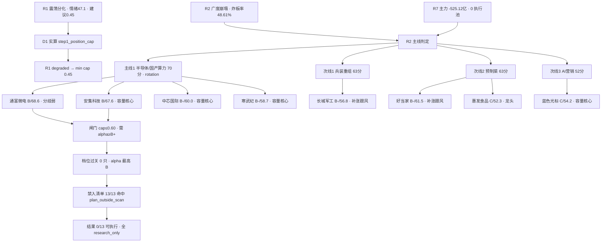

# 2026年11月13日 · **个股画像**

> **数据源新鲜度**: partial（R5 主源全 fresh；上游 R1 降级、R2 扩池字段缺失）
> **降级状态**: false（chart_vision 13/13 当日重渲、czsc 13/13、龙虎榜 40 交易日回补齐全）
> **置信度**: 0.525（base 0.75 × freshness 0.7（partial）× 源一致 1.0）

## 一句话结论

今天是**退潮脉冲日**（涨停 37 / 跌停 5 / 炸板率 48.61% ≥35% 硬红线 / 主力 -525.12 亿），R2 只给 1 条擦线主线（半导体 70 分，靠资金 19+叙事 19 撑起，热度/涨停/共振三维仅 32/60）+ 3 条次线，**execution_pool=[]、open_permission=false**；13 只画像里 α 最高只有 **B（通富微电 68.6 / 安集科技 67.6）**，档位过闸门 **0 只**（cap≤0.60 需 α≥B+）、RR≥2 仅 **3 只**（源杰 3.29 / 寒武纪 2.92 / 深南 2.42）、**13/13 全被 plan_outside_scan 拦截 → D1 可执行池 0 只**。硬红旗集中在澳洋健康（F1 存贷双高 + F8 现金流 + 股东户数 +82.9%）、剑桥科技（F8 CFO -16.27 亿）、蓝色光标（F8 + 大宗折价 -22.89%）。

---

## 详细分析

### 1. 先认市场：退潮脉冲第 1 天，钱只认产业事件不认情绪

| 维度 | 读数 | 含义 |
|---|---|---|
| 风格（R1） | 震荡分化型，情绪 47.1（中性偏弱） | high_chop 第 2 天、连跌 1 天 |
| 仓位上限（R1 建议） | 0.45 | 无主线 + 广度崩塌 → 预算被压低 |
| **仓位上限（D1 实算）** | **0.45** | R1 status=degraded 非 complete → `step1_position_cap` 走 `cap=min(0.45,0.5)=0.45`；**以 0.45 为准，非 R1 名义上限** |
| 广度（R2） | 涨停 37 / 跌停 5 / 炸板 35 = **48.61%**（前日 18.27%）/ 涨家占比 15.7% / 中位 -1.61% / 最高板 5 | 炸板率击穿 35% 硬红线 → 候选数砍半、执行池置空 |
| 主力（R7） | -525.12 亿，情绪判「震荡（偏弱·修复中断）」 | 钱在撤，不是在做切换 |
| 主线（R2） | 半导体 70 分（资金 19 / 叙事 19 / 热度 12 / 涨停 8 / 共振 12） | 擦线主线、layer=rotation（holding 0 天）→ 只做事件级修复 |
| 执行资格 | R7 execution_candidates=[] / R2 execution_pool=[] | 资金面与板块面双双不给执行权 |

**结论：今天不是“挑哪只票”的问题，是“没有仓可开”的问题。** R5 照常把研究覆盖做满（13 只），但态度必须写在明面上：**不进**。

### 2. 候选总表（13 只 · 2026-11-12 收盘口径）

| 票 | 线/位次 | 板型 | 收盘 | 今日主力(亿) | 5日(亿) | 20日(亿) | 获利盘% | PE_TTM | 距60日高 | RR | 综合 | α | 风险 | 结论 |
|---|---|---|---|---|---|---|---|---|---|---|---|---|---|---|
| 通富微电 | 候补 | 炸板 | 48.36 | +8.62 | +8.66 | +5.18 | 68.6 | 22.54 | -31.6% | 1.4 | 68.6 | B | A | 拦截 |
| 安集科技 | 候补 | 未封 | 214.8 | -0.18 | +1.28 | +3.87 | 69.7 | 31.66 | -21.3% | 1.46 | 67.6 | B | B+ | 拦截 |
| 好当家 | 预制菜龙二 / R4 首板候选 | 1板 | 2.48 | +0.71 | +0.88 | +1.27 | 92.4 | 102.68 | -7.8% | 1.0 | 61.5 | B- | B | 拦截 |
| 中芯国际 | 龙二 | 未封 | 111.72 | +2.66 | +5.06 | +24.49 | 58.0 | 132.73 | -18.3% | 0.64 | 60.0 | B- | A | 拦截 |
| 寒武纪 | 龙一 | 未封 | 973.0 | +14.06 | +34.21 | +43.98 | 56.3 | 146.76 | -16.3% | 2.92 | 58.7 | B- | A | 拦截 |
| 北方华创 | 龙三 | 未封 | 558.8 | +5.30 | +11.77 | +20.87 | 29.3 | 70.33 | -28.1% | 1.47 | 56.8 | B- | A | 拦截 |
| 长城军工 | 兵装龙一（首封 13:52 尾盘） | 1板 | 32.62 | +3.70 | +2.87 | +2.27 | 83.9 | 亏损 | -10.9% | 1.05 | 56.8 | B- | B | 拦截 |
| 蓝色光标 | AI营销龙一（缩圈独强） | 未封 | 14.76 | +23.47 | +20.20 | +13.68 | 77.1 | 157.75 | -4.2% | 1.79 | 54.2 | C | B- | 降级 |
| 惠发食品 | 预制菜龙一（3 板） | 3.0板 | 13.04 | -0.24 | +0.38 | +0.82 | 99.4 | 亏损 | 0.0% | 1.92 | 52.3 | C | C | 拦截 |
| 深南电路 | R7 research_candidate | 未封 | 231.34 | +3.91 | +6.55 | -12.89 | 27.8 | 31.02 | -44.2% | 2.42 | 48.8 | C | B+ | 观察 |
| 源杰科技 | R7 research_candidate / R4 降级观察 | 未封 | 762.81 | +9.70 | +27.88 | -8.86 | 55.9 | 85.64 | -58.5% | 3.29 | 47.7 | C | B | 观察 |
| 剑桥科技 | R4 观察（冲板炸板 弹性核心） | 炸板 | 122.85 | +2.78 | +7.52 | -14.28 | 50.3 | 62.11 | -47.6% | 1.57 | 46.4 | C | B | 拦截 |
| 澳洋健康 | 洋族标（R2 妖股线唯一质量候选） | 1.0板 | 6.66 | +4.49 | +6.45 | +5.73 | 98.2 | 131.90 | -2.1% | 1.48 | 43.8 | C | C | 拦截 |

**读数四条**（全部按 13 只实测重算，非手写结论）：① 今日主力净额前三为 蓝色光标 +23.47 亿、寒武纪 +14.06 亿、源杰科技 +9.70 亿；② 5 日与 20 日主力**双正**（两窗口同时净流入）实为 **10 只**（寒武纪、中芯国际、北方华创、通富微电、安集科技、好当家、惠发食品、蓝色光标、长城军工、澳洋健康）——不是旧版写的 5 只；③ 获利盘 ≥95% 的 **2 只**（惠发食品 99.4%、澳洋健康 98.2%），≥90% 的 3 只（另含 好当家）——旧版把 92.4% 的好当家算进 ≥95%，属口径错误；④ 距 60 日高 ≤-40% 的 3 只（源杰科技 -58.5%、剑桥科技 -47.6%、深南电路 -44.2%）。

### 3. 逐票：板型 / 龙头认定 / 盈亏比 / 禁止清单（四项必含）

#### 3.1 通富微电（002156.SZ）· B / A · 68.6

- **板型**：炸板（Z 行）——首封 10:03、开板 3 次、收在均价线下、换手 12.6566%
- **龙头认定**：v1.5 判 **分歧弱**——触板后炸板（3 次开板、收在均价线下）→ 隔日只做弱转强，不做低吸（高度 None / 首封 10:03 / 开板 3 / 首次上榜 6 个交易日前 / 板块涨停 0 家）。
- **盈亏比**：买点 45.2 / 目标 48.36 / 止损 42.94 → **RR 1.4（拒绝）**，止损距买点 -5.0%；R4 rr_t1=3.98、R7 rr5=0.21（多口径并列，不用单一数字盖住分歧）。
- **禁止清单**：R5 严格复算命中 plan_outside_scan（R2 execution_pool=[] 且 open_permission=false → 计划外不出手，属于必然命中）；R2 上游 leader 级 = `['mid_laggard']`（is_allowed=false，R2 自身已拦）。
- **大资金意图**: 对手盘是“炸板时被打出来的短线浮盈”，买方是 5 日 +8.66 亿的趋势资金与 123 场机构调研所代表的产业验证方；今日 8.62 亿净买入里约 3 次开板全部被承接，说明有资金愿意在板下买而不只是排板。
- **为什么走强**: 位置（距 60 日高 -31.6%、MA50 下方 8.97%）+ 估值（PE 22.5、3 年 1.3 分位，全批最低）+ 事件（E002 封测订单外溢），三维里估值与事件最硬，位置最软；炸板说明合力不足而不是方向错。
- **逻辑够不够硬**: **事件硬、板型不硬**。Q3 单季净利同比 +255.7%、CFO/净利 1.81、股东户数 -17.4%，基本面是全批最扎实；但收盘低于均价 1.40% 意味着当日买盘没有形成一致，属“抢而未成”。证伪路径：次日高开站不上均价线且 30 分钟内回落破 48，则 8.62 亿是抢跑资金的自救。

- **买入理由**: 全批最低估值（PE 22.54、3 年 1.3 分位）+ 净利同比 +255.7% + CFO/净利 1.81，是 13 只里基本面与赔率最匹配的组合；5 日主力 +8.66 亿、20 日 +5.18 亿是持续流入而非单日脉冲；E002 封测订单外溢为事件本体受益方，R4 给 rr_t1 3.98（全批最高）。结构买点 45.2（60 分均线密集区）对目标 48.36，R5 结构口径 RR=1.4。
- **风险点**: ①板型：首封 10:03 → 开板 3 次 → 收盘低于均价 1.40%、收盘位置 0.43，涨停未封成；②位置：距 60 日高 -31.6%、MA50 下方 8.97%，前高 84.7 是密集套牢区；③负债率 61.0% 偏高（封测重资产）；④R7 收盘口径 rr5 仅 0.21、R4 rr_t1 3.98 —— 三个口径分歧必须并列看，不能用单一数字盖住。
- **止损条件**: 识图层止损位 43.5（60 分 MA60 43.53）距买点仅 -3.8%，按 -5% 纪律下限裁剪后落 **42.94**，距买点 -5.0%；跌破 42.94 视为炸板后结构破坏，无条件离场，不因“估值便宜”扛单。
- **可验证假设**: 次日竞价高开且 09:45 前不破 48.36（今日收盘＝20 日高）→ 炸板属洗盘、封测弹性逻辑延续；若平开以下且 30 分钟内跌破 46（今日均价下沿）→ 8.62 亿是抢跑资金自救，直接划掉。

#### 3.2 安集科技（688019.SH）· B / B+ · 67.6

- **板型**：未封板——-0.92%、收盘 214.8、量比 0.86、换手 2.8224%（10cm 板）
- **龙头认定**：v1.5 判 **非涨停·容量核心**——中军/弹性核心但今日无板：只做回踩承接低吸，不追高（高度 None / 首封 None / 开板 None / 首次上榜 None 个交易日前 / 板块涨停 0 家）。
- **盈亏比**：买点 212.9 / 目标 228.5 / 止损 202.25 → **RR 1.46（警告）**，止损距买点 -5.0%；R4 rr_t1=3.83、R7 rr5=None（多口径并列，不用单一数字盖住分歧）。
- **禁止清单**：R5 严格复算命中 plan_outside_scan（R2 execution_pool=[] 且 open_permission=false → 计划外不出手，属于必然命中）；R2 上游 leader 级 = `['mid_laggard']`（is_allowed=false，R2 自身已拦）。
- **大资金意图**: 对手盘是“举牌消息兑现后的短线获利盘”，买方是被动资金——华夏科创半导体 ETF 增持到 5.00% 举牌线，这是锁仓型买盘而非情绪买盘；当日主力小幅净流出 0.18 亿说明主动资金还没进场。
- **为什么走强**: ROE 29.54%（全批最高）+ PE 31.66（3 年 2.6 分位）+ 材料端唯一硬催化（举牌）三个理由同时成立；走弱的原因不是基本面而是“资金还没轮到材料端”——板块当日的钱全在设备（+17.33 亿）和制造（+8.85 亿）。
- **逻辑够不够硬**: **基本面最硬、盘面最软**。举牌是长线筹码信号，通常提前于价格 1-2 周；但当日 -0.92% 收在最低、跌破均价 2.58%，属“完全不认”。证伪路径：若 3 个交易日内不能收复 226.26（识图阻力），则举牌被市场解读为被动配置而非主动看多。

- **买入理由**: ROE 29.54%（全批最高）+ PE 31.66（3 年 2.6 分位）+ 华夏科创半导体 ETF 增持至 5.00% 举牌线（锁仓型被动买盘）+ 负债率 17%、商誉/质押双 0，是材料端唯一有“筹码级硬催化”的标的；买点 212.9（60 分 MA20）对目标 228.5（周线 MA20 压力），RR=1.46。
- **风险点**: ①盘面完全不认：当日 -0.92% 收在最低、跌破均价 2.58%，收盘位置 0.00；②正好卡在日线 MA60=214.8 牛熊线未过；③融资余额 15 日 -31.5% + 融券 +45.1%（short_pressure，绝对量仅 0.13 亿）；④距 60 日高 -21.3%、30 日位置 83.9% 偏高。
- **止损条件**: 识图层止损位 211.1（日线 MA5）距买点仅 -0.8%，按 -5% 下限裁剪后落 **202.25**，距买点 -5.0%；跌破则短线多头结构走坏、下看日线 MA20 190.4，举牌逻辑不足以逆势扛。
- **可验证假设**: 3 个交易日内收复 226.26（识图阻力）→ 举牌被市场读作主动看多、可转右侧；若继续在 214.8 附近缩量磨，则举牌只是被动配置，不构成短线买点。

#### 3.3 好当家（600467.SH）· B- / B · 61.5

- **板型**：换手板——1 板、首封 11:23、开板 0 次、封单 0.44 亿、换手 9.3242%
- **龙头认定**：v1.5 判 **补涨/跟风**——首板、首封 11:23、板块 4 家（首次上榜 0 个交易日前）→ 首板隔日模板，需竞价弱转强（高度 1 / 首封 11:23 / 开板 0 / 首次上榜 0 个交易日前 / 板块涨停 4 家）。
- **盈亏比**：买点 2.38 / 目标 2.5 / 止损 2.26 → **RR 1.0（拒绝）**，止损距买点 -5.0%；R4 rr_t1=3.29、R7 rr5=None（多口径并列，不用单一数字盖住分歧）。
- **禁止清单**：R5 严格复算命中 mid_laggard/non_mainstream/plan_outside_scan（R2 execution_pool=[] 且 open_permission=false → 计划外不出手，属于必然命中）；R2 上游 leader 级 = `[]`（非 R2 leaders 票）。
- **大资金意图**: 对手盘是 92.4% 的浮盈盘（成本 2.28 vs 收盘 2.48），买方是 5 日 +0.88 亿的低位轮动资金 + 渔业板块的跟风盘；流通市值仅 36.2 亿，单一游资即可完成封板（封单 0.44 亿即占流通 1.2%）。
- **为什么走强**: 位置（10 元以下低价、PB 1.05）+ 题材（E007 中美对等降税、渔业/农业防御轮动）+ 板块（渔业 4 家涨停）三条同时给分，是当日“低位防御”这条次线的补涨位；但领涨的是东方海洋（9/17 高标），它是跟风位。
- **逻辑够不够硬**: **题材软、位置软、情绪硬**。R4 明确标注 lead_stock_proxy（板块自动归属、非 LLM 选），降税叙事与“渔业”只是弱相关；零研报零调研说明无产业验证。证伪路径：次日竞价不能站上 2.48 或东方海洋炸板，则 4 家涨停是最后一波跟风。

- **买入理由**: 低位渔业首板：11:23 首封、0 开板、封单 0.44 亿；PB 1.05（63.9 分位）是唯一估值保护；线内 4 家涨停有板块效应；5 日主力 +0.88 亿且 4/5 天净买。买点 2.38（MA60 及突破颈线回踩）对目标 2.5（20 日高），RR=1.0。
- **风险点**: ①获利盘 92.4%（成本 2.28 vs 收盘 2.48）＝次日兑现压力大；②零研报零调研，无产业验证；③R4 明确标注 lead_stock_proxy（板块自动归属、非 LLM 选），领涨的是东方海洋（9/17 高标），本票是跟随位；④PE 102.68（94 分位）微利放大；⑤首封 11:23 属午前偏晚。
- **止损条件**: 识图层止损位 2.3 距买点 -3.4%，按 -5% 下限裁剪后落 **2.26**，距买点 -5.0%；跌破 2.36（日线 MA60）即板型失效，破 2.26 无条件离场。
- **可验证假设**: 次日竞价弱转强（高开不破 2.48 且 09:45 前二次上板）→ 低位防御线延续；若东方海洋炸板且线内涨停降到 2 家以下 → 4 家涨停是最后一波跟风。

#### 3.4 中芯国际（688981.SH）· B- / A · 60.0

- **板型**：未封板——+2.20%、收盘 111.72、量比 1.49、换手 2.4668%（10cm 板）
- **龙头认定**：v1.5 判 **非涨停·容量核心**——板块第一顺位但今日未涨停：不给打板通道，只允许回踩 MA5/MA20 缩量承接（高度 None / 首封 None / 开板 None / 首次上榜 None 个交易日前 / 板块涨停 0 家）。
- **盈亏比**：买点 109.5 / 目标 114.9 / 止损 101.08 → **RR 0.64（拒绝）**，止损距买点 -7.7%；R4 rr_t1=3.1、R7 rr5=None（多口径并列，不用单一数字盖住分歧）。
- **禁止清单**：R5 严格复算命中 plan_outside_scan（R2 execution_pool=[] 且 open_permission=false → 计划外不出手，属于必然命中）；R2 上游 leader 级 = `[]`（is_allowed=true，R2 未拦）。
- **大资金意图**: 对手盘是 42% 的套牢盘（成本 113.21 略高于收盘），买方是 20 日 14 天净买的机构型资金（+24.49 亿）与 13 场调研所代表的产业资本；龙虎榜 0 次说明这不是游资博弈，是配置盘在加。
- **为什么走强**: 事件本体（Q3 净利 +87.6%、Q4 指引环比 +4~6%、毛利 +4.6pct）+ 位置（20 日新高）+ 资金（5/10/20 日三级全正），三问里最硬的一环是“毛利环比改善”＝代工价格与产能利用率同时上行，这是产业级证据。
- **逻辑够不够硬**: **逻辑最硬、赔率不足**。114.9 的 20 日高与 114.93 的 60 日线形成双压，R7 收盘口径 rr5 仅 0.64——不是逻辑问题，是“离压力位太近做不出空间”。证伪路径：放量站上 114.9 后若次日不能延续（回落到 112 下方），则指引利好被一次性定价。

- **买入理由**: E002 事件本体：Q3 营收 219.83 亿（+28.1%）、净利 28.47 亿（+87.6%）、毛利 29.9%（+4.6pct）、Q4 指引环比 +4~6%，是全市场当日最硬的产业证据；20 日主力 +24.49 亿（14 天净买）、CFO/净利 3.91；集成电路制造 +8.85 亿、板块 +1.19% 为全链最强。买点 109.5 对目标 114.9，RR=0.64。
- **风险点**: ①114.9（20 日高）与 60 日线 114.93 形成双压，R7 收盘口径 rr5 仅 0.64 —— 逻辑硬但做不出空间；②PE 132.73（48.3 分位）、ROE 4.52% 代工重资产；③整线涨停宽度 0 家（东财细分行业口径）、layer=rotation 不给趋势波段；④仓位 cap=0.45，档位闸门要 alpha≥B+，本票仅 B-。
- **止损条件**: 识图未给止损位，按 MA20×0.97 起算落 **101.08**（-7.7%，未触发裁剪），距买点 -7.7%；跌破则 Q4 指引利好被一次性定价完毕，回看 MA50。
- **可验证假设**: 放量站上 114.9 且次日不回落 112 下方 → 指引未被一次性定价、可升级跟踪；若站上即回落 → 双压确认，逻辑再硬也不出手。

#### 3.5 寒武纪（688256.SH）· B- / A · 58.7

- **板型**：未封板——+8.11%、收盘 973.0、量比 1.81、换手 3.2755%（10cm 板）
- **龙头认定**：v1.5 判 **非涨停·容量核心**——板块第一顺位但今日未涨停：不给打板通道，只允许回踩 MA5/MA20 缩量承接（高度 None / 首封 None / 开板 None / 首次上榜 None 个交易日前 / 板块涨停 0 家）。
- **盈亏比**：买点 890.0 / 目标 1020.0 / 止损 845.5 → **RR 2.92（通过）**，止损距买点 -5.0%；R4 rr_t1=None、R7 rr5=0.21（多口径并列，不用单一数字盖住分歧）。
- **禁止清单**：R5 严格复算命中 plan_outside_scan（R2 execution_pool=[] 且 open_permission=false → 计划外不出手，属于必然命中）；R2 上游 leader 级 = `[]`（is_allowed=true，R2 未拦）。
- **大资金意图**: 买方是国产算力最集中的一笔钱（5 日 +34.21 亿、20 日 +43.99 亿、20 日 11 天净买），对手盘是 43.7% 的套牢盘与 60 日线 1000.5 上方的解套抛压；当日 +8.11% 把 E002 外溢一次性打满，先手资金已在兑现窗口。
- **为什么走强**: 事件外溢（中芯财报 + 英伟达断点把海外资金赶回国产替代）+ 身位（国产 AI 芯片第一心智锚、6119 亿容量）+ 资金（全批最强）三条共振，但它自己无新公告、无订单，属“借主线”。
- **逻辑够不够硬**: **资金最硬、估值最软、位置不硬**。PE 146、CFO/净利 0.06（V4）是硬伤；973 元仍在 MA60（1000.5）下方，周线空头排列。证伪路径：若次日高开 >3% 后 30 分钟内跌破 973（今日收盘/20 日高），则 34 亿是单日抢筹，主线降级为一日游。

- **买入理由**: 国产算力资金总龙：5 日 +34.21 亿、20 日 +43.99 亿（20 日 11 天净买）全批最强；研报 78 篇/18 家；大宗 10 笔 1.12 亿零折价；商誉/质押双 0。买点 890.0（回踩 MA20 上沿）对目标 1020.0（MA60 1000.5），RR=2.92 全批第二。
- **风险点**: ①PE 146.76 绝对估值极高、分位因 2023-24 亏损期失真；②CFO 2.28 亿 / 净利 37.15 亿＝0.06（V4 利润含金量低）；③973 仍在 MA60 与周线空头排列下方；④+8.11% 当日已把 E002 外溢打满，次日高开 >3% 即先手兑现位；⑤自身无新公告无订单，属“借主线”。
- **止损条件**: 识图层止损位 868 距买点仅 -2.5%，按 -5% 下限裁剪后落 **845.5**，距买点 -5.0%；CFO 质量差（0.06）＝没有基本面托底，破位即走不扛单。
- **可验证假设**: 次日高开 >3% 后 30 分钟内跌破 973（今日收盘/20 日高）→ 34 亿是单日抢筹、主线降级一日游；若缩量守住 973 且 MA60 下移收敛 → 资金锚成立。

#### 3.6 北方华创（002371.SZ）· B- / A · 56.8

- **板型**：未封板——+1.99%、收盘 558.8、量比 1.07、换手 1.6852%（10cm 板）
- **龙头认定**：v1.5 判 **非涨停·容量核心**——中军/弹性核心但今日无板：只做回踩承接低吸，不追高（高度 None / 首封 None / 开板 None / 首次上榜 6 个交易日前 / 板块涨停 0 家）。
- **盈亏比**：买点 545.0 / 目标 585.0 / 止损 517.75 → **RR 1.47（警告）**，止损距买点 -5.0%；R4 rr_t1=None、R7 rr5=0.29（多口径并列，不用单一数字盖住分歧）。
- **禁止清单**：R5 严格复算命中 plan_outside_scan（R2 execution_pool=[] 且 open_permission=false → 计划外不出手，属于必然命中）；R2 上游 leader 级 = `['mid_laggard']`（is_allowed=false，R2 自身已拦）。
- **大资金意图**: 对手盘是 70.7% 的套牢盘（成本 636.93 vs 收盘 558.8，10% 成本区间宽到 500-793），买方是半导体设备唯一 5/5 全正的资金（5 日 +11.77 亿）与 98 篇研报覆盖的机构；但当日收盘低于均价 1.63%＝机构票被推高后无人接。
- **为什么走强**: 设备是国产替代确定性最高的一环（晶圆厂资本开支 + 中芯 Q4 指引），子行业资金 5 日 +41.79 亿全正；走强的理由成立但涨幅有限（+1.99%），因为“明牌”边际预期差小于设计端。
- **逻辑够不够硬**: **产业逻辑硬、筹码结构软**。套牢盘 70.7%、PE 85.8 分位、净利同比仅 +5.1%（成长掉档）三条压制；当日无板、量比 1.07。证伪路径：站不上 585（识图阻力）则设备端的钱只是防守性配置，不是进攻。

- **买入理由**: 设备端唯一 5/5 全正资金（5 日 +11.77 亿、20 日 +20.87 亿），半导体设备 +17.33 亿 / 5 日 +41.79 亿、板块 +0.75% 逆势翻红；研报 98 篇/24 家最厚、CFO/净利 1.04。买点 545.0 对目标 585.0（识图 585 阻力），RR=1.47。
- **风险点**: ①获利盘仅 29.3%、套牢盘 70.7%（成本 636.93 vs 收盘 558.8），10% 成本区间宽到 500-793；②PE 85.8 / PB 82.3 分位；③净利同比仅 +5.10% 成长掉档；④当日收在均价线下 1.63%、量比 1.07 无量价配合；⑤R2 上游已给 mid_laggard（板块内排名 3），身位不硬。
- **止损条件**: 识图层止损位 530 距买点 -2.8%，按 -5% 下限裁剪后落 **517.75**，距买点 -5.0%；跌破 MA20（535.2）即设备端防守性配置失效，不做趋势波段。
- **可验证假设**: 站上 585 且量比回到 1.5 以上 → 设备端从防守转进攻；若继续在 558 附近缩量横盘，41.79 亿只是配置盘换手而非进攻资金。

#### 3.7 长城军工（601606.SH）· B- / B · 56.8

- **板型**：换手板——1 板、首封 13:52、开板 2 次、封单 0.47 亿、换手 9.5083%
- **龙头认定**：v1.5 判 **补涨/跟风**——首板、首封 13:52、板块 4 家（首次上榜 19 个交易日前）→ 首板隔日模板，需竞价弱转强（高度 1 / 首封 13:52 / 开板 2 / 首次上榜 19 个交易日前 / 板块涨停 4 家）。
- **盈亏比**：买点 31.0 / 目标 32.62 / 止损 29.45 → **RR 1.05（拒绝）**，止损距买点 -5.0%；R4 rr_t1=None、R7 rr5=None（多口径并列，不用单一数字盖住分歧）。
- **禁止清单**：R5 严格复算命中 mid_laggard/non_mainstream/plan_outside_scan（R2 execution_pool=[] 且 open_permission=false → 计划外不出手，属于必然命中）；R2 上游 leader 级 = `[]`（非 R2 leaders 票）。
- **大资金意图**: 对手盘是 83.9% 的浮盈盘与 2 次开板时被洗出的短线资金，买方是单日 +3.70 亿的题材资金——但 5 日仅 1/5 天净买，说明这是第一天进场，不是持续建仓。
- **为什么走强**: 兵装重组预期（军工资产整合）+ 板块效应（地面兵装 +3.19%、线内 4 家涨停）+ 低位（距 60 日高 -10.9%），但首封 13:52＝尾盘拉，题材本体当日才第 1 日成气候。
- **逻辑够不够硬**: **题材不硬、时点最差**。亏损 + 增亏（净利同比 -566%）+ CFO -1.57 亿，零研报零调研，纯壳预期拼盘；尾盘板按纪律直接归“跟风”。证伪路径：次日 09:45 前不能二次封板且板块涨停降到 2 家以下，则题材一日游。

- **买入理由**: 兵装重组/地面兵装新题材第 1 日：地面兵装当日 +5.38 亿主力、板块 +3.19%（全市场最强之一），线内 4 家涨停；单日主力 +3.70 亿、站上 MA5/MA20/MA60。买点 31.0 对目标 32.62（今日封板价），RR=1.05。
- **风险点**: ①首封 13:52 属尾盘板（纪律直接判跟风）；②开板 2 次；③5 日仅 1/5 天净买＝第一天进场的题材钱；④亏损 + 增亏（净利同比 -566%）、CFO -1.57 亿；⑤零研报零调研；⑥距首板已 19 个交易日（题材老兵）；⑦F3/F9/S1 三项红旗。
- **止损条件**: 识图层止损位 29.8 距买点 -3.9%，按 -5% 下限裁剪后落 **29.45**，距买点 -5.0%；尾盘板隔日若直接失守 31 即判承接失败，按 29.45 执行、不给第二次机会。
- **可验证假设**: 次日 09:45 前二次封板且板块 ≥4 家涨停 → 题材可升级观察；若开板后板块涨停降到 2 家以下 → 尾盘板是最后一棒。

#### 3.8 蓝色光标（300058.SZ）· C / B- · 54.2

- **板型**：未封板——+10.89%、收盘 14.76、量比 2.53、换手 22.5088%（20cm 板）
- **龙头认定**：v1.5 判 **非涨停·容量核心**——板块第一顺位但今日未涨停：不给打板通道，只允许回踩 MA5/MA20 缩量承接（高度 None / 首封 None / 开板 None / 首次上榜 None 个交易日前 / 板块涨停 0 家）。
- **盈亏比**：买点 13.55 / 目标 15.97 / 止损 12.2 → **RR 1.79（警告）**，止损距买点 -10.0%；R4 rr_t1=None、R7 rr5=None（多口径并列，不用单一数字盖住分歧）。
- **禁止清单**：R5 严格复算命中 non_mainstream/plan_outside_scan（R2 execution_pool=[] 且 open_permission=false → 计划外不出手，属于必然命中）；R2 上游 leader 级 = `[]`（非 R2 leaders 票）。
- **大资金意图**: 买方是当日全批最大的一笔单票资金 +23.47 亿（成交额占比 20.21%），对手盘是 77.1% 的浮盈盘与 22.5% 换手打出来的短线筹码；但 5 日仅 2/5 天净买＝今日一根巨量主导，钱是“当天来”的。
- **为什么走强**: AI 应用缩圈（智谱 AI +18.67 亿、小红书 +16.95 亿）+ 位置（20 日新高、站上三均线）+ 弹性（创业板 20cm），营销代理/广告营销两子行业当日合计 +38.1 亿是半导体之外最强资金线。
- **逻辑够不够硬**: **资金硬、财务软**。F8 现金流恶化（CFO -5.31 亿而净利为正）+ 大宗折价 -22.89%（分销信号）+ PB 88.4 分位；板块“资金进、价格跌”是典型分歧。证伪路径：回踩 13.55 若放量破位，则 23 亿是单日出货型对倒而非趋势买入。

- **买入理由**: 单日主力 +23.47 亿（成交额占比 20.2%，全批单票最强）；营销代理 +19.28 亿 / 广告营销 +18.86 亿、合计 +38.1 亿是半导体之外最强资金线；20 日新高、站上 MA5/MA20/MA60、缠论在最后一个中枢上方。买点 13.55（5 日线/60 分 20 均）对目标 15.97（前高 15.97），RR=1.79。
- **风险点**: ①F8：CFO -5.31 亿而净利为正；②大宗折价 -22.89%（distribution_alert 分销减持信号）；③换手 22.5% + 获利盘 77.1%＝次日兑现压力；④PB 88.4 分位、PE 157.75 低基数失真；⑤5 日仅 2/5 天净买＝今日一根巨量主导；⑥板块“资金进、价格跌”（广告营销 -2.00%/-2.02%）分歧。
- **止损条件**: 识图未给止损位，按 MA20×0.97 起算后被 -10% 上沿裁剪，落 **12.2**，距买点 -10.0%；跌破则 23 亿属出货型对倒，降级结论成立。
- **可验证假设**: 回踩 13.55 缩量守住 → 巨量属建仓；若放量破 13.55 且广告营销资金转负 → 兑现盘主导，任何“资金最大”都不构成买入理由。

#### 3.9 惠发食品（603536.SH）· C / C · 52.3

- **板型**：换手板——3.0 板、首封 09:30、开板 1 次、封单 0.49 亿、换手 24.0286%
- **龙头认定**：v1.5 判 **龙头**——3.0 板、首封 09:30（09:45 前）、开板 1 次、板块涨停 4 家 → 龙头成立（高度 3.0 / 首封 09:30 / 开板 1 / 首次上榜 10 个交易日前 / 板块涨停 4 家）。
- **盈亏比**：买点 11.04 / 目标 13.04 / 止损 10.0 → **RR 1.92（警告）**，止损距买点 -9.4%；R4 rr_t1=None、R7 rr5=None（多口径并列，不用单一数字盖住分歧）。
- **禁止清单**：R5 严格复算命中 non_mainstream/plan_outside_scan（R2 execution_pool=[] 且 open_permission=false → 计划外不出手，属于必然命中）；R2 上游 leader 级 = `[]`（非 R2 leaders 票）。
- **大资金意图**: 对手盘是 99.4% 的浮盈盘（成本 11.03 vs 收盘 13.04），买方是 09:30 开盘即封的封单 0.49 亿；但涨停日主力净流出 0.24 亿 + 30 日 4 次龙虎榜累计 -1.02 亿＝游资边打边撤。
- **为什么走强**: 3 连板高度（线内最高）+ 板型最早（09:30 开盘封、仅 1 次开板）+ 板块（预制菜线 4 家涨停），是低位防御线里唯一的“高度+板型+宽度”三全标的；弱在资金级别（+0.38 亿 5 日）与基本面（亏损）。
- **逻辑够不够硬**: **板型最硬、资金最软**。PB 99.4 分位 + 亏损 + 龙虎榜净卖，是典型“结构好但接力差”；小盘 31.4 亿易被砸。证伪路径：次日竞价一旦低于 +3% 且开盘 15 分钟内跌破 12.5，则 3 板结束。

- **买入理由**: 3 连板高度线内第一、首封 09:30 开盘即封（全批最早板型）、仅 1 次开板、封单 0.49 亿（占流通 1.6%）；线内 4 家涨停（板块效应成立）；流通仅 31.4 亿易控盘。买点 11.04（日线 MA5）对目标 13.04（今日收盘/20 日高），RR=1.92。
- **风险点**: ①涨停日主力净流出 -0.24 亿＝量价背离；②30 日 4 次龙虎榜累计净 -1.02 亿（上榜即卖）；③获利盘 99.4%、几乎无套牢盘＝一旦分歧没有承接；④PB 99.4 分位 + 亏损；⑤F10（有息负债/净资产 112%）+ S1（净利为负）；⑥流通盘小易被砸。
- **止损条件**: 识图层止损位 10.0 距买点 -9.4%（未触发裁剪），落 **10.0**，距买点 -9.4%；3 板隔日先破 11.04（日线 MA5）即判接力失败、不等触损先减。
- **可验证假设**: 次日竞价不破且 09:45 前不炸 → 高度延续、可再看一板；若开盘 15 分钟内跌破 12.5 → 3 板结束，规则给的“龙头”被资金否定，以资金为准。

#### 3.10 深南电路（002916.SZ）· C / B+ · 48.8

- **板型**：未封板——+1.01%、收盘 231.34、量比 1.37、换手 2.7258%（10cm 板）
- **龙头认定**：v1.5 判 **非涨停·容量核心**——中军/弹性核心但今日无板：只做回踩承接低吸，不追高（高度 None / 首封 None / 开板 None / 首次上榜 6 个交易日前 / 板块涨停 1 家）。
- **盈亏比**：买点 223.0 / 目标 250.0 / 止损 211.85 → **RR 2.42（通过）**，止损距买点 -5.0%；R4 rr_t1=None、R7 rr5=0.39（多口径并列，不用单一数字盖住分歧）。
- **禁止清单**：R5 严格复算命中 non_mainstream/down_trend_break/plan_outside_scan（R2 execution_pool=[] 且 open_permission=false → 计划外不出手，属于必然命中）；R2 上游 leader 级 = `[]`（非 R2 leaders 票）。
- **大资金意图**: 买方是机构：30 日龙虎榜机构席位净 +4.35 亿、研报 68 篇 / 18 家、调研 400 场（上限），股东户数 -18.4%＝筹码在集中；对手盘是 72.2% 的套牢盘（成本 303.78 vs 收盘 231.34）。
- **为什么走强**: 位置（距 60 日高 -44.2%、30 日区间 16.1% 分位）+ 机构低位建仓 + E004/E005 光通信事件，三条里位置最吸引力；但板块资金是最大流出方向（元件 -34.45 / 通信设备 -68.14 亿）。
- **逻辑够不够硬**: **个股硬、板块软**。ROE 22.2%、PE 47.8 分位、CFO 健康，是个好公司；但线内四行业当日 -230.9 亿、MA50 -28.24%，属“逆势修复”。证伪路径：若板块资金 3 日内不能转正，机构买盘会被趋势压住，反弹到 251.3（日 MA20）即止。

- **买入理由**: ROE 22.20% + 净利同比 +77.5% + CFO 19.59 亿健康；研报 68 篇/18 家、调研 400 场、30 日龙虎榜机构净 +4.35 亿、股东户数 -18.4%（筹码集中）；位置极低（30 日区间 16.1% 分位、距 60 日高 -44.2%）。买点 223.0 对目标 250.0（日线 MA20 251.3），RR=2.42 全批第三。
- **风险点**: ①光互联负面线：元件 -34.45 / 通信设备 -68.14 / 通信网络设备 -49.26 / 电子 -79.05 ＝ -230.9 亿，全市场最大流出方向；②MA50 -28.24% 深度空头；③20 日主力仍 -12.89 亿；④套牢盘 72.2%（成本 303.78 vs 收盘 231.34）；⑤线内涨停仅 1 家，无板块效应。
- **止损条件**: 识图层止损位 216 距买点 -3.1%，按 -5% 下限裁剪后落 **211.85**，距买点 -5.0%；跌破则机构低位建仓被趋势压穿，反弹到 251.3 即止的路径作废。
- **可验证假设**: 板块资金 3 日内转正且站稳 251.3 → 逆势修复升级为趋势；若板块继续净流出，机构买盘只是左侧，反弹到 251.3 即止。

#### 3.11 源杰科技（688498.SH）· C / B · 47.7

- **板型**：未封板——-1.55%、收盘 762.81、量比 1.58、换手 9.8474%（10cm 板）
- **龙头认定**：v1.5 判 **非涨停·容量核心**——中军/弹性核心但今日无板：只做回踩承接低吸，不追高（高度 None / 首封 None / 开板 None / 首次上榜 1 个交易日前 / 板块涨停 1 家）。
- **盈亏比**：买点 700.0 / 目标 815.0 / 止损 665.0 → **RR 3.29（通过）**，止损距买点 -5.0%；R4 rr_t1=3.33、R7 rr5=0.25（多口径并列，不用单一数字盖住分歧）。
- **禁止清单**：R5 严格复算命中 non_mainstream/down_trend_break/plan_outside_scan（R2 execution_pool=[] 且 open_permission=false → 计划外不出手，属于必然命中）；R2 上游 leader 级 = `[]`（非 R2 leaders 票）。
- **大资金意图**: 买方是 5/5 天全净买的 27.88 亿（全批唯一），对手盘是 30 日龙虎榜机构净卖 -3.91 亿——这是“游资接力机构派发”的结构；股价当日 -1.55% 说明资金买了但价格不涨，典型背离。
- **为什么走强**: 位置（距 60 日高 -58.5%、30 日区间 14.9% 分位，全批最低）+ 毛利 81.7%/ROE 35.1% 的高质量光芯片 + 5 日资金唯一全正，三条里位置最极端。
- **逻辑够不够硬**: **资金与价格背离＝最危险组合**。R4 已判“降级观察：光模块叉乘为负、资金与股价背离”；板块 -230.9 亿、融资 -30.2%。证伪路径：放量站上 815 前，任何“资金在买”都不构成买入理由。

- **买入理由**: 5 日主力 +27.88 亿且 5/5 天全净买（全批唯一）；毛利 81.70% / ROE 35.10% 的高质量光芯片；30 日 14.9% 分位、距 60 日高 -58.49% 位置最极端。买点 700.0（识图 700 低吸）对目标 815.0（识图 815），RR=3.29 全批最高。
- **风险点**: ①30 日龙虎榜机构净 -3.91 亿（机构在减）、20 日主力 -8.86 亿（中期仍在流出）；②板块 -230.9 亿；③融资 15 日 -30.2%；④PE 85.64 低基数、PB 27.12（78.9 分位很高）；⑤资金买而股价 -1.55%（资金与价格背离＝最危险组合）；⑥R4 已判降级观察。
- **止损条件**: 识图层止损位 690 距买点仅 -1.4%，按 -5% 下限裁剪后落 **665.0**，距买点 -5.0%；放量站上 815 之前任何“资金在买”都不构成买入理由，破 665.0 结构走坏。
- **可验证假设**: 放量站上 815 且板块资金转正 → 逆势抱团成立；若 5 日资金继续全净买但股价不涨 → 结论是承接派发而非建仓，直接划掉。

#### 3.12 剑桥科技（603083.SH）· C / B · 46.4

- **板型**：炸板（Z 行）——首封 09:33、开板 3 次、收在均价线下、换手 18.9768%
- **龙头认定**：v1.5 判 **分歧弱**——触板后炸板（3 次开板、收在均价线下）→ 隔日只做弱转强，不做低吸（高度 None / 首封 09:33 / 开板 3 / 首次上榜 1 个交易日前 / 板块涨停 1 家）。
- **盈亏比**：买点 115.0 / 目标 133.0 / 止损 103.5 → **RR 1.57（拒绝）**，止损距买点 -10.0%；R4 rr_t1=3.61、R7 rr5=None（多口径并列，不用单一数字盖住分歧）。
- **禁止清单**：R5 严格复算命中 mid_laggard/non_mainstream/down_trend_break/plan_outside_scan（R2 execution_pool=[] 且 open_permission=false → 计划外不出手，属于必然命中）；R2 上游 leader 级 = `[]`（非 R2 leaders 票）。
- **大资金意图**: 对手盘是 3 次开板打出来的浮盈盘（换手 18.98%），买方是 5 日 +7.52 亿的事件资金（E004/E005 点名）；融资 15 日 -42.2%＝杠杆资金大幅撤退，属“游资接杠杆盘”。
- **为什么走强**: 事件（1.6T 传输 + 砍单澄清点名产能利用率高位）+ 低 PB 分位（36.6）+ 弹性（光模块冲板），但位置距 60 日高 -47.6%、板块资金 -230.9 亿。
- **逻辑够不够硬**: **事件硬、结构软、现金流软**。F8：CFO -16.27 亿而净利为正；炸板 3 次＝合力不足。证伪路径：次日若不能高开站上 128.65（识图阻力区下沿），弱转强不成立。

- **买入理由**: E004 1.6T 传输纪录 + E005 砍单传闻澄清点名（产能利用率高位）双事件在手；PB 4.86（36.6 分位，全批最低 PB 分位之一）；净利同比 +193.4%；量比 2.04、调研 141 场。买点 115.0（识图 115 低吸）对目标 133.0（128-135 阻力区下沿），RR=1.57。
- **风险点**: ①09:33 首封后炸板 3 次＝合力不足（分歧弱）；②F8：CFO -16.27 亿而净利为正；③距 60 日高 -47.6%、MA50 -30.23%；④融资 15 日 -42.2%（杠杆大幅撤退）、换手 18.98% 高波动；⑤R2 上游 mid_laggard + R5 自算 down_trend_break 双命中。
- **止损条件**: 识图层止损位 99.13 距买点 -13.8%，被 -10% 上沿裁剪后落 **103.5**，距买点 -10.0%；炸板票隔日不达预期即走，不因“双事件”给第二次机会。
- **可验证假设**: 次日高开站上均价线且重回 128.65 以上 → 弱转强成立；若再冲板不封且 CFO 无改善 → E004/E005 只是事件脉冲，不改现金流事实。

#### 3.13 澳洋健康（002172.SZ）· C / C · 43.8

- **板型**：换手板——1.0 板、首封 09:42、开板 4 次、封单 0.51 亿、换手 29.2683%
- **龙头认定**：v1.5 判 **分歧弱**——涨停但开板 4 次（分歧结构），只做弱转强（高度 1.0 / 首封 09:42 / 开板 4 / 首次上榜 22 个交易日前 / 板块涨停 1 家）。
- **盈亏比**：买点 6.2 / 目标 6.66 / 止损 5.89 → **RR 1.48（拒绝）**，止损距买点 -5.0%；R4 rr_t1=None、R7 rr5=None（多口径并列，不用单一数字盖住分歧）。
- **禁止清单**：R5 严格复算命中 non_mainstream/plan_outside_scan（R2 execution_pool=[] 且 open_permission=false → 计划外不出手，属于必然命中）；R2 上游 leader 级 = `[]`（非 R2 leaders 票）。
- **大资金意图**: 对手盘是 98.2% 的浮盈盘（成本 6.24 vs 收盘 6.66）+ 29.3% 换手的短线筹码，买方是 5 日 +6.45 亿的同音族游资；30 日 17 次龙虎榜净 -0.12 亿＝高频进出、无净增资金。
- **为什么走强**: 洋族同音梗（洋/阳族 5 只涨停）+ 封单 0.51 亿（族内最大）+ 四周期均线多头，是妖股线唯一“质量尚可”的标的；但 E008 监管工作函掐断高标反馈、替身未成合力。
- **逻辑够不够硬**: **情绪硬、结构最差**。换手 29.3% 接近死亡换手 + 股东户数 +82.9% + PB 99.2 分位 + 净利同比 -6.6%，F1 存贷双高 + F8；证伪路径：次日开板即破均价线，则 6 板是同音族末端。

- **买入理由**: 洋族 5 只涨停中封单 0.51 亿最大、开板 4 次仍封；四周期均线多头（MA20 +18.65% / MA50 +25.45%，共识度最高）；5 日 +6.45 亿 / 20 日 +5.73 亿双正。买点 6.2（识图 6.2 低吸）对目标 6.66（今日封板价 6.66），RR=1.48。
- **风险点**: ①换手 29.27% 接近死亡换手；②股东户数 +82.9%（散户化极端）；③PB 23.90、PE 99.2 分位、净利同比 -6.55%；④30 日 17 次龙虎榜净 -0.12 亿（高频博傻）；⑤F1 存贷双高 + F3 + F8 + F10 + V4 五项红旗；⑥E008 监管工作函掐断高标反馈；⑦板块孤军（线内仅本票涨停）。
- **止损条件**: 识图层止损位 5.99 距买点 -3.4%，按 -5% 下限裁剪后落 **5.89**，距买点 -5.0%；次日开板即破均价线则 6 板终结，按 5.89 离场。
- **可验证假设**: 次日 09:45 前二次封板且换手降到 15% 以下 → 筹码收敛、可再看一板；若开板即破 6.2（低吸位）→ 29% 换手是出货不是接力。

### 4. D1 闸门模拟（镜像真实代码，非 skill 自述）

| 项 | 值 | 说明 |
|---|---|---|
| position_cap_today | **0.45** | `src/plan/d1_algorithm.step1_position_cap`：R1 建议 0.45 → R1 degraded → `min(0.45, 0.5)=0.45` |
| 档位规则 | cap≤0.60 → **OR 语义**：alpha≥B+ 即过（或 alpha≥A- 且 risk≥B-） | 本批 alpha 最高 B → 0 只过档位 |
| 档位过关 | 0 / 13 | 无 B+ 及以上 |
| RR≥2 | 3 / 13 | 源杰 3.29 / 寒武纪 2.92 / 深南 2.42（其余 10 只 RR<2，中芯仅 0.64 → risk_reward 直接判「拒绝」） |
| 禁入清单放行 | 0 / 13 | 13/13 命中 plan_outside_scan（其中 3 只额外 mid_laggard、8 只 non_mainstream、3 只 down_trend_break） |
| **D1 可执行池** | **0 只** | 三重条件同时满足者 0 → 与 R2 discipline_gate 完全一致 |

> 口径说明：R2 上游 `leaders[].forbidden` **并非全空**——寒武纪/中芯国际为 `[]`，北方华创/通富微电/安集科技均为 `['mid_laggard']`（`is_allowed=false`），即 R2 自身已拦掉 5 只 leader 中的 3 只。R5 另按「无盘前计划不开仓」严格复算 → 13/13 追加命中 `plan_outside_scan`（8 只扩池票再加 non_mainstream）。**两套口径分列 JSON**：`r2_forbidden_hits`（R2 原值）与 `forbidden_check.hit_rules`（R5 复算），不静默覆盖。

## 关键证据

- 证据 1：**炸板率 48.61%（35/72）**，是前日 18.27% 的 2.7 倍，击穿 ≥35% 硬红线 → 纪律要求候选数砍半、execution 置空。来源 `data/research/20261113/R2_main_sectors.json` market_context.breadth
- 证据 2：**主力 -525.12 亿 + 涨家占比 15.7% + 中位 -1.61%**，退潮脉冲而非普跌修复。来源 `R7_capital_flow.json`（东财 DC，20 日序列末日 11-12）
- 证据 3：**半导体线宽度必须分两套口径读，R5 采用 R2 note④ 主口径**——「半导体(东财细分行业) 200 只」（R2 主口径）7 日为 null→4→0→0→2→2→0（**末值 0 家**，R5 字段 `sector_zt_breadth=0` 直接引用 R2 同源值）；「芯片(连板网）」口径为 36→8→2→2→3→4→2（末值 2 家）。R2 正文『4→2 单日下降』与 `limit_up_today=1` 用的是连板网口径，note④ 明确半导体宽度以东财细分行业为准 → **R5 取 0 家，与 R2 主口径一致，不是自算打架**。钱在（线内 5 行业 +63.0 亿/日、+204.0 亿/5 日）而板不在 → R2 判「mid_up 中段、只做事件级修复」。来源 R2 `main_lines[0].breadth.limit_up_series`（两套 series 均落盘于 profiles[].dimensions.sector_linkage.r2_breadth）+ R7 `sector_flows`
- 证据 4：**光互联是当日最大流出方向**：元件 -34.45 / 通信设备 -68.14 / 通信网络设备 -49.26 / 电子 -79.05 ＝ -230.9 亿，因此深南/源杰/剑桥三只即便有个股资金（+6.55 / +27.88 / +7.52 亿）也只能拿 C 档。来源 R7 `main_force.sector_flows`
- 证据 5：**13/13 chart_vision 当日重渲**且 11/13 判「偏多/震荡但周线空头排列」，与 R2「layer=rotation 不给趋势波段」同向；缠论 13/13 中 8 只价在最后一个中枢下方。来源 `data/raw/20261113/chart_vision_snapshot.json` + `_r5_chanlun.json`
- 证据 6：**硬红旗实测（按每票命中项数排序，与 JSON flags_census 同源）**：澳洋健康 F1/F10/F3/F8/V4（5 项）；长城军工 F3/F9/S1（3 项）；蓝色光标 F3/F8/distribution_alert（3 项）；剑桥科技 F3/F9/F8（3 项）；安集科技 V4/short_pressure（2 项）；惠发食品 F10/S1（2 项）；寒武纪 V4（1 项）；深南电路 V4（1 项）。阈值口径：F3 用 end_date 精确匹配上年同期、F9 分母标注 9M 累计并附 TTM 对照、F1 存贷双高、F8 CFO 连续两期为负而净利为正、F10 有息负债/净资产>80%、V4 ROE>15% 但 CFO/净利<0.5、distribution_alert 大宗折价 ≤-8%。来源 tushare 三表 + block_trade 按 R6 附录 A 阈值重算

## 数据源审计

| 源 | 状态 | 日期 | 记录数 | 备注 |
|---|---|---|---|---|
| tushare daily/adj_factor/daily_basic | 🟢 ok | 2026-11-13 | 207 根/票 ×13 | 前复权，≥30 日契约满足（最短 207 根） |
| tushare limit_list_d（个股 30 日 + 全市场当日） | 🟢 ok | 2026-11-13 | 77 + 逐票明细 | 当日 77 条触板记录（含炸板 Z 行） |
| tushare top_list / top_inst（40 交易日逐日全市场） | 🟢 ok | 2026-11-13 | 38 日命中 | 30 日龙虎榜净额与机构净额逐票回补 |
| tushare fina/income/balancesheet/cashflow | 🟢 ok | 2026-11-13 | 13 票 × 3 表 | F1-F12 红旗按 R6 附录 A 阈值重算（F3 按 end_date 匹配上年同期、F9 标注 9M 分母） |
| tushare block_trade / margin_detail / cyq_chips / pledge_stat | 🟢 ok | 2026-11-13 | 13 票 | 大宗折价、两融 46 天、筹码分布当日 |
| tushare report_rc / stk_surv / anns_d | 🟢 ok | 2026-11-13 | 1584 条公告 | 研报 90 日 + 调研 + 公告 6 月起 |
| 东财 DC moneyflow（R7 同源） | 🟢 ok | 2026-11-13 | 21 交易日 ×13 | 与 R7 hot_money 及 R2 口径逐票对齐（寒武纪 5 日 +34.21 亿一致） |
| chart_vision 当日快照 | 🟢 ok | 2026-11-13 | 13 / 13 | 当日重渲（非跨日指针，`snapshot.date==20261113` 已断言） |
| czsc 缠论 | 🟢 ok | 2026-11-13 | 13 / 13 | 日线笔/中枢，前复权口径 |
| R1_style | 🟡 stale | 2026-11-13 | 1 | status=degraded、confidence 0.472 → D1 cap 被压到 0.45 |
| R2 all_scored_boards_top10 | 🔴 缺失 | — | 0 | v1.4 扩池结构化通路缺席，改 R7/R4/次线/妖股四路补池 |
| vibe_trading MCP | 🔴 error | — | 0 | 未配置，第三方交叉核验缺失（不影响 tushare 主源） |

## 不确定性 / 反证（自我批判）

1. **本批“最高只有 B”可能是我的评分口径偏严**：R4 给中芯/安集/通富都是「研究首选」（rr_t1 3.10/3.83/3.98），而 R5 的六维把 technical_readiness 压得很低（中芯 44、深南 40、源杰 34）——因为 11/13 都是「周线空头排列下的反弹」，识图自己也写着“中期下行趋势未改”。若次日放量突破前高，这些技术分应在 24 小时内上修，本报告的技术结论**只对 T-1 收盘口径负责**。
2. **光互联负面线的判断建立在 E001（英伟达 CEO 辞职）这条单一事件上**：如果海外链没继续杀、或 1.6T/砍单澄清被资金重新定价，源杰（5 日 +27.88 亿全净买）与深南（机构龙虎榜 +4.35 亿）是本批最可能“打脸”的两只。我给它们 C 档是因为**板块资金当日 -230.9 亿**，不是否认公司质量。
3. **惠发食品的「龙头」判定有结构性风险**：它 09:30 开盘封、1 次开板、线内 4 家涨停，按 v1.5 规则确实过龙头线；但涨停日主力净流出 + 龙虎榜 4 次累计 -1.02 亿，是“板型最硬、资金最软”的组合。规则给龙头、资金给否定——这个矛盾我保留在数据里，不强行调和。
4. **股东户数 / 大宗折价的数据频率不同**：股东户数是最新报告期（Q3），大宗是 30 日窗口，两者与当日盘面存在时滞；把澳洋健康股东户数 +82.9% 当作“当日散户化证据”是过度解读，它只说明**Q3 完成了一轮筹码分散**。
5. **RR 的计算口径是“识图结构位”**：买点/目标/止损取自 chart_vision 的信号价（低吸/突破/止损），止损距被强制落进 -5~-10% 纪律区间；它不是 R7 的 rr5、也不是 R4 的 rr_t1，三个口径并列展示就是为了不让人误以为只有一种答案。

## 与其他 R/D/E 的关系

- **依赖**: `R1_style.json`(风格/cap) · `R2_main_sectors.json`(主线/leaders/次线) · `R3_sentiment.json`(情绪) · `R4_news.json`(8 事件 + 12 只个股极性) · `R7_capital_flow.json`(行业/概念/个股资金) · `data/raw/20261113/chart_vision_snapshot.json` · czsc · tushare 24 类接口 · 东财 DC 21 日
- **被消费**: `R6_devil_advocate`(hard_reject 候选池 + `fundamental_flags` 红旗透传) · `D1(canghai-plan)`(execution/watch 分层与 α/risk 双档) · `E1(canghai-review)`(复盘对照组)
- **不产出**: entry/exit 价位（R5 无此权限，买点/止损价只是识图结构位引用）· 板块排序（R2 职责）· 风格判断（R1 职责）

## Sub-Agent 元数据

- skill: analyze_stock_profile_v1@1.5（R5 情报深挖）
- artifact: data/research/20261113/R5_stock_profiles.json（310 KB）
- 画像数: 13（R2 主线 leaders 5 + 扩池 8）｜ 剔除 3（华虹宏力 / 斯迪克 / 天娱数科，理由见 JSON `coverage.excluded`）
- 生成耗时: 数据拉取 ~90s（13 票 × 24 类接口 + 40 交易日龙虎榜）· chart_vision 67.5s（13/13）· 打分+装配 ~2s
- model: deepseek-v4.1-flash · generated_at 2026-11-13T10:30+08:00
