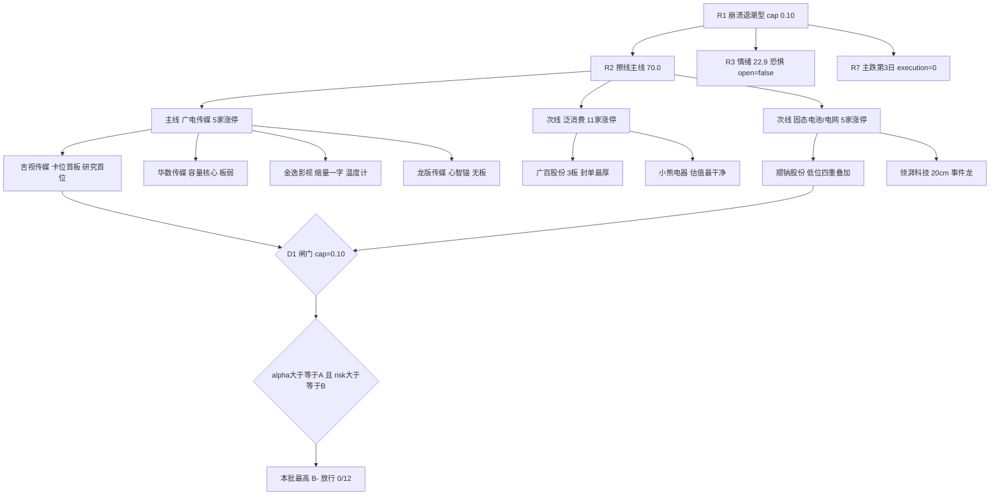

# 2026年11月17日 · **个股画像**

> **数据源新鲜度**: partial（主源 T+0，上游 R1 degraded / R3 L2 缺话语）
> **降级状态**: false（vibe-trading 未配置已用 tushare 主源替代，单列 data_gaps）
> **置信度**: 0.525

## 一句话结论

12 只全部研究级、零开仓资格：**D1 实算 cap=0.10 要求 alpha≥A 且 risk≥B，本批 alpha 最高 B-（吉视 60.4）→ 档位闸门结构性 0 通过**；相对价值最高的是主线卡位首板吉视传媒（B-/B、RR 1.79、当日主力 +4.48 亿）与低位四重叠加顺钠股份（B-/A、RR 1.62、11-17 回购+员工持股），两者都只接受 09:25-09:35 弱转强确认后的盘中试仓，盘前挂单即违反计划外不出手。

## 详细分析

本轮画像的真正任务不是找"能买的票"，而是在**崩溃退潮型 + 主跌第 3 日 + 炸板率取严 40%** 的环境里回答两个问题：钱在哪一层、谁有地位。答案很清楚：钱在电视广播（+6.79 亿，全市场第一）与银行红利、铁路公路、白酒这一层低波资产里，成长链（电子 -250.16 亿、通信设备 -71.28 亿）被系统性抛弃；有地位的只有两类票——**电视广播里的两条涨停（吉视/华数）**，和**低位＋事件叠加的顺钠**。4 板最高的北纬科技反而是反面教材：地位来自名字套利，不来自板块。

**大资金意图**：R7 概念端给出清晰指纹——红利破净 +10.44、红利股 +8.19、证金持股 +6.29、超级品牌 +8.58 在流入，融资融券 -605.55（5 日 -1250.62）、MSCI 中国 -401.43、深股通 -350.28 在流出。这是**杠杆/外资/机构减仓 + 避险资金被动配置**的组合，不是进攻。传媒线拿到的 6.79 亿正是这层依然在流动的资金里唯一带涨停的角落。

**为什么走强**：吉视传媒的走强是三件事叠加——（1）电视广播是全市场唯一正涨幅行业（+2.19%、涨占比 0.62）；（2）封单 1.37 亿为链内最厚、全天 0 开板，封成比 0.093 虽薄但结构一致；（3）龙虎榜单一上榜原因净买 +2.14 亿（买 3.05 / 卖 0.91）。华数则是容量承接（成交 82.2 亿、流通 145.2 亿），3 次开板 + 封单 0.29 亿说明它是"钱多板弱"，只能当容量核心不能当龙一。

**逻辑够不够硬**：不够硬。R4 当日只有"游戏"是 medium 正面（GTA VI 11-19 发售），广电/短剧/院线没有 high 级催化；R3 真等级 L1_only（L2 KOL 7 群 0 条）；R2 自己也写明"擦线主线·仅研究级，扣任一维即跌破 70"。所以本批所有结论都必须带前提：**这不是主升浪，是退潮期的低位试错窗口**。

**五种筹码人格的分层**（本日最关键的画像结论）：
1. **卡位型**（吉视）——首板、封单厚、0 开板、板块 5 家，可给研究首位；
2. **容量型**（华数）——钱多板弱，只在板块走出第 2 个交易日时做回踩承接；
3. **缩量一字型**（金逸）——封单=成交额 2.35 倍、换手 1.3%，强但买不到，只作情绪温度计；
4. **死亡换手型**（北纬）——7 次开板/换手 42.59%/封成比 0.016 + 龙虎榜净卖，任何低吸都是接刀；
5. **派发型**（九阳、天虹）——前者 60 日 +215% 后尾盘炸板 + 5 日主力 -4.63 亿；后者 21 笔大宗平均折价 -7.32% + 融券 15 日 +646%。

**次线两条**：泛消费 67 分是"单日脉冲"——涨停 1→11 家跳升、广百 3 板 1.99 亿最厚封单，但家电矩阵前 5 个观测日全 0、一般零售 5 日 -12.02 亿，一日游风险高；固态电池/电网 57 分是"事件驱动"——E005 特高压破万亿 + E006 十五五点名固态电池，但电池 5 日 -70.33 亿、概念榜无"固态电池"条目，只作 11-20 上海论坛前的事件级观察。

**低位反例顺钠**：距 60 日高 -22.9%、首板 0 开板、封单 0.96 亿、当日主力 +2.03 亿，叠加 11-17 回购方案 + 员工持股双公告与 E005。它是本批唯一"低位 + 事件 + 公告"三重确认的票，风险等级 A（全批最优），但因所在线非主流 + 5 日主力仅 1 天净流入，只能给 B-。

## 三问逐条（top 研究对象）

**吉视传媒——大资金意图**：主力当日 +4.48 亿、5 日 +6.23 亿（3/5 天正）、龙虎榜净买 +2.14 亿，属"单点攻击"而非板块普涨；**为什么走强**：唯一正涨幅行业 + 封单最厚 + 0 开板 + 身位在链内第一；**逻辑够不够硬**：不够硬——叙事靠广电国资而非短剧心智锚（锚表 TOP5 无一只在 11-16 涨停），扣掉题材溢价后只剩资金推动。

**顺钠股份——大资金意图**：当日 +2.03 亿、20 日 +1.83 亿，5 日仅 1 天净流入，属"事件脉冲式进场"；**为什么走强**：特高压官媒定调 + 回购/员工持股双公告 + 真低位（距高 -22.9%）；**逻辑够不够硬**：比传媒硬——事件有公开文件、公告有交易所文本，但板块只有 5 家涨停、行业 5 日 -19.35 亿，缺第二只票的接力。

**广百股份——大资金意图**：5 日 +1.30 亿、20 日 +2.38 亿，钱在进但一般零售行业 5 日 -12.02 亿（0/5 天净流入），是"个股钱 ≠ 板块钱"；**为什么走强**：3 板 + 09:30:03 秒板 + 1.99 亿最厚封单 + 板块涨停 11 家；**逻辑够不够硬**：最不硬——无 R4 催化（叙事维 9/20）、家电矩阵一日游、封单厚但板块资金背离，一旦断板无承接。

## 候选总表（按综合分排序）

| 票 | 代码 | R2 角色 | 板型 | 龙头认定 | 三价（买/目标/止损） | α/风险 | 综合 | 禁入清单 |
|---|---|---|---|---|---|---|---|---|
| 吉视传媒 | 601929.SH | 龙一 | 换手板·0开板｜1板·首封10:12·开板0次·封单1.37亿 | 龙头 | 2.78/3.03/2.64，RR=1.79（止损距 -5.0%） | B-/B | 60.4 | plan_outside_scan |
| 小熊电器 | 002959.SZ | 次线龙二（小家电板块龙） | 换手板·0开板｜1板·首封10:42·开板0次·封单0.34亿 | 补涨/跟风 | 34.5/38.9/32.77，RR=2.54（止损距 -5.0%） | B-/B+ | 59.4 | non_mainstream/plan_outside_scan |
| 金逸影视 | 002905.SZ | 龙三（缩量一字·情绪股） | 缩量快封｜2板·首封09:25·开板0次·封单1.16亿 | 龙头 | 10.0/11.8/9.0，RR=1.8（止损距 -10.0%） | B-/C | 59.2 | mid_laggard/plan_outside_scan |
| 华数传媒 | 000156.SZ | 龙二（容量核心） | 换手板·多次开板｜1板·首封10:53·开板3次·封单0.29亿 | 补涨/跟风 | 7.95/8.54/7.36，RR=1.0（止损距 -7.4%） | B-/B- | 57.5 | plan_outside_scan |
| 顺钠股份 | 000533.SZ | 观察（低位首板·电网） | 换手板·0开板｜1板·首封11:14·开板0次·封单0.96亿 | 龙头 | 9.4/10.16/8.93，RR=1.62（止损距 -5.0%） | B-/A | 55.2 | non_mainstream/plan_outside_scan |
| 紫竹高科 | 002058.SZ | 观察（首板·电池链趋势股） | 换手板·0开板｜1板·首封10:18·开板0次·封单0.52亿 | 补涨/跟风 | 21.4/24.6/19.98，RR=2.25（止损距 -6.6%） | C/B | 53.8 | mid_laggard/non_mainstream/plan_outside_scan |
| 龙版传媒 | 605577.SH | 候补（心智锚TOP1·未涨停） | 未涨停｜+5.15%·量比0.98·换手9.8079% | 非涨停·容量核心 | 16.8/17.6/15.5，RR=0.62（止损距 -7.7%） | C/B- | 53.5 | plan_outside_scan |
| 天虹股份 | 002419.SZ | 观察（零售首板） | 换手板·多次开板｜1板·首封09:32·开板2次·封单0.57亿 | 补涨/跟风 | 5.05/5.65/4.8，RR=2.4（止损距 -5.0%） | C/B- | 52.1 | mid_laggard/non_mainstream/plan_outside_scan |
| 广百股份 | 002187.SZ | 次线龙一（商超百货） | 换手板·0开板｜3板·首封09:30·开板0次·封单1.99亿 | 龙头 | 7.0/7.9/6.45，RR=1.64（止损距 -7.9%） | C/C | 50.3 | non_mainstream/plan_outside_scan |
| 北纬科技 | 002148.SZ | 身位股（4板最高·烂板） | 换手板·多次开板｜4板·首封09:25·开板7次·封单0.26亿 | 分歧弱 | 7.95/8.75/7.16，RR=1.01（止损距 -9.9%） | C/C | 48.6 | mid_laggard/plan_outside_scan |
| 领湃科技 | 300530.SZ | 次线龙一（固态电池） | 换手板·0开板｜1板·首封10:35·开板0次·封单0.98亿 | 龙头 | 26.0/31.82/24.5，RR=3.88（止损距 -5.8%） | C/B | 48.2 | non_mainstream/plan_outside_scan |
| 九阳股份 | 002242.SZ | 观察（心智锚·尾盘炸板） | 炸板｜首封09:25·开板7次·收+7.10% | 分歧弱 | 27.3/29.4/25.93，RR=1.53（止损距 -5.0%） | C/B- | 47.3 | non_mainstream/plan_outside_scan |

> 说明：α 最高 B-（无 A/A-/B+）；risk 最高 A（顺钠）；全部 12 只命中 plan_outside_scan（R2 execution_pool=[] + R3 open_permission=false + R7 主跌第 3 日），故 D1 实放行 0/12。

## 逐票四要素（板型 + 龙头认定 + 盈亏比 + 禁止清单）

**吉视传媒（601929.SH）· 电视广播唯一资金主线里的卡位首板龙头：封单最厚、0 开板，但身位只有 1 板、封成比 0.093 偏薄，次日靠竞价与板块效应。**
- 板型：换手板·0开板｜1板·首封10:12·开板0次·封单1.37亿
- 龙头认定：**龙头** —— 首板卡位型龙头：首封 10:12、开板 0 次、封单 1.37 亿、板块涨停 5 家、板块内第 1 顺位；高度仅 1 板故非高度龙头（连板天数 1）
- 盈亏比：2.78/3.03/2.64，RR=1.79（止损距 -5.0%）；收盘 2.96，止损距收盘 -10.81%
- 禁止清单：plan_outside_scan（R5 严格复算，in_plan=false）；R2 上游 leader 级：无（R2 本日未落 leader 级禁入清单）

**小熊电器（002959.SZ）· 小家电板块龙、基本面全批最干净（PE 19/ PB 分位 11），但首板封单仅 0.34 亿，是消费链里唯一『估值可算』的票。**
- 板型：换手板·0开板｜1板·首封10:42·开板0次·封单0.34亿
- 龙头认定：**补涨/跟风** —— 首板、首封 10:42、封单 0.34 亿、板块 11 家（封单不足 0.5 亿或板块顺位靠后）→ 首板隔日模板，需竞价弱转强（连板天数 1）
- 盈亏比：34.5/38.9/32.77，RR=2.54（止损距 -5.0%）；收盘 36.27，止损距收盘 -9.65%
- 禁止清单：non_mainstream、plan_outside_scan（R5 严格复算，in_plan=false）；R2 上游 leader 级：无（R2 本日未落 leader 级禁入清单）

**金逸影视（002905.SZ）· 2 板缩量一字情绪股：封单=成交额 2.35 倍、换手 1.3%，强但买不到，按纪律只观察不打不低吸。**
- 板型：缩量快封｜2板·首封09:25·开板0次·封单1.16亿
- 龙头认定：**龙头** —— 2 板、首封 09:25（09:45 前）、开板 0 次、板块涨停 5 家 → 高度龙头成立（连板天数 2）
- 盈亏比：10.0/11.8/9.0，RR=1.8（止损距 -10.0%）；收盘 10.89，止损距收盘 -17.36%
- 禁止清单：mid_laggard、plan_outside_scan（R5 严格复算，in_plan=false）；R2 上游 leader 级：无（R2 本日未落 leader 级禁入清单）

**华数传媒（000156.SZ）· 广电国资容量核心：82.2 亿成交、145 亿流通市值为链内最大承接载体，但 3 次开板 + 封单仅 0.29 亿说明封板质量不足以争龙一。**
- 板型：换手板·多次开板｜1板·首封10:53·开板3次·封单0.29亿
- 龙头认定：**补涨/跟风** —— 首板、首封 10:53、封单 0.29 亿、板块 5 家（封单不足 0.5 亿或板块顺位靠后）→ 首板隔日模板，需竞价弱转强（连板天数 1）
- 盈亏比：7.95/8.54/7.36，RR=1.0（止损距 -7.4%）；收盘 8.54，止损距收盘 -13.82%
- 禁止清单：plan_outside_scan（R5 严格复算，in_plan=false）；R2 上游 leader 级：无（R2 本日未落 leader 级禁入清单）

**顺钠股份（000533.SZ）· 全批唯一『低位+面积确认+事件+公告』四重叠加：距 60 日高 -22.9%、首板 0 开板、封单 0.96 亿、11-17 回购+员工持股。**
- 板型：换手板·0开板｜1板·首封11:14·开板0次·封单0.96亿
- 龙头认定：**龙头** —— 首板卡位型龙头：首封 11:14、开板 0 次、封单 0.96 亿、板块涨停 5 家、板块内第 2 顺位；高度仅 1 板故非高度龙头（连板天数 1）
- 盈亏比：9.4/10.16/8.93，RR=1.62（止损距 -5.0%）；收盘 9.82，止损距收盘 -9.06%
- 禁止清单：non_mainstream、plan_outside_scan（R5 严格复算，in_plan=false）；R2 上游 leader 级：无（R2 本日未落 leader 级禁入清单）

**紫竹高科（002058.SZ）· 电池链唯一有趋势结构的首板：60 日 +34.6%、剔脉冲 +9.6%、距高 -11.5%，但龙虎榜 30 日净卖 -1.92 亿是硬伤。**
- 板型：换手板·0开板｜1板·首封10:18·开板0次·封单0.52亿
- 龙头认定：**补涨/跟风** —— 首板、首封 10:18、封单 0.52 亿、板块 5 家（封单不足 0.5 亿或板块顺位靠后）→ 首板隔日模板，需竞价弱转强（连板天数 1）
- 盈亏比：21.4/24.6/19.98，RR=2.25（止损距 -6.6%）；收盘 22.4，止损距收盘 -10.8%
- 禁止清单：mid_laggard、non_mainstream、plan_outside_scan（R5 严格复算，in_plan=false）；R2 上游 leader 级：无（R2 本日未落 leader 级禁入清单）

**龙版传媒（605577.SH）· 短剧心智锚 TOP1 逆势 +5.15%，是『辨识度还活着』的证据而非买点：无板、无席位、20 日高 18.9 未破。**
- 板型：未涨停｜+5.15%·量比0.98·换手9.8079%
- 龙头认定：**非涨停·容量核心** —— 板块第 2 顺位但今日未封板（+5.15%）：不给打板通道，只允许回踩 MA5/MA20 缩量承接（连板天数 None）
- 盈亏比：16.8/17.6/15.5，RR=0.62（止损距 -7.7%）；收盘 16.94，止损距收盘 -8.5%
- 禁止清单：plan_outside_scan（R5 严格复算，in_plan=false）；R2 上游 leader 级：无（R2 本日未落 leader 级禁入清单）

**天虹股份（002419.SZ）· 零售首板但大宗折价分销：21 笔大宗平均折价 -7.32%、融券余额 15 日 +646%，涨停背后是减持通道。**
- 板型：换手板·多次开板｜1板·首封09:32·开板2次·封单0.57亿
- 龙头认定：**补涨/跟风** —— 首板、首封 09:32、封单 0.57 亿、板块 11 家（封单不足 0.5 亿或板块顺位靠后）→ 首板隔日模板，需竞价弱转强（连板天数 1）
- 盈亏比：5.05/5.65/4.8，RR=2.4（止损距 -5.0%）；收盘 5.4，止损距收盘 -11.11%
- 禁止清单：mid_laggard、non_mainstream、plan_outside_scan（R5 严格复算，in_plan=false）；R2 上游 leader 级：无（R2 本日未落 leader 级禁入清单）

**广百股份（002187.SZ）· 泛消费次线龙一：3 板、09:30:03 秒板、封单 1.99 亿全市场最厚，但零售链资金 5 日 -12.02 亿与情绪背离。**
- 板型：换手板·0开板｜3板·首封09:30·开板0次·封单1.99亿
- 龙头认定：**龙头** —— 3 板、首封 09:30（09:45 前）、开板 0 次、板块涨停 11 家 → 高度龙头成立（连板天数 3）
- 盈亏比：7.0/7.9/6.45，RR=1.64（止损距 -7.9%）；收盘 7.67，止损距收盘 -15.91%
- 禁止清单：non_mainstream、plan_outside_scan（R5 严格复算，in_plan=false）；R2 上游 leader 级：无（R2 本日未落 leader 级禁入清单）

**北纬科技（002148.SZ）· 4 板最高身位却是烂板+净卖：7 次开板、换手 42.6%、封成比 0.016，属名字套利孤票，禁止低吸。**
- 板型：换手板·多次开板｜4板·首封09:25·开板7次·封单0.26亿
- 龙头认定：**分歧弱** —— 涨停但开板 7 次（分歧结构），只做弱转强（连板天数 4）
- 盈亏比：7.95/8.75/7.16，RR=1.01（止损距 -9.9%）；收盘 8.75，止损距收盘 -18.17%
- 禁止清单：mid_laggard、plan_outside_scan（R5 严格复算，in_plan=false）；R2 上游 leader 级：无（R2 本日未落 leader 级禁入清单）

**领湃科技（300530.SZ）· 固态电池事件龙头但无固态收入：20cm 首板、0 开板、封单 0.98 亿，逻辑与业绩完全脱钩，只做情绪不做逻辑。**
- 板型：换手板·0开板｜1板·首封10:35·开板0次·封单0.98亿
- 龙头认定：**龙头** —— 首板卡位型龙头：首封 10:35、开板 0 次、封单 0.98 亿、板块涨停 5 家、板块内第 1 顺位；高度仅 1 板故非高度龙头（连板天数 1）
- 盈亏比：26.0/31.82/24.5，RR=3.88（止损距 -5.8%）；收盘 27.83，止损距收盘 -11.97%
- 禁止清单：non_mainstream、plan_outside_scan（R5 严格复算，in_plan=false）；R2 上游 leader 级：无（R2 本日未落 leader 级禁入清单）

**九阳股份（002242.SZ）· 消费心智锚 TOP3 却尾盘炸板 + 5 日主力 -4.63 亿：60 日 +215% 的高位派发结构，见炸板不救。**
- 板型：炸板｜首封09:25·开板7次·收+7.10%
- 龙头认定：**分歧弱** —— 触板后炸板（开板 7 次）→ 隔日只做弱转强，不做低吸（连板天数 None）
- 盈亏比：27.3/29.4/25.93，RR=1.53（止损距 -5.0%）；收盘 28.65，止损距收盘 -9.49%
- 禁止清单：non_mainstream、plan_outside_scan（R5 严格复算，in_plan=false）；R2 上游 leader 级：无（R2 本日未落 leader 级禁入清单）

## 首推票思维链

**吉视传媒 · 601929.SH（研究首位，非执行首位）**
- **买入理由**：全市场唯一"板块资金净流入第一 + 板块内多股涨停"方向里的卡位首板；封单 1.37 亿最厚、0 开板、龙虎榜净买 2.14 亿、5 日主力 6.23 亿；买点 2.78（60 分 MA20 与 2.80 共振回踩位），不追 2.96 收盘价。
- **风险点**：身位只有 1 板（逐日数据 11-12 涨停、11-13 -4.27%、11-16 涨停，limit_times=1，R2「二板」表述有误）；封成比 0.093 偏薄；获利盘 94.4% 无套牢缓冲；公司亏损（净利率 -22.3%）、PB 分位 86%。
- **止损条件**：跌破 2.70（日线 MA5 2.706 与 60 分 MA20 2.756 下方）即止损，止损距买点 -5.0%，止损距收盘 -8.75%；若开盘低开或板块转绿，不进场（不是止损，是放弃）。
- **可验证假设**：①09:25 竞价高开 ≤3%；②电视广播板块红盘率 >60%；③板块级涨停潮 ≥3 只。三条中两条不成立即当日放弃，不做"低开博反包"。

**顺钠股份 · 000533.SZ（低位首选，事件驱动）**
- **买入理由**：全批唯一"低位 + 事件 + 公告"三重叠加；距 60 日高 -22.9%、首板 0 开板、封单 0.96 亿、当日主力 +2.03 亿、risk 等级 A、11-17 回购 + 员工持股双公告；买点 9.40（60 分 MA20/MA60 回踩区）。
- **风险点**：板块仅 5 家涨停、电网设备 5 日 -19.35 亿、周线仍空头排列、距 MA50 -3.25%；事件是"官媒定调"级而非订单级；首板次日承接是唯一变量。
- **止损条件**：跌破 9.25（60 分 MA60）即止损，止损距买点 -5.0%，止损距收盘 -5.80%；若 09:35 后无法站上 9.40 则当日不参与。
- **可验证假设**：①电网设备板块当日红盘；②顺钠分时强于板块指数；③封单/承接在 10:00 前不跌破 0.5 亿量级。三者成立才试仓，仓位 ≤ 总仓 0.03（cap 0.10 的三成）。

## 结构关系（本日研判主干）

## 关键证据

- **证据 1**：电视广播Ⅲ 当日主力 +6.79 亿（全市场行业第 1）、5 日 +9.86 亿（3/5 天正）；同日电子 -250.16 亿、通信设备 -71.28 亿 → 钱在下沉不在成长。来源 R7 `main_force.sector_flows`。
- **证据 2**：吉视传媒封单 1.37 亿、0 开板、首封 10:12、龙虎榜单原因净买 +2.14 亿；limit_list_d 逐日记录为 11-12 涨停 / 11-13 -4.27% / 11-16 涨停，limit_times=1 → 实为 5 日 2 板而非"二连板"。来源 tushare `limit_list_d` + `top_list`。
- **证据 3**：九阳股份 11-16 炸板（7 次开板、收 +7.10% 未回封），5 日主力 -4.63 亿（全批最差），融资余额 15 日 +553.5%、融券 +163.1%，PE 与 PB 均处 3 年 100% 分位 → 高位派发而非启动。来源 tushare `daily`/`limit_list_d`/`margin_detail`/`daily_basic` + 东财 DC。
- **证据 4**：天虹股份 21 笔大宗交易平均折价 -7.32%，融券余额 15 日 +646% → 涨停被用作减持通道，R5 打 `distribution_alert`。来源 tushare `block_trade` + `margin_detail`。
- **证据 5**：顺钠股份 11-17 回购方案 + 员工持股计划双公告（R4 anns_window 命中）+ 距 60 日高 -22.92% + 首板 0 开板/封单 0.96 亿 + 当日主力 +2.03 亿。来源 R4 + tushare 公告/limit_list_d + 东财 DC。
- **证据 6**：chart_vision 12/12 当日重渲，11 只偏多（0.58-0.72）、顺钠震荡 0.58；多数明确提示"偏离均线过远/涨停次日分歧"，与 R1 崩溃退潮型同向。来源 `data/raw/20261117/chart_vision_snapshot.json`。

## 数据源审计

| 源 | 状态 | 抓取时间 | 记录数 | 备注 |
|---|---|---|---|---|
| tushare pro（22 类接口 × 12 票） | 🟢 ok | 2026-11-17 07:05 | 12 票 | 日线 206-209 根/票、龙虎榜逐日全市场、两融 15 日 |
| 东财 DC 主力净额 | 🟢 ok | 2026-11-17 07:05 | 21 日 | 与 R7 同源，逐票金额对齐 |
| chart_vision 快照 | 🟢 ok | 2026-11-17 07:03 | 12/12 | 当日重渲，非跨日指针 |
| czsc 缠论 | 🟢 ok | 2026-11-17 07:06 | 12/12 | 日线笔/中枢，前复权 |
| R1 风格 | 🟡 degraded | 2026-11-17 06:15 | — | status=degraded, conf 0.472 → cap 0.10 |
| R2 主线 | 🟢 ok | 2026-11-17 06:59 | 1 主线 + 3 次线 | 缺 all_scored_boards_top10（schema 留痕） |
| R3 情绪 | 🟢 ok | 2026-11-17 06:32 | 5 主题 | L2 KOL 0 条 → 真等级 L1_only |
| R4 消息 | 🟢 ok | 2026-11-17 06:23 | 8 事件 | 传媒线仅"游戏" medium 正面 |
| R7 资金 | 🟢 ok | 2026-11-17 04:57 | 21 日 | execution_candidates=0 |
| WeFlow / 本地微库 | 🔴 error | — | 0 | 停 2026-10-28，连续 11 个交易日 0 条（L2 结构性缺失） |

## 不确定性 / 反证

1. **吉视"二板"口径**：R2 文本称 11-13 首板→11-16 二板，但 limit_list_d 逐日记录与日线均显示 11-13 为 -4.27% 阴线，实际是 11-12 与 11-16 两次首板。R5 已用 `streak_days=1` 修正并写进 JSON notes；若后续复盘确认 11-13 曾盘中触板未封，"5 日 2 板"仍成立，不影响等级。
2. **擦线主线的持续性**：R2 70.0 分是"擦线"，扣任一维即跌破 70；本报告不给"主线确认"结论，只给"研究观察"。若 11-17 电视广播涨停家数 <3 且板块转绿，本批所有传媒票降级为纯观察。
3. **低位不等于安全**：顺钠 risk A 只代表"没有高位派发/估值泡沫结构"，不代表事件一定兑现；11-05 的 0.92 亿封单首板（次日未延续）说明该票历史连板概率并不高。
4. **消费线一日游概率**：涨停家数 1→11 是单日跳升，lianban 矩阵前 5 个观测日全 0；广百封单最厚但一般零售 5 日 -12.02 亿。若 11-17 家电链涨停 <5 家，全部消费票降级为观察。
5. **数据缺口**：vibe-trading 未配置（少一重第三方交叉核验）；5 只非两融标的 margin_15d_trend 结构性缺失；电池/消费线在 R7 sector_flows 无对口行业（unmapped_degraded），板块资金改引 R2 行业口径数字；商品实时价（碳酸锂/铜/票房）未接入，commodity_linkage 只给方向粗评。
6. **自我批判**：本批 12 只里真正具备"龙头或低位"资格的只有吉视（卡位首板）、顺钠（低位四重）、广百（3 板但资金背离）、领湃（事件龙但无固态收入）四只；其余 8 只（华数/小熊/金逸/紫竹/龙版/天虹/北纬/九阳）在本日环境下更接近"结构标本"而非交易对象，保留是为了给 D1/E1 提供对照样本，不是凑数。

## 与其他 R/D/E 的关系

- **依赖**：R1_style（cap/风格）、R2_main_sectors（候选池/身位/板块宽度）、R3_sentiment（主题等级/开仓否决）、R4_news（事件与首板候选）、R7_capital_flow（板块/个股资金同源）、chart_vision 快照、czsc。
- **被消费**：D1（canghai-plan）按 α/risk 双档 + `leader_verdict.d1_stance` 逐票核验 execution_pool；R6（反证）读取 `fundamental_flags` / `chanlun_divergence` / `distribution_alert`；E1（复盘）用 `d1_gate_simulation` 与本批分级回溯当日是否该空仓。

## Sub-Agent 元数据

- skill: analyze_stock_profile_v1@1.5
- artifact: data/research/20261117/R5_stock_profiles.json（12 画像 · 12 built · 0 failed）
- 生成耗时: 约 20 分钟（07:02 启动 → 07:22 落盘）
- model: deepseek-v4.1-flash
- 校验: scripts/research/check_r5_20261117.py → EXIT 0（0 errors / 0 warns）
