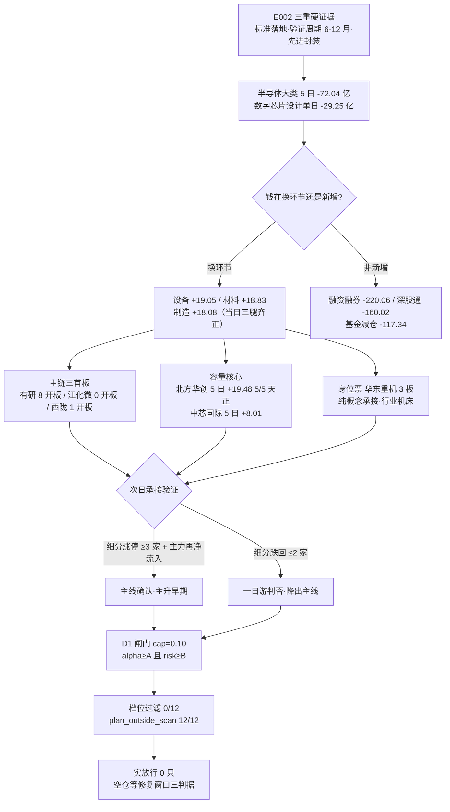

# 2026年11月18日 · **个股画像**

> **数据源新鲜度**: partial（R5 主源 T+0 全绿；扣分项全在上游 R1/R2/R3）
> **降级状态**: false（vibe-trading 未配置 → 大宗/两融/龙虎榜改 tushare 主源，已单列 data_gaps）
> **置信度**: 0.525（0.75 基准 × 0.7 新鲜度 × 1.0 多源一致，>3 独立源同向）
> **数据归属**: 本文件 trade_date = 2026-11-18（盘前），全部分析数据归属 **2026-11-17 收盘**（T-1），非 11-18 盘中数据
> **⚠️ 情绪闸门**: 炸板率取严 **36.67% ≥ 35%** 硬红线 → 情绪判 **主跌（第 5 日 / repair_window）**，候选数按纪律砍半：R2 只留 1 主线 + 3 次线，R5 只在 12 只研究候选内分层，**不给开仓资格**

---

## 一句话结论

12 只全部研究级、零开仓资格：**D1 实算 cap=0.10 要求 alpha≥A 且 risk≥B，本批 alpha 最高只有 B 档 → 档位闸门结构性 0/12**；相对价值最高的是主链三首板（江化微 0 开板+RR 4.41、有研新材 主力全场第一+2.76、西陇科学 已落中位），但 12/12 命中 `plan_outside_scan`（R2 execution_pool=[] + R3 open_permission=false + R7 execution=0）→ 实放行 0 只，本日正确动作是空仓等修复窗口三判据。

---

## 详细分析

本轮画像要回答的不是"哪只票好"，而是三个顺序问题：**钱在哪一层、谁的牌位是真的、次日押注到底在押什么**。环境是崩溃退潮型（R1，degraded 0.472）+ 主跌第 5 日（连跌 4 天）+ 炸板率取严 36.67% + 主力当日 -263.04 亿（第 4 个净流出日，但幅度从前一日 -646.77 亿收窄 383.73 亿）。这种环境里，"涨幅榜第一名"和"能承接的票"经常是两回事，所以画像的重心放在**板型质量 × 资金持续性 × 身位真伪**三张交叉验证上。

### 一、今天的市场在为什么付钱

- **大资金意图**: R7 口径给出清晰指纹——半导体设备 +19.05 亿（5 日 +39.53、20 日 +71.46）、半导体材料 +18.83 亿、集成电路制造 +18.08 亿三条腿当日全部净流入，而半导体大类 5 日仍 -72.04 亿、数字芯片设计单日 -29.25 亿。**这不是新增资金进场，是同一批科技筹码从设计/PCB/光模块换到设备/材料/制造环节**；同时融资融券 -220.06 亿、深股通 -160.02 亿、基金减仓 -117.34 亿在流出 → 对手盘是杠杆客与外资，接盘的是产业型与游资型资金。
- **为什么走强**: 催化是 E002 的"标准 + 订单 + 资本开支"三重硬证据（工信部设备质量标准落地、光刻胶国产验证周期从 1-2 年缩到 6-12 个月、先进封装 2026 收入首超传统）；位置是深度低位（有研新材距 60 日高 -33.1%、江化微 -35.6%、西陇科学 -19.0%）；筹码是有研新材单日主力 +14.89 亿全场第一且封单 2.56 亿链内最厚。三维交叉的结论是"低位 + 硬催化 + 单日资金脉冲"，缺的是**资金持续性**（有研 5 日 +9.88 亿里只有 1/5 天为正）。
- **逻辑够不够硬**: 半硬。硬的一面是政策与验证周期是真实可跟踪的产业变量；不硬的一面是四条独立源里 R3 真等级只到 L1_only（L2 KOL 连续 12 日 0 条）、R4 只有题材级承接无个股硬公告、R2 自判 layer=rebound / stage=formation（分支首日）、R7 execution_candidates=0 → 冲突点在于"催化是真的、承接没验证"。证伪路径很明确：次日电子化学/环保设备细分涨停若跌回 ≤2 家，本线按"一日游"判否，直接降出 main_lines。

### 二、12 只候选的三张交叉表（板型 × 身位 × 资金）

| 票 | 板型（首封/开板/封单） | 身位判定（v1.5） | 主力 当日/5日/20日（亿） | RR（买/目标/止损） | 档位 α/风险 | R5 态度 |
|---|---|---|---|---|---|---|
| 中芯国际 | 未涨停 +6.59%，量比 1.83 | 非涨停·容量核心 | +9.10 / +8.01 / +24.91 | 1.92（110.2/120.8/104.69） | B / B+ | 观察 |
| 北方华创 | 未涨停 +4.09%，换手 1.83% | 非涨停·容量核心 | +5.88 / +19.48 / +27.43 | 2.05（555/612/527.25） | B / A | 观察（逻辑首选、交易次选） |
| 长虹美菱 | 2 板 / 09:32 / 0 开板 / 0.99 亿 | 龙头（中位连板） | +0.62 / +1.20 / +0.79 | 3.00（4.45/5.20/4.20） | B / B | 不进（躲中位） |
| 有研新材 | 首板 / 09:52 / **8 开板** / 2.56 亿 | 分歧弱（R2 判龙一，口径分歧留痕） | +14.89 / +9.88 / +9.27 | 2.76（38.3/43.6/36.38） | B / B+ | 降级观察 |
| 西陇科学 | 首板 / 09:35 / 1 开板 / 0.81 亿 | 补涨/跟风（顺位第 3） | +1.21 / +1.28 / +0.12 | 1.84（7.40/8.08/7.03） | B / B+ | 拦截 |
| 华东重机 | 3 板 / 09:25 / 0 开板 / 2.71 亿 | 龙头（纯概念承接） | +0.51 / +3.07 / +2.99 | 2.17（6.05/6.70/5.75） | B- / B | 降级观察（只可打板/竞价） |
| 江化微 | 首板 / 10:28 / **0 开板** / 0.87 亿 | 龙头（首板卡位型） | +0.88 / +0.87 / -0.26 | **4.41**（23.60/28.80/22.42） | B- / B+ | 观察 |
| 双环科技 | 首板 / **09:30** / 1 开板 / 0.43 亿 | 补涨/跟风（次线唯一） | +0.32 / +0.34 / +0.35 | 0.59（4.30/4.43/4.08） | B- / B | 拦截 |
| 小熊电器 | 2 板 / 10:49 / 0 开板 / 0.39 亿 | 龙头（中位连板） | +0.31 / +0.75 / +0.41 | 0.42（38.90/40.03/36.20） | B- / B- | 不进（躲中位） |
| 长川科技 | 未涨停 +7.13%，贴 MA20 | 非涨停·观察（顺位第 4） | +0.80 / +6.83 / -5.00 | 1.59（176/190/167.2） | B- / B+ | 观察 |
| 联合化学 | 20cm 首板 / 10:00 / 1 开板 / 0.52 亿 | 补涨/跟风（顺位第 3） | +1.02 / +1.83 / +0.91 | 2.52（46.50/54.35/43.38） | B- / B- | 拦截 |
| 九阳股份 | 地天板 / 09:53 / 2 开板 / 2.23 亿 | 龙头（情绪龙） | **-0.22 / -6.59 / -1.35** | 1.81（28.00/32.00/25.79） | C / C | 拦截 |

### 三、六维传导结构（催化 → 资金换环节 → 身位 → 闸门）

### 四、五种筹码人格的分层（本日最关键的画像结论）

1. **卡位型（江化微）**——全链唯一 0 开板、缩量快封（换手 4.24%）、封单 0.87 亿、距 60 日高 -35.6%，板型质量优于龙一，但容量只有 94.6 亿、主力量级 0.88 亿仅龙一的 6% → 板型最干净，资金最弱。
2. **脉冲型（有研新材）**——当日 +14.89 亿全场第一、封单 2.56 亿链内最厚，但 8 次开板、封成比 0.054、5 日仅 1/5 天净流入 → **资金入口而非板型龙头**，只能按弱转强对待。
3. **容量型（北方华创 / 中芯国际）**——5 日 +19.48 / +8.01 亿，前者 5/5 天全正（全批唯一持续），后者 20 日 +24.91 亿且位置全链最优（距 60 日高 -15.9%），但两者当日都未涨停、无板型身位 → 容量承接，不给打板通道。
4. **身位纯概念型（华东重机）**——3 板 0 开板封单 2.71 亿（身位全批最高）、缠论站上中枢（本批唯四之一），但行业是机床制造、主营无半导体收入、机构龙虎榜净卖 -0.24 亿 → 身位来自概念映射，不是产业地位。
5. **派发型（九阳股份）**——地天板 + 双榜第一 + 龙虎榜 30 日净买 7.50 亿，但 5 日主力 -6.59 亿、获利盘 99.7%、距 MA50 +87.4%、PE 364 分位 100%、净利 -41.7% → 价格涨资金撤，典型高位派发。

### 五、首推票思维链（4 只：主链卡位 + 容量核心）

**① 江化微（603078.SH）· B-/B+ · RR 4.41 · 观察**

- **买入理由**: （1）产业逻辑最短——湿电子化学品是光刻胶国产验证周期从 1-2 年压到 6-12 个月的直接受益环节，验证提速即配套试剂先放量；（2）板型是全链唯一 0 开板 + 缩量快封（首封 10:28、换手 4.24%、封单 0.87 亿、封成比 0.22 远优于有研 0.054），且位置距 60 日高 -35.6%、距 MA50 -10.5% 属深度低位首板。
- **风险点**: （1）短期——容量 94.6 亿、主力当日 0.88 亿仅龙一 6%、龙虎榜 30 日 0 次上榜（无游资席位确认），一旦次日竞价无量即证伪；（2）中期——PE 100.9（3 年分位 86.1%）、净利同比 -14.03%、F9 应收/营收 44.2%（9M 口径 / TTM 34.0%），RR 目标 28.8 恰好压在日线 MA60 28.78 与周 MA20 32.22 的压制区，中期空间由估值与套牢盘共同限制。
- **止损条件**: 收盘跌破 22.42（买点 23.60 下方 -5%）无条件出；盘中若跌破 MA5 且量比 >2 视为失败突破，不等收盘。
- **可验证假设**（24-72h）: 次日竞价封单能否 >0.3 亿且 09:35 前维持不破 23.60；电子化学细分涨停家数能否 ≥2 家（今日 3 家）；主力当日净额能否为正（今日 +0.88 亿）。

- **大资金意图**: 链内资金是"设备先行、材料跟随"的次序，江化微拿到的是跟随档的 0.88 亿；主力在此位置下注的理由是低位 + 验证周期缩短的确定性，对手盘是前期套牢在 25.30 平均成本上方的持仓。
- **为什么走强**: 位置（距 60 日高 -35.6% 深度低位）+ 催化（E002 验证周期）+ 筹码（0 开板、换手 4.24% 缩量）= 三维同向，这是本批最干净的组合。
- **逻辑够不够硬**: 硬在板型与位置，不硬在资金量级与机构覆盖（研报 6 篇、2 家机构）；证伪路径是次日电子化学涨停家数跌回 ≤1 家。

**② 有研新材（600206.SH）· B/B+ · RR 2.76 · 降级观察**

- **买入理由**: （1）产业逻辑——E002 三重硬证据里"材料受益"是全市场唯一被东财点名的材料票（人气 44.0→4.5 全场最大跳升），当日主力 +14.89 亿全场第一、封单 2.56 亿链内最厚；（2）位置——距 60 日高 -33.1%、距 MA50 -8.31%、30 日区间位置 46.9%，属低位前排而非高位接力。
- **风险点**: （1）短期——8 次开板 + 封成比 0.054 = 反复开板回封的烂板型，且 5 日 +9.88 亿里只有 1/5 天净流入，次日低开且主力净额转负则材料链"四确认"样本失效；（2）中期——PE 117.8（分位 91.8%）、毛利率 8.10%、ROE 6.03%，F8 命中（CFO -5.86 亿而净利 +2.63 亿，利润未变现），机构研报 0 篇 → 定价权在游资，无机构托底。
- **止损条件**: 收盘跌破 36.38（买点 38.30 下方 -5%）出；跌破 37.20（日 MA20 37.24 与 60 分 MA60 37.09 双支撑）视为短线突破失效，先减半。
- **可验证假设**（24-72h）: 次日竞价能否维持封单 >1 亿且开板次数 ≤3；材料细分（电子化学 + 半导体材料）涨停家数能否 ≥3；主力当日净额能否连续第 2 日为正。

**③ 北方华创（002371.SZ）· B/A · RR 2.05 · 观察（逻辑首选、交易次选）**

- **买入理由**: （1）资金持续性——5 日 +19.48 亿且 5/5 天全正，是本周唯一持续净流入的科技分支核心，设备行业 20 日 +71.46 亿；（2）基本面无瑕——ROE 13.39%、净利率 16.51%、CFO 55.91 亿 > 净利 53.92 亿、商誉 5.6%、质押 0.08%、F1-F12 与 V1-V10 全 0 命中，机构研报 104 篇（26 家）。
- **风险点**: （1）短期——当日 +4.09% 未涨停、无板型身位，上方日 MA60 612.8 与周 MA20 659 双重压制，平均成本 629.34 高于现价（上方套牢盘密集）；（2）中期——PE 71.6（分位 86.3%）+ E005 对 2028 年加速器 capex 下修 28%，设备采购预期的边际压制未解除。
- **止损条件**: 收盘跌破 527.25（买点 555 下方 -5%）出；若收盘失守 MA20（532）且量比 <1，降级为只观察不入场。
- **可验证假设**（24-72h）: 半导体设备行业单日净额能否保持为正（今日 +19.05 亿）；股价能否站上 612.8（日 MA60）；5 日主力净流入能否维持 5/5 天全正。

**④ 中芯国际（688981.SH）· B/B+ · RR 1.92 · 观察**

- **买入理由**: （1）位置全链最优——距 60 日高 -15.9%（其余 -25%~-37%），20 日主力 +24.91 亿，且中芯概念 +41.82 亿为概念榜第一、大基金持股 +28.23 亿、先进封装 +27.25 亿三重概念权重；（2）基本面——净利同比 +91.57%、CFO 286.25 亿远超净利 73.14 亿、机构调研 20 次全批最多。
- **风险点**: （1）短期——当日已把 30 日区间打到 100%、逼近日 MA60 113.79 与 20 日高 116.28，RR 1.92 差 0.08 不过 2 的门槛；（2）中期——short_pressure 红旗（融资 15 日 -15.47% + 融券 +66.77%）＝空头加码，且 E005 capex 下修压制扩产预期，缠论收盘仍在中枢下方。
- **止损条件**: 收盘跌破 104.69（买点 110.20 下方 -5%）出；若回踩 MA20（约 105）未获承接且主力当日转负，取消跟踪。
- **可验证假设**（24-72h）: 融券余额能否连续 3 日回落（今日 15 日 +66.77%）；股价能否站上 116.28 并收在其上；集成电路制造行业净额能否维持正流入。

### 六、其余 8 只：一句话 + 止损 + 验证口径

| 票 | 一句话结论 | 止损/失效线 | 24-72h 验证口径 | 态度 |
|---|---|---|---|---|
| 西陇科学 | 获利盘 97.4% 无套牢盘 + 机构净卖 -0.32 亿 + 板块顺位第 3 + RR 1.84 | 跌破 7.03（-5%）即否 | 次日能否站上 8.02-8.08（MA60/20 日高）；电子化学涨停家数 ≥3 | 拦截 |
| 华东重机 | 3 板 0 开板身位全批最高，但机床制造 + 主营无半导体收入 + 机构净卖 | 跌破 5.75（-5%）即否；距收盘 -14.2% 已超硬区 | 竞价是否一字（封单 >1 亿）；国产芯片概念涨停家数 ≥3 | 降级观察（只可打板） |
| 双环科技 | 氯化铵年内新高 + 9:30 首封最早 + 量比 7.78，但 RR 0.59 + 净利 -1.35 亿 + 板块资金 5/5 天全负 | 跌破 4.08（-5%）即否 | 化学原料行业单日净额能否转正（5/5 天全负已 5 日）；氯化铵现货周涨幅能否维持 >5% | 拦截 |
| 长川科技 | ROE 25%/净利 +104%/PE 分位 12.1% 最硬，但距 MA50 -18.4%、识图震荡 0.45、RR 1.59 | 跌破 167.20（-5%）即否 | 能否站上 MA50（约 223）；设备行业净额连续为正天数 | 观察 |
| 联合化学 | 光刻胶链唯一 20cm 首板，但 PE 1405/分位 100%、净利 -98.6%、股东户数 +44.6%、龙虎榜净卖 | 跌破 43.38（-6.7%）即否 | 次日能否不破 46.50 且换手 <10%；光刻胶概念涨停家数 | 拦截 |
| 小熊电器 | PE 20.9 全批最低 + 研报 64 篇，但 RR 0.42（目标压周 MA60 40.03）+ 中位连板 | 跌破 36.20（-6.9%）即否 | 能否站上 40.03（周 MA60）；小家电涨停家数能否 ≥2 | 不进 |
| 长虹美菱 | 2 板 0 开板 + 封单 0.99 亿 + PB 0.84 破净 + RR 3.00 最高，但中位连板 + 板块指数 -1.00% | 跌破 4.20（-5.6%）即否 | 白色家电/小家电涨停家数能否维持 ≥3；家用电器行业 5 日净额能否转正（今日 -5.09 亿） | 不进 |
| 九阳股份 | 地天板 + 双榜第一 + 龙虎榜净买 7.50 亿，但 5 日主力 -6.59 亿 + 获利盘 99.7% + PE 364 | 跌破 25.79（-7.9%）即否 | 次日竞价能否高开且封单 >1 亿；家用电器行业净额能否连续 2 日为正 | 拦截 |

---

## 关键证据

- 证据 1：半导体设备 +19.05 亿 / 材料 +18.83 亿 / 制造 +18.08 亿当日三腿齐正，而半导体大类 5 日 -72.04 亿 → 是换环节不是新增资金 · 来源 `R7_capital_flow.json` main_force.sector_flows
- 证据 2：有研新材单日主力 +14.89 亿（与 R2 自报差额 0.00）、江化微 +0.88 亿、西陇科学 +1.21 亿 → 主链首板资金量级差 17 倍 · 来源 `_r5_moneyflow_dc.json`（东财 DC，21 个交易日）
- 证据 3：有研新材首封 09:52、开板 8 次、封单 2.56 亿、封成比 0.054；江化微首封 10:28、0 开板、封单 0.87 亿、封成比 0.22 · 来源 tushare `limit_list_d` 2026-11-17
- 证据 4：北方华创 5 日主力 +19.48 亿且 5/5 天全正；中芯国际融券余额 15 日 +66.77% → short_pressure · 来源 `_r5_moneyflow_dc.json` + tushare `margin_detail`
- 证据 5：九阳股份 5 日主力 -6.59 亿（1/5 天正）+ 获利盘 99.7% + 距 MA50 +87.42%，价格涨而资金撤 · 来源 `_r5_moneyflow_dc.json` + tushare `cyq_chips` / `daily_basic`
- 证据 6：财务红旗普查 F3×1（联合化学）、F8×3（有研/西陇/九阳）、F9×2（江化微/长川）、S1×1（双环）、short_pressure×1（中芯）；F1/F2/F4/F10/F11/V3/V4/S2/S3/distribution_alert 全批 0 命中 · 来源 R6 附录 A 阈值 + tushare 三表
- 证据 7：chart_vision 当日 13/13 ok，12 只候选中 11 只偏多（0.58-0.68）、1 只震荡（长川科技 0.45）；缠论站上中枢仅 4 只（华东重机/九阳/长虹/小熊），主链 5 只全部在中枢下方 · 来源 `chart_vision_snapshot.json` + `_r5_chanlun.json`
- 证据 8：12/12 命中 `plan_outside_scan`；4 只另命中 `mid_laggard`（西陇科学/小熊电器/长川科技/联合化学）· 来源 `src.research.forbidden_filter.check_forbidden`

---

## 数据源审计

| 源 | 日期 | 状态 | 备注 |
|---|---|:--:|---|
| tushare/日线行情 | 2026-11-17 | 🟢 | 12 票 × 205-210 根（≥30 日契约），前复权 |
| tushare/limit_list_d | 2026-11-17 | 🟢 | 全市场 124 条涨停专题，12 票逐票首封/开板/封单 |
| tushare/龙虎榜 | 2026-09-01 至 2026-11-17 | 🟢 | 50 个交易日逐日全市场拉取后筛，tickets 命中 27 条 + 机构 270 条 |
| tushare/两融 | 2026-09-01 至 2026-11-17 | 🟡 | 11/12 票有记录；西陇科学非两融标的（结构性缺失） |
| tushare/财报三表 + fina_indicator | 2025Q1 至 2026Q3 | 🟢 | 12 票 BS/IS/CF 全落地，最新报告期 2026-09-30 |
| tushare/公告 anns_d | 2026-06-01 至 2026-11-17 | 🟢 | 614 条（32-92 条/票） |
| tushare/研报 + 调研 | 2026-07-01 至 2026-11-17 | 🟢 | 研报 0-104 篇/票；调研 0-36 次/票 |
| 东财 DC 个股主力 | 2026-10-20 至 2026-11-17 | 🟢 | 21 个交易日全市场逐日，R7 同源，逐票口径对齐 |
| chart_vision 快照 | 2026-11-18 | 🟢 | 13/13 ok（12 票全覆盖，6 票本会话补渲，耗 34 秒） |
| czsc 缠论 | 2026-11-18 | 🟢 | 12/12 笔/中枢/买卖点 |
| vibe-trading MCP | - | 🔴 | 未在 hermes_mcp.json 配置 → 大宗/两融/龙虎榜第三方交叉核验缺失，改 tushare 主源 |
| weflow KOL（上游 R3） | - | 🔴 | 本地微信库停 2026-10-28，L2 真人话语连续 12 个交易日 0 条 |

---

## 不确定性 / 反证

1. **最大不确定性是"承接"，不是"催化"**：E002 是真的，但主线只有 1 天（R2 age_days=1、细分涨停 0→9），R2 自己把 layer 标为 rebound / stage=formation。次日若不出现第二波承接，本批全部结论降级为"退潮期单日脉冲"。
2. **R2 与 R5 身位口径的两处张力（留痕不覆盖）**：（a）R2 判有研新材龙一（带动性口径），R5 机械 v1.5 规则按 8 次开板判"分歧弱"——本文两套都写，结论同向为"只能按弱转强"；（b）R2 称华东重机 3 板身位，R5 用 streak_days=3 确认高度，但判"纯概念承接"（行业机床制造、主营无半导体收入）。
3. **RR 脆弱性**：双环科技 0.59、小熊电器 0.42 是目标位被 MA60/周 MA60 压住导致的结构性不过线，不是参数问题；江化微 4.41 的目标 28.80 也正好在 MA60 28.78 上沿——高 RR 来自"买点低"而非"目标远"，兑现需突破压制。
4. **数据缺口**：vibe-trading 未配置（少一重第三方交叉核验）；化工次线在 R7 sector_flows 无对口行业 → 板块资金字段记 unmapped_degraded 并改用 R2 原值；双环/长川 PE 为 nan（净利为负/近零），估值维度改用 PB×ROE 与 PS 对照；商品实时价未接入，氯化铵只作方向性粗评。
5. **自我批判**：本批 alpha 最高 B 档、risk 最好 A（北方华创），没有任何一只同时满足"主升段 + 资金持续 + 强封板"三重条件。这不是选股失败，而是环境不允许——主跌第 5 日 + 炸板率 36.67% 的交易日，"找能买的票"本身就是错的问题，正确问题是"明天什么条件成立才恢复开仓资格"。

---

## 与其他 R/D/E 的关系

- **依赖**：R1_style（风格=崩溃退潮型、cap 0.10、degraded 0.472）、R2_main_sectors（1 主线 77.0 + 3 次线、candidates 12、execution_pool=[]）、R3_sentiment（情绪 24.6、open_permission=false、炸板率取严 36.67%）、R4_news（E002 催化与 12 只点名个股）、R7_capital_flow（行业/概念/个股 DC 与 21 日序列）
- **被消费**：D1（canghai-plan）取 `profiles[].alpha_grade / risk_grade / rr / forbidden_check / leader_verdict / event_timeline` 逐票过门禁；R6（反证）取 `fundamental_flags` / `flags` / `chanlun_divergence` / `distribution_alert` 做模式七与硬否决；E1（复盘）取 `rr` 与 `可验证假设` 做 T+N 回填校准

---

## Sub-Agent 元数据

- skill: analyze_stock_profile_v1@1.5
- artifact: data/research/20261118/R5_stock_profiles.json（311 KB · 12 profiles · checker EXIT=0 / 0 errors / 0 warns）
- 生成耗时: 约 22 分钟（tushare 拉取 12 票 × 21 类接口 + 龙虎榜 50 日全市场 + chart_vision 6 票补渲 34 秒 + czsc + 打分装配）
- 用 model: deepseek-v4.1-flash
- 交付约束: 本文件为 `_body_R5.md`（管线 `scripts/research/publish_unit_md.py` 发布到 `chzl_kg/投研交易/个股画像/20261118.md`），未直写 chzl_kg
