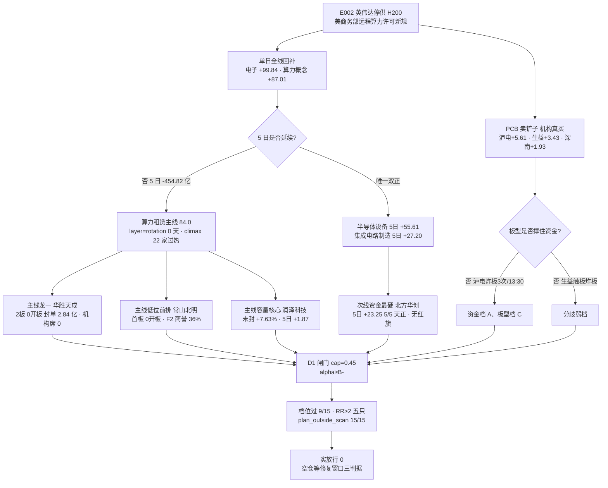

# 2026年11月19日 · **个股画像**

> **数据源新鲜度**: partial（R5 自采主源全绿；扣分全在上游 R2/R3/R4/R7）
> **降级状态**: false（vibe-trading 未配置 → 大宗/两融/龙虎榜改 tushare 主源，已单列 data_gaps）
> **置信度**: 0.525（0.75 基准 × 0.7 新鲜度 × 1.0 多源一致）
> **数据归属**: 本文件 trade_date = 2026-11-19（盘前），全部分析数据归属 **2026-11-18 收盘**（T-1），非 11-19 盘中数据
> **⚠️ 情绪闸门**: 炸板率取严 **39.44% ≥ 35%** 硬红线（连续 2 日在线上）→ R3 判 **震荡/主跌 · high_chop 第 6 天（连跌 5 天 · repair_window）**，候选按纪律砍半（6→3）；R5 只在 15 只研究候选内分层，**不给开仓资格**

---

## 一句话结论

15 只全部研究级、零开仓资格：**D1 实算 cap=0.45 只要求 alpha≥B-，9/15 档位过关、5 只 RR≥2，但 15/15 命中 `plan_outside_scan`（R2 execution_pool=[] + R3 open_permission=false + R7 execution=0）→ 实放行 0**。相对价值最高的是**主线龙一华胜天成**（身位第一但机构席 0＋首亏）与**主线低位前排常山北明**（封板干净但 F2 商誉 36%＋RR 1.55），本日正确动作是空仓等修复窗口三判据。

---

## 详细分析

这轮画像要回答的顺序问题依旧是三个：**钱在哪一层、谁的牌位是真的、次日押注在押什么**。环境是震荡分化型（R1，情绪 32.9 恐惧）＋ high_chop 第 6 天（连跌 5 天 repair_window）＋ 炸板率取严 39.44% ＋ 主力全场 -85.21 亿（第 5 日流出但连续 3 日收窄、超大单转正 +19.31）。这种环境里"涨停榜第一名"与"次日能承接的票"经常不是同一只，所以画像重心放在 **板型质量 × 资金持续性 × 身位真伪** 三张交叉验证上。

### 一、今天的市场在为什么付钱

- **大资金意图**: R7 的指纹非常清楚——单日全线回补（电子 +99.84 / 元件 +46.38 / 半导体 +45.53 / 印制电路板 +45.17 / 算力概念 +87.01 亿），但 5 日全线失血（电子 -454.82 / PCB -146.90 / 元件 -178.10 / 算力概念 -260.15 亿、pos_days_5d=1）。**这不是趋势反转，是超跌后的单日回补**；唯一 5/20 日双正的是半导体设备（+55.61 / +104.57 亿）与集成电路制造（+27.20 / +30.33 亿），这两条线反而是宽度最差的（涨停 11→3、涨占比 50%）。
- **为什么走强**: 催化是 E002（英伟达停供 H200 ＋ 美商务部远程算力许可新规，strength=high），落点是"国产机柜/算力对外出租"与"上游卖铲子"两条腿；位置普遍是深跌修复（15 只里 9 只距 60 日高 ≤ -30%，沪电 -37.5%、深南 -51.5%、生益 -46.6%）；筹码是机构在 PCB 上真金白银（沪电机构席当日 +5.61 亿 / 30 日 +16.9 亿、生益 +3.43 亿、深南 +1.93 亿）。
- **逻辑够不够硬**: 半硬。硬的一面是机构席位与业绩（沪电 Q1-3 预增 100-110%、深南 74-78%、生益 68-75%）都可核对；不硬的一面是**题材面过热且未验证**——算力租赁题材矩阵 22 家涨停（11-17 仅 5 家，跳增 4.4 倍，R2 明示"次日腰斩概率约 66%"）、主线 layer=rotation（0 天持有）、money_persist_days=0、age_days=2。证伪路径：次日算力租赁成分涨停若跌回 ≤5 家、或主力连续第 6 日净流出，则按"一日游"判否。

### 二、15 只候选的三张交叉表（板型 × 身位 × 资金）

| 票 | 板型（首封/开板/封单亿） | 身位判定（v1.5） | 主力 当日/5日/20日（亿） | RR（买/目标/止损） | 档位 α/风险 | 综合 | R5 态度 |
|---|---|---|---|---|---|---|---|
| 华胜天成 | 2 板 / 09:55 / 0 / 2.84 | 龙头（高度 2、板块 13 家） | +2.10 / +15.45 / +13.82 | 3.97（15.0/17.98/14.25） | B / **C** | 63.3 | 降级观察 |
| 常山北明 | 首板 / 10:02 / 0 / 1.63 | 龙头（首板卡位型） | +3.26 / +3.54 / +1.73 | 1.55（11.6/12.5/11.02） | B / B | 62.1 | 观察（不进） |
| 美利云 | 首板 / 10:05 / 1 / 1.13 | 补涨/跟风（顺位 4） | +3.45 / +3.00 / +2.12 | 2.09（13.4/14.8/12.73） | B- / B+ | 61.2 | 观察（不进） |
| 宏景科技 | 20cm 首板 / 13:30 / 0 / 1.17 | 补涨/跟风（午后首封） | +3.92 / +2.12 / -2.64 | 3.12（108.0/133.0/100.0） | B- / B+ | 61.1 | 降级观察 |
| 润泽科技 | 未涨停 +7.63%，量比 1.27 | 非涨停·容量核心 | +1.28 / +1.87 / **-4.52** | 2.41（54.0/60.5/51.3） | B- / B | 58.7 | 观察 |
| 利通电子 | 首板 / 11:26 / 1 / 2.39 | 补涨/跟风（R2 mid_laggard） | +4.54 / +1.69 / -7.69 | **0.45**（60.15/62.28/55.37） | B- / B+ | 56.5 | 拦截 |
| 生益电子 | 触板炸板 / 13:19 / 1 / — | 分歧弱 | +1.87 / +2.35 / -5.28 | 1.97（66.0/72.5/62.7） | B- / B | 56.4 | 观察（不进） |
| 北方华创 | 未涨停 +0.93%，量比 0.92 | 非涨停·容量核心 | +3.86 / **+23.25** / +33.95 | 1.44（568/609/539.6） | B- / **A** | 55.5 | 观察 |
| 中微公司 | 未涨停 +2.38%，量比 0.93 | 非涨停·容量核心 | +4.97 / +7.57 / +30.03 | 1.07（242/255/229.9） | B- / B- | 55.2 | 降级观察 |
| 深南电路 | 首板 / **13:19** / 0 / 1.85 | 补涨/跟风（午后首封） | +4.16 / +1.66 / -11.09 | 3.41（196/229.4/186.2） | **C** / B+ | 54.1 | 观察（档位拦） |
| 沪电股份 | 首板 / 13:30 / **3 次炸板** / 0.63 | 补涨/跟风（板型最软） | **+13.19** / -2.82 / -27.11 | 1.41（78.3/87.5/71.77） | **C** / B+ | 52.9 | 观察（档位拦） |
| 拓荆科技 | 未涨停 +4.56%，量比 1.0 | 非涨停·观察（顺位 4） | +2.33 / +6.04 / +11.97 | 1.19（505/535/479.75） | **C** / B | 52.5 | 观察（档位拦） |
| 江波龙 | 未涨停 +1.86%，量比 0.74 | 非涨停·观察（顺位 3） | +0.75 / -2.85 / -11.65 | 1.40（196.81/210.6/186.97） | **C** / B | 41.3 | 拦截 |
| 佰维存储 | 未涨停 +3.36%，量比 0.72 | 非涨停·观察 | +0.98 / -4.86 / -22.38 | **0.72**（125/129.5/118.75） | **C** / B- | 41.1 | 拦截 |
| 兆易创新 | 未涨停 +2.33%，量比 0.72 | 非涨停·容量核心 | +2.65 / **-31.11** / -29.86 | 1.64（212/229.4/201.4） | **C** / B+ | 40.7 | 拦截 |

### 三、六维传导结构（催化 → 单日回补 → 身位 → 闸门）

### 四、五种筹码人格的分层（本日最关键的画像结论）

1. **身位龙头型（华胜天成）**——2 板 0 开板、封单 2.84 亿（占流通 1.54%）、板块 13 家涨停、5 日主力 +15.45 亿，身位与板块共振都是第一；但龙虎榜机构专用席 **0 条**（卖方前三是拉萨金融城 -0.36 / 国信浙江互联网 -0.35 / 中信建投安徽 -0.34 亿）、获利盘 98.7%、位置 100%、2026H1 首亏 2.2-3.3 亿 → **身位是真的，基本面是空的**。
2. **低位前排型（常山北明）**——首板 10:02 早封、0 开板、封单 1.63 亿、距 60 日高 -10.5%、r60 -11.7%，是主线唯一"低位 + 板块效应 + 封板干净"三合一；但 **F2 商誉/净资产 36%**、CFO -17.55 亿、2026H1 增亏，且 RR 1.55 < 2 → 只能观察。
3. **容量核心型（润泽科技 / 北方华创）**——润泽是主线唯一有真实 IDC 业务 + 研报 42 篇 + 控股股东增持的 900 亿大票，但当日 +7.63% 未封、5 日强度仅 0.20%、20 日 -4.52 亿；北方华创是全批唯一 **5/5 天净流入（+23.25 亿）且财务 0 红旗（风险档 A）**，但 PE 分位 86.7%、RR 1.44、日 MA60 609 压制。
4. **资金硬板型软型（沪电股份 / 深南电路 / 生益电子）**——沪电机构席当日 +5.61 亿（R7 口径 3.50 亿）、30 日 +16.9 亿，是全场最硬的机构证据，**可盘中炸板 3 次、13:30 才回封、封单只剩 0.63 亿（占流通 0.04%）**；深南位置全批最低（距 60 日高 -51.5%、获利盘 13.9%）却因空头均线技术分仅 39；生益触板炸板 = 分歧弱。三只共同的病：**资金先到、板型没跟上**。
5. **周期顶赢家型（兆易 / 佰维 / 江波龙）**——三只 PE 分位 0.2% / 1.6% / 0.8%、ROE 23% / 90% / 73%、净利同比 +921% / +28728% / +1909%，账面是"最便宜的成长股"，实际是 **存储周期顶的教科书画像**：5 日主力 -31.11 / -4.86 / -2.85 亿、板块 0 涨停、CFO 分别 101.24 / -100.41 / -22.74 亿。V1 低 PE 陷阱五只（利通/中微/江波龙/佰维/兆易）里有三只在这里。

### 五、首推票思维链（4 只）

**① 华胜天成（600410.SH）· B/C · RR 3.97 · 降级观察**

> 图表: `output/charts/lwc_kline_600410_SH_20261119_065235.png`（chart_vision 当日快照同源，日内 K + 均线结构）

- **买入理由**: （1）身位无争议——2 板 0 开板、封单 2.84 亿（占流通 1.54%，板块第 1）、板块 13 家涨停、主升第 2 天，是 E002 国产算力链唯一的情绪龙头；（2）资金量级足——5 日主力 +15.45 亿（4/5 天净流入）、20 日 +13.82 亿、强度 8.4% of 流通市值（全批最高之一）；（3）缠论站上中枢（13.86-15.22）且向上笔未完成，是本批仅 2 只结构确认之一。
- **风险点**: （1）短期——获利盘 98.7%（上方零套牢也零承接）、位置 100%、距 MA20 +33.4%、换手 19.0%（爆量），R2 明示 climax 过热"次日腰斩概率约 66%"；（2）中期——龙虎榜机构席 0（纯游资）、2026H1 首亏 2.2-3.3 亿、PE 分母失效只能看 PB 4.56（分位 85.4%）、研报 0 篇。
- **止损条件**: 低吸买点 15.00，止损 14.25（-5%）收盘破位无条件出；若次日竞价低开 >4% 且 15 分钟不收复 15.8（前日均价 16.35 下方），视为高位加速失败，不等收盘。
- **可验证假设**（24-72h）: 次日竞价封单能否 >1 亿且不破 16.0；算力租赁成分涨停能否维持 ≥8 家（今日 13）；主力当日净额能否连续第 5 天为正（今日 +2.10 亿）。
- **大资金意图**: 5 日 +15.45 亿里 4 天为正，资金是"边打边撤"结构——买盘来自游资席位，卖方也是游资席位（拉萨/国信/中信建投三省分公司），没有机构对手盘；下注理由只有题材与身位。
- **为什么走强**: 位置（新高位 100% 区间）＋ 题材（E002 唯一硬催化）＋ 筹码（0 开板快封）三位一体，是典型"情绪龙头"的三件套，缺的是承接盘。
- **逻辑够不够硬**: 不硬。身位是市场给的，逻辑是题材借的，公司 2026H1 首亏 2.2-3.3 亿、机构 0 覆盖；证伪路径极短——次日若一字后炸板或主力净额转负，主线高度即断。

**② 常山北明（000158.SZ）· B/B · RR 1.55 · 观察（不进）**

> 图表: `output/charts/lwc_kline_000158_SZ_20261119_065235.png`

- **买入理由**: （1）位置是本批主线里最舒服的——距 60 日高 -10.45%、距 MA50 +2.08%、30 日区间 89.6%，r60 -11.66% 属板块内相对低位；（2）板型干净——10:02 早封、0 开板、封单 1.63 亿（占流通 0.83%）、换手 4.79% 缩量快封；（3）资金中等强度——当日 +3.26 亿（板块第 3）、5 日 +3.54 亿（3/5 天）、20 日 +1.73 亿。
- **风险点**: （1）短期——12.43 正踩缠论中枢下沿（12.40-13.38）、上方 12.47 周 MA20 与 12.66 双重压力，RR 1.55 < 2 结构性不达交易档；（2）中期——**F2 商誉/净资产 36%**（一旦减值击穿净资产）、CFO -17.55 亿、2026H1 增亏（-0.95~-1.15 亿）、PE 583（分母极薄）、研报 0 篇。
- **止损条件**: 低吸 11.60，止损 11.02（-5%）收盘破位出；若次日高开后跌回 11.40 以下（60 分 MA20 下方）且量比 <1，视为超跌反弹结束。
- **可验证假设**（24-72h）: 次日能否放量站上 12.66（20 日高/周 MA20 上方）；算力租赁成分涨停能否维持 ≥8 家；主力当日净额能否连续第 2 日为正。
- **大资金意图**: 龙虎榜 0 次、机构 0，当日 3.26 亿净买全部来自未上榜资金 → 主力是"盘中主动买"，没有席位痕迹，可持续性只能靠次日承接验证。
- **为什么走强**: 低位（r60 -11.7%）＋ 容量（流通 197.7 亿）＋ 华为昇腾辨识度，三维里位置最硬、辨识度中等。
- **逻辑够不够硬**: 位置硬、板型硬、但财务硬伤（F2 36% 商誉 + CFO -17.55 亿）与 RR 1.55 把交易价值拿走；只能作"低位前排"的观察样本。

**③ 润泽科技（300442.SZ）· B-/B · RR 2.41 · 观察（研究首选、交易次选）**

> 图表: `output/charts/lwc_kline_300442_SZ_20261119_065235.png`

- **买入理由**: （1）主线唯一产业实体——IDC 机柜出租/上架率是真实业务而非概念映射，E002 的预期差正落在"出租率"；（2）机构与股东双向背书——研报 42 篇（11 家）、调研 400 条（全批最多）、控股股东 20261012 起增持并触及 1% 及 5% 整数倍；（3）财务质量好——毛利 46.3%、净利率 32.3%、CFO 45.08 亿、PB 分位 38.1%。
- **风险点**: （1）短期——当日 +7.63% 未涨停无板型，5 日主力仅 +1.87 亿（强度 0.20%）、20 日 -4.52 亿，上方 59.8-61.2（日 MA60 59.76 / 60 分前高 / 20 日高）密集阻力；（2）中期——净利同比 -61.68%（折旧财务费用拖累）、PE 分位 71.4%、周 K 空头排列（周 MA20 64.22）、缠论仍在中枢下。
- **止损条件**: 低吸 54.00，止损 51.30（-5%）收盘破位出；若跌破 52.5（识图止损位）且量比 >1.5，视为反弹失败。
- **可验证假设**（24-72h）: 能否放量站上 59.76（日 MA60）；IT服务Ⅲ 当日净流入能否连续（今日 +18.35 亿）；5 日主力能否转正到 >3 亿。
- **大资金意图**: 900 亿流通盘日净买 1.28 亿（0.20%）属机构常规配置量，不是冲锋；对手盘是 22.1% 获利盘以外的 77.9% 套牢筹码（平均成本 61.60）。
- **为什么走强**: 超跌（自 49.33 见底）＋ 业务真实 ＋ 机构覆盖，是"基本面修复型反弹"而非情绪脉冲。
- **逻辑够不够硬**: 逻辑最硬的之一（真实 IDC + 增持 + 研报 42 篇），但位置在 MA60 下方、资金量级不足以破阻力带，交易价值排第二。

**④ 北方华创（002371.SZ）· B-/A · RR 1.44 · 观察**

> 图表: `output/charts/lwc_kline_002371_SZ_20261119_065254.png`

- **买入理由**: （1）资金持续性全批唯一——5 日 +23.25 亿且 **5/5 天全正**、10 日 +30.82、20 日 +33.95（14/20 天正）；（2）财务 0 红旗——ROE 13.39%、CFO 55.91 亿 > 净利 53.92 亿、商誉 5.6%、质押 0.08%，风险档 **A** 是全批唯一；（3）设备行业 5/20 日资金双正（+55.61 / +104.57 亿），R2 明示"宽度修复后可回补"。
- **风险点**: （1）短期——+0.93% 未涨停、量比 0.92 缩量、RR 1.44 < 2，日 MA60 609 与周 MA20 659 双重压制；（2）中期——PE 72.25（分位 86.7%）、PB 9.77（分位 84.9%）估值在历史高位区，净利同比仅 +5.1%，平均成本 627.57 高于收盘（上方套牢）。
- **止损条件**: 低吸 568，止损 539.6（-5%）收盘破位出；若收盘失守 MA20（532.6）且 5 日主力转负，降级只观察。
- **可验证假设**（24-72h）: 半导体设备行业单日净额能否连续为正（今日 +19.18 亿）；股价能否站上 589（识图突破位）／609（日 MA60）；5 日主力能否维持 5/5 天全正。
- **大资金意图**: 4175 亿流通盘 5 日 23.25 亿（0.56%），是机构持续加仓的"慢钱"，不是游资冲锋；对手盘是 627 元成本上方的套牢筹码。
- **为什么走强**: 资金持续 ＋ 无财务瑕疵 ＋ 设备行业资金双正，是"资金面单腿最硬"的修复型容量票。
- **逻辑够不够硬**: 资金与财务都硬，缺的是板型与估值空间；只做"回踩决策线（MA50 590.68，距 -2.82%）"的观察对象。

---

## 关键证据

- 证据 1: 算力租赁题材矩阵涨停 **22 家**（11-17 仅 5 家、跳增 4.4 倍），R2 判 climax 过热"次日家数腰斩概率约 66%"；主线 layer=rotation（0 天持有）、money_persist_days=0、age_days=2 · 来源 `R2_main_sectors.json`（main_lines[0]）
- 证据 2: 主力全场 **-85.21 亿**（连续第 5 日净流出，但连续 3 日收窄、超大单转正 +19.31 亿）；算力概念单日 +87.01 亿但 5 日 -260.15 亿、pos_days_5d=1 · 来源 `R7_capital_flow.json`（main_force / concept_top_inflow）
- 证据 3: 华胜天成龙虎榜全席位净买 +2.98 亿，但 **机构专用席 0 条**（卖方前三为拉萨金融城 -0.36 / 国信浙江互联网 -0.35 / 中信建投安徽 -0.34 亿）· 来源 tushare `top_list`/`top_inst`（20261118，R5 机构席口径修正）
- 证据 4: 沪电股份机构专用席 30 日 **+16.9 亿**、当日 +5.61 亿（R7 口径 +3.50 亿），可当日盘中炸板 3 次、13:30 才回封、封单 0.63 亿（占流通 0.04%）· 来源 tushare `top_inst` + `limit_list_d`
- 证据 5: 常山北明 **F2 商誉/净资产 36%** ＋ CFO -17.55 亿 ＋ 2026H1 增亏（-0.95~-1.15 亿）· 来源 tushare `balancesheet` / `cashflow` / `forecast`
- 证据 6: 美利云封单 1.13 亿（占流通 1.13%，全批最厚）、首封 10:05、缠论站上中枢（12.74-14.11），但获利盘 95.0%、F8（CFO -0.44 亿 vs 净利 +0.52 亿）· 来源 tushare `limit_list_d` + `cyq_chips` + `cashflow`
- 证据 7: 兆易创新 5 日主力 **-31.11 亿**（1/5 天净流入）、股东户数 +19.03%、存储成分 0 涨停；PE 13.29 分位 0.2%（V1 周期顶）· 来源 `_r5_moneyflow_dc.json` + tushare `stk_holdernumber` + `R2_main_sectors.json`
- 证据 8: chart_vision 15/15 当日可用——偏多 9 只（华胜 0.68 / 常山 0.55 / 润泽 0.56 / 宏景 0.58 / 利通 0.60 / 生益 0.50 / 美利云 0.55 / 北方华创 0.56 / 佰维 0.56）、震荡 4 只（深南 0.55 / 沪电 0.52 / 中微 0.60 / 拓荆 0.56）、偏空 2 只（兆易 0.62 / 江波龙 0.68）；缠论仅 2 只站上中枢（华胜天成 / 美利云），13 只在中枢下或中枢内 · 来源 `data/raw/20261119/chart_vision_snapshot.json` + czsc

## 数据源审计

| 源 | 状态 | 抓取时间 | 记录数 | 备注 |
|---|---|---|---|---|
| tushare pro（daily/adj/daily_basic/limit_list_d/top_list/top_inst/margin/block_trade/fina/forecast/三表/cyq/holder/pledge/report_rc/surv/share_float/anns/basic） | ✅ ok | 06:53 | 15 票 × 23 接口 | 日线 201-211 根/票（≥30 日契约） |
| 东财 DC 主力净额（R7 同源） | ✅ ok | 07:02 | 21 个交易日 | 20261021→20261118 全市场逐日 |
| chart_vision 快照 | ✅ ok | 06:52 | 33 条覆盖 / 本批 15 命中 | 当日重渲；无退化票 |
| czsc 缠论（日线笔/中枢） | ✅ ok | 06:58 | 15 | 前复权口径与 metrics 一致 |
| tushare 龙虎榜 | ✅ ok | 06:53 | 51 个交易日 | 20260901→20261118 逐日全市场回拉后筛 |
| tushare 财报三表 + 公告 | ✅ ok | 06:53 | 1070 条公告 | 20260601 起；三表 2025Q1 起 |
| R1_style | ✅ ok | 06:13 | - | 震荡分化型 / 情绪 32.9 / cap 0.45 |
| R2_main_sectors | ⚠️ ok（degraded=true） | 06:50 | 1 主线 + 3 次线 | degraded 因 R3 微信 L2 断更；主线 84.0 |
| R3_sentiment | ⚠️ stale（degraded=true） | 06:30 | - | L2 真人话语永久断更，真等级 L1_only |
| R4_news | ✅ ok（partial） | 06:21 | 8 事件 | E002 为唯一 high 正面簇 |
| R7_capital_flow | ✅ ok（partial） | 04:48 | 21 日序列 | execution_candidates=0 |
| vibe-trading MCP | ❌ error | - | 0 | 未配置 → 大宗/两融/龙虎榜交叉核验缺失，改 tushare 主源 |

## 不确定性 / 反证

- **最脆弱的一环是"板型 vs 资金"的排序权重**。今天沪电（机构 +5.61 亿/30 日 +16.9 亿）只有 C 档、北方华创（5/5 天净流入 23.25 亿、0 红旗）只有 B-，而华胜天成（纯游资、首亏）能到 B —— 这是评分模型把"位置/估值/机构覆盖"与"板型"加权后的结果，若次日机构继续买 PCB 而主线退潮，排序会被打脸。留痕：华胜的 B 是身位给的分，不是质量给的分（风险档 C 已如实反映）。
- **候选池取舍（透明留痕）**：R2 候选共 16 只（主线 leaders 5 ＋ 次线 leaders 9 ＋ watch_pool 2），受「6-15 只」契约上限约束只能取 15。取舍原则是**先保 R2 leaders 全覆盖**：存储第三顺位江波龙补入，让位的是莲花控股（首封 13:27 午后跟风档、股东户数 +42.9% 散户涌入、机构席 0）。若次日莲花在竞价弱转强并放量，本报告的缺席会在复盘里显形。
- **主线资格本身未确认**。R2 给 84.0 分但 layer=rotation（0 天持有）、stage=climax、money_persist_days=0，且 R1 判"无主线（轮动结构）"。R5 按 R2 上游口径画像，但研究资格 ≠ 可交易资格：本轮 15/15 全部命中 `plan_outside_scan`。
- **R3 的 L2（真人话语层）永久断更**（wechat_cli 5 群 0 字节，本地微信库停在 2026-10-28），情绪判断只有 L1 数据（东方财富/同花顺/龙虎榜），"共振"强度无法核实；R5 的催化维度因此对"群聊侧传闻"零依赖，也意味着若次日出现群内一致性预期，本报告捕捉不到。
- **存储三只（兆易/佰维/江波龙）的"拦截"结论依赖 V1 周期顶判读**。若 DRAM 涨价延续到 2027（E005 的 HBM4 翻番情景成立），低 PE 会被重新定价为"周期成长"，拦截可能错失。当前证据重量：5 日资金三只全负、板块 0 涨停、识图 2 只偏空（兆易 0.62 / 江波龙 0.68）＋ 佰维偏多 0.56 → 维持拦截。
- **数据口径两处已知偏差**：(a) 沪电机构净买 R7 3.50 亿 vs tushare 机构专用席 5.61 亿（席位分单差异），两个数都落盘；(b) 美利云流通市值 R3 口径 84 亿、tushare 99.5 亿（R3 用东财自由流通，tushare 用流通股本）→ 封单占比 1.13% 是 tushare 口径。
- **RR 的可执行性**：买点取识图低吸位（如华胜 15.00 比收盘 16.82 低 10.8%），止损距收盘 -15.28% 已超 -5~-10% 硬区间（相对买点仍合规）。这类"低吸位远离收盘"的票，次日若高开不回踩，计划根本无法成交 —— RR 好看但难执行，已列为降级观察的主因之一。

## 与其他 R/D/E 的关系

- 依赖: `R1_style.json`（风格/情绪/cap）、`R2_main_sectors.json`（主线+次线+候选池）、`R3_sentiment.json`（情绪闸门/分层）、`R4_news.json`（催化事件/点名）、`R7_capital_flow.json`（板块与个股资金/emotion）、`data/raw/20261119/chart_vision_snapshot.json`（识图）、tushare 直取（行情/筹码/财务/公告）
- 输出被下游使用: `canghai-plan`（D1）消费 `profiles[].alpha_grade/risk_grade/composite_score/rr/leader_verdict/forbidden_check` 做逐票门禁与 execution_pool 组装；`analyze_devil_advocate_v1`（R6）消费 `fundamental_flags`（本批 29 条红旗）与 `distribution_alert/short_pressure` 做反证；E1 复盘消费 `d1_gate_simulation` 与 `coverage`

## Sub-Agent 元数据

- skill: analyze_stock_profile_v1@1.5
- artifact: `data/research/20261119/R5_stock_profiles.json`（446 KB / 15 profiles）
- 生成耗时: 约 19 分钟（fetch 45s + chart_vision 补渲 ~110s + dc/chanlun/compute ~35s + 打分装配 ~5s）
- 用 model: deepseek-v4.1-flash（Hermes · canghai-research profile）
- 校验: `scripts/research/check_r5_20261119.py` → EXIT 0（ERRORS: none / WARN: none）
