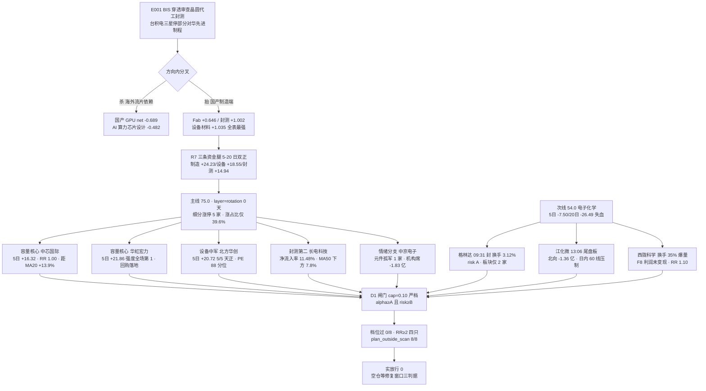

# 2026年11月20日 · **个股画像**

> **数据源新鲜度**: partial（R5 自采主源全绿；扣分全在上游 R1/R3/R4/R7）
> **降级状态**: false（vibe-trading 未配置 → 大宗/两融/龙虎榜改 tushare 主源，已单列 data_gaps）
> **置信度**: 0.525（0.75 基准 × 0.7 新鲜度 × 1.0 多源一致）
> **数据归属**: 本文件 trade_date = 2026-11-20（盘前），全部分析数据归属 **2026-11-19 收盘**（T-1），非 11-20 盘中数据
> **⚠️ 情绪闸门**: 炸板率取严 **51.06% ≥ 35%** 硬红线（R7 stk_limit 权威口径 47.17%，取严者为准）→ R3 判 **极恐 18.0 · 主跌/震荡 · capitulation 补跌第 7 天（连跌 6 天 · repair_window 三判据全不成立）**；R2 初筛 6 条方向砍半至 3 条，只留 **1 主 + 1 次**，execution_pool=[] → R5 在 8 只研究候选内分层，**不给开仓资格**

---

## 一句话结论

8 只全部研究级、零开仓资格：**D1 实算 cap=0.10（R1 防御观望型 / 无主线 rotation / 情绪 19.2 极恐）→ 落 cap≤0.40 严档，需 alpha≥A 且 risk≥B，而本批 alpha 上限只有 B → 档位过闸门 0/8；RR≥2 有 5 只（中京 3.53 / 华虹 3.26 / 江化微 3.17 / 长电 2.90 / 格林达 2.70），但 8/8 全数命中 `plan_outside_scan` → 实放行 0**。相对价值最高的是**华虹宏力**（5 日主力 21.86 亿、强度 2.68% 流通市值全场第 1＋回购落地）与**中芯国际**（本日唯一四源交集），但两者都收在 20 日最高点、距 MA20 分别 +23.9% / +13.9%，RR 分别 3.26 / 1.00 —— 资金最认的票位置最高，位置最好的票资金不认。本日正确动作是空仓，等修复窗口三判据。

---

## 详细分析

这轮画像要回答的顺序问题依旧是三个：**钱在哪一层、谁的牌位是真的、次日押注在押什么**。环境是防御观望型（R1，情绪 19.2 极恐）＋ capitulation 第 7 天（连跌 6 天、repair_window 三判据全不成立）＋ 炸板率取严 51.06% ＋ 主力全场 -313.15 亿（较前日 -85.21 摆动 -227.94）。这种环境里「涨停榜第一名」与「次日能承接的票」经常不是同一只，所以画像重心放在 **资金连续性 × 板型质量 × 身位真伪** 三张交叉验证上。

### 一、今天的市场在为什么付钱

- **大资金意图**: R7 的指纹是「**窄口抱团 + 基准盘撤退**」——单日集成电路制造 +24.23 / 半导体设备 +18.55 / 集成电路封测 +14.94 亿，概念端中芯概念 +30.79（5 日 +32.56）、大基金持股 +31.33（5 日 +47.77）全部为正；同时两融 -296.17 亿、深股通 -177.67 亿、主力全场 -313.15 亿、20 日 -3929.82 亿仅 8 日为正。**钱不是来了，是换地方了**：从全市场收缩到国家队口径的国产制造端。母行业『半导体』当日 +30.51 却 5 日 -96.28 亿，说明连半导体内部都在分化，只有制造/设备两条腿是 5-20 日双正。
- **为什么走强**: 催化是 R4 E001（美 BIS 穿透审查晶圆代工封测、台积电三星暂停部分对华先进制程出货）造成 **方向内分叉**——对依赖海外流片的国产 GPU 是杀（沐曦 net -0.689、AI 算力芯片设计 -0.482），对国产 Fab/封测/设备是抬（Fab +0.646、封测 +1.002、设备材料 +1.035 全表最强）。叠加 E003（伯恩斯坦上调 2027 全球 WFE 支出 2170 亿美元 / +39%）与 E004（无锡 50 亿先进封装产线奠基），三条事件全部落在「卖铲子」一侧。位置上整条线仍是深跌反弹（龙头中芯 r60 -9.43%、成员中位 r60 -24.44%），不是趋势主线。
- **逻辑够不够硬**: 半硬。硬的一面是可核验的订单口径与真实资金（设备 20 日 +144.54 亿、制造 20 日 +56.48 亿、华虹三日加速、中芯 CFO 286 亿），以及财报轴干净（中芯商誉 0 / 质押 0.07%，华虹回购在推进）。不硬的一面是**宽度没起来**：半导体（申万 53 只）涨占比仅 39.6%、中位 -0.35%，先进封装 -0.60%、芯片概念 -1.92%，全市场上涨占比 11.65%、跌停 68 家。证伪路径很短——次日若制造/设备资金转负、或涨停家数从 11 家回落至 ≤5 家，则按「第 3 日反抽结束」判否。

### 二、8 只候选的三张交叉表（板型 × 身位 × 资金）

| 票 | 板型（首封/开板/封单） | 身位判定（v1.5） | 主力 当日/5日/20日（亿） | RR（买/目标/止损） | 档位 α/风险 | 综合 | R5 态度 |
|---|---|---|---|---|---|---|---|
| 华虹宏力 | 未封 +8.05%，量比 1.31 | 非涨停·容量核心（第 2 顺位） | +7.09 / **+21.86** / +26.16 | 3.26（196.0/227.9/186.2） | B / **B+** | **66.0** | 降级观察 |
| 中芯国际 | 未封 +6.21%，量比 1.59 | 非涨停·容量核心（第 1 顺位） | +11.52 / +16.32 / **+37.19** | **1.00**（119.0/125.0/113.0） | B / B+ | 65.3 | 观察（RR 拦） |
| 长电科技 | 未封 +4.74%，量比 1.41 | 非涨停·观察（第 3 顺位） | +6.71 / +5.47 / -3.23 | 2.90（52.85/60.5/50.21） | B / B+ | 62.0 | 观察（右侧未成立） |
| 北方华创 | 未封 +3.13%，量比 1.10 | 非涨停·容量核心（设备中军） | +2.78 / **+20.72** / **+40.94** | 1.34（568.0/606.0/539.6） | B- / B+ | 59.5 | 观察（RR 拦） |
| 中京电子 | **首板 / 10:27 / 0 次 / 1.01 亿** | **孤军**（元件仅 1 家） | +3.08 / +2.69 / +0.66 | 3.53（11.8/13.88/11.21） | B- / B | 58.9 | **拦截** |
| 格林达 | **首板 / 09:31 / 1 次 / 0.84 亿** | 补涨/跟风（板块仅 2 家） | +0.55 / +0.99 / +0.86 | 2.70（27.3/31.0/25.93） | B- / **A** | 57.2 | 观察（板型最好） |
| 江化微 | **首板 / 13:06 / 0 次 / 0.84 亿** | 补涨/跟风（尾盘板） | +2.01 / +3.63 / +2.64 | 3.17（24.5/28.4/23.27） | **C** / B+ | 54.6 | **降级** |
| 西陇科学 | 未封 +4.98%，换手 35.1% | 非涨停·观察（候补） | +0.11 / +0.45 / -0.23 | **1.10**（8.0/8.44/7.60） | **C** / B | 54.4 | **拦截** |

### 三、六维传导结构（事件分叉 → 两条资金腿 → 身位 → 闸门）

### 四、五种筹码人格的分层（本日最关键的画像结论）

1. **资金最认 / 位置最高型（华虹宏力）**——5 日 +21.86 亿、强度 2.68% 流通市值（本批第 1）、三日加速（+6.27 / +8.91 / +7.09）、回购方案 11-13 董事会通过，获利盘 92.5%、上方套牢仅 7.5%。但距 MA20 +23.90%（本批最大）、PB 89.4% / PS 88.2% 分位、收盘在缠论中枢下沿之外（pos_in_zs -25.2）、股东户数 +11.93% 散户涌入。**资金是真的，位置是贵的**。
2. **四源交集型（中芯国际）**——唯一同时拿到 R2 龙一 + R4 E002 点名 + R7 代工龙头 + 制造/设备/封测三腿双正；CFO 286.25 亿 > 净利 73.14 亿、商誉 0、质押 0.07%、获利盘 82.1% / 上方套牢 17.9%。但位置 30 日区间 100%、距 MA20 +13.9%、RR 1.00（目标 125 距买点仅 +5%，被周 K 压力锁死）、融券 +84.32% 触发 short_pressure。**逻辑最硬，买点最差**。
3. **资金最稳 / 共识最满型（北方华创）**——5 日 +20.72 亿且 5/5 天全正（本批唯一满格）、20 日 +40.94 亿（本批最大）、ROE 13.39%（本批最高）、CFO/净利 1.04、研报 104 篇 26 家。但 PE 87.8% / PB 87.1% / PS 82.3% 三高、净利同比只有 +5.10%、平均成本 626 高于收盘 592（上方套牢 46.6%）、RR 1.34。**它是主线的业绩锚，不是进攻首选**。
4. **今天才转向型（长电科技）**——单日净流入率 11.48%（全场最高）、R4 封测腿 1.002 全表第 2、股东户数 -17%，但 20 日仍 -3.23 亿、MA50 下方 7.84%、缠论 pos_in_zs -111（本批结构最弱）、两融 -28.35%（杠杆撤退最快）。**右侧未成立的修复第一天**。
5. **板型干净 / 无板块效应型（格林达 + 江化微 + 中京电子）**——三只都有可圈可点的板型：格林达 09:31 开盘封、只开 1 次、换手 3.12% 惜售、封单占流通 1.45%；中京 10:27 封、0 开板、封单 1.01 亿；江化微 0 开板但 13:06 尾盘封。问题全在「势」上：电子化学仅 2 家涨停、元件仅 1 家涨停 → 板块效应不足，龙头判定分别落到「补涨/跟风」与「孤军」；且中京净利 -1.17 亿 + F10 有息负债 92.5%、江化微北向净卖 1.36 亿 + PE 89.9% 分位。**板型给不了势，势给不了价**。

### 五、首推票思维链

**① 华虹宏力（688347.SH）· B/B+ · RR 3.26 · 综合 66.0（本批第 1）· 降级观察**

> 图表: `output/charts/lwc_kline_688347_SH_20261120_064317.png`（chart_vision 当日快照同源，四周期 K + 均线结构）

- **买入理由**: （1）资金强度全场第一——5 日主力 21.86 亿 / 流通市值 814.9 亿 = 2.68%，且是三日加速（11-17 +6.27、11-18 +8.91、11-19 +7.09），本批唯一「连续三日 6-9 亿级」；（2）公司态度最硬——10-30 董事会主席兼总裁提议回购 → 11-13 董事会通过集中竞价回购方案，是除中芯外唯一真金白银在二级市场买自己的票；（3）产业链位置纯正——成熟制程+特色工艺吃 BIS 反身性订单回流，9-12 发行股份购买资产（华力微注入）已落地。
- **风险点**: （1）短期——距 MA20 +23.90%（本批最大乖离）、单日 +8.05% 已透支、收盘在缠论中枢下沿之外，周 K 仍受 MA20 227.9 压制、207.8 前高未破；（2）中期——PB 8.30（89.4% 分位）、PS 19.68（88.2% 分位）、股东户数 +11.93%（散户涌入）、F3 应收增速 51.4% 远超营收 14.1% 增速。
- **止损条件**: 低吸买点 196.0（60 分 MA20 与 15 分低吸区），止损 186.2（-5.0%，距收盘 -6.83%）；若开盘直接低开跌破日线 MA60 197.5 且 15 分钟不收复，视为本轮反弹技术失效，不等收盘。
- **可验证假设**（24-72h）: 能否在 195-198 区间缩量回踩而不破 197.5；集成电路制造行业单日净流入能否连续第 2 日为正（今日 +24.23 亿）；5 日主力能否维持在 15 亿以上；竞价的成交额能否守住 199 上方。
- **大资金意图**: 814.9 亿流通盘 5 日吸 21.86 亿，不是游资能做的事；10 日序列里 11-11 曾单日 -7.30 亿（-15.62%），说明同一批资金也会反向出货——这是「有组织但非锁定」的钱。对手盘是 7.5% 的套牢盘与 11.93% 新进散户。
- **为什么走强**: 事件（BIS 分叉抬升国产 Fab）+ 订单（WFE +39%）+ 自身（回购）三件事同向，且流通盘小（中芯的 1/3）所以资金强度天然放大。
- **逻辑够不够硬**: 硬，但已定价。硬到「资金连续三天加速 + 回购托底」，软在「距 MA20 +23.9% 意味着现在进场是给前三天抬轿」。它是本批**最不该追高、最该等回踩**的一只。

**② 中芯国际（688981.SH）· B/B+ · RR 1.00 · 综合 65.3 · 观察（RR 拦）**

> 图表: `output/charts/lwc_kline_688981_SH_20261120_064317.png`

- **买入理由**: （1）本日唯一四源交集——R2 龙一、R4 E002 点名（Fab 受抬侧）、R7 research_candidates 代工龙头、R7 制造/设备/封测三条腿全双正；（2）财务最干净——商誉 0、质押 0.07%、CFO 286.25 亿 > 净利 73.14 亿、资产负债率 34.46%，红旗只有 short_pressure（软性）；（3）筹码结构最好——获利盘 82.1%、平均成本 113.39 低于收盘 122.25、上方套牢仅 17.9%、90% 筹码在 ±10% 内。
- **风险点**: （1）短期——位置 30 日区间 100%、距 MA20 +13.87%、收在 20 日最高 122.25，RR 仅 1.00（目标 125.0 距买点 119.0 只有 +5.0%）；（2）中期——融券 15 日 +84.32%（空头加码）、20 日资金强度仅 0.67% 流通市值（大票慢吸）、板块涨占比 39.6% 未过半。
- **止损条件**: 低吸买点 119.0（60 分 MA20 119.29 共振带），止损 113.0（-5.0%，距收盘 -7.57%）；若收盘失守 113.36（日线 MA60）并放量，则视作突破失败、回补 11-17 缺口。
- **可验证假设**（24-72h）: 能否在 119-120 缩量回踩承接；能否放量站上 122.65（20 日高/日内高）并翻开 125；集成电路制造行业资金能否连续；融券余额是否继续上升（若继续升 = 空头不认）。
- **大资金意图**: 2445.7 亿流通盘单日 11.52 亿（10.98% 净流入率）属机构级配置，10 日序列里 11-16 -4.00 亿、11-17 +9.10 亿 = 在方向内做择时；30 日零龙虎榜 = 完全不走游资通道。
- **为什么走强**: 事件（BIS 分叉）+ 订单（WFE）+ 财报（Q3 净利 +91.57%）三事同时改善，且是国产替代叙事里辨识度最高的名字。
- **逻辑够不够硬**: 逻辑最硬（可核验的订单与现金流），但**交易价值被 RR 1.00 拿走**：目标位 125 是周 K 压力，不是空间。结论是「研究核心、非买点」——等它把 125 站成支撑，或回踩 119-113。

**③ 北方华创（002371.SZ）· B-/B+ · RR 1.34 · 综合 59.5 · 观察**

> 图表: `output/charts/lwc_kline_002371_SZ_20261120_064317.png`

- **买入理由**: （1）资金持续性唯一满格——5 日 +20.72 亿且 5/5 天全正、20 日 +40.94 亿（本批最大绝对额）、逐日 +5.09/+5.88/+3.86/+2.78 虽递减但不断；（2）财务最硬——ROE 13.39%（本批最高）、CFO/净利 1.04、毛利率 39.44%、商誉 5.6%、质押 0.08%；（3）事件簇最强——设备材料 net_score 1.035 全表第一（E003 WFE +39% / E004 无锡 50 亿封装线），且 10-30 完成收购诺合键维 100% 股权（零部件补强）。
- **风险点**: （1）短期——PE 87.8% / PB 87.1% / PS 82.3% 三项全在历史高位、RR 1.34（目标 606 就是压力位本身）、592 已贴 606-607 前高与 60 日线；（2）中期——净利同比仅 +5.10%（增速与估值不匹配）、平均成本 626.09 高于收盘（上方套牢 46.6%）、融券 +29.81%。
- **止损条件**: 低吸买点 568.0（60 分回踩位），止损 539.6（-5.0%，距收盘 -8.85%）；若收盘失守 566（识图止损位）且 5 日主力转负，降级为纯观察。
- **可验证假设**（24-72h）: 能否放量突破 606-607（前高+60 日线）；半导体设备行业净流入能否连续（今日 +18.55 亿）；5 日主力能否维持 5/5 天全正；研报目标价是否随 WFE 上调而抬升。
- **大资金意图**: 4306 亿流通盘 5 日 20.72 亿 = 0.48%，属机构「慢钱」持续加仓；11-13 一笔 0.20 亿大宗买方为「招商交易单元 + 机构专用」→ 机构在大宗接货。
- **为什么走强**: 设备是 WFE 上调 + 出口管制反身性的双重受益者，且它是国产设备链唯一有 ROE 13% 与 104 篇研报覆盖的标的。
- **逻辑够不够硬**: 资金与财务都硬，缺的是价格空间。它是主线的**体温计**：它若放量破 606-607，主线从「窄口抱团」升级为「设备链主升」；它若跌破 566，整条设备的资金叙事同步失效。

**④ 格林达（603931.SH）· B-/A · RR 2.70 · 综合 57.2 · 观察（板型最好）**

> 图表: `output/charts/lwc_kline_603931_SH_20261120_064331.png`

- **买入理由**: （1）板型本批最硬——09:31:17 开盘 6 分钟封、只开 1 次、换手仅 3.12%（惜售）、封单 0.84 亿占流通 1.45%（本批封单强度第 2）；（2）风险档 A 本批唯一——资产负债率 7.85%（几乎无债）、商誉 0、无质押、无 F/V 红旗；（3）估值有唯一安全垫——PB 3.00 处 3 年分位 20%（本批唯一 PB 低分位），净利率 20.15%、CFO/净利 1.39；（4）回购在推进——8-29 报告书、10-24 首次回购、11-03 进展公告。
- **风险点**: （1）短期——电子化学仅 2 家涨停 → 无板块效应，规则判「补涨/跟风」；29.15 几近对齐 20 日高 29.2 但未真正越过，易成假突破；止损距收盘 -11.05%；（2）中期——营收同比 -4.74%（成长停滞）、非两融标的（缺杠杆资金验证）、流通仅 58.2 亿（容量不足）、日 MA60 31.07 与周 MA20 33.79 双压制。
- **止损条件**: 低吸买点 27.3（日 MA5 27.15 + 60 分 MA20 27.20 三线共振），止损 25.93（-5.0%，距收盘 -11.05%）；若次日高开后跌回 27.2 下方且量比 <1，按一日游处理。
- **可验证假设**（24-72h）: 29.2 能否放量站稳；电子化学能否出现第 3 只涨停（若出现则次线升级、它转龙一）；5 日主力能否维持 4/5 天为正；回购公告是否继续披露。
- **大资金意图**: 58.2 亿流通盘单日 0.55 亿（净流入率 30.80%）是小盘脉冲资金的极限量级，10 日序列里 11-17 +0.41、11-18 +0.03、11-19 +0.55 → 只有涨停日才有大额，**是脉冲不是持续**。
- **为什么走强**: 湿电子化学品耗材 + 显影液国产替代 + 回购托底，三件事都不大但都真实；板块层面靠的是 T1 扩散的余温而不是自身梯队。
- **逻辑够不够硬**: 公司层面最干净的一只（risk A / PB 20 分位 / 换手 3.12%），但「势」不硬——2 家涨停的板块给不了它龙头地位。它是次线的**先行指标**：它若 29.2 站稳且出现第 3 家涨停，这条线才算成立。

---

## 关键证据

- 证据 1: R4 事件分叉量化——E001（BIS 穿透审查）对国产 GPU net **-0.689**、AI 算力芯片设计 **-0.482**，而国产 Fab **+0.646**、封测 **+1.002**、设备材料 **+1.035（全表最强）** → 同一条产业链内部方向相反，不可整链买入 · 来源 `R4_news.json`（sectors_catalyzed）
- 证据 2: R7 三条资金腿 5-20 日全双正——集成电路制造 +24.23（5日 +42.58 / 20日 +56.48）、半导体设备 +18.55（5日 +56.83 / 20日 +144.54）、集成电路封测 +14.94（5日 +4.85 由负转正）；而母行业『半导体』+30.51 但 5 日 **-96.28**、印制电路板 +4.36 但 5 日 -115.03 · 来源 `R7_capital_flow.json`（main_force.sector_flows）
- 证据 3: 主力全场 **-313.15 亿**（较前日 -85.21 摆动 -227.94）、20 日 -3929.82 亿仅 8 日为正、涨 649:跌 4876（上涨占比 11.65%）、中位 -2.55%、涨停 23（权威口径 28）/跌停 68（权威 83）/炸板率取严 **51.06%** /最高 3 板 · 来源 `R7_capital_flow.json`（conclusion_short / emotion）
- 证据 4: 华虹宏力 5 日主力 **+21.86 亿**（强度 2.68% 流通市值，全场第 1）、三日加速 +6.27/+8.91/+7.09；10-30 董事长提议回购 → 11-13 董事会通过集中竞价回购方案 · 来源 `_r5_moneyflow_dc.json` + tushare `anns_d`
- 证据 5: 中芯国际 20 日主力 **+37.19 亿**、CFO **286.25 亿 > 净利 73.14 亿**、商誉 0、质押 0.07%，但融券 15 日 **+84.32%** → short_pressure · 来源 `_r5_moneyflow_dc.json` + tushare `cashflow` / `margin_detail`
- 证据 6: 江化微 11-19 龙虎榜全席位净卖 **-0.96 亿**，其中沪股通买 2.16 亿 / 卖 3.52 亿 = **净 -1.36 亿**（本轮最大卖方），高盛席 +0.26 亿接货 → 北向派发 · 来源 tushare `top_list` / `top_inst`（机构/外资口径分列不混用）
- 证据 7: 中京电子 11-19 全席位净买 +1.05 亿，但**机构专用席 4 条合计约 -1.83 亿**、国新证券北京分公司（游资）+0.77 亿 → 游资单边接、机构出货；30 日机构席累计 **-2.03 亿** · 来源 tushare `top_inst`
- 证据 8: 财务红旗按 R6 附录 A 真实阈值重算，本批命中 **F3×2（华虹应收增速 51.4%、中京 22.1%）、F8×1（西陇 CFO 连续两期为负而净利为正，strong）、F9×2（中京 44.7%、江化微 44.2%）、F10×1（中京有息负债/净资产 92.5%）、S1×1（中京净利 -1.17 亿）、short_pressure×2（中芯融券 +84.32%、北方华创 +29.81%）**；F1/F2/F4/F11/V1/V3/V4/S2/S3/distribution_alert 全批 0 命中 · 来源 tushare `balancesheet` / `income` / `cashflow` / `pledge_stat` / `margin_detail`
- 证据 9: chart_vision 8/8 当日可用——偏多 7 只（中芯 0.62 / 华虹 0.63 / 长电 0.58 / 中京 0.62 / 江化微 0.58 / 格林达 0.55 / 西陇 0.58）、震荡 1 只（北方华创 0.58）；**8/8 口径一致：日线站上 MA5/MA20（部分站上 MA60），周 K 仍在 MA20/MA60 下方 → 超跌修复反弹而非趋势反转** · 来源 `data/raw/20261120/chart_vision_snapshot.json`
- 证据 10: 缠论站上中枢 **0/8**（8/8 above_zs=False）——中芯 pos_in_zs 72.0 / 北方华创 54.5 / 中京 55.6 / 西陇 57.5 在中枢内，长电 -111.0 / 江化微 -62.3 / 格林达 -46.6 / 华虹 -25.2 在中枢下方 → 全批「中枢内或中枢下的反弹」；chanlun_divergence 4 只（华虹 / 长电 / 格林达 / 江化微，识图偏多 vs 中枢下方）· 来源 `_r5_chanlun.json`（czsc 日线笔/中枢）

## 数据源审计

| 源 | 状态 | 抓取时间 | 记录数 | 备注 |
|---|---|---|---|---|
| tushare pro（daily/adj/daily_basic/limit_list_d/top_list/top_inst/margin/block_trade/fina/forecast/三表/cyq/holder/pledge/report_rc/surv/share_float/anns/basic） | 🟢 ok | 06:51 | 8 票 × 23 接口 | 日线 207-212 根/票（≥30 日契约）；errors=[] |
| 东财 DC 主力净额（R7 同源） | 🟢 ok | 06:43 | 21 个交易日 | 20261022→20261119 全市场逐日；与 R7 逐票精确对齐 |
| chart_vision 快照 | 🟢 ok | 06:43 | 10 条覆盖 / 本批 8 命中 | 当日重渲；无退化票（chart_degraded=false） |
| czsc 缠论（日线笔/中枢） | 🟢 ok | 06:43 | 8 | 前复权口径与 metrics 一致 |
| tushare 龙虎榜 | 🟢 ok | 06:43 | 52 个交易日 / 20 条命中 | 20260901→20261119 逐日全市场回拉后筛 |
| tushare 财报三表 + 公告 | 🟢 ok | 06:43 | 445 条公告 | 20260601 起；三表 2025Q1 起 |
| R1_style | 🟡 stale（status=degraded） | 06:12 | - | 防御观望型 / 情绪 19.2 / cap 0.10；量化骨架完好、文本层缺失 |
| R2_main_sectors | 🟡 ok（单元 degraded） | 06:39 | 1 主线 + 1 次线 | 主线 75.0 / 次线 54.0 / execution_pool=[] / research_only=true |
| R3_sentiment | 🟡 stale（degraded） | 06:30 | - | L2 真人话语断更 14 日，真等级 L1_only |
| R4_news | 🟢 ok（partial） | 06:19 | 8 事件 | E003 设备材料 net 1.035 全表最强；E001 为方向内分叉 |
| R7_capital_flow | 🟢 ok（partial） | 04:41 | 21 日序列 | execution_candidates=0 / research 3 / watch_reserve 1 |
| vibe-trading MCP | 🔴 error | - | 0 | 未配置 → 大宗/两融/龙虎榜交叉核验缺失，改 tushare 主源 |

## 不确定性 / 反证

- **最脆弱的一环是「宽度 vs 资金」的排序权重**。今天华虹（距 MA20 +23.9%）能拿综合第 1，而招商口径最干净的格林达只有 57.2 —— 这是评分把「资金强度 2.68% 流通市值」压过「位置/乖离」的结果。若次日华虹不回调直接冲 207.8，本报告的「降级观察」就是错的；若它回踩 197.5 以下，则排序被证成。留痕：华虹的 B+ 风险档已经把 PB 89 分位与 +23.9% 乖离计入，不是无脑抬分。
- **候选池只有 8 只，是本日最需要解释的取舍**。R2 只给 1 主 + 1 次（受 51.06% 炸板率红线砍半 + R1 无主线 + capitulation 第 7 天三重压制），leaders 共 8 只且全部 research_only。R5 **没有为凑 6-15 只自行扩池**：R2 无 all_scored_boards_top10（已留痕 r2_schema_missing_top10=true），R4 点名但不在 R2 池的长川科技、沐曦股份均标为「不自选题」进 excluded。宁可画像少，不改 R2 判断。
- **主线资格本身未确认**。R2 给 75.0 分但 layer=rotation（holding_days_max=0）、stage_conflict_note 明示「函数口径 best window 与市场温度冲突时以市场温度优先 → 阶段标签记录但不授权」，且 R1 判「无主线（轮动结构，行业次日留存 28.0%）」。R5 按 R2 上游口径画像，但研究资格 ≠ 可交易资格：8/8 命中 plan_outside_scan。
- **R3 的 L2 永久断更**（wechat_cli 5 群 0 字节 + L3 WeFlow 下线），情绪判断只有 L1 数据，共振强度止于 L1_only。这意味着若次日群内出现一致性预期，本报告捕捉不到；反之亦然。R5 的催化维度因此零依赖群聊侧传闻。
- **中芯/华虹的宽度口径存在人工修复**。两只票 30 日内从无涨停 → limit_list_d 无 industry 字段 → 板块涨停宽度原被算成 0（会误判「无板块效应」）。已回退 `stock_basic.industry`（半导体 20261119 该行业 3 家涨停，三佳/大港/蓝箭），并写 `industry_caliber_note` 留痕。影响仅这两只的 sector_linkage 维度（中芯 76→89、华虹 73→86、综合 62.9→65.3 / 63.7→66.0），其余六票口径不变 —— **这是口径修正，不是调参抬分**，若有人按旧口径复算，结论顺序（华虹/中芯居前）不变。
- **RR 的可执行性**：华虹买点 196.0 比收盘 199.86 低 1.9%、止损距收盘 -6.83%，是五只 RR≥2 里最好执行的；中京买点 11.8 比收盘低 3.0%、但止损距收盘 -7.89%；江化微买点 24.5 比收盘低 8.8%、止损距收盘 -13.37%，已超 -10% 硬区间（相对买点仍合规）→ 这类「低吸位远离收盘」的票，次日若高开不回踩，计划无法成交，RR 好看但难执行。
- **两次「身位 vs 质量」的分歧留痕**：(a) 格林达板型本批最硬（09:31 封 / 换手 3.12% / 封单占流通 1.45%）却因电子化学仅 2 家涨停被判「补涨/跟风」，与 R2 给的「龙二」口位冲突；(b) 中京电子首板 0 开板封单 1.01 亿（板型不差）却因元件孤军 + 净利 -1.17 亿被判「孤军/拦截」。两处都按 v1.5 规则（板块效应 ≥3 家才授龙头）执行，规则优先于口位。

## 与其他 R/D/E 的关系

- 依赖: `R1_style.json`（风格/情绪/cap）、`R2_main_sectors.json`（主线+次线+候选池）、`R3_sentiment.json`（情绪闸门/分层/discipline_gate）、`R4_news.json`（催化事件/点名/方向分叉）、`R7_capital_flow.json`（板块与个股资金/emotion）、`data/raw/20261120/chart_vision_snapshot.json`（识图 8/8）、tushare 直取（行情/筹码/财务/公告）+ czsc（日线笔/中枢）
- 输出被下游使用: `canghai-plan`（D1）消费 `profiles[].alpha_grade/risk_grade/composite_score/rr/leader_verdict/forbidden_check` 做逐票门禁与 execution_pool 组装（本日 cap=0.10 严档 → 0 只可进）；`analyze_devil_advocate_v1`（R6）消费 `fundamental_flags`（本批 9 条红旗：F3×2 / F8×1 / F9×2 / F10×1 / S1×1 / short_pressure×2）与 `leader_verdict`（补涨/跟风×2 + 孤军×1 为可反向标的）；E1 复盘消费 `d1_gate_simulation` 与 `coverage`

## Sub-Agent 元数据

- skill: analyze_stock_profile_v1@1.5
- artifact: `data/research/20261120/R5_stock_profiles.json`（262 KB / 8 profiles）
- 生成耗时: 约 12 分钟（fetch 55s + chart_vision 补渲 ~110s ×2（含 3 只次线补渲）+ dc/chanlun/compute ~40s + 打分装配 ~5s）
- 用 model: deepseek-v4.1-flash（Hermes · canghai-research profile）
- 校验: `scripts/research/check_r5_20261120.py` → EXIT 0（ERRORS: none / WARN: none / gate pass 0/8）
