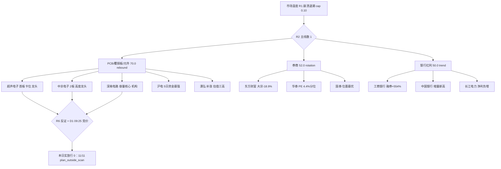

# 2026年11月23日 · **个股画像**

> **数据源新鲜度**: partial（主源 T+0，上游 R3 的 L2/L3 层缺失）
> **降级状态**: false（chart_vision 11/11、czsc 11/11、tushare 全接口 ok）
> **置信度**: 0.525（0.75 基准 × 0.7 新鲜度 × 1.0 一致度）

## 一句话结论

**11 只画像全部 research_only、零开仓资格**——PCB 反弹第一波的板型与席位都成立（超声电子首板 10:00 封、龙虎榜净买 4.41 亿全场第 1），但 alpha 上限 B 过不了 cap=0.10 的严档（须 alpha≥A），且 11/11 命中 `plan_outside_scan`；唯一 RR>2 的澳弘电子同时命中 `mid_laggard` 与估值三高。正确动作是空仓等修复窗口。

## 详细分析

### 一、先认市场：派发日里的"唯一板块效应"

11-20 是典型派发日：涨停 30 / 跌停 68 / 炸板 14（炸板率 31.82%，首次回落 35% 线下，前一日 47.17%），上涨 313:下跌 5236（占比 5.62%）、中位 -5.08%、成交放量至 14311 亿。主力全场 **-521.86 亿**，超大单 -172.89 / 小单 +484.71 → 机构砸盘、散户接货。炸板率下降不是因为修复，而是封板家数同时被压到 30 家（跌停仍是涨停的 2.27 倍）。

R1 判**崩溃退潮型 / 无主线 / 仓位上限 0.10**，R2 给出 `main_lines_count=1`（PCB/覆铜板/元件 70.0，layer=**rebound**、持有 ≤3 天）、`execution_pool=[]`、`research_only=true`，R7 判 **0 可执行**。三个上游单元给的是同一个结论：可以研究，不能开仓。

PCB 是当日**唯一有板块效应的方向**：印制电路板 47 只涨停 5 家（11-17 0 → 11-18 2 → 11-19 1 → 11-20 5）、元件 63 只涨停 6 家；单日主力 +20.39 亿 / +18.72 亿，超大单 18.99 / 18.62 对小单 -15.51 / -12.99（换手健康，非虚假成交）。但 3 日 +69.92 亿（3/3 天正）对上 5 日 -4.18 亿、20 日 -234.58 亿，且行业红盘率只有 42.6% / 34.9%（<50% 板块级门槛）→ **3 日回流 ≠ 趋势成立，是深跌反弹第一波**。同一时间，前一日抱团的半导体设备 -0.78 / 集成电路制造 -6.78 双双转负，抱团尾声确认。

### 二、再认个股：PCB 五票的分层

| 票 | 板型 | 顺位 | 一句话定性 | 档位 |
|---|---|---|---|---|
| 超声电子 | 首板 10:00 / 0 开板 / 封单 1.67 亿 | 龙一 | 板型+席位最硬，位置仅 23.6% | B / B+ |
| 中京电子 | 2 板 09:36 / 0 开板 / 封成比 20.6% | 龙二 | 身位最高但中报首亏、获利盘 98.9% | B- / B- |
| 深南电路 | 未封板 -0.59% | 容量核心 | 基本面最完整（ROE 22.2%/机构席 +2.48 亿） | B / B+ |
| 沪电股份 | 未封板 -0.96% | 观察 | 5 日资金最强 +13.83 亿，但 20 日 -10.85 亿 | B- / B+ |
| 澳弘电子 | 首板 10:04 / 封单 0.86 亿 | 补涨 | 估值三高（PE 88.1/PB 96.0/PS 91.0 分位） | C / B |

#### 首推票：超声电子（000823.SZ）

**大资金意图**：11-20 主力 +8.11 亿（净额率 37.96%，占流通市值 110.1 亿的 7.4%，本批强度第 1），但 10 日序列是"11-09 +5.67 → 六跌两涨累计 -4.10 → 11-20 单日 +8.11"，含义是**一日集中建仓而非连续吸筹**。龙虎榜买方前五：深股通 +1.49 / 开源证券西安西大街 +1.26 / 国泰海通上海江苏路 +0.86 / 国新证券北京 +0.77 / 机构专用 +0.43 亿——游资主导、机构小额承接；机构席 53 日累计 -7.06 亿（长窗口机构仍在减）。意图判断：**抢反弹第一波的资金，不是布局趋势的资金**。

**为什么走强**：R4 E005《全球电子协会 PCB 供应预警：常规材料短缺至少持续至 2027 上半年》直接点名，供给短缺 → 覆铜板+PCB 双主业同时受益；叠加公司三季报净利同比 +97.52%、单季 +276.24%（业绩与题材同向）。板型上是"首板卡位"：板块 5 家涨停、封单 1.67 亿、0 开板、顺位第 1。

**逻辑够不够硬**：**半硬**。硬的一面是催化剂真实（行业供给事件）+ 业绩兑现 + 席位净买全场第 1；软的一面是它站在 78.5% 套牢区下方（距 60 日高 -31.95%、MA50 上方 9.84% 压制）、换手 19.95% 浮筹密集、机构 0 覆盖、融券 15 日 +116.6%。结论是"反弹第一波的研究核心"，不是"趋势买点"。

**买入理由**：若要参与，唯一理由是"板型+席位+位置"三重共振——低位（30 日区间 23.6%）、首板封板质量本批第 1、龙虎榜净买全场第 1，且缠论虽在中枢下(-19.3)但当日长阳已收复 MA5/MA20。

**风险点**：①高位压力：MA60 19.64 与 20 日高 20.12 构成双重顶，识图明示"追高性价比低"；②浮筹：换手 19.95% + 获利盘 91.6%，次日任何低开都会触发集中兑现；③short_pressure：融资 15 日 -13.73%、融券 +116.58%；④板块宽度不达标（红盘率 42.6%）；⑤全市场炸板率 31.82%、跌停 68 家——大环境不允许追板。

**止损条件**：跌破 17.38（MA5）即视为"一日游"，止损无条件；RR 口径下买点收敛 17.95、止损 17.05（-5.0%），止损距收盘 -7.89%。

**可验证假设**：①次日竞价能否在 18.00 以上承接（强于收盘 -3% 以内）；②09:30-09:45 是否放量过 19.04（20 日高）；③PCB 链是否能再出 3 只以上涨停（板块效应需延续）；三条同时成立才谈"接力"，任一条破即证伪。

#### 次推票：深南电路（002916.SZ）

**大资金意图**：机构专用席当日 +1.99 / +0.49 亿、中信证券北京总部 +1.55 亿，深股通 -0.27 亿 → **机构在买、北向在卖**；机构席 53 日累计 +3.41 亿（本批唯一机构净买为正）。5 日主力 +9.05 亿（3/5 正）、20 日 +2.07 亿——本批唯一"5/20 日双正"的 PCB 票，但强度仅占流通 0.24%（大票属性）。

**为什么走强**：基本面 + 事件双落实——三季报净利 41.29 亿（+77.54%）、ROE 22.2%、PE 3 年 35.2% 分位；定增获批（弹药）+ 控股股东提议现金分红 + 400 条调研记录。它是"机构口径的 PCB 龙头"，涨的是估值修复与订单预期，不是情绪。

**逻辑够不够硬**：**最硬的一只，但结构最差**。财报轴全批最干净（商誉 0、质押 0.03%、CFO 19.59 亿），催化真实；但价格在 MA20 下方 5.45%、MA50 下方 30.83%、获利盘仅 21.5%（均价 277.98 vs 收盘 210）→ 上方 78.5% 套牢盘需要时间消化。**逻辑硬 ≠ 现在能买**。

#### 其余三票要点

- **中京电子**：板型最好（2 板、09:36:24 首封、0 开板、封成比 20.6%），但中报营收 24.45 亿、净利 **-1.17 亿**（首亏）、PS 89.7 分位、获利盘 98.9% → 纯情绪身位；买点收敛 12.99 后 RR 1.25。
- **沪电股份**：5 日主力 +13.83 亿本批第 1、PE 3 年 10.1% 分位、ROE 31.55%，但 20 日 -10.85 亿、融资 15 日 -26.54%、缩量反弹（量比 0.92）、缠论中枢下 -177.5，且命中 `mid_laggard` → 只观察。
- **澳弘电子**：唯一 RR>2（2.34），但 PE 88.1 / PB 96.0 / PS 91.0 三项 3 年高位、5 日 -7.4%（连跌后反抽）、53 日 14 次涨停、非两融标的、同链顺位第 4 且命中 `mid_laggard` → 降级观察。

### 三、次级线 6 只：政策落地但板块不确认

**券商三票（R2 52.0 分 · rotation）**：R4 E001 融资保证金 100%→80%（理论释放约 4000 亿）、E002 做市规则、E003 降费——政策三箭全部指向券商，但**证券 50 只当日红盘率仅 12.5%、中位 -1.27%、0 涨停**（11-17~11-20 连续 0 涨停）。三票（东财 +0.22 / 华泰 +1.10 / 国泰 +0.61）全部强于板块中位，属"个体强于板块"；资金端却相反：东财 5 日 -6.35 / 20 日 -20.54 亿（10 日里 9 天为负）、华泰 5 日 -2.39 亿、国泰当日仅 +0.04 亿。**利好不涨 = 市场没给这条线付钱**。另东方财富有 1 笔大宗 **-18.90%** 折价（distribution_alert，risk 强制 B-）。

**银行/红利三票（R2 50.0 分 · trend）**：银行 42 只红盘率 **54.8%**（全场最宽）、中位 +0.19%、0 涨停；工行 +3.30%、中行 +2.72%、长电 +2.40% 全部创 60 日新高，四周期均线多头排列 + 缠论站上中枢（confirmed）。但 PE/PB/PS 三项均在 3 年 **100% 分位**（长电 76.2/79.4/79.8），且融券 15 日：工行 **+554%**、中行 +68.2%、长电 +43.1%。这是"别人崩了"驱动的被动资金迁移，是防御抱团末段，不是进攻主线。

## 关键证据

- **证据 1（板块效应唯一来源）**：印制电路板 47 只涨停 5 家 + 元件 63 只 6 家，单日主力 +20.39 / +18.72 亿，超大单为正、小单为负；同时间半导体设备 -0.78 / 集成电路制造 -6.78 转负 → 抱团切换，资金从半导体切到 PCB（R7 + R2 breadth_matrix）。
- **证据 2（板型与席位）**：超声电子 10:00:45 首封 / 0 开板 / 封单 1.67 亿 / 龙虎榜净买 4.41 亿（机构 +0.43、深股通 +1.49）；中京电子 09:36:24 首封 / 2 板 / 0 开板 / 封单 2.04 亿（tushare limit_list_d + top_list）。
- **证据 3（机构口径分化）**：深南电路机构专用席 +2.48 亿（53 日 +3.41 亿，唯一净买正）；超声电子机构席 53 日 -7.06 亿（今日才 +0.43）→ 同一条线，机构买容量票、游资打身位票（top_inst 按 exalter 含"机构"分桶）。
- **证据 4（资金强度归一化）**：沪电 5 日 +13.83 亿 / 流通 1552 亿 = 0.89%（强度第 1）；超声 +7.62 / 110 亿 = 6.92%（强度第 1 于小票）；东财 -6.35 / 2465 亿 = -0.26% → 绝对额与强度必须分列看。
- **证据 5（估值分位两极）**：PE 3 年分位：东财 2.3% / 华泰 4.4% / 国泰 4.9% / 沪电 10.1% vs 工行 100% / 中行 100% / 澳弘 88.1% / 长电 76.2% → "便宜的没资金、有资金的不便宜"。
- **证据 6（RR 结构）**：11 只中仅澳弘 2.34 > 2；超声 1.88、华泰 1.63、沪电 1.31、中京 1.25；深南 0.91、工行 0.78、长电 0.61、东财 0.60、中行 0.59、国泰 0.49 → 目标位普遍被前高/MA60 锁死（judge_risk_reward 实算）。

## 数据源审计

| 源 | 状态 | 抓取时间 | 记录数 | 备注 |
|---|---|---|---|---|
| tushare 20 类接口 × 11 票 | 🟢 ok | 2026-11-23 06:46 | 11 票 / 日线 213 根 | 财报三表 2025Q1 起、公告 6 月起 |
| 东财 DC moneyflow_dc | 🟢 ok | 2026-11-23 06:46 | 21 交易日全市场 | 与 R7 逐票对齐（误差 0） |
| chart_vision 当日快照 | 🟢 ok | 2026-11-23 06:45 | 11/11 命中 | 快照 date=20261123 已校验（防跨日指针） |
| czsc 缠论（日线笔/中枢） | 🟢 ok | 2026-11-23 06:46 | 11/11 | 13-20 笔 / 4-6 中枢 |
| 龙虎榜逐日全市场 | 🟢 ok | 2026-11-23 06:47 | 53 个交易日筛选 | top_list + top_inst 按 code 筛 |
| 两融 margin_detail | 🟡 partial | 2026-11-23 06:46 | 10/11 票 | 澳弘电子不在两融标的（结构性缺失） |
| R7 sector_flows 板块资金 | 🟡 partial | 2026-11-23 06:42 | 14 行业 | 无证券/银行行 → 券商银行线级资金 unmapped |
| R3 情绪 L2/L3 层 | 🔴 stale | — | 0 | L2 断更、L3 永久下线 → 仅 L1 单源 |
| mcp__vibe_trading 交叉核验 | 🔴 missing | — | 0 | MCP 未配置，全部改用 tushare 主源 |

## 不确定性 / 反证

1. **"炸板率 31.82% 已回落到 35% 线下"不等于修复**：封板家数同时被压到 30 家、跌停 68 家仍是涨停的 2.27 倍。若 D1 误读为情绪修复，会重犯"主跌段抢反弹"的错。
2. **PCB 的 3 日资金无法反驳 5/20 日净流出**：+69.92 亿（3 日）vs -4.18 / -234.58 亿（5/20 日）。我把它判为"反弹第一波"而非"主线趋势"，若次日板块红盘率上 50% 且 5 日转正，这个判断需要修正。
3. **超声电子的"龙头"身份有口径分歧**：R2 判龙一是带动性口径；但机构席 53 日 -7.06 亿、机构覆盖 0 → 从机构视角它是游资票。同一只票两套认法，D1 需按模板（首板隔日 vs 总龙锁仓）取不同字段权重。
4. **深南电路 RR 0.91 是结构问题不是参数问题**：目标 213（60 分高抛）距买点 203.7 仅 +4.6%，5% 止损下 RR 必 <1；若用 222（突破位）则 RR 需放量突破才成立。
5. **银行/红利的高位拥挤未定价**：PE/PB 分位 100% + 融券暴增（工行 +554%），且当日上涨由"外部风险偏好崩塌"驱动；一旦科技链修复，这批资金会最快离开。我把它们留在观察池作防御强度温度计。
6. **两融与龙虎榜的机构口径**：机构净额只统计 exalter 含"机构"的席位；全席位合计与机构席差值可达 10 亿以上（超声今日全席位 +4.41 vs 机构 +0.43），两套数已分列字段，不得混用。
7. **东方财富 ps_ttm=66.13 明显偏离营收口径**，其估值结论以 PE（2.3 分位）/PB（13.3 分位）为主，PS 仅作参考——已在 `data_gaps` 留痕。

## 与其他 R/D/E 的关系

- **依赖（上游）**：`R1_style.json`（崩溃退潮 / 无主线 / cap 0.10）、`R2_main_sectors.json`（1 主线 + 2 次线 / 11 只 leaders / research_only）、`R3_sentiment.json`（恐惧 21.1 主跌 / 炸板率 31.82%）、`R4_news.json`（E001/E002/E003/E005/E006/E007）、`R7_capital_flow.json`（板块资金腿 / hot_money / watch_reserve / execution 0）。
- **被消费（下游）**：D1（`main_decision_v1`）取 `alpha_grade`/`risk_grade`/`rr`/`forbidden_check`/`leader_verdict`/`d1_stance` 做逐票闸门；R6（`analyze_devil_advocate_v1`）取 `fundamental_flags`（F3/F9/F10/V4/S1/short_pressure/distribution_alert）做模式七复核；E1 复盘取 `coverage`/`confidence_breakdown`。
- **交接边界**：R5 只给档位与结构判断，不出 entry/exit 价位；`buy/take/stop` 仅为 RR 计算口径，D1 在 09:25 竞价后另定实价。R6 的 `hard_reject` 优先级高于本文件的任何档位。

## Sub-Agent 元数据

- skill: analyze_stock_profile_v1@1.5
- artifact: data/research/20261123/R5_stock_profiles.json（机读契约，11 profiles / gate pass 0）
- 生成耗时: 约 9 分钟（fetch 108s + chart_vision 56s + compute/chanlun/score/emit 40s + 文字装配）
- model: deepseek-v4.1-flash