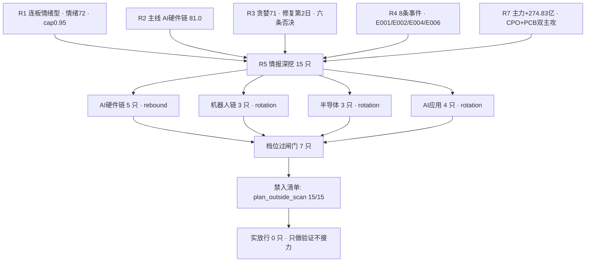

# 2026 年 11 月 24 日 · **个股画像**

> **数据源新鲜度**: partial（R3/R4/R7 上游 partial，R5 主源 ok）
> **降级状态**: false（vibe-trading 未配置属长期结构性缺失，已用 tushare 主源兜底）
> **置信度**: 0.525（0.75 基准 × 0.7 新鲜度 × 1.0 源一致性）

## 一句话结论

修复段第 2 日，钱只去「CPO/通信设备 + 元件/PCB」两条腿；15 只候选全部 research_only，档位过 7 只、禁入清单拦住全部，**实放行 0 只**——今日的正确动作是验证不接力、低开承接不追开盘价。

## 详细分析

### 一、先认市场：这是修复第 2 日，不是主升

11-23 的修复是"真修复"：涨停 152 / 跌停 7 / 炸板 27、炸板率 15.08%（前一日 31.82%、11-19 47.17%），上涨 4658 : 跌 783（占比 83.63%）、中位 +2.41%、成交 15639.6 亿（放量 1328.5 亿）。但主力账本只修了单日：当日 +274.83 亿（前 -521.86，摆动 +796.69），5 日仍是 -908.42、20 日 -3903.35（20 日仅 8 日为正）。四档结构为超大单 +265.96 / 大单 +8.86 / 小单 -47.00 —— 大单接、小单抛，是换手不是散户抬轿。

R1 判连板情绪型、情绪 72.0 贪婪、仓位上限 0.95；R3 判 `main_up` 但 `open_permission=false`（六条否决同时成立，其中最关键两条是"共振真等级只到 L1_only"与"R7 可执行候选 0"）。**阶段只定温度**：修复第 2 天是验证/分歧日，延续的前提是昨日涨停红盘率 92.9% 与广度 83.63% 不再走弱，任一转弱即按一日反抽处理、只做日内 T。

### 二、再认主线：一条主线、三条次线，钱与位置恰好相反

R2 只认一条可交易主线——AI 硬件链 81.0（CPO/光模块 + PCB/覆铜板/元件）。三条资金腿单日/3 日/5 日全正：通信设备 +69.15 / 元件 +54.33 / 印制电路板 +48.03 亿（3 日 +41.29 / +75.87 / +72.78；5 日 +40.38 / +101.93 / +100.84），结构全部是"换手（健康）"（超大单净买、小单净卖）。**但 20 日三条腿全是深度负（-217.54 / -186.13 / -135.70 亿）**，且全链龙头 60 日中位 -57.9%、layer=rebound。资金最强与位置最差，在本日恰好是同一条线。

三条次线全部是 rotation，不给买点：机器人链 69.0（涨停 68 家、概念热值 159182 双第一，但机械设备 3 日 -37.28 / 5 日 -67.42 亿）、AI 应用 63.0（传媒 5 日 -83.96 / 20 日 -133.58 亿）、半导体国产链 62.0（37 只涨停里申万半导体本体只 2 只，核心容量票北方华创 -6.55%、中芯国际 -3.08%）。**人气主战场 ≠ 资金主战场**，这一条在 R3、R7、R2 三处独立成立。

### 三、推理三问：赚钱效应到底在谁身上

**大资金意图**（新易盛）：当日主力 +22.94 亿、5 日 +35.90 亿、20 日 +33.61 亿，三项均为 CPO 链第一；资金强度 +1.58% of circ 是本批最高。大资金在赌"英伟达链修复的第一波弹性"，不是赌业绩（业绩已在 91 篇研报里充分定价）。但它 30 日龙虎榜 0 次——**这批钱没有席位指纹**，无法区分是机构回补还是量化做反弹，这是它最大的信息缺口。

**为什么走强**：三腿资金健康换手 + E006 的产业硬数据（PCB 订单同比 +56.1%、出货仅 +13.3%、交期 16-20 周）给了"缺货涨价"的事实支撑，叠加 E001 隔夜费半 +14.03% / NVDA +31.31% 的外部定价。**逻辑够不够硬**：资金硬、产业数据硬，但位置软（距 60 日高 -60.29%、周线深度空头）——所以只能按"修复第一波、持有≤3 天、破 MA5 无条件走"来定价，任何"趋势反转"的假设都不成立。

**为什么沪电是"最实的买盘"却过不了赔率**：机构专用席 30 日 +16.90 亿（全批第一）+ 龙虎榜全席位 +18.48 亿，是唯一有真实机构承接证据的票；但它当日只 +2.96%、未封板，目标位 83.87（60 分高抛）距买点 80.5 仅 4.2%，RR 0.84。**逻辑够不够硬**：买盘硬、板型软——它属于"等回踩承接"的容量核心，不属于"打板接力"的身位票。

**为什么中京板型最好却给了降级**：3 连板 + 首封 09:30:51 + 5 日主力 5/5 全正，板型维度全批第一；但 6 次开板、换手 30.34%、获利盘 98.9%（无任何套牢盘）、中报净利 -1.17 亿。R7 直接给"反复开板烂板 medium"派发警报。**逻辑够不够硬**：身位硬、质量软——身位股可以观察，不能作为接力标的。

### 四、首推票思维链（新易盛 300502.SZ）

**买入理由**：CPO 总龙的资金三重正（单日/5 日/20 日全为正，链内唯一）；PE 17.35 处 3 年 6.8% 分位、ROE 49.57%、净利同比 +79.74%，PEG 口径显著便宜；三条板块腿结构为健康换手而非单边出货。若明日低开不破前收（181 附近）并回踩 176 缩量承接，是修复段第 2 日唯一符合"低开承接"打法的位置。

**风险点**：位置是全批最差（距 60 日高 -60.29%、60 日 -56.20%），上方全是解套盘；30 日龙虎榜 0 次，主力席位无指纹；识图（bias 震荡 0.58）与缠论（中枢下 -503）同向偏空，属"超跌修复"而非反转；R4 E008（芯片出口管制法案 + SEC 调查英伟达会计问题）对 CPO 的净分削减 33%。

**止损条件**（研究口径，非开仓指令）：R5 复算止损距收盘 -9.02%（止损位 165 附近），对应纪律硬区间内；若收盘跌破 MA5 或失守 165/152，反弹逻辑作废、无条件离场。

**可验证假设**：①明日竞价不高开 >5%，且低开后 30 分钟内不破前收；②通信设备/元件/印制电路板三条腿当日主力仍为正；③CPO 概念当日净流入保持前 5。三条中任一不成立，本票即降为纯观察。

### 五、候选池与五档态度（15 只，全部不进）

| 票 | 线 | 综合/α/风险 | 龙头认定 | RR | 一句话证据 | 态度 |
|---|---|---|---|---|---|---|
| 新易盛 300502 | AI硬件 | 66.1 / B / B+ | 非涨停·容量核心 | 1.29 | CPO 三资金正（+22.94/+35.90/+33.61 亿） | **观察（研究首选）· 不进** |
| 沪电股份 002463 | AI硬件 | 65.6 / B / B+ | 非涨停·观察 | 0.84 | 机构席 30 日 +16.90 亿全批最实 | **观察 · 不进** |
| 风华高科 000636 | AI硬件 | 61.5 / B- / B+ | 补涨/跟风（14:08 尾盘） | 1.07 | 首板 0 开板封单 1.76 亿+榜 1.80 亿 | **观察 · 不进** |
| 中际旭创 300308 | AI硬件 | 60.6 / B- / B+ | 非涨停·容量核心 | 1.27 | 5 日 +30.49 亿，但 20 日 -10.32 亿 | **观察 · 不进** |
| 双环传动 002472 | 机器人 | 58.7 / B- / B+ | 分歧弱（触板未封） | 2.02 | 减速器中军 core 3/3、换手 5.46% | **观察 · 不进** |
| 中京电子 002579 | AI硬件 | 56.6 / B- / B- | 分歧弱（6 次开板） | 0.62 | 3 连板但获利盘 98.9%+中报亏损 | **降级观察 · 不进** |
| 浙文影业 601599 | AI应用 | 55.3 / B- / B- | 补涨/跟风 | 1.92 | 唯一 RR 双过线，但申万=纺织制造 | **观察 · 不进** |
| 宇树科技 688836 | 机器人 | 54.5 / C / B | 龙头（首板卡位型） | 1.74 | 人气 #1，5 日主力 -0.66 亿 | **观察 · 不进** |
| 龙版传媒 605577 | AI应用 | 52.5 / C / B- | 龙头（2 板，需竞价确认） | 0.94 | 心智锚 TOP1，30 日 16 次涨停 | **观察 · 不进** |
| 凡拓数创 301313 | AI应用 | 52.2 / C / B- | 龙头（2 板） | 2.00 | 机构当日 -1.68 亿，R7 诱多 high | **降级观察 · 不进** |
| 瑞芯微 603893 | 半导体 | 51.1 / C / B+ | 补涨/跟风 | 1.12 | 首板封单 2.13 亿，5 日 -1.26 亿 | **观察 · 不进** |
| 有研新材 600206 | 半导体 | 51.0 / C / B+ | 非涨停·无板型 | 2.16 | 5 日 +5.57 亿，PE 3 年 92.6% 分位 | **观察 · 不进** |
| 上海电影 601595 | AI应用 | 50.6 / C / B- | 补涨/跟风 | 0.97 | 正本业首板，净利同比 -86.72% | **观察 · 不进** |
| 华东重机 002685 | 机器人 | 49.7 / C / C | 孤军（行业仅 1 家） | 0.48 | 唯一 trend 层，但距 MA20 +48.22% | **观察 · 不进** |
| 盛剑科技 603324 | 半导体 | 48.7 / C / C | 孤军（5 板 0 开板） | 0.31 | 当日主力 -0.12 亿，机构 -0.40 亿 | **降级观察 · 不进** |

**龙头认定口径（v1.5）**：高度≥2 且首封≤09:45 且开板≤1 且板块涨停≥3 → 高度龙头；streak=1 + 板块≥3 + 封单≥0.5 亿 + 顺位≤2 → 首板卡位型龙头；开板≥4 → 分歧弱；板块≤1 → 孤军；首封≥14:00 → 补涨/跟风。本批 3 只龙头（宇树、龙版、凡拓）、2 只容量核心（新易盛、中际旭创）、2 只孤军（华东重机、盛剑科技）、2 只分歧弱（中京电子、双环传动）、4 只补涨/跟风（风华高科、瑞芯微、上海电影、浙文影业）、1 只非涨停观察（沪电股份）、1 只无板型（有研新材）。

## 关键证据

- 证据 1：CPO 总龙资金三重正 · 新易盛当日 +22.94 亿 / 5 日 +35.90 亿 / 20 日 +33.61 亿，与 R7 `research_candidates` 逐项对齐 · 来源 tushare moneyflow_dc + R7
- 证据 2：PCB 产业硬数据 · 订单同比 +56.1% 而出货仅 +13.3%、高多层交期 16-20 周 · 来源 R4 E006
- 证据 3：机构最实买盘 · 沪电股份机构专用席 30 日净买 +16.90 亿（全批第一）· 来源 tushare top_inst（仅 exalter 含"机构"席位）
- 证据 4：板块资金健康换手 · 通信设备/元件/印制电路板超大单分别 +57.99 / +38.21 / +33.17 亿、小单 -21.05 / -41.39 / -36.63 亿 · 来源 R7 sector_flows
- 证据 5：人气与资金背离 · 宇树科技人气 53→#1（Δ+52），但 5 日主力 -0.66 亿（正 2/5）、20 日 -12.68 亿 · 来源 R7 hot_money + moneyflow_dc
- 证据 6：机构诱多 · 凡拓数创当日机构专用席 -1.68 亿而股价 20cm 涨停（R7 severity=high）· 来源 R7 hot_money.distribution_alerts
- 证据 7：技术面同向偏空 · 新易盛/中际旭创/沪电/风华缠论均在最近中枢下方（-503.4 / -575.4 / -163.6 / -103.7），与识图"修复非反转"一致 · 来源 czsc + chart_vision 快照

## 数据源审计

| 源 | 状态 | 抓取时间 | 记录数 | 备注 |
|---|---|---|---|---|
| tushare pro（20 类接口 × 15 票） | 🟢 ok | 2026-11-24 07:30 | 15 票 | 0 error（fetch log DONE errors=0） |
| 东财 DC moneyflow_dc | 🟢 ok | 2026-11-24 07:28 | 21 日 × 全市场 | 与 R7 逐票精确对齐 |
| chart_vision 快照 | 🟢 ok | 2026-11-24 07:20 | 37 | 本批 15/15 命中，date=20261123 校验通过 |
| czsc 缠论 | 🟢 ok | 2026-11-24 07:31 | 15 | 宇树科技仅 2 笔、无中枢（次新） |
| tushare 龙虎榜 | 🟢 ok | 2026-11-24 07:31 | 54 日 / 108 行 | 逐日全市场拉取后筛，机构席口径单列 |
| tushare 财报三表 | 🟢 ok | 2026-11-24 07:32 | 15 | 2025Q1 起 |
| cninfo/anns_d 公告 | 🟢 ok | 2026-11-24 07:33 | 751 | 2026-06 起 |
| R7 sector_flows | 🟡 partial | 2026-11-24 04:52 | 14 | 半导体无独立行业腿 → unmapped_degraded |
| R1/R2/R3/R4 artifacts | 🟡 partial | 2026-11-24 06:14~07:24 | 4 | R3 真等级 L1_only（L2 断更、L3 下线）、R4 freshness=partial |
| mcp__vibe_trading | 🔴 error | — | 0 | MCP 未配置，第三方交叉核验通路缺失，tushare 主源兜底 |

## 不确定性 / 反证

1. **资金强 ≠ 位置好**：三条腿 20 日仍全负（-217.54 / -186.13 / -135.70 亿），本批 5 只 AI 硬件票 layer 全为 rebound。若明日广度跌破 50% 或炸板率回到 35% 上方，全批降为纯观察。
2. **新易盛没有席位指纹**：30 日龙虎榜 0 次，+22.94 亿的构成无法拆分，本报告按"资金可见但性质不可见"处理，不给研究首选以上的档位。
3. **红旗阈值套用偏差**：中际旭创 V1（PE 3 年 4.8% 分位 + ROE 35.8% + 净利 +211.8%）是"低 PE 周期顶"模板误套到成长期硬件；新易盛/沪电 V4（CFO/净利 0.47/0.48）是利润含金量观察项而非否决项。R6 复核时须按行业属性重判，不得直接 hard_reject。
4. **次新股样本不足**：宇树科技上市仅 63 个交易日，PE 510.86 的 3 年分位只有 63 个样本，估值分位参考意义弱；60 日趋势层按 63 根计算。
5. **口径分歧留痕**：中京电子全席位 30 日 +11.98 亿 vs 机构专用席 -0.98 亿；瑞芯微全席位 -5.87 亿 vs 机构席 +2.36 亿——两处均分列，不混算。
6. **四只不在两融标的**（盛剑/龙版/上海电影/浙文）→ `margin_15d_trend` 记 not_a_margin_target，属结构性缺失，不视为抓取失败。

## 与其他 R/D/E 的关系

- 依赖：`R1_style.json`（风格与 cap）、`R2_main_sectors.json`（候选池与线级宽度）、`R3_sentiment.json`（情绪阶段与禁投段）、`R4_news.json`（事件催化）、`R7_capital_flow.json`（资金腿与派发警报）、`data/raw/20261123/chart_vision_snapshot.json`（识图）。
- 被消费：D1（canghai-plan）取 `profiles[].alpha_grade / risk_grade / forbidden_check / rr` 做逐票门禁；R6（反证）读本 artifact 的 `fundamental_flags` 与 `leader_verdict` 做六类反证；E1（canghai-review）回看档位与实盘结果差。

## Sub-Agent 元数据

- skill: analyze_stock_profile_v1（v1.5 龙头判定维度）
- artifact: data/research/20261124/R5_stock_profiles.json（458,508 B，15 profiles）
- 生成耗时: 数据拉取约 210 秒 + 缠论/计算/打分/装配约 40 秒
- model: deepseek-v4.1-flash
- 校验: `scripts/research/check_r5_20261124.py` — ERRORS: none（档位过闸门 7/15、实放行 0/15）
