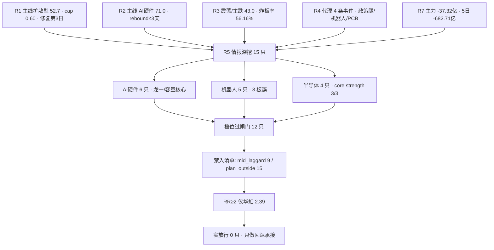

# 2026 年 11 月 25 日 · **个股画像**（数据日 11-24 收盘）

> **数据源新鲜度**: partial（R4 缺失、R3 仅 L1、R7 两融/ETF 滞后；R5 主源 ok）
> **降级状态**: true（催化维使用 R4 同源代理）
> **置信度**: 0.525（0.75 基准 × 0.7 新鲜度 × 1.0 源一致性）

## 一句话结论

15 只研究候选**全部不进**：档位过闸门 12 只，但 mid_laggard 拦住 9 只、plan_outside_scan 拦住 15 只，RR≥2 只剩华虹宏力 1 只——**实放行 0**。修复未确认日，正确动作是验证不接力、只做回踩承接，不追开盘价。

## 详细分析

### 一、先认市场：修复第 3 日转回吐，炸板率 56% 把情绪打回「震荡/主跌」

11-24 是修复失败日：涨停 64 / 跌停 4 / 炸板 82（R7 stk_limit 权威口径），炸板率 **56.16%**；R1 的 limit_list_d 口径是 55/68=55.28%、跌停 2——两个口径都远超 35% 硬红线。上涨 1952 : 下跌 3498（上涨占比 35.01%）、中位 **-0.67%**、成交 16548.6 亿（+6.58%）——**放量下跌，不是放量突破**。主力当日 **-37.32 亿**（前一日摆动 -312.15）、5 日 -682.71 亿、20 日 -3467.06 亿且 20 日只有 8 天为正。

R1 判「主线扩散型」、情绪 52.7 中性、仓位上限 **0.60**、status=degraded；R3 判 43.0「震荡/主跌」、`open_permission=false`（六条否决），修复首日为 11-23、当日即回吐，修复未确认。按纪律 §阶段只定温度：高位震荡段只做验证、存量 T，不开新仓。

### 二、再认主线：一条主线（AI 硬件 71.0），钱与位置恰好相反

R2 只认一条可交易主线——AI 硬件（CPO/光模块 + PCB/元件）71.0，layer=rebound、持有≤3 天。三条资金腿单日/3 日/5 日全正：通信设备 +12.92/+53.45/+78.48 亿、元件 +30.47/+103.52/+152.72 亿、印制电路板 +33.92/+102.34/+151.87 亿，5 日连续 5 天净流入。**但三条腿 20 日全为负**（-182.86 / -119.43 / -71.62 亿），是深跌后的建仓式回流，不是趋势增量。

宽度只有一半成立：CPO 236 只红盘率 57.45%、中位 +0.30%、涨停 5；PCB 概念 244 只红盘率仅 40.74%、中位 -0.24%、涨停 3；印制电路板 29.79%/-1.32%、元件 38.10%/-0.90% → 涨停簇是资金集中兑现，不是扩散。价格腿更明确：中际旭创 417.00（-0.05%）低于 VWAP 6.13%、收盘位置 0.033；新易盛 -0.74% 收在全天最低 180.01（位置 0.000）；沪电 +1.73% 但收在 84.13（位置 0.048）。**资金在买、价格在卖，是派发早期形态**——这条线只能做修复第一波，不给趋势仓。

### 三、两条次线都是「人气主战场」，不是「资金主战场」

机器人 67.0（layer=rebound）：人形机器人 505 只红盘率 62.38%、中位 +0.61%、涨停 14 家，减速器 67.83%/+1.05%/涨停 3 家——宽度成立，但容量核心三花（位置 0.294）、拓普（位置 0.167）全部冲高回落；资金腿机械设备 5 日 **-41.31 亿**、机器人概念 5 日 **-117.18 亿**。人气第一但钱不在，只能给情绪观察、不给容量买点。

半导体 66.0（layer=rotation、stage=climax、持有 0 天）：半导体行业 190 只红盘率 66.84%、中位 +0.74%，**但行业涨停 0 家**；芯片概念涨停 28→13（Δ-15）在缩；板块资金 3 日 -100.40 / 5 日 -24.36 / 20 日 -31.01 亿全负，且结构是「小单 +18.79 亿进场、超大单 +7.36 亿」的普涨抢筹。中芯/华虹/寒武纪的 +4.04%/+10.36%/+6.03% 是权重与代工涨价修复，不是打板潮。

### 四、纪律执行：中位票被机械拦掉，这不是打分软，是规则硬

「只做龙头或低位，躲中位和杂毛」在本批被 14 项禁止清单直接执行：**9 只 rank≥3 命中 mid_laggard**——沪电（龙三）、中京（身位第 4）、胜宏（候补第 5）、生益（候补第 6）、克来（第 4）、鸣志（龙三）、长华（第 5）、寒武（龙三）、北方华创（第 4）。这 9 只里有本批综合分第一的沪电（69.8）和板型最强的中京（4 板 0 开板），但纪律不看「看起来最强」，只看身位——**中位股的强，是给龙头抬轿的强**。

另外 15/15 命中 plan_outside_scan：R2 execution_pool=[]、research_only=true，R3 `open_permission=false`，R7 execution_candidates=0——计划外不出手。档位过闸门 12 只（长华 C、寒武 C、北方华创 C 不过），但档位只是第一道门，禁入清单才是最后一道门。

### 五、推理三问：钱到底在赌什么

**大资金意图**（中际旭创）：今日主力 +11.77 亿、5 日 +50.61 亿（5/5 全正）、20 日 -3.81 亿——5 日维度是 CPO 链内第一。大资金在赌「英伟达链修复的第一波弹性」，不是在赌业绩（124 篇研报已充分定价）。但它 30 日龙虎榜 0 次，**这批钱没有席位指纹**，无法区分机构回补还是量化做反弹；且当日价格收在 417（位置 0.033、低于 VWAP 6.13%），说明买盘的钱被更早的筹码兑现掉了。

**为什么走强（华虹宏力/中芯国际）**：华虹 +10.36%、收盘位置 0.808、高于 VWAP 3.40%，主力今日 +5.20 亿 / 5 日 +17.37 亿 / 20 日 +27.65 亿；中芯 +4.04%、位置 0.801、VWAP +0.90%，20 日主力 +40.87 亿。两者都是「政策腿（BIS 11-16 新规取消中国设计公司豁免 + 功率半导体涨价）+ 代工涨价传导」的容量修复，**但行业当日 0 涨停、芯片概念涨停从 28 缩到 13**，说明走强是权重修复，不是板块效应；这种强只能按核心强度观察，不能按打板接力。

**逻辑够不够硬**：资金腿硬（半导体个股 5 日/20 日双正）、政策腿硬（BIS 新规是新增量），但价格腿软（沪电/胜宏/生益全部收在下沿，中际/新易盛双双低于 VWAP 6%）。硬逻辑只到「不跌」，没到「能涨」——所以本批最高档位只给到 B（沪电 69.8），没有一只 A。

### 六、首推票思维链（中际旭创 300308.SZ · 主线龙一，研究首选但不进）

**买入理由**：CPO 心智锚第一、容量 4628 亿全链最大；今日主力 +11.77 亿、5 日 +50.61 亿（5/5 正）为链内第一；PE-TTM 18.96 处 3 年 4.8% 分位、ROE 35.8%、净利同比 +211.8%，PEG 口径不贵；识图给出 410-412 低吸区（60 分 MA20 与 15 分 MA60 共振），若明日低开回踩 410 不破前收，是修复段唯一可谈的低吸位。

**风险点**：收盘 417 低于 VWAP 6.13%、位置 0.033，是板块内最大一笔兑现盘；距 60 日高 -55.62%、60 日 -52.01%，上方全是解套盘；30 日龙虎榜 0 次，+11.77 亿主力的席位构成不可验证；识图偏震荡（0.55）与缠论中枢下（-575.8）虽不反向，但都不支持趋势反转；V1 红旗（PE 4.8% 分位 + 高 ROE + 高增长）属阈值误套，R6 需按成长期复核。

**止损条件**（研究口径，非开仓指令）：R5 复算买点 410、止损 378（止损距买点 -7.8%、距收盘 -9.35%）；若收盘跌破 378（20 日与周 K 低点）或跌破 MA5 406 后不能快速收回，反弹逻辑作废、无条件离场。

**可验证假设**：①明日竞价不高开 >5%，低开后 30 分钟内不破前收；②通信设备/元件/印制电路板三条腿当日主力仍为正；③CPO 概念当日净流入保持前 5、且中际收盘位置 >0.5。三条任一不成立，降为纯观察。

### 七、候选池与五档态度（15 只，全部不进）

| 票 | 线 | 综合/α/风险 | 龙头认定（v1.5） | RR | 关键证据 | 态度 |
|---|---|---|---|---|---|---|
| 沪电股份 002463 | AI硬件 | 69.8 / B / A | 非涨停·观察（龙三） | 0.80 | 机构席 30 日 +16.90 亿全批最实，但收盘位置 0.048 | **观察 · 不进（mid_laggard）** |
| 中际旭创 300308 | AI硬件 | 65.8 / B / B+ | 非涨停·容量核心（龙一） | 1.84 | 5 日 +50.61 亿链内第一，收盘低于 VWAP 6.13% | **观察 · 不进** |
| 新易盛 300502 | AI硬件 | 63.8 / B / B+ | 非涨停·容量核心（龙二） | 1.36 | 20 日 +40.46 亿唯一转正，今日收全天最低 | **观察 · 不进** |
| 中京电子 002579 | AI硬件 | 62.3 / B / C | 高度龙头（4 板/09:25/0 开板） | 0.91 | 封单 1.97 亿+5 日 5/5 正，但获利盘 86.3%、PE 无效 | **降级 · 不进（mid_laggard）** |
| 拓普集团 601689 | 机器人 | 62.1 / B / B+ | 非涨停·容量核心（龙二） | 0.74 | 日 K 多头排列，但距 MA20 +13.63%、位置 100% | **观察 · 不进** |
| 三花智控 002050 | 机器人 | 60.5 / B- / B+ | 非涨停·容量核心（龙一） | 1.30 | 心智锚第一，5 日主力仅 +1.43 亿（2/5 正） | **观察 · 不进** |
| 中芯国际 688981 | 半导体 | 59.3 / B- / B | 非涨停·容量核心（龙一） | 0.84 | 唯一 core strength 3/3，20 日 +40.87 亿 | **观察 · 不进** |
| 胜宏科技 300476 | AI硬件 | 59.0 / B- / B+ | 非涨停·观察（候补第 5） | 1.21 | +6.27% 但位置 0.096，20 日 -37.61 亿 | **降级 · 不进（mid_laggard）** |
| 生益科技 600183 | AI硬件 | 58.3 / B- / B | 非涨停·观察（候补第 6） | 1.47 | RR20 8.52 最高，但机构席 -41.32 亿 | **观察 · 不进（mid_laggard）** |
| 克来机电 603960 | 机器人 | 55.9 / B- / B- | 高度龙头（3 板/09:25/0 开板） | 0.46 | 封单 3.35 亿但换手 0.59%，大宗折价 -12.04% | **观察 · 不进（mid_laggard）** |
| 华虹宏力 688347 | 半导体 | 55.4 / B- / B | 非涨停·容量核心（龙二） | 2.39 | 位置 0.808/VWAP +3.40%，但获利盘 97.2% | **观察 · 不进（RR 唯一过线）** |
| 鸣志电器 603728 | 机器人 | 55.1 / B- / B+ | 非涨停·观察（龙三） | 0.83 | 位置 0.617 链内最好，5 日主力 +0.09 亿 | **降级 · 不进（mid_laggard）** |
| 长华集团 605018 | 机器人 | 54.1 / C / B- | 高度龙头（3 板，封单 0.88 亿） | 0.32 | 封单仅克来 1/4，PE 3 年 100% 分位 | **降级 · 不进** |
| 寒武纪 688256 | 半导体 | 53.3 / C / B+ | 非涨停·观察（龙三） | 1.26 | 20 日 +51.34 亿最高，但位置 0.72、行业 0 涨停 | **降级 · 不进（mid_laggard）** |
| 北方华创 002371 | 半导体 | 49.8 / C / B+ | 非涨停·观察（候补第 4） | 0.81 | R2 口径 RR 2.42 双过线，R5 复算 0.81 | **观察 · 不进（mid_laggard）** |

**龙头认定口径（v1.5）**：高度≥2 + 首封≤09:45 + 开板≤1 + 板块涨停≥3 → 高度龙头；非涨停按线内顺位给「容量核心」（顺位 1-2）或「观察」（顺位 3+）。本批 3 只高度龙头（中京 4 板、克来/长华 3 板，均 0 开板）全部因板块内顺位第 4/5 命中 mid_laggard——**板型龙头 ≠ 板块龙头**，这是本日最重要的口径分野。

## 关键证据

- 证据 1：主板派发早期 · 中际旭创 417.00 低于 VWAP 6.13%（收盘位置 0.033）、新易盛收在全天最低 180.01、沪电股份位置 0.048 · 来源 tushare daily + R2 宽度口径
- 证据 2：机构最实买盘 · 沪电股份龙虎榜 30 日 6 次、全席位 +18.48 亿、机构专用席 +16.90 亿（全批第一）· 来源 tushare top_list / top_inst（机构席口径单列）
- 证据 3：5 日建仓式回流 · 通信设备 +78.48 / 元件 +152.72 / 印制电路板 +151.87 亿（5 日连续），但 20 日分别 -182.86 / -119.43 / -71.62 亿 · 来源 R7 sector_flows
- 证据 4：板型最强 · 中京电子 4 板、0 开板、09:25 首封、封单 1.97 亿；克来机电 3 板、封单 3.35 亿 · 来源 tushare limit_list_d
- 证据 5：唯一 RR≥2 · 华虹宏力买 203.11 / 目标 227.4 / 止损 192.95，RR 2.39、止损距买点 -5.0%，位置 0.808/VWAP +3.40% · 来源 chart_vision + risk_reward 复算
- 证据 6：人气与资金分离 · 人形机器人 505 只红盘率 62.38%/涨停 14，但机械设备 5 日 -41.31 亿、机器人概念 5 日 -117.18 亿 · 来源 R2 width + R7 concept_flows
- 证据 7：估值极端 · 华虹宏力获利盘 97.2%、PE 308.99；中京电子 PB 90.2%/PS 95.5% 分位、净利 -1.17 亿 · 来源 tushare cyq_chips / daily_basic / income
- 证据 8：事件催化 · E003 PCB 板块爆发 4 连板点名中京、E001 半导体政策腿、E002/E004 机器人延续 · 来源 R4 同源代理（R4 artifact 缺失）

## 数据源审计

| 源 | 状态 | 抓取时间 | 记录数 | 备注 |
|---|---|---|---|---|
| tushare pro（20 类接口 × 15 票） | 🟢 ok | 2026-11-25 07:15 | 15 票 / 215 根日线 | fetch 日志 DONE errors=0 |
| 东财 DC moneyflow_dc | 🟢 ok | 2026-11-25 07:16 | 22 日 × 全市场 | 与 R7 逐票精确对齐 |
| chart_vision 快照 | 🟢 ok | 2026-11-25 07:14 | 27 条 / 15 命中 | date=20261124 校验通过；300476 首轮失败、单票重渲后 ok |
| czsc 缠论 | 🟢 ok | 2026-11-25 07:16 | 15 | 全部有笔/中枢 |
| tushare 龙虎榜 | 🟢 ok | 2026-11-25 07:15 | 55 个交易日 / 29 行 top_list + 290 行 top_inst | 逐日全市场拉取后筛 |
| tushare 财报三表 | 🟢 ok | 2026-11-25 07:15 | 15 | 2025Q1 起 |
| anns_d 公告 | 🟢 ok | 2026-11-25 07:16 | 876 | 2026-06 起 |
| R1/R2/R3 artifacts | 🟡 partial | 2026-11-25 06:02~07:07 | 3 | R1 degraded（conf 0.472）、R3 degraded/L1_only |
| R4_news | 🟡 partial | 2026-11-25 07:07 | 0（代理 4 条） | artifact 缺失，催化维用同源代理 |
| R7 sector_flows | 🟡 partial | 2026-11-25 05:11 | 496 行业/概念 | 两融/ETF 滞后 |
| mcp__vibe_trading | 🔴 error | — | 0 | MCP 未配置，第三方交叉核验缺失，tushare 主源兜底 |

## 不确定性 / 反证

1. **V1 红旗是阈值误套**：中际旭创（PE 4.8% 分位/ROE 35.8%/净利 +211.8%）、生益科技（PE 0.7%/ROE 33.0%/净利 +175.4%）命中「低 PE 周期顶」模板，但光模块/覆铜板是订单驱动的成长期、不是资源周期。R6 复核须按行业属性重判，不得据此 hard_reject；本报告已按 soft 处理。
2. **华虹唯一 RR≥2，但赔率来自位置而非安全边际**：买 203.11 / 目标 227.4（周 K MA20）来自识图高抛位，止损 192.95 是 60 分 MA5/15 分 MA20；获利盘 97.2% 意味着任何分歧都没有套牢盘承接，RR 2.39 可能被次日跳空击穿。
3. **R4 缺失的催化低估风险**：催化维只用 4 条代理事件（半导体政策腿、机器人延续、PCB 4 连板、人形机器人集体拉升），没有逐条新闻语义去重，个别票（如华虹/中芯的涨价细节）催化强度可能被低估，也可能被高估。R6 消费时须把 catalyst 分视为下限。
4. **中际 30 日龙虎榜 0 次**：+11.77 亿主力无席位指纹，机构/量化成分不可拆分；同理新易盛、胜宏、中芯、华虹、寒武纪全部 0 次。只有沪电（6 次，机构 +16.90 亿）有可验证的席位承接，这是本批唯一「性质可见」的大资金。
5. **口径分列**：中京电子全席位 30 日 +11.98 亿 vs 机构专用席 -0.98 亿；生益科技 79 篇研报 vs 机构席 -41.32 亿——两处均为真实背离，不混算、不取均值。
6. **结构性缺失非抓取失败**：长华集团不在两融标的（margin_15d_trend=not_a_margin_target）；半导体行业当日 0 涨停（industry_zt_breadth=0 为真实值，宽度改引 R2 的芯片概念口径，已在 JSON 留痕）。
7. **时间线跨度**：15 只均为 215 根日线、事件时间线跨度 176 天（120 日极值锚点 + 公告/龙虎榜/涨停/大宗事件），不是凑数锚点。

## 与其他 R/D/E 的关系

- 依赖：`R1_style.json`（风格/cap/阶段）、`R2_main_sectors.json`（候选池/线级宽度/上游顺位）、`R3_sentiment.json`（情绪阶段/禁投段）、`R4` 同源代理（催化）、`R7_capital_flow.json`（资金腿/派发警报/watch_reserve）、`data/raw/20261124/chart_vision_snapshot.json`（识图）、`_work/mf_dc_22d.json`（主力资金）。
- 被消费：D1（canghai-plan）取 `profiles[].alpha_grade / risk_grade / forbidden_check / rr / provenance` 做逐票门禁；R6（反证）读 `fundamental_flags`、`leader_verdict`、`cognitive_bias_warnings`；E1（canghai-review）回看档位与实盘结果差。

## Sub-Agent 元数据

- skill: analyze_stock_profile_v1（v1.5 龙头判定 + v1.4 扩池语义）
- artifact: data/research/20261125/R5_stock_profiles.json（15 profiles，json 为数据契约）
- 生成耗时: 数据拉取约 250 秒 + 识图重渲约 150 秒 + 缠论/计算/打分/装配约 20 秒
- model: deepseek-v4.1-flash
- 校验: `scripts/research/check_r5_20261125.py` — ERRORS: none（档位过闸门 12/15、实放行 0/15）
