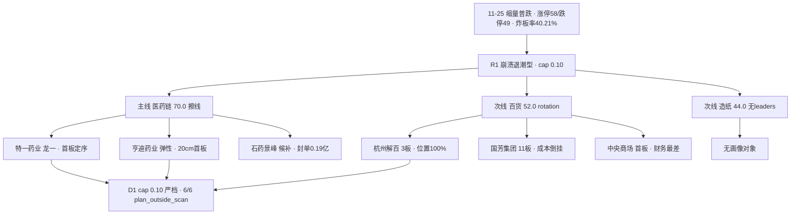

# 2026-11-26 · **个股画像**

> **数据源新鲜度**: partial  
> **降级状态**: false（chart_vision 6/6、czsc 6/6、tushare 20 类接口 0 error；R3 单元级降级已透传，不阻断 R5）  
> **置信度**: 0.525（0.75 × 0.7 × 1.0）

## 一句话结论

**退潮第 2 日只有一条「擦线」主线（医药链 70.0）和一条「玄学」次线（百货 52.0），6 只候选全部只有研究资格、没有开仓资格**——最硬的板是杭州解百（封单 2.46 亿 / 4% 流通）却位置 100%、RR 0.31；资金最实的是国芳集团（30 日席位净 +4.61 亿）却成本倒挂；唯一受 R2 授龙一的是特一药业，但龙虎榜 0 次、主力 5 日仅 +0.23 亿。**本批最高 α 只到 B，RR≥2 为 0 只，D1 cap 0.10 严档档位过闸门 0/6。**

## 详细分析

### 一、先认市场：缩量普跌第 2 日，炸板率 40.21% 把情绪按在「震荡/主跌」

11-25 全市场涨停 58、跌停 49、炸板 39（R7 stk_limit 权威口径）→ 炸板率 **40.21%**，高于 35% 硬红线；另两口径 xtick 39.36%、R1 limit_list_d 37.04%（官方漏收 7 涨停/6 跌停/9 炸板），**取严者 40.21% 仍破线 → 候选按纪律砍半**。宽度上，上涨 567 : 下跌 4588（上涨占比 10.51%）、中位 **-3.68%**、成交 13829.3 亿（-16.43%）；高度只有 5 板 1 只，梯队 1 板 37 / 2 板 5 / 3 板 6 / 4 板 2 / 5 板 1。

资金端更直白：主力 **-490.23 亿**（摆动 -452.91）、5 日 -1087.73、20 日 **-4194.29（仅 7/20 日为正）**。钱在撤离科技硬件——电子 -209.37 亿（超大单 -116.70 / 小单 +166.52 = 典型派发）、半导体 -126.22 亿；防御端只有食品饮料 +6.25 亿、造纸 +5.70 亿、化学制药 +4.69 亿接住。R1 据此判**崩溃退潮型**、情绪 31.9 恐惧、high_chop 第 2 天，`position_cap_suggestion=0.10`（风格 0.15 − 情绪档 0.05 − 阶段 0.05 − 广度 0.05，触主跌下限）。

### 二、再认主线：医药链 70.0 是「四腿成立 + 宽度否决」的擦线研究级

R2 把它判为主线但不是可交易主线（`main_line_status=擦线·研究级未确认`、`tradable_today=false`、layer=rotation、holding_days_max=0）。四条腿同时成立：

1. **涨停腿**：13 家涨停（化学制药 6 + 医药商业 4 + 中成药 3），与人工智能并列当日第一，内部 **12/13 首板、最高仅 2 板（天圣）**——身位极低，没有高位老龙包袱；
2. **价格腿**：流感概念 +0.58%，是全市场中位 -3.68% 下的逆势正涨幅；
3. **资金腿**：流感概念 +8.75 亿（超大单 +9.54 / 小单 -6.28 = 换手健康）、中药概念 +8.62 亿（超大单 +10.78 为全概念第 2）；
4. **叙事腿**：R4 E20261126_005 strength=high 正面、净分 +0.602（仅次银行回购 +0.689），叠加赛诺菲 410 亿美元现金收购呼吸药企 + 证券时报直接点名 002728。

**但宽度是硬伤**：THS 流感 185 只红盘率 43.8% / 中位 -0.35%、DC 流感 132 只 43.9% / -0.41%、化学制药 161 只 30.8% / -1.10%、医药生物 512 只 26.6% / -1.44% → 四口径全部 <50% 且中位为负，**涨停潮是 13 只票被点名，不是板块在扩散**。加上 limit_cpt 流感/化学制药/创新药都只在 11-25 首次上榜（前 11 个交易日零记录），按「连续 ≥2 日才算主线候选」属**一日游风险最高一档**；R7 三条腿 d1 +10.32 亿 / d5 -30.27 亿 → 单日新钱、存量撤离，属对抗不属趋势资金。

### 三、次线：百货 52.0 宽度最健康，但叙事是玄学、龙头已 3 板

百货/一般零售是当日唯一「题材连续 2 日 + 宽度成立」的组合：lianban 零售 11-24 1 家 → 11-25 4 家（expanding）；THS 百货 41 只红盘率 **61.0%** / 中位 +0.975% / 涨停 4 / 零跌停（全市场唯一健康宽度）；资金三档全正——一般零售 +4.93 亿（3 日 +5.02 / 5 日 +3.96）、百货 +4.35 亿（5 日 +6.62）、新零售概念 +11.22 亿（全概念第 1）。但叙事是「杭州北高峰财神庙重开」的玄学 + 本地消费，R3 判 late，龙头杭州解百已 3 板。

第 2 条次线造纸 44.0 只有资金腿干净（造纸 +5.70 / 特种纸 +5.59，5 日连续为正）而宽度 13.0% / -2.47% 完全未建立，R2 自列 `leaders=[]` → 无票可画像。

### 四、纪律执行：为什么 6 只全部没有开仓资格

这不是打分偏软，是三道硬门同时关：

- **门 1 档位**：D1 实算 cap=0.10 ≤0.40 → 走**严档**（alpha≥A 且 risk≥B）。本批最高 α 只到 B（亨迪 63.7 / 特一 62.8），**过闸门 0/6**；
- **门 2 禁止清单**：6/6 命中 `plan_outside_scan`（R2 execution_pool=[] + research_only=true + tradable_today=false、R3 open_permission=false、R7 execution_candidates=0）；另有 2 只命中 `mid_laggard`（中央商场、石药景峰，均为板块内顺位 3）；
- **门 3 盈亏比**：RR≥2 **0 只**（最高国芳 1.77、特一 1.22、亨迪 0.72、杭州解百 0.31）。原因是涨停把「目标价」与「现价」压在同一天：杭州解百目标 8.35 = 收盘价，分母消失；亨迪目标 11.28 距买点仅 +4.6%。

### 五、推理三问：钱到底在赌什么

**大资金意图**（医药链整体）：今日 +8.75 亿（流感概念）却是 5 日 -18.12 亿、20 日 -68.91 亿——**单日新钱进场、存量仍在撤离**，这个组合只说明一件事：**游资在做首板定序，不是机构在做板块**。证据有三：①13 家涨停里 12 家首板、最高 2 板，没有一只是「趋势票放量突破」；②亨迪的龙虎榜 5 席全部是营业部（国泰海通江苏路 +0.24 / 大连路 +0.10、中信东阳 +0.10…），机构专用席 0、深股通还是 -0.05；③特一拿到龙一却 30 日 0 次上榜，+0.53 亿主力连席位指纹都没有。**钱在赌「流感季 + 赛诺菲并购」这个叙事能被第二天的竞价接力，不是赌业绩（特一净利同比 -24.18%）。**

**为什么走强（亨迪药业 / 杭州解百）**：亨迪是 20cm 板里唯一「主力今日/5 日/20 日三口径全正」（+0.81 / +0.62 / +0.52）+ 净利同比 +89%、Q3 单季 +299% 的票，所以它 09:33 封板（全链第 3 家：特一 09:31:33 → 石药 09:32:51 → 亨迪 09:33:24）、收 20 日新高；杭州解百是「宽度最好 + 资金最连续（5 日 4/5 正、20 日 +1.40 亿）」的次线龙头，封单 2.46 亿（4.0% 流通）为全市场涨停第 3 大封单、封单占流通比第 2（克来机电 3.06 亿/6.27% 在前）。**但两者走强的性质不同：亨迪是「业绩 + 20cm 弹性」的个股强，杭州解百是「板块唯一正涨幅行业 + 玄学题材」的位置强。**前者的问题在承接（封单 0.46 亿 = 0.99% 流通），后者的问题在空间（30 日位置 100%、获利盘 97.6%）。

**逻辑够不够硬**：资金腿只硬一天（d1 正、d5 负），宽度腿硬不了（四口径红盘率 <50%），叙事腿硬（官媒 + 并购 + 疾控发布会），位置腿硬（12/13 首板）。**四条腿里两条硬、两条软，且软的那两条恰好是「能不能持续」的决定项**——所以本批最高只给 α=B，没有一只 A/A-。旧的「医药是防御板块所以稳」说法在今天不成立：医药生物 512 只中位 -1.44%，防御属性只在 13 只票上成立。

### 六、首推票思维链（特一药业 002728.SZ · 主线龙一，研究首选但不进）

**买入理由**：R2 唯一授龙一（心智锚第一 + R3 T1 龙二与 T2 龙一两腿合并）；封板质量是全批最好——09:31:33 首封、0 开板、封单 0.74 亿（1.76% 流通），且有证券时报「超 30 万手买单封板」官媒背书；位置不高（30 日 39.7%、距 60 日高 -18.46%），上方第一压力是 8.65（MA20）与 9.13（MA60），不是历史套牢密集区；PE 65.04 但 PB 仅 16.8% 分位、PS 18.1% 分位，资产端不贵。

**风险点**：①30 日龙虎榜 **0 次** + 机构专用席 0，+0.53 亿主力没有席位指纹，无法验证是机构还是量化；②主力 5 日 +0.23 亿、20 日 +0.05 亿，等于「没有中期资金」；③获利盘 51.5%、平均成本 8.30 与收盘 8.35 几乎重合，接盘者等于接在平均成本线上；④识图日 K 与周 K **双空头排列**，8.46/8.65/9.14 三层压力，上周周 K 曾 -18.75%；⑤净利同比 -24.18%、营收 -9.87%，流感季是事件不是业绩拐点。

**止损条件**（研究口径，非开仓指令）：R5 复算买点 8.15（识图低吸位）、目标 8.65、止损 7.74（止损距买点 -5.0%、距收盘 -7.31%）。若次日收盘跌破 7.74 或跌破 MA5 7.81 后不能当日收回，首板定序逻辑作废。

**可验证假设**：①次日竞价 ≤+3% 且不破 8.35 板价；②化学制药 + 医药商业 + 中药Ⅱ 三条腿当日主力合计仍为正（今日 +10.32 亿）；③板块内出现第二只 2 板（今日最高只有天圣 2 板）；④识图 15 分/60 分在回踩 8.10-8.25 后能重新站上 8.65。四条中若 ①③ 任一不成立，降为纯观察；若 ② 转负，整条主线降级为「情绪孤岛」。

### 七、候选池与五档态度（6 只，全部不进）

| 票 | 线/顺位 | 板型 | 龙头认定 | 六维 | α/risk | RR | 禁止清单 | 态度 |
|---|---|---|---|---|---|---|---|---|
| 亨迪药业 301211 | 主线·弹性核心 | 20cm 首板 09:33、0 开板、封单 0.46 亿 | 补涨/跟风（封单 <0.5 亿阈值） | 63.7 | B / A | 0.72 | plan_outside_scan | **观察·不进** |
| 特一药业 002728 | 主线·龙一 | 首板 09:31、0 开板、封单 0.74 亿 | 龙头（首板卡位型） | 62.8 | B / A | 1.22 | plan_outside_scan | **观察·不进** |
| 杭州解百 600814 | 次线·龙一 | 3 板 09:30、0 开板、封单 2.46 亿（占流通 4.0%） | 龙头（高度龙头） | 57.4 | B- / B | 0.31 | plan_outside_scan | **降级·不进** |
| 国芳集团 601086 | 次线·龙二 | 首板 10:06、0 开板、封单 0.76 亿 | 补涨/跟风（距启动日 55 日） | 55.6 | B- / B | 1.77 | plan_outside_scan | **观察·不进** |
| 中央商场 600280 | 次线·候补 | 首板 09:40、开板 1 次、封单 0.51 亿 | 补涨/跟风 | 51.3 | C / B | 1.12 | mid_laggard + plan_outside_scan | **降级·不进** |
| 石药景峰 000908 | 主线·候补 | 首板 09:32、0 开板、封单 0.19 亿 | 补涨/跟风（封单最薄） | 48.1 | C / B+ | 1.29 | mid_laggard + plan_outside_scan | **降级·不进** |

## 关键证据

- **市场宽度与情绪**：涨停 58 / 跌停 49 / 炸板 39 = 40.21%（三口径取严）· 上涨占比 10.51% · 中位 -3.68% · 最高 5 板 — 来源 `R7_capital_flow.json` + `R1_style.json`
- **主线四腿 vs 宽度否决**：13 家涨停 / 流感概念 +0.58% / +8.75 亿（超大单 +9.54、小单 -6.28）/ THS 流感红盘率 43.8%、化学制药 30.8% — 来源 `R2_main_sectors.json` width.calibers
- **资金连续性**：主力 -490.23 亿、5 日 -1087.73、20 日 -4194.29（仅 7/20 日为正）；医药三腿 d1 +10.32 / d5 -30.27 亿；百货两腿 d1 +9.28 / d5 +10.58 亿 — 来源 `R7_capital_flow.json` sector_flows + 东财 DC 21 日
- **席位结构**：国芳集团 30 日 16 次上榜、全席位净 +4.61 亿、机构席 0（16 次全为游资席位）；亨迪 1 次 5 席游资净 +0.45 亿、机构席 -0.05 亿（2 席小额卖出）；特一/石药 0 次 — 来源 `_r5_lhb_30d.json`（56 个交易日逐日全市场回补）
- **筹码与成本**：杭州解百获利盘 97.6% / 成本 7.22；国芳成本 11.26 > 收盘 10.75；石药获利盘 17.8%（82.2% 深套）— 来源 `tushare cyq_chips`
- **财务红旗**：F8 石药景峰（CFO -0.43 亿连续两期为负）、F10 中央商场（有息负债/净资产 2334.6%）、S1 中央商场（净利 -0.83 亿）、F3 亨迪/国芳（应收增速超收入 1.5 倍）— 来源 `_r5_fin_stmt.json` + R6 附录 A 阈值
- **识图与结构**：6/6 快照命中；偏多 4（杭州解百 0.62 / 亨迪 0.60 / 中央商场 0.60 / 国芳 0.55）、震荡 2（石药 0.58 / 特一 0.55）、偏空 0；缠论站上中枢仅杭州解百，石药中枢下 — 来源 `chart_vision_snapshot.json` + `_r5_chanlun.json`

## 数据源审计

| 源 | 状态 | 抓取时间 | 记录数 | 备注 |
|---|---|---|---|---|
| tushare-pro（20 类接口 × 6 票） | 🟢 ok | 2026-11-26 | 6 票 · 日线 216/216/213 根 | 0 error；≥30 日契约远超 |
| 东财 DC 主力净额 | 🟢 ok | 2026-11-26 | 21 个交易日 | 与 R7 同源，逐票对齐 |
| chart_vision 快照 | 🟡 partial | 2026-11-26 | 6/6 命中 | 首次 2 只空响应，重渲后全命中 |
| czsc 缠论 | 🟢 ok | 2026-11-26 | 6/6 | 笔/中枢/买卖点全出 |
| tushare 龙虎榜 | 🟢 ok | 2026-11-26 | 56 个交易日 · 20 行命中 | 逐日全市场拉取再筛 |
| tushare 财报三表 | 🟢 ok | 2026-11-26 | 6 票 | 2025Q1 起 |
| 公告（cninfo/tushare anns_d） | 🟢 ok | 2026-11-26 | 157 条 | 6 月起 |
| R4 消息面 | 🟢 ok | 2026-11-26 | 8 条事件 | E20261126_005 医药链主催化 |
| R7 资金面 | 🟡 partial | 2026-11-26 | 496 板块 + 概念 | 两融/ETF 滞后 |
| R3 情绪 | 🔴 error | 2026-11-26 | 3 主题 | degraded · 真等级仅 L1_only |
| 两融（5 只） | 🔴 error | — | 0 | 非两融标的，结构性缺失 |

## 不确定性 / 反证

1. **「龙一」的含金量与席位无关**：特一拿到 R2 龙一，但 30 日 0 龙虎榜、主力 5 日 +0.23 亿。R2 的龙一判定基于「首封时间 + 封单 + 开板次数」三项（09:31:33 / 0.74 亿 / 0 次），这是**当日定序**，不是**资金地位**。若次日竞价没有溢价，说明定序没有被市场承认——这是本批最需要先证伪的一条。
2. **宽度否决可能过严**：按四口径红盘率全 <50% 判「不成立」，但 13 家涨停本身是很强的价格事实，历史上「13 家涨停 + 1 日新进」有过走成主线的先例。若次日涨停家数维持 ≥8 家且出现 2 板梯队，本日的宽度否决就会被证明偏保守——记入「可能漏掉的错」。
3. **亨迪是「补涨/跟风」但综合分第一**：判跟风的依据是封单 0.46 亿 < 0.5 亿阈值 + 顺位 2。若把它按 20cm 板型的资金强度看，它其实是全批最强板。**这是打分与规则的错位，不在本日修正，交给 R6 复核。**
4. **国芳的「30 日 11 板」是真实妖股还是数据口径**：limit_list_d 30 日窗口内 11 个 U + 龙虎榜 16 次（含 2 次跌幅偏离前五）→ 是高位巨震股而非单边强票。用 days_since_first_board=55 判「反抽」合理，但若它明日继续 2 板，说明是二波而非反抽。
5. **中央商场的财务数据是「是否可交易」的唯一否决项**：ROE -35.91%、负债 97.9%、质押 56.89%、净利 -0.83 亿。板型干净（09:40、封单 0.51 亿）不足以覆盖，若后续出现重组/纾困公告则需重估——本日按纪律先否决。
6. **R3 降级对结论的影响**：真等级只到 L1_only，题材共振无法作为加分。如果明天 L2 恢复或出现真人话语扩散，医药链的持续性判断需要上调半档。

## 与其他 R/D/E 的关系

- **依赖**：`R1_style.json`（风格与 cap）· `R2_main_sectors.json`（2 条线 + 6 只 leaders）· `R3_sentiment.json`（情绪与主题 L 等级）· `R4_news.json`（E20261126_005 催化）· `R7_capital_flow.json`（板块/概念/个股资金）· `data/raw/20261125/*`（日线/快照/财报/公告/龙虎榜）
- **被消费**：D1（`main_decision_v1`）取 α/risk 双档 + `d1_gate_simulation` 做 execution_pool 逐票门禁；R6（`analyze_devil_advocate_v1`）取 `fundamental_flags`（F3×2 / F8×1 / F10×1 / S1×1）与 `leader_verdict`（2 只补涨/跟风 + 1 只高度龙头中位）做反证
- **不输出**：entry/exit 价位、板块排序、风格判断（归 R1/R2）

## Sub-Agent 元数据

- skill: `analyze_stock_profile_v1@1.5`
- artifact: `data/research/20261126/R5_stock_profiles.json`（201 KB · 6 profiles · check_r5 exit 0）
- 生成耗时: 约 12 分钟（fetch 60s / DC 1s / chanlun 1s / chart_vision 80s / compute 1s / score+emit 2s / checker 1s）
- model: deepseek-v4.1-flash
- 关键运行口径: R2 主线 3 + 次线 3 全画像；扩池来源标 `r2_expand_pool`（综合分起步 -3）；`r2_schema_missing_top10=true` 留痕
