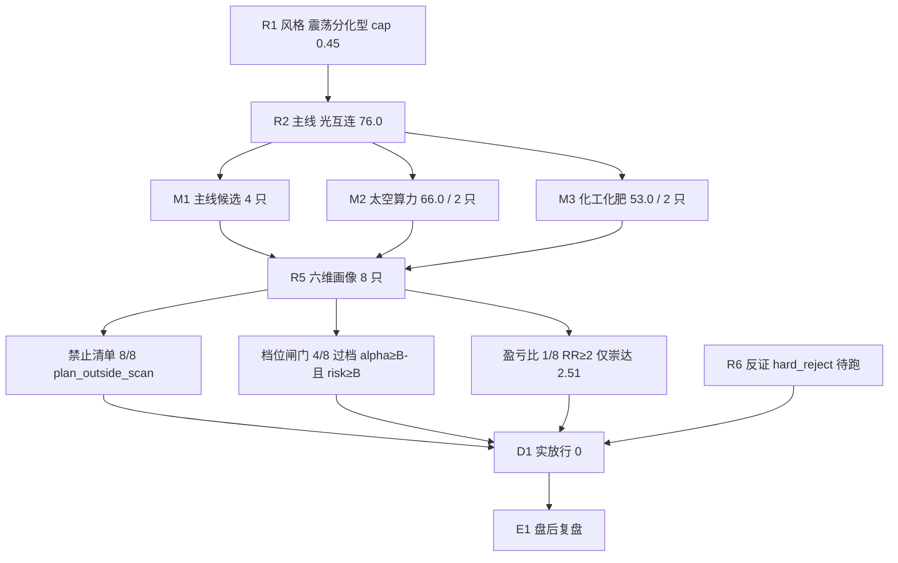

# 2026年11月27日 · **个股画像**

> **数据源新鲜度**: partial（主源全绿，R3 情绪层与 R7 两融/ETF 降级）
> **降级状态**: false（8/8 画像完成，chart_vision 8/8、czsc 8/8、tushare 0 error）
> **置信度**: 0.525

## 一句话结论

**修复第 2 日只有一条真资金链（光互连，三腿单日 +127.15 亿、5 日 +285.17 亿），但核心票 60 日仍 -49%~-63%、20 日资金全负；8 只研究候选 0 只具备开仓资格——4 只过档位、1 只 RR≥2，全部被 plan_outside_scan 拦截。**

## 详细分析

### 1｜市场阶段：修复第 2 日，不是主升

11-26 收盘（数据日）：涨停 70 / 跌停 9 / 炸板 35，炸板率 33.33%（三口径取严，未越 35% 分歧线）；涨 1766 跌 3642（涨家占比 31.66%）、中位 -0.79%、成交 13259.9 亿（缩量 -666.7 亿）；最高 5 板。主力资金从 11-25 的 -490.23 亿反手到 +9.14 亿，但 5 日 -765.44 亿、20 日 -3481.31 亿（仅 8/20 日为正）。R7 结构拆解：超大单 +84.13 亿、大单 -75.00 亿、小单 +69.13 亿 —— **机构在接、游资在退**，钱只去了一条链。

R1 判「震荡分化型 + 情绪 54.9 中性 + 无主线（轮动结构）」，仓位上限 0.45；R3 discipline_gate 明确 `open_permission=false`，只认「低位新题材首板/二板」这一条合规进攻通道。**阶段只定温度，不预设打法**：修复日只做低开承接与分歧转强，不做追高。

### 2｜主线与次线结构

| 线 | R2 分 | 阶段/层 | 宽度与资金 | 本批候选 | 研究结论 |
|---|---|---|---|---|---|
| M1 光互连（CPO/PCB/通信设备） | 76.0 | formation 启动第 1 天 / layer=rebound | 元器件 67 只红盘率 86.57%/涨停 5；PCB 48 只 91.67%/涨停 4；R7 三腿 d1 +127.15 亿、d5 +285.17 亿 | 中际旭创、东山精密、骏亚科技、崇达技术 | 宽度与资金全批最好，但核心票 60 日 -49%~-63%、20 日资金全负 → 抱团池回流，不是趋势 |
| M2 太空算力/商业航天/6G | 66.0 | formation / rebound | 商业航天 332 只红盘率 39%/中位 -0.63%；9 涨停 5 只跨 ≥3 标签、炸板 8 家；R7 两腿 d5 -15.02 亿 | 利君股份、华丰科技 | 叙事最强、盘面不过关，只给竞价观察资格 |
| M3 化工/化肥 | 53.0 | mid_up / rotation | 化工家数 11-25 2 家→11-26 8 家扩张；R7 三腿 d1 +7.29 亿、d5 -16.83 亿 | 金牛化工、泸天化 | 唯一连续 2 日扩张的低位首板簇，但零催化、5 日资金负 |

**8 只画像总览**（综合分 = 催化 20 / 筹码 22 / 板块 18 / 估值 14 / 技术 16 / 机构 10 加权）：

| 代码 | 名称 | 线 | 身位 | 龙头判定 | 综合 | α | 风险 | RR | 禁止清单 |
|---|---|---|---|---|---|---|---|---|---|
| 002815.SZ | 崇达技术 | M1 | 龙二(情绪/容量) | 补涨/跟风 | 69.1 | B | B+ | 2.51 | plan_outside_scan |
| 603386.SH | 骏亚科技 | M1 | 龙一(情绪) | 龙头（首板卡位型） | 68.5 | B | B+ | 0.79 | plan_outside_scan |
| 300308.SZ | 中际旭创 | M1 | 龙一(core) | 非涨停·容量核心 | 61.1 | B- | B+ | 1.65 | plan_outside_scan |
| 002651.SZ | 利君股份 | M2 | 龙一(情绪) | 孤军（3 板但本线仅 1 家涨停） | 55.7 | B- | B- | 1.62 | plan_outside_scan |
| 002384.SZ | 东山精密 | M1 | 龙二(core) | 非涨停·容量核心 | 54.5 | C | B | 1.75 | plan_outside_scan |
| 688629.SH | 华丰科技 | M2 | 龙二(容量) | 非涨停·容量核心 | 53.4 | C | A | 1.84 | plan_outside_scan |
| 600722.SH | 金牛化工 | M3 | 龙一 | 龙头（3 板高度在前） | 52.6 | C | B- | 0.67 | plan_outside_scan |
| 000912.SZ | 泸天化 | M3 | 龙二(情绪/硬首板) | 补涨/跟风（封单 0.36 亿不足） | 49.5 | C | B- | 1.25 | plan_outside_scan |

### 3｜推理深度三问（Top 对象）

**崇达技术（综合第一 69.1，但判定「补涨/跟风」）**

- **大资金意图**：主力今日 +6.27 亿、5 日 +11.66 亿（4/5 正）、10 日 +11.47 亿、20 日 +15.71 亿，30 日龙虎榜净 +2.07 亿且机构专用席 +0.83 亿 —— 这是全批唯一「5/10/20 日三口径全正 + 机构专用席为正」的票，且 20 日净额全批最大。资金意图是**在主线里买容量**，不是打情绪。
- **为什么走强**：R4 first_board 首推 quality=high（6G 方案 + SpaceX FCC 直接覆盖 PCB），叠加板块宽度 91.67%、成交 21.09 亿（元器件内最大）、换手 18.32%。
- **逻辑够不够硬**：**半硬**。资金腿最硬，但板质最烂——10:11 首封、1 次开板、封单/成交仅 5.5%、获利盘 90.5%、股东户数 +29.55%。它证明的是“资金愿意买 PCB”，不是“这只票有身位”；所以给 `补涨/跟风` 而不是龙头，α 封顶 B。

**骏亚科技（68.5，龙头判定成立）**

- **大资金意图**：主力三口径小幅持续净流入（今日 +1.07 / 5 日 +1.88 / 20 日 +1.78 亿），流通仅 47.4 亿，30 日龙虎榜 7 次净 +0.26 亿——是**小市值情绪载体**，不是容量主攻。
- **为什么走强**：09:31:02 首封、0 开板、封单 0.73 亿（流通 1.54%、封单/成交 40%，元器件 5 只里唯一 >30%），股东户数 -35.39%（筹码集中），R2 授“情绪龙一”。
- **逻辑够不够硬**：**板硬、空间贵**。高度仅 1 板，PE-TTM 95.82（3 年 84.1% 分位），距 60 日高 -33.12%，RR 0.79（目标 14.92 距买点仅 +4%）。它适合做“次日弱转强的观察锚”，不适合作为仓位载体。

**中际旭创（61.1，龙一但降级）**

- **大资金意图**：今日 +16.91 亿、5 日 +47.09 亿（全场第一）是回补，但 20 日仍 -13.9 亿、融资余额 15 日 -52.32%（杠杆在撤）、30 日 0 龙虎榜（+47 亿没有席位指纹）。
- **为什么走强**：英伟达断供（E002，负面）与 6G 方案 + SpaceX（E005，正面）两条腿对撞后，资金选择先买回超跌容量核心；收盘位置 0.636、贴 VWAP +1.01%，带动性在价格不在趋势。
- **逻辑够不够硬**：**估值硬、趋势不硬**。PE 6% 分位匹配净利 +211.81%，但 60 日 -49.37%、距 60 日高 -54.21%、识图日 K 空头排列（435-440 与 458 双重阻力）。定性为“容量核心观察”，不给打板通道。

**首推票思维链 · 崇达技术（唯一 RR≥2）**

- **买入理由**：R4 唯一「首推·试错」quality=high；主力 5/10/20 日全正（+11.66/+11.47/+15.71 亿）且 20 日净额最大；机构专用席 +0.83 亿；所属 PCB 宽度 91.67%、主线资金三腿全正；RR 2.51（买 14.8 / 目标 16.66 / 止损 14.06，止损距 -5.0%）。
- **风险点**：10:11:27 首封偏晚、1 次开板、封单/成交 5.5% = 烂板；获利盘 90.5%、股东户数 +29.55% 筹码高位分散；距 60 日高 -39.9%、周 K 震荡；F3 soft（应收增速>收入×1.5）。
- **止损条件**：跌破 14.06（买点 -5%）无条件走；若次日低开破 14.38（前一日实体中枢）且 30 分钟内未回补封单，按“弱转强失败”当日处理，不隔夜。
- **可验证假设**：①次日 09:25 竞价量能不低开、封单回补 ≥0.8 亿 → 烂板转强成立；②PCB 板块当日涨停 ≥3 家且元件资金 d1 仍为正 → 主线延续；③若高开 >2% 但 10:00 前封单不增（R2 原话的一日游判据）→ 假设证伪，降级观察。

### 4｜逐票一句话（六维细节见 JSON）

- **中际旭创**：龙一身位 + 5 日主力 +47.09 亿全场第一，但 20 日 -13.9 亿、融资 -52.32%、60 日 -49.37% —— 资金回补不是趋势反转。**降级·不进**。
- **东山精密**：30 日机构专用席净卖 -18.97 亿是全场最硬的负面证据，叠加识图偏空 0.62、60 日 -62.69% —— 反弹弹性来自超跌。**降级·不进**。
- **骏亚科技**：板质全批第一（09:31 秒封/0 开板/封成比 40%），但仅首板、PE 84.1% 分位、RR 0.79。**观察·不进**。
- **崇达技术**：资金腿全批最实（三口径全正 + 机构席 +0.83 亿），但 10:11 首封 + 封成比 5.5% 属烂板。**观察·不进**（仅次日弱转强）。
- **利君股份**：3 板一字（09:25、封单 1.16 亿）是最高身位，但本线仅 1 家涨停=孤军、位置 100%、获利盘 96.1%、净利同比 -87.33%。**观察·不进**。
- **华丰科技**：20cm +11.37% 最强板型但未封板、5 日主力 -2.08 亿、PE 130.51、周 K 空头。**降级·不进**。
- **金牛化工**：3 板 0 开板 + 主力 5 日 5/5 全正，但获利盘 99.3%、位置 100%、LHB 净 -3.6 亿、户数 +79.28%、RR 0.67。**观察·不进**。
- **泸天化**：09:36:33 硬首板 0 开板是本线最干净低位板，但封单仅 0.36 亿、主力四口径近零、净利 -1.45 亿、RR 1.25。**观察·不进**。

## 关键证据

- **证据 1（资金宽度）**：R7 sector_flows 元件 +45.27 亿 / 印制电路板 +44.12 亿 / 通信设备 +37.76 亿，三腿 5 日 +108.49 / +109.91 / +66.77 亿全正；但三腿 20 日 -74.73 / -28.58 / -136.92 亿全负。来源：R7_capital_flow.json（stk_limit + DC 同源）。
- **证据 2（机构派发）**：东山精密 30 日龙虎榜 6 次、机构专用席净 -18.97 亿；中际旭创 30 日 0 榜。来源：tushare top_inst 逐日全市场回补（57 个交易日）。
- **证据 3（筹码集中/分散）**：骏亚股东户数 -35.39%（集中）；崇达 +29.55%、金牛 +79.28%（散户涌入）；金牛获利盘 99.3%、利君 96.1%、崇达 90.5%。来源：tushare stk_holdernumber + cyq_chips。
- **证据 4（估值错位）**：中际旭创 PE 19.56（3 年 6.0% 分位）匹配净利 +211.81%；金牛 PE 157.47（88.9%）/PB 93.8%/PS 94.4% 三线高位；泸天化 PE 无效、PB 2.8% 分位。来源：tushare daily_basic 三年序列。
- **证据 5（技术结构）**：8 只中仅金牛站上缠论中枢（pos=262.2），其余 7 只在中枢内或中枢下；识图偏多 6 只、震荡 1 只（中际旭创）、偏空 1 只（东山）。来源：czsc + chart_vision 快照。
- **证据 6（禁止与赔率）**：8/8 命中 plan_outside_scan（R2 execution_pool=[] + research_only=true + R3 无开仓权限 + R7 可执行 0）；RR≥2 仅崇达 2.51，金牛 0.67 / 骏亚 0.79 被拒。来源：src/research/forbidden_filter + src/plan/risk_reward 实算。

## 数据源审计

| 源 | 状态 | 抓取日期 | 记录数 | 备注 |
|---|---|---|---|---|
| tushare daily / adj_factor | 🟢 ok | 2026-11-26 | 8 票 × 217 根 | ≥30 日契约（最短 217 根），前复权 |
| tushare limit_list_d | 🟢 ok | 2026-11-26 | 99 行 | 官方漏收 5 涨停，宽度用 R7 权威口径 |
| tushare top_list / top_inst | 🟢 ok | 2026-09-01→2026-11-26 | 57 个交易日 / 29 命中 | 按席位分桶，机构仅取 exalter 含“机构” |
| tushare margin_detail | 🟡 partial | 2026-11-26 | 6/8 票有记录 | 骏亚、利君不在两融标的（结构性缺失） |
| tushare daily_basic 三年 | 🟢 ok | 2026-11-26 | 8 票（830~944 行/票） | 利君、泸天化 PE 无效（TTM 亏损） |
| 财报三表 + fina_indicator | 🟢 ok | 2026-09-30 | 8/8 票 | 2025Q1 起，R6 附录 A 阈值复核 |
| 公告 anns_d | 🟢 ok | 2026-06-01→2026-11-26 | 90/58/30/62/29/64/27/26 | 事件时间线来源 |
| 东财 DC 主力资金 | 🟢 ok | 2026-10-28→2026-11-26 | 22 日 × 全市场 132725 行 | 与 R7 同源逐票对齐 |
| czsc 日线笔/中枢 | 🟢 ok | 2026-11-26 | 8/8 票 | 前复权，max_bi_num=40 |
| chart_vision 快照 | 🟢 ok | 2026-11-26（日线 last_date） | 27 条 / 本批 8 命中 | 6 只由 R5 补渲并按 ts_code 合并 |
| R1 / R2 / R3 / R4 / R7 | 🟡 partial | 2026-11-27 盘前 | 7 个 artifact | R3 真等级 L1_only；R7 两融/ETF 滞后 |
| mcp__vibe_trading | 🔴 error | — | — | 未配置，大宗/两融/龙虎榜仅 tushare 单源 |

## 不确定性 / 反证

1. **阶段与结构冲突（R2 自述）**：M1 stage=formation（第 1 天）但 layer=rebound、核心票 60 日 -49%~-63%。R5 按结构（rebound）执行，因此 α 上限压在 B —— 若后续 3 日资金三腿 d5 继续为正且核心票收复 MA20，才可能升级为趋势级。
2. **宽度口径**：M2 的商业航天宽度是 R2 标签计数（332 只 39%、9 涨停 5 只跨 ≥3 标签、8 家炸板），R5 只能用行业口径近似（利君=航空装备 1 家、华丰=元件 5 家）。这是“标签 vs 行业”的口径不一致，已在 JSON 写 `industry_caliber_note`，不抬高评分。
3. **PE 失效**：利君、泸天化 TTM 亏损，估值维只能靠 PB/PS（利君 PB 72.6% 分位、泸天化 PB 2.8% 分位），缺 PE 锚；两票的 α 不应被过度解读。
4. **两融缺失**：骏亚、利君不在两融标的，杠杆温度不可观测；华丰质押数据无记录。三者均属结构性缺失，非抓取失败。
5. **情绪层降级**：R3 L2 群聊永久断更（0 字节、本地库停 2026-10-28）、L3 WeFlow 下线，真等级最高 L1_only → 本报告不使用“共振强度”作为加分，仅作催化背景。
6. **快照命名口径**：本次 chart_vision 快照按 trade_date（20261127）命名，日线数据截至 data_day（20261126）；R5 已按日期断言校验，但若次日流水线改回 data_day 命名，需重新核对 `snap["date"]`，否则会误读前一交易日结构。
7. **反证边界**：R5 无 entry/exit 权限，档位是研究结论不是开仓资格。R6 若对本批任一票给出 `hard_reject`，D1 必须无条件接受，R5 不干预。

## 与其他 R/D/E 的关系

- **依赖**：`R1_style.json`（cap 0.45 / high_chop）、`R2_main_sectors.json`（主线 76.0 + 次线 66.0/53.0 + research_only 8）、`R3_sentiment.json`（neutral 52.4 / open_permission=false）、`R4_news.json`（E002 负面 / E005 正面 / first_board 首推崇达）、`R7_capital_flow.json`（三腿资金 + 龙虎榜派发警报）、`data/raw/20261127/chart_vision_snapshot.json`。
- **被消费**：D1（canghai-plan）读 `profiles[].alpha_grade / risk_grade / rr / forbidden_check / leader_verdict` 逐票过闸；R6 读 `fundamental_flags` 与 `leader_verdict` 做反证；E1 读 `coverage / d1_gate_simulation` 复盘。
- **边界**：R5 不出 entry/exit 价格（JSON 内 `rr` 为研究口径，仅供 D1 参考），不做板块排序（R2 职责），不做风格判断（R1 职责）。

## Sub-Agent 元数据

- skill: analyze_stock_profile_v1@1.5（R5 情报深挖）
- artifact: `data/research/20261127/R5_stock_profiles.json`（8 profiles / 校验 exit 0）
- 生成耗时: 约 10 分钟（tushare 20 类接口 8 票 + 龙虎榜 57 日回补 + 6 只 chart_vision 补渲 + czsc）
- model: deepseek-v4.1-flash
- 覆盖: 主线 leaders 4/5（快克智能 mid_laggard 排除并留痕）+ research_only 4/4；chart_vision 8/8、czsc 8/8、时间线 8/8（跨度 ≥50 天）
