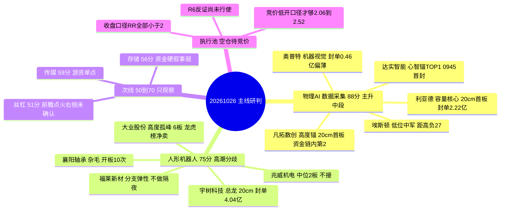

# 2026年10月26日 · **主线研判**（盘前）

> **数据源新鲜度**: partial（四源均当日生成，行情同口径 20261023 收盘；缺北向/杠杆，非过期）
> **降级状态**: true（上游 R1 0.72 / R7 0.74 覆盖降级；因子层设计内跳过；宇树次新股性 n=1）
> **置信度**: 0.71（0.85 × 新鲜度 0.95 × 独立源 0.88，研究质量分，不是胜率）

## 一句话结论

**两条主线同属机器人链：物理AI 88 分赚宽度，人形机器人 75 分只剩高度；执行池留空，等竞价实价重算盈亏比。**

---

## 一、市场坐标：宽度在物理AI，高度在本体链

| 指标 | 数值 | 口径 / 来源 |
|---|---|---|
| 涨停 / 跌停 / 炸板 | **82 / 6 / 12** | `tushare limit_list_d` · 炸板率 **12.77%** |
| 连板梯 | 1板 **70** · 2板 9 · 3板 1 · 4–5板 **0** · 6板 **2** | 同上 · 宽度型不是梯队型 |
| 全市场广度 | 涨 **4526** / 跌 909 · 成交 **19728 亿**（+28.0%） | `R7 market_breadth` |
| 昨日涨停溢价 | 收盘中位 **+4.55%** · 开盘中位 **-0.87%** · 红盘率 66.7% | 33 家样本重算 |
| 早盘首封占比 | **26.8%**（<10:00） | R1 独立统计 |
| 情绪浓度 | **70**（R1 基线 69） · 次日信号 **弱修复 +0.30** | `R3_sentiment.json` |
| 风格 / 总仓上限 | **连板情绪型** / **65%**（溢价转负或炸板上 25% 降 40%） | `R1_style.json` |

一句话读法：**涨停 82 家但 4–5 板全空、6 板只有两只孤峰**，接力的钱没进来，进场的是首板隔日的一次性资金。R1 因此把主模板定为「首板隔日」，R3 把次日判成「弱修复」并明确 **高开兑现概率 > 低开修复概率**。

| 板块（概念口径） | 5日主力净额 | 净流入天数 | 当日涨幅 |
|---|---:|---:|---:|
| 人形机器人 | **+104.13 亿**（全概念第 1） | 3/5 | +4.92% |
| 数字芯片设计 | +87.92 亿 | 4/5 | +5.27% |
| AI眼镜 | +75.51 亿 | 4/5 | +4.10% |
| 智能穿戴 | +73.89 亿 | — | — |
| 传感器（物理AI 数采） | **+59.97 亿** | 4/5 | +3.62% |
| 减速器 | +48.46 亿 | 4/5 | +5.13% |

资金口径必须分清：**半导体/数字芯片是「资金最硬」的板块，但 R3 判其退位、R4 事件中性**，属资金驱动而非叙事驱动，只能进次线；机器人链才是资金与叙事同向的位置。

---

## 二、五维打分总表（0–20 × 5，相加不放大）

| 方向 | 热度 | 资金 | 涨停 | 叙事 | 共振 | 合计 | 分层 | 态度 |
|---|---:|---:|---:|---:|---:|---:|---|---|
| **物理AI / 数据采集** | 19 | 17 | 18 | 18 | 16 | **88** | 核心主线 | 研究首选 · 执行条件式 |
| **人形机器人 / 本体·减速器** | 12 | 19 | 20 | 19 | 5 | **75** | 核心主线（高潮） | 只做龙一龙二分歧 |
| 传媒 / AI应用情绪容器 | 17 | 7 | 12 | 9 | 14 | 59 | 次线 | 观察 |
| 存储 / 数字芯片 | 13 | 18 | 11 | 8 | 6 | 56 | 次线 | 观察 |
| 丝杠 / 精密传动 | 10 | 12 | 8 | 17 | 4 | 51 | 次线 | 观察 |
| 网络安全 | 14 | — | — | — | — | 42 | 丢弃 | 不进 |
| 铜 / 锂资源 | — | — | — | — | — | 33 | 丢弃 | 不进 |
| 特高压 / 电网设备 | — | — | — | — | — | 25 | 丢弃 | 不进 |
| 黄金 / 贵金属 | — | — | — | — | — | 0 | 丢弃 | 回避（R4 负面） |

打分口径：热度=东财题材热度 + 同花顺概念榜 + 个股人气跃升（霸榜警报封顶打折）；资金=R7 同口径概念/行业 5 日净额（行业与概念不相加）；涨停=`limit_cpt_list` 家数 + 梯队结构 + 板块涨幅；叙事=R4 `sectors_catalyzed` 的 max_strength 与 net_score；共振=R3 共振等级（L1+L2 给 16）+ 霸榜警报归零 + 群覆盖折减。**分数是研究排序，不是胜率，也不是开仓许可。**

---

## 三、主线一 · 物理AI / 数据采集（88 分 · 主升中段）

五维拆解：热度 **19**（东财题材 hot 1178 全市场第 1、+8.27%；同花顺 MLOps 新进第 5；凡拓 17→7、利亚德 10→2、埃斯顿 12→3）；资金 **17**（传感器概念 5 日 +59.97 亿 / 4/5 净流入日，个股主力利亚德 +11.96 亿、达实 +6.29 亿）；涨停 **18**（人工智能 29 家、数据要素 9 家）；叙事 **18**（R4 E001 high，net 0.74）；共振 **16**（R3 rank1，L1+L2，无霸榜警报）。

生命周期：**运行 5 日 · 龙头高度 1 板 · 资金连续 4 日 · 炸板率 12.77%** → `mid_up`。判读重点是「首板宽度型」：东财物理AI 窄口径 3 家涨停全部午后封板（凡拓 13:24、能科 13:43、埃斯顿 14:38），R2 板型统计下本线 11 只首板有 8 只在午后或尾盘封板，首封早于 10:00 的只有达实（09:45）——这是**资金轮动出来的宽度**，不是抢筹出来的高度。

- **大资金意图**: 主力买的是「数据采集硬件入口」而不是算法叙事——传感器 5 日 +59.97 亿且 4/5 天净流入，利亚德封单 2.22 亿（链内最大）叠加主力 +11.96 亿、龙虎榜 +1.76 亿。对手盘很清楚：周末被卖方集中科普后、周一准备高开接力的散户与量化。机构在这个位置下注，赌的是智元开源 Physical Agent 数据集 + 英伟达生态入选带来的**订单口径**变化，不是估值提升。
- **为什么走强**: 位置（利亚德 5 日 +62.7%、凡拓 +89.1%，双双创 60 日新高）+ 催化（R4 E001 四重催化，强度 high）+ 筹码（利亚德龙虎榜 +1.76 亿净买，但凡拓 3 日净卖 -0.62 亿、先手已在兑现）三维交叉 → **强在宽度与资金同向，弱在首封时序**。这就是它 88 分但只有条件式执行的原因。
- **逻辑够不够硬**: 跨源验证 0.67（R3 正向共振 ✓、R4 high ✓、R7 行业口径无同名板块 ✗，按契约判 false，不硬凑）。硬时间锚=智元数据集开源 + 英伟达生态，属产业级事件，但「认知差已被抹平」是真实风险——6/6 群覆盖 + 4 家公众号 + MLOps 新进热榜，周一买的是**一致性接力**。证伪路径只有两条：竞价高开 >+2% 后 30 分钟站不上均价，或传感器概念当日转为净流出。

**龙头梯队**

| 角色 | 代码 | 名称 | 收盘 | 板型 | 流通市值 | 5日涨幅 | 距60日高 | 主力5日 | 龙虎榜 | 收盘口径RR | 低吸口径RR | 态度 |
|---|---|---:|---:|---|---:|---:|---:|---:|---:|---:|---:|---|
| 龙一 | 300296.SZ | 利亚德 | 7.32 | 20cm · 13:43 首封 · 1 开板 · 封单 2.22 亿 · 换手 27.9% | 169.9 亿 | +62.7% | 0% | +11.96 亿 | +1.76 亿 | 1.04 | **2.06** | 观察 |
| 龙二 | 301313.SZ | 凡拓数创 | 61.44 | 20cm · 13:24 首封 · 1 开板 · 封单 0.87 亿 · 换手 39.3% | 48.4 亿（谨慎区） | +89.1% | 0% | +4.12 亿 | -0.15 亿（3日 -0.62） | 1.39 | **2.52** | 观察 |
| 候补 | 002747.SZ | 埃斯顿 | 29.18 | 10cm · 14:38 尾盘板 · 0 开板 · 换手 10.5% | 228.9 亿 | +20.4% | **-27.1%** | +4.38 亿 | +1.72 亿 | 0.23 | 0.93 | 观察 |
| 候补 | 002421.SZ | 达实智能 | 3.43 | 10cm · **09:45 链内最早** · 3 开板 · 换手 26.5% | 69.8 亿 | +9.9% | -11.6% | +6.29 亿 | 未上榜 | 0.15 | 0.82 | 观察（心智锚 TOP1 但股性差） |
| 候补 | 688686.SH | 奥普特 | 153.20 | 20cm · 14:42 尾盘板 · 封单仅 0.46 亿 | 187.3 亿 | +44.1% | -2.7% | +1.44 亿 | +0.21 亿 | — | — | 观察（封单过薄） |

**辨识度裁决**：题材心智锚（`theme_anchors` 20261020，597 概念）TOP1 是达实智能 79.0（妖性型），但凡拓数创、利亚德都不在锚 TOP5——龙一按当日身位/封单/资金判，不按历史锚定分判；达实锚分最高却只能做候补，因为涨停次日中位仅 +0.90%（n=16）。**这就是「锚定分 ≠ 可交易」的分界。**

---

## 四、主线二 · 人形机器人 / 本体·减速器（75 分 · 高潮分歧）

五维拆解：热度 **12**（同花顺概念 3 日霸榜第 1 → 按红线 5 不计正分，仅给残值）；资金 **19**（人形机器人概念 5 日 +104.13 亿全概念第 1，减速器 +48.46 亿）；涨停 **20**（机器人概念 43 家全市场第 1、人形机器人 26 家 +4.46%）；叙事 **19**（R4 零部件双事件叠加 net 0.939、本体 0.74、丝杠 0.602）；共振 **5**（R3 `distribution_alert=true`，霸榜出货警戒直接把共振维打到残值）。

生命周期：**运行 8 日 · 龙头高度 6 板 · 资金连续 3 日 · 炸板率 12.77%** → `climax`。这是今天最需要克制的一条线：**分数高是因为资金和涨停硬，不是因为结构好**。

- **大资金意图**: 主力买的是宇树（封单 4.04 亿全链最大、主力 +10.05 亿、龙虎榜 +2.11 亿）和兆威（主力 5 日 +4.70 亿、5/5 净流入），**不是 6 板高度票**——大业当日龙虎榜 -0.56 亿、主力 5 日只有 +0.44 亿，高度是情绪给的，不是资金给的。对手盘是仍在博弈「高度续命」的接力资金，以及被周末全群一致预期吸引进来的增量。
- **为什么走强**: 涨停家数全市场第 1（43 家）+ 连板高度 6 板 + R4 双事件叠加，但 **4–5 板 0 只、6 板 2 只孤峰**，高度与宽度分离；位置大业 5 日 +61.1%、距 60 日高 0%，无缓冲。强的是「人气与家数」，弱的是「梯队与派发」。
- **逻辑够不够硬**: 四源交集 4/4、composite 0.80 是全场最高，但 R3 明确 `distribution_alert`+`positive_resonance=false`，且大业主营是**胎圈钢丝**，题材纯度低。硬业绩/硬政策一项都没有，硬时间锚也只有特斯拉 Optimus 叙事。证伪路径极短：**断板即无承接**，或概念榜跌出前 3 同时资金转负。

**龙头梯队**

| 角色 | 代码 | 名称 | 收盘 | 板型 | 流通市值 | 5日涨幅 | 距60日高 | 主力5日 | 龙虎榜 | 收盘口径RR | 低吸口径RR | 态度 |
|---|---|---:|---:|---|---:|---:|---:|---:|---:|---:|---:|---|
| 龙一 | 603278.SH | 大业股份 | 15.96 | **6 板 / 16天8板** · 13:09 封 · 0 开板 · 封单 0.95 亿 · 换手 33.4% | 54.5 亿 | +61.1% | 0% | +0.44 亿 | **-0.56 亿** | 1.25 | 2.33 | 观察（高度锚，不接力） |
| 龙二 | 688836.SH | 宇树科技 | 624.00 | 20cm · 14:15 封 · 0 开板 · **封单 4.04 亿（链内最大）** · 换手 28.1% | 187.7 亿 | +46.1% | **-43.3%** | +10.05 亿 | +2.11 亿 | 不可用 | 不可用 | 观察（次新 n=1） |
| 候补 | 003021.SZ | 兆威机电 | 91.73 | 2 板 · 09:43 封 · 5 开板 · 换手 12.6% | 191.0 亿 | +50.1% | 0% | +4.70 亿（5/5） | +2.14 亿（3日 +2.34） | 0.22 | 0.96 | 观察（中位段不接） |
| 候补 | 000678.SZ | 襄阳轴承 | 13.23 | 2 板 · 10:03 封 · **10 开板** · 换手 27.3% | 60.8 亿 | +21.0% | -4.8% | +4.11 亿 | +1.22 亿 | 0.01 | 0.69 | **杂毛 · 剔除** |
| 候补 | 605488.SH | 福莱新材 | 38.15 | 5天3板 · 13:37 封 · 0 开板 · 换手 11.7% | 113.9 亿 | +49.0% | 0% | +2.59 亿 | +1.06 亿 | 0.15 | 0.84 | 观察（分支弹性，不做隔夜） |

**杂毛判定**（命中 ≥2 项即剔）：襄阳轴承命中 3 项——板块内主力排名在 top3 之外、连板 2 < 龙头高度-2、开板 10 次板型极差；福莱新材命中 2 项——主力在 top3 之外、身位属分支补涨。**中位段与杂毛一律不进执行池，这不是保守，是纪律。**

---

## 五、结构图：两条主线其实是一条产业链

---

## 六、四只核心票的思维链（研究记录，不是买入建议）

### 利亚德 300296.SZ · 物理AI 容量核心
- **买入理由**: ① 物理AI「数据采集」的容量核心，R4 E001 强度 high 直接点名数采设备，属产业逻辑而非纯情绪；② 资金证据链最硬——主力 5 日 +11.96 亿（链内第 1）、封单 2.22 亿（链内最大）、龙虎榜 +1.76 亿、东财人气 10→2，四个口径同向。
- **风险点**: ① 20cm 票 13:43 才首封、换手 27.9%，属午后接力板而非抢筹板，次日高开兑现概率高于低开修复（R3 已判弱修复）；② 股性样本 n=1，8.35% 的次日目标收益是单样本外推，RR 可信度低；③ 5 日 +62.7%、距 60 日高 0%，位置没有任何缓冲。
- **止损条件**: 不设价格止损（买卖点属 D1 权限）。假设证伪条件：竞价高开 >+2% 后 30 分钟内跌破当日均价且主力资金转为净流出，则「容量核心承接」假设当日作废，直接降级观察，不等收盘。
- **可验证假设**: 次日 10:00 前维持 +5% 以上或直接封板、且传感器概念资金为正 → 假设成立；若炸板且换手 >30% → 假设证伪，链内降一档。

### 凡拓数创 301313.SZ · 物理AI 高度锚
- **买入理由**: ① 东财物理AI 题材 `lead_stock`（hot 1178 全市场第 1），5 日内 3 次 20cm，是链内唯一高度；② 人气 17→7 + 股性次日中位 +11.11%（n=4、胜率 1.0），情绪溢价能力在链内最强。
- **风险点**: ① 龙虎榜当日 -0.15 亿、3 日 -0.62 亿，先手已在兑现；② 13:24 尾盘封 + 换手 39.3%，板型弱于人气，属尾盘抢筹不是承接；③ 流通 48.4 亿落在 20–50 亿谨慎区，冲击成本高；④ 5 日 +89.1%、20 日 +103.9%，加速末端。
- **止损条件**: 不设价格止损。证伪条件：竞价 ≤-4% 开盘后 30 分钟不能回到均价上方，或盘中跌破前收且主力净卖扩大，则「分歧低吸」假设作废。
- **可验证假设**: 竞价 ≤-4% 且 30 分钟内回封/站上均价 → 低吸口径成立（RR 2.52）；若竞价 >+3% 直接放弃，视为先手已兑现、不追。

### 大业股份 603278.SH · 高度孤峰（只做温度计）
- **买入理由**: ① 连板高度 top1（6 板 / 16 天 8 板）、0 次开板、封单 0.95 亿，是当前市场唯一的情绪高度标尺；② 股性次日中位 +9.99%（n=24、胜率 0.71），样本量是链内唯一过硬的。
- **风险点**: ① 主营胎圈钢丝，非机器人主业，题材纯度低，靠双标签（Optimus+商业航天）维持；② 当日龙虎榜 -0.56 亿、主力 5 日仅 +0.44 亿，高度与资金背离；③ 4–5 板空档，一旦断板没有承接梯队；④ R3 霸榜警报对整条链外溢。
- **止损条件**: 不设价格止损，且 R2 明确不给接力买点。证伪条件：断板当日即撤销高度锚资格，不等回封、不看次日反抽。
- **可验证假设**: 竞价强一致（一字或 >+7%）且封单维持 1 亿以上 → 高度延续；若平开或低开后 10 分钟不能翻红 → 高度锚失效，整条链降级。

### 宇树科技 688836.SH · 人形机器人总龙
- **买入理由**: ① R4 明示的人形机器人总龙，20cm 首板封单 4.04 亿（全链最大）、0 开板，收板质量最好；② 主力 5 日 +10.05 亿、龙虎榜 +2.11 亿；③ 距 60 日高 -43.3%，是链内唯一「不是新高」的龙头，深跌修复空间是唯一预期差。
- **风险点**: ① 次新股，近一年涨停次日样本 n=1（-18.7%），RR 为负、不可量化；② 14:15 才封板，28.1% 换手，属尾盘一次性拉板；③ 距高 -43% 说明前高套牢盘沉重；④ 解禁与筹码结构未核，是最大的未知。
- **止损条件**: 不设价格止损。证伪条件：次日跌破 624 元前收且 30 分钟内不能回补，或封单撤单超过一半，则「深跌修复」假设作废。
- **可验证假设**: 竞价 -3% 以内且开盘 30 分钟不破均价 → 修复延续；高开低走破前收 → 修复假设证伪，链内总龙地位让位给大业的高度（但大业同样不接力）。

---

## 七、执行池为什么是空的

| 股票 | 收盘口径 RR | 竞价低开口径 RR | 达标？ |
|---|---:|---:|---|
| 凡拓数创 | 1.39 | 2.52（≤-4%） | 仅低吸口径 |
| 大业股份 | 1.25 | 2.33（低开） | 仅低吸口径，但 R2 不给接力买点 |
| 利亚德 | 1.04 | 2.06（≤-3%） | 仅低吸口径 |
| 埃斯顿 | 0.23 | 0.93 | 否 |
| 兆威机电 | 0.22 | 0.96 | 否 |
| 达实智能 | 0.15 | 0.82 | 否 |

三个独立原因，缺一不可：
1. **盘前没有当日价格**。所有 RR 都是按 20261023 收盘价外推，收盘口径全部 <2（最高凡拓 1.39）。只有「竞价低开 ≥3% 的分歧低吸」口径能到 2.06–2.52，而这必须用 09:25 实价重算——R2 不在盘前虚构入场价。
2. **股性样本不足**。利亚德 n=1、凡拓 n=4、宇树 n=1，RR 目标值是单样本外推，即使数值达标也标 `valid=false`。
3. **R6 尚未反证**。`hard_reject` 硬否决权未行使，任何结论都不构成开仓许可；两条主线同属机器人链，敞口必须合并计算（≤40%），不能按两条独立主线各自满仓。

---

## 关键证据

- **证据 1**: 20261023 涨停 82 家 / 炸板 12 家（12.77%）/ 连板梯 70-9-1-0-0-2，4–5 板全空 → 宽度型而非梯队型 · 来源 `tushare limit_list_d`
- **证据 2**: 机器人概念涨停 43 家（全市场第 1）、人形机器人 26 家 +4.46%、人工智能 29 家 → 涨停维与热度维的板块归属 · 来源 `tushare limit_cpt_list`
- **证据 3**: 人形机器人概念 5 日 +104.13 亿（3/5 天）、传感器 +59.97 亿（4/5）、减速器 +48.46 亿（4/5）、数字芯片设计 +87.92 亿（4/5） · 来源 `R7 concept_flows`
- **证据 4**: R4 E001 物理AI/数据采集 high（net 0.74）、人形机器人零部件双事件 net 0.939、E008 黄金/白银 -0.489 · 来源 `R4_news.json`
- **证据 5**: R3 四条共振主题（物理AI 正向 / 人形机器人霸榜警戒 / 传媒正向 / 存储退位）+ 次日弱修复 +0.30 + 人气跃升凡拓 17→7、利亚德 10→2、埃斯顿 12→3 · 来源 `R3_sentiment.json`
- **证据 6**: 10 只候选个股主力 5 日净额独立复核全部一致——利亚德 +11.96 / 达实 +6.29 / 埃斯顿 +4.38 / 凡拓 +4.12 / 宇树 +10.05 / 兆威 +4.70 / 襄阳 +4.11 / 福莱 +2.59 / 奥普特 +1.44 / 大业 +0.44（亿元） · 来源 `tushare moneyflow`

---

## 数据源审计

| 源 | 日期 | 状态 | 备注 |
|---|---|:--:|---|
| R1 风格研判 | 2026-10-26 | 🟡 | status=degraded，confidence 0.72；提供情绪基线 69、风格、总仓 65% |
| R3 情绪共振 | 2026-10-26 | 🟢 | complete，confidence 0.65，4 条共振主题；WeFlow 永久下线，最高 L1+L2 |
| R4 消息面 | 2026-10-26 | 🟢 | complete，8 条 top_event / 25 个 sectors_catalyzed；2 处与真实涨停不符已剔除 |
| R7 资金面 | 2026-10-26 | 🟡 | degraded=True，confidence 0.74；北向、两融杠杆缺测 |
| tushare limit_list_d | 2026-10-23 | 🟢 | 82 行 · 封板时间/开板次数/封单/换手/流通市值/连板数 |
| tushare limit_cpt_list | 2026-10-23 | 🟢 | 20 行 · 概念涨停家数与连板统计 |
| tushare top_list | 2026-10-23 | 🟢 | 101 行 · 按票去重后取当日榜 |
| tushare moneyflow / daily | 2026-10-23 | 🟢 | 10 票 × 20 日资金 / 420 日行情（股性样本） |
| 东财 dc_concept | 2026-10-23 | 🟢 | 638 个题材 · 热度排名与成分股 |
| 同花顺 ths_hot | 2026-10-23 | 🟢 | 99 行 · 热股榜与概念标签 |
| 主题心智锚 | 2026-10-20 | 🟡 | 597 概念 · 历史辨识度背景，非当日资金证据 |
| 因子快照 | — | 🔴 | `data/factor_snapshot` 目录不存在，设计内跳过（标 degraded 非 error） |
| 北向 / 杠杆 / 筹码集中度 | 2026-10-23 | 🔴 | 缺可信同口径值，未用替代值凑数 |

---

## 不确定性 / 反证

1. **R6 未运行**。本单元所有结论都没有经过独立反证，`hard_reject` 权未行使，执行池为空也包含这一层原因。霸榜警报（人形机器人概念 3 日第 1）只是**警戒**，不是已证实的出货。
2. **两条主线是同一个敞口**。物理AI 与本体链同属机器人产业链，R1 的行业代理判「独主线」并不与 R2 拆两条分支矛盾，但 D1 必须按单一板块上限合并计算，任何「两条主线各给一份仓位」的做法都是错的。
3. **RR 的可信度有限**。利亚德 n=1、凡拓 n=4、宇树 n=1，样本量不足 5 的票，RR 只能做参考，这也是它们全部 `valid=false` 的原因。
4. **首封时序是最硬的隐忧**。全市场 10:00 前首封仅 26.8%，链内 11 只首板有 8 只在午后或尾盘封板（R2 板型统计），东财物理AI 窄口径 3 家更是全部午后封板——这意味着次日的承接要靠新钱，而不是当日筹码的锁仓。
5. **热度与叙事可能同日见顶**。R3 判物理AI `crowded=true`、`early_or_late=middle`，卖方周末集中覆盖后，认知差已经抹平；如果周一高开冲高回落，88 分的主线会在一天内变成「一致性出货」。
6. **本次复核修正了 5 处口径**（已写入 JSON `validation.r2_verification`）：利亚德/宇树主力 5 日净额、大业/凡拓龙虎榜净额按当日榜去重、宇树流通市值与板型补齐、`capital_evidence.stocks_5d` 与 moneyflow 对齐。分数与结论未变，但说明**上游摘录口径需要逐字段核对**。
7. **因子层缺失**。`data/factor_snapshot` 从未生成，板块内个股排序没有量化因子验证，当日排序完全依赖身位、封板时序、资金与辨识度四项定性证据。

---

## 与其他 R / D / E 的关系

- **依赖**: `R1_style.json`（风格/情绪基线/总仓上限）、`R3_sentiment.json`（共振等级/霸榜警报/次日信号）、`R4_news.json`（板块催化强度/净极性）、`R7_capital_flow.json`（概念与行业资金）、tushare 直拉（涨停/龙虎榜/资金/行情）、`theme_anchors`（辨识度背景）。
- **被消费**: D1（`main_decision_v1`）用于选 execution_pool，须优先 `cross_validation_score >= 0.67` 的主线；E1（`daily_review_v1`）用于回填主线兑现度与龙头表现；R5（`analyze_stock_profile_v1`）对 4 只核心票做六维画像；R6（`analyze_devil_advocate_v1`）对两条主线做独立反证并保留硬否决权。
- **权限边界**: 本单元不出买卖点、止损价、仓位比例；`execution_pool` 为空是纪律结果，不是数据缺失。

## Sub-Agent 元数据

- skill: `analyze_main_sectors_v1@1.3`（`filter_leader_v1` 已应用）
- artifact: `data/research/20261026/R2_main_sectors.json`（含 `validation.r2_verification` 复核记录）
- 生成 / 复核: 2026-10-26 06:32 生成 · 06:34–06:40 用 tushare 独立复核并修正 5 处口径
- 用 model: ark-code-latest
