# 2026年10月26日 · 主线研判

> ⚠️ **数据源时间错位**
> - 文件名声明交易日：**2026-10-26**（周一）
> - 实际数据归属日：**2026-10-23**（周五收盘，T-1）
> - 错位原因：本轮为 **2026-10-24 周末预演**，下一交易日是 10-26，行情/涨停/资金/热榜只能取 10-23 收盘口径
> - 影响范围：板块强度、龙头身位、资金口径可复算；周一竞价、隔夜消息、实际封板率不可知
> - 处理建议：作为 10-26 盘前研究底稿，D1 须在竞价后重新校准，不得把本文件当已发生事实

> **降级标记**：R2 `status=partial` · `degraded=true` · `confidence=0.55`
> R1=degraded（连板情绪型 / high_chop / 仓位上限 55%）· R3=degraded（群聊维度 0 条）· R7=partial（北向缺、概念级 5 日序列缺）· R4=complete（唯一未降级上游）
> **本次不重跑分析、不改 JSON**，只按契约把已落盘的 `R2_main_sectors.json` 渲染成人读版。

## 🧭 一句话结论
**三条线强度都够，可交易只够一条半：AI应用做龙一，具身智能只做龙二，国产算力只作研究载体。**

三条主线的分数都在 70 以上（88.5 / 88.0 / 72.0），但强度不等于可交易性：主线①是 1 板广谱扩散、有身位有资金、14 项禁止清单全过；主线②是 6 板高度 + 霸榜出货警报，总龙宇树尾盘封板命中禁止项；主线③分数够但没有封板龙头，只能当研究载体。R2 的 `execution_pool` 为空，3 只 `execution_candidates` 是提名不是授权 —— 开仓资格由 D1 七项门禁 + R6 反证独立裁定，R2 不裁定。

## 📌 本轮的四个边界
1. **周末预演**：所有价格、封单、换手、资金都是 2026-10-23 收盘值。周一竞价一开，身位就会变，本文件的最强结论也可能当天作废。
2. **分数是研究规则，不是胜率**。88.5 分不表示 88.5% 概率，它只表示五维（热度/资金/涨停/叙事/共振）各 0–20 的规则和。
3. **R2 无开仓授权**。`new_position_allowed=null`，外部约束只取 R1 的 `position_cap_suggestion=0.55`（单票 ≤15%、持仓 ≤3 只）。
4. **候选是研究对象**。22 只被剔除的票全部写明理由；剔除原因集中在重组一字 / 借势身位 / 老妖 / 流通 <20 亿 / 名字情绪。

## 📊 五维评分
| 方向 | 热度 | 资金 | 涨停 | 叙事 | 共振 | 合计 | 定位 |
|---|---:|---:|---:|---:|---:|---:|---|
| **AI应用/算力软件** | 20.0 | 20.0 | 18.5 | 15.0 | 15.0 | **88.5** | 可交易确认主线 |
| **具身智能/人形机器人** | 20.0 | 20.0 | 20.0 | 20.0 | 8.0 | **88.0** | 可交易确认主线（拥挤末期） |
| **国产算力/半导体自主可控** | 14.0 | 14.0 | 13.0 | 19.0 | 12.0 | **72.0** | 研究方向（无封板龙头） |
| 消费电子/端侧 | 0.0 | 20.0 | 10.5 | 3.0 | 8.0 | 41.5 | 单票事件，不进 |
| CPO/光通信 | 17.0 | 0.0 | 0.0 | 18.0 | 6.0 | 41.0 | 丢弃 |
| 创新药 | 14.0 | 8.0 | 2.0 | 6.0 | 0.0 | 30.0 | 丢弃（热度资金背离） |
| 军工 | 10.0 | 3.0 | 2.0 | 7.0 | 0.0 | 22.0 | 丢弃（计划外事件线） |
| 油气开采/油服 | 0.0 | 3.0 | 2.0 | 7.0 | 0.0 | 12.0 | 丢弃 |
| 黄金/白银 | 0.0 | 3.0 | 0.0 | 3.0 | 0.0 | 6.0 | 负面极性 |

评分口径（`r2_5dim_v1.4_20261026`）：热度按同花顺概念榜 rank 分档；资金按东财概念/行业当日净流入分档，**同族概念不累加、取最强单条**；涨停按 `limit_cpt_list` 家数分档 + 连板家数加成；叙事按 R4 最高强度 + 正负面事件计数；共振按 R3 层级 + 质量降档，**红线4 霸榜出货硬封顶 8 分**。三条主线总分都 <100 是因为共振/叙事维有扣减，不是数据缺失。

> 口径提醒：`candidate_reduction.funnel` 里“进五维评分板块=6”只数观察池方向，三条主线另计；`coverage.r2_boards_scored=9` 才是全量口径。两处不矛盾，留证供 E1 校准。

## 🔄 主线生命周期
| 主线 | 模块判定 | 覆盖后 | 年龄 | 龙头高度 | 资金连续 | 市场炸板率 | 执行语义 |
|---|---|---|---:|---:|---:|---:|---|
| AI应用/算力软件 | mid_up（0.55） | **mid_up** | 5 天 | 2 板 | 1 日 | 12.77% | 只做龙一/龙二分歧低吸，不做 3 板加速 |
| 具身智能/人形机器人 | mid_up（0.70） | **climax**（R2 覆盖） | 6 天 | 6 板 | 1 日 | 12.77% | 只做龙一分歧低吸/弱转强，禁 6 板接力与缩量一字 |
| 国产算力/半导体 | mid_up（0.55） | **mid_up** | 3 天 | 2 板 | 1 日 | 12.77% | 阶段给了窗口，龙头认证没给 → 不构成交易主线 |

具身智能的 `climax` 是 R2 主观覆盖模块的 `mid_up`：模块阈值要求高度 ≥7 或炸板 ≥25% 才判高潮，而真实拥挤证据是「霸榜 + 监管工作函 + 4–5 板完全真空」，两条阈值都没触发属模块口径问题，不是强度问题。覆盖理由已写入 JSON `stage_effective_reason`，这是本轮唯一一处主观 override，E1 复盘应优先核它。

## 🔗 跨源交叉验证（R2 × R3 × R4 × R7）
| 主线 | R3 共振 | R4 催化 | R7 资金 | CV（3 源） | consensus 综合 |
|---|:--:|:--:|:--:|---:|---:|
| AI应用/算力软件 | ✅ L1+L2b | ✅ DeepSeek 融资 + 十五五规划 | ✅ 概念第 1 + 行业 3 席进前十 | **0.75** | 0.78 |
| 具身智能/人形机器人 | ✅ L1+L2b（含霸榜警报） | ✅ Optimus 量产 + 6 项国标 | ✅ 概念第 4、第 6 | **0.75** | 0.78 |
| 国产算力/半导体 | ✅ L1+L2b（degraded_medium） | ✅ 存储/设备材料/算力芯片三组 high | ✅ 行业第 1/2/3 | **0.60** | 0.63 |

`cross_validation_degraded=true`：R3 降级、R7 partial、概念级 5 日资金缺。CV 分母只算可核的 3 源（本轮无源彻底缺失），但「三源同向」不等于「三次独立验证」（见不确定性段）。D1 取用规则：CV ≥0.67 的两条主线优先，0.60 的第三条降 watch。

## 🟢 主线① AI应用/算力软件 · 88.5 分 · 可交易确认

- **大资金意图**: 人工智能 BK0800 单日净流入 **+114.30 亿**，是当日全市场概念第 1；计算机 +40.80 亿（行业第 4）、软件开发 +22.64 亿（第 6）、垂直应用软件 +15.72 亿（第 9）同时进前十 —— 买的是「算力→模型→应用」整条链，不是单点炒题材。但对手盘同样清楚：计算机 10 日 **-86.89 亿**、20 日 **-207.47 亿**，中期资金仍在撤，这一天是政策 + 事件的回补，不是趋势反转。
- **为什么走强**: 位置在中位（年龄 5 天、龙头高度只有 2 板）+ 硬催化三条腿（DeepSeek 首轮 1000 亿融资估值 7000 亿、月之暗面新模型、信息化十五五规划）+ 筹码上是 1 板广谱扩散（29 家涨停 / 5 家连板，天娱 17.93% 换手、3.27 亿封单）。热榜也在扩不在收：人工智能 3（前值 12）、AI应用 4（前值 9），MLOps / 中国AI50 / 华为欧拉 / 算力租赁四个方向新进前 20。
- **逻辑够不够硬**: 三源交叉全中（CV=0.75），但**不能当三次独立验证** —— R3 的观点层来自公众号，与 R4 部分同源。硬事件有（融资 + 规划），硬业绩没有（应用侧收入未验），所以它硬在「广度 + 资金同向」，软在「没有高度」。证伪路径明确：次日人工智能概念涨停家数掉到 15 家以下，或天娱破 8.03 不收回，则「广谱扩散」退化为单点。

### 龙头候选
| 角色 | 代码 | 名称 | 板型 | 首封 | 封单(亿) | 换手 | 流通(亿) | 收盘 | 14项清单 | 态度 |
|---|---|---|---:|---:|---:|---:|---:|---:|---|---|
| 龙一 | 002354.SZ | 天娱数科 | 首板 1/1 · 开板 2 次 | 09:37 | 3.27 | 17.93% | 130.6 | 8.03 | 14/14 过 | **进**（执行提名） |
| 龙二 | 002421.SZ | 达实智能 | 首板 1/1 · 开板 3 次 | 09:45 | 0.85 | 26.50% | 69.8 | 3.43 | 14/14 过 | **进**（次选） |
| 候补 | 603859.SH | 能科科技 | 首板 1/1 · 0 开板 | 13:43 | 1.01 | 9.23% | 106.6 | 43.56 | 命中 `mid_laggard` | **拦截** |
| 候补 | 603528.SH | 多伦科技 | 2 板 2/2 · 0 开板 | 13:19 | 0.75 | 12.51% | 57.5 | 8.14 | 命中 `mid_laggard` | **拦截** |

本线当日**没有 2 板以上的真龙**：唯一 2 板的多伦是智能交通借势，不是 AI 叙事内生（13:19 下午封）。所以龙一由辨识度认定（AI应用心智锚第 3 = 75.2、DC 人气第 3、ths 第 7、09:37 早盘封），不是由高度认定。这是 1 板广谱扩散的标准形态，也决定了它的天花板。

### 天娱数科 002354.SZ · 龙一 · 执行提名
- **买入理由**: ① AI 应用心智锚第 3（75.2）+ DC 人气第 3 + ths 第 7，三处人气同向，是「一提 AI 应用就会想到」的那一档；② 5 日主力净流入 12.11 亿、4/5 日为正，是应用侧资金最连续的票；③ 首板 09:37 早盘封 + 3.27 亿封单，2 次开板已经把分歧释放过一轮。
- **风险点**: ① 广告营销主业毛利率低，AI 视频 2.8 万支、互动占比 94.77% 是实数但弹性大于业绩；② ths 第 7 与 DC 第 3 的平台位差说明人气不一致；③ 130.6 亿流通 + 17.93% 换手，隔日必须有新接力盘，否则 1 板就是一次性事件；④ 同日国办「减缓 AI 就业替代」是反向政策口径，只压一日溢价但会给分歧。
- **止损条件**: 次日跌破 8.03（前日涨停价）且 30 分钟内不收回 → 首板结构破坏，当日不再考虑。不设均线止损（首板没有均线支撑参照）。
- **可验证假设**: 24h 内可验 —— 人工智能概念涨停家数 ≥15 且天娱保持 DC 人气前 10 → 扩散成立；若 AI 应用涨停家数掉到 5 家以下 → 广谱扩散退化为单点，降级观察。

### 达实智能 002421.SZ · 龙二 · 执行次选
- **买入理由**: ① AI应用/人工智能/智能体三概念心智锚**第 1**（79.0），辨识度高于龙一；② 09:45 早盘封 + 当日 IT 服务资金榜领涨股，说明有主动买盘。
- **风险点**: ① 3 次开板 + 26.5% 换手，封板质量明显弱于龙一；② 3.43 元低价 + 69.8 亿盘，退潮时没有支撑，容易被当纯情绪票；③ 无 5 日资金序列，「持续性」这一项不可证；④ 身位第二却有第一的辨识度 = 有认知、缺资金强度，溢价只能靠板块 β。
- **止损条件**: 跌破 3.43 且 AI 应用板块涨停家数收敛到 10 家以下 → 撤，两条同时成立才算证伪。
- **可验证假设**: 次日 IT 服务板块主力净流入继续为正且达实守住 3.43 → 龙二成立；若次日再开板 3 次以上 → 当日放弃。

## 🔴 主线② 具身智能/人形机器人 · 88.0 分 · 可交易确认但拥挤末期

- **大资金意图**: 概念级人形机器人 BK1184 **+71.43 亿**（概念第 4）、机器人概念 +59.91 亿（第 6）双双进前六，但**只有单日**，概念级 5 日序列缺。同时行业榜里没有同名一级行业（东财无「机器人」行业），所以这条线的资金证据只有概念口径，不能拿行业榜冒充。买盘是真的，但先手已经在兑现 —— 宇树 14:15 才首封，就是尾盘接力的典型时段。
- **为什么走强**: 强度确实是第一梯队：43 家涨停（板块第 1，5天3板）、人形机器人 26 家（6天6板）、减速器 +4.62%，是当日 82 只涨停里最大集群；热榜连续两日第 1，热度值 68387.5 → 149729（+119%）。但位置结构最难做：高度龙（大业 6 板）是腱绳未量产的杂毛且收了监管工作函，总龙（宇树）是次新首板，中军（埃斯顿/兆威）是容量票 —— **三个角色不由同一只票承担**。
- **逻辑够不够硬**: 叙事硬、订单软。Optimus 量产线 + 6 项国标 + H2-X 新品是三重硬催化，但野村口径工厂任务成功率约 60%、进生产系统需 98%，产业方向是真的、兑现节奏是假的。**逻辑证伪已经在 6 板身上发生**（公司公告腱绳仅送样未量产、无实质收益），这正是「错了快切不讲故事」的现场。R3 独立判 late、可持续 1 日并触发霸榜出货警报，所以共振维被硬封顶 8/20 —— 88.0 分里那 12 分缺口就是这个警报的价格。

### 龙头候选
| 角色 | 代码 | 名称 | 板型 | 首封 | 封单(亿) | 换手 | 流通(亿) | 收盘 | 14项清单 | 态度 |
|---|---|---|---:|---:|---:|---:|---:|---:|---|---|
| 龙一 | 688836.SH | 宇树科技-W | 首板 1/1 · 0 开板 | 14:15 | 4.04 | 28.08% | 187.7 | 624.00 | 命中 `late_speculation` | **降级**（只等弱转强） |
| 龙二 | 003021.SZ | 兆威机电 | 2 板 3/5 · 开板 5 次 | 09:43 | 1.26 | 12.57% | 191.0 | 91.73 | 14/14 过 | **进**（执行首选） |
| 候补 | 002747.SZ | 埃斯顿 | 首板 1/1 · 0 开板 | 14:38 | 0.95 | 10.51% | 228.9 | 29.18 | `mid_laggard` + `late_speculation` | **拦截** |
| 候补 | 605488.SH | 福莱新材 | 首板 3/5 · 0 开板 | 13:37 | 0.60 | 11.65% | 113.9 | 38.15 | 命中 `mid_laggard` | **拦截** |

**宇树仍是研究层龙一，但执行层不首选** —— 这不是用低位票替补龙一，是同一层级内的执行顺序调整：禁止项 9（14:00–14:30 尾封）落在它身上，规则不允许把尾盘板的成本区（624 元）当买点。龙一被否的合法出口只有空仓或等分歧，不是换一只低位票顶上。

### 宇树科技-W 688836.SH · 总龙 · 只等弱转强
- **买入理由**: ① 产业总龙：G1 累计下线约 1–2 万台，全球最畅销人形机器人，Optimus 量产线 + 6 项国标 + H2-X 新品三重催化同源；② 4.04 亿封单 0 开板 + 5 日主力净流入 10.41 亿（3/5），是板块内唯一干净的卡位；③ DC 人气第 1。
- **风险点**: ① **14:15 尾封命中禁止清单第 9 项，这个板本身不能作为买点**，次日高开是先手兑现窗口；② 5 日已 +46%，距上市首日高点 1100 仍 -43%，没有历史筹码参照；③ 20cm 波动 + 624 元高价，滑点与仓位控制难度大；④ 次新股解禁节奏未核。
- **止损条件**: 跌破 5 日均线（约 536）且当日不收回 → 总龙逻辑转弱；竞价高开后 30 分钟内翻绿 → 视为先手兑现，不做承接。
- **可验证假设**: 次日竞价成交额 ≥ 前日同期 60% 且开盘 30 分钟不破 624 → 弱转强成立；若竞价缩量高开低走，则 6 板高标核按钮风险传导，整条线当日降级。

### 兆威机电 003021.SZ · 龙二 · 执行层首选
- **买入理由**: ① 5/5 日主力净流入 4.67 亿，是全板块资金最连续的票，「资金-叙事」同向；② 2 板早盘封（09:43）+ 核心零部件（微型丝杠 / 灵巧手），Optimus 量产直接对应，不是概念外延；③ 191 亿容量，接力有承接空间。
- **风险点**: ① 5 次开板 = 当日分歧极大，隔日溢价不确定；② 5 日已 +50%，位置不低；③ 191 亿盘要求继续放量，缩量即断；④ 2 板层在 4–5 板真空的环境里没有缓冲，一旦断板直接回落。
- **止损条件**: 跌破 91.73（前日涨停价）且次日不收回 → 2 板结构破坏，当日不再考虑。
- **可验证假设**: 次日 09:35 前站上 91.73 且量比 >1.2 → 龙二晋级成立；若开盘一字下压破 5 日线，则 2 板层再度断裂（与 R1「中位已死」的风险判断一致）。

## 🟡 主线③ 国产算力/半导体自主可控 · 72.0 分 · 只作研究载体

- **大资金意图**: 半导体 +68.69 亿（行业第 1）、电子 +66.52 亿（第 2）、数字芯片设计 +62.46 亿（第 3）包揽行业前三；关键在 5 日 —— 数字芯片设计 **5 日 +87.92 亿，是全市场唯一 5 日转正的科技子行业**。但半导体 10 日 **-115.17 亿**、20 日 **-580.74 亿**，中期流出没改，这是低位回补不是趋势反转。买的是「跌够了 + 叙事回来了」，不是「业绩兑现了」。
- **为什么走强**: 位置是三条线里最低的：长鑫低于 MA20 约 13%、兆易低于 MA20 约 11.5%、寒武纪距 60 日高 -26.3%、中微/立昂微 20 日 -12%~-19%。催化三组全是 high（存储超级周期 / 半导体设备材料 / AI 算力芯片），叙事维 19/20 为三条线最高。但筹码上给不出答案：当日最强身位是睿能 2 板一字（重组驱动，买不到），其余全首板散乱。
- **逻辑够不够硬**: 广度够、叙事硬、资金方向对，**唯一缺的是「谁在带队」**。CV=0.60 是三条线里最低，因为没有封板时序龙头可交叉。R3 的原话「买盘在板块广度而不在一个封死的票上」与 R2 判「无封板龙头」一致 —— 一致的不确定，也是不确定。证伪路径：数字芯片设计 5 日资金转负，或次日仍无票封出 2 板 → 维持研究载体，不进执行。

### 候选（无龙一/龙二）
| 角色 | 代码 | 名称 | 板型 | 首封 | 封单(亿) | 换手 | 流通(亿) | 收盘 | 14项清单 | 态度 |
|---|---|---|---:|---:|---:|---:|---:|---:|---|---|
| 候补 | 603986.SH | 兆易创新 | 无封板（+5.51%） | — | — | — | — | — | 命中 `mid_laggard` | **观察**（研究首选） |
| 候补 | 301660.SZ | 粤芯半导-U | 首板 1/1 · 开板 2 次 | 10:34 | 1.81 | 47.35% | 82.0 | 33.64 | 命中 `mid_laggard` | **拦截** |
| 候补 | 002077.SZ | 大港股份 | 首板 1/1 · 开板 3 次 | 09:48 | 0.59 | 10.72% | 75.9 | 13.08 | 命中 `mid_laggard` | **拦截** |
| 候补 | 688368.SH | 晶丰明源 | 首板 1/1 · 开板 3 次 | 13:46 | 0.31 | 8.53% | 135.0 | 105.96 | 命中 `mid_laggard` | **拦截** |

**本线刻意不给龙一/龙二**：72 分衡量的是板块强度，龙头认证衡量的是可交易性，两者分离是纪律要求。无封板时序龙头时按规则输出观察，不用资金排名冒充身位 —— 兆易资金最连续但当日 +5.51% 没涨停，就没有身位可言。

### 兆易创新 603986.SH · 研究首选 · 交易候补
- **买入理由**: ① 5 日主力净流入 25.90 亿、4/5 日为正，是全候选池最连续的资金曲线；② 低于 MA20 约 11.5%，属低位修复不属于追高；③ 存储超级周期是硬逻辑（Q4 合约价再涨、黄仁勋否认 2029 过剩）。
- **风险点**: ① 当日 +5.51% 未涨停，缺封板确认，无法证明有资金在抢；② 板块 10 日 -115 亿、20 日 -581 亿，中期仍是流出趋势；③ 存储路线分歧未解（美光 4F² vs 长鑫），美光高端路线若成主流会压国产替代节奏。
- **止损条件**: 跌破 MA20 下沿 3% 且 5 日资金转负 → 低位修复假设失效，两条同时成立才算。
- **可验证假设**: 次日半导体行业主力继续净流入、数字芯片设计 5 日维持正 → 修复延续；若 5 日资金转负 → 该线降为观察。

## 🧱 覆盖与剔除：22 只票为什么不要

涨停 82 家里，剔除不是挑剩，是按规则挡掉。**22 只全部写明理由**，供 R6 反证与 E1 复盘逐条回查。

| 主线 | 代码 | 名称 | 连板 | 剔除理由 |
|---|---|---:|---:|---|
| AI应用 | 301313.SZ | 凡拓数创 | 1 | 过热：5 日 +94.68%、39.32% 换手，拥挤末期不是启动 |
| AI应用 | 300296.SZ | 利亚德 | 1 | 高位加速：5 日 +60.88%，非龙头且不在低位 |
| AI应用 | 002343.SZ | 慈文传媒 | 1 | 老妖杂毛：7/11 走势，短剧收入约 50 万元（公告自证） |
| AI应用 | 300561.SZ | 汇金科技 | 1 | 当日开板 10 次，封板结构已坏 |
| AI应用 | 301428.SZ | 世纪恒通 | 1 | 流通 22.7 亿贴近门槛 + 14:04 尾板 |
| AI应用 | 000156.SZ | 华数传媒 | 1 | 电视广播非 AI 内生；14:47 尾板 |
| AI应用 | 603721.SH | 中广天择 | 1 | 影视院线 28.3 亿小盘，非 AI 核心叙事 |
| AI应用 | 920207.BJ | 众诚科技 | 1 | 北交所 920 不进执行池（流动性） |
| 具身智能 | 603278.SH | 大业股份 | 6 | **逻辑证伪 + 监管**：腱绳仅送样未量产、无实质收益（风险提示公告），已收监管工作函；13:09 下午板 + 33.42% 换手 = 老妖出货特征 |
| 具身智能 | 002724.SZ | 海洋王 | 6 | 非主线内生：照明+军工，名字情绪炒作；5 次开板、封单仅 0.03 亿 |
| 具身智能 | 000678.SZ | 襄阳轴承 | 2 | 开板 10 次；精密轴承累计收入仅 13.14 万元（公告自证） |
| 具身智能 | 301502.SZ | 华阳智能 | 2 | 流通 15.3 亿 < 20 亿硬门槛 |
| 具身智能 | 600838.SH | 上海九百 | 3 | 一般零售/地域题材，无机器人叙事无资金 |
| 具身智能 | 603933.SH | 睿能科技 | 2 | 重组一字：发行股份购买资产，一字板买不到，非题材内生 |
| 具身智能 | 301699.SZ | 洛轴股份 | 1 | 流通 23.4 亿接近门槛 + 13:16 板 + 无叙事交叉 |
| 具身智能 | 603089.SH | 正裕工业 | 2 | 汽零 2 板杂毛，只有行业标签 |
| 具身智能 | 603280.SH | 南方路机 | 2 | 工程机械 2 板，与主线无交叉证据 |
| 具身智能 | 603028.SH | 赛福天 | 2 | 通用设备 2 板，无叙事无资金，跟风 |
| 国产算力 | 603160.SH | 汇顶科技 | 1 | 14:33 尾板 + R4 剔除（业绩与股价背离） |
| 国产算力 | 002185.SZ | 华天科技 | 1 | 跨平台热度第 1 但仅 +4.12% 未涨停，热度见顶早期 |
| 国产算力 | 688825.SH | 长鑫科技 | 1 | 5 日主力仍 -18.10 亿，单日 +16.12 亿属反手不是持续 |
| 国产算力 | 603186.SH | 华正新材 | 1 | 当日炸板未封回，元件板块资金 -27.75 亿；业绩最硬但板型失败 |

### 候选漏斗
| 环节 | 数量 | 说明 |
|---|---:|---|
| 全市场涨停 | 82 | 跌停 6、炸板 12、炸板率 12.77% |
| R3 主题 | 5 | 五主题打分 |
| 五维评分方向 | 9 | 3 主线 + 6 观察 |
| 主线 | 3 | 可交易确认 2 + 研究方向 1 |
| 龙头/候补候选 | 12 | 每条线 4 只 |
| 剔除并写明理由 | 22 | 上表 |
| 执行提名 | 3 | 天娱 / 达实 / 兆威 |
| 执行池 | **0** | R2 无授权，D1 填 |

`candidate_reduction.applied=false`：炸板率 12.77% < 35%，未触发「炸板率高企候选砍半」。候选收缩完全来自纪律（只做龙头或低位 + 流通 ≥20 亿 + 剔除重组/借势/老妖），不是情绪条款。

## 🚦 情绪与仓位约束
- **情绪**：高位震荡（政策底深 V 修复第二日，待确认）。R1 判 `high_chop`，风格=连板情绪型。
- **仓位上限**：55%（R1 给定），单票 ≤15%，持仓 ≤3 只。R2 不分配仓位，只传约束。
- **通道**：低吸 / 半路为主，不打板。理由不是「情绪周期禁用打板」，而是当日三条线里两只执行提名的买点都在回踩（天娱 8.03、兆威 91.73），追高即接先手。
- **全员降级触发**：周一 2 板晋级率 <30% 或炸板率 >30% → 三条线全部降级，按 R1 的 30% 档执行。
- **总仓骤降触发**：高标核按钮且跌停家数回到 20+ → 总仓降至 10% 以下（R1 原文条款）。

## 🗺️ 决策传导图

```mermaid
flowchart TD
 A[2026-10-23 收盘 82 家涨停 炸板率 12.77%] --> B[R1 连板情绪型 high_chop 仓位上限 55%]
 A --> C[R3 五主题 具身霸榜警报]
 A --> D[R4 17 板块催化 8 事件]
 A --> E[R7 1012 板块资金 20 票]
 C --> F[五维打分 9 方向]
 D --> F
 E --> F
 B --> F
 F --> G[AI应用 88.5 一板广谱扩散]
 F --> H[具身智能 88.0 六板拥挤末期]
 F --> I[国产算力 72.0 无封板龙头]
 G --> J[天娱龙一 达实龙二 十四项全过]
 H --> K[宇树尾封命中第九项 执行改兆威]
 I --> L[只作研究载体 不进执行]
 J --> M[D1 七项门禁 加 RR 逐票核]
 K --> M
 L --> N[执行池为空 R2 无授权]
 M --> N
 N --> O[E1 复盘 回填可验证假设]
```

## 🔬 不确定性 / 反证
**证据缺口（会实质影响结论的三条）**
1. **R3 群聊维度 0 条**（5/5 群未初始化，weflow 空）—— 主线①最关键的缺口就在这：广谱扩散最怕游资当天已经兑现，而这一层完全看不见。天娱 17.93% 换手是好是坏，缺这层无法判断。
2. **R7 概念级 5 日序列缺**，只有 14 个行业有序列。所以「资金连续 3 日」这类话本轮一句都没说，只有单日方向和行业级 5 日。把行业 5 日当概念 5 日是这轮最容易犯的错，文件里每一处都标了口径。
3. **板块级封板率（触板/封板比）缺**，只有市场级炸板率 12.77%。所以三条线的「封板质量」只能用封单 + 开板次数近似，不能算真封板率。

**置信度口径偏离（必须留证）**
JSON 里 `confidence=0.55`，其 `freshness_factor=0.9`、`source_agreement_factor=0.78`（0.75×0.90×0.78=0.527→0.55）。但写作契约 §9 的表格里 `input_freshness=partial` 对应 0.7。若按契约表重算：0.75×0.70×0.78=**0.41**。本轮**不改 JSON**，只在此标注 —— 0.55 略偏乐观，E1 复盘若做 confidence vs 兑现相关性，应按 0.41 这一档理解。

**三源不是三次独立验证**：CV=0.75（主线③0.60）只表示口径同向。R3 的观点层（L2b）来自公众号，与 R4 的公众号/快讯池部分同源，所以 `consensus_themes` 里 `agreement_count=4` 是四个**口径**命中，不是四次独立证实。

**其它降级**
- 心智锚快照是 2026-10-20，stale 4 天；宇树 / 粤芯 / 福莱 / 晶丰均未入库（次新或小票），这四只的认定改用身位 + 人气 + 封单，不靠锚分。天娱（75.2/第 3）、达实（79.0/第 1）有锚可用且与排序一致。
- 因子快照目录不存在，`factor_layer_degraded=true`，`factor_composite_score=null` —— 本轮没有量化因子层做二次校验。
- 排名 1/2 只差 0.5 分，属噪声区间；真实差异是 R3 红线4 对具身智能的共振折价（8/20 vs 15/20），不是强度判定。
- 具身智能的 `climax` 是主观 override（模块判 mid_up），本轮唯一一处覆盖，复盘应优先检验。
- 主线③ 72 分但 `trading_mainline_confirmed=false`：分数与可交易性分离，72 分不代表能做。

**留给 R6 的反证点（R6 未跑，本轮无 hard_reject）**
- 宇树 14:15 尾封，是否已是霸榜出货的末段；次日高开是否就是出货窗口。
- 天娱 130.6 亿流通 + 17.93% 换手，隔日接力盘是否还在；3.27 亿封单是否含对倒。
- 兆易 25.90 亿 5 日净流入，是低位建仓还是被套资金补仓。
- 具身智能 4–5 板真空 + 大业监管函，是否意味着这条线的高度已经死掉。

## 数据源审计
| 源 | 日期 | 状态 | 备注 |
|---|---|:--:|---|
| R1_style | 2026-10-23 | 🟡 | 1 条 · style=连板情绪型 · cap 0.55 · high_chop · 原 status=degraded |
| R3_sentiment | 2026-10-23 | 🟡 | 5 主题 + 霸榜警报 · 群聊维度 0 条（5/5 群未初始化） |
| R4_news | 2026-10-23 | 🟢 | 17 板块催化 / 22 票 / 8 事件 · 唯一未降级上游 |
| R7_capital_flow | 2026-10-23 | 🟡 | 1012 板块资金 + 20 票 · 北向缺、两融口径弃用、概念级 5 日缺 |
| tushare/limit_cpt_list | 2026-10-23 | 🟢 | 20 条板块涨停统计 |
| tushare/limit_list_d | 2026-10-23 | 🟢 | 涨停 82 / 跌停 6 / 炸板 12 |
| tushare/ths_hot(概念) | 2026-10-23 | 🟢 | 20 条概念榜 |
| tushare/ths_hot(热股) | 2026-10-23 | 🟢 | 99 条热股 |
| tushare/moneyflow_ind_dc | 2026-10-23 | 🟢 | 概念+行业当日净流入，同族不累加 |
| theme_anchors/latest | 2026-10-20 | 🟡 | 597 个概念 · stale 4 天 · 次新未入库 |
| factor_snapshot | 2026-10-23 | 🔴 | 目录不存在 · 因子层降级 |
| wechat_cli_5groups | 2026-10-23 | 🔴 | 5/5 群未初始化 · L2 维度 0 条（匿名化） |
| weflow_snapshot | 2026-10-23 | 🔴 | 空 · 三层共振不成立 |
| 北向净买 | 2026-10-23 | 🔴 | null · 无可信同口径数据，不替代 |

## 🔗 与其他 R/D/E 的关系
- **依赖**：R1（风格/仓位上限）、R3（主题共振 + 霸榜警报）、R4（板块催化 + 事件极性）、R7（概念/行业资金 + 个股资金），路径与 SHA256 见 JSON `meta.upstream_lineage`。
- **R5**：`main_lines[].leaders` 是 R5 的读取位置，12 只候选可直接画像；`leaders_excluded` 是剔除存证，供 R6 与 E1 回查，不是给 R5 的候选。
- **R6**：本轮未跑，无 `hard_reject`。R6 只消费 R1–R5+R7 产出，反证点已列在上节。
- **D1**：`execution_pool` 为空是 R2 无权填，不是无票可做。3 只提名（天娱/达实/兆威）需 D1 逐票过 RR（RR<1 拒、止损距 -5%~-10%）、R5 画像、R6 反证后才可进池；`cross_validation_score ≥0.67` 的两条主线优先，0.60 的第三条降 watch。
- **E1**：按日期回填 `testable_hypothesis`，尤其核具身智能的 `climax` override 是否比模块的 `mid_up` 更准。

## 🧪 Sub-Agent 元数据与自检
- skill: `analyze_main_sectors_v1`（本轮只执行 §md 渲染步骤，未重跑五维打分）
- artifact: `data/research/20261026/R2_main_sectors.json`（status=partial，confidence 0.55，generated 2026-10-24 19:20）
- 生成耗时：本轮渲染单步，未重跑分析
- model: ark-code-latest

**契约自检**
- [x] mermaid ≥1 张，本图 15 节点 / 4 层
- [x] 三条主线各含 `大资金意图` / `为什么走强` / `逻辑够不够硬` 三问锚点
- [x] 5 只首推/观察顶部票含四段思维链（天娱 / 达实 / 宇树 / 兆威 / 兆易）；其余 7 只候补以表格呈现，未进首推或观察顶部
- [x] `## 数据源审计` 三色 emoji，日期无时分秒，群名已匿名
- [x] 无 python dump JSON 段落，无时分秒时间戳（表内 09:37 等为封板时刻，属行情事实）
- [x] frontmatter `namespace_mismatch: true` + `data_from_trade_date` + 顶部 ⚠️ 警示块
