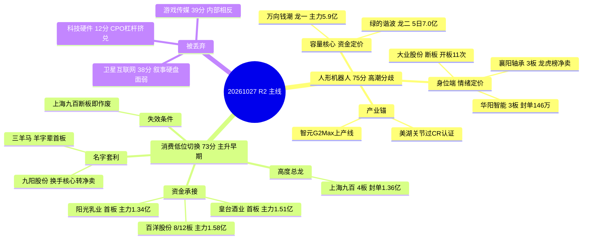

> **数据源新鲜度**: partial（上游四源当日生成，行情同口径 20261026 收盘；缺北向/杠杆）
> **降级状态**: true（R1 0.49 / R7 0.74；因子层设计内跳过；公众号源断）
> **置信度**: 0.72（研究质量分，不是胜率）

# 2026年10月27日 · **主线研判**（盘前）

## 一句话结论

**人形机器人 75 分只剩容量核心在扛、消费名字套利 73 分靠低位切换起量；两条线都只认龙一，中位与身位股全部降观察。**

---

## 一、市场坐标：宽度还在，高度已废

| 指标 | 数值 | 口径 / 来源 |
|---|---|---|
| 涨停 / 跌停 / 炸板 | **55 / 26 / 23** | `tushare limit_list_d` 20261026 · 炸板率 **29.49%** |
| 连板梯 | 1板 **40** · 2板 8 · 3板 6 · 4板 **1** | 同上 · 4 板唯一（上海九百） |
| 全市场广度 | 涨 **2252** / 跌 **3157** · 成交 **16231 亿** | `R7 market_breadth` · 前日 19729 亿 |
| 昨日涨停溢价 | 收盘中位 **+2.38%** · 开盘中位 **+3.04%** | 82 家样本（20261023 涨停股） |
| 情绪浓度 | **36**（R1 独立测算 40.6） · 次日信号 **弱修复 +0.15** | `R3_sentiment.json` |
| 风格 / 总仓上限 | **震荡分化型** / **45%** | `R1_style.json` |
| 主力资金 | 5 日 **-1126.66 亿**（4/5 日流出） · 电子单日 **-146.16 亿** | `R7 market_windows` |

一句话读法：**55 家涨停里 40 家是首板，4 板只有上海九百一只孤峰，跌家数比涨家数多 905 家** —— 这不是普涨，是存量资金在高低之间搬家。R1 因此给「震荡分化 + 45% 上限」，R3 把次日判成「弱修复」并注明 14 条观点里 12 条隐含「有冲高就卖」。

**这条判断直接决定 R2 的打分权重**：宽度型市场里，热度与涨停家数会奖励「铺开的方向」，但真正能接力的是「有容量核心承接」的方向 —— 所以人形机器人（容量核心在）排在消费（纯名字套利）之前，尽管后者共振更干净。

| 板块（行业口径） | 当日主力净额 | 5 日 | 位置 |
|---|---:|---:|---|
| 汽车 | **+11.60 亿** | -17.09 亿 | 单日转正、5 日仍负 |
| 汽车零部件 | **+10.23 亿** | **+10.73 亿** | 唯一当日 5 日双正的大行业 |
| 数字芯片设计 | +9.90 亿 | **+81.26 亿** | 资金最硬但股价 -2.80% |
| 医疗服务 | +7.85 亿 | -5.35 亿 | 单日转正 |
| 游戏Ⅱ | +7.66 亿 | -8.12 亿 | 单日转正 |
| 电子 | **-146.16 亿** | -174.15 亿 | 流出第一，CPO/PCB 重灾区 |

概念口径要点名一条：**人形机器人 5 日 +105.72 亿为全市场概念第 1、当日 +26.32 亿**，但行业口径里「机器人」只有 +2.78 亿、排第 17 —— 两个口径不同不可混算，这也是本线交叉验证 R7 判 false 的原因（详见第三节）。

---

## 二、五维打分总表（0–20 × 5，相加不放大）

| 方向 | 热度 | 资金 | 涨停 | 叙事 | 共振 | 合计 | 分层 | 态度 |
|---|---:|---:|---:|---:|---:|---:|---|---|
| **人形机器人 / 减速器** | 14 | 19 | 18 | 19 | 5 | **75** | 核心主线 · 高潮分歧 | 只做龙一，禁身位股 |
| **消费 / 低位切换（羊字辈）** | 17 | 14 | 16 | 8 | 18 | **73** | 核心主线 · 主升早期 | 龙一打板 / 龙二低吸 |
| CXO / 创新药 / 抗癌 | 15 | 12 | 8 | 17 | 13 | 65 | 次线 | 观察，等首板广度 |
| 物理AI / 数据采集 | 18 | 11 | 13 | 14 | 8 | 64 | 次线 | 修复即卖，不给新仓 |
| 油气 / 油服 | 12 | 14 | 3 | 19 | 9 | 57 | 次线 | 防守观察，无涨停基因 |
| 游戏 / 传媒 | 12 | 13 | 6 | 3 | 5 | 39 | 丢弃 | 内部相反，不进 |
| 卫星互联网 / 商业航天 | 10 | 4 | 2 | 17 | 5 | 38 | 丢弃 | 叙事硬但盘面反向 |
| 科技硬件 / CPO·PCB·存储 | 8 | 1 | 1 | 0 | 2 | 12 | 丢弃 | 回避，反抽即减仓 |

打分口径：热度=概念榜排名与热度值变化 + 个股人气跃升（霸榜警报封顶）；资金=R7 同口径 5 日净额（行业与概念不相加）；涨停=`limit_cpt_list` 家数 + 梯队结构；叙事=R4 `sectors_catalyzed` 的 strength 与 net_score；共振=R3 共振等级 + 霸榜警报归零。**分数是研究排序，不是胜率，也不是开仓许可。**

两条主线 75 / 73 分只差 2 分，但性质完全相反：一条是「有资金没情绪」，一条是「有情绪没资金」。这个差异决定了它们各自只能做一种买点。

---

## 三、主线一 · 人形机器人 / 减速器（75 分 · 高潮分歧）

**核心事实**：机器人概念 23 家涨停（前日 43）、人形机器人 14 家（前日 26），广度腰斩；但概念主力当日 +26.32 亿、5 日 +105.72 亿仍是全市场概念第 1。**家数在退、钱没退，定价权从身位股交到容量核心。**

### 三条推理深度

- **大资金意图**: 机构在 10-23（+71.43 亿）与 10-26（+26.32 亿）两次净流入，买的是「智元 G2 Max 上产线 + 美湖谐波关节过 CR 认证 + 上纬 20cm」这条量产三连的产业确认，而不是情绪。对手盘是 10-23 前在 6 板大业股份上接力的游资 —— 大业当日 +8.08% 断板、开板 11 次、换手 38%，资金从它身上撤出后没有离开板块，而是转向流通 422.9 亿的万向钱潮，这是「同板块内部的仓位再平衡」。
- **为什么走强**: 位置看，板块 11 日龄、龙头高度从 6 板掉到 3 板，属高潮后的第一次分歧；催化看，量产三连是硬产业事件（不是预期稿）；筹码看，龙虎榜万向单日净买 3.74 亿（净占比 14.92%）、机构专用 1.63 亿，而襄阳净卖 0.46 亿、华阳净卖 0.38 亿 —— 三维交叉的结论是「强的是容量端，弱的是身位端」。
- **逻辑够不够硬**: 硬在产业事件 + 资金双确认（两个独立源），但**共振维只有 5 分**：R3 判 `distribution_alert=true`（宇树热股 16→1 连续霸榜 + 证券时报/上海证券报两次风险提示稿），按红线 5 热度与共振不计正分。可能的证伪路径很明确 —— **今日机器人概念涨停家数若跌破 15 家、或万向未能维持封单 1 亿以上，则「资金迁移」解释失效，改为「资金被套在高位等解套」**，整线降为次线。

### 生命周期

| 指标 | 数值 | 判读 |
|---|---|---|
| 板块年龄 | **11 日** | 主升中后段，不是新题材 |
| 龙头高度 | **3 板**（前值 6 板） | 高度塌陷，情绪退潮迹象 |
| 资金持续 | 3/5 日净流入，5 日 +105.72 亿 | 钱还在，但集中在 2 天 |
| 今日炸板率 | **29.49%** | 未破 35% 阈值，情绪=震荡不是主跌 |

**阶段动作**：`climax` → 只做龙一（万向钱潮）分歧后的弱转强，禁追缩量一字、禁身位股打板、不加补涨。断板或板块主力转出即整线降级。

### 龙头候选

| 角色 | 标的 | 板型 | 涨幅 | 封单 | 开板 | 主力当日 | 5 日 | 流通市值 | 资格 |
|---|---|---|---:|---:|---:|---:|---:|---:|---|
| **龙一** | 万向钱潮 000559 | 2 板 | +10.04% | 1.42 亿 | 2 | **+5.90 亿**（23.51%） | +9.36 亿 | 422.9 亿 | 执行前置 ✅ |
| **龙二** | 绿的谐波 688017 | 未涨停 | +1.03% | — | — | +1.73 亿 | +7.03 亿 | 537.2 亿 | 执行前置 ✅ |
| 身位股 | 襄阳轴承 000678 | 3 板 | +9.98% | 1.08 亿 | 5 | +0.65 亿 | — | 66.9 亿 | 仅打板确认 ❌ |
| 候补 | 模塑科技 000700 | 2 板 | +10.02% | 0.76 亿 | 1 | +2.70 亿 | +5.26 亿 | 120.0 亿 | 观察 ❌ |
| 候补 | 华阳智能 301502 | 3 板 | +20.00% | **146 万** | 5 | +0.16 亿 | — | **18.4 亿** | 剔除 ❌ |

龙一为什么不是连板最高的襄阳轴承：按 v1.3 口径 **带动性 > 辨识度/容量 > 身位**。襄阳 3 板但龙虎榜净卖、开板 5 次、封单 1.08 亿靠接力盘；万向 2 板但主力净占比 23.51% 全场涨停股第 1、龙虎榜单日净买 3.74 亿、容量 422.9 亿，且汽车零部件 6 家涨停是板块内最多的带动源。**连板高度是结果，带动性才是原因。**

---

## 四、主线二 · 消费 / 低位切换（73 分 · 主升早期）

**核心事实**：消费链 9 家涨停（休闲食品 3、白酒 1、乳品 1、饲料 1、一般零售 1、铁路公路 1、汽车服务 1），上海九百 4 板为全市场最高标；但 R4 的 8 条事件里没有一条消费催化 —— 这条线的驱动是**资金跷跷板 + 名字套利**，不是产业。

### 三条推理深度

- **大资金意图**: 买的是「物理AI 与机器人退潮后的低位承接」。10-26 机器人概念涨停从 43 掉到 23、物理AI 缩量回调，钱需要一个不考验业绩的方向过渡，于是选了流通盘小（上海九百 48.5 亿）、有上海国资属性的低位零售，并把「羊字辈」做成名字游戏（三羊马首板、百洋 12 天 8 板、九阳被当换手核心）。对手盘是次日接力的游资，不是机构 —— 所以上海九百主力当日净卖 0.58 亿（-13.89%），封单 1.36 亿全部来自接力盘。
- **为什么走强**: 位置极低（一般零售长期无人问津，东百集团 20 日位置仅 33 分位）；催化是**伪催化**（无事件，纯情绪）；筹码上上海九百 5 日 +46.5%、位置 100% 分位、开板 1 次首现松动。三维交叉的读法是：**低位起、高位分歧、筹码由主力转向接力盘**。
- **逻辑够不够硬**: 不硬。四源交叉只有两源成立（R3 rank1 + 盘面 9 家涨停），R4 零催化、R7 行业资金仅 +2.92 亿排第 21，CV=0.33。**硬证据只有一条：4 板高度 + 封单 1.36 亿（全场第 2）**。证伪路径同样明确 —— R3 自己写了「保质期 1-3 日、上海九百断板整线失效」，所以**上海九百一旦断板，这条线当日作废，不看任何补涨**。

### 生命周期

| 指标 | 数值 | 判读 |
|---|---|---|
| 板块年龄 | **4 日** | 主升早期 |
| 龙头高度 | **4 板**（全市场唯一） | 情绪总龙头位 |
| 资金持续 | **1/5 日**（仅 10-26 转正） | 只有一天，不足以称趋势 |
| 内部分化 | 2 只炸板（元祖 +8.11%、新华百货 +0.64%）、1 只跌停（味知香 -10.01%） | 横向铺开，不是向上打开 |

**阶段动作**：`early_up` → 优先龙一与低位首板；龙二只做分歧低吸不打板；龙头断板即整线作废。

### 龙头候选

| 角色 | 标的 | 板型 | 涨幅 | 封单 | 开板 | 主力当日 | 流通市值 | 资格 |
|---|---|---|---:|---:|---:|---:|---:|---|
| **龙一** | 上海九百 600838 | **4 板**（全场最高） | +10.00% | 1.36 亿 | 1 | **-0.58 亿**（-13.89%） | 48.5 亿 | 执行前置 ✅ |
| **龙二** | 百洋股份 002696 | 1 板（12 天 8 板） | +10.05% | 0.57 亿 | 1 | +1.58 亿（16.77%） | 37.7 亿 | 执行前置 ✅ |
| 候补 | 东百集团 600693 | 未涨停 | +7.77% | — | — | +1.11 亿 | 78.4 亿 | 观察 ❌ |
| 候补 | 阳光乳业 001318 | 首板 | +10.00% | 0.44 亿 | 1 | +1.34 亿（30.87%） | 34.2 亿 | 观察 ❌ |
| 候补 | 皇台酒业 000995 | 首板 | +10.04% | 0.43 亿 | 2 | +1.51 亿（26.88%） | 23.7 亿 | 观察 ❌ |

这条线的反常之处必须写清：**龙一主力净卖、龙二主力净买**。正常主升是龙头吸金、跟风喝汤；这里反了，说明钱在挑「还没涨透的」而不是「已经最高的」。所以龙一的资格靠的是**高度与封单**（情绪定价），龙二的资格靠的是**资金与换手**（筹码定价）—— 两者不能互推。

---

## 五、结构图：两条主线共用一条「低位承接」逻辑

读法：左边是「有资金没情绪」，右边是「有情绪没资金」，中间的共同点是**都不在自己板块的最高位加仓，而是在低位或容量端承接**。这不是巧合，是存量市场的必然 —— 5 日主力净流出 1126.66 亿的环境里，任何方向都只能做「结构」不能做「总量」。

---

## 六、四只核心票的思维链（研究记录，不是买入建议）

### 万向钱潮 000559.SZ · 人形机器人容量核心（龙一）

- **买入理由**: ①产业锚硬 —— 智元 G2 Max 已在产线应用、美湖谐波关节过 CR-3-05 认证，机器人零部件 6 家涨停，公司是汽零链里唯一流通超 400 亿的容量标的；②资金锚硬 —— 当日主力 +5.90 亿（净占比 23.51%）为全场涨停股第 1，5 日 +9.36 亿（4/5 日为正），龙虎榜单日净买 3.74 亿（+14.92%），机构专用 1.63 亿。
- **风险点**: ①位置 12.71 为 20 日新高、分位 100%，2 板后追高属右侧末端；②龙虎榜 3.74 亿集中在单日，若次日转净卖则「接棒」证伪；③板块 `distribution_alert` 未解除，个股再强也受板块 β 约束，宇树两次风险提示稿是头顶的监管阴影。
- **止损条件**: 跌破 5 日线 **11.55** 且 30 分钟未收回 → 逻辑证伪离场；开盘 30 分钟内封单低于 **0.7 亿**（较 1.42 亿减半）→ 视为接棒失败，不等收盘。
- **可验证假设**: 今日机器人概念涨停家数 **≥18 家** 且万向维持封单 **≥1 亿** → 「资金迁移到容量核心」成立；反之若涨停跌破 15 家或万向开板 ≥3 次，则改为「高位套牢」解释，整线降次线。

### 绿的谐波 688017.SH · 减速器辨识度中军（龙二）

- **买入理由**: ①谐波减速器是机器人本体成本占比最高的环节，产业逻辑最硬；②资金 5 日 +7.03 亿（4/5 日为正）为减速器链第 1，当日板块 -1.52% 时仍逆势 +1.73 亿；③流通 537.2 亿，是承接大资金的中军体量。
- **风险点**: ①10-26 盘中最高 318.8（+9.9%）后收 293，上影 -8%，冲高兑现痕迹明显；②科创板 20cm 波动放大，情绪退潮先杀中军；③当日仅 +1.03%，无涨停意味着没有情绪溢价保护。
- **止损条件**: 回踩跌破 10 日线且当日收盘不能收回 → 中军破位，离场；若机器人概念当日涨停 <15 家，不等破位直接降观察。
- **可验证假设**: 今日若出现「板块缩量但绿的谐波放量收阳」→ 洗盘成立，可继续持有研究资格；若缩量收阴且主力转净卖，则判派发。

### 上海九百 600838.SH · 消费低位切换总龙（龙一）

- **买入理由**: ①4 板为全市场唯一最高标，封单 1.36 亿全场第 2，首封 09:25 属竞价一字后开板回封，情绪定价权明确；②R3 rank1 主题（L1+L2，4 个 L1 源 + 4 个群 + 2 家官媒报道），共振维 18 分为全表最高；③流通仅 48.5 亿，低位小盘更易被游资控盘。
- **风险点**: ①主力当日净卖 0.58 亿（-13.89%），封单靠接力盘不是主力；②5 日 +46.5%、位置 100% 分位，5 板即触发异动监管；③叙事维只有 8 分 —— R4 八条事件零消费催化，故事由「上海国资 + 消费低位 + 羊字辈」三条拼凑，任何一条被证伪都会连锁松动；④同板块味知香跌停、元祖与新华百货炸板，宽度是铺开不是打开。
- **止损条件**: 断板即出，不看次日反抽；若开盘一字未遂、9:35 前跌破 **11.60**（前一日涨停价 11.00 上方 5.5%）→ 视为分歧转退潮，放弃。
- **可验证假设**: 今日能否「开板后回封且封单不低于 0.7 亿（1.36 亿的一半）」—— 成立则 5 板可期、整线延续；不成立则名字套利当日失效，R3 的「保质期 1-3 日」兑现。

### 百洋股份 002696.SZ · 名字套利第二载体（龙二）

- **买入理由**: ①累计 8/12 板为消费链板数最高，10-22 曾 -6.75% 炸板后 10-26 再涨停，抗打击能力已验证；②主力 +1.58 亿（净占比 16.77%）为链内第 1，龙虎榜单日净买 0.56 亿；③换手 26.58% 说明筹码在高频交换，接力盘充足。
- **风险点**: ①12 天 8 板、20 日 +68.4%、位置 96% 分位，属高位换手末期；②流通 37.7 亿在 50 亿 caution 档以下，一旦 -5% 回撤易踩踏；③龙虎榜净买仅 0.56 亿，资金证据强度弱于表面印象（原表曾误记为 1.67 亿，已按去重规则修正）。
- **止损条件**: 跌破 5 日线 **10.4** 或当日炸板后 30 分钟未回封 → 高位换手转派发，离场。
- **可验证假设**: 今日若「换手继续 >20% 且收盘涨幅 >+5%」→ 接力盘还在；若换手 >25% 而收盘翻绿，则判最后一棒。

---

## 七、执行口径：研究前置资格 4 只，最终由 D1 按实价定

| 标的 | 研究资格 | 通道 | 前置条件（盘前不可省的硬条件） |
|---|---|---|---|
| 万向钱潮 000559 | ✅ 执行前置 | 半路 / 分歧低吸 | 必须低开不破 5 日线 11.55 且半小时内放量翻红；一字板不追 |
| 上海九百 600838 | ✅ 执行前置 | 打板（仅分歧回封） | 必须开板后回封且封单 ≥0.7 亿；一字板不追 |
| 绿的谐波 688017 | ✅ 执行前置 | 低吸（回踩确认） | 回踩 10 日线不破且板块涨停 ≥15 家 |
| 百洋股份 002696 | ✅ 执行前置 | 低吸（深度回踩） | 只做回踩 5 日线，不打接力板 |

**三条盘前不可让渡的约束**：

1. **仓位上限 45% 来自 R1，R2 不给仓位数字**。两条主线分属机器人链与消费链，但机器人链内部（万向 + 绿的）敞口需按单一板块合并计算，不得各算一份。
2. **盘前无价，不虚构入场价与盈亏比**。所有 RR 必须由 D1 在 09:25 用竞价实价重算；收盘口径下本 skill 不宣称任何票满足 RR≥2。
3. **身位股与候补全部不进执行池**：襄阳（龙虎榜净卖 0.46 亿、开板 5 次）、模塑（13:03 才首封）、华阳（流通 18.4 亿 <20 亿 hard_reject + 封单 146 万 + 净卖 0.38 亿）—— 按纪律 §2「只做龙头或低位，躲中位和杂毛」，一律只留痕。

---

## 关键证据

- 证据 1: 机器人概念涨停 **43→23**、人形机器人 **26→14**，而人形机器人概念 5 日主力 **+105.72 亿** 为全市场概念第 1 · 来源 `tushare limit_cpt_list` + `moneyflow_ind_dc`
- 证据 2: 万向钱潮当日主力 **+5.90 亿（净占比 23.51%）**、封单 1.42 亿、龙虎榜单日 **+3.74 亿（净占比 14.92%）**，为全场涨停股资金第一 · 来源 `moneyflow_dc` + `top_list`(去重后)
- 证据 3: 上海九百 **4 板**为全市场唯一最高标、封单 **1.36 亿**全场第 2，但主力 **-0.58 亿（-13.89%）** → 高度与资金背离 · 来源 `limit_step` + `moneyflow_dc`
- 证据 4: R3 rank1 为「消费/羊字辈名字套利」（L1+L2、positive、early），rank3 人形机器人带 `distribution_alert=true`（宇树热股 16→1 + 两次风险提示稿）· 来源 `R3_sentiment.json`
- 证据 5: R4 八条事件中无一条消费催化；人形机器人量产三连 net_score **0.74（high）**；光模块/CPO **-0.706（high 负面）** · 来源 `R4_news.json`
- 证据 6: 全市场 5 日主力 **-1126.66 亿**、电子单日 **-146.16 亿**，科技硬件按 R4 负面硬约束直接丢弃 · 来源 `R7_capital_flow.json`

---

## 数据源审计

| 源 | 日期 | 状态 | 备注 |
|---|---|:--:|---|
| R1 风格研判 | 2026-10-27 | 🟡 | status=degraded(0.49) · 震荡分化型 / 情绪 40.6 / 上限 45% |
| R3 情绪共振 | 2026-10-27 | 🟢 | 5 条共振主题 + 3 条 watch · 最高 L1+L2（WeFlow 永久下线） |
| R4 消息面 | 2026-10-27 | 🟢 | 8 条事件 · degraded=true（公众号源 AuthKey 失效） |
| R7 资金面 | 2026-10-27 | 🟡 | degraded=true · 行业/概念口径分列 · 北向缺 |
| tushare limit_list_d | 2026-10-26 | 🟢 | 104 行 · 涨停 55 / 跌停 26 / 炸板 23 |
| tushare limit_step | 2026-10-26 | 🟢 | 15 行 · 梯 4/3/2 板全量 |
| tushare limit_cpt_list | 2026-10-26 | 🟢 | 20 行 · 机器人 23 / 人形 14 / 数据要素 11 |
| tushare daily_basic | 2026-10-26 | 🟢 | 5570 行 · 逐票流通市值 |
| tushare moneyflow_dc | 2026-10-26 | 🟢 | 10 票 · 主力净额与净占比逐个复核 |
| tushare top_list | 2026-10-26 | 🟢 | 89 行 · 同票多 reason 去重、单日与累计窗不叠加 |
| tushare moneyflow_ind_dc | 2026-10-26 | 🟢 | 行业 9920 / 概念 10180 行 · 20 日序列 |
| 因子快照 weekly_ir_scan | — | 🔴 | 脚本从未实现、目录从未生成 · 设计内降级 |
| 北向净流入 | 2026-10-26 | 🔴 | tushare moneyflow_hsgt 为成交额口径，方向不可用 |
| WeFlow / XTick | — | 🔴 | 永久下线 / 无 token · 情绪只剩 L1+L2 |
| 公众号源 mptext | 2026-10-27 | 🟡 | 81 篇 · AuthKey 失效，仅 RSS 兜底 |

---

## 不确定性 / 反证

1. **「资金迁移」vs「高位套牢」无法今日区分**。支持迁移的证据是万向的容量与主力净占比、汽零 6 家涨停；支持套牢的证据是涨停家数腰斩而 5 日资金仍为正 —— 后者可以解释为「钱被困在跌不动的票里等解套」。裁决点在今日 10:00 前的涨停家数与万向封单，两条都已写进可验证假设。
2. **消费线的最大风险是它自己承认的短命**。R3 原文即注明「保质期 1-3 日、上海九百断板整线失效」，且 CV=0.33 < 0.34 阈值 —— 按 v1.2 契约 D1 应把它降到 watch_pool。R2 仍列为主线，理由是尊重 R3 rank1 + 9 家涨停 + 4 板高度三重盘面证据，**这是本报告最可能被证伪的一处判断**，请 R6 优先反证。
3. **R1 与 R2 的主线数量冲突未消除**。R1 代理口径判 1 条（≥20 家涨停概念数=1），R2 五维判 2 条。差异源于口径：R1 数「概念家数」，R2 数「维度加权」。本报告不调和一个错的数字，只披露差异 —— 若今日消费线涨停缩到 5 家以下，则 R1 口径正确、R2 应回到 1 条主线。
4. **数据缺口不补**：因子层（个股排序无量化验证）、北向（方向不可用）、两融杠杆（未接入）、跨资产（外盘 stale）—— 这四项会让「容量核心优于身位股」的排序缺少量化交叉验证，只能靠资金与带动性两个定性维度支撑。
5. **本 skill 自检已修正一处口径错误**：首版把 top_list 同日同票多行直接相加（万向 6.61→3.74、百洋 1.67→0.56、模塑 1.03→0.52、华阳 -0.77→-0.38 亿）。修正不改变龙一/龙二排序，但**百洋的资金证据强度下调一档**，其龙二身份现在更多依赖「累计 8/12 板 + 换手 26.58%」而非龙虎榜。

---

## 与其他 R / D / E 的关系

- 依赖: `R1_style.json`（风格/情绪/仓位上限）、`R3_sentiment.json`（共振与热榜）、`R4_news.json`（叙事催化）、`R7_capital_flow.json`（资金口径）
- 被消费: **D1**（选 execution_pool，须优先取 CV≥0.67 的主线，消费线 CV=0.33 应降 watch）、**R5**（对 4 只执行前置票画像）、**R6**（反证，重点打消费线短命与机器人「资金迁移」假设）、**E1**（T+N 回填可验证假设）

---

## Sub-Agent 元数据

- skill: analyze_main_sectors_v1（v1.3 辨识度优先口径）
- artifact: `data/research/20261027/R2_main_sectors.json`
- 生成耗时: 约 55 分钟（含独立复拉校验）
- model: llm_v1
