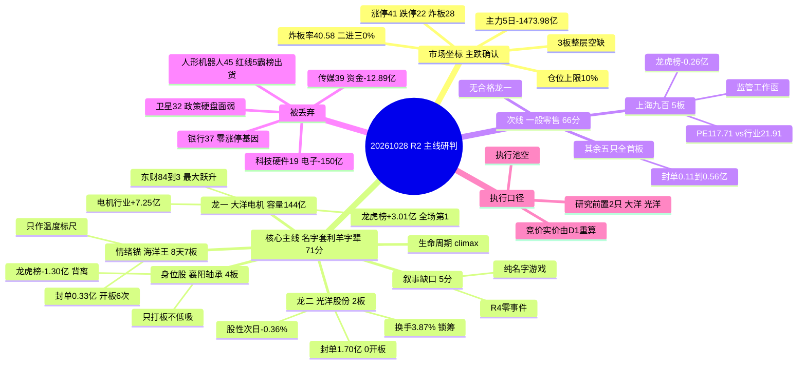

> **数据源新鲜度**: partial（五源当日可达，行情同口径 20261027 收盘；缺羊字辈板块口径、两融杠杆、北向方向）
> **降级状态**: true（R1 0.49 / R7 0.72 / R4 公众号源；因子层设计内跳过）
> **置信度**: 0.66（研究质量分，不是胜率）

# 2026年10月28日 · **主线研判**（盘前）

## 一句话结论

**主跌确认日只剩一条能站住的主线：名字套利/羊字辈 71 分、处于高潮分歧，只认龙一龙二；一般零售 66 分被监管工作函按住降为次线，人形机器人 45 分按霸榜出货红线整块丢弃 —— 执行池空仓，等竞价实价。**

---

## 一、市场坐标：这是主跌确认，不是震荡

| 指标 | 数值 | 口径 / 来源 |
|---|---|---|
| 涨停 / 跌停 / 炸板 | **41 / 22 / 28** | `tushare limit_list_d` 20261027 · 炸板率 **40.58%** |
| 连板天梯 | 1板 **29** · 2板 8 · **3板 0** · 4板 3 · 5板 1 | 同上 · **3 板整层空缺** |
| 二进三 / 一进二 晋级率 | **0.0%** / 18.18% | XTick `jj2t3` / `jj1t2` · 2 板以上接力无承接 |
| 全市场广度 | 涨 **606** / 跌 **4922** / 平 42 · 中位 **-2.97%** | 独立复算 `tushare daily`（与 R7 逐位一致） |
| 成交额 | **14728.97 亿**（前日 16230.9 亿，-9.25%） | 同上 |
| 昨日涨停溢价 | 开盘均值 +1.58% / 中位 +0.39%；收盘均值 +1.36% / 中位 +0.82% | `R1_style.json` · 55 家样本 |
| 情绪浓度 | R1 **38.0**（恐惧）/ R3 **31.0** | 两个独立测算都指向恐惧 |
| 风格 / 总仓上限 | **崩溃退潮型** / **10%** | `R1_style.json` · 主跌下限生效 |
| 主力资金 | 5 日 **-1473.98 亿**（1/5 日为正）· 20 日 **-6218.45 亿** | `R7 market_windows` |

一句话读法：**跌 4922 家、成交缩到 1.47 万亿、3 板整层空缺、二进三 0%** —— 这不是「震荡分化」，是宽度与高度同时塌掉的主跌段。R1 因此把仓位上限压到 10% 并判「无主线（代理口径）」，R3 把次日判成「震荡：早盘承压 → 日内冲高 → 尾盘再兑现」，14 条观点里 13 条的动作是「冲高卖」而不是「低吸买」。

**这条判断直接决定 R2 的打分权重**：主跌段里，热度与涨停家数会奖励「还在动的方向」，但只有**资金与价格双正**的方向才可能在次日还有承接。所以本报告不按「谁涨停最多」排序，而按「谁的钱是真的、价格是红的」排序。

| 板块（行业口径） | 当日主力净额 | 5 日 | 当日涨跌 | 判读 |
|---|---:|---:|---:|---|
| 银行Ⅱ | **+7.70 亿** | -26.81 亿 | +1.34% | 避险去处，零涨停基因 |
| 电机Ⅱ | **+7.25 亿** | **+17.54 亿** | +1.38% | **唯一「当日+5 日双正」的成规模行业** |
| 光学元件 | +3.22 亿 | +7.58 亿 | -2.33% | 资金在接、价格在跌 → 逆势吸筹 |
| 工业金属 | +2.82 亿 | -41.44 亿 | -1.42% | 单日脉冲，5 日仍在流出 |
| 一般零售 | +2.49 亿 | +3.20 亿 | +0.98% | 连续 3 日净流入 |
| 百货 | +1.96 亿 | +3.28 亿 | **+2.42%** | 同上，板块当日最强 |
| **电子** | **-150.36 亿** | -335.12 亿 | -3.96% | 流出第一，CPO/PCB/存储重灾区 |
| 半导体 | -76.47 亿 | -101.63 亿 | -4.54% | R4 韩国央行警告直接对应 |
| 元件 / 印制电路板 | -36.23 / -30.16 亿 | -174.75 / -148.65 亿 | -4.20 / -4.68% | 科技硬件无差别被卖 |
| 机器人 | -3.46 亿 | +9.26 亿 | -3.61% | 5 日仍正、当日转负 → 存量搬家 |
| 传媒 | -12.89 亿 | -44.97 亿 | -2.36% | 热度在个股、资金在离场 |

**市场在为什么付钱**：钱只去了三个地方 —— 银行（避险）、电机-机器人（+7.25 亿，5 日 +17.54 亿）、光学元件（逆势吸筹）。三者里只有**电机是「资金 + 价格」双正**，这是本报告只给电机链一条主线的根因。**谁有地位**：全场唯一最高标是零售的上海九百 5 板，但它的资金是净卖的（龙虎榜 -0.26 亿），地位来自高度不来自钱；真正的钱在电机链的容量端。

---

## 二、五维打分总表（0–20 × 5，相加不放大）

| 方向 | 热度 | 资金 | 涨停 | 叙事 | 共振 | 合计 | 分层 | 态度 |
|---|---:|---:|---:|---:|---:|---:|---|---|
| **名字套利/羊字辈（羊·洋·阳）** | 18 | 15 | 18 | **5** | 15 | **71** | 核心主线 · 高潮分歧 | 只做龙一/龙二 |
| 一般零售/内需百货 | 15 | 16 | 17 | 8 | 10 | **66** | 次线 | 监管函未解，只观察 |
| 人形机器人/减速器·电机零部件 | **3** | 9 | 18 | 10 | **5** | 45 | 丢弃 | 霸榜出货，4 板不接 |
| 传媒/AI短剧 | 15 | 2 | 2 | 10 | 10 | 39 | 丢弃 | 热度有、承接无 |
| 银行/红利 | 8 | **18** | 0 | 3 | 8 | 37 | 丢弃 | 避险去处，非短线标的 |
| 铜/工业金属 | 8 | 10 | 0 | 17 | 0 | 35 | 丢弃 | 事件硬、盘面零承接 |
| 卫星互联网/商业航天 | 6 | 4 | 0 | **18** | 4 | 32 | 丢弃 | 政策最硬、盘面最弱 |
| 创新药/CXO | 6 | 8 | 0 | 14 | 2 | 30 | 丢弃 | 无首板广度 |
| 冰雪产业 | 12 | 12 | 0 | 0 | 4 | 28 | 丢弃 | 自救盘，非进攻共识 |
| 存储/CPO/PCB（科技硬件） | 10 | 4 | 0 | 3 | 2 | 19 | 丢弃 | 电子链 -150 亿，回避 |

打分口径：**热度**=概念榜排名与热度值变化 + 个股人气跃升（霸榜警报封顶归零）；**资金**=R7 同口径 5 日净额（行业与概念不相加，名字集合取载体行业）；**涨停**=`limit_cpt_list` 家数 + 天梯结构；**叙事**=R4 `sectors_catalyzed` 的 strength 与 net_score；**共振**=R3 共振等级 + 正向/负向 + 霸榜警报归零。

**分数是研究排序，不是胜率，也不是开仓许可。**

三处必须解释的打分动作：

1. **45 分的机器人为什么整块丢弃**（它涨停维 18 分全表并列最高）。红线 5：人形机器人概念榜连续 5 个观测日第 1，热度值 149729 → 107879 → 57662（两日 -47%），板块当日 -2.76%、主力 -70.24 亿 —— 霸榜 + 量价背离是本单元定义的最高级别出货形态，热度与共振两维不计正分。叠加 R4「六家公司澄清机器人业务占比极小」判 `纯概念跟风杂毛 -0.774`，4 板的多伦科技（软件，4 连板后自曝不涉本体）、赛福天（钢丝绳送样阶段、封单仅 0.25 亿）都是身位股不是龙头。
2. **71 分的名字套利为什么能当核心，66 分的零售不能**。差的不是 5 分，是性质：名字套利拿到的是「热度 + 资金 + 涨停」三项同时成立，唯一的缺口是叙事（5 分）—— 这是结构性缺口，因为名字套利本质无事件；零售的缺口是叙事（8）+ 共振（10），二者指向同一件事：**5 板 + 监管工作函 = 高位兑现，不是主升**。一个「没故事但有资金」，一个「有故事但被监管按住」，主跌段只能选前者。
3. **R1 判 0 条主线、R2 判 1 条，不调和只披露**。R1 用的是代理指标「≥20 家涨停的概念数」（当日最高新能源汽车 18 家），R2 用的是维度加权。纯家数口径下确实没有 20 家以上的概念，但 71 分的名字套利线有 6 只涨停（另 1 只炸板触及）、三平台霸榜、电机资金双正，不能因一个代理指标被抹掉。**若今日羊字辈涨停家数缩到 4 家以下，则 R1 口径正确、本报告应回到「无主线」。**

---

## 三、主线一 · 名字套利/羊字辈（71 分 · 高潮分歧）

**核心事实**：三平台前 30 名里羊字辈占 5 席（襄阳轴承东财 1 / 同花顺 2、海洋王 2 / 1、大洋电机 3、光洋股份 11、阳光乳业 24），6 只涨停（海洋王、襄阳轴承、光洋股份、大洋电机、阳光乳业，加 R3 关联的桂发祥）外加百洋股份炸板 -5.14% 触及，高度为海洋王 8 天 7 板与襄阳轴承 4 板；载体行业电机Ⅱ 当日 +7.25 亿 / 5 日 +17.54 亿。**但 R4 的八条事件里，没有一条落在名字套利上。**

### 三条推理深度

- **大资金意图**：买的是「主跌段里唯一还有赚钱效应的低门槛方向」。10-27 电子链被单边卖出 150 亿、机器人本体（宇树 -4.77%、万向 -5.74%、埃斯顿 -7.00%）在被清仓，钱需要一个不考验业绩、不考验估值、只要有名字就能形成合力的去处 —— 名字套利正好符合：启动成本最低（不需要产业逻辑）、扩散最快（看到「洋」就能联想到同族）、容量可控（流通盘 22–144 亿，游资拉得动）。对手盘是隔日接力的游资，不是机构，所以龙虎榜上买五卖五全是营业部席位。
- **为什么走强**：位置看，海洋王 8 天 7 板、襄阳轴承 4 连板、20 日涨幅分别 +66.96% / +77.49%，是全市场最高位；催化看，**伪催化**（零事件，纯名字游戏）；筹码看，分化已经出现 —— 大洋电机龙虎榜净买 +3.01 亿（全场第 1）、光洋股份 3 日净买 +1.67 亿、海洋王 +1.33 亿，而襄阳轴承单日净卖 -1.30 亿（3 日 -1.11 亿）、百洋股份 -0.55 亿。三维交叉的读法是：**高位、无故事、钱在从身位股换到容量端与低位端**。
- **逻辑够不够硬**：**不硬，这是本报告最可能被证伪的一处判断**。四源交叉只有两源半成立（R3 rank1 + R7 载体资金 + 盘面 6 只涨停），R4 完全缺位，CV=0.67 靠的是「载体行业资金」而不是「名字套利本身有资金口径」。硬证据只有三条：① 三平台霸榜（持续度真实）；② 电机Ⅱ 5 日 +17.54 亿是全场唯一双正行业；③ 6 只涨停（另 1 只炸板触及）+ 4 板/7 板双高度。证伪路径同样明确 —— **海洋王次日若高开后 30 分钟不能封板，或羊字辈涨停缩到 4 家以下，则「名字套利是主线」这个前提直接作废，整线不看任何补涨。**

### 生命周期

| 指标 | 数值 | 判读 |
|---|---|---|
| 线龄 | **5 个交易日** | 从襄阳首板起算，海洋王首封更早（8 天前） |
| 龙头高度 | 海洋王 **7 板**（8 天 7 板，今日反包）/ 襄阳 **4 板** | 高位，天梯最高位是零售的 5 板 |
| 资金持续 | 电机Ⅱ **1 日**连续为正（3/5 日为正，5 日 +17.54 亿） | 钱在，但今天的增量是单日脉冲 |
| 今日炸板率 | **40.58%** | ≥25% → 高潮分歧确认 |

**阶段动作**：`climax` → 只做龙一与龙二（分歧后的弱转强），禁追高缩量一字、禁打 4 板以上身位股、不加补涨。断板或载体行业资金转出即整线降级。

### 龙头候选（5 只，候选数已按炸板率减半）

| 角色 | 标的 | 板型 | 涨幅 | 封单 | 开板 | 龙虎榜 | 主力 5 日 | 流通 | 研究资格 |
|---|---|---|---:|---:|---:|---:|---:|---:|---|
| **龙一** | 大洋电机 002249 | 首板（4 天 2 板） | +10.00% | 1.10 亿 | 1 | **+3.01 亿** | **+5.26 亿** | **144.2 亿** | ✅ 研究前置 |
| **龙二** | 光洋股份 002708 | 2 板（秒板） | +10.03% | **1.70 亿** | **0** | +1.67 亿（3日） | +2.40 亿 | 87.8 亿 | ✅ 研究前置 |
| 身位股 | 襄阳轴承 000678 | **4 板** | +10.03% | 1.28 亿 | 1 | **-1.30 亿** | +3.84 亿 | 73.6 亿 | ❌ 仅打板确认 |
| 情绪锚 | 海洋王 002724 | 8 天 7 板（反包） | +10.00% | **0.33 亿** | **6** | +1.33 亿 | +0.62 亿 | 74.2 亿 | ❌ 仅温度标尺 |
| 候补 | 桂发祥 002820 | 2 板 | +10.01% | 0.44 亿 | 0 | +0.44 亿 | +1.01 亿 | 22.5 亿 | ❌ B 计划补涨 |

**龙一为什么不是连板最高的襄阳轴承，也不是辨识度第一的海洋王**：按 v1.3 口径 **带动性 > 辨识度/容量 > 身位**。

- 襄阳 4 板但龙虎榜单日净卖 1.30 亿、3 日净卖 1.11 亿，与 5 日主力 +3.84 亿方向完全相反 —— 同一票上两个资金口径打架时，以龙虎榜（真实席位）为准，它是**被席位游资卖、被拆单资金接**的结构，次日典型高开低走。
- 海洋王辨识度全场第一（双榜 1–2），但封单只有 0.33 亿、开板 **6 次**、换手 28.85%、成交 20.90 亿 —— 封单是尾盘那一笔打上去的，**封板质量线内最差**，它只能当温度计，不能当买点。
- 大洋电机容量 144.2 亿（线内最大）、龙虎榜净买 3.01 亿（全场第 1）、东财人气 84→3（全市场最大跃升 +81）、电机Ⅱ 行业资金跟着它走，首封后只开板 1 次。**连板高度是结果，带动性才是原因。**

### 与机器人零部件的同源关系（必须写清，否则 D1 会重复计敞口）

羊字辈与机器人零部件**共用同一批筹码**：襄阳轴承、光洋股份、大洋电机同时挂在汽车零部件与机器人链上。10-27 的真实结构是 —— 机器人**本体**在被卖（宇树 -4.77%、万向 -5.74%、埃斯顿 -7.00%、机器人板块主力 -3.46 亿），机器人**零部件低位**在涨（多伦 4 板、赛福天 4 板、光洋 2 板、沪光 2 板、科瑞思 2 板）。这是**存量搬家，不是板块扩散**。

所以 R2 只保留「名字套利」这一个叙事外壳，机器人板块整体丢弃（45 分 < 50），而不是把它当第二条主线 —— 否则 D1 会在同一批票上做双重敞口。**若今日必须只留一条线，留羊字辈；机器人零部件的 4 板是身位股，不是主线。**

---

## 四、次线 · 一般零售/内需百货（66 分 · 函数判 mid_up、实际按 climax 对待）

**核心事实**：6 家涨停（上海九百 5 板、国芳集团、新华百货、广百股份、茂业商业、百大集团），上海九百 5 板为全市场唯一最高标、封单 1.50 亿、0 开板；一般零售当日 +0.98%、5 日主力 +3.20 亿连续 3 日为正，百货当日 +2.42% 为板块最强；`limit_cpt_list` 里「零售」是 top20 概念中**唯一收红**的一个（+0.38%）。

### 三条推理深度

- **大资金意图**：买的是「内需政策的低位补涨 + 科技退潮的避风港」。10-27 科技链被卖 150 亿，钱需要低位、低估值、有政策预期的方向过渡；发改委「扩大内需战略实施方案（2026—2030）研究中」给了故事外壳，上海国资属性给了想象空间。但对手盘结构说明这不是机构行为 —— 上海九百 5 日主力仅 +0.72 亿、龙虎榜净卖 0.26 亿，**封单 1.50 亿全部来自接力盘，主力没有净买**。
- **为什么走强**：位置极低（零售长期无人问津，国芳集团 20 日还 -28.58%，10-27 是深跌反弹），催化是「政策预期 + 名字低位」的拼凑，筹码上上海九百 5 日 +61.14%、位置 100% 分位、0 开板、开盘即封属竞价一字后封死 —— **低位起、高位加速、主力不跟**。
- **逻辑够不够硬**：不硬。证据链里最硬的一条是「资金连续 3 日净流入 + 唯一收红概念」，最软的是叙事（R4 零事件，只有官媒报道）与共振（R3 判 `positive_resonance=false`）。真正的 kill switch 是 **10-27 晚间上交所对上海九百下发监管工作函**（对象含上市公司/董监高/控股股东/实控人），公司同步公告异常波动并自曝静态 PE 117.71、滚动 106.40，而零售业均值只有 21.91 / 21.12 —— **5 板 + 监管函 + 5 倍估值溢价**，高开兑现概率显著高于接力概率。

### 生命周期

| 指标 | 数值 | 判读 |
|---|---|---|
| 线龄 | **5 个交易日** | 上海九百 5 连板 |
| 龙头高度 | **5 板**（全场唯一） | 情绪天花板，也是监管红线 |
| 资金持续 | **3 日**连续净流入（一般零售 +2.49 / +0.27 / +3.42 亿） | 函数因此判 mid_up |
| 结构 | 3 板整层空缺、二进三 **0%** | 从 5 板直接掉到首板，中间无承接 |

**阶段动作**：函数判 `mid_up`（龙头 5 板 + 资金持续 3 天），但 R2 按**实际可操作段位 = climax** 处理并降为次线 —— 监管函 + 二进三 0% + 中间层空缺，这三条里任何一条都足以否掉「主升中期」的操作含义。

### 为什么本线没有龙一

最高标上海九百触发监管工作函 + 5 板 + 估值 5 倍溢价，按禁止清单不可进执行池；其余 5 只**全是首板**，封单 0.11–0.56 亿（新华百货 0.11 亿且尾盘才封、国芳集团尾盘才封且龙虎榜净卖 0.19 亿），无一只具备带动性。按 v1.3「允许 execution_pool 为空，禁止拿弹性核心/杂毛充数」，本线**只给板块分，不给龙头候选**，`leaders_degraded=true`。

---

## 五、被丢弃的方向：一条一句

| 方向 | 分 | 一句否决理由 |
|---|---:|---|
| 人形机器人/减速器·电机零部件 | 45 | 霸榜 5 日第 1 + 热度两日 -47% + 主力 -70.24 亿 + 六家澄清，红线 5 归零热度与共振 |
| 传媒/AI短剧 | 39 | 传媒 -12.89 亿 / 5 日 -44.97 亿；粤传媒 +6.56% 炸板 5 次、慈文跌停、新华传媒 -6.00% |
| 银行/红利 | 37 | 资金最硬（+7.70 亿、四大行收盘新高）但零涨停基因、板块 +1.34%，避险去处不等于短线标的 |
| 铜/工业金属 | 35 | R4 现货铜溢价 206 美元（0.62 high）但板块 -1.42%、5 日 -41.44 亿、零涨停 —— 事件没落到盘面 |
| 卫星互联网/商业航天 | 32 | 星枢计划 2032 千星 + 产业基金（0.646 high）但航天装备 -5.77%、中国卫星 5 日主力 -1.42 亿（0/5 日正） |
| 创新药/CXO | 30 | 医疗研发外包 +2.95 亿但板块 -4.29%、零涨停，缺首板广度 |
| 冰雪产业 | 28 | R3 已判 L1_only，L2 语义是「被埋资金自救」；冰山冷热 -4.43% 龙虎榜净卖，PE 128.99 倍 vs 行业 37.78 倍 |
| 存储/CPO/PCB | 19 | 电子 -150.36 亿为流出第一，R4 韩国央行警告 -0.80 high，R3 判「热度逆势升、价格与资金双杀」 |

---

## 六、结构图：一条真主线 + 一条被监管按住的次线

读法：左边是「真的有资金+价格」的那一条，但它没有故事（叙事 5 分）；中间是「有故事但被监管按住」的那一条；右边一大片是「有热度没资金」——主跌段里，热度是最便宜的东西。

---

## 七、两只核心票的思维链（研究记录，不是买入建议）

### 大洋电机 002249.SZ · 龙一 · 电机容量核心

- **买入理由**：①容量锚硬 —— 流通 144.2 亿为线内最大，是唯一能承接大资金的载体，且上午首封后尾盘回封、中间只开板 1 次，封板质量明显优于海洋王（6 次）；②资金锚硬 —— 龙虎榜净买 **+3.01 亿**为当日全场涨停股第 1，5 日主力 +5.26 亿（3/5 日为正），电机Ⅱ 行业当日 +7.25 亿 / 5 日 +17.54 亿为全市场唯一双正成规模行业；③关注锚硬 —— 东财人气 84→3（+81，全市场最大跃升）、同花顺 29→11，说明资金是「发现」而不是「抱团」；④产业锚不空 —— 电机是机器人执行器的真实环节，不是纯名字游戏，这给了它在名字套利失效时第二个解释。
- **风险点**：①首板封单 1.10 亿对 144 亿流通只有 0.76%，**封板是薄封**，打板不成立，只能等回踩；②位置在 20 日最高点（距高点 0%），5 日 +21.07%、20 日 +17.56%，右侧已走了一段；③它同时属机器人链，机器人板块当日 -3.61%、主力 -3.46 亿，**β 逆风**：本体继续被卖会传导到零部件与电机；④人气 84→3 是「关注度骤升」也是「接盘盘骤升」，次日若高开冲高回落，追进去的就是最后一棒。
- **失效条件（不是交易指令，是逻辑证伪）**：①次日回踩跌破 5 日线 **7.15** 且当日不能收回 → 「容量承接」逻辑失效；②海洋王高开后 30 分钟不能封板且襄阳断板 → 整线前提失效，本票一并作废；③电机Ⅱ 当日主力转为净流出 → 载体资金逻辑失效。**具体止损价与仓位由 D1 依竞价实价与 RR 计算，R2 不给买卖点。**
- **可验证假设**：今日「大洋电机缩量回踩不破 7.15、且电机Ⅱ 主力继续为正」→ 容量承接成立，可继续给研究资格；若「高开 >+5% 后 30 分钟回落翻绿」且封单消失 → 判一日游，整线降级为观察。

### 光洋股份 002708.SZ · 龙二 · 低位二板卡位

- **买入理由**：①封板质量线内第一 —— 封单 **1.70 亿**（封单/流通 1.94%）、**0 开板**、开盘即秒板；②筹码锁定最好 —— 换手仅 **3.87%**，12 只 2 板以上票里最低，说明没有人在板上换手；③位置低 —— 20 日涨幅 -0.17%、距 20 日高 -1.2%，是「低位二板」不是「高位加速」；④资金真 —— 龙虎榜 3 日累计净买 +1.67 亿、5 日主力 +2.40 亿（4/5 日为正）。
- **风险点**：①**股性证伪** —— 过去 11 次涨停的次日收益中位 **-0.36%**、正收益占比仅 45%，二板后接力历史并不好，所以低吸拿不到安全边际，只能打板或竞价确认；②股价仍在 20 日线（15.67）下方，今日 17.22 是**第一次站上 20 日线**，趋势尚未确认；③封单 1.70 亿是秒板形成的，若次日竞价不及预期，这笔封单会最快撤离；④它同样受机器人 β 与羊字辈寿命（1–2 日）双重约束。
- **失效条件**：①炸板后 30 分钟未回封 → 卡位失败；②次日跌破 **15.67（20 日线）** → 低位二板变破位；③龙一（大洋电机）先行破位 → 线内次序失效，本票作废。**止损价由 D1 计算，R2 不给。**
- **可验证假设**：今日「竞价不低于 +3% 且 10 点前封板、封单 ≥1 亿」→ 卡位成立；若「竞价即破 +1% 且换手放大到 10% 以上」→ 判昨日秒板为诱多。

### 两只只作标尺、不给买点

- **襄阳轴承 000678.SZ（4 板，身位股）**：龙虎榜单日净卖 1.30 亿、3 日净卖 1.11 亿，而 5 日主力 +3.84 亿 —— 席位在卖、拆单在买，典型高开低走结构；换手 20.57%、5 日 +42.82%。**唯一用途：它断板则整线作废。**
- **海洋王 002724.SZ（8 天 7 板，情绪锚）**：封单 0.33 亿、开板 6 次、换手 28.85%，尾盘才回封 —— 封板质量线内最差；但股性极强（过去 20 次涨停的次日收益中位 **+8.40%**）。**唯一用途：次日高开 >+4% 后 30 分钟能否封板，决定羊字辈是「续命」还是「退潮」。**

---

## 八、执行口径：执行池空，研究前置 2 只，最终由 D1 按实价定

| 标的 | 研究资格 | 通道 | 前置条件（盘前不可省的硬条件） |
|---|---|---|---|
| 大洋电机 002249 | ✅ 研究前置 | 低吸 / 半路 | 不接一字、不接大幅高开；回踩 5 日线 7.15 附近缩量止跌才看；封单/流通仅 0.76%，打板不成立 |
| 光洋股份 002708 | ✅ 研究前置 | 打板 / 竞价确认 | 只做竞价确认后的板；股性次日中位 -0.36%（n=11），低吸无安全边际 |
| 襄阳轴承 000678 | ❌ 仅标尺 | — | 龙虎榜净卖 1.30 亿 + 5 日 +42.82%，只用于判断整线是否作废 |
| 海洋王 002724 | ❌ 仅标尺 | — | 封单 0.33 亿 + 开板 6 次，只用于判断羊字辈温度 |
| 桂发祥 002820 | ❌ B 计划补涨 | — | 名字关联弱、题材归属漂移；仅当龙一龙二均未破板且自身零开板时作为 B 计划回踩对象 |
| 上海九百 600838 等 6 只零售 | ❌ 无资格 | — | 监管工作函 + 5 板 + 估值 5 倍溢价；其余全首板，无带动性 |

**四条盘前不可让渡的约束**：

1. **执行池空是纪律结果，不是数据缺失**。R1 仓位上限 10%、情绪周期主跌、炸板率 40.58% ≥ 35%、二进三 0%，这四条任意一条单独出现都足以让执行池收缩；四条同时出现，唯一正确的输出是空池。
2. **盘前无价，不虚构入场价与 RR**。本 skill 不宣称任何票满足 RR≥2；所有 RR 必须由 D1 在集合竞价用实价重算。羊字辈处在 climax、叙事维仅 5 分，只够给「研究前置资格」，不够给开仓资格。
3. **单板块敞口合并计算**。羊字辈的 5 只里，襄阳/光洋/大洋同时属汽车零部件与机器人链；若 D1 同时看羊字辈与任何机器人票，敞口须按同一板块合并，不得各算一份。
4. **身位股与候补不进执行池**。襄阳（龙虎榜净卖）、海洋王（封单 0.33 亿、开板 6 次）、桂发祥（题材归属漂移）、百洋（-5.14% 炸板 + 龙虎榜 -0.55 亿 + 股性次日 -2.16%）、三羊马（未板、5 日 -0.89%、20 日线下方）、阳光乳业（2 板开板 4 次、封单 0.17 亿）—— 按纪律「只做龙头或低位，躲中位和杂毛」，一律只留痕。

---

## 关键证据

- 证据 1: 涨停 **41** / 跌停 **22** / 炸板 **28**、炸板率 **40.58%**、天梯 5:1 / 4:3 / **3:0** / 2:8 / 1:29 合计 41 勾稽通过、二进三晋级率 **0%** · 来源 `tushare limit_list_d` + `limit_step` + XTick `jj2t3`
- 证据 2: 广度 **涨 606 / 跌 4922 / 中位 -2.97%** / 成交 **14728.97 亿**，独立复算与 R7 逐位一致，与 R1 的 576/4601 差 30/321 家（口径差异已记录） · 来源 `tushare daily` 全量 5570 只
- 证据 3: 电机Ⅱ 当日 **+7.25 亿** / 5 日 **+17.54 亿**为全市场唯一「当日+5 日双正」的成规模行业；电子 **-150.36 亿**为流出第一 · 来源 `moneyflow_ind_dc` / `R7 sector_flows`
- 证据 4: 大洋电机龙虎榜净买 **+3.01 亿**（全场第 1）、东财人气 **84→3**（最大跃升 +81）、封单 1.10 亿、开板 1 次；光洋股份封单 **1.70 亿 / 0 开板**、换手 **3.87%**；襄阳轴承龙虎榜净卖 **1.30 亿**（3 日 -1.11 亿） · 来源 `top_list`（去重后）+ `dc_hot` + `limit_list_d`
- 证据 5: R3 rank1 为羊字辈（L1+L2、positive、late、crowded），rank2 一般零售（L1+L2 但 **positive=false**），rank3 人形机器人带 `distribution_alert=true`（概念榜连续 5 日第 1、热度两日 -47%） · 来源 `R3_sentiment.json`
- 证据 6: 上海九百 5 连板当日收到上交所监管工作函，公司自曝静态 PE **117.71** / 滚动 106.40，零售业均值 21.91 / 21.12 · 来源 `R3 risks`（level=high）
- 证据 7: R4 八条事件中零条对应名字套利；卫星互联网 **0.646 high**、铜 **0.62 high**、人形机器人零部件 0.361 medium、纯概念杂毛 **-0.774**、半导体设备 **-0.689** · 来源 `R4_news.json sectors_catalyzed`

---

## 数据源审计

| 源 | 日期 | 状态 | 备注 |
|---|---|:--:|---|
| R1 风格研判 | 2026-10-28 | 🟡 | status=degraded(0.49) · 崩溃退潮型 / 情绪 38.0 / 上限 10% / 代理口径主线 0 条 |
| R3 情绪共振 | 2026-10-28 | 🟢 | 5 条共振 + 2 条 watch · 最高 L1+L2（WeFlow 永久下线）· 霸榜警报 1 个 |
| R4 消息面 | 2026-10-28 | 🟢 | 8 条事件 + 17 条板块极性 · degraded=true（公众号源仅 RSS） |
| R7 资金面 | 2026-10-28 | 🟡 | degraded=true(0.72) · 行业/概念分列 · 北向 20 日全净买 +495.63 亿 |
| tushare limit_list_d | 2026-10-27 | 🟢 | 91 行 · 涨停 41 / 跌停 22 / 炸板 28 |
| tushare limit_step | 2026-10-27 | 🟢 | 12 行 · 天梯 5:1/4:3/3:0/2:8/1:29 |
| tushare limit_cpt_list | 2026-10-27 | 🟢 | 20 行 · 机器人 13 / 人形 9 / 汽车零部件 8 / 零售 6 |
| tushare top_list | 2026-10-27 | 🟢 | 88 行 · 同票多 reason 去重、单日与 3 日窗不叠加 |
| tushare moneyflow_dc | 2026-10-21 ~ 10-27 | 🟢 | 5 个交易日全市场逐日现拉 · 逐票 5 日净额 |
| tushare daily / daily_basic | 2026-10-27 | 🟢 | 5570 只 · 广度复算 + 逐票流通市值/换手 |
| 题材心智锚 | 2026-10-20 | 🟡 | 597 概念 · 8 日前快照，仅作辨识度参考不参与打分 |
| 因子快照 weekly_ir_scan | — | 🔴 | 脚本从未实现、目录从未生成 · 设计内降级（非 error） |
| 两融 / 北向方向 | 2026-10-26 | 🔴 | 两融 T+1 滞后、北向为成交额口径方向不可用 · 未用替代值凑数 |
| WeFlow / XTick | — | 🔴 | WeFlow 永久下线（L3 永久缺位）· XTick 无 token 走 HTTP 直连成功（42/23/30） |

---

## 不确定性 / 反证

1. **本报告最可能被证伪的一处：羊字辈到底算不算主线**。它的 71 分里 18 分来自热度、15 分来自载体行业资金，叙事只有 5 分，R4 完全缺位 —— 如果「名字套利」本身不被资金承认为一个方向（只是几只票碰巧名字像），那这条线不是「该降分」，而是「应整体作废」。裁决点在今日：羊字辈涨停家数是否维持 6 家以上、海洋王能否在高开后封板。请 R6 优先反证此处。
2. **羊字辈与机器人零部件共用筹码，存在「一条线打两次」的风险**。襄阳/光洋/大洋同时属两个标签，若 D1 或 E1 把羊字辈与机器人零部件当作两条独立主线各配一次仓位，实际敞口会被放大一倍。本报告已把机器人整体丢弃、只留羊字辈，但**这个处理本身有争议**：另一种合理读法是「主线是机器人零部件低位切换，羊字辈只是最方便的名字外壳」，那就是另一套龙一龙二（多伦/赛福天）。R2 选择前者的理由是资金（电机双正 vs 机器人当日 -3.46 亿）。
3. **零售 66 分里有一处口径矛盾未解**。百大集团在 `limit_list_d` 记为 Z（炸板）但收盘 +10.03%，同一行内自相矛盾；若它实际是涨停，零售涨停家数应为 6（已按 6 计）；若实际是炸板，则 5 家。差 1 家不改变分层，但影响「6 家涨停」这句表述的精度。
4. **R1 与 R2 的广度数字不一致，未强行调和**。R1 记 576/4601/40、成交 14608 亿，tushare daily 全量复算与 R7 均为 606/4922/42、14728.97 亿，中位 -3.02% vs -2.97%。推测 R1 剔除了部分北交所/停牌标的。本报告采用后者并已写入 `corrections_to_upstream`，**差异不改变「宽度崩」的结论**，但说明上游之间存在未对齐的口径。
5. **数据缺口不补**：因子层（个股排序无量化验证）、两融杠杆（未接入，方向不可用）、羊字辈板块口径（无指数，热度与资金只能用个股榜与载体行业还原）。这三项让「龙一为什么是大洋电机而不是襄阳」缺少量化交叉验证，只能靠带动性代理（容量/封单/龙虎榜/关注跃升）支撑。
6. **本 skill 自检已修正两处上游口径**：① R3 记「海洋王烂板没能回封」——收盘口径不成立，`limit_list_d` 记 pct_chg=10.00、尾盘回封，本报告按「高价回封、封单仅 0.33 亿」表述；② R4 把「AMD 入股 Meta + 甲骨文对接 OpenAI」记为正面对光模块/CPO，但同批韩国央行警告 -0.80 high 方向相反，`sectors_catalyzed` 净额 -0.219，本报告按净额判负。

---

## 与其他 R / D / E 的关系

- 依赖: `R1_style.json`（风格/情绪/仓位上限）、`R3_sentiment.json`（共振与热榜/霸榜警报）、`R4_news.json`（叙事催化与板块极性）、`R7_capital_flow.json`（行业与概念资金）
- 被消费:
  - **D1**：`main_lines[0]` CV=0.67 可进候选，但 `execution_pool` 为空 —— D1 须在竞价后用实价自行重算 RR 与开仓资格，并注意「羊字辈与机器人零部件敞口合并」；`secondary_lines` 零售 CV=0.35，按契约应降 watch。
  - **R5**：研究前置 2 只（大洋电机 002249 / 光洋股份 002708）优先画像；襄阳/海洋王可按「标尺票」补画像但不必深度。
  - **R6**：优先反证「羊字辈是否算主线」（见不确定性第 1 条）与「羊字辈 vs 机器人零部件谁是主线」（第 2 条）。
  - **E1**：T+0/T+1 回填三条可验证假设 —— 大洋电机回踩 7.15 是否守住、光洋股份竞价与封单、海洋王高开后 30 分钟能否封板。

---

## Sub-Agent 元数据

- skill: analyze_main_sectors_v1（v1.3 辨识度优先口径 · 红线 5 · 候选减半）
- artifact: `data/research/20261028/R2_main_sectors.json`（33.7 KB · status=complete · confidence 0.66）
- 独立复核件: `_r2_verify.json`（limit_list_d/limit_step/limit_cpt_list/top_list/moneyflow_dc/daily/daily_basic）· `_r2_hist.json`（24 票 2025 年至今日线，MA/5日/20日高/涨停次日股性）· `_r2_lifecycle.json`（广度复算 + 生命周期函数输出）
- 验收: `tests/checks/check_r2_cross_validation.py 20261028` PASS（1 条主线 CV 0.67 · consensus_themes 2 条 agreement=3）
- 生成耗时: 约 40 分钟（含三条独立复拉脚本）
- model: llm_v1
