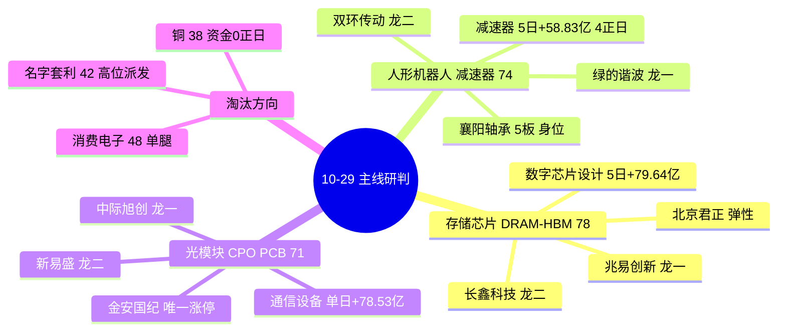

# 2026 年 10 月 29 日 · **主线研判**

> **数据源新鲜度**: partial（R1 降级、R3 降级、WeFlow 下线）
> **降级状态**: true
> **置信度**: 0.63（研究质量分，不是胜率，不是开仓许可）

## 一句话结论

**10-28 是一次放量反包的「第一天」而不是「趋势确认日」——三条主线全部落在「有故事的第一天」或「老故事的第十三天」，因此今日只给研究前置 5 只、执行池 0 只。**

## 盘面坐标

| 维度 | 读数 | 含义 |
|---|---|---|
| 涨停 / 跌停 / 炸板 | `72` / `5` / `69`（炸板率 `48.94%`） | 封板质量极差，近一半封板被砸开 |
| 连板梯 | `1板64 · 2板5 · 3板2 · 5板1` | **4 板整层空缺**，高度无法自然递推 |
| 广度 | 涨 `3872` / 跌 `1176` / 平 `169`，中位 `+1.35%` | 普涨修复，非结构性崩坏 |
| 成交 | `16282 亿`（前值 14608 亿，`+11.46%`） | 放量，但钱是回补不是新增 |
| 昨日涨停溢价 | 41 家样本，收盘中位 `+2.03%`，红盘率 `68.3%`，再涨停 `8` 家 | 有溢价但弱，接力意愿一般 |
| 主力资金 | 单日 `+237.0 亿` / 5 日 `-1142.3 亿` | 一天的回补，抵不过一周的撤退 |
| 情绪 | R1 `59.0`（中性）· R3 `54.0`（中性偏弱） | 修复带强分歧 |
| 仓位上限 | `45%`（R1） | 高位震荡 + 30 日样本中位 -12.82% |

## 五维打分总览

| 排名 | 板块 | 总分 | 热度 | 资金 | 涨停 | 叙事 | 共振 | 判定 |
|:--:|---|:--:|:--:|:--:|:--:|:--:|:--:|---|
| 1 | 存储芯片 / DRAM-HBM | **78** | 18 | 17 | 10 | 18 | 15 | 主线核心 |
| 2 | 人形机器人 / 减速器 | **74** | 12 | 20 | 20 | 16 | 6 | 主线核心（派发警报） |
| 3 | 光模块 / CPO / PCB | **71** | 16 | 15 | 14 | 15 | 11 | 主线核心（5日资金负） |
| 4 | 消费电子 / 无线耳机 | 48 | 8 | 15 | 10 | 9 | 6 | 淘汰（差 2 分） |
| 5 | 名字套利 / 羊·洋·百 | 42 | 12 | 6 | 6 | 2 | 16 | 淘汰 |
| 6 | 半导体设备 / 材料 | 41 | 8 | 10 | 3 | 12 | 8 | 淘汰 |
| 7 | 铜 / 工业金属 | 38 | 6 | 6 | 2 | 18 | 6 | 淘汰 |
| 8 | 储能 / 电力设备 | 30 | 6 | 3 | 10 | 5 | 6 | 淘汰 |
| 9 | 创新药 / 化学制药 | 27 | 7 | 4 | 6 | 6 | 4 | 淘汰 |
| 10 | 银行 / 红利 | 22 | 2 | 9 | 0 | 5 | 6 | 淘汰 |

**三条主线的共同病根不是分低，而是「位置不对」**：存储与 CPO 都还在 MA20 之下，是下跌通道里的反包第一天；机器人虽在 MA20 之上，但已是第 13 个交易日、并带着「概念榜连续 5 观测日第 1」的派发警报。

## 主线一 · 存储芯片 / DRAM-HBM 涨价链（78 分）

- **大资金意图**: 今日主力在存储链砸下全场最集中的单笔——兆易创新净流入 `17.64 亿`、净占比 `14.36%`（全市场第 2），长鑫科技成交 `161.9 亿`（超过兆易的 122.8 亿）。对手盘是过去三周在电子链上撤出的 `-243.6 亿`（5 日）资金，今日是「反手回补」而非「新增建仓」。机构逻辑很直接：原厂口径（SK 海力士 Q3 营业利润同比 +600%、内存售罄至 2029）已经把周期钉死在 2028 年前，A 股缺的只是载体。
- **为什么走强**: 位置（三只核心全在 MA20 下方 `-6.2%` 至 `-7.8%`，是深跌后的第一天反包）× 催化（两条 high 级硬事件，一条来自原厂业绩、一条来自国产 HBM3E 送样）× 筹码（兆易量比仅 `1.36` 却净占比 14.36% = 低增量的大单承接，不是散户抢筹）。
- **逻辑够不够硬**: 是四源全命中里唯一的一条（R2 78 + R3 共振 rank1 L1+L2 + R4 双 high + R7 数字芯片设计 5 日 `+79.64 亿`、3 正日）。硬度来自「原厂业绩 + 价格指引 + 国产送样」三重时间锚，不来自传闻。证伪路径只有两条：①数字芯片设计单日转净流出 `>30 亿`；②存储芯片概念跌出同花顺前 5。**但必须诚实记一笔**：全链一线票零封板，涨停的只有富瀚微、金海通、必易微三只小票——这是「资金型主线」，不是「封板型主线」，不能按打板逻辑做。

| 角色 | 标的 | 涨幅 | 板型 | 主力净额 | 5日 | 流通 | 关键证据 |
|---|---|:--:|---|:--:|:--:|:--:|---|
| 龙一 | 兆易创新 `603986.SH` | +7.77% | 未封板（主板 10cm） | +17.64 亿（净占 14.36%） | +19.43 亿 | 1944 亿 | 飙升 81→23（+58）为存储链最大跃升 |
| 龙二 | 长鑫科技 `688825.SH` | +3.16% | 未封板（科创 20cm，次新） | — | +18.08 亿 | 1998 亿 | 成交 161.9 亿全场前十、纳入上证指数第一大权重 |
| 龙三 | 北京君正 `300223.SZ` | +18.37% | 20cm 未封 | +6.80 亿 | +4.10 亿 | 474 亿 | 飙升 85→12（+73）全市场最大 |
| 候补 | 佰维存储 `688525.SH` | +8.36% | 未封板 | — | +2.21 亿 | 780 亿 | 模组环节 Q3 环比转负，故只候补 |
| 候补 | 华天科技 `002185.SZ` | +5.78% | 未封板 | — | — | 542 亿 | 热股 21→7；股性 11 次涨停/炸板率 15.4% 最干净 |

#### 兆易创新 · 首推思维链

- **买入理由**: ①原厂端两条 high 级事件（E001 SK 海力士营业利润 +600% 且售罄至 2029、E003 长鑫 HBM3E 送样）把「存储周期」从预期变成事实；②资金端今日主力 `+17.64 亿`、净占比 `14.36%`、5 日 `+19.43 亿`/2 正日，量比只有 `1.36` —— 大单低增量承接，不是情绪脉冲。
- **风险点**: ①短期：一线票零封板，无封单承接，次日竞价主力若转负立即证伪；②中期：模组环节 Q3 单季环比已转负，产业链两端背离，一旦市场改读「模组毛利被挤压」，设计与模组会一起被卖；③位置：距 MA20 `312.50` 仍差 `7.8%`，仍在下跌通道内。
- **止损条件**: 跌破前日低点 `276.72`（-4.5%）无条件止损；或竞价高开 >4% 而 30 分钟内回落至平盘以下，视为兑现盘。
- **可验证假设**: 24 小时内可观测——①数字芯片设计行业当日主力净额仍为正；②兆易量比回落至 `1.5` 以下而收盘价守住 MA5 `280.81`；两者同时成立则「资金型反包」成立，任一失败则降级观察。

## 主线二 · 人形机器人 / 减速器·执行器（74 分）

- **大资金意图**: 这是 10-28 唯一「5 日 + 今日双正」的成链方向——人形机器人 `+75.21/+75.84 亿`（3 正日）、减速器 `+30.81/+58.83 亿`（4 正日）、执行器 `+17.20/+32.46 亿`（4 正日）、传感器 `+39.06/+35.78 亿`。对手盘是「概念榜第 1 但 5 日涨幅 -1.79/+4.46/-0.79/-2.76/+4.13」的散户追高盘。机构买的是有订单的减速器与执行器，游资炒的是名字像机器人的票——两条腿今天同时走，但只有一条腿能走远。
- **为什么走强**: 位置（绿的谐波站上 MA20 `266.15`、双环创 60 日新高）× 催化（上海 2028 年 8000 台进工厂 + 智元 Genie Sim 一致性 96.7% + 特斯拉 Optimus 接管插枪，三件事都指向有订单的环节）× 筹码（26 家涨停占全市场 36%，5 板/3 板/2 板梯队完整）。
- **逻辑够不够硬**: 资金与涨停两维都是满档 20 分，硬度毋庸置疑；但**热度只给 12 分、共振只给 6 分**，因为它连续 13 个交易日霸榜、并被 R3 判「连续 5 个观测日概念榜第 1、热度与价格背离」的派发警报。同日 R4 还有反向事件（E006 特朗普把进口机器人与工业机械列为国家安全风险）打出口链估值。**这是今日最大的多空分歧点，交 R6 反证裁定。**

| 角色 | 标的 | 涨幅 | 板型 | 封单 / 成交 | 5日 | 流通 | 关键证据 |
|---|---|:--:|---|:--:|:--:|:--:|---|
| 龙一 | 绿的谐波 `688017.SH` | +6.05% | 未封板 | — | +13.31% | 535 亿 | 站稳 MA20、减速器子链 5 日 +58.83 亿/4 正日 |
| 龙二 | 双环传动 `002472.SZ` | +8.91% | 未封板 | — | +16.48% | 341 亿 | 创 60 日新高（距高 -0.99%），但 5 日主力仅 +1.54 亿 |
| 身位 | 襄阳轴承 `000678.SZ` | +9.99% | **5 板** | 2.92 亿 / 8.3 亿 = 35.3% | +60.97% | 81 亿 | 9:32 首封、0 开板、换手仅 10.38%；20 日 +98.09% |
| 身位 | 光洋股份 `002708.SZ` | +9.99% | **3 板** | 1.78 亿 / 3.6 亿 = 49.6% | +30.53% | 97 亿 | 9:30 秒板、0 开板；封单比全市场最高档 |
| 候补 | 三花智控 `002050.SZ` | +4.64% | 未封板 | — | +8.23% | 1316 亿 | 容量最大、5 日 +5.08 亿/4 正日、距 20 日高仅 -3.6% |

#### 绿的谐波 · 首推思维链

- **买入理由**: ①减速器是全链唯一「5 日 + 今日双正且 4/5 日净流入」的容量子链（+30.81 / +58.83 亿），个股 5 日 `+4.57 亿`/4 正日；②技术位置是全链唯一右侧结构——`291.98` 站上 MA20 `266.15`、5 日 `+13.31%`、距 20 日高仅 -8.4%。
- **风险点**: ①R3 霸榜派发警报已点名本板块，R5 必须加风险标记；②E006（232 国安调查）压出口链估值，虽以内需订单为主但仍压制情绪；③板块年龄 13 天，主升早期窗口早关，这是「中后期做龙头分歧」不是「早期猛干」。
- **止损条件**: 跌破 MA20 `266.15`（-8.8%）止损；或减速器概念单日主力转净流出 >20 亿，逻辑先行证伪即离场。
- **可验证假设**: 48 小时内——①减速器概念主力连续净流入天数继续增加；②绿的谐波不破 MA5 `281.83`。若出现「板块涨停家数 ≥20 但绿的走弱」的背离，判定为资金在做高低切，降 watch。

## 主线三 · 光模块 / CPO / PCB（71 分）

- **大资金意图**: 中际旭创单日主力 `+31.97 亿`、成交 `235.73 亿`——两项都是全市场第 1。对手盘是过去 5 日从通信设备撤出的 `-72.19 亿`、从元件撤出的 `-144.11 亿`、从 PCB 撤出的 `-120.14 亿`。今天这 31.97 亿是「逆势抄底」还是「机构换手」只有次日才知道，但成交额结构（7062 亿流通对 235 亿成交、换手 4.18%）说明是机构级调仓，不是游资。
- **为什么走强**: 位置（距 60 日高 `-38.46%`，MA20 下方 10.7%）× 催化（E005 微软本季新增 24 个数据中心、谷歌对外卖 TPU、Marvell 洽购 Lumentum，需求侧三重确认）× 筹码（中际东财人气 23→4，散户关注度单日跃升 19 位）。
- **逻辑够不够硬**: 需求侧是硬的，融资侧是软的——同一天 AI 债务收益率升至两位数、美联储 10 月不降息且两票主张加息、12 月加息概率 50%。**「需求好、钱变贵」的组合下，光模块只能做反包不做趋势**，这也解释了为什么资金维给 15 不给满分：单日 +78.53 亿，5 日仍 -80.89 亿。证伪路径：中际旭创次日主力净额转负，或 5 日资金继续扩大流出。

| 角色 | 标的 | 涨幅 | 板型 | 主力净额 | 5日主力 | 流通 | 关键证据 |
|---|---|:--:|---|:--:|:--:|:--:|---|
| 龙一 | 中际旭创 `300308.SZ` | +10.28% | 未封板（创业板 20cm） | +31.97 亿（净占 13.56%） | +29.72 亿 | 7062 亿 | 成交 235.7 亿全市场第 1、人气 23→4 |
| 龙二 | 新易盛 `300502.SZ` | +8.08% | 未封板 | +14.84 亿 | **-24.47 亿** | 3222 亿 | 5 日 -12.69% / 20 日 -43.56%，超跌反抽 |
| 龙三 | 金安国纪 `002636.SZ` | +10.01% | **1 板**（开板 1 次） | +5.84 亿（净占 36.51%） | -0.62 亿 | 425 亿 | 封单 3.27 亿、龙虎榜 +1.31 亿、热股 50→9 |
| 候补 | 天孚通信 `300394.SZ` | +6.79% | 未封板 | +8.96 亿 | -0.36 亿 | — | 5 日资金最抗跌，站上 MA5 196.97 |
| 候补 | 沪电股份 `002463.SZ` | +5.41% | 未封板 | +6.61 亿 | -9.13 亿 | 2015 亿 | 5 日 -9.05%、MA20 下方 7.3% |

#### 中际旭创 · 首推思维链

- **买入理由**: ①全市场资金与成交双第一（`+31.97 亿` / `235.73 亿`），容量 7062 亿是全市场最大承接位；②R4 E005 需求侧三重确认（微软 24 个数据中心、谷歌卖 TPU、Marvell 洽购 Lumentum），800G/1.6T 订单能见度延伸到 2027。
- **风险点**: ①5 日板块资金 `-80.89 亿`，今日是单日脉冲，随时可能被打回；②AI 债务收益率两位数 = 融资侧收紧，估值端先挨刀；③距 60 日高 -38.46%，趋势仍是下跌，做的是反包不是主升；④7062 亿流通对 235 亿成交，是机构调仓级换手，可能是派发。
- **止损条件**: 跌破 MA5 `602.11`（-5.4%）止损；或开盘 30 分钟内主力净额转负且成交额不足昨日同期 60%，视为换手派发。
- **可验证假设**: 24 小时内——①通信设备行业主力净额连续第 2 日为正；②中际守住 MA5 且不出现「缩量阴线」。若 5 日资金继续扩大流出至 -120 亿以上，本线降为次线。

## 主线生命周期

| 主线 | 阶段 | 年龄 | 龙头高度 | 资金持续 | 今日炸板率 | 实操含义 |
|---|:--:|:--:|:--:|:--:|:--:|---|
| 存储芯片 | 启动/形成期 | 1 天 | 1 板（小票） | 1 日 | 48.94% | 资金先于涨停潮 → 只做低吸，不打板 |
| 人形机器人 | 主升中期（实操按高潮） | 13 天 | 5 板 | 1 日 | 48.94% | 只做龙一/龙二分歧低吸，不碰身位股低吸 |
| 光模块/CPO | 启动/形成期 | 1 天 | 1 板 | 1 日 | 48.94% | 只做龙一低吸，不做后排补涨 |

> 机器人线的函数判定是「主升中期」，但炸板率 `48.94%` + 概念 5 日霸榜派发 + 5 板票 20 日 `+98%`，实操段位应按「高潮/分歧」对待。**这不是覆盖函数，是给函数结论加一条可操作边界。**

## 淘汰与次线

| 板块 | 分 | 为什么淘汰（一句话） |
|---|:--:|---|
| 铜 / 工业金属 | 38 | 叙事维满分 18（世行料金属价格 +25%、江铜 Q3 净利 +65%），但有色今日 `-8.59 亿`、5 日 `-98.15 亿`、0/5 正日，72 家涨停里零家有色——**基本面最硬的方向没有资金** |
| 名字套利 / 羊·洋·百 | 42 | R3 给了 L1+L2 双源共振，但 R3 自己结论是「观察不进」：海洋王人气 26→14、今日仅 +2.37% 未涨停；百洋热股 9→34（-25）、9/14 板高位 |
| 消费电子 / 无线耳机 | 48 | 资金维真在（概念 `+60.27 亿`、无线耳机 5 日 `+31.02 亿`），但叙事 9 分、共振 6 分——**单腿站不住，差 2 分不进次线** |
| 半导体设备 / 材料 | 41 | 只有 E003 一条 medium，涨停仅金海通 1 家——叙事先行、载体未定 |
| 储能 / 电力设备 | 30 | 电力设备 `-18.88 亿`（流出第 1）、电池 `-14.40 亿`（第 2）；概念口径的 16 家「涨停」与行业实际（电网设备 2、其他电源 1）勾稽不上，判为虚高不采信 |
| 创新药 | 27 | 莱美药业 20cm 但当日开板 10 次、封单仅 0.5 亿；R3 判 l2_only（群聊原话是调侃），单源不进共振 |
| 银行 / 红利 | 22 | 招行主力 `+7.44 亿` 但股价 `-2.00%`，零涨停基因——防守去处不等于短线主线 |

**次线为空（50–70 分段无一入榜），这是刻意的**：第 4 名 48 分，不为了凑一条次线把 48 抬到 50。次线是观察资源，不是数量指标。

## 研究前置池 5 只 · 执行池 0 只

炸板率 `48.94% ≥ 35%` → 候选数按纪律砍半（10 → 5）。前置池只放「三条线的龙一/龙二」，身位股（襄阳 5 板、光洋 3 板）与一字/股性差票（金安国纪炸板率 56%）不进。

| 标的 | 线 | 角色 | 通道 | 竞价前置条件 |
|---|---|:--:|:--:|---|
| 兆易创新 `603986.SH` | 存储 | 龙一 | 低吸/半路 | 高开 ≤4% 且不破 MA5 `280.81`；量比 >2 而涨幅 <3% = 兑现盘，放弃 |
| 长鑫科技 `688825.SH` | 存储 | 龙二 | 半路/低吸 | 次新，竞价波动 >5% 一律不碰；不破 MA5 `42.51` 才有价值 |
| 绿的谐波 `688017.SH` | 机器人 | 龙一 | 低吸 | 高开 ≤3%、回踩 MA5 `281.83` 缩量止跌；带派发警报，R5 必须加风险标记 |
| 双环传动 `002472.SZ` | 机器人 | 龙二 | 低吸（回踩） | 新高票不追高开，等回踩 `44.0`；5 日主力仅 +1.54 亿，量能不跟即降 watch |
| 中际旭创 `300308.SZ` | CPO | 龙一 | 低吸/半路 | 高开 ≤4%、回踩 MA5 `602.11`；开盘 30 分钟主力转负即离场 |

**执行池为空，四条理由**：①三条线无一是「已确认可交易主线」——存储与 CPO 都在 MA20 之下反包第一天、机器人是第 13 天老主线带派发警报；②炸板率近半，纪律要求不接秒板、不接二次冲高；③盘前无价，R2 不虚构入场价与盈亏比，RR ≥ 2 必须由 D1 在竞价用实价重算；④今日是「修复验证日」，验证条件（昨日 41 家涨停红盘率过半 + 广度 ≥0.60）盘前不可知。

## 关键证据

- 证据 1：数字芯片设计 今日 `+57.27 亿` / 5 日 `+79.64 亿` / 3 正日，是芯片类唯一 5 日净流入子行业 · 来源 R7 `main_force.sector_flows`
- 证据 2：人形机器人概念 5 日 `+75.84 亿`、减速器 `+58.83 亿`/4 正日，为全市场唯一「5 日 + 今日双正」成链方向 · 来源 R7 `concept_flows.top5d_inflow`
- 证据 3：涨停 72 家 / 炸板 69 家 / 炸板率 `48.94%`，4 板整层空缺 · 来源 tushare `limit_list_d` + `limit_step`（R2 独立复拉与 R1 完全一致）
- 证据 4：机器人概念连续 13 个交易日在 limit_cpt 前 20（今日 31 家第 1）；存储芯片 13 日内从未进前 20 · 来源 tushare `limit_cpt_list` 13 日 × 20 行
- 证据 5：中际旭创 `+31.97 亿` / 兆易 `+17.64 亿` / 新易盛 `+14.84 亿` / 天孚 `+8.96 亿` 与 R7 个股资金逐只对位一致 · 来源 tushare `moneyflow_dc` 交叉 R7

## 数据源审计

| 源 | 日期 | 状态 | 备注 |
|---|---|:--:|---|
| tushare `limit_list_d` | 2026-10-28 | 🟢 | 72 条涨停/5 跌停/69 炸板，与 R1 完全一致 |
| tushare `limit_step` | 2026-10-28 | 🟢 | 8 条天梯，5板1/3板2/2板5，与涨停明细勾稽自洽 |
| tushare `limit_cpt_list` | 2026-10-10 ~ 2026-10-28 | 🟢 | 13 日 × 20 行 = 260 条，用于算主线年龄 |
| tushare `top_list` | 2026-10-28 | 🟢 | 78 条（去重后按单日口径），金安国纪 +1.31 亿、万向钱潮 +2.82 亿 |
| tushare `daily_basic` | 2026-10-28 | 🟢 | 19 只，流通市值/自由流通换手/量比/涨跌状态 |
| tushare `daily` | 2026-10-28 | 🟢 | 6 只补口径，用于 5 日/20 日/MA/距高 |
| 个股股性 5 年 xlsx | 2026-10-17 | 🟡 | 3150 只，滞后 7 个交易日；科创板无样本 |
| 题材心智锚 | 2026-10-20 | 🟡 | 597 题材，滞后 6 日且成分有污染，仅作旁证 |
| R1 风格 | 2026-10-29 | 🟡 | status=degraded，confidence 0.392 |
| R3 情绪 | 2026-10-29 | 🟡 | degraded=true，WeFlow 下线、群聊仅早盘 186 条（群A–群G 匿名） |
| R4 消息面 | 2026-10-29 | 🟢 | 8 事件 + 12 板块极性，confidence 0.72；`kol_confirm` 未接 R3 |
| R7 资金面 | 2026-10-29 | 🟢 | 496 行业口径条目，confidence 0.75，两融/ETF 有 T+1 滞后 |
| 因子快照 `weekly_ir_scan` | — | 🔴 | 脚本从未实现、目录从未生成，设计内降级 |
| WeFlow 群聊 | — | 🔴 | 永久下线，L3 缺位，共振封顶 L1+L2 |

## 不确定性 / 反证

1. **「资金型主线」的先天缺陷**：存储线 78 分是三条线里最高，但一线票零封板。历史上靠净值流入推起来、没有涨停潮确认的板块，第二天的延续率显著低于「涨停潮 + 梯队」型主线。若次日存储链仍无一只核心票封板，本线应从「主线」降为「资金反抽」。
2. **机器人线是今日最大的分歧点**：热度最高、资金最持续、涨停最多，同时被 R3 判为连霸派发。两种读法都能自圆其说——读法 A「资金真金白银 5 日连续流入，是洗盘不是派发」；读法 B「第 13 天、5 板票 20 日 +98%、炸板率近半，是最后一波」。R2 不裁决，交 R6 反证。
3. **上游未交叉**：R4 的 `kol_confirm` 全部标注「未接入 R3」，等于消息面与情绪面在源头没有交叉验证；本报告的交叉结论（CV 1.00 / 0.67 / 0.67）是 R2 自己做的，若 R3 的 L2 窗口只覆盖早盘，则共振维实际是「半个源」。
4. **口径差异已披露不改数**：R1 代理口径判 3 条主线（机器人概念 31、新能源汽车 25、专精特新 20 家涨停），与 R2 的三条不同集合。新能源汽车与专精特新在 R2 看来分别是「汽车零部件机器人化外溢」与「全市场属性标签」，不是题材主线；存储/CPO 又因涨停家数不足 20 被 R1 漏计。差异是口径不是矛盾。
5. **股性样本滞后**：用 2026-10-17 构建的 5 年股性表评估今日候选，襄阳「历史最高 4 板」已被今日 5 板突破——这类记录滞后的地方，本报告已在字段里标 null 而不是硬填。

## 与其他 R/D/E 的关系

- **依赖**: R1_style（风格/仓位上限/情绪）、R3_sentiment（共振主题 + 派发警报）、R4_news（8 条事件与板块极性）、R7_capital_flow（行业/概念/个股资金）、tushare 独立复拉（涨停/天梯/概念榜 13 日/龙虎榜/每日指标/股性）、theme_anchors（旁证）
- **被消费**: R5（对前置池 5 只做六维画像，必须给绿的谐波/双环传动加派发风险标记）→ R6（对三条主线做反证，人形机器人是重点）→ D1（从 5 只前置 + 3 条主线龙一/龙二构建 3–6 只执行池，逐票过七项开仓资格与十四条禁止清单）→ E1（回填 T+1 表现，校准五维打分与带动性口径）

## Sub-Agent 元数据

- skill: `analyze_main_sectors_v1`（v1.2 契约 + v1.3 辨识度/带动性口径）
- artifact: `data/research/20261029/R2_main_sectors.json`（67,027 bytes）
- 交叉验证验收: `tests/checks/check_r2_cross_validation.py 20261029` 全部通过（3 主线，CV 1.00/0.67/0.67）
- 交叉验证口径: 存储四源共识 `0.85`；机器人三源 `0.65`（R3 结构性缺位记 0）；CPO 三源 `0.63`
- 生成耗时: 约 27 分钟（含 13 日概念榜、龙虎榜、每日指标、股性四轮现拉）
- model: ark-code-latest
