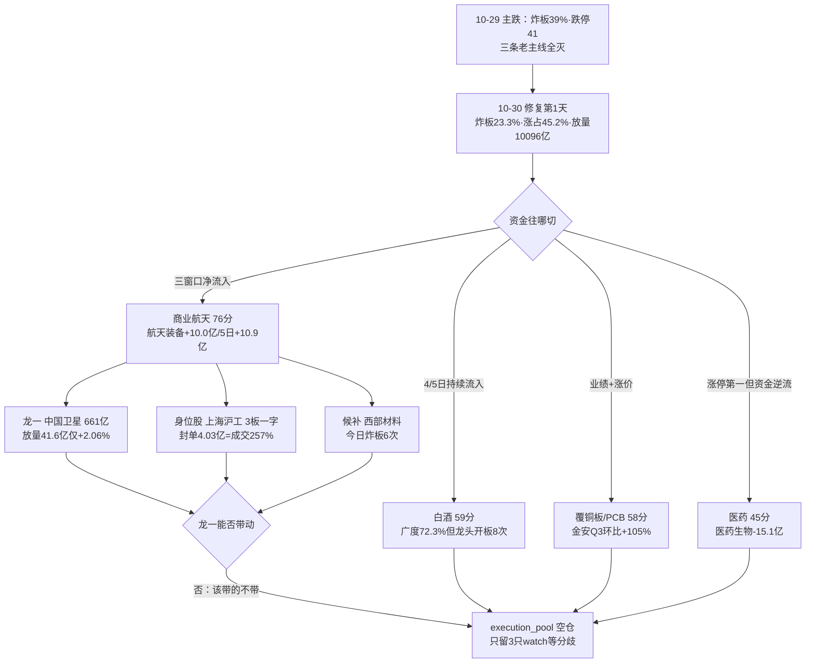

# 2026年10月30日 · 主线研判

> **数据源新鲜度**: partial　|　**降级状态**: true　|　**置信度**: 0.62

## 一句话结论

**今天是主线切换日**：昨日存储/机器人/光模块三条主线被资金全部证伪，今日只剩 **商业航天（76 分）** 一条，但它已在第 2 日发生首次收缩 —— 所以 `execution_pool` 为空，只给 watch 三只。

## 今日盘面（10-30 11:30 实测 · 全市场 5220 只）

| 指标 | 10-30 半日 | 10-29 全日 | 方向 |
|---|:--:|:--:|:--:|
| 上涨占比 | **45.2%**（2522 涨 / 2819 跌） | 14.7% | 🟢 大幅修复 |
| 涨停 / 跌停 | **46 / 18** | 39 / 41 | 🟢 跌停砍掉一半 |
| 炸板 / 炸板率 | **14 / 23.3%** | 25 / 39.06% | 🟢 退出分歧区（<35%） |
| 昨日涨停今日表现 | 红盘 **20/39**、中位 **+0.53%**、再涨停 9 | 中位 -2.40%、红盘 33.3% | 🟢 溢价转正 |
| 最高连板 | **3 板**（上海沪工一字） | 4 板 | 🔴 高度下移，青岛食品 4 板炸板 |
| 半日成交 | **10096 亿**（= 10-29 全日的 64.9%） | 15562 亿 | 🟢 放量 |

**读法**：三个修复指标（炸板率、昨日涨停溢价、跌停家数）同时改善，但**高度反而从 4 板掉到 3 板、且唯一的 4 板炸了**。这是「修复第 1 天」的典型结构 —— 钱回来了，但没人愿意去挑战高度。所以仓位按 R1 的 10% 上限走，方向上只允许一个方向。

## 五维打分 · 全部候选（每维 0–20，满分 100）

| 板块 | 热度 | 资金 | 涨停 | 叙事 | 共振 | 总分 | 判定 |
|---|:--:|:--:|:--:|:--:|:--:|:--:|---|
| **商业航天 / 卫星互联网** | 15 | **18** | 15 | **17** | 11 | **76** | ✅ 主线 |
| 白酒 | 13 | 17 | 12 | 12 | 5 | 59 | 🟡 次线 |
| 覆铜板 / PCB 涨价链 | 13 | 5 | **18** | **17** | 5 | 58 | 🟡 次线 |
| 医药（器械/中药/连锁药房） | 11 | 4 | **18** | 4 | 3 | 45 | ⛔ 观察不推 |
| 存储 / 机器人 / 光模块 | 6 | 2 | 9 | 3 | 2 | 22 | ⛔ 已证伪 |

**扣分不是手感，是数据**：商业航天共振只给 11 分，因为 R3 只能给到 `L1+L2b`（游资群层自 10-28 断更），按 R3 契约 L2b 不参与共振升级；白酒共振给 5 分，因为它没出现在 R3/R4 的任何一条里。

## 主线一 · 商业航天 / 卫星互联网（76 分 · early_up 第 2 日）

**评分依据不是「涨得多」，是「钱是唯一性的」**：

- **资金 18/20**：航天装备Ⅲ 今日 `+10.00 亿` / 5日 `+10.92 亿` / 10日 `+8.68 亿`，是全市场**唯一**三窗口同时为正的行业，`top_inflow` 排名第 1。国防军工 5 日仍 `-39.59 亿` —— 说明吸金的不是整个军工，是航天这一条子链，这点很重要：它排除了「军工作为防守板块普涨」的误读。
- **叙事 17/20**：蓝箭航天 9500 万中标成飞研究所运载火箭发射服务（公示到 11-02，中科宇航第二候选）+ 国星宇航过港交所聆讯 + 11 月多场发射 + 上海《卫星互联网产业创新发展行动方案》800 亿 / 3000 颗。**至少两项硬时间锚**，不是纯情绪。
- **涨停 15/20**：10-29 涨停 11 家 → 10-30 上午 6 家。是收缩，不是瓦解。
- **热度 15/20 扣分原因**：概念榜 10-29 刚登顶，10-30 上午 483 只成分**中位 -0.53%、上涨占比仅 35.4%** —— 榜上热、盘面冷，这个背离必须记账。

### 三个必须回答的问题

- **大资金意图**：10-29 电子链单日净流出 309 亿、半导体 -136 亿，主力在**从高估值科技里撤**；同一天航天装备逆势 +10 亿，这是典型的「换赛道不换战场」——钱还在做多，只是从「讲远期算力的」搬到「有订单、有 11 月时间表的」。对手盘是还在等 CPO 反弹的左侧资金。
- **为什么走强**：位置上是低位启动（中国卫星 20 日 -3.2%、距 20 日高 -3.5%），催化上是硬事件（中标+聆讯+发射排期），筹码上是中国卫星昨日首封 10:24 但**开板 8 次、封单仅占成交 2.66%（纸封）**——所以今日 +2.06% 不是「走强」，是「分歧」。走强的只有上海沪工（缩量一字）。
- **逻辑够不够硬**：**资金够硬，结构不够硬**。资金是唯一的（三窗口同向），但结构是分裂的：高度在伪题材（沪工焊接设备）、容量在真核心（卫星放量滞涨）。可能的证伪路径很具体 —— 明日上午板块中位仍为负且涨停 ≤3 家，主题直接降级一日游。

### 四只候选

| 角色 | 代码 | 名称 | 今日 | 板型（classify_pattern 实测） | 流通 | 板型判定 |
|---|---|---|:--:|---|--:|:--:|
| **龙一** | 600118.SH | 中国卫星 | +2.06% | 今日未触板；昨日回封板·开板 8 次·封单 0.83 亿(成交 2.66%) | 661 亿 | ⚠️ 纸封 |
| 身位股 | 603131.SH | 上海沪工 | **+10.03%** | 竞价秒板 09:25·**0 开板**·封单 4.03 亿(= 成交 **257%**) | 53.7 亿 | 🟢 缩量一字(买不到) |
| 候补 | 002149.SZ | 西部材料 | +7.77% | 昨日首板(开板 1 次)；今日冲板后**炸板 6 次** | 157.7 亿 | ❌ 多次开板不碰 |
| 候补 | 688818.SH | 电科蓝天 | +2.24% | 今日未触板，5 日 +25.4% 创新高后回落 | — | ⚠️ 已透支 |

**剔除**：航天晨光 600501 —— 昨日涨停（首封 10:25、开板 2 次）今日 **-0.53% 翻绿**，按纪律 §9「不达预期隔日走」直接出池。

### 首推票思维链 · 中国卫星 600118（观察，不建仓）

- **买入理由**：①产业逻辑最正 —— 卫星总体是商业航天唯一的「总装口径」，上海 3000 颗在轨目标直接对应总装与测运控需求；②数据锚硬 —— 昨日 +10.00% 首板、今日成交 41.63 亿为板块第 1（是西部材料 27.67 亿的 1.5 倍）、5 日主力 +6.06 亿；③双榜人气 —— 东财人气第 3、同花顺第 14，昨日尚未进前 20，是**新增关注度**而非存量抱团。
- **风险点**：①**纸封基因** —— 昨日开板 8 次、封单占成交仅 2.66%，说明封单是虚的，这种票在退潮段最容易一根阴线打回起点；②今日放量 41.63 亿却只涨 2.06%，是**放量滞涨**，第一批先手资金在换手不在加仓；③主线切换首日就做容量核心，等于在别人止盈的位置接货；④R3 缺游资群层，无法验证这波是不是散户抬轿。
- **止损条件**：跌破 `55.90`（10-29 收盘 = 今日前收）且在 30 分钟内不收复 → 主题当日作废，无条件出；不设「灵活调整」。
- **可验证假设**（24–72h 内可证真/证伪）：①明日竞价高开 >2% 且不破 55.90 → 分歧转一致，主题升级；②明日上午板块 483 只成分中位 ≥0 且涨停 ≥6 家 → 集群存活；③航天装备主力净流入若转负 → 资金逻辑当场证伪，不再看任何航天票。

### 为什么上海沪工不是龙一

它是今天全场最亮的票（3 板、竞价一字、封单 4.03 亿 = 成交的 257%），但**三个理由否掉它当龙一**：

1. **伪题材**：R4 在 E20261030_005 里把它直接列进「纯概念跟风杂毛」负面簇（net -0.512），理由是主业焊接设备/焊接机器人，与卫星火箭零关联。按纪律 §2「躲中位和杂毛」，这种票只能当情绪温度计。
2. **买不到**：缩量一字、0 开板，二级市场根本没有筹码，所谓「参与」只剩竞价挂涨停这一条路，且是纯博弈无止损参照。
3. **带不动**：它涨 10%，板块中位 -0.53%。真龙一是「它动板块才敢动」，沪工是「它动只有它自己动」。

所以按 v1.3 辨识度优先原则，**龙一给中国卫星（辨识度+容量），沪工只标 `身位股`，不可低吸、只可竞价极小仓验证**。这是本单元今天最反直觉、也是最不想妥协的一条判断。

## 次线（50–70 分 · 只观察不主推）

| 板块 | 分 | 资金真相 | 致命短板 |
|---|:--:|---|---|
| 白酒 | 59 | 今日 +4.25 亿 / 5日 +7.18 亿 / 10日 +14.18 亿 / 近 5 日 **4 天净流入** | 龙头封不住：古井贡酒**开板 8 次**、皇台开板 6 次、封单仅占成交 15.5% 和 4.9% —— 广度 72.3% 但龙头是回封板 ❌ |
| 覆铜板/PCB | 58 | 印制电路板今日 **-82.49 亿**、5日 -140.59 亿、10日 -199.42 亿 | 板型和叙事都是全场最好（金安国纪开板 1 次封单 7.92 亿、满坤 0 开板封单 6.60 亿；电子布 11 月涨价 + 金安 Q3 净利 11.58 亿环比 +105%），但**板块资金在全市场第三大失血方向** → 只能是业绩票独立行情 |

**这两条为什么不够 70**：白酒输在「龙头封板质量」，覆铜板输在「资金反向」。一个板块再有故事，龙头封不住或钱在跑，都不叫主线。

## 观察但不推 · 医药（45 分）

今日涨停数全场第一：九安医疗、澳洋健康（2 板）、大参林、羚锐制药、桂林三金、阳普医疗（20cm）、毕得医药（20cm）、永安药业共 8 只，生物医药板块上涨占比 78.9%。

**但资金是逆流**：医药生物今日 `-15.09 亿` / 5 日 `-46.73 亿` / 10 日 `-131.45 亿`，中药 -3.15 亿，医疗器械 -0.71 亿。只有医疗服务（+3.00 / 5日 +17.07）和医疗研发外包 CXO（+2.05 / 5日 +12.14）是正流入。

**结论**：这是**超跌反抽 + 无资金 + 无催化剂 + 无龙头**的四无上涨。8 只涨停里没有一只能带动板块的，属于普涨型情绪释放。按纪律 §1「无资金无催化不给开仓资格」，判观察。**升级条件**：若 5 日转为连续净流入，且出现带板型的分支龙头，再谈。

## 昨日三条主线为何全灭（切换账）

| 昨日主线 | 昨日分 | 今日证据 | 判定 |
|---|:--:|---|:--:|
| 存储芯片 / DRAM-HBM | 78 | 电子 -309.22 亿、半导体 -136.40 亿、5 日同向为负；兆易创新 -1.90% | ⛔ 证伪 |
| 人形机器人 / 减速器 | 74 | 机器人概念 9 只涨停但板块均值 **-0.36%**、上涨占比 39.6% → 是低位票补涨不是板块进攻 | ⛔ 证伪 |
| 光模块 / CPO / PCB | 71 | 中际旭创 -1.46%、新易盛 **-7.68%**、天孚 -3.46%；通信设备 -111.15 亿 | ⛔ 证伪 |

**这是本报告最该被记住的一页**：昨天三条 70+ 的主线，一天之内全部被资金打掉。R2 昨天给了 3 条、今天只剩 1 条，这不是判断力摇摆，是市场真的换了一次赛道。切换日的正确姿势是「只允许新方向、不救老方向」。

## 不确定性 / 反证

1. **R1 与 R2 口径冲突**：R1 判「崩溃退潮 / 无主线 / 仓位上限 10%」，本单元判「1 条主线 76 分」。两者不矛盾 —— R1 用全市场情绪口径（10-29 炸板 39.06%、跌停 41 家），R2 用板块局部资金口径（航天装备三窗口净流入）。叠加后的正确结论是：**仓位按 R1 的 10%，方向只留航天一个，且必须等分歧再动**。
2. **今日「无合格买点」是可执行的结论，不是遗漏**：龙一买不到（一字）、容量核心 RR 1.94 < 2.0（止损 54.50 / 目标 62.00）、候补炸板 6 次。空池符合纪律 §4 与 §8。
3. **最大的反向可能**：今日修复是「单日反抽」。证据是最高连板从 4 板降到 3 板、唯一的 4 板（青岛食品）炸板、航天板块广度已转负。若明日涨停家数回落到 40 以下且炸板率重新上 30%，今天这 76 分就是给退潮段打的分。
4. **R3 只有 L1+L2b**：缺游资群这一层验证，是置信度只有 0.62 的主因。若明日 R3 群聊层恢复且给出反向信号，本结论应立刻下调。

## 数据源审计

| 源 | 日期 | 状态 | 备注 |
|---|---|:--:|---|
| tushare/rt_k | 2026-10-30 11:30 | 🟢 | 5220 只 A 股有效报价，涨跌比 2522/2819 与 midday_snapshot 45.19% 吻合 |
| xtick/limit_board | 2026-10-30 11:45 | 🟢 | 涨停 46 / 炸板 14，与 rt_k 口径交叉一致 |
| xtick/hot_bk(agn) | 2026-10-30 11:44 | 🟢 | 458 个概念板块成分表，用于板块广度与涨停簇计算 |
| tushare/daily | 2026-10-29 | 🟢 | 19 只候选 5 日 / 20 日涨幅与距 20 日高位置 |
| src/research/board_pattern | 2026-10-30 | 🟢 | 9 只涨停票板型实测（首封时间/开板次数/封单占比） |
| src/research/mainline_lifecycle | 2026-10-30 11:42 | 🟢 | 三条候选生命周期判定（early_up / early_up / formation） |
| R7_capital_flow | 2026-10-29 收盘 | 🟡 | 496 个板块资金；东财盘中无当日值，资金维为 T-1 口径 |
| R3_sentiment | 2026-10-30 11:35 | 🟡 | 仅 2 条共振主题，L1+L2b，群聊层断更 |
| R4_news | 2026-10-30 11:37 | 🟢 | 8 条 top_event，商业航天 net +0.732 |
| R1_style | 2026-10-30 07:03 | 🟡 | 崩溃退潮型，confidence 0.49 |
| scripts/factor/weekly_ir_scan | — | ⚪ | 未实现，设计内跳过，记 degraded 不记 error |
| wechat_cli_5groups | 2026-10-30 | 🔴 | 0 字节，群聊层连续第 3 日断更 |

## 与其他 R/D/E 的关系

- **依赖**：R1（风格/仓位上限）、R3（共振主题）、R4（催化事件）、R7（板块资金）、本单元自采 10-30 11:30 全市场行情
- **被消费**：D1（选执行池，须逐票过门禁与 forbidden_filter/board_pattern/risk_reward）、R5（对 4 只候选做画像）、R6（反证，重点看「主线切换首日 + 龙头伪题材」）、E1（T+1 回填 3 个可验证假设）

## Sub-Agent 元数据

- skill: `analyze_main_sectors_v1@1.3`
- artifact: `data/research/20261030/R2_main_sectors.json`
- 生成耗时: 约 11 分钟（含 4 次实时抓取 + 2 次本地闸门调用）
- model: deepseek-v4.1-flash
- 校验: `src.research.contract_checks.check_r2_cross_validation` → violations = 0
