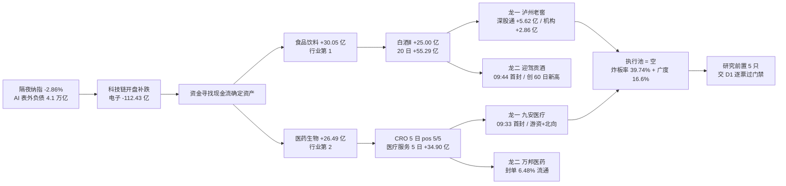

# 2026-11-02 · **主线研判**

> **数据源新鲜度**: partial（数据日 2026-10-30 收盘，11-02 盘前）
> **降级状态**: false（本单元未降级；上游 R1/R3 降级已计入置信度）
> **置信度**: 0.68（研究质量分，不是胜率，也不是开仓许可）

## 一句话结论

科技崩出来的钱没消失，搬到了白酒和医药——今日两条主线都是「防守转进攻」，不是产业催化进攻；执行池为空，研究前置 5 只。

## 详细分析

**一、市场段位：崩溃退潮第 3 天，不是修复第 1 天。** 10-30 收盘口径：涨停 47 / 跌停 82 / 炸板 31（炸板率 39.74%，连续第二日 ≥35%）、涨 854 跌 4290（涨家占比 16.6%）、中位 -3.12%、成交 16742 亿（+7.58%）、昨日涨停股收盘溢价 -0.28%（39 家样本）、最高 5 板、4 板整层空缺、首板占比 80.85%。指数全线下跌且分化极大：上证 -1.44%、沪深300 -1.39% vs 创业板 -4.13%、科创50 -5.48%。R1 判「崩溃退潮型 + 情绪 31.3 恐惧 + 仓位上限 10%」，R1 的代理口径给出「0 条主线」——代理口径统计的是涨停家数是否成规模，今日 47 家涨停散落在 20+ 个行业，任何「≥8 家涨停行业」的门槛都过不去。

**二、资金搬家：一进一出 200 亿级别，这才是今天的真相。** 净流入前六名全部是防御链：食品饮料 +30.05 亿（行业第 1）、医药生物 +26.49 亿（第 2）、白酒Ⅱ +25.00 亿（第 3）、医疗服务 +16.36 亿（第 5）、医疗研发外包 +14.39 亿（第 6）、生物制品 +5.58 亿（第 9）。净流出端全部是科技链：电子 -112.43 亿、通信 -58.76 亿、半导体 -56.14 亿、通信设备 -52.19 亿、计算机 -47.32 亿、机械设备 -38.61 亿。隔夜纳指 -2.86%、AI 表外负债突破 4.1 万亿美元、OpenAI 融资目标下调百亿——R4 把这条记成 E20261102_008（high 负面）。所以今日的「主线」不是涨出来的，是被别处的崩盘挤出来的。这一点决定了后面所有判断的性质：这两条线赚的是「相对收益」的钱，指数一旦反抽，它们会被反向抽血。

**三、主线一·消费防御（80 分）：资金是真金白银，叙事是空白。** 五维打分 热度 18 / 资金 19 / 涨停 17 / 叙事 8 / 共振 18。资金维度拿 19 分的理由是持续性而非单日脉冲：白酒Ⅱ 5 日 +27.91 亿、pos 4/5、20 日 +55.29 亿，是全市场唯一 20 日主力净流入仍为正的成规模行业。涨停维度：白酒Ⅱ 4 家（泸州老窖 / 古井贡酒 / 皇台酒业 / 迎驾贡酒）+ 休闲食品 3 家 + 饮料乳品 2 家 + 食品加工 1 家 = 10 家，占全市场涨停 21.3%。热度维度：同花顺「白酒」概念第 3，前值第 18，单日跃升 15 位是当日概念榜最大斜率；东财人气茅台 46→9（飙升 +37）。叙事维度只有 8 分，因为 R4 对消费给的是负面（PMI 49.3 / 49.7 双降，low），白酒/食品根本不在 R4 的催化清单里——这条线没有产业故事，只有避险故事。

**四、主线二·医药/CRO/医疗服务（75 分）：资金在、龙头不在。** 五维打分 热度 14 / 资金 18 / 涨停 14 / 叙事 12 / 共振 17。资金维度靠子板块的极端持续性撑起来：医疗研发外包 5 日 +28.86 亿、pos 5/5（全市场资金连续性最好的子板块），医疗服务 5 日 +34.90 亿、pos 4/5。但涨停维度只能给 14 分：医药系 9 家涨停（医疗服务 3 + 医疗器械 2 + 中药 2 + 医药商业 1 + 化学制药 1）却带不动一只 200 亿以上大票封板之外的价格——医药生物板块指数当日 -0.61%、创新药概念 -0.56%、医疗器械概念 -2.26%，一线票药明康德 -0.62%（量比 0.87 缩量）、恒瑞 -0.33%、复星 +1.57% 全部未发动。涨停潮与小票之外的价格背离，是这条线最大的结构缺陷。

**五、为什么执行池必须是空的。** 四条理由，缺一条都可以不空，但四条同时成立：①两条线都不满足「已确认可交易主线」——消费线涨停潮只有 1 日龄、高度在 38 亿小票、龙一封单仅占流通 0.01%；医药线涨停带不动板块指数；②炸板率 39.74% ≥35%（连续第二日），纪律要求候选砍半且不接秒板；③市场段位是崩溃退潮第 3 天，广度 16.6%、跌停 82 > 涨停 47、昨日涨停收盘溢价 -0.28%，R1 仓位上限 10%、R7 execution_eligible=0；④盘前无价，R2 不虚构入场价与盈亏比。空池不是没东西可写，是写了也不该买。

## 推理深度三问

**① 大资金意图是什么？**
今日最有信息量的不是板块涨幅，是龙虎榜席位拆解。泸州老窖涨停背后：深股通净买 +5.62 亿、机构专用净买 +2.86 亿、席位合计 +7.79 亿——这是当日唯一「外资 + 机构」双买的涨停票。对照九安医疗（国泰海通游资 +1.60 亿、深股通 +0.88 亿、机构 -0.28 亿）与百花医药（纯游资 1.56 亿、机构 0），医药线的龙头是游资在低位捡的，白酒线的龙头是外资和机构在换仓。这是两个不同性质的钱：前者做一天，后者做一段。

**② 为什么走强？**
不是因为任何一条产业消息。白酒走强是因为「别处不能待」：AI 资本开支叙事被空方压制、隔夜纳指 -2.86%、半导体 5 日 -248.8 亿，资金必须找现金流确定的资产。医药更直接——R3 转述高盛交易员的判断「AI 泡沫见顶后防御资产先受青睐」，就是这条线的全部逻辑。所以两条线共享同一个驱动，这也意味着它们不能同时对冲：如果有人砸盘砸的是「避险交易」本身，两条线会一起死。

**③ 逻辑够不够硬？**
消费线：够硬的那一半是资金（20 日 +55 亿、外资机构双买），不够硬的那一半是位置（白酒Ⅱ 已连涨 2 日、当日 +5.15% 是 12 日最大单日涨幅，属加速段而非启动段）。医药线：够硬的是 CRO 5 日 pos 5/5，不够硬的是龙头成分——3 板身位股澳洋健康主力 -0.93 亿、龙虎榜 -0.24 亿、机构 -0.30 亿，是明确的派发结构。结论：两条线都只值得「研究前置」，都不值得在盘前给执行资格。

## 首推票思维链 · 000568 泸州老窖（消费线龙一）

**买入理由**：它是今日唯一同时满足「容量 + 辨识度 + 资金结构 + 封板」四条的票。容量 1133.8 亿，接得住风格级资金；辨识度是国窖 1573，全市场一听就知道；资金结构是深股通 +5.62 亿、机构专用 +2.86 亿的双买，主力净额 +5.29 亿、净占比 16.97%，量比 2.82 为白酒板块最大放量；板型是首板涨停、全天零炸板、成交 31.2 亿。

**风险点**：第一，封单只有 0.12 亿、占流通 0.01%，是全场最薄的涨停封单之一，尾盘 13:27 才封——说明它靠的是盘中真实成交承接，不是封单锁仓，次日开板概率高。第二，距 60 日高仍 -16.0%，5 日 +10.1% 属于反弹段，不是趋势新高（对照迎驾贡酒与茅台均已创 60 日新高）。第三，白酒Ⅱ 20 日 +55.29 亿的资金里，今日一天就贡献 25.00 亿（45%），单日集中度过高，若明日资金断档，这条线的「持续性」叙事立刻塌。第四，R4 对消费给的是负面（PMI 双降），宏观与资金的方向相反，这是本报告最大的内部分歧。

**止损条件**：收盘跌破 MA5 71.83 视为逻辑证伪（今日收盘 77.07，距 MA5 +7.3%）；竞价高开 >4% 直接放弃（追高即接盘）；竞价高开 >6% 视为情绪透支，不论后续走势当日不参与。若次日上午深股通方向转净卖，同步降级。

**可验证假设**：①若「风格切换」为真，次日五粮液（主力 +7.37 亿，板块最大）应放量上 4% 以上并向 60 日高（现距 -4.3%）靠拢，茅台应守住 MA5 1356.54；②若只是单日调仓，则次日只有老窖一只红盘、板块整体回落；③迎驾贡酒是这条线的连板种子，它能否 2 板是「情绪接力」的判据，老窖能否承接是「资金续力」的判据——两个判据同时成立，这条线才算升级。

## 主线决策与资金流

## 关键证据

- **证据 1（资金搬家）**：食品饮料 +30.05 亿 / 医药生物 +26.49 亿 / 白酒Ⅱ +25.00 亿 vs 电子 -112.43 亿 / 通信 -58.76 亿 / 半导体 -56.14 亿。来源：R7 `main_force.top_inflow_sectors` + tushare `moneyflow_ind_dc` 20 日序列。
- **证据 2（席位性质）**：泸州老窖龙虎榜净买 +4.61 亿，席位拆解深股通 +5.62 亿、机构专用 +2.86 亿；澳洋健康（3 板身位）席位合计 -0.65 亿、机构 -0.30 亿。来源：tushare `top_list` 96 行 / `top_inst` 960 行。
- **证据 3（主线年龄）**：白酒概念在 15 个交易日窗口内仅 20261030 一日进 `limit_cpt_list`（5 家、high_num=0）→ 主线 1 日龄；医疗器械概念 2 日；商业航天 6 日但当日概念指数 -4.00%。来源：tushare `limit_cpt_list` 15 日现拉。
- **证据 4（涨停结构）**：全市场 47 涨停 / 82 跌停 / 31 炸板，首板占比 80.85%，4 板整层空缺（3 板 2 只 → 5 板 1 只）。来源：tushare `limit_list_d` 160 行，与 R1 `market_structure` 逐项一致。
- **证据 5（R4 反向）**：R4 对消费记负面（E20261102_003，PMI 49.3/49.7 双降，low）；对医药零覆盖；对光模块/CPO 记 high 负面（E20261102_008）。来源：R4 `sectors_catalyzed`（20 条）。

## 数据源审计

| 源 | 状态 | 抓取日期 | 记录数 | 备注 |
|---|---|---|---|---|
| R1 风格研判 | 🟡 degraded | 2026-11-02 | 1 | 崩溃退潮型 / 情绪 31.3 / 无主线（代理口径）/ cap 10% |
| R3 情绪共振 | 🟡 degraded | 2026-11-02 | 3 | WeFlow 永久下线 → 共振封顶 L1+L2b；群聊断更 5 个交易日 |
| R4 消息面 | 🟢 ok | 2026-11-02 | 8 | kol_confirm 全为「unavailable(R3未产出)」= 时序倒挂，R2 已自行交叉 |
| R7 资金面 | 🟢 ok | 2026-11-02 | 1 | execution_eligible=0，与本报告一致 |
| tushare 涨停列表 | 🟢 ok | 2026-10-30 | 160 | U47 / D82 / Z31，与 R1 一致 |
| tushare 概念榜龄 | 🟢 ok | 2026-10-30 | 300 | 15 个交易日 × 20 条，算主线年龄 |
| tushare 龙虎榜 | 🟢 ok | 2026-10-30 | 96 | 同票多 reason 去重取净额最大 |
| tushare 席位明细 | 🟢 ok | 2026-10-30 | 960 | 拆出深股通 / 机构专用净买 |
| tushare 个股资金 | 🟢 ok | 2026-10-30 | 27 | 候选池 10 日主力净额序列 |
| tushare 每日指标 | 🟢 ok | 2026-10-30 | 5571 | 流通市值 / 自由流通换手 / 量比 |
| 题材心智锚 | 🟠 stale | 2026-10-20 | 597 | 白酒锚表失效（一线票 zt_count 低被挤出），已改用心智锚并披露 |
| 生命周期函数 | 🟢 ok | 2026-11-02 | 2 | 两条线各调用一次，override 理由已写入 |

## 不确定性 / 反证

- **最大反证**：R4 与 R3/R7 对消费的结论完全相反。R4 用 PMI 49.3 / 49.7 双降读「需求收缩」，R3/R7 用资金读「避险流入」。R2 采信后者的理由只有一个：资金已经发生，是可复算事实；需求收缩是宏观推断。但我不掩盖分歧——这是本报告最可能错的地方，已明确交 R6。
- **第二条反证**：医药线的龙一（九安医疗）在医疗器械子板块，而该子板块 5 日 -7.7 亿、20 日 -32.1 亿。龙的资金是自己进来的，不是板块带的——这意味着「带动性」缺少板块验证，如果 R6 认定这只是个股妖性，医药线应降为次线。
- **第三条反证**：两条主线都是「共享同一个驱动」（避险迁移）。若次日出现科技反抽（例如存储涨价链重新放量），资金会双向回流科技，两条线同时失效。这不是两条独立赌注，是一个赌注的两个押注点。
- **第四条反证（自我批判）**：我在消费线把龙一给了容量核心泸州老窖、而不是首封最早（09:44）的迎驾贡酒。如果按「谁先封谁带动」的严格口径，龙一应是迎驾。我选择容量核心的理由是「接得住风格级资金」——这个理由是判断，不是数据。若次日迎驾连板而老窖开板，说明我这条判断错了。
- **口径替换披露**：theme_anchors 的白酒概念锚 top5 是威龙股份 / 会稽山 / 均瑶健康 / 金徽酒 / 中锐股份（妖性小票），因为锚定分按历史涨停频次打分，一线白酒 1 年只涨停 1-2 次必然低分。本报告改用跨平台人气 + 心智锚（茅台 / 五粮液 / 老窖），属口径替换而非数据缺失。

## 与其他 R/D/E 的关系

- **依赖**：R1（市场温度与仓位约束）、R3（共振主题与文本叙事）、R4（事件催化与板块极性）、R7（行业/概念资金）、tushare 独立复拉（涨停 / 榜龄 / 龙虎榜 / 席位 / 资金 / 市值 / 股性）。
- **被消费**：
  - **D1（canghai-plan）**：`research_precheck` 5 只 + 各票 `precondition` 是 D1 的候选输入；`execution_pool` 为空是纪律结论，不是数据缺失，D1 不应把空池读成「R2 没干活」。
  - **R5（个股画像）**：画像对象建议取两条线龙一 + 龙二（泸州老窖 / 迎驾贡酒 / 九安医疗 / 万邦医药），候补两只（五粮液 / 药明康德）按需。
  - **R6（反证）**：三处待反证已写明——R4×R3 消费分歧、九安医疗子板块负资金、消费线龙一口径（容量核心 vs 首封先锋）。
  - **E1（复盘）**：与昨日（10-29）结论的三处反转是本日最重要的复盘素材——存储从龙一降为淘汰、机器人从龙二降为淘汰、光模块/CPO 从主线降为未评级（R3 定性霸榜出货）。

## Sub-Agent 元数据

- skill: analyze_main_sectors_v1@1.0（v1.3 辨识度优先口径 + v1.2 交叉验证契约）
- artifact: `data/research/20261102/R2_main_sectors.json`（66 KB）
- 生成耗时: 约 10 分钟（含 8 项 tushare 独立复拉）
- model: deepseek-v4.1-flash
- 主线数: 2 · 候选 leader 8 只 + 身位股 2 只 · 研究前置 5 只 · 执行池 0 只
