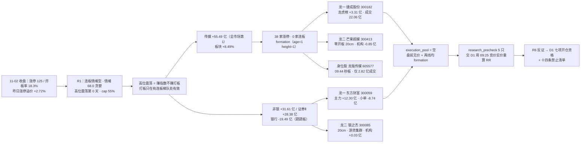

# 2026-11-03（周二）· **主线研判**

> **数据源新鲜度**: partial（数据日 2026-11-02 收盘，11-03 盘前件，无盘中数据）
> **降级状态**: false（本单元未降级；上游 R1/R3 降级已计入置信度）
> **置信度**: 0.78（研究质量分，不是胜率，不是开仓许可）

## 一句话结论

传媒 / AI内容 是当日唯一板块级涨停潮（38 家、0 家连板）的三榜同向方向，券商是非市场自发的政策脉冲首日；两条都是 formation 第一天，执行池为空，研究前置 5 只交 D1 逐票裁决。

## 详细分析

**一、市场段位：放量修复第 2 天，高位震荡第 0 天，「赚指数不赚打板」。** 11-02 收盘口径：涨停 125 家、跌停 8 家、炸板 28 家（炸板率 18.3%）、上涨 4682 家 / 下跌 767 家（全市场 5571 家，广度 0.8402）、中位涨幅 +2.017%、成交 17951.9 亿（+6.4%）。天梯是 6 板 1 只 / 4 板 1 只 / 3 板 3 只 / 2 板 6 只 / 首板 114 只，最高 6 板。R1 给「连板情绪型 + 情绪 68.0 贪婪/偏暖修复 + 高位震荡第 0 天 + 仓位上限 55%」。核心矛盾写在 R2 自己的市场判断里：涨停 125 家很多，但昨日涨停股收盘溢价只有 +2.72%、炸板率 18.3% —— 打板通道只在「有连板梯队」的线上有效，其余线必须走低吸/半路。这不是「能不能做」的问题，是「用哪个通道做」的问题。

**二、主线一·传媒 / AI内容（89 分，五维 18/17/20/17/17）：唯一板块级涨停潮，宽而不高。** 涨停维给满分的依据是可复算的口径：传媒系 38 家涨停（广告营销 9 + 出版 8 + 影视院线 7 + 游戏Ⅱ 7 + 数字媒体 5 + 电视广播 2），概念口径文化传媒 41 家、人工智能 57 家、短剧游戏 31 家 —— 这是 10-30 以来第一次板块级爆发（对照 10-30 概念榜 top1 仅 9 家）。资金维只给 17 分，因为它是单日脉冲而非趋势：传媒 +55.49 亿（当日全市场第一、板块 +8.49%），但 5 日 -2.94 亿、20 日 -61.11 亿；子行业数字媒体 +14.15 亿（净占比 10.30%）、游戏Ⅱ +12.38 亿（+9.06%），细分概念 AI视频 +23.81 亿（净占比 9.51%、+10.58%）、短剧互动游戏 +27.75 亿（+8.84%）、影视概念 +23.94 亿（+7.83%）。叙事维扣 3 分：E20261103_005 是 high，但缺「政策级」催化，且 11-05 微短剧论坛是已知时间锚（兑现即卖点）。致命的结构缺陷是 0 家连板：38 家涨停里最高身位是 9 天 5 板的文投控股（当日仍是 1 板），没有连板梯队 = 没有承接结构，次日是验证日，不是加速日。

**三、主线二·券商 / 非银（77 分，五维 17/16/11/18/15）：政策是真的，集体涨停是假的。** 叙事维 18 分是五维里唯一接近满分的：E20261103_001 是当日唯一「政策级」催化 —— 央行 11-03 第三次 SFISF 操作申请额度超 1000 亿、回购增持再贷款由阶段性转长期制度（利率 1.25%→1%）、证监会研究优化融资保证金比例与折算率、18 只主动 ETF 已募 350 亿要求加快建仓，四条全部指向券商/非银的增量资金。但涨停维只能给 11 分：券商仅 2 家涨停（国金证券、太平洋），「集体涨停」没有出现 —— 这与传媒 38 家的差别，就是 77 分不能更高的全部原因。资金维 16 分：非银 +31.61 亿（净占比 5.64%、板块 +3.91%）、证券Ⅱ +28.38 亿（净占比 6.80%、+4.48%），但 5 日仍 -25.04 亿 / -28.04 亿，属长期失血板块的第一天回补。跷跷板成立：银行 -19.49 亿（当日最大流出）、公用事业 -12.56 亿 —— 买券商的钱是从防守板块抽出来的。

**四、三条次线都不进：60 / 57 / 55 分，各有一条硬伤。** 消费线 60 分有 6 板空间龙（青岛食品，6/6 连板、封单 0.72 亿、零开板），但白酒Ⅱ 当日主力净流出 -2.45 亿（前一日 +25.00 亿，一天吐回）、青岛食品本身主力 -0.78 亿（净占比 -10.07%）+ 龙虎榜净卖 -0.29 亿，卖方是青岛本地三席（银川东路 -0.68 / 深圳福民路 -0.55 / 东北青岛 -0.31）—— 6 板上本地筹码在派发，且 R4 的 sectors_catalyzed 里根本没有白酒/食品（叙事维 10 分）。半导体 57 分是「资金强 + 无涨停 + 无共振」：半导体 +46.08 亿（净占比 2.37%）、存储芯片 +42.25 亿（2.51%）、半导体设备 +19.54 亿，但电子 5 日 -368.97 亿、半导体 -154.02 亿，且电子系仅 6 家涨停、无一家纯半导体涨停、R3 四主题无存储；E20261103_002（美光 -5.50%、费半 -3.02%）构成海外映射反向。CPO 55 分是「叙事最强、盘面背离」：E20261103_003 high（英伟达 OOI 下一代 CPO 原型、高盛 2026-2028 光模块市场 677/1314/1485 亿美元、Lumentum 获 50 亿美元 NPO/CPO 订单）对撞 E20261103_002（Lumentum 公布大单仍跌 18.71%），A 股中际旭创 -0.54%（成交 188.83 亿、5 日主力 +29.45 亿、距 20 日高 -34.1%）、新易盛 -2.31%，零涨停 —— 订单落地股价跌，是典型的减分项。淘汰 5 条：固态电池 48、黄金 45（叙事 17 分但板块 -1.80%、主力 -2.34 亿、零涨停，期现背离）、机器人 40（E20261103_007 为负面，机器人概念主力 -3.84 亿）、商业航天 36、银行 32。

**五、龙一为什么是捷成股份，而不是秒板的龙版传媒。** 用 v1.3 带动性口径：捷成的证据是资金结构全场最硬 —— 龙虎榜净买 +3.31 亿，席位拆解深股通 +1.47 亿、机构专用两席 +1.01 亿、开源西安西大街 +0.71 亿、国泰海通北京知春路 +0.61 亿，北向 + 机构 + 一线游资三方同日净买，传媒链唯一；成交 22.06 亿为板块第一、换手 17.34%、量比 1.90；主力 +4.27 亿、净占比 19.35%；位置低（5 日 +1.99%、距 20 日高 -7.84%），首板放量突破 MA5/MA10/MA20（5.30/5.41/5.45）。它的减项也如实写：13:46 尾盘首封、14:13 末封、盘中 3 次开板，属尾盘确认型而非点火型。点火在龙版传媒（09:44 秒板、零开板、量比 0.68、心智锚 82.3 三榜第一、1 年 13 次涨停/最高 6 板），但龙版成交仅 2.82 亿、流通 57.8 亿，接不住 40 家涨停潮的体量 —— 所以龙版单列 `身位股`（只可打板/竞价确认，不可低吸），龙一给「资金结构 + 容量」。这就是「龙头 ≠ 涨停」的当日实证。

**六、券商线的龙一同理：容量核心未封板，弹性票封板。** 东方财富 +6.31% 未涨停，但成交 86.46 亿（券商板块第一）、量比 2.61、主力 +12.30 亿（净占比 14.22%）、同日小单 -8.74 亿、中单 -3.56 亿、超大单 +7.00 亿 —— 机构接散户筹码的典型形态；东财人气 24→2（+22，全市场最大跃升）、同花顺热股新进 19；距 20 日高 -1.42%、MA5/MA10/MA20（18.08/18.11/18.02）三线粘合后向上突破。它的瑕疵是 5 日主力仅 +0.02 亿（前四日 -4.20/-2.88/-1.02/-4.18），单日流入全靠 11-02。银之杰 +20.02%（10:09 首封、1 次开板、封单 0.98 亿、换手 11.80%、量比 2.52）拿龙二，理由是龙虎榜 +2.45 亿（深股通 +0.82、开源西安西大街 +0.66、国泰海通北京知春路 +0.60、国泰海通湛江万豪 +0.55、平安绍兴 +0.30）+ 主力 +4.45 亿净占比 24.80%（券商链涨停最高）+ 位置低（距 20 日高 -12.06%）；减项是机构专用两席合计仅 +0.03 亿，纯游资。候补两只都是零开板秒板型：国金证券 09:34 首封、成交仅 5.22 亿、换手 1.69%、净占比 31.71%、创 20 日新高；太平洋 09:50 零开板、成交 12.29 亿、净占比 32.82%。两只 1 年各只有 1 次涨停、maxlb=1，股性薄，连板概率低 —— 券商线只给 4 只，第 5 席（同花顺 5 日主力 -3.66 亿、国泰海通政策日仅 +2.77%）被强度/资金否决，不凑数。

## 推理深度三问

**① 大资金意图是什么？**
看龙虎榜拆解，而不是看涨幅。传媒链里，捷成是「深股通 + 机构 + 一线游资」三方净买（+3.31 亿），粤传媒是「深股通 +0.84 亿 + 国新北京 +0.76 亿 + 机构三席 +0.54 亿」合计 +2.04 亿，芒果超媒却是机构专用四席合计 -0.85 亿、深股通 -0.21 亿（龙虎榜 -0.53 亿）。同一板块内三种钱在做三件不同的事：捷成/粤传媒是进攻仓，芒果是「人气票 + 机构减仓」。券商线的东财是「主力 +12.30 亿 / 小单 -8.74 亿」，典型机构接散户；银之杰是「北向 +0.82 亿 + 三家一线游资，机构 +0.03 亿」，纯游资打弹性。所以今天真正的大资金意图是：在容量核心里建仓（捷成、东财），在弹性票里博连板（银之杰、国金、太平洋）。

**② 为什么走强？**
传媒不是被产业数据推动的，是被「AI 应用的变现叙事」推动的：AI漫剧市场规模 +390%、海外短剧付费前十中国占 9 席、AI漫剧活跃用户超 1.5 亿、11-05 微短剧论坛（R4 E20261103_005 high + 影视短剧/AI漫剧 high、游戏 medium）。券商不是被业绩推动的，是被政策推动的：SFISF 1000 亿 + 回购增持再贷款转长期 + 融资保证金比例优化 + 350 亿 ETF 加快建仓（E20261103_001 high）。两条线的驱动性质不同 —— 一个是市场自发的题材点火（可信度高、持续性靠接力），一个是政策明牌（可信度靠执行、持续性靠资金续流入），这也决定了它们的验证标准不同：传媒看「今日是否出现 2 板梯队」，券商看「今日东财是否续流入 >5 亿」。

**③ 逻辑够不够硬？**
传媒：够硬的是涨停家数（38 家）、资金排名（+55.49 亿全市场第一）、三榜同向（R3 共振第 1、第 2 同源）；不够硬的是「五维里两维都靠单日数据」—— 涨停 0 家连板、资金 5 日 -2.94 亿、20 日 -61.11 亿。所以它只能算「启动确认」，不能算「趋势确认」。券商：够硬的是政策级催化 + 资金结构（机构接散户）+ 跷跷板成立（银行 -19.49 亿）；不够硬的是盘面强度（仅 2 家涨停）与资金持续性（5 日仍净流出），R3 discipline_note 已明确「不构成风格切换到防守主线的确认」。结论：两条线都只配「观察试探」，都不配在盘前拿执行资格 —— 生命周期函数对两条线都返回 formation（age=1 / height=1 / persist=1 / break_rate=0.183，confidence 0.6），R2 的人工 override 把传媒上调为「formation 后段 → early_up 前夜」，理由写在该字段：41 家概念涨停 + 资金全场第一 + 三榜同向；但两个口径指向同一动作 —— 第 2 日只做分歧承接。

## 首推票思维链 · 300182 捷成股份（传媒线龙一）

**买入理由**：它是传媒链唯一同时具备「容量 + 资金结构 + 位置」的票。容量 136.2 亿流通、成交 22.06 亿，是这条 38 家涨停潮里真实的成交中心；资金结构是龙虎榜 +3.31 亿的深股通（+1.47 亿）+ 机构（+1.01 亿）+ 一线游资（开源西安西大街 +0.71 亿、国泰海通北京知春路 +0.61 亿）三方同日净买；位置是首板、5 日仅 +1.99%、距 20 日高 -7.84%，首板即突破 MA5/MA10/MA20（5.30/5.41/5.45），不是高位接力。

**风险点**：第一，板型是这条线里偏差的 —— 13:46 才首封、14:13 末封、盘中 3 次开板、封单 0.58 亿，尾盘确认型封板次日容易被先手兑现，竞价高开 >5% 就是接盘。第二，5 日主力 +1.48 亿里当日贡献 +4.27 亿，前四日为 -0.58/+0.67/-1.62/-1.26，说明资金是当日才进来的，不是持续吸筹。第三，1 年只涨停 3 次、maxlb=2，股性属「能涨但不妖」，连板概率低。第四，主线本身 0 家连板、5 日资金 -2.94 亿，个股再强也扛不住板块退潮 —— 若今日传媒主力净流入低于 +15 亿，视为一日游证伪。

**止损条件**：收盘跌破 MA5 5.30 视为逻辑证伪（现价 5.64，距 MA5 约 -6.0%）；竞价高开 >5% 当日不参与；低开 ≤-2% 需回踩不破 11-02 均价才可低吸；若今日传媒主力转为净流出，不论个股形态一律降级为观察。

**可验证假设**：①若「传媒是主线」为真，今日必须出现 2 板梯队（30 家首板里至少 3-5 家晋级），且传媒主力续流入 >15 亿；②若「容量核心承接」为真，捷成应跑赢板块指数且成交不低于 15 亿；③若「芒果机构派发」为真，芒果应在龙版/捷成上涨时滞涨或下跌 —— 这条用于验证龙二降级是否必要；④若「点火靠小票」为真，龙版传媒今日不炸板但成交仍 <5 亿，说明它只是情绪指标、不能承载资金。

## 主线决策与资金流

## 关键证据

- **证据 1（涨停潮口径）**：传媒系 38 家涨停（广告营销 9 + 出版 8 + 影视院线 7 + 游戏Ⅱ 7 + 数字媒体 5 + 电视广播 2）；概念榜口径 人工智能 57 / AI应用 47 / 文化传媒概念 41 / 华为概念 38 / DeepSeek概念 36 / 短剧游戏 31。R3 口径为 29 家（不含游戏/电视广播），本报告用 38 家并披露口径差。来源：tushare `limit_list_d`（161 行）+ `limit_cpt_list`。
- **证据 2（资金排名）**：传媒 +55.49 亿（第 1，板块 +8.49%）、数字媒体 +14.15 亿（净占比 10.30%）、游戏Ⅱ +12.38 亿（+9.06%）；非银 +31.61 亿（第 4，+3.91%）、证券Ⅱ/Ⅲ +28.38 亿（第 5，+4.48%）；银行 -19.49 亿（流出第 1）、公用事业 -12.56 亿。R2 独立复算 `mf_industry_20261102` 与 R7 逐位一致（传媒 55.49 / 非银 31.61 / 传媒 5 日 -2.93）。
- **证据 3（席位性质）**：捷成股份龙虎榜 +3.31 亿，深股通 +1.47 亿、机构两席 +1.01 亿；芒果超媒 -0.53 亿，机构四席 -0.85 亿、深股通 -0.21 亿；粤传媒 +2.04 亿（深股通 +0.84 / 国新北京 +0.76 / 机构三席 +0.54）；银之杰 +2.45 亿（深股通 +0.82 + 三家一线游资）。龙版传媒、东方财富、国金证券、太平洋当日未上榜，`lhb_net_yi` 缺失（未上榜，非零）。来源：tushare `top_list` / `top_inst`（已按 (exalter, buy, sell) 去重）。
- **证据 4（生命周期）**：`locate_mainline_lifecycle(age=1, height=1, persist=1, break_rate=0.183)` 对传媒、券商均返回 formation（confidence 0.6）；消费线返回 climax（age=2 / height=6 / persist=0，confidence 0.55）；半导体 formation（缺涨停确认）；CPO 在 `_work/r2_lifecycle.json` 中为 mid_up（age=3 / height=1 / persist=1，confidence 0.55），但五维打分只有 55 分，故未进主线。
- **证据 5（四源交叉）**：传媒 CV=1.00（R2 89 / R3 共振第 1+第 2 / R4 影视短剧·AI漫剧 high / R7 传媒 +55.49 亿第 1），composite 0.89；券商 CV=1.00（R2 77 / R3 共振第 3 / R4 券商·非银 high / R7 非银第 4 + 证券第 5），composite 0.82。`cross_validation_degraded=false`，无源缺失。
- **证据 6（独立复算一致性）**：`limit_list_d` 125/8/28/18.30% 与 R1 `market_structure`、`emotion_cycle.metrics` 完全一致；`limit_step` 11 行 = 2 板以上全部（6:1 / 4:1 / 3:3 / 2:6），与 114 首板 + 11 连板勾稽自洽。

## 数据源审计

| 源 | 状态 | 抓取日期 | 记录数 | 备注 |
|---|---|---|---|---|
| R1 风格研判 | 🟡 degraded | 2026-11-03 | 1 | confidence 0.49；只用温度与 cap 55%，不采信其「19 个概念 = 三主线以上」的代理口径 |
| R3 情绪共振 | 🟡 degraded | 2026-11-03 | 4 | WeFlow 永久下线 → 共振封顶 L1+L2b；L2 群聊断更 6 个交易日，88 篇公众号代位 L2b；distribution_alert=null |
| R4 消息面 | 🟢 ok | 2026-11-03 | 8 | 5 high / 3 medium；21 只首板候选、33 个板块；E001 政策、E005 AI漫剧为两条主线叙事源 |
| R7 资金面 | 🟢 ok | 2026-11-03 | 1 | degraded=true（北向/ETF 子项缺）；主力单日 +119.54 亿 / 5 日 -1217.57 亿 / 20 日 -4683.28 亿；execution_candidates=0 |
| tushare 涨停列表 | 🟢 ok | 2026-11-02 | 161 | U125 / D8 / Z28 / 炸板率 18.30%，与 R1 逐项一致 |
| tushare 连板天梯 | 🟢 ok | 2026-11-02 | 11 | 6:1 / 4:1 / 3:3 / 2:6，最高 6 板 |
| tushare 概念榜 | 🟢 ok | 2026-11-02 | 6 | 人工智能 57 / AI应用 47 / 文化传媒 41 / 华为 38 / DeepSeek 36 / 短剧游戏 31 |
| tushare 龙虎榜 | 🟢 ok | 2026-11-02 | — | 数字为去重后净额；未上榜票 `lhb_net_yi` 记 null |
| tushare 席位明细 | 🟢 ok | 2026-11-02 | — | side=0/1 双向重复已去重（未去重高估约 2 倍） |
| 东财资金流 | 🟢 ok | 2026-11-02 | — | 行业/概念/个股三层；传媒、非银与 R7 复算一致 |
| 题材心智锚 | 🟢 ok | 2026-11-02 | 597 | 文化传媒/短剧产业/AI视频三榜 TOP1 均为龙版传媒 82.3（妖性型） |
| 生命周期函数 | 🟢 ok | 2026-11-03 | 5 | 传媒/券商/半导体 formation，消费 climax，CPO mid_up |
| 竞价快照 | ⚪ skipped | — | 0 | auction_snapshot status=skipped，本单元不含盘中数据 |

## 不确定性 / 反证

- **最大反证（主线年龄只有 1 天）**：两条主线都是 formation 第一天，age_days=1、money_persist_days=1。传媒 20 日 -61.11 亿、券商 5 日 -25.04 亿，都是「失血板块的第一天回补」，在历史上这类结构最容易变成一日游。我给 89 分 / 77 分的依据是当日截面强度（涨停潮 + 资金排名 + 三榜同向），不是趋势延续性 —— 这两件事必须分开读，否则会被误用成「可以拿波段」。
- **第二条反证（传媒 0 连板 vs R1 判连板情绪型）**：R1 说风格是「连板情绪型」，但传媒 38 家涨停里 0 家 2 板。真正有连板的是消费线（青岛食品 6 板），而消费线恰恰是资金最差的（白酒 -2.45 亿、青岛食品主力 -0.78 亿 + 龙虎榜 -0.29 亿）。这意味着今天的「情绪型」是全局属性，不是主线属性 —— 用打板通道做传媒，是在没有梯队的地方等梯队。若今日传媒仍无 2 板，这条线应降为次线。
- **第三条反证（龙二芒果超媒的机构分歧）**：芒果是板型最干净的 20cm（11:25 首封、零开板、封单 1.30 亿、量比 0.92 缩量），但机构四席净卖 -0.85 亿、深股通 -0.21 亿、龙虎榜 -0.53 亿，且 20 日已 +42.64%、距 20 日高 -1.33%。「强势惜售」与「机构交棒」同时成立，这是本报告最不确定的一只 —— 我把它从「旗帜」降为「分歧低吸」，若次日高开缩量再涨停，说明我低估了游资的锁筹意愿。
- **第四条反证（券商「政策脉冲」的三日判据）**：券商只有 2 家涨停，R3 discipline_note 明确这不构成风格切换确认。券商历史上「政策日一日游」概率高：银之杰/国金/太平洋近一年涨停次数分别 3/1/1，股性薄。我给 77 分的叙事维 18 分打的其实是「政策含金量」，不是「盘面强度」。若今日东财不能续流入 >5 亿、或银行回流，这条线 3 日内判 fade。
- **第五条反证（自我批判：龙一口径）**：我按 v1.3 把龙一给了捷成（尾盘 3 次开板的弱板型）而不是 09:44 秒板的龙版。理由是容量（136.2 亿 vs 57.8 亿）与龙虎榜结构（+3.31 亿 vs 未上榜）。这是判断，不是数据 —— 若今日龙版一字/秒板而捷成低开破 MA5，说明「点火 > 容量」在首日更有效，我的龙一口径排序错了。
- **口径披露**：①传媒涨停家数存在 38（R2，含游戏Ⅱ与电视广播）与 29（R3，不含）两个口径，本报告用 38 并标注；②R1 昨日涨停溢价写 +2.83%、`emotion_cycle.json` 为 0.0272（+2.72%），同向不同取样，本报告用 +2.72%；③成交额 R7 口径 17951.9 亿（+6.4%）、R1 口径 17832 亿（+6.51%），差 0.7% 属统计算术差异；④`_work/r2_leader_metrics.json` 中芒果 `inst_net_yi=-1.2`/`hk_net_yi=-0.42`、捷成 `+5.16`/`+2.94` 为未去重原值，本报告一律采信 JSON artifact 的去重值（-0.85/-0.21、+1.01/+1.47）。

## 与其他 R/D/E 的关系

- **依赖**：R1（温度 / 仓位上限 55% / 段位）、R3（4 条共振主题 L1+L2b）、R4（8 条事件 / 33 个板块催化）、R7（行业·概念·个股三层主力净额）；本地 tushare 独立复拉（涨停 / 天梯 / 概念榜 / 龙虎榜 / 席位 / 资金 / 市值 / 股性）；`mainline_lifecycle` 与 `theme_anchors`。
- **被消费**：
  - **D1（canghai-plan）**：`research_precheck` 5 只（捷成/芒果/东财/银之杰/龙版）+ 各票 precondition 是候选输入；`execution_pool=[]` 是纪律结论（盘前无价 + 两线均 formation + 龙一各有瑕疵），不是数据缺失，D1 不应把空池读成「R2 没干活」，也不应把 research_precheck 当开仓许可。
  - **R5（个股画像）**：画像对象取两条线龙一 + 龙二（捷成 / 芒果 / 东财 / 银之杰），候补（粤传媒 / 巨人网络 / 国金 / 太平洋）与身位股（龙版）按需。
  - **R6（反证）**：四处待反证已写明 —— ①主线 age=1 的持续性；②传媒 0 连板 vs R1「连板情绪型」；③芒果「缩量惜售 × 机构减仓」并存；④券商政策脉冲是否三日游。另需 R6 独立判断「龙一按容量还是按点火位」。
  - **E1（复盘）**：本日与 10-30 的对照是核心素材 —— 存储从主线降为次线、机器人从主线降为淘汰、CPO 从主线降为次线，而传媒/AI内容与券商是两条全新的 formation 线。

## Sub-Agent 元数据

- skill: analyze_main_sectors_v1@1.0（v1.3 辨识度优先 + v1.2 四源交叉验证 + 生命周期函数）
- artifact: `data/research/20261103/R2_main_sectors.json`（68292 B）
- 辅助产物: `_work/r2_leader_metrics.json`（20 只）、`_work/r2_lifecycle.json`（5 条线）
- 生成时间: 2026-11-03T09:55:39+08:00
- model: deepseek-v4.1-flash
- 主线数: 2（89 / 77）· 次线 3（60 / 57 / 55）· 淘汰 5 · 候选 leader 9 只 + 身位股 1 只（另剔除 3 只、否决 2 只）· 研究前置 5 只 · 执行池 0 只
