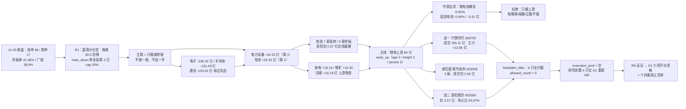

# 2026-11-04（周三）· **主线研判**

> **数据源新鲜度**: partial（数据日 2026-11-03 收盘，11-04 盘前件，无盘中数据）
> **降级状态**: false（本单元未降级；上游 R1/R3 降级、R4 缺板块聚合已计入置信度）
> **置信度**: 0.74（研究质量分，不是胜率，不是开仓许可）

## 一句话结论

电子系单日失血 470.71 亿、钱切向电力设备与电池的第 2 天，锂电上游（钠电/锂矿/回收）是全场唯一四源同源的方向（84 分 / early_up）；但主线只有 2 天龄、最高 2 板、龙一还在 MA20 下方，程序层 14 项禁止清单对 6 只候选全部拦截 —— 研究给方向，执行池必须为空。

## 详细分析

**一、市场段位：主跌期的修复二次验证日，「赚指数」都不成立。** 11-03 收盘口径：涨停 48 家（前日 125）、跌停 17 家（前日 8）、炸板 34 家（炸板率 41.46%，前日 18.3%）、上涨 2023 / 下跌 3045（广度 39.9%）、中位涨幅 -0.60%、成交 17029.1 亿（-4.50%）。天梯只有 4 板 2 只 / 3 板 1 只 / 2 板 12 只 / 首板 33 只，最高 4 板。昨日 125 家涨停股今日收盘溢价仅 +0.95%、红盘率 50.81%、再涨停 15 只 —— 三条修复判据（溢价 >+1%、广度 ≥60%、涨停 ≥60）一条都不成立。R1 给「震荡分化型 + 情绪 39.5 恐惧 + main_down 修复段第 3 日 + 仓位上限 20%」，R4 的板块攻守矩阵同样是「主跌（修复失败反手杀跌）」。这个段位下，任何「今天能不能做」的问题都要先降一维：不是选票问题，是开不开仓的问题。

**二、主线一·锂电上游（84 分，五维 17/20/18/14/15）：钱、板、故事、人气第一次指向同一个方向。** 资金维给满分 20 的依据是可复算的：电力设备 +34.32 亿（全市场行业第 1）、电池 +25.32 亿（第 2）、锂电池 +10.47 亿（第 3）、电池化学品 +8.98 亿（第 4），概念层钠离子电池 +18.16 亿（前日 +11.33）、锂矿 +16.30 亿（前日 +8.33）、动力电池回收 +16.18 亿、麒麟电池 +12.08 亿、换电 +9.65 亿；电池行业资金连续 3 个交易日净流入。同期对面是电子 -236.26 亿、半导体 -131.43 亿、通信 -103.02 亿单边失血 —— 这不是普涨，是一笔钱从高位科技搬到低位电力设备。涨停维 18 分：电池 7 家涨停为全行业第一，且这 7 家 0 家进炸板池（封板率 100%），圣阳股份封单 2.57 亿是当日 48 家涨停里最硬的一笔。扣分项同样硬：最高身位只有 2 板（紫竹高科），没有 3 板以上梯队；叙事只到 R4 的 medium（E008 电池 7 家涨停 + 宁德逆势 +3.80% + 主力 12.85 亿），没有产业或政策级催化。

**三、这条线的关键结构是「上游吸金 / 中游出货」，做错环节等于做反方向。** 同一天里，电池行业 +1.63%、电池化学品 +1.92%、蓄电池 +3.76%，但锂电池概念指数 -0.82%、板块资金 -5.84 亿，固态电池 -0.46% / -3.41 亿。资金只认钠电、锂矿、回收这三个上游概念，不认电解液、隔膜、正极。这条分界线的实战含义是：龙蟠科技（磷酸铁锂/正极）虽然封单 0.77 亿、主力 +1.22 亿净占比 33.82%，也只能列候补并被禁止清单判 mid_laggard；而丰元股份（距 20 日高 -32.83%）虽是位置最低的补涨位，股性薄、成交仅 3.0 亿，同样出不了研究前置。

**四、次线三条都不进：消费 65 / 光伏储能 48 / 非银保险 47，各有一条致命缺口。** 消费白马的资金是真的 —— 白酒 +2.99 亿、5 日 +25.98 亿（全市场 5 日榜第 1）、20 日 +56.85 亿，14/20 天为正，茅指数 +20.92 亿（概念榜第 1），茅台 +2.84%、成交 108.3 亿、收在 20 日新高。但涨停是拼盘：一般零售 4 + 服装家纺 3 + 饮料乳品 2 + 白酒 1，封单普遍不到 0.5 亿（大连友谊 0.19 / 大东方 0.23 / 友好集团 0.20 / 均瑶健康 0.34），营业部资金零售 -3.32 亿、服装 +0.21 亿 —— 钱只买权重不买题材，R3 原文即判「跟风位，杂毛剔除」。更要紧的是：七匹狼、九牧王、利群股份这批涨停的真实驱动是玄学梗（狼 / 牧羊 / 群字含羊），把它们算成「消费复苏主线」，等于把情绪当产业。光伏储能的问题相反：有资金（光伏设备 +8.50 亿、逆变器 +7.37 亿）、有涨停（储能 7 家首板、光伏 7 家 2 天 2 板），但 R3 判 L1 单源 —— 同花顺概念榜前 20 没有光伏/储能身影，热榜层未确认。非银保险的叙事最硬（SFISF 1000 亿落地、31 家机构申报、中信中标 100 亿最大份额），却零涨停，且证券Ⅱ 当日 -11.83 亿、中信证券主力 -3.11 亿而股价 +1.92% —— 政策利好被用来出货，与 11-03 的「+28.38 亿 / 2 家涨停」完全反转，一日半就结束。

**五、玄学已经是明线，但高标在派发。** 48 家涨停里 13 家（27.1%）属于 yáng 音族或羊/狼意象：阳（阳光照明 4 板、阳光股份、阳光乳业、太阳能、太阳电缆、鲁阳节能、圣阳股份）、洋（东方海洋 4 板、百洋股份、大西洋）、狼（七匹狼 2 板）、牧（九牧王）、群（利群股份，群字含羊）。再加同族炸板 7 家（岳阳兴长、澳洋健康、大洋电机、华阳国际、明阳电路、天洋新材、海阳科技），同族合计 20 家 —— 这不是巧合，是资金在炒「名字梗的扩散」。但高标反馈是坏的：两只 4 板（阳光照明主力 -5.94 亿、净占比 -35.28%、龙虎榜 -0.55 亿；东方海洋主力 -0.43 亿、龙虎榜 -0.37 亿）都在派发。接力资金转向低位同族：太阳能（龙虎榜 +1.77 亿，全场个股第 2）、七匹狼（+0.77 亿、封 1.11 亿）、九牧王（+0.84 亿）、利群股份（+0.38 亿）。所以妖股赛道的定性是「高标退潮 + 低位接力」的第二段，只能打板/竞价确认、单票 ≤5%、禁低吸、禁追一字。

**六、为什么执行池必须为空 —— 这次有程序层证据。** 我把 6 只候选喂进 `forbidden_filter.check_forbidden`（emotion_phase=main_down）：6 只全部拦截，allowed_count=0。主因是 counter_emotion_turn（情绪差仍开仓）与 buy_after_fade（确认退潮仍开仓），丰元股份与龙蟠科技另命中 mid_laggard（板块排名 3/4 = 中位杂毛）。也就是说，空池不是 R2 主观保守，而是 14 项禁止清单自己的输出。逻辑上还有第二层：本报告是盘前件，20261104 未开盘、没有竞价价，RR 无法计算 —— 按纪律「盈亏比优先于胜率」，没有 RR 就没有开仓资格。

## 推理深度三问

- **大资金意图**: 11-03 的买卖不是选股，是搬家。一边是电子 -236.26 亿、半导体 -131.43 亿、通信 -103.02 亿的机构减仓（中际旭创 -12.69% 成交 293 亿、新易盛 -9.46% 成交 174 亿，东财人气 30→2 / 42→8 却价格崩塌 = 典型派发），另一边是电力设备 +34.32 亿、电池 +25.32 亿的承接。承接方的结构是「大单进、散单出」：宁德时代主力 +12.85 亿净占比 8.28%、成交 155.11 亿；圣阳股份主力净占比 54.67% 但成交仅 7.20 亿 —— 大钱在容量票建仓，小钱在弹性票博板。对手盘是谁很清楚：卖的是上半年抱团 AI 算力的机构，买的是做「高低切 + 低位首板」的游资与部分长期资金。这就是为什么龙一是宁德（容量/带动性）而不是封单最硬的圣阳（弹性）—— 11-03 买入的主力金额，宁德是圣阳的 3.2 倍。

- **为什么走强**: 三维交叉看。位置：宁德收 249.32，仍在 MA20（258.12）下方、距 20 日高 -18.71%、20 日 -14.36%，是深跌反抽而不是突破；圣阳距 20 日高 -13.04%，首板即站上 MA20 17.78；丰元/龙蟠距 20 日高 -32.83% / -31.40%，是全市场最深的低位区。催化：不是产业数据，而是「资金高低切的承接方向」—— R4 E008 medium 的措辞很克制，只说资金在找承接，没有说锂价或钠电有拐点。筹码：电池行业资金连续 3 日净流入（10-30 +6.33、11-02 +6.74、11-03 +25.32），是三日加速而非单日脉冲；但电池 20 日仍 -157.47 亿、电力设备 20 日 -393.27 亿，中期筹码还在出清。结论：走强是「位置 + 三日资金加速」的组合，不是「产业拐点 + 筹码锁定」。

- **逻辑够不够硬**: 硬的部分有三项可复算证据 —— ①资金排名（行业第 1、第 2、第 3、第 4 全在这条线上）；②涨停结构（7 家涨停、0 家炸板、最大封单 2.57 亿）；③三源共振（R3 共振第 1、R4 E008 正面、R7 资金第 1）。不够硬的部分同样三项 —— ①年龄只有 2 天（11-02 首现 1 家、11-03 爆发 7 家），无法区分「新主线」与「一日半的高低切」；②高度只有 2 板，没有梯队就没有承接结构，次日若不出 3 板，按生命周期时序规则要降回 formation 后段；③龙一在 MA20 下方，意味着这条线的「龙」本身还没走出自己的下降通道。证伪路径很清晰：11-04 若电池行业资金转为净流出、或 7 家涨停里 0 家晋级 2 板，这条线当日降级为次线，不是「等回调再买」。

## 首推票思维链 · 300750 宁德时代（锂电上游龙一）

**买入理由**：①它是这条线唯一的成交中心 —— 155.11 亿成交是板块第二名的 21 倍，主力 +12.85 亿净占比 8.28%、5 日 +18.07 亿（5 日内 3 天为正），资金本体在这里而不在涨停票里；②同日钠电 +18.16 亿、锂矿 +16.30 亿、回收 +16.18 亿三条上游概念同步吸金，7 家电池股涨停，一个不封板的大容量核心带动了板块涨停潮，符合「龙头 ≠ 涨停」；③位置上是深跌反抽的起点（距 20 日高 -18.71%），不是高位接力，赔率结构比追涨停好。

**风险点**：①收在 MA20 258.12 下方，20 日 -14.36%，电力设备 20 日 -393.27 亿 —— 中期仍是失血板块，反抽随时可以结束；②它是「被用来承接」的票，不是「被用来进攻」的票：11-03 买入它的钱来自卖出电子，一旦电子止跌，这笔钱可能回流；③盘前无价，RR 无法计算，任何「现在就买」都是违反纪律「盈亏比优先于胜率」；④作为容量票它不提供短线弹性，若 D1 需要的是隔日溢价，它给不了。

**止损条件**：收盘跌破 MA5 236.13 视为「深跌反抽结束」，全条线下调为次线；竞价高开 >3% 当日不参与（不给隔夜逃命盘抬轿）；若当日电池行业主力转为净流出，不论个股形态一律降级为观察。参考止损距 -5.3%，处于 -5~-10% 硬区间内。

**可验证假设**：①若「上游吸金」为真，11-04 电池行业主力应续流入 >10 亿、且钠电/锂矿/回收三个概念至少两个为正；②若「高低切」为真，电子/半导体当日应继续净流出或至多打平，一旦电子大幅回流而电池转出，主线判定失败；③若「龙一是容量不是涨停」为真，宁德当日涨幅应不低于电池板块指数，且成交不低于 120 亿；④若「中游出货」为真，固态电池/锂电池概念指数当日应弱于电池行业指数 —— 这条用于验证「只做上游」的纪律是否还成立。

## 主线决策与资金流

## 候选票四要素（板型 / 龙头认定 / 盈亏比 / 禁止清单）

| 票 | 角色 | 板型（11-03） | 龙头认定（过纪律 §2） | 盈亏比 | 禁止清单命中 |
|---|---|---|---|---|---|
| 300750 宁德时代 | 龙一 | 未涨停 +3.80%，成交 155.11 亿，站稳 MA5/MA10 | ✅ 带动性（21 倍成交断层）+ 容量（10622.6 亿）+ 辨识度（宁王） | RR=null（盘前无价）；止损距 MA5 -5.3% | counter_emotion_turn / buy_after_fade |
| 002580 圣阳股份 | 龙二 | 首板，0 开板，封 2.57 亿（封/成交 0.357） | ✅ 强度核心（全场最硬封单）+ 锚 #5（回收概念）+ 位置低（-13.04%） | RR=null；止损距 MA5 -7.6% | counter_emotion_turn / buy_after_fade |
| 002058 紫竹高科 | 身位股 | 2 板，0 开板，封 0.73 亿（成交 2.50 亿） | ⚠️ 身位最高但容量不足（30.3 亿），是被带动方不是带动方 | RR=null；板价 -5% 止损 | counter_emotion_turn / buy_after_fade |
| 002805 丰元股份 | 候补（已剔出前置） | 首板，1 次开板，封 0.89 亿 | ⚠️ 低位（-32.83%）但股性薄、成交 3.0 亿 | RR=null | mid_laggard / counter_emotion_turn / buy_after_fade |
| 603906 龙蟠科技 | 候补（已剔出前置） | 首板，0 开板，封 0.77 亿 | ❌ 中游属性（正极）与「只做上游」冲突 | RR=null | mid_laggard / counter_emotion_turn / buy_after_fade |
| 002029 七匹狼 | 狼字辈龙头（并行赛道） | 2 板，0 开板，封 1.11 亿 | ⚠️ 玄学龙头，非主线（服装家纺不在主线列表） | RR=null；止损距 MA5 -14.0% → 超硬区间 | non_mainstream / counter_emotion_turn / buy_after_fade |

> 盈亏比口径：**盘前无价，一律 null，不由 R2 虚构入场价**。表中只给结构位止损距，供 D1 在 09:25 用竞价实价重算。按纪律 §4「RR<2 降级 watch」，四只在 RR 未算出前都不具备开仓资格。

## 关键证据

- **证据 1（资金断层）**：11-03 行业主力净额 —— 电力设备 +34.32 亿、电池 +25.32 亿、锂电池 +10.47 亿、电池化学品 +8.98 亿；对面电子 -236.26 亿、半导体 -131.43 亿、通信 -103.02 亿、元件 -64.64 亿。概念层钠离子电池 +18.16 亿（前日 +11.33）、锂矿 +16.30 亿（前日 +8.33）、动力电池回收 +16.18 亿。R2 用 `mf_ind_20261103` 独立复算，与 R7 `sector_flows` 逐位一致（容差 0.02 亿）。来源：eastmoney moneyflow_dc + R7。
- **证据 2（涨停结构）**：电池 7 家涨停（紫竹高科 2 板、圣阳股份、丰元股份、龙蟠科技、野马电池、时代万恒、尚水智能），0 家进入炸板池，封板率 100%；圣阳封单 2.57 亿为 48 家涨停中最大，封/成交 0.357；野马电池封/成交 0.57 但成交仅 1.0 亿。对照：一般零售 4 家封单 0.19-0.35 亿、服装家纺 3 家 0.48-1.11 亿。来源：tushare limit_list_d（U48 / D17 / Z34）。
- **证据 3（上游 / 中游分界）**：电池行业 +1.63%、电池化学品 +1.92%、蓄电池 +3.76%，但锂电池概念指数 -0.82%、板块资金 -5.84 亿、固态电池 -0.46% / -3.41 亿。同题材两种方向，说明资金在做环节选择而非板块普买。来源：R3 discipline_note + R7 concept_flows。
- **证据 4（生命周期）**：`locate_mainline_lifecycle(age=2, height=2, persist=3, break_rate=0.4146)` → early_up（confidence 0.80），证据为「主线运行仅 2 天 + 资金持续 3 天」；消费白马 mid_up（0.55）、非银保险 early_up（0.80，但 leader_height=0 反映零涨停）、光伏储能 early_up（0.80）、玄学妖股 climax（0.55，4 板 + 资金 0 天）。
- **证据 5（四源交叉）**：锂电上游 CV=1.00 —— R2 84 分、R3 共振第 1（L1+L2b）、R4 电池 +0.473 正面（E008 medium）、R7 电力设备第 1 + 电池第 2；consensus_themes 1 条，agreement_count=4，composite 0.80。
- **证据 6（程序层闸门）**：`forbidden_filter.check_forbidden(emotion_phase=main_down)` 扫描 6 只候选，allowed_count=0、blocked_count=6，主因 counter_emotion_turn + buy_after_fade，丰元/龙蟠另命中 mid_laggard。这是 execution_pool=[] 的独立程序证据。
- **证据 7（玄学扩散度）**：48 家涨停中 13 家（27.1%）属 yáng/狼/群字辈，加同族炸板 7 家共 20 家；两只 4 板（阳光照明、东方海洋）主力分别为 -5.94 亿 / -0.43 亿、龙虎榜 -0.55 亿 / -0.37 亿 = 高标派发。来源：limit_list_d + mf_dc + top_list + yaogu 素材包。

## 数据源审计

| 源 | 日期 | 状态 | 备注 |
|---|---|:--:|---|
| R1 风格研判 | 2026-11-04 | 🟡 | confidence 0.49；只用温度与 cap 20%，不采信其「无主线」结论（判定标准不同） |
| R3 情绪共振 | 2026-11-04 | 🟡 | WeFlow 永久下线 → 共振封顶 L1+L2b；2 条正向共振 + 3 条 L1 单源 + 2 条 L2 单源 |
| R4 消息面 | 2026-11-04 | 🟢 | 8 条事件（7 high / 1 medium）；`sectors_catalyzed` 与 `stocks_catalyzed` 为空 dict → 叙事维用 sector_polarity_matrix 替代 |
| R7 资金面 | 2026-11-04 | 🟢 | 主力单日 -574.09 亿（20 日第二重）；北向日 2026-10-28 起停抓（retired） |
| tushare 涨停列表 | 2026-11-03 | 🟢 | 99 行 · U48 / D17 / Z34 / 炸板率 41.46%，与 R1 逐项一致 |
| tushare 日线 + 市值 | 2026-11-03 | 🟢 | 5570 只 · 20 个交易日窗口 · MA/距 20 日高/5 日 20 日涨幅 |
| tushare 龙虎榜 | 2026-11-03 | 🟢 | 91 行 · 未上榜票记 null（非零） |
| 东财资金流 | 2026-11-03 | 🟢 | 6031 只个股 + 行业/概念三层 · 与 R7 逐位复算一致 |
| 题材心智锚 | 2026-11-02 | 🟡 | 597 概念 · 滞后 1 个交易日，仅用于存量资格（圣阳 = 回收概念锚 #5） |
| 玄学素材包 | 2026-11-04 | 🟢 | 3123 只名称 + 99 条涨停/跌停/炸板池；LHB 段当日无数据，改用 top_list_20261103 |
| 生命周期函数 | 2026-11-04 | 🟢 | 5 条线 · 锂电 early_up / 消费 mid_up / 保险 early_up / 光伏 early_up / 玄学 climax |
| 禁止清单过滤器 | 2026-11-04 | 🟢 | 6 只扫描 · allowed 0 / blocked 6 |
| iwencai（MCP+CLI） | — | 🔴 | 无 access key + Playwright 浏览器缺失 → 板块成分未做第三方交叉验证 |
| 竞价快照 | — | ⚪ | 未纳入 · 本单元不含盘中数据 |

## 不确定性 / 反证

- **最大反证（2 天龄 vs 真主线）**：这条线 11-02 才有第 1 家涨停、11-03 爆发 7 家，age=2、height=2。历史上两天就熄火的高低切远多于成型的真主线。我给 84 分依据是当日截面的四维同源，不是趋势延续性 —— 这两件事必须分开读，否则会被误用成「可以拿波段」。若 11-04 不出 3 板，这条线当日就该降为次线。
- **第二条反证（龙一在 MA20 下方）**：宁德收 249.32 vs MA20 258.12，距 20 日高 -18.71%。按「下降趋势板不碰」（禁止清单第 8 项），它本身就带着 down_trend_break 的嫌疑。我把龙一给它的理由是带动性与资金本体，但这确实是最容易被证伪的一环 —— 若 11-04 它跌破 MA5 236.13，整条线的定性从「主线」退回「反抽」。
- **第三条反证（R1 说无主线、R2 说有主线）**：R1 的代理口径是「概念 up_nums ≥20 的家数」（本日 0 个、最高 10 家），按它的标准今天没有主线；R2 的标准是「钱/板/故事/人气是否同源」。两个标准都对，只是回答不同问题。我选择按 R2 标准输出 1 条主线，但同时把执行池清空、候选砍半、只留弱转强通道 —— 如果事后证明这条线只是一日半的高低切，那说明在这种段位下「四维同源」也拦不住噪音。
- **第四条反证（玄学高标派发会不会传染）**：两只 4 板主力净流出，说明玄学赛道的高标在收钱。但玄学与锂电上游有交叉票（圣阳股份 = 阳字辈 + 钠电），若玄学资金整体退潮，圣阳会被双向拖累。我把圣阳的玄学属性当加分项，可能是错的 —— 它也可能是一个减分项。
- **第五条反证（自我批判：候补被剔出前置）**：丰元股份是位置最低的票（-32.83%），按「低位优先」本该给个位置，但 forbidden_filter 以板块排名 3 判 mid_laggard。我接受了程序判定，没有为「低位」开后门 —— 如果 11-04 丰元涨停而圣阳炸板，说明机械排名在低位票上过于粗糙。
- **口径披露**：①涨停家数 R2 用 tushare limit_list_d（48/U），与 R1 一致；②成交额 R1 17029.1 亿（-4.50%）vs R4 17150.9 亿，差 0.7% 属统计算术差异；③广度 R1 用「上涨/全样本」=39.9%，R4 用含平盘口径 =37.85%，本报告用 R1；④昨日涨停溢价 R1 close_mean +0.95%，与 emotion_cycle 的 premium 0.0221（开盘口径）不同取样，本报告用收盘口径；⑤`theme_anchors` 为 20261102 版本，圣阳锚分 56.1 反映的是 11-02 之前的历史股性。

## 与其他 R/D/E 的关系

- **依赖**：R1（段位 main_down / 情绪 39.5 / cap 20%）、R3（2 条共振主题 L1+L2b）、R4（8 条事件 + 21 个板块极性 + 6 只首板候选）、R7（行业/概念/个股三层主力净额）；本地 tushare 独立复拉（涨停 / 日线 / 市值 / 龙虎榜 / 资金）；`mainline_lifecycle`、`theme_anchors`、`yaogu_llm_context`、`forbidden_filter`。
- **被消费**：
  - **D1（canghai-plan）**：`research_precheck` 4 只（宁德 / 圣阳 / 紫竹 / 七匹狼）+ 各自 precondition 是候选输入；`precheck_excluded` 2 只（丰元 / 龙蟠）明确禁止进入执行池；`execution_pool=[]` 是纪律结论，不是数据缺失 —— D1 不应把空池读成「R2 没干活」，也不应把 research_precheck 当开仓许可。`forbidden_scan` 可直接复用在 D1 的闸门校验。
  - **R5（个股画像）**：画像对象取主线龙一 + 龙二 + 身位股（宁德时代 / 圣阳股份 / 紫竹高科），玄学并行赛道取太阳能、七匹狼；丰元 / 龙蟠按需（已剔出前置）。
  - **R6（反证）**：四处待反证已写明 —— ①2 天龄主线是否只是一日半的高低切；②龙一在 MA20 下方是否属 down_trend_break；③玄学高标派发是否会传染到圣阳的双身份；④「上游吸金 / 中游出货」的分界能否持续。另需 R6 独立判断「正面 84 分与空执行池是否自相矛盾」。
  - **E1（复盘）**：本日与 11-03 的对照是核心素材 —— 传媒/券商两条 formation 线一日即熄（11-03 传媒 38 家涨停 → 11-04 全部退潮），而锂电上游从 1 家到 7 家。玄学赛道从「暗线」变「明线」（13/48 涨停）也是新出现的结构变化。

## Sub-Agent 元数据

- skill: analyze_main_sectors_v1@1.0（v1.3 带动性优先 + v1.2 四源交叉验证 + 生命周期函数 + Step 4.8 玄学 LLM 联想 + 禁止清单程序层复核）
- artifact: `data/research/20261104/R2_main_sectors.json`（59951 B）
- 辅助产物: `_work/_r2_metrics.json`（30 只候选量化面板）、`_work/r2_lifecycle_20261104.json`（5 条线）、`_work/run_forbidden.py`（禁止清单扫描）
- 生成时间: 2026-11-04T07:09:00+08:00
- model: deepseek-v4.1-flash
- 主线数: 1（84）· 次线 3（65 / 48 / 47）· 淘汰 5（40 / 30 / 28 / 22 / 18）· 候选 leader 5 只 + 妖股候选 6 只 · 研究前置 4 只 · 剔除前置 2 只 · 执行池 0 只
