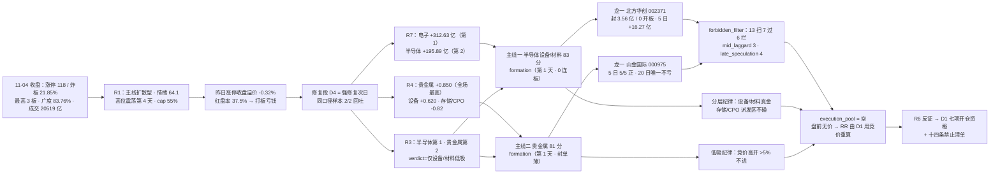

# 2026-11-05（周四）· **主线研判**

> **数据源新鲜度**: partial（数据日 2026-11-04 收盘，11-05 盘前件，无盘中数据）
> **降级状态**: false（本单元未降级；上游 R1/R3 降级、R7 partial、妖股素材包缺段均已计入置信度与 notes）
> **置信度**: 0.72（研究质量分，不是胜率，不是开仓许可）

## 一句话结论

修复段第 4 天、昨日涨停收盘溢价 −0.32% 的「指数强、打板亏钱」结构下，钱只认两个方向：**半导体设备/材料（83 分）**与**贵金属（81 分）**——前者靠 5 日 +37.07 亿的电子链唯一真金，后者靠 R4 全场最高 +0.850 的内外共振；但两条主线都是第 1 天、龙一还在 MA20 下方，程序层禁止清单 13 扫 7 过 6 拦，**执行池必须为空**。

## 详细分析

**一、市场段位：修复段第 4 天 = 强修复次日，2/2 同口径样本回吐。** 11-04 收盘口径：涨停 118 家（首板 105 / 89.0%）、跌停 9 家、炸板 33 家（炸板率 21.85%）、最高 3 板、涨 4667 / 跌 779（广度 83.76%）、中位 +1.88%、成交 20519 亿（+19.64%），主力净额 +500.28 亿为近 20 日最大单日。但昨日（11-03）涨停 48 家今日收盘溢价均值 −0.32%（中位 −2.342%）、红盘率仅 37.5%、再涨停 12 只 —— **指数级修复与打板亏钱同时成立**。R1 定级 high_chop（高位震荡第 4 天）+ 贪婪下沿 + 仓位上限 55%，并给出强修复次日样本 2/2 回吐（10-23→10-26、11-02→11-03）的实证。R3 接这个约束不给任何票开仓资格，本报告全部为研究观察对象。还有一个微观证据：118 家涨停中 48 家（40.7%）在 14:30 后才封板 —— 涨停潮的午后投机属性极强。

**二、主线一·半导体设备/材料（83 分，五维 18/17/19/13/16）：一条链、两个方向，设备/材料是真金、存储/CPO 是派发区。** 资金维 17 分的依据可复算：电子 +312.63 亿（行业第 1）、半导体 +195.89 亿（第 2）、数字芯片设计 +82.47 亿、元件 +49.86 亿、集成电路封测 +24.81 亿（净流入率 13.81% 全场最高）、半导体设备 +42.47 亿且 **5 日 +37.07 亿为电子链唯一 5 日为正的子行业**。涨停维 19 分：半导体 19 家涨停（全场第一）+ 元件 7 + 专用设备 6，封单合计 29.28 亿为板块第一，云南锗业 4.09 亿是全场封单第 2、通富微电 3.80 亿、北方华创 3.56 亿。扣分项同样硬：19 家全为首板（0 连板）= 只有广度没有高度；电子 5 日仍 −292.09 亿、20 日 −1176.61 亿，单日 +312 亿是高低切首日而非趋势流入；R4 对同一条链给两个方向 —— E003 设备 +0.62 high、材料 +0.434，E002 半导体/存储/光模块/CPO −0.82/−0.82/−0.82/−0.574。**买错分支等于买反方向，这是今日最大的操作陷阱。**

**三、主线二·贵金属（81 分，五维 14/17/15/19/16）：唯一「内外共振」方向，但封单薄、榜位脱节。** 叙事维 19 分是全场最高：R4 sector_polarity 贵金属 +0.850（20 板块第一），E001 high —— 民主党中期选举大胜 → 美元美债双跌 → 现货金 +3.57% 破 4070、现货银 +5.00% 报 52.26、沪银主力 +5%、花旗 0-3 月目标 4500。资金维 17 分：有色金属 +73.45 亿（行业第 6）、贵金属 +23.49 亿（净流入率 12.06% 全场第 2）、小金属 +28.82 亿；独立复算 5 日，贵金属 −7.03/−7.43/−3.67/−0.91/+23.49 = **由四连负转正的第一天**。但涨停质量不成立：贵金属 11 家涨停封单合计仅 9.20 亿、开板 18 次，最大封单赤峰 2.21 亿、山东黄金 0.46 亿、湖南黄金 0.15 亿；且黄金股 0 只进入东财人气榜前 15（榜上云南锗业 #2 是小金属不是黄金）—— 热点靠外盘「喂」，无自发赚钱效应。

**四、次线三条都不进：机器人 68 / CRO 63 / 光伏储能 58，各缺一条硬腿。** 机器人的问题是「题材最热、钱最不认」：机器人概念 21 家涨停、E005 high（王兴兴「距 GPT 时刻只差几毫米」+ 特斯拉新一代机器人进博会），但机械设备 +44.86 亿仅行业第 10、5 日 −91.74 亿，R4 标机器人 5 日 −194.76 亿「一日反抽」；龙头股集体亏钱（襄阳轴承 −3.85% 且连续 3 日霸榜后掉 #4 = R3 霸榜派发续报、大业股份 −8.16%），冰山冷热 3 板但封单仅 0.14 亿、换手 48.69%（死亡换手边缘）。CRO 是「封板质量最好、叙事最空」：医疗研发外包 5 日 +32.16 亿（全市场 5 日榜第 2、4/5 天正），药明康德封 3.23 亿 / 换手 2.30%（4516 亿市值的惜售型涨停）、凯莱英封 1.85 亿 / 0 开板，但药明 14:05 才封 = 落在投机窗口（forbidden late_speculation），且 R4 无 CRO/创新药条目、板块资金未进前十。光伏储能是「资金 3 连正、涨停拼盘」：电力设备 5 日 +30.11 亿、光伏设备 5 日 +28.47 亿、逆变器 5 日 +19.61 亿，但行业口径涨停仅光伏设备 3 + 电网设备 3 + 电池 1，无一只封单过 1.3 亿 —— R3 原话「若 11-05 光伏涨停家数 <10 家，确认一日游，剔除」。

**五、玄学妖股是「峰值后第一根阴线」，不是启动日。** 11-03 是明牌高潮（48 家涨停里 13 家同族），11-04 一天打完：同族只剩 2 家涨停（扬子新材、鲁阳节能，均 2 板），4 板高标阳光照明 −9.90%（主力 −1.43 亿、净占比 −21.3%）、东方海洋 −4.09%（主力 −3.44 亿），狼族七匹狼 −9.97%（主力 −4.20 亿、龙虎榜 −1.90 亿）、泉阳泉 −10.00%。这是标准的「高标派发 → 全族退潮」结构：钱从名字梗切去了半导体设备/贵金属两个产业壳。按纪律「退潮期不硬做」，只保留扬子新材（2 板 + 封 0.64 亿 + 主力净占比 21.9% 三条件同时成立的活口）做轻仓观察。

**六、为什么执行池必须为空 —— 这次有程序层证据。** 13 只候选喂进 `forbidden_filter.check_forbidden`（emotion_phase=high_chop）：7 只通过（北方华创 / 赤峰黄金 / 山金国际 / 凯莱英 / 索辰科技 / 宇树科技 / 冰山冷热）、6 只被拦（拓荆 late_speculation、中科飞测 mid_laggard+late、云南锗业 / 盛达资源 / 山东黄金 mid_laggard、药明康德 late_speculation）。逻辑上还有两层：①本报告是盘前件，20261105 未开盘、没有竞价价，RR 无法计算 —— 按纪律「盈亏比优先于胜率」，没有 RR 就没有开仓资格，R2 不虚构入场价；②R1 定级 high_chop + 昨日涨停溢价为负，接力/打板类打法本日必须降级，只能做核心承接。

## 推理深度三问 · 主线一 半导体设备/材料

- **大资金意图**: 11-04 的 +312.63 亿不是建仓电子全链，而是**高低切的第一天**：钱从 20 日 −1176.61 亿的电子旧仓位里挑了一个 5 日真金为正的子行业（半导体设备 +37.07 亿）做承接，长鑫回购上限提至 50 亿给了回购资金一个确定性出口。对手盘很清楚：卖的是上半年抱团存储/CPO/光模块的机构（东山精密 +7.04% 却龙虎榜净卖 −18.38 亿、机构专用 −29.74 亿），买的是做「国产设备国产替代 + 低位反抽」的游资与回购盘。这就是为什么龙一给北方华创（3895 亿容量 + 封 3.56 亿 / 0 开板 + 主力 +8.12 亿）而不是封单最大的云南锗业 —— 容量与带动性才是承接的锚。

- **为什么走强**: 位置 + 催化 + 筹码三维交叉。位置：全条线在 MA20 下方（北方华创 535.50 vs 548.17、拓荆 487.79 vs 535.21、华峰测控 218.53 vs 281.74），20 日 −13%~−42%，是深跌反抽的第 1 日不是趋势突破。催化：R4 E003 high（设备指数 +15.22% 涨停潮、长鑫回购 50 亿）是硬事件锚，但隔夜费半盘中 −5.00%、阿斯麦 −4.60% 给出跨市场反向。筹码：设备 5 日 +37.07 亿、北方华创 5 日 +16.27 亿且 4/5 天为正 —— 资金持续性是这条链唯一站得住的结构。

- **逻辑够不够硬**: 硬的部分三项可复算 —— ①5 日 +37.07 亿是电子链唯一 5 日为正子行业；②封单 29.28 亿板块第一、龙头 3.56 亿 / 0 开板；③三源共振 CV=1.0（R3 第 1 / R4 E003 / R7 第 1-2）。不够硬的部分三项 —— ①主线第 1 天、无连板梯队，一旦次日不出 2 板就是标准一日游；②R4 对同一产业链给相反极性（设备 +0.62 vs 半导体 −0.82），若按「半导体」整体口径 CV 只有 0.67；③隔夜海外设备股杀跌，A 股高开就是给隔夜盘抬轿。证伪路径：11-05 设备链资金转负、或 19 家涨停里 0 家晋级 2 板、或竞价高开 >3% 且封单 <1 亿 —— 任一成立当日降级。

## 推理深度三问 · 主线二 贵金属

- **大资金意图**: 这是**唯一的内外共振方向** —— 美元美债双跌 + 现货金破 4070 + 白银 +5%，A 股贵金属 11 家涨停且 5 日资金由四连负转正（+23.49 亿）。配置逻辑是「民主党大胜 → 弱美元 → 贵金属重估」的一次性政治事件映射，不是产业周期；对手盘是此前深套黄金股的资金（板块 20 日 −240.93 亿）借外盘解套。资金给了真信号：山金国际 5 日主力 5/5 天为正、赤峰封 2.21 亿为板块最厚 —— 但封单合计 9.20 亿 / 开板 18 次说明锁仓意愿弱。

- **为什么走强**: 催化最强（R4 +0.850 全场最高）、资金初动（5 日由负转正的第一天）、位置最低（多数票 20 日 −12%~−23%，属深跌反抽起点）；但榜位脱节（0 只进人气前 15）说明人气还没跟上 —— 这是「资金先行、人气滞后」的早期结构，也是「只做低吸、不做接力」的原因。

- **逻辑够不够硬**: 硬的部分：R3 第 2（L1+L2b）+ R4 最高分 + R7 有色第 6 三源齐，CV=1.0，composite 0.76 为当日最高。不够硬的部分：①驱动是中期选举一次性事件，事件落地后若金价不续涨映射立即失效；②封板质量不成立（9.20 亿 / 18 次开板）；③板块无连板梯队、黄金股无人气榜位。证伪路径：11-05 竞价高开 >5%（R3 红线：一律不进）、或贵金属资金转负、或金价夜盘回落 —— 任一成立降级为观察。

## 首推票思维链 · 002371 北方华创（半导体设备/材料 龙一）

**买入理由**：①它是设备链唯一的「封单≥3 亿 + 0 开板 + 3895 亿容量」三合一核心 —— 11-04 封 3.56 亿 / 0 开板 / 13:47 封板，主力 +8.12 亿（净流入率 12.94%）、5 日 +16.27 亿且 4/5 天为正，是半导体链 5 日净流入最大的单票之一；②一说「半导体设备」全市场第一个想到的名字，且设备 5 日 +37.07 亿为电子链唯一真金，资金本体在它身上而不在 20cm 弹性票上；③位置上是深跌反抽起点（距 20 日高 −12.2%），不是高位接力。

**风险点**：①收盘 535.50 仍在 MA20 548.17 下方（−2.31%）、20 日 −13.1%，反抽不等于反转，跌破 MA5 500.47 即结构破坏；②隔夜费半盘中 −5.00%、阿斯麦 −4.60%，A 股高开即进入兑现博弈，R4 明确「高开压力」；③电子 5 日仍 −292.09 亿，单日 +312 亿是高低切首日，次日资金回吐会把 5 日 +37.07 亿一起抹平；④盘前无价，RR 无法计算，任何「现在就买」都违反纪律。

**止损条件**：收盘跌破 MA5 500.47（距 535.50 约 −6.5%，落在 −5~−10% 硬区间）视为反抽结束；竞价高开 >3% 当日不参与（不给隔夜逃命盘抬轿）；当日设备链行业资金转负则无条件降级观察。

**可验证假设**：①若「设备真金」为真，11-05 半导体设备行业主力应续流入 >10 亿；②若「存储/CPO 是派发区」为真，存储芯片 / CPO 概念当日应净流出或至多打平；③若「龙一是容量不是身位」为真，北方华创当日成交应 ≥50 亿且设备链出现 ≥1 只 2 板；④若「高开即兑现」为真，竞价高开 >3% 后日内回落概率大 —— 这条用于验证 R3「只做设备/材料低吸承接」纪律是否还成立。

## 首推票思维链 · 000975 山金国际（贵金属 龙一）

**买入理由**：①5 日主力 +4.13 亿且 5/5 天为正，是黄金 11 家里唯一「资金 5 天全正」的票 —— 资金持续性全场最好，说明它是这条链的资金锚而非补涨；②20 日 +1.4%、距 20 日高 −7.8%，是黄金股里唯一「20 日不亏钱」的标的（其余 −12%~−23%）；③R3 首推两只之一 + 582 亿容量，机构配置黄金的第一梯队名字。

**风险点**：①封单仅 0.83 亿、开板 2 次，封板质量配不上龙一身位；②驱动是中期选举一次性事件，A 股属映射而非本源，金价不续涨映射立即失效；③贵金属 5 日虽转正但前四天连续净流出，单日脉冲属性明显；④盘前无价，RR 无法计算。

**止损条件**：竞价高开 >5% 一律不进（R3 红线）；回踩 MA5 21.63（距 23.08 约 −6.3%，符合 −5~−10% 硬区间）失守即走；当日贵金属行业资金转负或金银夜盘回落则降级。

**可验证假设**：①若「资金锚」为真，11-05 山金 5 日主力应续为正且贵金属行业资金 >0；②若「内外共振」为真，现货金应站稳 4070 上方且沪银不回落；③若「封单薄 = 情绪推动」为真，板块 11 家涨停中晋级 2 板的家数应 <3；④若「低吸有效」为真，竞价高开 ≤5% 的承接盘应拿到当日正收益 —— 高开 >5% 则验证「不进」纪律。

## 主线决策与资金流

## 候选票四要素（板型 / 龙头认定 / 盈亏比 / 禁止清单）

| 票 | 角色 | 板型（11-04） | 龙头认定（过纪律 §2） | 盈亏比 | 禁止清单命中 |
|---|---|---|---|---|---|
| 002371 北方华创 | 半导体 龙一 | 首板，0 开板，封 3.56 亿，13:47 封，成交 62.8 亿 | ✅ 带动性（设备链发动者）+ 容量（3895 亿）+ 辨识度 | RR=null（盘前无价）；止损距 MA5 −6.5% | 无（程序 14 项通过） |
| 688072 拓荆科技 | 半导体 龙二 | 20cm 首板，0 开板，封 1.24 亿，14:33 封 | ✅ 弹性核心 + 容量（1386 亿）；⚠️ 尾盘才封 | RR=null；止损距 MA5 −11.1% → 超硬区间 | late_speculation |
| 002428 云南锗业 | 半导体 候补 | 首板，开板 3 次，封 4.09 亿（全场第 2），09:32 封 | ⚠️ 早盘卡位 + 材料事件驱动；非板块 β | RR=null；止损距 MA5 −6.2% | mid_laggard |
| 688200 华峰测控 | 半导体 候补 | 20cm 首板，0 开板，封 1.49 亿，LHB 机构净买 +0.96 亿 | ⚠️ 低位（20 日 −41.6%）+ 席位确认；链断即弃 | RR=null；止损距 MA5 −5.4% | 无（程序通过） |
| 688361 中科飞测 | 半导体 候补 | 20cm 首板，开板 2 次，封 1.52 亿，14:00 封 | ❌ 5 日主力仅 +0.89 亿，价先行钱未到 | RR=null | mid_laggard + late_speculation |
| 000975 山金国际 | 贵金属 龙一 | 首板，开板 2 次，封 0.83 亿 | ✅ 资金持续性（5/5 正）+ 20 日唯一不亏 + 容量（582 亿） | RR=null；止损距 MA5 −6.3% | 无（程序 14 项通过） |
| 600988 赤峰黄金 | 贵金属 龙二 | 首板，开板 1 次，封 2.21 亿（板块最大），13:30 封 | ✅ 封板质量最好；⚠️ 5 日资金 −1.32 亿 | RR=null；止损距 MA5 −4.5% → 需 RR≥3 | 无（程序通过） |
| 600547 山东黄金 | 贵金属 候补 | 首板，0 开板，封 0.46 亿，14:24 封 | ⚠️ 容量锚（922 亿）+ 当日主力最大 +3.88 亿 | RR=null | mid_laggard + late_speculation |
| 000603 盛达资源 | 贵金属 候补 | 首板，开板 1 次，封 1.96 亿，13:24 封 | ⚠️ 白银弹性位；5 日主力 −0.24 亿 | RR=null | mid_laggard |
| 300139 晓程科技 | 贵金属 候补 | 20cm 首板，开板 1 次，封 0.94 亿，LHB 机构 +1.91 亿 | ⚠️ 20cm 弹性位，只做竞价确认轻仓 | RR=null；20cm 波动 ±15% | 无（程序通过） |
| 603259 药明康德 | CRO 次线 龙一 | 首板，开板 2 次，封 3.23 亿，14:05 封，换手 2.30% | ⚠️ 惜售型大票（4516 亿），但封板时间不合格 | RR=null；止损距 MA5 −4.9% → 需 RR≥3 | late_speculation |
| 002821 凯莱英 | CRO 次线 龙二 | 首板，0 开板，封 1.85 亿，13:32 封，5 日 +9.2% | ✅ 封板质量 + 5 日主力 +4.82 亿 5/5 正；须药明同步走强 | RR=null；止损距 MA5 −7.2% | 无（程序通过） |
| 002652 扬子新材 | 妖股赛道活口 | 2 板，0 开板，封 0.64 亿，主力净占比 21.9% | ⚠️ yáng 族唯一三条件活口；全族已退潮 | RR=null；单票 ≤5% 轻仓 | 非主线（并行独立赛道） |

> 盈亏比口径：**盘前无价，一律 null，不由 R2 虚构入场价**。表中只给结构位止损距，供 D1 在 09:25 用竞价实价重算。按纪律 §4「RR<2 降级 watch / 止损距 <5% 需 RR≥3」，所有票在 RR 未算出前都不具备开仓资格；程序通过的票只代表不违反 14 项禁止清单，不等于开仓授权。

## 关键证据

- **证据 1（资金断层）**：11-04 行业主力净额 —— 电子 +312.63 亿（第 1）、半导体 +195.89 亿（第 2）、数字芯片设计 +82.47 亿、元件 +49.86 亿、半导体设备 +42.47 亿（5 日 +37.07 亿，电子链唯一 5 日正）；有色 +73.45 亿（第 6）、贵金属 +23.49 亿（净流入率 12.06% 全场第 2）；对面白酒 −14.01 亿、证券 −3.52 亿。R2 用 `ind_20261104.json` 独立复算，与 R7 逐位一致（容差 0.02 亿）。来源：eastmoney moneyflow_ind_dc + R7。
- **证据 2（涨停结构）**：半导体 19 家涨停（全场第一）+ 元件 7 + 专用设备 6，封单合计 29.28 亿板块第一（云南锗业 4.09 亿全场第 2、通富 3.80 亿、北方华创 3.56 亿）；贵金属 11 家封单合计 9.20 亿、开板 18 次（最大封单赤峰 2.21 亿）。118 家涨停中 48 家（40.7%）在 14:30 后封板。来源：tushare limit_list_d（U118 / D9 / Z33）。
- **证据 3（生命周期）**：`locate_mainline_lifecycle` → 半导体设备/材料 formation（age 1 / height 1 / persist 1）、贵金属 formation（age 1 / persist 1）、光伏储能 early_up（age 2 / persist 3，但涨停仅 1 板 3 家 → R2 覆盖为观察）、CRO mid_up→early_up 覆盖（age 2 与最高 1 板矛盾）、机器人 mid_up→fade 覆盖（R4 5 日 −194.76 亿 + 龙头亏钱 + 霸榜派发）。
- **证据 4（四源交叉）**：两条主线 CV=1.00 —— R2 83/81 分、R3 共振第 1/第 2（L1+L2b）、R4 E003/E001 正面 high、R7 资金第 1-2/第 6；consensus_themes 2 条（半导体设备/材料 composite 0.71、贵金属 0.76，均为 4 源交集）。
- **证据 5（位置检查）**：7 只主线龙头中 5 只在 MA20 下方 —— 北方华创 535.50 vs 548.17（−2.31%）、拓荆 −8.86%、云南锗业 −3.67%、赤峰 −8.11%、华峰测控 −27.3%；只有山金国际（+0.30%）刚站上、山东黄金贴线。20 日跌幅 −13%~−42% →「深跌反抽」定性成立，本轮不是趋势突破。
- **证据 6（程序层闸门）**：`forbidden_filter.check_forbidden(emotion_phase=high_chop)` 扫描 13 只候选，allowed 7 / blocked 6（mid_laggard 3、late_speculation 4）。这是 execution_pool=[] 的独立程序证据。
- **证据 7（玄学退潮）**：11-03 峰值 13 家同族涨停 → 11-04 只剩 2 家（扬子新材、鲁阳节能 2 板）；4 板高标阳光照明 / 东方海洋 / 七匹狼合计主力净流出 −9.07 亿、龙虎榜 −3.57 亿。来源：limit_list_d + mf_dc + top_list + yaogu 素材包。

## 数据源审计

| 源 | 日期 | 状态 | 备注 |
|---|---|:--:|---|
| R1 风格研判 | 2026-11-05 | 🟡 | confidence 0.39；只用温度与 cap 55%，不采信其「无主线归属」结论（判定标准不同） |
| R3 情绪共振 | 2026-11-05 | 🟡 | 焦点群 0 条（连续第 6 日断更）+ WeFlow 永久下线 → 共振封顶 L1+L2b；5 条共振 + 3 条分布警报 |
| R4 消息面 | 2026-11-05 | 🟢 | 8 条事件（6 high / 2 medium）+ 20 个板块极性 + 6 只首板候选 |
| R7 资金面 | 2026-11-05 | 🟡 | 主力 +500.28 亿；vibe-trading stdio 掉线、两融/ETF 份额未披露；北日 2026-10-28 起停抓（retired） |
| tushare 涨停列表 | 2026-11-04 | 🟢 | U118 / D9 / Z33 / 炸板率 21.85%，与 R1 逐项一致 |
| tushare 连板天梯 | 2026-11-04 | 🟢 | 最高 3 板（3 板 7 / 2 板 6 / 首板 105） |
| tushare 日线 + 市值 | 2026-11-04 | 🟢 | 5572 只 · 21 日面板 · MA/距 20 日高/5 日 20 日涨幅 |
| tushare 龙虎榜 | 2026-11-04 | 🟢 | 72 行 · 未上榜票记 null（非零） |
| 东财资金流 | 2026-11-04 | 🟢 | 6031 只个股 + 行业/概念三层 · 与 R7 逐位复算一致 |
| 生命周期函数 | 2026-11-05 | 🟢 | 5 条线 · 半导体/贵金属 formation · 光伏 early_up 覆盖观察 · CRO 覆盖 early_up · 机器人覆盖 fade |
| 题材心智锚 | 2026-11-02 | 🟡 | 597 概念 · 滞后 1 个交易日，仅用于存量资格判断 |
| 玄学素材包 | 2026-11-05 | 🟡 | 3123 只名称；涨停池/龙虎榜段落抓取失败（无数据），已用 limit_list_d + R7 hot_money 补齐 |
| 禁止清单过滤器 | 2026-11-05 | 🟢 | 13 只扫描 · allowed 7 / blocked 6 |
| iwencai（MCP+CLI） | — | 🔴 | 无 access key + Playwright 浏览器缺失 → 板块成分未做第三方交叉验证 |
| 竞价快照 | — | ⚪ | 未纳入 · 本单元不含盘中数据 |

## 不确定性 / 反证

- **最大反证（第 1 天 vs 真主线）**：两条主线都是「首次涨停潮 + 0 连板 + 龙一在 MA20 下方」，历史上一天熄火的高低切远多于成型的真主线。我给 83/81 分依据的是当日截面的四维同源 + 5 日资金结构，不是趋势延续性 —— 若 11-05 不出 2 板、或设备/贵金属资金转负，当日降级为次线，不是「等回调再买」。
- **第二条反证（分支污染）**：R4 对同一产业链给相反极性（设备 +0.62 / 半导体 −0.82），我把「半导体设备/材料」单独成线、把存储/CPO 剔除。如果 11-05 存储/CPO 反而大涨，说明 R3「反抽第二日高危兑现区」的判断错了，也说明 R2 的分层过度自信 —— 但东山精密龙虎榜 −18.38 亿、CPO 20 日 −1003.29 亿的筹码证据目前都指向剔除。
- **第三条反证（贵金属事件映射）**：驱动是中期选举一次性事件，历史上「事件次日高开兑现」概率高；封单薄（9.20 亿 / 18 次开板）+ 榜位脱节（0 只进人气前 15）意味着它随时可能变成一日游。若金价夜盘回落，R4 +0.850 的最高分立即失效。
- **第四条反证（R1 三主线 vs R2 两主线）**：R1 代理口径是概念 up_nums≥15 去重得 3 条链，R2 按 5 维门槛（≥70 + 封板质量/资金持续性）只认 2 条。两个标准回答不同问题：R1 量扩散广度，R2 量可交易性。若 11-05 机器人走出换手龙头而设备链哑火，说明 R2 的「散户型共振不给开仓资格」过严。
- **第五条反证（自我批判：候补被程序拦）**：云南锗业封 4.09 亿 / 09:32 早盘卡位是全场封单第 2，但 forbidden_filter 以板块排名 3 判 mid_laggard。我接受程序判定 —— 如果 11-05 云南锗业涨停而北方华创回落，说明机械排名低估了材料分支的事件驱动强度。
- **口径披露**：①涨停家数 R2 用 tushare limit_list_d（118/U），与 R1 一致；②连板口径 R2 用 R1 limit_step（3 板 7 / 2 板 6 / 首板 105），自算 up_stat（4:2 / 3:10 / 2:10 / 1:96）是「N 日内涨停次数」非连续板，两者不可混用；③R3/R4 引用的「贵金属 +16.86 亿」与行业口径 +23.49 亿差 6.63 亿，属概念/行业口径差异，本报告用行业口径；④`theme_anchors` 为 20261102 版本，仅用于存量资格。

## 与其他 R/D/E 的关系

- **依赖**：R1（主线扩散型 / 高位震荡第 4 天 / cap 55%）、R3（5 条共振主题 + 分布警报 + discipline 开仓资格判定）、R4（8 条事件 + 20 板块极性 + 6 只首板候选）、R7（行业/概念/个股三层主力净额 + hot_money）；本地 tushare 独立复拉（涨停 / 日线 / 市值 / 龙虎榜 / 资金）；`mainline_lifecycle`、`theme_anchors`、`yaogu_llm_context`、`forbidden_filter`。
- **被消费**：
  - **D1（canghai-plan）**：`research_precheck` 6 只（北方华创 / 山金国际 / 赤峰黄金 / 凯莱英 / 拓荆 / 药明）+ 各自 precondition 是候选输入；`precheck_excluded` 10 只明确禁止进入执行池；`execution_pool=[]` 是纪律结论（盘前无价 + 高位震荡第 4 天 + 打板亏钱），不是数据缺失 —— D1 不应把空池读成「R2 没干活」，也不应把 research_precheck 当开仓许可。`forbidden_scan` 可直接复用在 D1 的闸门校验。
  - **R5（个股画像）**：画像对象取两条主线龙一 + 龙二 + 关键候补（北方华创 / 拓荆 / 云南锗业 / 华峰测控 / 山金国际 / 赤峰黄金 / 山东黄金），次线取药明康德 / 凯莱英，妖股赛道取扬子新材。
  - **R6（反证）**：五处待反证已写明 —— ①第 1 天主线是否一日游；②设备/材料分层是否过自信；③贵金属事件映射是否一日游；④R1 三主线 vs R2 两主线口径差；⑤候补被 mid_laggard 拦截是否过度。另需 R6 独立判断「双主线 80+ 分与空执行池是否自相矛盾」。
  - **E1（复盘）**：本日与 11-03 的对照是核心素材 —— 半导体从每日 0~3 家涨停跳增至 19 家（首次涨停潮）、贵金属从 0 家跳增至 11 家；玄学赛道从峰值到全族退潮仅用 1 天；「指数强 + 打板亏钱」的组合是本轮修复的结构底色。

## Sub-Agent 元数据

- skill: analyze_main_sectors_v1@1.3（v1.3 带动性优先 + v1.2 四源交叉验证 + 生命周期函数 + Step 4.8 玄学 LLM 联想 + 禁止清单程序层复核）
- artifact: `data/research/20261105/R2_main_sectors.json`（70312 B）
- 辅助产物: `_work/r2_leader_metrics.json`（23 只候选量化面板）、`_work/r2_lifecycle.json`（5 条线）、`_work/r2_forbidden_scan.json`（13 只禁止清单扫描）、`_work/build_r2_20261105.py`
- 生成时间: 2026-11-05T07:07:01+08:00
- model: deepseek-v4-flash
- 主线数: 2（83 / 81）· 次线 3（68 / 63 / 58）· 淘汰 5（47 / 31 / 26 / 26 / 24）· 候选 leader 10 只 + 妖股候选 1 只 · 研究前置 6 只 · 剔除前置 10 只 · 执行池 0 只
