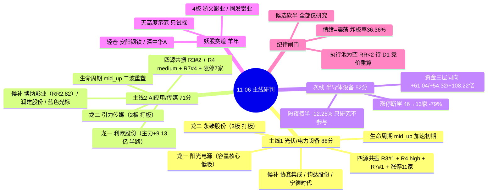

# 2026-11-06 · **主线研判**

> **数据源新鲜度**: partial（核心 A 股全 ok，R1/R3 降级、妖股素材包缺段已自建）
> **降级状态**: false（本单元无自身降级；上游 R1/R3 的降级已在置信度与共振维扣分）
> **置信度**: 0.66

## 一句话结论

**两条主线 = 光伏/电力设备（88 分）+ AI应用/传媒（71 分），半导体设备降级次线只研究不参与**。昨日是「广度极强、资金转弱」的修复段第 4 日（涨停 84、炸板率 36.36% 越 35% 红线）——情绪标**震荡**，候选砍半，全部 10 只仅作研究候选，无一只进执行池，开仓权留给 D1 按竞价与门禁逐票裁决。

---

## 详细分析

### 一、先认市场：修复段第 4 日的高位分歧，不是普涨

昨日（20261105）全市场涨停 **84**、跌停 **0**、炸板 **48**、炸板率 **36.36%**，广度 **88.3%**、中位 **+2.01%**、成交 **21177 亿（+3.94%）**，连板天梯 4 板 2 家 / 3 板 2 家 / 2 板 17 家 / 1 板 63 家。**结构判定**：权重滞涨（上证 +0.10%）+ 题材普涨（中证500 +1.80%）＝资金在题材端扩散、不在权重端进攻。但**当日炸板率 ≥35% 触发纪律减半线**，R1 情绪周期标 `high_chop`（修复段第 5 个交易日＝修复未确认的二次验证日），R3 情绪标**震荡**（分歧带极端）。**结论**：可以做，但只做龙头与低位，不接中位补涨；候选数从常规砍半。

资金面（R7）：全市场主力仅 **+85.39 亿**（前日 +500.28 亿）＝**钱没有增量，只是在内部换手**。流入端电力设备 **+63.10 亿**、半导体 +61.04、半导体设备 +54.32、传媒 +34.92、光伏设备 +32.36；流出端 CPO 概念 −85.47、5G 概念 −102.09、通信设备 −56.39 —— **AI 硬件链（CPO/光模块/PCB）连续两周被抽血**，资金切向「设备 + 电力设备 + 光伏」。20 日维度只有三条线是真金：半导体设备 +19.60 亿、光伏设备 +4.20 亿、贵金属 +5.63 亿/黄金 +12.30 亿。

### 二、主线 1：光伏/电力设备（含储能）· 88 分 · 四源满分共振

**四源交叉验证 = 1.0（R3 rank1 + R4 high + R7 资金第一 + 涨停结构），全市场唯一量级断层主线**。

| 维度 | 得分 | 依据 |
|---|:--:|---|
| 热度 | 19/20 | THS 概念热榜 **#1**，热度 52212→204009（+291%），是第 2 名 AI应用 142976 的 **1.43 倍**；储能 #10 / BC电池 #14 / 锂电池 #13 同日 NEW |
| 资金 | 20/20 | 电力设备 +63.10 亿（行业第 1）、光伏设备 +32.36 亿（涨 8.45%、主力占比 5.77%）、电池 +26.43 亿；电力设备 4 日 / 光伏设备 4 日 / 电池 5 日连续净流入，光伏设备 5.61→8.50→21.66→32.36 逐日加速 |
| 涨停 | 17/20 | 光伏设备 **11 家**（全场唯一 ≥8 家行业，前日仅 3 家）；光伏概念 22 涨停 / 9 连板、储能 18 / 6、电网设备 3 |
| 叙事 | 18/20 | R4：光伏设备 net_score **+1.471** / strength **high**（E002 民主党叫停关税 + E003 四连涨涨停潮）；行业分析师群与游资群点名 |
| 共振 | 14/20 | R3 rank1（L1_only 封顶 15 分）· 产业链横向扩散非单点脉冲 |

**生命周期**：`mid_up 主升中期`（age=4 / 高度 3 板 / 资金持续 4 日 / 炸板率 36.36%）——涨停潮是第 1 日（3→11 家）但板块已四连涨，**结构是加速初期、位置不是低位**，因此只做龙一/龙二，不接中位补涨。对前日「光伏涨停 <10 家即一日游剔除」阈值：实际 11 家 → **一日游假设被证伪，主线资格确认**。

**候选龙头（5 只 · 全部仅研究）**：

| 角色 | 票 | 板型 | 通道 | RR | 核心依据 |
|---|---|---|---|:--:|---|
| 龙一 | 阳光电源 300274 | 未涨停 +4.89% · 成交 130.5 亿 | 低吸 | 0.72 | 容量核心 + 带动性：主力 +5.03 亿、东财人气 52→8、流通 1352 亿；11 家涨停潮由它带出（未封板仍为龙一，实证 2026-10-26 宇树同型） |
| 龙二 | 永臻股份 603381 | 3 板 · 09:25 一字封 2.56 亿 · 0 开板 · 换手 2.40% | 打板 | 0.80 | 身位龙头：全场并列最高板之一，锁仓意愿最强；流通仅 26.8 亿（20-50 亿警惕区间） |
| 候补 | 协鑫集成 002506 | 1 板 · 09:32 封 1.65 亿 · 0 开板 · 换手 3.50% | 半路 | 0.80 | 大容量首板 + 主力高纯度（占比 46.71%）；光伏组件历史妖性股 |
| 候补 | 钧达股份 002865 | 1 板 · 09:39 封 0.54 亿 · 换手 12.07% | 低吸 | 0.80 | 换手最优首板：筹码交换真实；封单 0.54 亿偏薄不打板 |
| 候补 | 宁德时代 300750 | 未涨停 +4.42% · 成交 184.0 亿 | 低吸 | 1.61 | 储能链容量核心：主力 +8.10 亿、5 日 +45.47 亿（5/5 天为正）；RR 为本线最优，是「资金已回来、价格还在中位」结构 |

**推理深度三问**：
- **大资金意图**: 民主党横扫两院＝叫停关税 + 结束伊朗战争 + 数据中心不推高电费 → 光伏出口链与电力设备获**产业级政策锚**；主力 4 日连续流入且容量核心只涨 4.89%＝**建仓而非拉抬**（对手盘是 5 日 +26.7% 后追高的散户）
- **为什么走强**: 位置（板块四连涨非低位，但光伏设备 5 日 +26.7%、pos20=79）+ 催化（E002/E003 双 high，产业级非一次性）+ 筹码（永臻 3 板封 2.56 亿 0 开板锁仓、宁德 5 日 +45 亿回流）三维同向
- **逻辑够不够硬**: 三独立源共振（R3 热榜断层 + R4 双 high 事件 + R7 资金第一）且资金逐日加速＝**硬**；证伪路径＝炸板率继续抬升 >40%（光伏设备同日已炸 7 家占全场 14.6%）或隔夜费半 −12.25% 触发系统性补跌

### 三、主线 2：AI应用/传媒（含短剧游戏）· 71 分 · 资金纯度高于涨幅

**四源交叉验证 = 1.0（R3 rank2 + R4 medium + R7 资金第四 + 涨停结构）**。

| 维度 | 得分 | 依据 |
|---|:--:|---|
| 热度 | 17/20 | AI应用 #2 热度 +262%（昨 #11）、短剧游戏 #5 +60%、AI视频 #9 +70%、人工智能 #7 +74% —— 四个同族同日进前 10 |
| 资金 | 16/20 | 传媒 +34.92 亿（行业第 4）、营销代理 +20.52 亿（主力占比 **9.21% 全市场行业最高**）、广告营销 +20.07 亿；三线均连续 2 日净流入 |
| 涨停 | 12/20 | 广告营销 3 家（引力传媒 2 板竞价封）+ 影视院线 2 家（博纳 13:25 封 1.46 亿 0 开板）+ 通信服务 2 家；AI应用概念 17 涨停 / 5 连板 |
| 叙事 | 13/20 | R4：AI应用 +0.406 / medium（E007 腾讯混元 Hy4 770B 开源 + Kimi K3.1 Pro 开放权重）；**扣分**＝AI微短剧(纯概念) 同事件 −0.406（广电总局扶持真人剧规范 AI 剧） |
| 共振 | 13/20 | R3 rank2；芒果超媒 74→10、引力传媒 66→21 人气跳升 |

**生命周期**：`mid_up 主升中期`（age=4 / 高度 2 板 / 资金持续 2 日）——实为「二波重塑」：11-02 17 家 → 11-03 1 家 → 11-04 1 家 → 11-05 7 家，第二波只有 2 板高度，属**中段反抽而非新题材首日**。

**候选龙头（5 只 · 全部仅研究）**：

| 角色 | 票 | 板型 | 通道 | RR | 核心依据 |
|---|---|---|:--:|:--:|---|
| 龙一 | 利欧股份 002131 | 1 板 · 09:40 封 1.37 亿 · 开板 1 次 · 换手 8.48% | 半路 | 0.80 | 资金最猛 + 容量 + 人气：主力 +9.13 亿（全市场单票第 2、占比 42.53%）、龙虎榜净买 +3.30 亿、东财人气 #1、流通 257 亿 |
| 龙二 | 引力传媒 603598 | 2 板 · 09:30 竞价封 0.84 亿 · 0 开板 · 换手 2.93% | 打板 | 0.69 | 身位龙头 + 心智锚：AI营销 题材锚第 2（64 分/妖性型），辨识度高于资金排名 |
| 候补 | 博纳影业 001330 | 1 板 · 13:25 封 1.46 亿 · 0 开板 · 换手 11.07% | 低吸 | **2.82** | 全组唯一 RR>2 的票：位置低（MA20 下方、距 20 日高 −22.1%）+ 封板实；封板偏晚属投机窗口边缘 |
| 候补 | 润建股份 002929 | 1 板 · 09:46 封 2.00 亿 · 开板 1 次 · 换手 9.07% | 半路 | 0.72 | 封单本线最厚 + 资金纯度 28.58%；AI 算力服务二阶受益 |
| 候补 | 蓝色光标 300058 | 未涨停 +6.62% · 成交 57.3 亿 | 观察 | 0.37 | 容量核心但 RR 全组最差，仅作板块温度计 |

**推理深度三问**：
- **大资金意图**: 模型开源降价（腾讯混元 + Kimi）＝AI 应用落地叙事从「硬件」切向「软件变现」，营销代理主力占比 9.21% 全场最高＝**资金纯度优先于涨幅**；对手盘是隔夜 AI 硬件崩塌（费半 −12.25%）后急于找避风港的散户
- **为什么走强**: 位置（博纳等低位票在 MA20 下方）+ 催化（E007 模型权重开放，硬事件）+ 筹码（利欧龙虎榜净买 +3.30 亿、引力 0 开板）——但**7 家涨停中 3 家落在 13:00 后**（博纳 13:25 / 慈文 13:35 / 中嘉博创 14:15），午后投机属性强，非早盘主动进攻
- **逻辑够不够硬**: 双源共振（R3 rank2 + R4 medium）+ 模型降价是硬事件但**缺硬业绩**＝中等偏硬；证伪路径＝AI 硬件崩塌情绪传导（CPO/PCB 热度 −85%/−70%）导致应用端开盘高开低走，或利欧双平台不合力（东财 #1 / THS 仅 #21）证实为单一平台散户炒作

### 四、次线与丢弃：半导体设备只研究 · 黄金/商业航天/创新药/机器人全弃

**半导体设备/材料（国产替代）52 分 → secondary_lines（只研究不参与）**：R7 资金三层同向（半导体 +61.04 亿第 2、半导体设备 +54.32 亿第 3、5 日 +108.22 亿）是全场第二强资金面，但**涨停家数 24h 内 −79%（芯片概念 46→13 家）**、2 板票封板质量崩坏（瑞芯微开板 11 次、有研新材 6 次）、隔夜费半 −12.25%（E001 negative/high）＋R4 对半导体(海外映射)给 −0.63 → **「资金还在、情绪已退」，高开即是给隔夜盘抬轿**。生命周期判 `climax`（函数按 early_up 机械返回，已按涨停衰减率人工下调）。

**推理深度三问（次线）**：
- **大资金意图**: 国产替代（E006 设备订单排到明年 + 科创板 106.5 亿回购）是**中期真逻辑**，机构在 20 日维度持续加仓（半导体设备 20 日 +19.60 亿为全场唯一正收益资金线）——但今日与费半 −12% 正面对撞，短期做的是「低开不破的承接」而非追高
- **为什么走弱（相对）**: 涨停 46→13 家（−79%）+ 瑞芯微开板 11 次 + 有研新材开板 6 次＝封板质量崩坏；热度端 CPO −84.9%、PCB −69.7%、存储 −87% 断崖，硬件链先崩一角
- **逻辑够不够硬**: 基本面最硬（订单 + 回购）但**今日情绪面最弱**（海外 −12% + 烂板）＝「资金与情绪背离」；只做竞价不破位时的右侧，不做左侧抄底

| 丢弃板块 | 分数 | 理由 |
|---|:--:|---|
| 黄金/贵金属 | 42 | 叙事最强（E004 +1.334 high、金价破 4130 美元）但热度 −66% 反向 + 贵金属仅 1 家涨停且全线炸板（赤峰开板 21 次）+ R3 零提及 |
| 商业航天 | 38 | 热榜 #3 是唯一亮点，但 0 涨停、无主力板块资金进前 10、R4 无对应事件 → 人气无承接 |
| 创新药 | 34 | 百济单票硬业绩（E005 +431.8%）驱动，无涨停潮、5 日仅 +2.38 亿 → 单票事件不是主线 |
| 人形机器人 | 30 | 热度 144354→76060（−47%）而排名仍第 4 = R3 判定「衰退惯性，不得当升温解读」；资金 5 日净流出 |

**妖股赛道（羊年窗口）**：yáng 谐音族 4 只涨停但 3 只烂板（东方海洋开板 14 次 + 换手 53% + 命中 R3 霸榜出货警报；鲁阳节能封单仅 0.24 亿；阳光照明开 4 次），拆字族仅祥和实业 1 只烂板，狼字辈全场 0 涨停；全场最高仅 4 板（浙文影业/闽发铝业），**无高度示范 → 羊年梗处于「启动前的散点」而非「主升」，只做轻仓试探**（详见 JSON `yaogu_track`）。

---

## 候选思维链（10 只 · 全部仅研究，D1 须按竞价价重算 RR）

### 主线 1 · 光伏/电力设备

**阳光电源 300274.SZ（龙一 · 容量核心）**
- **买入理由**: ①产业逻辑＝光伏出口链获「叫停关税」政策锚，容量核心是板块承接力来源；②数据锚＝主力 +5.03 亿、东财人气 52→8（+44 位）、成交 130.5 亿全场前列，11 家涨停潮由它带出（带动性证据，非封板时序）
- **风险点**: ①短期风险＝5 日 +26.7%、pos20=79 已在高位，追高即接在分歧位（光伏设备同日炸 7 家）；②中期反证＝隔夜费半 −12.25% 若引发系统性补跌，最强方向首当其冲
- **止损条件**: 回踩 MA5（75.77）且收盘跌破 76.63（−10% 硬区间）离场；竞价高开 >3% 不参与
- **可验证假设**: 24-72h 内观察「光伏设备涨停家数是否 ≥8」与「容量票涨幅是否 ≥6%」；若涨停缩到 <5 家或宁德/阳光同时放量下跌 → 主线证伪，候选降级 watch

**永臻股份 603381.SH（龙二 · 身位龙头）**
- **买入理由**: ①产业逻辑＝光伏边框/铝型材涨价链 + 光伏双击，3 板是板块高度锚；②数据锚＝09:25 一字封 2.56 亿、0 开板、换手仅 2.40%、主力占比 69.34%＝锁仓意愿全场最强
- **风险点**: ①短期风险＝流通仅 26.8 亿（20-50 亿警惕区间）+ 成交 0.6 亿＝流动性差，一旦炸板无承接；②中期反证＝3 板一字 = 一致而非分歧，4 板需竞价承接，分歧点全在开盘
- **止损条件**: 打板/竞价确认参与（禁止低吸）；若 4 板炸板破均线或开盘后放量不封，立即离场（参考 16.97 止损锚，−9.97%）
- **可验证假设**: 今日竞价高开 ≤3% 且承接放量 → 分歧买点成立；高开 >7% 是给隔夜盘抬轿 → 放弃；24h 内若开板 ≥2 次 → 身位龙头资格失效

**协鑫集成 002506.SZ（候补 · 大容量首板）**
- **买入理由**: ①产业逻辑＝组件环节受益涨价链与出口缓和，补涨分支但容量够大（流通 148 亿）；②数据锚＝封 1.65 亿 / 0 开板 / 主力 +2.39 亿（占比 46.71%）/ 换手 3.50%
- **风险点**: ①候补位必然命中 mid_laggard（板块内第 3+ 顺位）→ 只做板块延续确认后参与；②首板无连板包袱但属 β 票，板块退潮无独立逻辑
- **止损条件**: 回踩 2.45 一带低吸；收盘跌破 2.29（−9.84%）离场
- **可验证假设**: 24h 内板块涨停 ≥8 家且协鑫不破 MA5 → 补涨成立；光伏涨停 <5 家 → 不参与

**钧达股份 002865.SZ（候补 · 换手最优首板）**
- **买入理由**: ①产业逻辑＝电池片价格反弹 + 储能装机，光伏中游弹性分支；②数据锚＝换手 12.07%（全场最优首板，筹码交换真实）+ 主力 +2.93 亿（占比 24.95%）
- **风险点**: ①封单仅 0.54 亿（流通 100 亿）→ 打板性价比差，只做低吸；②换手高 = 分歧已释放，若次日高开反而是兑现点
- **止损条件**: 回踩 42 附近低吸；收盘跌破 39.30（−10.01%）离场
- **可验证假设**: 24h 内不高开反而回踩 MA5 企稳 → 低吸成立；直接高开 >5% → 放弃追高

**宁德时代 300750.SZ（候补 · 储能链容量核心）**
- **买入理由**: ①产业逻辑＝储能并网 + 电网 6000 亿投资中期锚，非日内题材；②数据锚＝主力 +8.10 亿、5 日 +45.47 亿（5/5 天为正）、+4.42%，RR 1.61 为本线最优（止损距合理）
- **风险点**: ①超大市值不提供日内弹性，只提供「板块不倒」确认；②pos20=52.7 中位，若板块退潮它跌幅有限但也不抗跌
- **止损条件**: 回踩 255（MA20）低吸；收盘跌破 237.65（−10%）离场
- **可验证假设**: 72h 内主力 5 日累计仍为正 → 资金确认；转负且价格跌破 MA20 → 储能链资金撤退信号

### 主线 2 · AI应用/传媒

**利欧股份 002131.SZ（龙一 · 资金+人气双冠）**
- **买入理由**: ①产业逻辑＝AI 营销（数字人/投放模型）+ 低价大容量（流通 257 亿），是「AI 应用落地」最易被散户讲通的故事；②数据锚＝主力 +9.13 亿（全市场单票第 2、占比 42.53%）、龙虎榜净买 +3.30 亿（净率 15.36%）、东财人气 #1
- **风险点**: ①短期风险＝双平台不合力（东财 #1 / THS 仅 #21）＝人气集中在单一平台散户端，机构/游资端未确认；②中期反证＝AI 硬件崩塌情绪传导（费半 −12.25%），应用端高开低走风险
- **止损条件**: 半路参与（4.35-4.45 区间承接）；低开缩量破 4.10（MA20）或收盘跌破 3.95（−10.02%）离场
- **可验证假设**: 24h 内 THS 人气升至前 15 且成交 ≥15 亿 → 双平台合力确认；THS 仍 <30 → 单一平台炒作，降级 watch

**引力传媒 603598.SH（龙二 · 身位龙头 + 心智锚）**
- **买入理由**: ①产业逻辑＝AI 营销题材内体量最小、盘子最轻的高标（流通 58.5 亿），天然是游资做高度工具；②数据锚＝09:30 竞价封 0.84 亿、0 开板、换手仅 2.93%、主力占比 55.38%；AI营销题材锚第 2（64 分/妖性型）
- **风险点**: ①短期风险＝成交仅 1.7 亿 → 一致性极高，分歧点全在竞价；②中期反证＝3 板预期若兑现即到分歧位，缩量 2 板低吸无承接
- **止损条件**: 只做竞价弱转强打板确认（禁止低吸）；高开 >5% 且换手放大到 8% 才是健康换手板，否则放弃；收盘跌破 19.49（−10.02%）离场
- **可验证假设**: 24h 内 3 板且 0 开板 → 高度延续；开板 ≥2 次 → 弱转强失败，身位资格让渡

**博纳影业 001330.SZ（候补 · 全组唯一 RR>2）**
- **买入理由**: ①产业逻辑＝影视院线 + AI视频/短剧内容端，应用端低位补涨分支；②数据锚＝13:25 封 1.46 亿 / 0 开板 / 换手 11.07% / 主力 +1.69 亿（占比 22.26%）；RR **2.82** 为全组最优，距 20 日高 −22.1% 位置最低
- **风险点**: ①短期风险＝13:25 封板属投机窗口边缘，非早盘主动进攻；②中期反证＝MA20（6.23）仍在其上，属破位后首板，若板块二波失败则回吐
- **止损条件**: 回踩 5.58（MA5）低吸；收盘跌破 5.54（−10.06%）离场
- **可验证假设**: 24h 内板块涨停 ≥5 家且博纳守住 MA5 → 低位补涨成立；板块缩量 → 不参与

**润建股份 002929.SZ（候补 · 封单最厚）**
- **买入理由**: ①产业逻辑＝AI 算力服务/IDC 运维，应用要落地先要算力运维（二阶受益）；②数据锚＝09:46 封 2.00 亿（本线最厚）、开板 1 次回封、主力 +3.12 亿（占比 28.58%）
- **风险点**: ①算力租赁 #16 NEW 进热榜但 AI 硬件侧隔夜崩塌，属情绪传导高危区；②5 日仅 +4.2% 相对低位但非题材核心，板块退潮无独立α
- **止损条件**: 回踩 55 附近半路承接；收盘跌破 51.63（−10.01%）离场
- **可验证假设**: 24h 内算力租赁概念热度维持 top20 且润建不破 MA5 → 成立；热度回落 → 放弃

**蓝色光标 300058.SZ（候补 · 容量核心观察）**
- **买入理由**: ①产业逻辑＝AI 营销龙头，海外 AI 广告模型降价直接利好投放效率叙事；②数据锚＝成交 57.3 亿、主力 +3.81 亿、+6.62%、流通 465 亿＝板块承载力确认
- **风险点**: ①RR 0.37 全组最差（目标空间仅 +3.74%）→ 不做任何买点；②主力占比 6.65% 大市值摊薄＝「资金在里面但推不动」
- **止损条件**: 观察不进仓；若纳入执行池须以 MA20（12.36）为硬止损
- **可验证假设**: 72h 内主力占比能否升破 10% → 决定是否从温度计升级为参与标的

---

## 关键证据

- 证据 1: 光伏设备 11 家涨停＝全场唯一 ≥8 家行业（前日仅 3 家），「一日游」阈值被证伪 · 来源 tushare.limit_list_d(20261105)
- 证据 2: 电力设备 +63.10 亿（行业第 1）/ 光伏设备 +32.36 亿 / 传媒 +34.92 亿 / 营销代理占比 9.21%（全场最高）· 来源 eastmoney.moneyflow_ind_dc + R7
- 证据 3: THS 概念热榜光伏 #1（热度 204009 是第 2 名 1.43 倍）、AI应用 #2（+262%）· 来源 tushare.ths_hot + R3
- 证据 4: R4 双 high 事件：E002 民主党横扫（叫停关税 + 结束伊朗战争 + 数据中心不推高电费）+ E003 光伏四连涨涨停潮 · 来源 R4_news.json
- 证据 5: 全场最高 4 板仅 2 家（闽发铝业/浙文影业）、首板占 75% —— 宽度型而非情绪主升型 · 来源 limit_U_20261105.json
- 证据 6: 半导体设备资金 3 层同向（+61.04/+54.32/+108.22 亿）但涨停 46→13 家（−79%）+ 瑞芯微开板 11 次 → 高潮后首日分歧 · 来源 R7 + limit_U
- 证据 7: 龙虎榜利欧净买 +3.30 亿（净率 15.36%）、慈文 +3.14 亿 · 来源 tushare.top_list(20261105)

---

## 数据源审计

| 源 | 日期 | 状态 | 备注 |
|---|:--:|:--:|---|
| tushare.limit_list_d | 2026-11-05 | 🟢 | 84 涨停 / 48 炸板 / 连板结构完整 |
| tushare.ths_hot | 2026-11-05 | 🟢 | 概念 20 条 + 个股 200 条双日 diff |
| tushare.dc_hot | 2026-11-05 | 🟢 | 东财人气 200 条双日 diff |
| eastmoney.moneyflow_ind_dc | 2026-11-05 | 🟢 | 行业 1058 条全量 |
| tushare.top_list | 2026-11-05 | 🟢 | 龙虎榜 69 条（含席位方向） |
| R1_style.json | 2026-11-06 | 🟡 | degraded：缺外盘个股/汇率/商品，A 股主源完整 |
| R3_sentiment.json | 2026-11-06 | 🟡 | degraded：L1_only（群聊断更 9 天 + WeFlow 下线），共振维封顶 15 分 |
| R4_news.json | 2026-11-06 | 🟢 | 8 条 top events + 19 板块极性 |
| R7_capital_flow.json | 2026-11-06 | 🟢 | 资金 top15 + 龙虎榜 + 跷跷板 |
| theme_anchors/latest.json | 2026-11-02 | 🟢 | 597 概念心智锚（引力 64 / 深中华A 80） |
| yaogu_llm_context_20261106.txt | 2026-11-06 | 🟡 | 涨停池/龙虎榜段抓取失败 → 已用 tushare 自建等价口径 |

---

## 不确定性 / 反证

1. **隔夜海外冲击未定价**（最大变量）：费半 −12.25%、纳指 −5.52%（E001 negative/high）——若今日开盘系统性补跌，最强方向（光伏）首当其冲，板块级 β 会盖过个股 α；置信度已 ×0.90 扣分。
2. **R3 仅 L1_only**：群聊断更 9 天 + WeFlow 永久下线，共振维无人际验证，「扩散带分歧」只能从涨停/炸板结构推断。
3. **全部候选 RR<2（收盘机械口径）**：本单元不含竞价/盘中数据，所有 RR 均为收盘口径；D1 必须用竞价价重算，若竞价给出更好位置 RR 可能翻倍——这不构成本单元的否决。
4. **光伏位置不低**：板块四连涨、阳光电源 5 日 +26.7%、永臻 pos20=100；若把「加速初期」误读成「低位首日」，追高就会接在分歧位。
5. **半导体设备的降级判断依赖涨停衰减率人工 override**：`locate_mainline_lifecycle` 函数缺该输入，属已知函数缺口（已在 stage_override_note 记录）。
6. **利欧/慈文人气陷阱风险**：慈文换手 35.16%（死亡换手边缘）不进候选；芒果超媒人气 74→10 但主力 −2.09 亿＝人气与资金背离，禁作正向共振。

---

## 与其他 R/D/E 的关系

- **依赖**: R1_style.json（style/情绪/仓位上限）· R3_sentiment.json（resonance_top_themes 5 条 + hotlist_signals + distribution_alert）· R4_news.json（sectors_catalyzed 19 条 + top_events 8 条）· R7_capital_flow.json（top_inflow_sectors 15 条 + hot_money + seesaw_pairs）· theme_anchors/latest.json · yaogu_llm_context_20261106.txt
- **被消费**: D1（canghai-plan）选 execution_pool 时按 cross_validation_score 优先 ≥0.67 主线；R6（反证）对 cross_validation_score=0 的主线给 strong_suggest；E1 复盘校验 `tests/check_r2_cross_validation.py`（每条 main_line 含 cross_validation、consensus_themes 存在、4 源交集阈值）
- **交叉验证结果**: consensus_themes 2 条 —— 光伏/电力设备（agreement_count=4 · composite 0.97）、AI应用/传媒（agreement_count=4 · composite 0.79）；cross_validation_degraded=false

## Sub-Agent 元数据

- skill: analyze_main_sectors_v1
- artifact: data/research/20261106/R2_main_sectors.json
- 生成耗时: 约 20 分钟（含数据验证与重写）
- model: deepseek-v4-flash

