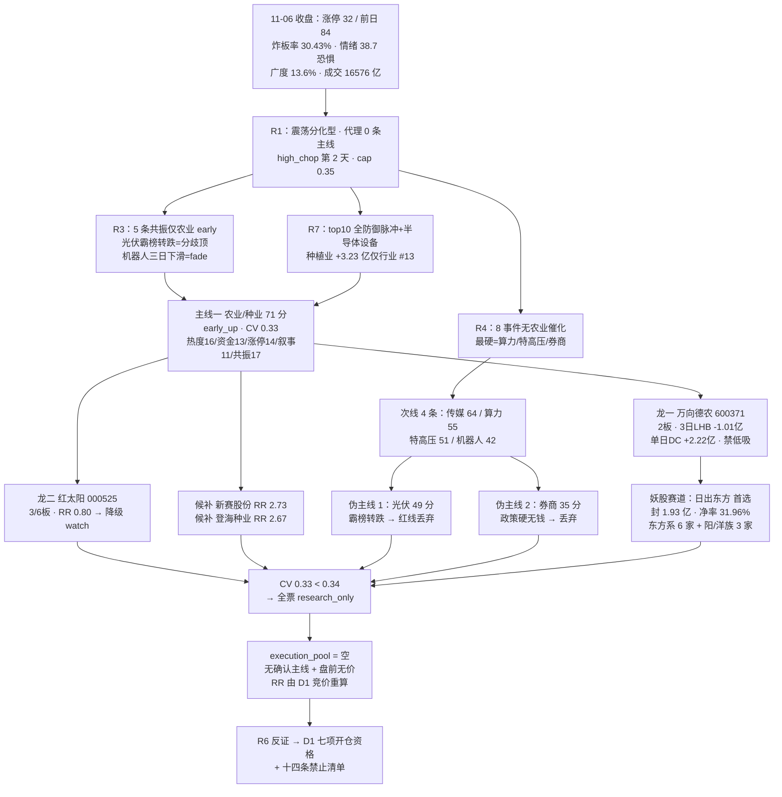

# 2026-11-09（周一）· **主线研判**

> **数据源新鲜度**: partial（数据日 2026-11-06 收盘，11-09 盘前件，无盘中数据）
> **降级状态**: false（本单元未降级；上游 R3 degraded、妖股素材包缺段已计入置信度与 notes）
> **置信度**: 0.62（研究质量分，不是胜率，不是开仓许可）

## 一句话结论

今日是**无确认主线的一天**：涨停 32 家（前日 84 腰斩）、炸板率 30.43% 逼近 35% 分歧线、情绪 38.7 恐惧、R1 代理 0 条主线 —— R2 唯一的 71 分线（农业/种业·转基因）勉强过线但 **CV 仅 0.33**，本质是「低位轮动起点」而非主升主线；识破两个伪主线（光伏涨停最多但霸榜转跌=出货、券商政策最硬但没钱），**全票只研究、执行池为空**。

## 详细分析

**一、市场段位：情绪恐惧 + 涨停腰斩 + 炸板率逼近分歧线，R1 判 0 条主线。** 11-06 收盘口径：涨停 32 家（前日 84 家腰斩）、跌停 15 家、炸板 14 家（炸板率 30.43%）、最高 5 板（闽发铝业 6/10）、广度 13.6%、成交 16576 亿（-21.73%）。R1 定级**震荡分化型**、情绪 38.7 恐惧、high_chop 第 2 天、仓位上限 0.35，代理口径 0 条主线（≥20 家涨停的概念数=0，第一概念 10 家较前日 22 家 -12）。R3 open_permission=false。**这个环境下 R2 的任务是"找出唯一值得研究的方向"而不是"凑满 3 条主线"** —— 无合格对象允许为空。

**二、主线一·农业/种业（转基因·粮食安全）71 分（热度 16 / 资金 13 / 涨停 14 / 叙事 11 / 共振 17）：三条腿成立、两条腿不成立的"勉强过线"。** 共振维 17 分是全场最高：R3 rank1「农业/种业（转基因）」L1+L2b 双源、early 阶段，是 5 条共振主题里**唯一无出货警报的早期方向**；转基因概念 11-06 THS 概念榜第 3（+2.01%，前 10 里唯一收红），金健米业热股 41→5（+36 位）、万向德农热股新进 #13。资金维 13 分可复算：种植业 +3.23 亿（行业 #13 / 496）、种子 +2.84 亿（#14 附近）、粮食概念 +3.17 亿、转基因概念 +2.76 亿 —— **种植业/种子是全市场 19 个「单日+5 日+价格」三正行业里农业链最强的组合**，但绝对额没进 R7 top10（#13），按 top-10 闸门判 False。涨停维 14 分：乡村振兴概念 9 家涨停（#2）+ 种植业 2 家 + 农化 1 家 + 农产品加工 1，高度 2/3 板无 4 板以上 = 「低位轮动起点」不是主升。**叙事维只有 11 分是它只有 71 分的原因**：R4 零农业事件，仅有公众号定性 + 部委调研 + 进口签约三条软腿，被生猪/大豆期货下跌部分对冲。

**三、龙头与板块背离是本线最大的结构瑕疵。** 板块资金进（+3.23 亿）但高度龙头筹码在出：万向德农 **3 日累计龙虎榜净卖 -1.01 亿**（单日上榜 +0.31 亿、DC 主力单日 +2.22 亿/净率 27.57%）、首封 09:36 后 4 次开板、free 换手 46.3%、5 日 +28.3%；金健米业（人气 41→5 最高辨识度）单日龙虎榜净卖 -1.05 亿、DC 主力仅 +0.51 亿/净率 1.79%、free 换手 51.6% = 高位派发，**辨识度不救筹码，直接剔除**。对面红太阳（3/6 板）是板块内唯一「零开板 + 席位净买 +0.99 亿 + DC 主力 +1.32 亿/22.28%」的干净身位票，但 RR 0.80 < 2 → 按纪律降级 watch。真正的预期差在低位：新赛股份（首板、0 开板、封 0.65 亿、DC +0.74 亿/16.05%、流通 26.6 亿、RR 2.73 线内最高）与登海种业（容量老龙头、流通 64.6 亿、20 日位置 27 分位、RR 2.67）—— 但主线未跨源确认，全为研究候选。

**四、次线四条都不进：传媒 64 / 算力 55 / 特高压 51 / 机器人 42，各缺一条硬腿。** 短剧/传媒（64，mid_up）：浙文影业 5/5 板竞价首封 + 龙虎榜 +0.95 亿、上海电影首板席位净买 +1.19 亿，但传媒行业 d1 -24.42 亿把 5 日 +62.38 亿吐回四成、R3 标 middle（已运行 5 日）、R4 零事件 → 分歧中接力，只研究不进。国产算力/运营商（55，formation）：R4 E006 high（中国移动 2027 算力投资超 1000 亿 + 智谱 GLM 接入移动云）是当日最硬产业叙事、电信运营商 d1 +4.05 / d5 +8.64 亿、当日 +2.87%，但算力概念 d1 -50.91 亿、R4 同时给 AI 算力硬件 -0.85（英伟达治理丑闻）→ 只有叙事缺人气。特高压（51，formation）：E007 high（国网一交两直 591 亿核准）+ 财联社明日主题前瞻点名平高电气，但特高压概念 d1 -17.67 / d5 -17.28 亿双负、11-06 零涨停 → 催化为王、价格未验证。人形机器人（42，fade）：R4 E008 high 是全周催化最密集一条（上纬新材启元万台 / 拓斯达 Star / 丰田设机器人部门 / 智元进博会），但概念榜 1104 #2→1105 #4→1106 #8 三日下滑、机器人概念 d1 -116.30 / d5 -127.23 亿、襄阳轴承跌停、11-06 零涨停 → 产业消息无法转化为榜单热度，只观察。

**五、识破的两个伪主线 —— 不做"涨停家数最多就选它"的机械替代。** 光伏/电力设备（49，climax）：涨停家数全市场第一（光伏概念 10 家 #1、光伏设备 4 家 #16；永臻股份 4/4 板、贝特利 3/3），是唯一「涨停维 17 分」的板块；但概念榜**连续 2 个观测日霸榜第 1、1106 却转跌 -1.79%**（热度最高 + 涨幅转负 = 典型分歧顶），R3 给出货警报、光伏概念 d1 -29.93 亿把 5 日 +57.76 亿吐回一半 → 按红线「霸榜第一不得加分」，热度/共振不计正分，49 分丢弃。券商（35，formation）：E005 high（国常会今年首提稳市机制、26 家券商申请 700 亿互换便利、6 家已首批买入）是全场最硬政策催化，但证券 d1 -10.30 / d5 -10.86 / d20 -156.34 亿、11-06 零涨停、R3 零提及 → **政策底 ≠ 资金底**，只有叙事没有钱，丢弃；若今日券商高开放量，属 D1 盘口增量判断。

**六、妖股赛道：梗已扩散到「成立」，但高度股筹码全有瑕疵，只做东方系首板里的干净票。** 11-06 涨停池 32 家里 9 家名字梗票（28%）：东方系 6 家（东方海洋 2 板 8/13、日出东方、东方新能、东方创业、东方嘉盛、大东方）+ 阳/洋族 3 家（阳光照明 2 板 7/12、鲁阳节能 4 连板 5/6、红太阳 3/6）。赚钱效应验证后剔除三只高度股：鲁阳节能 14:27 才首封（撞投机板红线）+ 6 次开板 + 封单 0.04 亿 = 烂板；东方海洋热榜连续 2 日第 1 却主力净流出 0.68 亿、换手 42.6% = 霸榜出货；阳光照明主力净额仅 +0.07 亿（净率 0.52%）= 散户接力。**首选日出东方**（首封 09:45、0 开板、封单 1.93 亿族内最厚、DC 主力 +1.56 亿/净率 31.96%、free 换手 17.56%、流通 73.1 亿），次选大东方（2/4 板接力、席位净买 +1.08 亿、DC +1.67 亿）与东方新能（0 开板、换手 4.24%、净率 47.45% 族内最高）。狼吃羊谐音链（朗姿）只到温和异动未接棒，拆字族未启动 —— **不强行联想**。

**七、为什么执行池必须为空。** 三层理由：①R1 判 0 条主线、R3 open_permission=false、涨停腰斩 + 炸板率 30.43%，无已确认可交易主线，按纪律 §2 不授予开仓资格；②唯一的 71 分线 CV 仅 0.33（R3 真 / R4 假 / R7 假），按 D1 消费契约 <0.34 必须降级 watch_pool；③盘前无价，RR 机械口径（止损=max(近5日最低,-10%)）由 11-06 收盘价计算，D1 必须用竞价价重算 —— **R2 不虚构入场价，不拿研究候选冒充可交易候选**。consensus_themes 为 0 条（无 ≥3 源交集主题），这是今日最重要的结论之一。

## 推理深度三问 · 主线一 农业/种业（转基因·粮食安全）

- **大资金意图**: 这不是产业定价，是**低位轮动** —— 市场在 32 家涨停的恐惧环境里没有进攻主线，钱从高位题材（光伏/机器人）撤出后寻找最低位的出口；种植业/种子 20 日位置 27~38 分位、5 日 +8~15% 未透支，是全市场 19 个三正行业里农业链最强的组合。对手盘很清晰：涨停日被 3 日累计龙虎榜净卖 -1.01 亿的万向德农高位筹码（单日 DC 主力仍 +2.22 亿 = 游资高抛、新资金低接的换手局），以及金健米业 51.6% 换手的散户盘。资金买的是"板块位置低"，不是"农业涨价" —— 所以叙事维只有 11 分、R4 零事件。

- **为什么走强**: 位置（低位）+ 资金（三正行业、板块资金进）+ 共振（R3 rank1 early）三维里位置与资金成立，催化不成立。转基因概念 11-06 是 THS 概念榜前 10 里唯一收红的概念（#3 / +2.01%），金健米业热股 +36 位、万向德农新进 #13 —— 人气在聚，但高度只有 2/3 板、无 4 板以上，涨停结构是"低位轮动起点"而非主升。筹码维度是矛盾面：板块资金进 +3.23 亿、高度龙头 3 日席位在出（万向德农 -1.01 亿、金健米业 -1.05 亿）—— 游资在做"进板块、出高度"的换手局。

- **逻辑够不够硬**: 硬的部分三项可复算：①R3 rank1 L1+L2b early，5 条共振里唯一无出货警报的早期方向；②种植业/种子是全市场 19 个三正行业里农业链最强组合（+3.23/+5.64 亿/+2.72%；种子 +2.84/+5.71/+4.64%）；③转基因/粮食概念资金同向（+2.76 / +3.17 亿）。不够硬的部分三项：①R4 零农业事件，涨价逻辑只活在公众号叙事层 → 属情绪轮动不是产业定价，持续性天然短；②资金绝对额 #13 未进 R7 top10；③龙头筹码兑现 + 期货反向（生猪两月跌近三成、CBOT 大豆周跌 3.2%）。**证伪路径**：11-09 种植业资金转负、或 2/3 板高度股断板、或转基因概念跌出概念榜前 10 —— 任一成立当日降级次线。

## 首推票思维链 · 600371 万向德农（农业/种业 龙一 · 研究候选）

**买入理由**：①带动性核心：R7 转基因概念 leader_stock、R3 热榜新进 #13、转基因是 11-06 概念榜前 10 里唯一收红概念的旗手；②DC 主力单日 +2.22 亿（净率 27.57%）说明 11-06 当天新资金仍真金买入，板块若延续它是第一卡位；③5 日 +28.3% 但仍在低位轮动框架内（20 日涨幅未透支到主升）。

**风险点**：①首封 09:36 后 4 次开板 + free 换手 46.3% = 承接不连续，属"最强身位 + 3 日席位在出"的混合筹码；②龙虎榜 3 日累计净卖 -1.01 亿（单日 +0.31 亿）—— 若 11-09 高开低走则证明 3 日兑现优先；③主线 CV 0.33 未跨源确认，板块退潮时龙头跌得最快；④R6 未跑，4 次开板的派发性质待反证。

**止损条件**：只给「竞价弱转强」通道（高开 ≤3% + 封单回补）—— 首板/2 板低吸=接飞刀，**禁止低吸**；炸板破分时均线必卖；席位转净卖按出货离场；种植业行业资金转负无条件降级。

**可验证假设**：①若「板块资金进」为真，11-09 种植业行业主力应续流入 >1 亿；②若「3 日筹码在出」为真，万向德农竞价高开后日内回落概率大；③若「低位轮动」为真，板块晋级 2 板的家数应 ≥2（乡村振兴概念 9 家里至少 1 只续板）；④若「龙一卡位」为真，万向德农 11-09 应保持转基因概念领涨地位（涨幅 ≥ 板块中位）。

## 首推票思维链 · 600540 新赛股份（农业/种业 候补 · 线内最高 RR 2.73）

**买入理由**：①低位首板 + 种植业本体（棉花/种子双属性）：首封 10:58、0 开板、封单 0.65 亿、DC 主力 +0.74 亿（净率 16.05%）、free 换手 27.73%、流通 26.6 亿；②5 日 +15.4% 未透支、20 日位置 38 分位，是离主力成本区最近的农业首板；③线内唯一同时满足「低位 + 零开板 + 资金纯」三条件的票。

**风险点**：①主线 CV 0.33，若板块次日不延续，首板隔日无溢价；②棉花/种业无个股独立催化，吃的是板块 β；③流通 26.6 亿属中小容量，板块退潮时承接薄；④龙一（万向德农）若断板，它作为补涨首板会被连带。

**止损条件**：首板隔日打板/半路模式；收盘破首板价或分时破均线即走；种植业资金转负当日不参与。

**可验证假设**：①若「低位补涨」为真，11-09 新赛应随板块走强且换手不超 40%（超 = 死亡换手）；②若「首板隔日」为真，乡村振兴 9 家里应有 ≥1 只晋级 2 板；③若「资金纯」为真，11-09 DC 主力应续为正；④若「板块退潮」为真，种植业行业资金应转负 —— 该假设同时证伪整条主线。

## 主线决策与资金流

## 候选票四要素（板型 / 龙头认定 / 盈亏比 / 禁止清单）

| 票 | 角色 | 板型（11-06） | 龙头认定（过纪律 §2） | 盈亏比 | 禁止清单命中 |
|---|---|---|---|---|---|
| 600371 万向德农 | 农业 龙一 | 2板（2/3），首封 09:36，开板 4 次，free 换手 46.3% | ✅ 带动性（转基因概念旗手 + R7 leader_stock + R3 热榜新进 #13）；⚠️ 3 日累计 LHB -1.01 亿（单日 +0.31 亿 / DC +2.22 亿） | RR 机械口径待 D1 竞价重算；4 次开板 → 只竞价弱转强 | 无（研究候选；禁低吸 = 承接不连续） |
| 000525 红太阳 | 农业 龙二 | 3/6 板，首封 13:39，0 开板，封 0.77 亿，free 换手 13.29% | ✅ 身位龙 + 席位净买 +0.99 亿 + DC +1.32 亿（22.28%）；⚠️ 农化非种业本体 | RR 0.80 < 2 → 降级 watch | 身位已 3 板；仅弱转强打板 |
| 600540 新赛股份 | 农业 候补 | 首板，首封 10:58，0 开板，封 0.65 亿，free 换手 27.73%，流通 26.6 亿 | ✅ 低位 + 零开板 + 资金纯（DC +0.74 亿 / 16.05%） | RR 2.73（线内最高） | 首板隔日模板；主线未跨源 → 研究候选 |
| 600313 登海种业 | 农业 候补 | 未涨停 +2.58%，DC 主力 +0.27 亿，free 换手 13.5%，流通 64.6 亿 | ✅ 容量型老龙头（候选池内最大容量）；20 日位置 27 分位 | RR 2.67 | 容量补涨；低吸（回踩 MA5）优于追高 |
| 603366 日出东方 | 妖股 首选 | 首板，首封 09:45，0 开板，封 1.93 亿（族内最厚），free 换手 17.56%，流通 73.1 亿 | ✅ 东方系 6 家里最干净（DC +1.56 亿 / 净率 31.96%） | 单票 ≤5% 轻仓 | 打板/竞价确认；禁低吸、禁追一字 |
| 600261 阳光照明 | 妖股 身位 | 7/12 板（2 连板），首封 09:49，开 1 次，封 1.39 亿 | ⚠️ 阳字辈高标；主力仅 +0.07 亿 = 散户接力，排在东方系首板之后 | 只打板弱转强 | 禁低吸、禁隔夜满仓 |

> 盈亏比口径：**盘前无价，R2 不虚构入场价**。表中 RR 为 11-06 收盘机械口径（止损 = max(近 5 日最低, -10%)），D1 必须在 09:25 用竞价实价重算。按纪律 §4「RR < 2 降级 watch / 止损距 < 5% 需 RR≥3」，所有票在 RR 重算前都不具备开仓资格；且本日 R1 判 0 条主线、CV 0.33 < 0.34，整池为 research_only。

## 关键证据

- **证据 1（涨停结构）**：U32 / D15 / Z14，炸板率 30.43% 逼近 35% 分歧线，最高 5 板（闽发铝业 6/10）；乡村振兴概念 9 家涨停（#2）+ 光伏概念 10 家（#1）——农业高度只有 2/3 板、光伏最高 4 连板但霸榜转跌。来源：tushare limit_list_d + limit_cpt_list（20261106）。
- **证据 2（资金断层）**：R7 top10 全为防御脉冲（公用事业 +9.59 / 电力 +9.40 / 银行 +8.53 / 半导体设备 +7.40）+ 电信运营商 +4.05；种植业 +3.23 亿（行业 #13/496）未进 top10，种子 +2.84、粮食概念 +3.17、转基因概念 +2.76 —— 农业是"接近但未达标"的资金结构。对面：机器人概念 d1 -116.30 / d5 -127.23 亿、光伏概念 d1 -29.93 亿（5 日 +57.76 吐回一半）、证券 d1 -10.30 亿。来源：R7 + moneyflow_ind_dc。
- **证据 3（龙头筹码）**：万向德农 3 日累计 LHB -1.01 亿（单日上榜 +0.31 亿 / DC 主力单日 +2.22 亿）、金健米业单日 LHB -1.05 亿（DC 仅 +0.51 亿 / 净率 1.79%）、红太阳 LHB +0.99 亿（DC +1.32 亿 / 22.28%）。来源：tushare top_list + moneyflow_dc（20261106）。
- **证据 4（叙事）**：R4 8 条 top_events 无农业条目；最硬三催化（移动云算力 +0.8 / 特高压 +0.75 / 券商稳市 +0.8）全部资金不认（算力 -50.91 / 特高压 -17.67 / 证券 -10.30 亿）。来源：R4_news.json + R7。
- **证据 5（共振）**：R3 5 条主题中农业 rank1 L1+L2b early（唯一无出货警报的早期方向）、短剧 middle、玄学 late、光伏 late（霸榜第 1 转跌 = 分歧顶）、机器人 late（三日下滑）；distribution_alert=None。来源：R3_sentiment.json。
- **证据 6（妖股赚钱效应）**：11-06 涨停池 32 家里 9 家名字梗票（28%）：东方系 6 + 阳/洋族 3；高标反馈（东方海洋 8/13、阳光照明 7/12、鲁阳节能 4 连板）成立但筹码全有瑕疵（烂板/霸榜出货/散户接力）。来源：limit_list_d + top_list + moneyflow_dc 重建（素材包涨停池段为空）。
- **证据 7（跨源共识）**：consensus_themes = 0 条 —— 最强的农业也只有 R2+R3 两源（R4 零事件、R7 #13 未进前十），无任何 ≥3 源交集主题；主线 CV = 0.33（R3 真 / R4 假 / R7 假）。**今日没有跨源确认的主线，这是与 11-05（CV 1.0 双线）最本质的差别。**

## 数据源审计

| 源 | 日期 | 状态 | 备注 |
|---|---|:--:|---|
| R1 风格研判 | 2026-11-09 | 🟢 | 震荡分化型 / 情绪 38.7 恐惧 / 代理 0 条主线 / cap 0.35 |
| R3 情绪共振 | 2026-11-09 | 🟡 | WeFlow 永久下线 + KOL 文本层断更 → 共振封顶 L1+L2b；5 条共振 + distribution_alert=None |
| R4 消息面 | 2026-11-09 | 🟢 | 8 条事件（6 high / 2 medium）+ 17 板块催化；无农业条目 |
| R7 资金面 | 2026-11-09 | 🟢 | 行业 496 + 概念 531；北向 2026-10-28 起停抓（retired）；top10 全防御脉冲 |
| tushare 涨停列表 | 2026-11-06 | 🟢 | U32 / D15 / Z14 / 炸板率 30.43%，与 R1 逐项一致 |
| tushare 涨停板块统计 | 2026-11-06 | 🟢 | 21 条 · 光伏 #1（10 家转跌）/ 乡村振兴 #2（9 家） |
| tushare 龙虎榜 | 2026-11-06 | 🟢 | 79 行 · 万向德农双上榜（单日 +0.31 / 3 日累计 -1.01 亿） |
| tushare 市值/换手 | 2026-11-06 | 🟢 | 5573 只 · 自由流通换手 / 流通市值逐票核验 |
| 东财个股资金流 | 2026-11-06 | 🟢 | 6032 只 · 与 R7 口径对齐（net_amount / net_rate） |
| 生命周期骨架 | 2026-11-09 | 🟢 | lines 由 R2 填充（农业 early_up / 光伏 climax / 机器人 fade） |
| 题材心智锚 | 2026-11-02 | 🟡 | 597 概念 · 滞后，仅用于存量资格判断 |
| 玄学素材包 | 2026-11-09 | 🟡 | 3123 只名称；涨停池/龙虎榜段为空，已用 limit_list_d + top_list 重建 |
| iwencai（MCP+CLI） | — | 🔴 | 无 access key + Playwright 浏览器缺失 → 板块成分未做第三方交叉验证 |
| 竞价快照 | — | ⚪ | 未纳入 · 本单元不含盘中数据 |

## 不确定性 / 反证

- **最大反证（低位轮动一日游）**：农业 CV 0.33 只有 R3+R2 两源，R4 零事件、R7 未进 top10 —— 按 D1 消费契约 <0.34 必须降级 watch_pool。历史上恐惧环境里的低位轮动大多 1-3 天熄火；若 11-09 种植业资金转负或 2/3 板断板，当日降级次线，不是"等回调再买"。
- **第二条反证（万向德农"龙一"资格）**：3 日累计席位净卖 -1.01 亿 vs 单日 DC 主力 +2.22 亿 —— 两个口径指向相反结论。我按"3 日筹码在出、单日新资金仍进"的混合结构处理，只给竞价弱转强、禁低吸。若 11-09 高开低走则证明 3 日兑现优先；若平开高走则证明单日主力更有效 —— 这是一个可证伪的判定。
- **第三条反证（光伏丢弃是否正确）**：光伏是涨停家数第一（10 家 + 4 连板高度），我按红线"霸榜转跌 = 出货"丢弃。若 11-09 光伏反包走出涨停潮，说明 R3 分歧顶判断错、机械红线过严；永臻股份 4 板作为反证样本 —— 若续 5 板则证明本轮不是出货。
- **第四条反证（券商丢弃是否正确）**：政策底 ≠ 资金底，证券 d1 -10.30 亿是硬证据。但若今日券商高开且放量，属 D1 的盘口增量判断，不在 R2 研究范围 —— 本单元不背这个锅，也不应被读成"券商被否"。
- **第五条反证（妖股高度股剔除）**：我把鲁阳节能（4 连板）/东方海洋（8/13）全部划掉、只留东方系首板。若 11-09 东方海洋续强而日出东方退潮，说明"霸榜出货"误判 —— 但 42.6% 换手 + 主力净流出 0.68 亿的筹码证据目前都指向剔除。
- **口径披露**：①涨停家数用 tushare limit_list_d（U32），与 R1 一致；②连板口径用 up_stat（N 日内涨停次数）非连续板，2/3 板 = 2 次涨停/3 日内；③"主力净额"一律为东财 DC 口径（万元→亿），与 R7 同源；④龙虎榜万向德农双记录（单日上榜与 3 日累计）已分列，避免口径混淆；⑤R3/R4 概念口径与 R7 行业口径不可混算，本报告资金维全部用 R7 行业口径，转基因/粮食概念额仅作辅助证据。

## 与其他 R/D/E 的关系

- **依赖**：R1（震荡分化型 / 0 条主线 / cap 0.35）、R3（5 条共振 + distribution_alert + open_permission=false）、R4（8 事件 + 17 板块催化）、R7（行业/概念两层资金 + top_inflow_sectors）；本地 tushare 独立复拉（涨停 / 涨停板块 / 龙虎榜 / 市值换手 / 个股资金）+ `mainline_lifecycle` + `theme_anchors` + `yaogu_llm_context` + 素材包缺段重建。
- **被消费**：
  - **D1（canghai-plan）**：主线 1 条（农业 71 分）全票 research_only、CV 0.33 < 0.34 → 按消费契约必须降级 watch_pool，**execution_pool=[] 是纪律结论**（R1 0 条主线 + 情绪恐惧 + 涨停腰斩 + 盘前无价），不是 R2 没干活；D1 不应把空池读成数据缺失。妖股赛道候选（日出东方等 5 只）为并行独立赛道，轻仓 ≤5%，D1 须过七项开仓资格 + 14 条禁止清单。
  - **R5（个股画像）**：画像对象取主线龙一/龙二/候补（万向德农 / 红太阳 / 新赛股份 / 登海种业），妖股赛道取日出东方 / 大东方 / 东方新能；金健米业虽人气最高但已被剔除（派发），不做画像。
  - **R6（反证）**：五处待反证已写明 —— ①农业低位轮动是否一日游；②万向德农双口径筹码（3 日席位出 vs 单日主力进）哪边有效；③光伏霸榜转跌=出货是否误判；④券商政策底何时变资金底；⑤妖股高度股剔除是否过度。R6 还需独立判断「唯一 71 分线与空执行池是否自相矛盾」。
  - **E1（复盘）**：本日与 11-05 的对照是核心素材 —— 11-05 双主线 CV 1.0（半导体设备 / 贵金属）到 11-09 零 consensus_themes，市场从"资金真金 + 事件共振"退到"低位轮动 + 情绪恐惧"，同一套五维口径下分数结构完全不同；光伏从 11-05 次线观察位走到 11-06 霸榜出货，验证了 R3「一日游」判定。

## Sub-Agent 元数据

- skill: analyze_main_sectors_v1@1.3（v1.3 带动性优先 + v1.2 四源交叉验证 + 生命周期函数 + Step 4.8 玄学 LLM 联想 + 红线霸榜出货规则）
- artifact: `data/research/20261109/R2_main_sectors.json`（约 38 KB）
- 辅助产物: `_work/limit_list_d_20261106.json` / `_work/top_list_20261106.json` / `_work/daily_basic_20261106.json` / R7 `sector_flows` 行业/概念两层 / MCP 直拉 `limit_cpt_list` + `moneyflow_dc`（spillover 存档）
- 生成时间: 2026-11-09 07:29（md 落盘；JSON 首次生成 07:22，本会话复核修正 9 处事实口径后同文件更新）
- model: deepseek-v4-flash
- 主线数: 1（71）· 次线 4（64 / 55 / 51 / 42）· 淘汰 2（49 / 35）· 候选 leader 4 只 + 妖股候选 5 只 · consensus_themes 0 条 · 执行池 0 只
