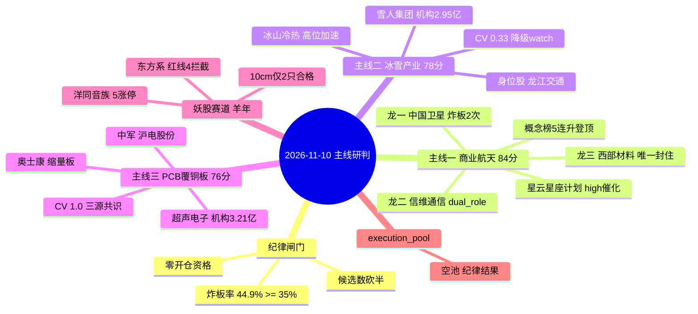

# 2026-11-10 · **主线研判**

> **数据源新鲜度**: partial
> **降级状态**: false
> **置信度**: 0.60
> **纪律闸门**: 🔴 炸板率 44.90% ≥ 35% 红线 → 候选数砍半、**零开仓资格**；3 条主线全部 research_only

## 一句话结论

📌 修复段第 2 日仍是"反抽未确认"：无一条 R1 认可的主线（行业≥8 家涨停 0 条），三条研究主线按可交易性排序 **PCB > 冰雪 > 商业航天**，全部只做研究、**execution_pool 为空**——今天不是进攻日，是等竞价的一天。

## 详细分析

### 🧊 市场背景：反抽第 2 日，钱只认科技硬件一条线

20261109 修复段第 2 日呈现典型"权重托底、题材反抽、情绪不接力"结构：涨停 54 家 vs 跌停 1 家，但炸板率 **44.90%**（44/98）远超 35% 红线，涨家占比仅 40.23%、中位数 **-0.35%**；R1 判 **震荡分化型 · 中性 55.1 · 无主线**。R7 资金给出决定性证据：超大单 +130.88 亿托权重，中单 -73.84 亿/小单 -59.40 亿离场——**钱只认科技硬件一条线**（电子 +93.39 / 元件 +38.42 / 印制电路板 +37.63 / 通信设备 +37.34 亿），其余全是脉冲。

所以 R2 的裁决框架是：**五维打分只回答"今天是不是主线"，不回答"能撑多久"**；在炸板率 44.9% 的纪律闸门下，任何"首板接力/追高"动作都被红线禁止，唯一允许的买点形态是**低开承接/弱转强**，且全部待 D1 独立核验。

### 🛰️ 主线一：商业航天/太空算力（含 6G·卫星互联网）—— 84 分 · tradeability 第 3

**五维**: 热度 19 / 资金 15 / 涨停 16 / 叙事 19 / 共振 15。商业航天概念榜 **5 观测日连升登顶**（1103→1109：8→6→3→2→1，唯一连续 5 日上行的前排概念）；R4 E20261110_003「星云星座计划·全栈国产太空算力网·快舟三年 50 发·新闻联播聚焦低轨」为 **high 级硬催化（net_score +0.732）**；板块 **14 家涨停**（limit_cpt rank 2、4 天 3 板）。资金 5 日 -35.89 亿 / 20 日 -355.06 亿——单日 +50.53 亿反抽未改中期失血。

但**高潮分歧特征明显**：龙一中国卫星 +4.55% 盘中触板**炸板 2 次**、龙二信维通信 +12.77% **炸板 1 次**，只有龙三西部材料 0 开板封住（封单 2.74 亿）。结论：题材是产业级，但高位买盘不足以封板，**禁追高炸板票，只做低开承接或空仓等分歧**。

- **大资金意图**: 政策级硬催化（星云星座/快舟 50 发/新闻联播）给了机构"产业主线"的配置理由；大资金借概念登顶日的流动性把筹码卖给接力盘——龙虎榜无新增机构承接，板块资金 20 日 -355 亿说明这是**存量反抽而非增量建仓**，对手盘是追概念榜的高位接盘者。
- **为什么走强**: 位置=概念榜 5 日连升登顶（超买边缘）；催化=星云星座 high 级政策事件（硬）；筹码=板块 14 家涨停但龙头炸板 2 次＝**扩散补涨段、不是主升段**，中军中国卫星 679.9 亿容量承接了大部分资金但封不住。
- **逻辑够不够硬**: 硬在政策锚（星云星座计划落地是产业级里程碑，R3/R4 双源共振）；软在资金（5/20 日仍深亏、龙虎榜无新机构）。证伪路径=今日龙头竞价低开不承接 → 反抽一日游；若中国卫星/信维通信修复封板且概念榜续涨，则晋级主升观察。

### ⛷️ 主线二：冰雪产业/冰雪经济（含热泵·制冷设备）—— 78 分 · tradeability 第 2

**五维**: 热度 18 / 资金 17 / 涨停 15 / 叙事 12 / 共振 16。R3 #1 共振主题（L1+L2b，early）：概念榜 **#20 → #3**（单日跃升 17 位，top20 升幅最大）；雪人集团东财人气**新进 #2**、冰山冷热 42→5。资金维最亮眼：冰雪经济概念 +12.63 亿（净流入率第一梯队）、空气能热泵 +16.65 亿、**5 日 +9.40 亿＝今日唯一 5 日净流入为正的候选主线**；雪人集团龙虎榜净买 2.67 亿、**机构净买 2.95 亿（全场第 2）**。

扣分在叙事：R4 无冰雪直接催化（寒潮供暖 E007 只到 medium，属相邻催化），**CV 仅 0.33**——按 D1 契约 <0.34 必须**降级 watch**。个股结构：龙一雪人集团 4 次开板 + 封单仅 0.69 亿＝封板合力不足（纪律 §7 不封）；龙二冰山冷热 20 日 +83.7% 高位加速；身位股龙江交通 2 板但 DC 主力仅 +0.19 亿（资金没跟上身位）。**只做分歧转强与低位补涨（大连圣亚），禁追缩量一致板，若次日概念榜掉出前 10 整线降级为一日游。**

- **大资金意图**: 冬季季节性 + 欧洲热泵需求（财联社前瞻）给了**机构短线仓位**一个"有真实业绩承接"的题材出口——雪人机构净买 2.95 亿是全场第 2，说明不是纯游资击鼓传花，有配置资金在试错建仓；对手盘是概念榜跳升 17 位吸引的追高散户。
- **为什么走强**: 位置=概念 8 天 4 板脉冲、个股已高（冰山 20 日 +84%）；催化=寒潮 + 热泵前瞻（medium，非 hard）；筹码=唯一 5 日资金为正的候选主线＋机构龙虎榜承接＝**人气+涨停群+机构钱三点齐备**，但雪人 4 次开板暴露封板合力不足。
- **逻辑够不够硬**: 硬在资金（5 日 +9.4 亿唯一为正 + 机构承接）与季节性时间锚（寒潮窗口）；软在**叙事维 12/20**（R4 无直接催化，CV 0.33 不达标）。证伪路径=概念榜次日掉出前 10 或雪人低开不承接 → 一日游成立；若龙江交通 3 板 + 板块资金续正，则确认第二波。

### 🔌 主线三：PCB/覆铜板（算力硬件低位分支）—— 76 分 · tradeability 第 1

**五维**: 热度 13 / 资金 18 / 涨停 14 / 叙事 18 / 共振 13。这是**唯一 R3/R4/R7 三源共识 100%（CV 1.0）**的候选主线，且是"真实资金+涨停群出现在元件/覆铜板低位分支"的**右侧起点**：电子行业 +93.39 亿（第 1）、元件 +38.42 亿（第 2）、印制电路板 +37.63 亿（第 3、板块 +3.07%）；R4 E20261110_002「PCB 供需两紧·头部产能利用率 90%+·Q3 行业净利同比 +196%」high 级；龙虎榜超声电子**机构净买 3.21 亿＝全场第 1**。

但 R3 判 late 补涨分支、同题材光模块高位（中际旭创/东山精密 5 日仍负）只是反抽——**只认元件低位、不接光模块高位**。超声电子 1106 -7.5% → 1109 反包首板（距 20 日高 -31%，低位反包）；次日首板接力在 44.9% 炸板率下禁止，只做竞价低开承接/弱转强。

- **大资金意图**: 业绩驱动型资金在**低位分支**找右侧起点：PCB 供需两紧 + Q3 净利 +196% 是硬业绩锚，机构借板块低位（元件 20 日 -340 亿深坑）扫货——超声电子机构净买 3.21 亿全场第 1 是"低位真金卡位"而非高位接力；对手盘是仍在高位光模块（中际旭创/东山精密）里套牢的旧筹码。
- **为什么走强**: 位置=元件/覆铜板低位分支（超声距 20 日高 -31%、生益距 60 日高 -55%）；催化=三季报业绩 + 涨价（硬，R4 high）；筹码=电子/元件/印制电路板行业资金同日前三 + 机构龙虎榜第 1＝**资金、涨停群、机构三个右侧信号同时出现**，但板块整体 5/20 日仍深亏＝反抽性质未完全逆转。
- **逻辑够不够硬**: 硬在业绩（Q3 净利 +196%、产能利用率 90%+，可验证指标高频）+ 三源共识（CV 1.0 唯一满源）；软在 R3 判 late 补涨（不是新主线启动）、光模块高位仍在派发。证伪路径=元件行业资金第 2 日不能续正 → 一日游；若超声电子竞价弱转强 + 板块资金续正，则确认元件分支独立启动。

### 🧧 妖股赛道（四季度跨年 · 羊年 window）

素材包涨停池/龙虎榜段为空（生成器缺陷），改用 R2 自查 T-1 数据。今日最强梗是 **『洋』同音族**：yáng 族 5 只涨停（澳洋健康/光洋股份/盛洋科技/红太阳/祥明智能），三只"洋"字同日涨停＝同音族扩散第一次确认；拆字族（祥=羊部件）由祥明智能 20cm 补位。**监管未触发（regulatory_switch=false）**；东方系 7 只涨停被 R3 红线 4 拦截（东方海洋机构净卖 2.51 亿＝高位派发），**纯名字梗高位今日不可接**。10cm 合格档仅 2 只（澳洋健康 002172、盛洋科技 603703），龙虎榜缺席位级确认 → 全部只作研究，参与方式限打板/竞价确认，禁低吸。

## 关键证据

- 证据 1: 商业航天概念榜 5 连升登顶（8→6→3→2→1）+ R4 星云星座 high 催化 · 来源 R3 #2 + R4 E20261110_003
- 证据 2: 电子/元件/印制电路板/通信设备四行业同日进资金前十（+93/+38/+37/+37 亿）· 来源 R7 top_inflow
- 证据 3: 超声电子龙虎榜机构净买 3.21 亿（全场第 1）、雪人集团机构净买 2.95 亿（全场第 2）· 来源 top_list/top_inst 20261109
- 证据 4: 冰雪概念 5 日资金 +9.40 亿＝唯一 5 日净流入为正的候选主线 · 来源 R7 概念资金
- 证据 5: 炸板率 44.90%（44/98）+ R1 判无主线 → 全部 research_only · 来源 R1 + limit_list_d
- 证据 6: 洋同音族 5 只涨停（澳洋/光洋/盛洋/红太阳/祥明）＝羊年梗扩散第一次确认 · 来源 R2 自查涨停池

## 数据源审计

| 源 | 日期 | 状态 | 备注 |
|---|---|:--:|---|
| tushare daily/daily_basic | 2026-11-09 | 🟢 | 5573 条 · 全市场 |
| tushare moneyflow_dc 个股 | 2026-11-02~09 | 🟢 | 25 条 · 候选池 5 日窗口 |
| tushare limit_list_d | 2026-11-09 | 🟢 | 99 条 · 54 涨停 + 45 炸板 |
| tushare top_list/top_inst | 2026-11-09 | 🟢 | 67/670 条 · 龙虎榜 |
| tushare limit_cpt_list | 2026-11-09 | 🟢 | 20 条 · 概念涨停 top |
| 东财 moneyflow_ind_dc/dc | 2026-11-09 | 🟢 | 531/496 条 · 概念+行业 |
| R1/R3/R4/R7 artifact | 2026-11-10 | 🟢 | 全部 complete |
| tushare daily 600121 区间 | 2026-11-09 | 🔴 | 区间返回空，单点正常；煤炭线改用 limit_list_d |
| yaogu_llm_context | 2026-11-10 | 🟡 | 涨停池/龙虎榜段为空（生成器缺陷），妖股段改用 R2 自查 |
| weflow | 2026-11-10 | 🔴 | DOWN · R3 已标注 degraded，L1 热榜源仍可用 |

## 不确定性 / 反证

1. **反抽是否确认全靠今日竞价**：R1 判无主线 + 炸板率 44.9%，三条主线都可能是"反抽一日游"。可验证假设：PCB 若元件行业资金第 2 日不能续为正、冰雪若概念榜掉出前 10，整线降级。
2. **商业航天 14 家涨停含大量低位跟风**：概念池 588 只，涨停数不能等同板块健康度；龙头双炸板说明高位买盘不足，若今日龙一竞价低开不承接，直接视为退潮。
3. **PCB 阶段判定冲突**：R3 判 late 补涨、R2 判元件低位分支 early_up，按更保守的"补涨"仓位处理；业绩+涨价叙事是否已被 price in 待 R6 反证。
4. **R6 尚未运行**：以上风险项全部待 R6 反证复核；R6 是唯一硬否决权来源，主控不得过滤其 hard_reject。
5. **妖股梗扩散缺席位级确认**：洋同音族 5 涨停但龙虎榜无羊族票，若高标（光洋/澳洋）今日竞价走弱，梗扩散逻辑证伪。

## 与其他 R/D/E 的关系

- 依赖: R1_style.json · R3_sentiment.json · R4_news.json · R7_capital_flow.json（全部 complete）
- 被消费: filter_leader_v1（本文件原地过滤）→ D1(canghai-plan) · R5 个股画像 · R6 反证 · E1 复盘

## Sub-Agent 元数据

- skill: analyze_main_sectors_v1
- artifact: data/research/20261110/R2_main_sectors.json
- 生成耗时: 约 60 秒（07:18 首版 + 07:21 schema 修补）
- model: deepseek-v4-flash
