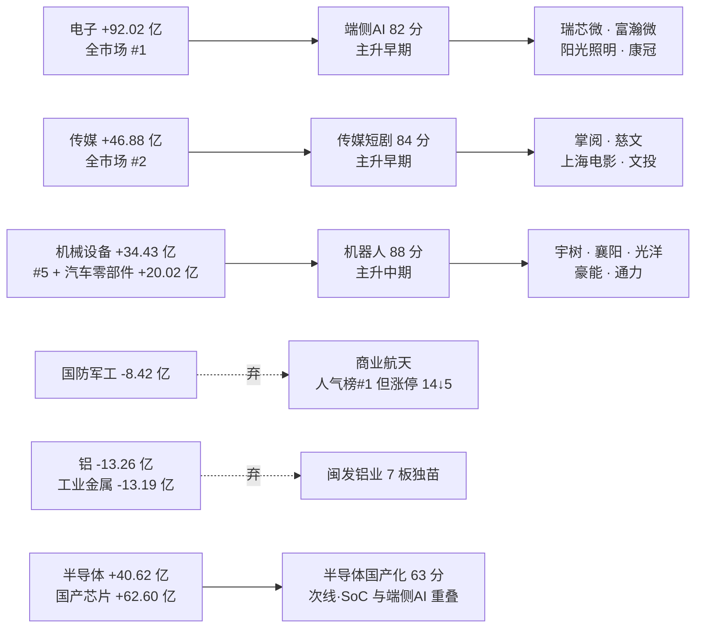

# 2026-11-11 · **主线研判**

> **数据源新鲜度**: 🟡 partial（R3/R4/R7 全 ok，R1 degraded，妖股素材包缺涨停池）
> **降级状态**: 🟡 degraded=true（理由同上，属设计外但可用的降级）
> **置信度**: `0.49` = 0.70 base × 0.7 freshness × 1.0 agreement

## 一句话结论

钱在下游三处同时开花：具身智能封板最多（34 家）、传媒涨停最集中（17.65%）、端侧AI 最有钱（电子 +92 亿）；上游算力与商业航天被资金抛弃。

## 详细分析

### 一、市场背景（R1 透传，非 R2 重算）

| 维度 | 读数 | 含义 |
|---|---|---|
| 风格 | 🟢 连板情绪型 | 五分法代价 0.0 为唯一零代价选项，风格表与情绪周期一致 |
| 情绪 | 🟢 71.9（贪婪） | 高位但未极端 |
| 周期 | 🟢 主升 · 修复段第 3 日 | 修复首日 20261109 起算的第 3 天＝接力日 |
| 涨停 / 跌停 | 93 / 0 | 涨停梯队 1 板 73、2 板 15、3 板 4、7 板 1 |
| 炸板率 | 🟢 16.96%（19 家） | 远低于 35% 红线，候选不砍半 |
| 涨跌家数 | 4003 / 1073（涨家占比 78.9%） | 普涨 |
| 成交额 | 15046 亿（+1.49%） | 温和放量 |
| 昨日涨停溢价 | 🟢 +4.91%（红盘率 88.9%，再涨停 19 只） | 赚钱效应成立，但成本已抬高 |
| 连板高度 | 7 板（闽发铝业·工业金属） | 4/5/6 板全空＝高度无法递推 |

因果链很清楚：**T-1 三项确认（溢价 +4.91%、炸板率 16.96%、涨家占比 78.9%）→ 赚钱效应成立 → 修复段进入接力日 → 但溢价抬到 +4.91% 意味着接力成本变贵，只能做低位首板与主线核心低开承接，不能追高位二波**。R1 因此把仓位上限给到 70%、同时明令禁止追连续加速的高位二波——这条禁令直接决定了本文三条主线的 `tradeability_rank`。

### 二、三条主线（五维打分 + 阶段 + 可交易性）

| 主线 | 热度 | 资金 | 涨停 | 叙事 | 共振 | 总分 | 阶段 | 可交易性 | 交叉验证 |
|---|---:|---:|---:|---:|---:|---:|---|---|---:|
| 🥇 人形机器人/具身智能 | 19 | 19 | 19 | 14 | 17 | **88** | 主升中期（5 日龄） | 第 3 | 1.00 |
| 🥈 传媒/AI短剧·AI漫剧 | 17 | 18 | 18 | 15 | 16 | **84** | 主升早期（首日） | 第 1 | 1.00 |
| 🥉 端侧AI/AI终端硬件 | 18 | 18 | 16 | 12 | 18 | **82** | 主升早期（首日） | 第 2 | 0.67 |

**五维只回答「今天是不是主线」，不回答「明天能不能做」**——所以得分第一的机器人可交易性排最后（5 日龄 + 34 家涨停是加速段，正好撞在 R1「不追高位二波」的红线上）；得分第三的端侧AI 可交易性排第二（首日脉冲 + 资金最厚）；得分第二的传媒可交易性排第一（首日 + 涨停密度全场最高 + 首封最早）。

### 2.1 🥇 人形机器人/具身智能（88 分 · 主升中期）

轴标签：**下游·买方（具身智能终端与零部件）**。选它做主线一的理由不是「机器人会涨」，而是三组数据同向：机器人概念涨停 34 家（占全市场 93 家的 36.6%，涨停板块榜第 1、6 天 5 板）、概念净流入 +94.63 亿（概念榜第 1、5 日 +148.02 亿）、载体行业机械设备 +34.43 亿（#5）叠加汽车零部件 +20.02 亿（其 20 日 +14.63 亿是少数 20 日仍为正的成规模行业）。

- **大资金意图**: 机构在机器人链条上的下注位置是「执行层零部件」而非整机厂——34 家涨停里 11 家属汽车配件（轴承/丝杠/结构件），游资买的是低估值+低位置的补涨弹性，机构买的是能出量的结构件订单。对手盘是 8 月以来堆积在算力硬件上的高位筹码：今日上游算力股普遍走弱（海光信息 -0.98%、寒武纪 -1.55%），资金实际是从算力搬到执行层。
- **为什么走强**: 位置三分歧——概念已 5 日龄（不是低位）、龙头宇树处 20 日新高（不是中位）；催化只有零部件级（灵波触觉模型 medium，无整车级硬事件）；筹码则是 5 日主力连续净流入 4 天。结论：**是资金驱动的中期加速，不是催化驱动的启动**，所以只能做分歧承接，不能当启动期猛干。
- **逻辑够不够硬**: 硬的只有一源——资金（R7 两个口径同向）；催化（R4 E005）只到 medium、且只到触觉这一个子分支；宽度（涨>5% 占比 0.132）明显弱于传媒（0.244）。证伪路径很明确：**若明日涨停家数从 34 掉到 15 以下、且宇树不能维持在 5 日线上，就证明今日是高潮派发而非加速起点**。

| 角色 | 标的 | 收盘 | 当日 | 位置 | 关键证据 | 结论 |
|---|---|---|---:|---|---|---|---|
| 龙一 | 宇树科技 `688836.SH` | 761.01 | +6.29% | 20 日 +74.29%，距高点 -5.93% | 东财 #1 / 同花顺 #1 双榜第一；流通 229 亿；5 日主力 +3.11 亿 | 只做低开承接 |
| 龙二 | 襄阳轴承 `000678.SZ` | 19.26 | +9.99%（涨停） | 20 日 +73.98% | 在榜 42 日人气留存；封单 1.85 亿、0 开板；主力 +3.54 亿但 5 日 -1.24 亿 | 日内不隔夜 |
| 身位股 | 光洋股份 `002708.SZ` | 24.17 | +10.01%（2 板） | 5 日 +28.02% | 封单 2.65 亿全场最大、换手仅 3.14% 锁筹 | 只可竞价打板 |
| 候补 | 豪能股份 `603809.SH` | 9.55 | +10.02% | 20 日 +13.96% | 当日与 5 日资金双正（+1.02 / +1.07 亿）；封单 0.38 亿偏薄 | 低吸/半路 |
| 候补·弹性 | 通力科技 `301255.SZ` | 21.97 | +19.99%（20cm） | 20 日 +18.69% | 减速器纯正标的；流通 29.4 亿；换手 3.45% 缩量封 | 只低吸 |

**剔除记录**：宁波华翔虽涨停且龙虎榜净买 0.83 亿，但盘中 5 次开板、封单仅 0.10 亿＝烂板，按红线划掉；华培动力 2 板但公司已公告相关收入尚未形成，不列候补。

### 2.2 🥈 传媒/AI短剧·AI漫剧（84 分 · 主升早期 · 可交易性第 1）

轴标签：**下游·买方（AI 应用内容变现）**。这条线最反直觉：概念榜只到 #9/#10/#19，不在榜首，但涨停密度全场第一——影视音像 6 家涨停占该行业 34 只的 **17.65%**，载体涨>5% 占比 **0.244**、板块均值 **+3.74%**，三项都是三线最高。榜不热、板很硬，这种错位结构往往才是低吸机会。

- **大资金意图**: 传媒行业当日主力 +46.88 亿（全市场 #2）、影视院线 +14.65 亿（板块涨幅 +7.05% 全场第一）、广告营销 +14.29 亿。机构买的不是影院票房，是**付费数据可验证的内容出海**——R4 E008 给的是「海外 AI 漫剧月活超 1.5 亿、中国厂商占出海短剧付费前十九席」，这是可被季报验证的收入线索，不是纯题材。
- **为什么走强**: 位置偏低（传媒 20 日资金仍 -42.72 亿，本轮是低位修复）、催化是付费数据型（medium 但可验证）、筹码是首板换手完成型（慈文换手 21.93%、掌阅 14.51%）。三条都指向「低位 + 真实事件 + 换手完成」，正是修复段第 3 天该做的类型。
- **逻辑够不够硬**: 两源硬（R4 事件 + R7 行业资金 #2），第三源 R3 只到 middle。证伪路径：**若明日影视音像涨停家数从 6 掉到 3 以下、或涨占比跌破 0.60，就证明是一日游**——这是宽度门槛给出的明确判据，不用讲故事。

| 角色 | 标的 | 收盘 | 当日 | 位置 | 关键证据 | 结论 |
|---|---|---|---:|---|---|---|---|
| 龙一 | 掌阅科技 `603533.SH` | 32.80 | +9.99%（涨停） | 20 日 +20.59%，距高点 -0.33% | 09:36 首封全场最早；主力 +6.70 亿传媒链最大、5 日 +5.37 亿；封单 1.49 亿；流通 144 亿 | 低吸不追板 |
| 龙二 | 慈文传媒 `002343.SZ` | 9.33 | +10.02%（涨停） | 5 日 +12.41%，距 20 日高点 -14.33% | 09:38 次早封；封单 1.22 亿占流通 2.76% 最厚；换手 21.93% 换手完成；主力 +4.42 亿 | 低吸 |
| 候补 | 上海电影 `601595.SH` | 42.57 | +10.00%（涨停） | 5 日 +39.16%，20 日新高 | 容量 190.8 亿板块最大；但主力仅 +0.55 亿、封单 0.52 亿偏薄 | 不追高，只等回踩 |
| 身位股 | 文投控股 `600715.SH` | 2.85 | +10.04%（2 板） | 20 日 +61.02% | 09:31 秒板；龙虎榜净买 1.09 亿（沪股通 +0.71 / 国泰海通长宁 0.73）；封单 1.85 亿 | 只可竞价打板 |
| 候补·弹性 | 华智数媒 `300426.SZ` | 11.47 | +19.98%（20cm） | 20 日 +32.75% | 机构龙虎榜净买 +0.41 亿（4 笔全正）；但首封 14:56 属尾盘板 | 只观察竞价 |

**剔除记录**：华策影视 +16.39% 但盘中 3 次开板未封住，封板失败不列；天娱数科（题材心智锚 74.5）仅 +5.07% 未涨停，列观察。

### 2.3 🥉 端侧AI/AI终端硬件（82 分 · 主升早期 · 可交易性第 2）

轴标签：**下游·买方（AI 终端变现）**。这是当日唯一「概念榜新进 + 涨停板块首次成群 + 大单机构承接 + 媒体三源点名」四点齐备的方向，但叙事维只有 12 分——因为 R4 全文没有「端侧AI」这一条催化，所有叙事都来自 R3 转述的媒体口径（财联社收评/午报/VIP日报 + 上海证券报）。人气与资金满格、叙事缺位，这是它 82 分而不是 88 分的原因。

- **大资金意图**: 电子行业主力 +92.02 亿居全市场 #1、5 日 +371.45 亿；细分消费电子 +23.11 亿（+4.28%）、消费电子零部件 +21.37 亿（+4.44%）、数字芯片设计 +18.66 亿（+4.25%）。机构在龙虎榜真实承接 4 只（富瀚微 +0.44 亿、康冠科技 +0.32 亿、中青宝 +0.11 亿、佳创视讯 +0.04 亿），深股通另净买富瀚微 +0.80 亿、康冠 +0.37 亿——是三条线里唯一「机构专用席位连续出现」的线。对手盘是上游算力：同日海光、寒武纪下跌，钱在做「AI 从云下沉到端」的切换。
- **为什么走强**: 位置是首日（四概念同日首次成群，days=1）、催化是间接（Meta Muse Ember 轻量模型→Agent 商业化提速，模型变小才能上终端）、筹码是三路资金同买。首日 + 间接催化 + 真金承接 = 典型「资金先行、叙事后补」的启动形态。
- **逻辑够不够硬**: 硬在两处——资金（电子 #1 + 5 日 +371 亿）与机构承接（龙虎榜 4 只机构净买）；不硬在两处——叙事零直接催化、持续性只有 1 天证据（R3 原文：产业链尚未扩散到二线）。证伪路径：**若明日四个关联概念的涨停家数合计从 60 家（12+14+16+18）掉到 30 家以下，就证明是单日脉冲**。

| 角色 | 标的 | 收盘 | 当日 | 位置 | 关键证据 | 结论 |
|---|---|---|---:|---|---|---|---|
| 龙一 | 瑞芯微 `603893.SH` | 233.20 | +10.00%（涨停） | 20 日新高 | 容量 987 亿本线唯一；主力 +6.19 亿＝数字芯片设计板块 18.66 亿的 33%；5 日 +13.52 亿；封单 2.39 亿 | 低吸不追午后板 |
| 龙二 | 富瀚微 `300613.SZ` | 80.02 | +20.01%（20cm） | 20 日新高 | 龙虎榜净买 2.68 亿（深股通 +0.80 / 机构 +0.76 / 开源西安 0.73）三路同买；东财人气新进 #11 | 只低吸 |
| 候补·点火 | 阳光照明 `600261.SH` | 5.85 | +9.96%（涨停） | 20 日 +74.63% | 09:30 首封全场最早；封单 2.25 亿占流通 2.88% 最厚；但 5 日主力 -1.04 亿 | 只低吸不打板 |
| 候补 | 康冠科技 `001308.SZ` | 24.19 | +10.00%（涨停） | 5 日 +29.01% | 整机代工；龙虎榜净买 1.03 亿（北向 +0.37 / 机构 +0.32）；封单仅 0.24 亿但 0 开板 | 低吸/半路 |
| 候补·弹性 | 视涯科技 `688781.SH` | 56.16 | +20.00%（20cm） | 5 日 +20.49% | MicroOLED 光学核心；流通 23.4 亿（警惕区间）；机构龙虎榜净买 -0.15 亿（买卖互现） | 只低吸 |

**龙头裁决说明（本文最关键的一次裁决）**：板块午后 13:00–13:30 集体封板（康冠 13:06、联创 13:05、富瀚微 13:11、瑞芯微 13:20、视涯 13:20），早盘点火者是阳光照明 09:30 首封、封单 2.25 亿。按时序点火归阳光照明；但按容量与资金带动性归瑞芯微——987 亿容量 + 单票承担板块资金 33%，符合 skill 口径「龙头≠涨停，大容量核心未封板却带动板块涨停潮仍为龙一」。故龙一给瑞芯微、阳光照明按点火时序列候补。**允许空池、禁止拿弹性核心充数**这条红线同样适用：本文没有把任何一只 20cm 弹性票放进执行位。

### 三、资金 → 主线 → 龙头 传导图

### 四、次线与丢弃（分歧记录）

| 处置 | 板块 | 分 | 核心判据 |
|---|---|---:|---|
| 次线 | 半导体国产化（RISC-V/平头哥） | 63 | 叙事最硬（阿里拟分拆平头哥独立上市·high）+ 资金不弱（国产芯片 +62.60 亿），但 R3 明写「人气退」、涨停维与端侧AI 的 SoC 链重叠、半导体行业 194 只仅 2 家涨停（1.03%）→ 按上下游分轴降为次线，不重复计涨停维 |
| 次线 | AI算力硬件/光模块·CPO | 58 | 叙事最强（Anthropic IPO + 260 亿美元私募 + SpaceX 签 1205 亿 GPU 协议）但无涨停潮（全窗口 CPO 未上过涨停板块榜）、位置是深跌反弹（新易盛 20 日 -47.68%、中际旭创 -35.92%）→ 只能写「反弹」，不许写「主线」 |
| 🚫 丢弃 | 商业航天/太空算力 | 27 | R3 红线 4 霸榜派发：人气榜连续 2 日第 1（序列 8→6→3→2→1→1 六日单调上行），而涨停家数 1109 的 14 家到 1110 直接跌出前 20；国防军工 -8.42 亿同步流出。人气登顶 + 涨停塌陷＝出货 |
| 🚫 丢弃 | 冰雪产业 | <50 | R3 theme_fading：概念榜 14→20→3→9；冰山冷热 2 板但 5 次开板、雪人集团机构净卖 1.54 亿 |
| 🚫 丢弃 | 名字玄学·东方系 | <50 | R3 theme_late_no_industry_backing（hours_to_expiry=0）：日出东方 3 板、大东方 3 板、东方新能 3 板，无产业承接。玄学归妖股赛道独立处理 |
| 🚫 丢弃 | 铝/工业金属（闽发铝业 7 板） | <50 | 全场唯一 7 板独苗（14:13 尾盘封、换手 38.90%），但铝 -13.26 亿为全市场净流出 #1 → 独苗与资金反向；同时它是 R1「4/5/6 板空缺」断层的证据 |
| 🚫 丢弃 | 煤炭/燃气 | <50 | 燃气Ⅱ 2 家涨停未进概念榜前 20；石油石化 -12.02 亿、炼化贸易 -7.20 亿双流出 |

### 五、妖股赛道 · 羊年同音族（独立赛道，不占主线三席）

**梗在哪里**：把 3123 个名字按羊年（2027 丁未）联想摊开——同音族 yáng（阳/洋/扬/杨/央/养/秧）51 只、拆字族（祥 11 / 美 40 / 群 2 / 善 1 / 羚 1）、狼吃羊族（狼/朗/郎 + 七匹狼）13 只、牧羊族 6 只。

**赚钱效应落在哪一族**：同音族 yáng 当日 **8 只涨停**——襄阳轴承、光洋股份（2 板）、盛洋科技（2 板）、阳光照明、朝阳科技、阳光乳业、华阳新材、新北洋；拆字族仅美盈森 1 只（14:36 尾盘板）；狼吃羊族 **0 只涨停**。结论：本轮扩散在同音族，不在拆字族、也不在狼族——所以狼吃羊的联想（朗姿/七匹狼/九牧王）本轮**不成立**，不要照梗库念名单。

**高标反馈（决定明天能不能追）**：族内最高仅 2 板（光洋股份、盛洋科技），**无 3 板以上高标**，缺少「高标带队」的龙头结构。梗在扩散，但没有高度，参与方式只能是轻仓试探。

| 标的 | 收盘 | 流通(亿) | 梗层 | 梗逻辑 | 赚钱效应证据 | 参与方式 |
|---|---:|---:|---|---|---|---|
| 阳光照明 `600261.SH` | 5.85 | 78.1 | 同音·阳 + 端侧AI | 名字直落 + AI 眼镜概念双重确认 | 09:30 首封最早，封单 2.25 亿 | 打板/竞价，≤5% |
| 光洋股份 `002708.SZ` | 24.17 | 123.2 | 同音·洋 + 机器人 | 族内最高身位，封单 2.65 亿全场最大 | 2 板、换手 3.14% 锁筹 | 只可打板，禁低吸 |
| 襄阳轴承 `000678.SZ` | 19.26 | 88.5 | 同音·阳 + 机器人 | 42 日在榜人气留存，族内辨识度最高 | 涨停、封单 1.85 亿 | 打板/竞价，≤5% |
| 华阳新材 `600281.SH` | 5.54 | 28.5 | 同音·阳（纯梗） | 小金属与羊年零关系，纯梗票 | 涨停 11:19，封单 0.32 亿偏薄 | 纯梗只 ≤3% |
| 朝阳科技 `002981.SZ` | 24.20 | 29.4 | 同音·阳 + 声学 | AI 眼镜声学器件，梗+题材双标签 | 午后 13:05 封板，封单 0.50 亿 | 只低吸 ≤3% |
| 新北洋 `002376.SZ` | 7.73 | 60.9 | 同音·洋（纯梗） | 计算机设备无题材承接 | 涨停但 2 次开板，封单质量差 | 只观察不参与 |

**划掉**：盛洋科技（2 板但 5 次开板 + 换手 29.17%＝烂板，虽龙虎榜净买 1.04 亿）、美盈森（14:36 尾盘投机板，红线禁止）、东方海洋/澳洋健康（同族上榜但未涨停）、大东方（3 板但属 R3 拦截的东方系，与羊年无关）。

**下一观测点**：明日 yáng 族涨停家数是否 ≥5、是否出现 3 板高标；掉到 2 只以下即判梗熄火、整族退出。

### 六、首推票思维链（6 只）

#### 掌阅科技 `603533.SH` · 传媒龙一

- **买入理由**: ①产业逻辑——AI 漫剧/短剧出海的上游是 IP，海外月活 1.5 亿、中国厂商占付费前十九席，IP 端按分成直接受益；②数据锚——09:36 全场最早首封 + 主力 +6.70 亿（是龙二慈文 4.42 亿的 1.5 倍）+ 5 日 +5.37 亿 + 封单 1.49 亿。
- **风险点**: ①短期——距 20 日高点仅 -0.33%，明日高开 >5% 即进入兑现区；②中期——传媒 20 日资金仍 -42.72 亿，这一波是低位修复不是趋势启动，若概念榜继续下移（今日只 #9）则人气断档。
- **止损条件**: 收盘跌破 `30.77`（5 日线，对应自 32.80 回撤 -6.2%）；或盘中跌破当日分时均价线且不能收回即离场（逻辑证伪＝板块涨停家数掉到 3 家以下）。
- **可验证假设**: 24 小时内可证真/证伪——①明日竞价昨日涨停红盘率是否 >50%（R1 给的修复延续判据）；②影视音像涨停家数是否维持 ≥4 家；③主力是否连续第二日净流入（今日 +6.70 亿为基准线）。

#### 慈文传媒 `002343.SZ` · 传媒龙二

- **买入理由**: ①产业逻辑——影视内容制作端，AI 短剧降本直接改善毛利；②数据锚——09:38 次早封、封单 1.22 亿占流通 2.76% 为板块最厚、换手 21.93% 一次性换手完成、主力 +4.42 亿且 5 日 +4.58 亿双正。
- **风险点**: ①短期——距 20 日高点仍有 -14.33%，说明前面套牢盘未解，上方有压力；②高换手首板是双刃剑，明日承接盘必须同样厚才能不破板；③流通 44.2 亿处 20–50 亿警惕区间（流动性溢价与庄股风险并存）。
- **止损条件**: 收盘跌破 `8.67`（5 日线，对应 -7.1%）；或明日竞价低开 >3% 且开盘 15 分钟内不能翻红即离场。
- **可验证假设**: ①明日封板时间是否仍早于 10:00（早盘封＝资金还在，午后封＝接力弱）；②换手是否维持 10% 以上（换手掉到 5% 以下＝无人接力）；③封单额是否 ≥0.8 亿。

#### 瑞芯微 `603893.SH` · 端侧AI 龙一

- **买入理由**: ①产业逻辑——端侧 AI 的算力载体是低功耗 SoC，模型轻量化（Meta Muse Ember）直接扩大终端 SoC 需求；②数据锚——987.2 亿容量为本线唯一千亿级、主力 +6.19 亿＝数字芯片设计板块当日 +18.66 亿的 33%、5 日 +13.52 亿、封单 2.39 亿、0 开板。
- **风险点**: ①短期——13:20 才封板，午后板次日溢价系统性低于早盘板；②叙事零直接催化，R4 全文无「端侧AI」条目，一旦媒体降温即失去支撑；③20 日新高位置，无套牢盘但也无支撑参考。
- **止损条件**: 收盘跌破 `214.74`（5 日线，对应 -7.9%）；或端侧四概念涨停家数合计跌到 30 家以下（今日 60 家）即判脉冲结束。
- **可验证假设**: ①明日电子行业主力是否连续第二日净流入（今日 +92.02 亿为基准）；②瑞芯微自身主力是否维持 3 亿以上（今日 6.19 亿）；③四概念涨停家数合计是否 ≥45 家。

#### 富瀚微 `300613.SZ` · 端侧AI 龙二

- **买入理由**: ①产业逻辑——AI 眼镜 SoC 是端侧 AI 最明确的硬件落点（眼镜对功耗极敏感）；②数据锚——龙虎榜净买 2.68 亿，且是外资（深股通 +0.80）+ 机构（+0.76）+ 游资（开源西安 0.73）三方同买，本线唯一；20cm +20.01%、0 开板、封单 1.72 亿；东财人气新进 #11。
- **风险点**: ①短期——5 日 +29.06% 已进加速段，20cm 票回撤幅度天然是主板两倍；②机构在 20cm 票上只买 0.76 亿（相对 175.9 亿流通仅 0.43%），承接厚度有限；③首封 13:11 属午后。
- **止损条件**: 收盘跌破 `73.60`（自 80.02 回撤 -8%，落于 -5~-10% 硬区间）；趋势线参考 5 日线 `70.89`（-11.4% 已超出允许止损距，故以 -8% 为先）。破位即走，不做「等反抽」。
- **可验证假设**: ①明日 20cm 票数量是否仍 ≥3 只（今日 中青宝/富瀚微/佳创视讯/视涯/华智数媒/丝路视觉/科瑞思/通力科技 等多只）；②富瀚微竞价是否高开 <3%（高开 >3% 即兑现）；③机构席位是否再出现净买。

#### 宇树科技 `688836.SH` · 机器人龙一

- **买入理由**: ①产业逻辑——人形机器人本体厂是整条链的需求源头，零部件涨停潮最终要靠整机出货兑现；②数据锚——东财 #1 / 同花顺 #1 双榜第一（全市场人气第一）、流通 229 亿能承接板块级资金、5 日主力 +3.11 亿、5 日 +21.84%。
- **风险点**: ①短期——20 日 +74.29%、距 20 日高点仅 -5.93%，位置在最高区；未涨停仅 +6.29%，说明今日是零部件在涨而本体在滞涨；②中期——上市 2026-08-19，上市不足 3 个月的次新股，估值锚不稳、解禁日历未知；③R1 明令不追高位二波。
- **止损条件**: 收盘跌破 `693.93`（5 日线，对应 -8.8%，仍在 -10% 硬区间内）；跌破即视为「本体滞涨 → 零部件见顶」的同步信号，同板块其它票一并降级。
- **可验证假设**: ①明日机器人概念涨停家数是否维持 ≥20 家（今日 34 家）；②宇树是否补涨（涨幅 > 板块均值 +2.73%）；③若宇树下跌而零部件继续涨停，则确认是「末端补涨」而非健康扩散——此时按退潮处理。

#### 襄阳轴承 `000678.SZ` · 机器人龙二

- **买入理由**: ①产业逻辑——轴承是丝杠/减速器之外最直接的执行层载体，机器人放量直接拉动；②数据锚——飙升榜在榜 42 日人气留存、09:57 首封且 0 开板、封单 1.85 亿、主力 +3.54 亿。
- **风险点**: ①短期——20 日 +73.98% 高位，且当日 5 日主力 **-1.24 亿**（净流出），说明老资金在借涨停减仓；②42 日在榜意味着筹码已多次换手，今日封单是重新聚集而非新增；③换手 15.35% 偏高。
- **止损条件**: 收盘跌破 `18.20`（自 19.26 回撤 -5.5%，位于 -5~-10% 硬区间下沿，同时是涨停板下沿与前收上方）；此票止损距刻意压低是因为高位 + 5 日资金为负，容错必须小。
- **可验证假设**: ①明日是否出现 5 日主力转正（今日 -1.24 亿）；②在榜天数是否继续增加（人气未散）；③明日若能 2 板则身位确认，若断板则整条机器人线的补涨结束。

## 关键证据（五条）

- **证据 1 · 涨停密度倒挂**: 传媒影视音像 6 家涨停占该行业 34 只的 `17.65%`，高于机器人载体 2.92% 与端侧AI 载体 3.85% —— 涨停最集中的行业不是涨停绝对数最多的行业（来源 `limit_list_d` + `stock_basic` 行业口径）。
- **证据 2 · 资金三处同向**: 电子 +92.02 亿（#1）、传媒 +46.88 亿（#2）、机械设备 +34.43 亿（#5）+ 汽车零部件 +20.02 亿；三条主线全部落在下游，无一条在上游算力（来源 `moneyflow_ind_dc`）。
- **证据 3 · 概念涨停序列**: 机器人概念 `21→16→6→16→34`（1104→1110）连续两日上升；文化传媒 `10→16`（1105→1110）；AI眼镜/智能穿戴 1110 首次上榜（days=1）（来源 `limit_cpt_list` 17 个交易日 × 341 行）。
- **证据 4 · 商业航天派发**: 人气榜连续 2 日第 1，但涨停家数 1109 的 14 家（榜 #2）到 1110 跌出前 20（<5 家）；国防军工 -8.42 亿 —— 人气与涨停反向＝出货（来源 R3 negative_theme_warnings + `limit_cpt_list`）。
- **证据 5 · 机构真承接**: 端侧AI 是唯一「机构专用席位连续出现」的线——富瀚微 +0.76 亿、康冠 +0.32 亿、中青宝 +0.11 亿、佳创视讯 +0.04 亿（top_inst 去重后聚合），另深股通净买富瀚微 0.80 亿、康冠 0.37 亿（来源 `top_inst`）。

**羊年梗证据**：同音族 yáng 8 只涨停（襄阳轴承/光洋股份/盛洋科技/阳光照明/朝阳科技/阳光乳业/华阳新材/新北洋）vs 拆字族 1 只（美盈森·尾盘板）vs 狼族 0 只 —— 梗在扩散，但最高仅 2 板，无高标带队（来源 `limit_list_d` 112 条 + 梗库 latest.json）。

## 数据源审计

| 源 | 日期 | 状态 | 备注 |
|---|---|:--:|---|
| tushare/limit_list_d | 2026-11-10 | 🟢 | 112 条 = 93 涨停(U) + 19 炸板(Z)，用于涨停维与首封时序 |
| tushare/limit_cpt_list | 2026-10-19 → 2026-11-10 | 🟢 | 341 行 · 17 个交易日 × 每日前 20 概念，用于涨停序列与 age_days |
| tushare/daily | 2026-09-01 → 2026-11-10 | 🟢 | 56 只候选日线，用于 5/10/20 日收益与均线 |
| tushare/daily_basic | 2026-11-10 | 🟢 | 5573 条 · 流通市值/换手/量比/PE |
| tushare/top_list | 2026-11-10 | 🟢 | 58 条 · 龙虎榜净额与上榜原因 |
| tushare/top_inst | 2026-11-10 | 🟡 | 580 条原始行含买卖两侧重复，已去重后聚合机构/股通 |
| tushare/ths_member | 2026-11-10 | 🟢 | AI眼镜 196 只 / 人形机器人 577 只，仅核对成分未参与打分 |
| R7/moneyflow_ind_dc | 2026-11-04 → 2026-11-10 | 🟢 | 逐日 1058 行 · 行业资金连续净流入天数 |
| R7/moneyflow_dc（个股） | 2026-11-04 → 2026-11-10 | 🟢 | 逐日 6032 行 · 个股 5 日主力净额 |
| R1_style | 2026-11-11 | 🟡 | status=degraded（confidence 0.472）；style/周期/结构三段可用 |
| R3_sentiment | 2026-11-11 | 🟢 | complete · 5 个共振主题 + 3 条负向预警 |
| R4_news | 2026-11-11 | 🟢 | complete · 8 个 top_event + 10 个正面板块 + 首板候选池 |
| R7_capital_flow | 2026-11-11 | 🟢 | complete · 行业/概念资金 + 跷跷板 + ETF |
| data/rules/theme_anchors/latest.json | 2026-11-02 | 🟡 | 597 个概念梗库，2026-11-02 生成后未刷新（用于辨识度裁决，允许滞后） |
| data/rules/yaogu_memes/yaogu_llm_context_20261111.txt | 2026-11-11 | 🟡 | 名称段 3123 只可用；涨停池/龙虎榜段落为空（生成器缺陷），已用本地落盘替代 |
| 公众号 / 群聊（匿名） | 2026-11-11 | 🟢 | 20 号公众号 + 5 个焦点群（匿名），经 R3/R4 加工后引用，本文不直接引原文 |
| scripts/factor/weekly_ir_scan.py | — | 🔴 | 从未实现、`data/factor_snapshot/` 从未生成 → 设计内跳过，不是故障 |

## 不确定性 / 反证（自我批判）

1. **最可能错的地方是机器人**。它得分最高、资金最猛，但 5 日龄 + 34 家涨停（前值 16，单日翻倍）是典型的加速末段特征；R1 的禁令「不追连续加速的高位二波」直接指向它。我把它排到 `tradeability_rank` 第 3 就是这个原因，不是排序疏漏。
2. **端侧AI 只有一天证据**。四概念同日首次成群（days=1）在历史上首日脉冲居多，R3 自己也写了「产业链尚未扩散到二线，持续性未验证」。它的 82 分里热度 18 + 资金 18 + 共振 18 都来自「当日」，没有一个来自「跨日趋势」。
3. **叙事维普遍偏低是本文的软肋**。三条主线的叙事分 14/15/12，全部靠 R3 转述媒体，R4 的直接催化只到零部件级（E005 medium）。这意味着三条线都可能在一篇辟谣或一次媒体降温后失去立论基础。
4. **CV 只有一条满分之外的短板**：端侧AI 的 CV=0.67（R4 无该板块条目），按 v1.2 消费契约「CV<0.34 须降 watch」它没触线，但 0.67 也意味着它比另外两条线少一源支撑。D1 应据此给它更小的敞口。
5. **妖股素材包降级**：涨停池/龙虎榜段落为空（与 20261110 同一生成器缺陷），我用本地 `limit_list_d` + `top_list` 替代。替代是可靠的（同为 tushare 原始数据），但素材包本身该修——这是生成器 bug，不是数据缺失。
6. **潜在反证（若成立则本文全错）**：若明日竞价昨日涨停红盘率跌破 50%、或广度跌回 0.55 以下，R1 判定「修复只按一日反抽处理」——那么今日所有「主升早期/中期」的阶段标注全部失效，三条主线应整体降为日内 T 级。

## 与其他 R/D/E 的关系

- **依赖**: R1（风格/情绪/周期）、R3（共振主题 + 负向预警）、R4（催化事件 + 首板候选）、R7（行业/概念资金）、`limit_cpt_list`（涨停序列）、`limit_list_d`（首封时序）、`theme_anchors`（心智锚）、`mainline_lifecycle.py`（阶段定位）。
- **被消费**: D1（选 execution_pool 时优先 CV≥0.67 的主线；CV<0.34 降 watch）、R5（对本文 15 只候选逐票画像）、R6（本文 CV 与叙事维软肋是主要反证入口）、E1（T+1 回填「可验证假设」的观测量与阈值）。

## Sub-Agent 元数据

- skill: `analyze_main_sectors_v1`（v1.3 · 辨识度优先 + 核心/情绪双层强度 + 上下游分轴）
- artifact: `data/research/20261111/R2_main_sectors.json`（74.5 KB · 26 顶层键 · `check_r2_cross_validation.py` 通过）
- 五维打分: 机器人 88（19/19/19/14/17）· 传媒 84（17/18/18/15/16）· 端侧AI 82（18/18/16/12/18）
- 阶段: mid_up（机器人 age 5）· early_up（传媒 age 1）· early_up（端侧AI age 1）
- 交叉验证: 1.00 / 1.00 / 0.67 · consensus_themes 3 条 · degraded=false
- 执行池: `[]`（R2 红线 3 不出买卖点；盘前无价不虚构 RR；候选全部在 leaders + watch_reserve）
- 妖股赛道: 启用 · 羊年同音族 · 6 只候选 · 素材包 degraded
- 置信度: `0.49` = 0.70 × 0.7 × 1.0
