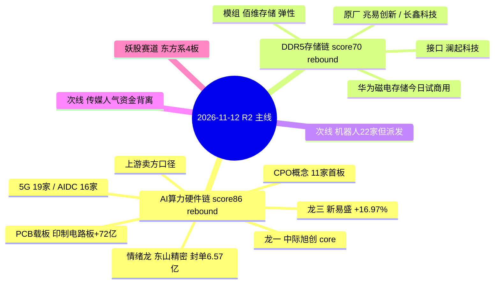

# 2026年11月12日 · **主线研判**

> **数据源新鲜度**: partial（R1 degraded / weflow 降级 / 概念涨占比缺失）  
> **降级状态**: true  
> **置信度**: 0.62

## 一句话结论

**今天只有一条真链：AI 算力硬件（光模块/CPO + PCB 载板，score 86），存储涨价链是它的第二落点（score 70）；两条线位置都在 60 日高下方 27%~58%，分层全为「反弹」，只做第一波、持有 ≤3 天。机器人、传媒、商业航天全部降次线，东方系玄学走妖股独立赛道。**

---

## 详细分析

### 一、市场温度：放量修复第 4 天，钱在硬件、不在连板

R1 给的坐标很清楚：风格 **连板情绪型**、情绪 70.3（贪婪下沿）、仓位上限 **60%**、阶段 **高位震荡 · 修复段第 4 个交易日**。

| 指标 | 2026-11-11 读数 | 读数含义 |
|---|---|---|
| 涨停 / 跌停 | 85 / 0 | 放量修复，无跌停=分歧可控 |
| 炸板率 | 18.27% | 低于 35% 红线，候选不砍半 |
| 最高连板 | 4 板（0 层空缺） | 天梯断层，接力弱于高度 |
| 涨家占比 / 中位涨幅 | 63.47% / +0.59% | 广度及格、中位温和 |
| 成交额 | 16760.7 亿（+11.40%） | 增量资金进场 |
| 昨日涨停收盘溢价 | +2.92%（红盘率 68.8%，再涨停 19 只） | 赚钱效应成立但成本已抬高 |
| 主力净流入 | 单日 +202.85 亿，5 日 +66.76 亿，10 日 -980.72 亿 | **止血不是转势** |

R1 判「无主线（轮动结构）」：行业次日留存 16.0%（4/25）、行业截面解释力 13.96%。这个口径与 R2 不冲突——R2 授予的主线是 **rebound 层（≤3 天）的单链修复**，不是可以按主线波段持有的趋势。

**钱去哪了**：机器人 / 传媒 / 端侧 AI 三处人气还在，资金已经撤出（传媒行业主力 -16.13 亿、前一日 +46.88 亿单日反手；机器人高标主力净卖）；同一笔钱切回 **通信设备 +135.30 亿、电子 +177.41 亿、元件 +81.79 亿、印制电路板 +72.14 亿、半导体 +76.75 亿**。

### 二、主线一：AI 算力硬件链（光模块/CPO + PCB 载板）· score 86 · layer=rebound · 持有 ≤3 天

| 维度 | 得分 | 依据 |
|---|:--:|---|
| 热度 | 19/20 | CPO 同花顺概念榜 **#1**（前一日 #11，跃升 10 位，+4.62%）；东山精密 dc 人气 #1 / ths #7 |
| 资金 | 20/20 | CPO 主力 +205.54 亿（+5.83%）、5 日 +129.65 亿；通信设备 +135.30 亿；电子 +177.41 亿；元件 +81.79 亿 |
| 涨停 | 13/20 | CPO 11 家、5G 19 家、AIDC 16 家、通信设备 7-8 家——**家数够、高度为零（cons_nums=0，全部 days=1）** |
| 叙事 | 20/20 | R4 net_score **+1.359**（当日全市场最强带）：E001 美股 AI 回暖（费半盘中 +7%、CoreWeave +24.71%）+ E002 微软游说白宫把 FCC 光收发器禁令推迟到 2028-2029（硬时间锚） |
| 共振 | 14/20 | R3 rank1 **L1+L2b**（L1 热榜+涨停结构成立；L2 KOL 7 群 0 条，L2b 公众号代位）——热度真、真人话语缺 |

**轴标签 = 上游·卖方（AI 算力资本开支）**。光模块/CPO 与 PCB 载板是 **同一批硬件筹码的两个名字**，已在 R2 内部合并为一条主线，不各自满额计涨停维；D1 合并敞口时按同一敞口处理。

- **大资金意图**: 机构在深调 -46%~-58% 的位置回补算力硬件，对手盘是过去 30 天在 -11.63% 中位跌幅里被套的散户与趋势资金。龙虎榜给出确认：东山精密机构净买 9.36 亿、沪电 5.69 亿、光迅 3.71 亿，全是 **单日机构承接**，不是游资打板。它们买的是 2028-2029 的 FCC 禁令推迟（把最坏情景往后推 2-3 年）+ 2027 资本开支能见度，而不是当日涨停。
- **为什么走强**: 位置=超卖深调（中际旭创距 60 日高 -45.86%、新易盛 -53.93%、东山 -57.70%）+ 催化=海外 AI 交易回暖叠加政策硬时间锚 + 筹码=午后集中封板（东山 13:11 / 沪电 13:13 / 光迅 13:46 / 深南 13:55 / 源杰 14:08），说明是机构调仓而非早盘一致性抢筹。
- **逻辑够不够硬**: 硬在 **硬时间锚**（FCC 推迟到 2028-2029 是政策日历，不是预期）+ **三源同向**（R3 热榜第一 / R4 +1.359 / R7 资金前三）+ **5 日资金为正**（CPO 5 日 +129.65 亿，不是单日脉冲）。不硬的地方同样明确：连板网「光通信」11-11 单日 13 家、前 9 个交易日无同题材记录，**涨停高度为零**，按 A+B 规则单日题材不得直接立主线——本条的资格来自「链级持续性（算力 10 日在榜 4 日、PCB 2 日）+ 资金 5 日为正 + 硬时间锚」，**11-12 竞价不确认即降级**。

| 角色 | 代码 | 名称 | 涨停/涨幅 | 封单·首封 | 容量 | 认定依据 |
|---|---|---|:--:|---|---|---|
| 龙一 | 300308.SZ | 中际旭创 | +15.07%（未涨停，20cm） | — | 6016 亿 | 带动性最强：主力 +29.87 亿、成交额 312.29 亿、dc #2/ths #10，「光模块」心智锚 |
| 龙二（情绪龙头） | 002384.SZ | 东山精密 | 首板 +10.00% | 封单 6.57 亿 · 13:11 · 开板 0 | 1276 亿 | 板高并列时比封单额最厚，另叠加 PCB+光模块双属性、dc #1、机构 9.36 亿 |
| 龙三 | 300502.SZ | 新易盛 | +16.97%（未涨停） | — | 2698 亿 | 主力 +30.50 亿（当日最大）、5 日 +32.38 亿且逐级放大 |
| 候补 | 002463.SZ | 沪电股份 | 首板 +10.00% | 封单 2.63 亿 · 13:13 · **开板 3 次** | 1728 亿 | PCB 中军，机构 5.69 亿；开板 3 次封板质量不合格，不给情绪席位 |
| 候补 | 002281.SZ | 光迅科技 | 首板 +10.00% | 封单 2.23 亿 · 13:46 · 开板 0 | 817 亿 | 龙虎榜 +2.46 亿（机构 3.71 亿）；首封晚于剑桥，只作低开承接对象 |

备选（不进候选池）：剑桥科技 603083（首封最早 09:34、封单 4.24 亿、322 亿弹性位，但首封早只说明抢跑）、源杰科技 688498（20cm +20.00%、封单 2.67 亿、PE 86.99 最高）、天孚通信 300394（+13.96% 未涨停）、深南电路 002916（封单 1.88 亿、换手 1.94%）。

#### 首推票 中际旭创 300308 · 思维链

- **买入理由**: ① 产业逻辑=AIDC/800G 光模块是算力资本开支第一顺位受益，主营光通信收发模块占比 98.99%、毛利率 46.6%，主业纯度全链最高；② 数据锚=主力单日 +29.87 亿、5 日 +16.06 亿（3 个正日）、成交额 312.29 亿、PE(TTM) 24.65 在算力硬件里最低档；③ 位置锚=距 60 日高 -45.86%，是深调修复的第一波，不是新高追高。
- **风险点**: ① 短期=昨日 +15.07% 已兑现一半利好，今日竞价高开 >3% 就是给机构抬轿，20cm 票回撤速度快；② 中期=若 11-12 机构龙虎榜转净卖或 CPO 炸板率 >35%，说明是单日调仓而非趋势起点；③ 结构=全场 11 家 CPO 涨停全为首板，无连板高度可依托，二波需要新的增量资金。
- **止损条件**: 收盘跌破 **514.90**（参考价 542.00 × 0.95，同时贴近当日 VWAP 514.19）无条件走；盘中跌破 5 日线且不能 30 分钟内收回同样走。
- **可验证假设**: ① 11-12 竞价 CPO 前排红盘率 ≥50%、板块高开不回落（观测 09:30-10:00 板块分时）；② 东山精密 / 沪电股份 / 光迅科技龙虎榜次日不出现机构净卖；③ 中际旭创当日成交额 ≥250 亿且收盘站上 542。三项中两项不成立即降为观察。

#### 情绪龙头 东山精密 002384 · 一句话口径

13:11 首封、封单 6.57 亿、开板 0 次、机构 9.36 亿——**这是机构在收盘前 1 小时把一只 1276 亿的大票封死**，封板质量是本链最好；但 5 日主力仍 -5.61 亿，说明 T-1 是单日回补。**买点=打板或竞价确认的弱转强，不做低吸**（大票低吸接的是机构抛压）；炸板破 88.49 均价线即离场。

### 三、主线二：存储芯片 / DRAM·DDR5 涨价链 · score 70 · layer=rebound · 持有 ≤3 天

| 维度 | 得分 | 依据 |
|---|:--:|---|
| 热度 | 16/20 | 存储芯片概念 #6（前一日 #18，跃升 12 位，+3.13%）；长鑫人气 34、兆易 +6.15% |
| 资金 | 15/20 | 半导体 +76.75 亿（5 日 +155.23 亿，20 日 -4.10 亿≈持平）；**个股 5 日仍负**（长鑫 -20.26 / 兆易 -13.37） |
| 涨停 | 10/20 | 芯片概念 21 家（days=3、2天2板），但存储细分 0 家涨停、半导体仅 2 家 |
| 叙事 | 15/20 | 三事件叉乘 +0.578 = E001(+0.560) + E007 华为磁电存储 11-12 贵安试商用(+0.259) + E008 大摩警告旧存储见顶(-0.241) |
| 共振 | 14/20 | R3 rank3 **L1+L2b early**、`early_or_late=early` |

- **大资金意图**: 买的是 **原厂的毛利扩张**，不是模组的涨价弹性。R4 的分布数据说明一切：江波龙 Q3 环比 -44.2%、德明利 +2.2%、长鑫 +3.0%——机构在往上游原厂挪，模组端在被杀毛利。对手盘是做"涨价链=模组"叙事的散户。
- **为什么走强**: 位置=兆易距 60 日高 -41.53%、长鑫 -31.93%（超卖修复）+ 催化=**今天落地的硬时间锚**（华为新型存储系统贵安试商用是当日唯一「当天发生」的事件）+ 筹码=澜起 2.63%、兆易 6.27% 低换手（筹码稳）。
- **逻辑够不够硬**: 硬在硬时间锚 + 原厂估值（兆易 PE 15.71、长鑫 20.52）+ 半导体 5 日 +155 亿。不硬在 **叙事是对冲不是单边**（E008 大摩见顶同日出现）、**个股 5 日资金仍负**、**存储细分零涨停**。70.0 分是主线核心的下沿，竞价不确认直接降次线。

| 角色 | 代码 | 名称 | 涨幅 | 收盘位置 | 容量/PE | 认定依据 |
|---|---|---|:--:|:--:|---|---|
| 龙一 | 603986.SH | 兆易创新 | +6.15% | 0.95 | 1741 亿 / 15.71 | 「存储=兆易」心智锚 + 链内最大主力 +12.52 亿 + 最低估值原厂 |
| 龙二 | 688825.SH | 长鑫科技 | +4.00% | 0.87 | 1894 亿 / 20.52 | DRAM 原厂唯一 + 主力 +16.57 亿；**4.00% 未达 20cm ≥7% 门槛，状态=观察** |
| 候补 | 688525.SH | 佰维存储 | +6.95% | 0.96 | 661 亿 / 6.89 | 弹性位（涨幅第 2）；模组端受 E008 压制，只做 1-2 日弹性 |
| 候补 | 688008.SH | 澜起科技 | +5.21% | 0.93 | 1864 亿 / 51.76 | DDR5 接口芯片纯度最高、2.63% 最低换手；强度不足只观察 |

不进候选：江波龙 301308（+4.69%，Q3 环比 -44.2%，买在毛利压缩侧）、德明利 001309（+6.61%，模组端同上）、深科技 000021（+2.98%）。

#### 首推票 兆易创新 603986 · 思维链

- **买入理由**: ① 产业逻辑=DRAM/NOR Flash 原厂，DDR5 涨价周期里原厂拿毛利、模组被压，且 PE 15.71 是存储链最低；② 数据锚=主力 +12.52 亿（存储链最大单票流入）、成交额 105.89 亿、收盘位置 0.95 收在上沿；③ 位置锚=距 60 日高 -41.53%，反弹第一波。
- **风险点**: ① 短期=6.15% 涨幅在主板属"强势但未封板"，次日若无板块二波容易变成冲高回落；② 中期=E008 大摩"旧存储价格见顶、2028 供需转宽松"若被市场采信，涨价叙事直接腰斩；③ 结构=存储细分零涨停，无赚钱效应示范，靠的是原厂独立逻辑。
- **止损条件**: 收盘跌破 **246.64**（259.62 × 0.95）离场；或盘中跌破当日 VWAP 251.67 且 30 分钟不收回，减半。
- **可验证假设**: ① 11-12 存储前排红盘率 ≥50%；② 长鑫 / 兆易当日主力仍为净流入（连续第 2 日）；③ 华为贵安试商用有第二条产业侧跟进消息（原厂/接口厂公告或调研）。三项中两项不成立即降为观察。

### 四、次线（不占主线名额，今日不新进）

| 板块 | 分数 | 为什么降次线 | 层级 |
|---|:--:|---|---|
| 人形机器人 / 具身智能 | 64 | R3 rank4 **late + 拦截**：襄阳轴承 2 板开板 6 次主力 -0.99 亿、光洋股份 3 板开板 2 次主力 -1.13 亿且公司自证机器人业务占比低；连板网 22/26/13 家连续在榜但**家数收缩**；R4 E003 北京三年行动方案(+0.62) 被 E006 大摩部署延后一年(-0.44) 对冲 | trend（高标贴 60 日高，正是派发位）· 持有上限 3 天 |
| 短剧游戏 / AI 漫剧 · 传媒 | 55 | 人气-资金背离：传媒行业主力 -16.13 亿（前一日 +46.88 亿单日反手）、文投控股 3 板开板 9 次 | rotation · 不给买点 |
| 商业航天 / 太空算力 | 52 | 拥挤度冷却（概念榜 8→6→3→2→1→1→3），连板网 11-11 掉出（前两日各 6 家）；无负面但最热段已过 | rotation · 只记录 |

### 五、妖股赛道（并行独立，不占主线名额）

**窗口**：四季度跨年妖（2027 春节=羊年）。**当前市场实际在炒的是「东方」字族**，不是羊族。

| 候选 | 梗层 | 赚钱效应证据 | 参与方式 |
|---|---|---|---|
| 大东方 600327 | 名字族（东方系） | 4 板（5/7）、封单 1.17 亿、换手 11.7% 非一字 | **打板/竞价确认**，轻仓 ≤5%，炸板破均线必卖 |
| 日出东方 603366 | 名字族（东方系） | 4 板、封单 5.69 亿、换手仅 1.15% 缩量一字 | **只观察不打一字**（硬过滤第 4 条） |
| 三羊马 001317 | 同音族（羊年正字） | 当日 -2.57%、无涨停无量能，羊族无扩散 | **不进**（无资金无催化） |

剔除：东方环宇（3 板开板 10 次烂板）、东方通信（1 板开板 5 次）、光洋股份（公告自证题材证伪）、襄阳轴承（换手 37.4% 派发）、东方海洋（60 日 +132% 高位滞涨）、利群股份（拆字"群"但 rotation 无资金）、利扬芯片（688 不进 10cm 赛道）。R3 已把东方系标 `theme_late_no_industry_backing`（0 小时到期），本赛道不授予开仓资格。

### 六、宽度与持续性：为什么只敢给「反弹」而不是「趋势」

连板网 10 日「题材×涨停家数」矩阵（收盘事实，比资金估算可靠）：

| 题材 | 11-11 | 11-10 | 11-09 | 11-06 | 11-05 | 11-04 | 11-03 | 11-02 |
|---|:--:|:--:|:--:|:--:|:--:|:--:|:--:|:--:|
| 机器人 | 22 | 26 | 13 | — | 8 | 9 | 2 | 9 |
| 光通信 | 13 | — | — | — | — | — | — | — |
| 芯片 | 4 | 3 | 2 | 2 | 8 | 36 | — | — |
| PCB | 4 | — | 2 | — | — | — | — | — |
| 算力 | 4 | — | — | 3 | 4 | 1 | — | 5 |
| AI应用 | 3 | 12 | — | 4 | 14 | — | — | 29 |
| 端侧AI | 2 | 13 | — | 2 | 5 | — | — | 3 |
| 商业航天 | — | 6 | 6 | — | 2 | — | — | — |

三条硬读法：① **光通信是单日新增**（前 9 日零记录）→ 一日游风险真实存在，所以只按反弹做 1-3 天；② **机器人 22→26→13** 连续在榜但家数在收缩，且收缩发生在高标开板时，是派发不是洗盘；③ **AI应用 29→14→12→3、端侧AI 13→2** 已经掉队，正是资金切出的那一侧。

---

## 关键证据

- 证据 1：CPO 概念主力 **+205.54 亿（+5.83%）**、5 日 +129.65 亿，龙头同花顺概念榜 #1（前一日 #11，跃升 10 位）· 来源 R7_capital_flow + R3_sentiment
- 证据 2：机构龙虎榜单日集中承接——东山精密净买 7.22 亿（机构 9.36 亿）、沪电 3.86 亿（机构 5.69 亿）、光迅 2.46 亿（机构 3.71 亿）· 来源 R3_sentiment hotlist_signals
- 证据 3：E002 微软等游说白宫把 FCC 光收发器禁令推迟到 **2028-2029**（strength=high，+0.65）· 来源 R4_news top_events
- 证据 4：CPO 11 家涨停 **全部 days=1 / cons_nums=0 / 首板**，5G 19 家、AIDC 16 家同为 days=1 · 来源 tushare limit_cpt_list（2026-11-11）
- 证据 5：龙一中际旭创距 60 日高 **-45.86%**、新易盛 -53.93%、东山 -57.70%、兆易 -41.53% → 分层函数输出全部 = rebound · 来源 kb/research.db market_daily_bars（前复权，as_of=20261111）
- 证据 6：机器人高标襄阳轴承开板 6 次 + 主力 -0.99 亿、光洋股份开板 2 次 + 主力 -1.13 亿 + 公司澄清 → 人气留存型派发 · 来源 R3_sentiment + limit_list_d
- 证据 7：R1 行业次日留存 16.0%（4/25）、截面解释力 13.96% → 轮动结构，不支持主线波段 · 来源 R1_style rotation_evidence

## 数据源审计

| 源 | 日期 | 状态 | 备注 |
|---|---|:--:|---|
| tushare/limit_list_d | 2026-11-11 | 🟢 | 104 条涨停明细（封单/首封/开板/换手齐全） |
| tushare/daily + daily_basic | 2026-11-11 | 🟢 | 5574 只，OHLC+量额+PE+流通市值 |
| tushare/limit_cpt_list | 2026-11-11 | 🟢 | 20 条概念涨停天梯（CPO 11 家首板、5G 19、AIDC 16） |
| lianban.net 连板网主线性 | 2026-11-11 | 🟢 | 10 日 × 16 题材涨停家数矩阵 |
| kb/research.db market_daily_bars | 2026-11-11 | 🟢 | 1,428,948 根前复权日线，trend_layer 取 as_of=20261111 |
| eastmoney/moneyflow_ind_dc | 2026-11-11 | 🟢 | 496 行业 + 534 概念，21 日窗口 |
| R1_style | 2026-11-12 | 🟡 | status=degraded（外盘/跨资产缺口，freshness 0.75） |
| R3_sentiment | 2026-11-12 | 🟡 | complete 但 weflow 降级 + L2 KOL 0 条 |
| R4_news | 2026-11-12 | 🟢 | 8 条 top_events + 板块极性矩阵 |
| R7_capital_flow | 2026-11-12 | 🟢 | complete，execution_candidates 为空 |
| wechat_official_rss | 2026-11-12 | 🟢 | 88 篇 · 18 订阅源（群名匿名） |
| 概念成分涨占比 | 2026-11-11 | 🔴 | 无成分池口径，宽度只能用行业+全市场广度代理 |
| theme_anchors 心智锚表 | 2026-11-02 | 🟡 | stale，未随股性表刷新，龙一认定改用带动性+容量 |
| yaogu_llm_context | 2026-11-12 | 🟡 | 涨停池/龙虎榜段落=无数据，改用本地 limit_list_d |
| factor panel（weekly_ir_scan） | — | 🟡 | degraded：未实现（设计内跳过，不是故障） |

## 不确定性 / 反证

1. **最可能错的地方：把「单日机构调仓」当成「趋势起点」**。全部 CPO 涨停 days=1、cons_nums=0，若 11-12 竞价前排高开低走、炸板率 >35%，这两条线当日就该作废——R3 给的 falsify 条件逐条可验：竞价前排高开低走 / 白宫否认推迟 / 机构龙虎榜次日反手。
2. **存储 70.0 分是下沿**，只要竞价存储前排红盘率 <50%，直接降次线；它的叙事本身是对冲结构（E007 华为试商用 vs E008 大摩见顶），不是单边利好。
3. **R1 与 R2 的口径差异是设计而非矛盾**：R1 用行业留存率判「无主线」，R2 用资金+叙事+链级持续性判「有主线但只到反弹层」。如果今日资金没有连续性（5 日 CPO 转负），R1 的轮动判定就会接管，R2 的 86 分不成立。
4. **宽度缺口**：概念成分涨占比拿不到，宽度只能用「涨停家数 + 板块涨幅 + 全市场广度」代理，普涨不封板与封板不普涨的结构差异无法区分。
5. **妖股素材包涨停池为空**，东方系判断是我用本地涨停明细手工做的联想，不是生成器给的结构化口径；若用户口径要求以素材包为准，本段应视为 partial。
6. **反证待办**：R6 尚未跑。本线需 R6 复核「午后集中封板=机构真实回补 vs 尾盘mark价」与「光模块 5 日 +129.65 亿是否含 ETF/被动买入」两点。

## 与其他 R/D/E 的关系

- 依赖：R1（温度/仓位上限 60%）、R3（共振主题 rank1/rank3）、R4（sectors_catalyzed + top_events）、R7（top_inflow_sectors/概念资金）、lianban 矩阵、limit_list_d、kb 日线
- 被消费：R5（对本文件 leaders 逐票画像）、R6（反证，不得过滤其 hard_reject）、D1（选执行池，`cross_validation_score=1.0` 的两条线优先级最高，但**同属一个硬件敞口需合并**）、E1（复盘回填）

## Sub-Agent 元数据

- skill: analyze_main_sectors_v1
- artifact: `data/research/20261112/R2_main_sectors.json`
- 校验: `tests/checks/check_r2_cross_validation.py 20261112` → ✅ 通过（2 条主线、2 个 consensus_themes）
- 生成耗时: 约 18 分钟（含 trend_layer 全量分层 + 涨停明细归集）
- model: deepseek-v4.1-flash
- 分层函数: `src/research/trend_layer.py::classify_layer`（as_of=20261111，禁看未来 K 线）
