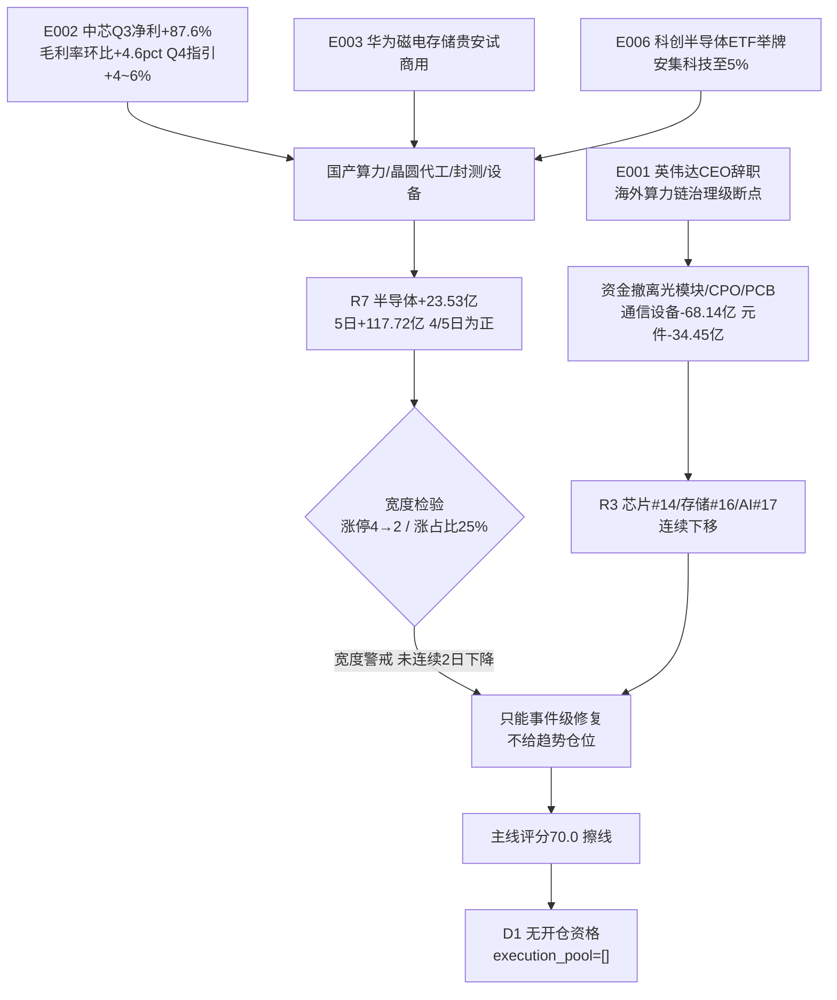

# 2026-11-13 · **主线研判**

> **数据源新鲜度**: partial（R1 degraded，R3/R4/R7 ok，T-1 行情全量本地）
> **降级状态**: 因子层设计内跳过（degraded，非故障）
> **置信度**: 0.66（唯一主线擦线 70 + 龙一结构为轮动 → 中等偏下）

## 一句话结论

**全场只有一条线过 70 分——半导体/国产算力 70.0（擦线），但它是「资金与催化齐备、板型与结构未修复」的事件级修复线；兵装重组 63、预制菜 63、AI 营销 52 只能算次线；T-1 涨停 37 家、炸板率 48.61%、主力 −525.12 亿，今日不给任何票开仓资格。**

## 详细分析

**一、温度先定：这是一根退潮中的脉冲，不是修复启动。**
T-1（11-12）涨停 37 家、跌停 5 家、炸板 35 家（炸板率 48.61%，前一日仅 18.27%）、涨 875 跌 4635（涨家占比 15.7%）、中位 −1.61%、成交 19,458.7 亿、主力净流出 −525.12 亿、最高 5 板、昨日涨停溢价 −0.87%、再涨停仅 11 只。R1 给「震荡分化型 + 情绪 47.1 中性 + high_chop 第 2 天 + 仓位上限 45%」，并明确判「无主线（轮动结构；行业次日留存 12.0%、行业截面解释力 13.85%）」。按纪律 §2「阶段只定温度」，今天任何板块都只能按 1–2 日脉冲对待。

**二、半导体为什么是唯一主线，又为什么只是擦线。**
三层证据在这条线上齐了：R3 把它排 rank1，芯片 #14 / 存储 #16 / 人工智能 #17 三概念同时在榜，且唯一「资金双正」；R4 给出全市场最密的催化——E002 中芯 Q3 营收 219.83 亿（+28.1%）、净利 28.47 亿（+87.6%）、毛利率 29.9%（环比 +4.6pct）、Q4 指引环比 +4~6%，叠加 E003 华为磁电存储贵安试商用、E006 科创半导体 ETF 举牌安集科技至 5%；R7 资金端半导体 +23.53 亿（5 日 +117.72 亿、4/5 日为正）、半导体设备 +17.33 亿（5 日 5/5 全正），概念端大基金持股 +24.49 亿、先进封装 +17.52 亿、HBM +15.28 亿、中芯 +14.42 亿、光刻机 +9.90 亿、AI 芯片 +9.37 亿。
但如果只看这三点就判「主线成立、可以猛干」，就是被资金骗。反证同样硬：T-1 半导体细分行业 200 只**涨占比仅 25.0%**、均值 −0.83%、**涨停 0 家**（全链唯一封板是元件端的超颖电子），涨停家数序列 11-04 的 36 家 → 8 → 2 → 2 → 3 → 4 → 2 家，钱在但板没有。所以五维只能给 70.0：热度 12、资金 19、涨停 8、叙事 19、共振 12——靠资金与叙事两维撑起，扣一维就跌破阈值。

**三、另外三条线为什么升不上去。**
兵装重组 63 分：热度是全市场最好的（概念榜 #1 +2.07%、板块 +3.19%、12 只成分 10 涨 83.3%），但①R4 零催化条目（重组仍是传闻级）②地面兵装资金只有当日 +5.38 亿、5 日 −0.12 亿（pos_days 1/5）③只有 1 只封板且是尾盘板、开板 2 次；而且「涨停家数 0→1」仅 1 个交易日，按 skill 属一日游，不满足连续 ≥2 日的主线门槛。
预制菜/食品链 63 分：涨停 5 家（37 家里占 13.5%）在扩，惠发食品 3/3 板且是全场**唯一贴新高**结构（60 日 +36.5%、距 60 日高 0.0%），渔业 7 只全红；但板块资金 5 日仅 +1.24 亿、20 日 −12.49 亿，属单日脉冲，且驱动里混着东方海洋 9/17 的玄学高标，R3 直接判「不进（避险轮动而非进攻主线）」。
AI 营销 52 分：蓝色光标单票主力 +23.47 亿（全场第一）、+10.89%，但广告板块 pct −2.02%、涨占比 14.8%、**0 涨停**，AI 应用连板家数 3→0 归零——典型的缩圈独强，R3 明示「单票独强、板块级 pct 为负 = 缩圈，不作板块共振使用」。

**四、妖股赛道：名字梗数量扩散、质量崩塌，且监管已介入。**
洋/阳族 T-1 同日 5 只涨停（澳洋健康 6/12、东方海洋 9/17、百洋股份 1/1、大西洋 1/1、安阳钢铁 1/1），东方系另有 大东方 6/8、日出东方 5/5、东方环宇 4/4 全封——名字梗确实是当下唯一成气候的赚钱效应。但封成率只有 2/5：东方海洋开板 26 次、换手 35.1%（死亡换手），百洋开 11 次，大西洋开 6 次且封单 0.04 亿。更关键的是 E008：上交所对大东方、日出东方（均 5 连板以上）下发股价波动监管工作函 → 高标反馈被掐断，触发「替身切换」判断。羊年正字与拆字梗集体未启动：三羊马 −2.21%、利群股份 +0.27%、九阳股份 +0.23%（热榜 87→38 跃升 49 位但股价不动）。结论：今日只给 2 只封成候选（澳洋健康、安阳钢铁），均轻仓竞价确认，不接一字、不打尾盘板。

**五、所以今天计划做什么、不做什么。**
做：把半导体这条线当**事件级修复**跟踪，只等龙一/龙二回踩 5 日线且站上均价线的低吸位，等不到就不做。
不做：光模块/CPO 与 PCB/AI 服务器（E001 英伟达 CEO 辞职 = 治理级断点，R4 极性 −0.85，元件 −34.45 亿、通信设备 −68.14 亿）、人形机器人（R3 判 late 且机器人概念 −203.73 亿）、东方系玄学高标（监管函）、任何打板通道（涨停 0–2 家 + 炸板率 48.61%，板型结构性不适用）。

## 五维打分总表

| 线 | 总分 | 热度 | 资金 | 涨停 | 叙事 | 共振 | 层级 | 阶段 | 最长持有 | 结论 |
|---|---|---|---|---|---|---|---|---|---|---|
| 半导体/国产算力（晶圆代工·封测·设备·存储） | **70.0** | 12 | 19 | 8 | 19 | 12 | 轮动 | mid_up（资金驱动型） | 0（不给趋势买点） | 主线·擦线·仅研究 |
| 兵装重组/地面兵装 | 63.0 | 18 | 13 | 12 | 8 | 12 | 轮动 | formation（首日） | 0 | 次线·watch |
| 预制菜/食品链 | 63.0 | 14 | 13 | 16 | 9 | 11 | **趋势**（贴新高） | mid_up | 5（贴新高） | 次线·watch |
| AI营销/广告 | 52.0 | 13 | 15 | 5 | 8 | 11 | 轮动 | climax（实为缩圈） | 0 | 次线末位·watch |

> 判读口径：热度=概念榜/人气榜位次与动量；资金=R7 行业+概念主力净额（今日与 5 日双看）；涨停=板块涨停家数与宽度；叙事=R4 催化密度与强度；共振=R3 真等级（L2 真人话语 0 条 → 全部只能记 L1_only，故共振维上限受限）。

## 主线拆解：半导体/国产算力（70.0 · 擦线）

### 证据链

### 推理深度三问

- **大资金意图**：R7 的 +117.72 亿（5 日）不是短线博弈的钱——半导体设备 pos_days 5/5 全正、先进封装 5 日 +83.63 亿，说明是**顺着中芯资本开支指引做中期布局**的机构钱；但同一天全市场主力净流出 −525.12 亿，这 117 亿是从光互联（通信 −73.03 亿、元件 −34.45 亿）搬过来的**存量搬家**，不是增量进场。存量搬家的含义：它只能撑一条线，撑不了普涨。
- **为什么走强**：催化密度全市场第一（4 条 high/medium 事件同日落地），且事件直接指向订单与毛利率（中芯毛利率环比 +4.6pct 是最硬的产业证据），资金只需要一个「确定性」借口就能从被英伟达吓坏的光互联里撤出来。
- **逻辑够不够硬**：产业逻辑够硬（订单+指引可验证、季度频率可跟踪），但**交易逻辑不硬**——涨停 0 家、涨占比 25%、龙头 60 日均为负收益（寒武纪 r60 −10.79%、中芯 −10.9%、北方华创 −25.1%），上方还有套牢盘。硬逻辑只支持「低吸回踩」，不支持「追涨打板」。

### 龙头候选（5 只）

| 角色 | 代码 | 名称 | 涨跌 | 收盘位置 | 站上均价线 | 流通市值 | 主力(今日/5日) | 结构 | 生命周期 | 通道 |
|---|---|---|---|---|---|---|---|---|---|---|
| 龙一 | 688256.SH | 寒武纪 | +8.11% | 0.55 | ✗（−0.65%） | 6,118.7 亿 | +14.06 / +34.21 亿 | 轮动 | 核心·容量 | 回踩低吸 |
| 龙二 | 688981.SH | 中芯国际 | +2.20% | 0.51 | ✓（+0.12%） | 2,235.1 亿 | 事件本体 | 轮动 | 核心·容量 | 回踩低吸 |
| 龙三 | 002371.SZ | 北方华创 | +1.99% | 0.39 | ✗（−1.63%） | 4,064.4 亿 | +5.30 / +11.76 亿 | 反弹 | 核心·容量 | 观察 |
| 候补 | 002156.SZ | 通富微电 | +5.36% | 0.43 | ✗（−1.40%） | 733.8 亿 | +8.62 / +8.66 亿 | 反弹 | 核心·容量 | 弱转强 |
| 候补 | 688019.SH | 安集科技 | −0.92% | 0.00 | ✗（−2.58%） | 490.5 亿 | 举牌催化 | 反弹 | 核心·容量 | 观察 |

**首推票思维链（寒武纪 688256.SH）**

- **买入理由**：国产 AI 算力第一心智锚 + 当日板块最大涨幅（+8.11%）+ 全场半导体单票最大主力净流入（+14.06 亿，5 日 +34.21 亿）+ 距 20 日高仅 −4.61%（上方真空），E002 中芯指引证伪「Q3 见顶」叙事，它是受益弹性最大的载体。
- **风险点**：①**冲高回落**——收盘位置 0.55、收盘 973.00 低于当日均价线 979.32（−0.65%），按核心票强度口径「涨而未站住」，当天不算走出来；②60 日 −10.79%、距 60 日高 −16.3%，属轮动而非趋势，无 5 日持有资格；③PE(TTM) 146.76、6,118 亿市值，一旦资金分流回撤幅度大；④炸板率 48.61% 的环境里，日内首波反弹多为诱多。
- **止损条件**：若按计划参与，止损设在**跌破 5 日线且收盘低于当日均价线**（对应 −5%~−7% 区间，落在纪律硬区间内）；跌破即离场，不补仓、不用 T 掩盖。
- **可验证假设**：①次日半导体资金是否连续第 5 天为正（R7 明日 pos_days）；②中芯 Q4 指引兑现后设备/封测订单是否跟上（看北方华创、通富微电的 5 日主力净额能否转正）；③涨停家数能否从 2 家回到 ≥5 家（宽度修复的唯一硬信号）。三条任一不成立，本线降回 watch。

### 板块宽度（必须与强度一起读）

- 涨停家数序列（芯片口径）：36（11-04）→ 8 → 2 → 2 → 3 → 4 → 2（11-12）；细分行业口径：— → 4 → 0 → 0 → 2 → 2 → 0。
- 涨占比 25.0%（200 只）、均值 −0.83%、中位 −1.44%；子行业分化：集成电路制造 +1.19%、半导体设备 +0.75%、封测 −0.05%、半导体 −0.84%。
- 结论：**宽度警戒但未触发整线降级**（家数 4→2 只跌了一天，11-10→11-11 是上升，不构成「连续 2 日下降」）；但涨占比 <50% 是硬伤 → 本线只许事件级参与，不许按趋势主线给仓位。

## 次线三条（不进主线，只留观察位）

**兵装重组/地面兵装（63.0 · stage=formation 首日）**
- 大资金意图：+5.38 亿是**当日抢筹**，5 日累计 −0.12 亿说明此前无人布局——更像游资借概念榜 #1 做首日卡位，不是机构建仓。
- 为什么走强：概念榜 #1（唯一涨幅红盘 +2.07%）+ 板块 +3.19% 全市场最好 + 12 只成分 10 涨，赚钱效应真实但极窄（只有 12 只样本）。
- 逻辑够不够硬：**不硬**——无官方催化、只有 1 只尾盘封板、资金无连续性。唯一亮点是内蒙一机（60 日 +11.2%、距高 −12.2%、剔峰 +1.1%，全板块唯一趋势回踩结构）。升级条件：概念榜连续第 2 天在榜 **且** 长城军工竞价弱转强。

**预制菜/食品链（63.0 · stage=mid_up，惠发 trend/near_high）**
- 大资金意图：+8.40 亿当日、5 日 +1.24 亿、20 日 −12.49 亿 → 避险资金临时避风，不是产业资金进场。
- 为什么走强：惠发食品 3/3 板贴新高（60 日 +36.5%、距高 0.0%、剔峰 +24.1%）+ 渔业 7/7 全红 + E007 中美 300 亿对 300 亿对等降税外溢。
- 逻辑够不够硬：消费/避险逻辑只能做 1–3 天；且领涨里混入东方海洋 9/17 的玄学高标，一旦玄学退潮整条链会跟着塌。

**AI营销/广告（52.0 · 缩圈独强）**
- 大资金意图：蓝色光标 +23.47 亿（5 日 +20.2 亿）是**全场最大单票净流入**，但板块 pct −2.02%、0 涨停、AI 应用连板家数归零 → 资金是把整个板块的钱抽到一只票上（缩圈），不是板块行情。
- 逻辑够不够硬：无任何 R4 事件支撑，纯资金行为；缩圈票的次日风险是「资金一分流就断头」，只能跟单票资金连续性，不能当板块做。

## 妖股赛道（四季度跨年妖 · 2027 春节=羊年）

| 候选 | 梗层 | 赚钱效应证据 | 位置 | 参与方式 |
|---|---|---|---|---|
| 澳洋健康 002172.SZ | 同音族（洋/yáng） | 6/12 板、封单 0.51 亿、开板 4 次、龙虎榜 +2.18 亿（机构净卖 −0.59 亿） | 51.0 亿 / 换手 29.3% | 竞价确认、轻仓 ≤5%，弱转强才上 |
| 安阳钢铁 600569.SH | 同音族（阳）+ 低价钢铁 | 1/1 首板、开板 1 次、封单 0.18 亿（薄） | 57.4 亿 / 换手 4.5% | 竞价弱转强，不打 T 字板 |
| 三羊马 001317.SZ | 正字梗（羊） | 无涨停、−2.21% | 40.9 亿 / 换手 10.6% | 只观察，等首板 |
| 利群股份 601366.SH | 拆字（群含羊）+ 预制菜 | +0.27%、无涨停 | 36.3 亿 / 换手 3.4% | 只观察，双梗未启动 |
| 七匹狼 002029.SZ | 谐音（狼吃羊）+ 服饰链 | +3.61%、换手 15.0%，未涨停 | 62.9 亿 | 只观察，等首板 |

**剔除**：东方海洋（开板 26 次、换手 35.1%，烂板+死亡换手）、百洋股份（开 11 次）、大西洋（开 6 次、封单 0.04 亿）、大东方（6/8 板 + 监管工作函）、日出东方（5/5 板 + 监管函 + 开 7 次）、襄阳轴承（8/16 板但当日炸板、换手 37.9%）。
**监管切换已触发**（E008）→ 东方系高标进入监管窗口，资金有转向同音族/低位未启动梗的动机，但替身目前只有 2 只封成票，不构成合力。

## 剔除与拦截清单

- **光模块/CPO、PCB/覆铜板、AI 服务器/英伟达链**：E001 黄仁勋辞去总裁/CEO/董事全部职务即刻生效 = 治理级断点（R4 极性 −0.85），R7 通信 −73.03 亿、通信设备 −68.14 亿、元件 −34.45 亿，R3 列 high 级派发警告。拦截。
- **人形机器人/具身智能**：R3 判 late（概念连续 4 个观测日 #2 但当日 −3.15%）、机器人概念主力 −203.73 亿、宇树科技 −8.38%。拦截。
- **东方系玄学高标**：E008 监管工作函落地。拦截。
- **农业/渔业单独成线**：并入预制菜/食品链，仅好当家（首板、封成）保留观察位；东方海洋为玄学高标不作产业代表。

## 关键证据

- 证据 1：中芯国际 Q3 营收 219.83 亿（+28.1%）、净利 28.47 亿（+87.6%）、毛利率 29.9%（环比 +4.6pct）、Q4 指引环比 +4~6% · 来源 R4 E20261113_002（high）
- 证据 2：半导体主力 +23.53 亿（5 日 +117.72 亿、4/5 日为正），半导体设备 5 日 5/5 全正 · 来源 R7 top_inflow_sectors #1/#4
- 证据 3：芯片 #14 / 存储 #16 / 人工智能 #17 三概念同时在榜且唯一资金双正，真等级 L1_only · 来源 R3 resonance_top_themes rank1
- 证据 4：T-1 涨停 37 / 炸板 35（48.61%）/ 涨 875 跌 4635 / 主力 −525.12 亿 · 来源 tushare limit_list_d + R7 market_breadth
- 证据 5：概念榜 #1 兵装重组 +2.07%，地面兵装 +3.19%、12 只成分 10 涨 · 来源 R3 hotlist_signals + R7 sector_flows
- 证据 6：蓝色光标主力 +23.47 亿（全场单票第一）但广告板块 −2.02%、0 涨停 · 来源 R7 watch_reserve + 本地日行情

## 数据源审计

| 源 | 状态 | 抓取日期 | 记录数 | 备注 |
|---|---|---|---|---|
| R3_sentiment.json | 🟢 ok | 2026-11-13 | 5 主题 | complete，conf 0.53；L2 KOL 0 条 → 全部 L1_only |
| R4_news.json | 🟢 ok | 2026-11-13 | 8 事件 | complete，conf 0.68；kol_confirm 字段过期（早于 R3 生成） |
| R7_capital_flow.json | 🟢 ok | 2026-11-13 | 15 板块 + 5 候选 | complete，conf 0.75；execution_candidates=0 |
| R1_style.json | 🟡 stale | 2026-11-13 | 42 键 | degraded，conf 0.472；汇率/商品缺口，仅作温度输入 |
| limit_list_d 20261112 | 🟢 ok | 2026-11-12 | 77 行（37U/35Z/5D） | 本地落盘，与 R1/R7 广度一致 |
| daily/daily_basic 20261112 | 🟢 ok | 2026-11-12 | 5,573 只 | 本地全量，VWAP/收盘位置由此计算 |
| top_list 20261112 | 🟢 ok | 2026-11-12 | 69 条 | 龙虎榜净额校准妖股候选 |
| lianban_mainline | 🟢 ok | 2026-11-12 | 10 日 × 题材 | 家数序列，宽度校验 |
| dc_member BK1382/BK1025/BK1220 | 🟢 ok | 2026-11-12 | 72 只 | 兵装 12 只、预制菜 66 只、广告 30 只 |
| 因子层 weekly_ir_scan | ⚪ degraded | — | 0 | 设计内跳过（脚本未实现），非故障 |

## 不确定性 / 反证

1. **我的主线判定与 R1 冲突**：R1 用行业次日留存 12.0%/解释力 13.85% 判「无主线」，我用五维判「1 条擦线主线」。分歧点在度量对象——R1 量的是「行业轮动随机性」，我量的是「单条线的资金+催化+涨停」。我保留自己的判断，但把这条线的 `d1_note` 写成「仅研究级、不得当主升主线建仓」，让 D1 有仲裁空间。
2. **半导体 70 分是擦线，最脆弱的是热度维**：芯片 #14、存储 #6→#16 连续下移，若明日跌出 top20，热度维会掉到 9–10，总分直接跌破 70 → 主线资格消失。这条线本质是「事件驱动的资金搬家」，事件冷却即结束。
3. **涨停 0 家是我给 8 分而非 0 分的唯一理由**：全链唯一封板是元件端的超颖电子（PCB，属 E001 负面链），严格按「半导体细分行业」口径应为 0 家。若按 0 家给 6 分，总分 68 → 次线。我取 8 分（含链上封板 + 4 次触板），属于**偏宽松**，已在 `quality_note` 标注扣一维即跌破。
4. **R3 的「真等级 L1_only」是共振维不能给高的硬约束**：L2 真人话语 0 条 = 没有真人情绪背书，所有主题的共振都是「人气+资金」的机器口径。若明日 KOL 群出现半导体/兵装的真人口径，共振维可上调，但今日不行。
5. **妖股赛道可能整体失效**：监管函落在东方系，如果高标明日直接断板，整个名字梗赚钱效应会一起退潮，同音族替身也接不住。我的处理是只给 2 只轻仓竞价确认，不做埋伏。

## 与其他 R/D/E 的关系

- **依赖**：`R1_style.json`（风格/情绪/仓位上限）、`R3_sentiment.json`（共振主题与真等级、distribution 风险）、`R4_news.json`（催化事件与极性矩阵）、`R7_capital_flow.json`（板块与个股资金）、T-1 行情/涨停池/龙虎榜/连板家数矩阵/股性锚表。
- **被消费**：`D1`（canghai-plan）取主线/次线与龙头候选做执行池裁决；`R5` 对 5 只半导体龙头与 3 只兵装/预制菜龙头做画像；`R6` 对主线做反证（本 R2 已自曝三条反证）；`E1` 复盘用 `cross_validation` 与 `layer` 校验主线判断。

## Sub-Agent 元数据

- skill: `analyze_main_sectors_v1`
- artifact: `data/research/20261113/R2_main_sectors.json`（43.4 KB，19 个顶层键，status=complete）
- 人读副本: `data/research/20261113/_body_R2.md`（由 `scripts/research/publish_unit_md.py` 发布到 `chzl_kg/投研交易/主线研判/20261113.md`）
- 验收: `tests/checks/check_r2_cross_validation.py 20261113` 通过（1 条主线 CV=1.00、consensus 2 个、degraded=False）
- 生成耗时: 约 13 分钟（含 3 次板块成分拉取与 4 组龙虎榜/资金核对）
- model: deepseek-v4.1-flash
