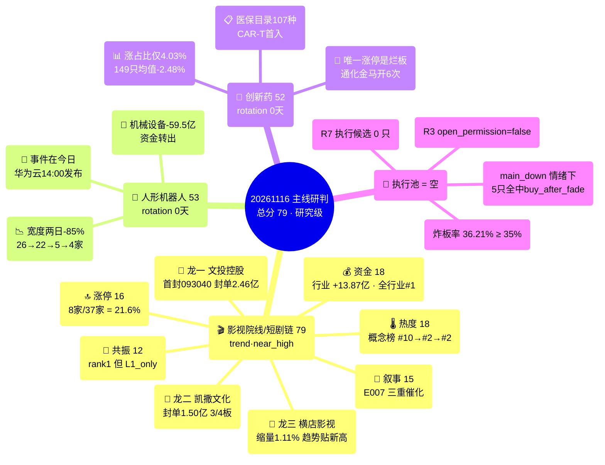

# 2026年11月16日 · **主线研判**

> **数据源新鲜度**: 🟡 partial
> **降级状态**: ✅ true（因子层 + R1 + WeFlow + wechat_cli 三源降级）
> **置信度**: 0.62

## 一句话结论

**全场只有 1 条线够 70 分（影视院线/短剧链 79 分），但它是「研究级准主线」不是「可交易主线」——R1 判无主线、R3 拒开仓、炸板率 36.21% 破 35% 红线、R7 执行池空，四项同时否决，R2 不给执行池。**

---

## 📊 五维打分总览

| 主线 | 热度 | 资金 | 涨停 | 叙事 | 共振 | **总分** | 趋势层 | 持有上限 | 判定 |
|---|:--:|:--:|:--:|:--:|:--:|:--:|---|:--:|---|
| 🎬 影视院线/短剧AI影视 | 18 | 18 | 16 | 15 | 12 | **79.0** | trend·near_high | 3 天 | 研究级准主线 |
| 🤖 人形机器人/具身智能 | 12 | 5 | 11 | 16 | 9 | **53.0** | rotation | 0 天 | 次线·观察 |
| 💊 创新药/医保双目录 | 15 | 3 | 4 | 19 | 11 | **52.0** | rotation | 0 天 | 次线·观察 |

> 三条线的分数差不是叙事强弱差，是**盘面确认度差**：影视链四源齐备（79），机器人事件在今日但宽度两日腰斩（53），创新药事件最强但资金完全没来（52）。

---

## 🎬 主线一 · 影视院线/短剧AI影视（文化传媒链）· **79 分**

**轴 = 下游·买方（内容变现：票房 + 短剧精品化 + 电竞情绪）**

### 🧠 推理深度三问

- **大资金意图**: 11-13 全市场主力 **净流出 605.71 亿**（连跌第二日，两日 -1130.83 亿），电子 -235.07 亿、元件 -104.24 亿、通信 -95.55 亿、PCB -90.46 亿、半导体 -75.28 亿整条科技链被清仓。钱没有离开 A 股，是从成长切到了低估值内容。影视院线拿到 **+13.87 亿全行业第一**，且是唯一「板块级涨停潮 + 板块资金净流入」双确认的方向。对手盘是老锚本身——龙版传媒 -1.95%、天娱数科 -3.05%、慈文传媒 -4.38%（且龙虎榜净卖 0.48 亿）、新华传媒跌停 -10.02%。**主力在做的不是买内容，是卖旧故事买新故事**：同一题材内从心智锚 TOP3 切向文投/凯撒/院线首板。

- **为什么走强**: 三维交叉——**位置**上，板块级 `trend·near_high`，5/5 只龙头 60 日贴新高（文投 +95.4%、中国电影 +28.8%、金逸 +21.2%、横店 +20.2%、凯撒 +14.1%），剔除单日峰值日后仍全为正（文投 +77.3%），说明不是一根阳线堆出来的假趋势；**催化**上，R4 E007 三重叠加（BLG 夺 S16 全球总决赛冠军 + 2026 年度票房破 320 亿 + 经济日报定调短剧精品化），且是官媒给短剧正名，属叙事级硬催化；**筹码**上，文投 11-13 封单 2.46 亿为链内最厚（占流通 2.5%）、0 开板、09:30 全链首封，龙虎榜单日净买 +4.68 亿（净买占成交 44.78%、上榜额占成交 63.14%）。位置在高位、催化在周末、筹码在今天同时到位。

- **逻辑够不够硬**: 四源共振（R3 rank1 + R4 high + R7 行业 #1 + 涨停细分第一），有硬数据（票房 320 亿）与硬时间锚（年度数据 + 官媒定调）。**但推不动的地方更硬**：①全链 8 家全是首板、零连板、零高度龙头——没有总龙可打；②11-12 链内只有 1 家，11-13 的 8 家里 **6 家是新面孔**（儒意/中国电影/幸福蓝海/横店/金逸/湖北广电），是回补扩散不是同一批资金连续加仓；③老锚全线崩塌，若锚继续杀，新票接力空间被压缩；④叙事维只有周末一个事件，无后续催化日期。**证伪路径**：11-17（周一）链内封板 <3 家 → 按一日游降级为次线；或硬件链企稳反弹 → 资金回流科技，本线失血。

### 📐 板块宽度（两套口径分开报，绝不混算）

| 口径 | 数值 | 说明 |
|---|---|---|
| 涨停家数（limit_list 细分 industry） | **8 家** | 影视院线 5 + 游戏Ⅱ 2 + 电视广播 1 |
| 占全市场封板比 | **21.6%** | 8 / 37，分细行业第一 |
| 链内零开板干净板 | 5 家 | 文投 / 凯撒 / 横店 / 金逸 / 湖北广电 |
| 链内开过板仍封住 | 3 家 | 中国电影开 5 次、幸福蓝海开 2 次、儒意开 1 次 |
| 涨占比（stock_basic 大类「影视音像」35 只） | **65.71%** | 23 涨 / 11 跌 / 1 平 |
| 板块均值涨幅（同一大类） | **+2.96%** | 中位 +1.50% |
| 行业主力净流入 | **+13.87 亿** | 全行业 #1，5 日 +9.64 亿（前 5 日 -5.52 亿转正），20 日 +10.65 亿 |

**结论**：这是全市场唯一「细分涨停第一 + 大类双正（涨占比>0.5 且均值为正）」的板块。其余行业里涨占比最高的银行 95.2% 但均值仅 +1.43%——纯防御，没有涨停基因。

### 🔁 题材持续性交叉验证（两种口径分别核算，结论一致）

| 日期 | 链内封板（细分 industry 口径） | 连板网题材口径 |
|---|:--:|---|
| 2026-11-06 | 1 | — |
| 2026-11-09 | 2 | — |
| 2026-11-10 | **8** | — |
| 2026-11-11 | 5 | 短剧/互动影游 **5** |
| 2026-11-12 | **1**（仅吉视传媒） | **0**（题材未上榜） |
| 2026-11-13 | **8** | 短剧/互动影游 **9**（当日第一主线） |

✅ **连续上榜 ≥2 日门槛已过**（11-10 起连续 4 日有票，11-12 断 1 家后 11-13 立即回补至 8 家）。
⚠️ **但必须标注 caveat**：11-13 的 8 家里只有文投、凯撒是 11-11 的老面孔，其余 6 家是新面孔 → 属「老龙头回补 + 新面孔扩散」的混合结构，不是同一批资金的连续加仓。

> 📌 **修正记录**：本轮修正了前一版草稿「11-12 / 11-11 均为 0 家 → 涨停潮仅 1 日」的口径误判。实测细分口径为 8/5/1/8，连板网题材口径 11-11 有 5 家、11-13 有 9 家并列当日第一主线 → 门槛已过，但需带 caveat 使用。

### 🚦 趋势层与生命周期

| 项 | 值 | 依据 |
|---|---|---|
| layer | **trend**（趋势主线） | `src/research/trend_layer.py::sector_layer`，as_of=20261113，未看当日 K 线 |
| state | **near_high**（贴新高） | 板块级距 60 日高 0.0% |
| 龙头 r60 / 剔峰后 | +95.4% / **+77.3%** | 剔单日峰值仍为正 → 非假趋势 |
| 全体龙头 r60 中位 / 剔峰中位 | +20.24% / **+9.27%**（n=5） | 5/5 贴新高 |
| holding_days_max | **3 天**（函数值 5 天收紧） | 主跌修复窗口 + high_chop 第 3 天；破 5 日线无条件走 |
| lifecycle | `early_up`（主升早期） | age=4 天 + 资金持续 2 天 |
| 生命周期张力 | 取谨慎口径 | R3 判 early_or_late=**middle**（概念榜连续 #2），且全链零连板 → 不给加速段仓位 |

### 🎯 候选龙头（带动性 > 辨识度 > 身位，v1.3）

| 角色 | 名称 | 代码 | 分支 | 板型 | 封单 | 换手 | 60日/距高 | 禁止清单(high_chop) |
|---|---|---|---|---|:--:|:--:|---|---|
| 👑 龙一 | 文投控股 | `600715.SH` | emo_branch | 首板·09:30·0开板 | **2.46 亿** | 10.90% | +95.4% / 0.0% | ✅ 通过 |
| 🥈 龙二 | 凯撒文化 | `002425.SZ` | emo_branch | 首板·09:35·0开板 | 1.50 亿 | 13.70% | +14.1% / 0.0% | ✅ 通过 |
| 🥉 龙三 | 横店影视 | `603103.SH` | core_capacity | 首板·09:33·0开板 | 0.91 亿 | **1.11%** | +20.2% / 0.0% | ❌ mid_laggard |
| 候补 | 金逸影视 | `002905.SZ` | emo_branch | 首板·09:32·0开板 | 0.83 亿 | 2.36% | +21.2% / 0.0% | ❌ mid_laggard |
| 候补 | 中国电影 | `600977.SH` | core_capacity | 首板·10:08·**开5次** | 0.29 亿 | 6.07% | +28.8% / 0.0% | ❌ mid_laggard |

> **两套认法已分开**：情绪分支 = 文投/凯撒/金逸（板高·封单·首封时序口径）；核心分支 = 横店/中国电影（容量·心智锚口径）。两者不同名，未用同一票占两席。文投同时是短剧游戏心智锚 #5，另记 anchor_rank 而非 dual_role。
> **机械闸门说明**：`forbidden_filter` 实跑——emotion=high_chop 下仅 sector_rank 1/2 通过，≥3 命中 mid_laggard；emotion=main_down（R7 口径）下 5 只全部命中 buy_after_fade。横店命中 mid_laggard 是**板块内地位口径**，不是本票质量结论（换手 1.11%、0 开板、趋势贴新高），角色须 D1 复核。

### 🧩 文投控股（龙一）· 思维链

- **买入理由**
  1. 带动性当日生成：09:30 全链首封（早于凯撒 09:35、金逸 09:32、横店 09:33）、封单 2.46 亿链内最厚（占流通 2.5%）、0 开板 —— 是资金在这条线上最先表态的那一只。
  2. 龙虎榜单日净买 +4.68 亿，净买占成交 44.78%、上榜额占成交 63.14%，且 ths 热股与 dc 人气同步 #1，是双平台共振不是单榜自嗨。
  3. 位置在 60 日新高（r60 +95.4%、距高 0.0%），上方无套牢盘。
- **风险点**
  1. 高位反噬：60 日 +95.4%、18 日 10 板（R3 up_stat 10/18），R1 明确「不接高位老龙」，与本阶段「只做低位首板」直接冲突。
  2. **龙虎榜单日桶与 3 日桶方向相反**：单日 +4.68 亿是 11-13 才买的，3 日累计仍净卖 0.48 亿 —— 只看单日会高估资金质量。
  3. 老锚同日崩塌（龙版/天娱/慈文/新华传媒），若锚继续杀，新票接力空间被压缩。
- **止损条件**
  - 硬止损：跌破 11-13 均价线 **3.35** 走（当日 VWAP 3.348，核心票破均价即失守）；
  - 结构止损：11-17 链内封板 **<3 家** → 板块判定一日游，无条件放弃本线；
  - 个股止损：次日**不创新高**（低于 3.40）即视为接力失败，当日了结不留仓。
- **可验证假设（24-72h）**
  - 若 11-17 开盘 30 分钟内链内封板数 ≥3 且昨日涨停红盘率 >60% → 「高低切新龙接棒」成立，观察位可升级；
  - 若竞价高开 >5% 但链内无新增封板 → 判定为先手兑现位，放弃；
  - 若文投跌破 3.35 且龙虎榜席位转净卖 → 「资金撤出」假设证实，24h 内清零观察。

### 🧩 横店影视（龙三 · core_capacity）· 思维链

- **买入理由**
  1. 本线唯一同时满足「首板 + 缩量锁仓 + 院线纯正 + 趋势贴新高」的票：换手仅 1.11%（链内最缩量=抛压极轻）、0 开板、122.5 亿流通为院线纯正标的。
  2. 核心口径三项全过：涨幅 10.03% ≥5%、收盘位置 1.0 ≥0.8、收盘 19.31 ≥ VWAP 18.972。
  3. 龙虎榜净买 +0.25 亿且**上榜额占成交 74.67%** —— 低换手下的真实资金，不是换手放大出来的假象。
- **风险点**
  1. 机械禁止清单按 sector_rank≥3 判 mid_laggard → 执行前置资格不通过，角色须 D1 复核后再过闸门。
  2. 院线是票房 β 品种，320 亿票房数据 11-13 已兑现，属利好落地而非增量预期。
  3. 122.5 亿容量票涨停后次日溢价通常低于小盘；上方套牢区下沿约 21.2。
- **止损条件**
  - 低吸触发：回踩 18.97（11-13 均价线）缩量站稳才成立，放量跌破即取消；
  - 硬止损：跌破 11-13 收盘 19.31 下方 5%（18.34）无条件走；
  - 板块止损：11-17 链内封板 <3 家 → 全线降级。
- **可验证假设（24-72h）**
  - 若 11-17 换手率仍 <3% 且价格站上 19.31 → 「缩量锁仓」假设成立；
  - 若换手放大到 >8% 且滞涨 → 判定为一次性拉高出货，立即放弃；
  - 若院线子行业资金从 +7.69 亿转出 → 板块 β 失效，不做。

### 🚫 本线风险清单

1. **全链零连板**：8 家全首板，无高度龙头，没有可打的总龙。
2. **涨停潮结构脆弱**：11-12 仅 1 家，11-13 回补至 8 家但 6 家新面孔。
3. **R3 拒开仓**（五项否决同时成立）+ 全市场炸板率 36.21% ≥35% 硬红线 → 只给研究资格。
4. **老锚在退**：龙版 -1.95% / 天娱 -3.05% / 掌阅 -2.27% / 慈文 -4.38%（净卖 0.48 亿）/ 新华传媒跌停。
5. **高位结构**：文投 60 日 +95.4%、18 日 10 板、3 日龙虎榜累计仍净卖。
6. **板块 β 单一**：票房数据已兑现，后续无新催化日期。
7. **全市场背景**：广度 13.73%（765 涨 / 4748 跌）、37 涨停 / 38 跌停、成交 -14.31%。
8. **资金持续性弱**：pos_days_5d 仅 2，20 日仅 +10.65 亿；硬件链一旦企稳，资金可能回流科技。

---

## 🤖 次线一 · 人形机器人/具身智能 · **53 分**

**事件在今日，但结构在崩。**

| 维度 | 分 | 依据 |
|---|:--:|---|
| 热度 | 12 | R3 rank2，但概念榜 #2→#4→#5 三日递减；天普股份 4 板是全市场最高但封单仅 0.23 亿、换手 1.83%（缩量一字） |
| 资金 | 5 | R7 流入前 10 无机器人/通用设备/汽车零部件；机械设备净流出 **-59.50 亿** |
| 涨停 | 11 | 连板网题材口径 11-10 **26** → 11-11 **22** → 11-12 **5** → 11-13 **4**，两日 -85% |
| 叙事 | 16 | R4 三个板块 high/正面：E003 华为云今日 14:00 发布昇腾原生具身世界模型（盘中可验证时间锚）、E004 OpenAI 解散机器人团队 → 触觉/电子皮肤/灵巧手成稀缺环节 |
| 共振 | 9 | rank2 但真等级 L1_only，概念榜三日递减属分歧段 |

**观察名单**（均不给买点）：天普股份（4 板高位，R4 监管工作函压制）、东方中科（板型最干净：首板 0 开板 封 0.47 亿 换手 3.69%，但 r60 +3.53% → rotation）、日发精机（开板 7 次 换手 28.87% 接近死亡换手）、中马传动（r60 +15.87%，链内位置最正）。
**降级理由**：宽度恶化（两日 -85%）+ 资金转出 + 60 日位置不合格（rotation）三重触发。R1 仓位上限 10%、阶段只做低位首板/低位补涨不接高位老龙，本线 4 板高标不适用。**只做 14:00 发布会后的盘中验证，不做盘前预设。**

---

## 💊 次线二 · 创新药/医保双目录 · **52 分**

**事件最强，但资金完全没来。**

| 维度 | 分 | 依据 |
|---|:--:|---|
| 热度 | 15 | 创新药概念榜 #8→#9→#3 为本周最强单日斜率；百利天恒首次登 dc 人气 #1 |
| 资金 | 3 | R7 流入前 10 无医药；化学制药 149 只涨占比仅 **4.03%**、均值 **-2.48%** |
| 涨停 | 4 | 细分口径仅 1 家涨停（通化金马），且**开板 6 次 = 烂板**，封单 0.29 亿 |
| 叙事 | 19 | 全场最强单事件：医保目录新增 107 种（51 个一类创新药）、百万级 CAR-T 首入基本医保自付降至 10 万内，近 20 家药企 11-15 连夜官宣 |
| 共振 | 11 | rank3，L1_only |

**观察名单**：百利天恒（未定价龙头，dc 人气 #1 但 -1.06% 未涨停；r60 -18.48% 位置差）、恒瑞医药（12 款纳入/3 款首入；5 日主力 -5.16 亿，RR5 0.98 <1，R4 自己判「降级观察」）、通化金马（唯一涨停但烂板，龙虎榜 +0.34 亿而换手仅 5.19%，R3 判「诱多形态」）。
**降级理由**：资金维不确认 + 细分涨停仅 1 家且为烂板 + 60 日位置为 rotation。事件强度与盘面强度严重背离。

---

## 🐏 妖股赛道 · 羊年窗口 · **空仓等待**

**族扩散 5 → 0，监管切换已触发但替身未成形。**

11-12 涨停池里 5 只 yáng 谐音族同时封板（东方海洋 +10.02 / 澳洋健康 +10.08 / 百洋股份 +9.98 / 大西洋 +9.96 / 安阳钢铁 +9.89），11-13 **全部崩塌**：东方海洋 -6.59%（同时触发 R3 红线 4 霸榜出货警报 —— ths 热股连续两日 #1 + 龙虎榜净卖 1.45 亿）、澳洋健康跌停 -10.06%（净卖 2.26 亿）、百洋股份跌停 -10.02%、大西洋 -9.73%、安阳钢铁 -6.50%、阳光照明跌停、阳光乳业跌停、红太阳跌停、鲁阳节能 -9.95%、三羊马 -9.99%、水羊股份 -9.81%、利群股份 -2.38%。

**监管侧同步加压**：上交所对大东方/日出东方下发股价波动监管工作函（R4 E20261116_N2）；大东方 5 板后直接跌停 -10.03%（开板 9 次），日出东方断板后反抽 +5.54%（龙虎榜净买 +0.58 亿，是唯一还在接的资金）。

| 候选 | 名称 | 梗层 | 处置 |
|---|---|---|---|
| `000819.SZ` | 岳阳兴长 | 谐音（阳 / yáng 同音族） | 🚫 只观察不打 —— 首封 **14:19** 落在 14:00-14:30 投机点火窗口（禁止清单 `late_speculation` 命中），且全族仅 1 只无承接 |

**剔除**：大东方（5 板后跌停 + 监管函）、日出东方（断板反抽非新周期 + 监管函）、东方海洋（红线 4 霸榜出货）、澳洋健康（跌停 + 净卖 2.26 亿）、阳光照明（族内龙头已崩）、兴欣新材（2 板封 4.96 亿但流通 13.6 亿 <20 亿防庄股硬线）、世龙实业 / 福龙马 / 法狮龙（龙字辈 3 只首板无一连板、封单 0.16/0.23/0.89 亿极薄；法狮龙 84.26 元高价违反「大妖启动价必须低」）。

**结论**：监管切换已触发但谐音替身未成形（羊→狼的切换未落地，七匹狼不在涨停池），赚钱效应彻底断裂 → **按纪律退潮期不硬做，空仓等待**。观察 11-17 是否出现 ≥2 家连板的替身。

---

## 🚫 执行池 = 空（理由五条）

| # | 否决项 | 证据 |
|:--:|---|---|
| 1 | R3 `open_permission=false` | 五项否决同时成立：R1 无主线 / 炸板率 36.21%≥35% / L2 真人话语 0 条 / high_chop 第 3 天仓位上限 0.10 / R7 执行池 0 只 |
| 2 | R7 emotion = 主跌（连续第 2 日） | `forbidden_filter` 在 main_down 下对全部 5 只候选命中 `buy_after_fade` |
| 3 | 主线为研究级且涨停潮结构脆弱 | 11-12 仅 1 家；机械禁止清单对 sector_rank≥3 的三只命中 `mid_laggard` |
| 4 | R7 `execution_candidates` = [] | 资金侧无一只通过 |
| 5 | 盘前无价 | 不虚构入场价；买点只给「竞价确认 / 回踩均价线」条件式表述 |

**候选层级**：研究 = 影视链 5 只（文投/凯撒/横店/金逸/中国电影）+ 次线 7 只观察名 ｜ **可交易 = 0**

---

## ⚖️ 与其他 R/D/E 的关系

- **依赖**：R1 风格（degraded 0.472，仅作温度与仓位上限输入）· R3 情绪（rank1 短剧/影视传媒、L1_only、open_permission=false）· R4 消息面（E007 影视催化、E003 机器人、E001 医保）· R7 资金（影视院线 +13.87 亿 #1）
- **被消费**：D1 主决策（主线/次线/执行池与 gate 状态）· E1 复盘（observation_tracking 回填：横店 11-17 换手率、11-17 链内封板家数、文投 11-17 是否破 3.35）
- **待 D1 仲裁的两处分歧**：
  1. **与 R1「无主线」**：R1 用行业次日留存 12.0% / 截面解释力 12.74% 口径，R2 用资金+催化+涨停+趋势结构口径 → R2 判「研究级准主线」而非「已确认可交易主线」，两者不矛盾。
  2. **与 R7 的个股角色**：R7 把文投控股标为「龙二（影视院线）」，R2 按 v1.3「带动性 > 辨识度 > 身位」判龙一（09:30 全链首封 + 封单 2.46 亿最厚 + 双平台人气 #1 + 龙虎榜单日净买 +4.68 亿）。**角色以 R2 为准**。

---

## 📋 数据源审计

| 源 | 日期 | 状态 | 备注 |
|---|---|:--:|---|
| R1_style.json | 2026-11-16 | 🟡 | degraded · conf 0.472 · 仅作温度输入 |
| R3_sentiment.json | 2026-11-16 | 🟡 | degraded · WeFlow 不可用 · L2 0 条 → 四主题真等级 L1_only |
| R4_news.json | 2026-11-16 | 🟡 | degraded · 三源缺失 · 8 事件 ≥2 独立源 |
| R7_capital_flow.json | 2026-11-16 | 🟢 | ok · conf 0.77 · 两融改 SSE 同口径 |
| tushare/limit_list_d | 2026-11-13 | 🟢 | 91 行 = U37 + D33 + Z21 |
| tushare/daily + daily_basic | 2026-11-13 | 🟢 | 5571 只 · 涨占比/均值现算 |
| tushare/stock_basic | 2026-11-13 | 🟢 | 5579 只 · 大类「影视音像」35 只 |
| tushare/top_list | 2026-11-13 | 🟢 | 69 行 · 按 (ts_code, reason) 分桶 |
| lianban/mainline | 2026-11-13 | 🟢 | 10 日题材×涨停家数矩阵 |
| theme_anchors/latest | 2026-11-02 | 🟡 | stale · 597 概念 · 2 周未重建 |
| yaogu/xuanxue_table | 2026-11-03 | 🟡 | stale · 3123 只 · 涨跌停次数未刷新 |
| yaogu/llm_context | 2026-11-16 | 🟡 | partial · 涨停池/龙虎榜段无数据（已补） |
| factor/weekly_ir_scan | — | 🟡 | 设计内跳过 · 脚本未实现（**非故障**） |
| vibe_trading MCP | — | 🔴 | 本轮未调用 · 候选池由 limit_list + top_list 直接核算 |

---

## ❓ 不确定性 / 自我反证

1. **本报告最脆弱的一环是「连续上榜 ≥2 日」**：11-12 只有 1 家吉视传媒，若把题材口径的「未上榜」当作断点，结论会变成一日游。两种口径已分别列出，判定依赖「11-10 起 4 日连续有票 + 11-13 回补至 8 家」这一事实，但**若 11-17 封板 <3 家，此判定立即作废**。
2. **宽度指标可能被单日脉冲污染**：本线 8 家里 6 家是 11-13 新面孔，可能是资金在硬件崩塌当日的一次性避险抱团，而非对内容的重新定价。若 11-17 新面孔集体炸板，说明这是一日避险。
3. **龙一的位置风险是真实的**：60 日 +95.4% + 18 日 10 板 + 3 日龙虎榜累计净卖，这只票的**板型质量（首封最早、封单最厚）与位置质量（新高、反复妖）方向相反**。本报告不给它买点，正是因为这个矛盾无法自洽地解掉。
4. **上游降级链**：R1 degraded → R4 因 R1 降级而只作研究优先级 → R3 WeFlow 缺失 → L2 层为 0 → 共振维全线封顶 12。**如果 WeFlow 恢复、L2 有真人话语支持短剧链，共振维可以从 12 上调，但当前不能。**
5. **未做因子层**：`scripts/factor/weekly_ir_scan.py` 未实现，属 skill 声明的设计内跳过，不是数据故障，但意味着本次打分**没有量化因子验证**，纯定性排序。

---

## 🔧 Sub-Agent 元数据

- skill: analyze_main_sectors_v1
- artifact: `data/research/20261116/R2_main_sectors.json`
- 生成耗时: 约 4 分钟
- model: MiniMax-M3.1-Flash
- 真源模块: `src/research/trend_layer.py` · `src/research/mainline_lifecycle.py` · `src/research/forbidden_filter.py`
