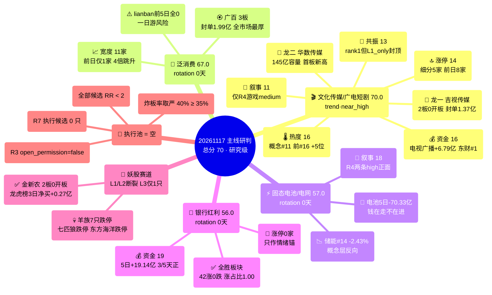

# 2026年11月17日 · **主线研判**

> **数据源新鲜度**: 🟡 partial
> **降级状态**: ✅ true（R1/R3/R4 三源 degraded + 妖股素材包空段 + iwencai 不可用）
> **置信度**: 0.68

## 一句话结论

**全场只有 1 条线够 70 分（文化传媒/广电短剧 70.0，擦线），但它是「研究级准主线」不是「可交易主线」——R1 判无主线、R3 拒开仓、炸板率取严 40% 破 35% 红线、R7 执行池 0 只、全部候选 RR<2，五项同时否决，R2 执行池置空；妖股赛道羊族 L1/L2 双双断裂，只剩金新农一只 L3 活口。**

---

## 五维打分总览

| 主线 | 热度 | 资金 | 涨停 | 叙事 | 共振 | **总分** | 趋势层 | 持有上限 | 判定 |
|---|:--:|:--:|:--:|:--:|:--:|:--:|---|:--:|---|
| 🎬 文化传媒/广电短剧AI影视 | 16 | 16 | 14 | 11 | 13 | **70.0** | trend·near_high | 5 天（实盘 1-2 日） | 研究级准主线·擦线 |
| 🛒 商超百货 + 小家电（泛消费内需） | 14 | 16 | 16 | 9 | 12 | **67.0** | rotation | 0 天 | 次线·观察 |
| ⚡ 固态电池 / 电网设备 | 9 | 6 | 12 | 18 | 12 | **57.0** | rotation | 0 天 | 次线·事件级观察 |
| 🏦 银行 / 红利高股息 | 17 | 19 | 2 | 8 | 10 | **56.0** | rotation | 0 天 | 次线·情绪锚（不授进攻资格） |
| 🚫 执行池 | — | — | — | — | — | **空** | — | — | 五条理由同时成立 |

> 分数差不是叙事强弱差，是**盘面确认度差**：传媒链四源齐备（70.0，CV 1.00，全场唯一 4 源共识）；泛消费宽度今日第一（11 家）但是一日游脉冲（67.0）；固态电池叙事维 18 分最高却资金 5 日全负（57.0）；银行资金维 19 分最高但涨停 0 家、无进攻资格（56.0）。

---

## 主线一 · 文化传媒/广电短剧AI影视（电视广播 + 短剧游戏 + 院线）· **70.0 分**

**轴 = 下游·买方（AI 漫剧内容供给 + 广电国资整合）** —— 与半导体/光模块/PCB 的上游·卖方硬件链不共享筹码，**不与科技敞口叠加**，D1 无需合并。

### 推理深度三问

- **大资金意图**: 11-16 全市场主力**净流出 646.77 亿**（五日 -1401.40 亿），跌停 60 家、创业板 -4.37%、科创50 -5.16%、费半 -5.28%。钱没离开 A 股，是从成长**向下沉一层**：电子 -250.16 亿（5 日 -294.85、20 日 -794.78）、半导体 -126.67 亿、通信 -75.63 亿、PCB 元件合计 -193.74 亿（占全市场流出 30%）。而**电视广播拿到东财行业净流入第 1（+6.79 亿 / 5 日 +9.86 亿 / 3/5 天正）**，是全场唯一「板块级涨停潮 + 板块级资金净流入」双确认的方向。资金买的**不是影视**，是**低波 + 有涨停基因 + 国资背景**——银行 5 日 +19.14 亿、红利破净概念 +10.44 亿同时进钱，说明这批钱同源。对手盘是同题材的老锚自己：龙版 +5.15%、慈文 +5.42%（尚可），但天娱 -5.16%、欢瑞 -3.00%、掌阅 -2.35%（旧故事在退）。**资金在做的是同一题材内部的换手：从心智锚 TOP3 切向广电国资低位**。

- **为什么走强**: 三维交叉——**位置**上，龙一吉视传媒 60 日 +19.35%、剔除单日峰值日后仍 +8.31%、距 60 日高 **0.0%（贴新高）**，5 只候选龙头的 60 日中位数 +24.49%、距高同为 0.0% → `trend·near_high`，**不是一根阳线堆出来的假趋势**（剔峰检验是唯一能防这个的判据）。**催化**上，R4 E008（GTA VI 11-19 全球发售、预售破 10 亿美元 + 三季度国内游戏收入 925 亿环比改善）给了一个**可验证的时间锚 11-19**，但只覆盖游戏子链，不覆盖广电/短剧/院线——所以叙事维只给 11 分，是全场最低的一维之一。**筹码**上，吉视 11-16 封单 1.37 亿为链内最厚、**全天 0 开板**、首封 10:12（午前）、龙虎榜单一上榜原因净买 **+2.14 亿**（买 3.05 / 卖 0.91），人气 ths#15 → dc#4（delta +11，新进前 5）。位置在高位、催化在时间锚、筹码在当日同时到位。

- **逻辑够不够硬**: **四个独立源交叉（CV 1.00，全场唯一）**：R3 rank1 + R4 游戏 medium + R7 行业净流入 #1 + R2 打分 70。但硬度**只够到「准主线」**，不够到「可交易主线」，缺口在三处：① **共振维封顶**——R3 真等级只有 L1_only（L2 真人话语 7 群 0 条，本地微信库停 10-28 已 11 个交易日 0 字节），按红线 3 不得标强共振；② **叙事维最弱**——R4 无广电/短剧 high 级催化，财联社收评只是收盘复述，不构成次日新增驱动；③ **宽度在缩**——细分涨停家数 8 → 5（-37.5%），且 3 个子行业里 2 个涨占比 <0.5，本线是「一条腿（电视广播）站着」。**证伪路径**：若次日电视广播涨停家数 <3 家、或吉视开盘即炸板，则「连续上榜 ≥2 日 + 板块资金净流入」的判定立即作废，退化为一日游。

### 板块宽度（两套口径分开报，绝不混算）

| 子行业（东财口径） | 涨跌幅 | 涨占比 | 涨停 | 领涨 |
|---|:--:|:--:|:--:|---|
| 电视广播 | **+2.19%** | **0.62** | 2 | 吉视传媒 |
| 游戏Ⅱ | -1.76% | 0.17 | 2 | 凯撒文化 |
| 影视院线 | -1.81% | 0.22 | 1 | 金逸影视 |
| 传媒大类 | -1.42% | 0.30 | — | — |

> **电视广播是 11-16 唯一正涨幅且有涨停的行业**，涨占比 0.62 也是三个子行业里唯一过半的。涨停家数用 `limit_list_d` 细分行业口径（电视广播/影视院线/游戏Ⅱ），涨占比与均值用东财行业板块口径，两套分类严禁混算。**宽度判定：分化而非崩塌**——涨停家数只有 1 个交易日下降（8→5），不满足「连续 2 个交易日下降 且 涨占比<50%」的整线降级条件。

### 题材持续性交叉验证（lianban.net 题材×涨停家数矩阵）

| 校验项 | 结论 | 证据 |
|---|:--:|---|
| 连续上榜 ≥2 日 | ✅ 通过 | 细分口径 11-09=2 / 11-10=8 / 11-11=5 / 11-12=1 / 11-13=8 / 11-16=5；11-10 与 11-11 连续、11-13 与 11-16 相邻交易日连续 |
| 单日 ≥20 家（过热） | ✅ 未过 | 最高 8 家，远低于 20 家阈值 |
| 家数趋势 | ⚠️ shrinking | 8 → 5，-37.5% |
| 家数 vs 资金方向 | ⚠️ 不一致 | 家数缩量但资金仍进（电视广播 5 日 +9.86 亿）→ **按 skill 口径以家数为准**（收盘事实），资金为估算 → 定性为「窄化而非崩塌」 |
| 小主线 5~9 家门槛 | 🚫 命中 | 5 家擦线落在 5~9 区间下沿 → **不给仓位**（skill 明文） |

### 趋势层与生命周期

| 项 | 值 | 说明 |
|---|---|---|
| `layer` / `layer_state` | **trend / near_high** | 60 日 +19.35%、剔峰 +8.31%、距高 0.0% |
| `holding_days_max` | **5 天**（结构上限） | 实盘按 1-2 日超短口径——炸板率 40%、阶段=高位震荡第 4 天（repair_window）、R3 拒开仓 |
| 龙头中位数 | 60 日 +24.49% / 距高 0.0% / 剔峰 +13.12%（n=4） | 4 只龙头全部贴新高 |
| 窗口 | 60 交易日 · `as_of`=20261116 · `short_history`=false | 未看到未来 K 线；30/30 候选可算，无 `unknown` |
| `stage` | `mid_up`（主升中期，兜底判定） | age_days=5 / leader_height=4 / money_persist_days=3 / break_rate=0.40 · conf 0.55 |
| 生命周期读数 | 实为「中期偏后段的窄化」 | 不是教科书式 mid_up：已运行 5 天、高度只有 4 板且是烂板、资金仍进但涨停家数缩量 |

### 候选龙头（带动性 > 辨识度 > 身位，v1.3）

| 角色 | 代码 | 名称 | 涨幅 | 连板 | 角色属性 | 通道 | 收盘口径 RR |
|---|---|---|:--:|:--:|---|---|:--:|
| 👑 龙一 | `601929.SH` | 吉视传媒 | +10.04% | 2 | emo_branch | 竞价确认 | 1.19 🚫 |
| 🥈 龙二 | `000156.SZ` | 华数传媒 | +10.05% | 1 | core_capacity | 回踩均价线低吸 | 1.44 🚫 |
| 🥉 龙三 | `002905.SZ` | 金逸影视 | +10.00% | 2 | emo_branch | 无（情绪股只观察） | 0.45 🚫 |
| 身位股 | `002148.SZ` | 北纬科技 | +10.06% | 4 | emo_branch | 竞价确认 | 0.30 🚫 |
| 候补 | `605577.SH` | 龙版传媒 | +5.15% | 0 | core_capacity | 仅观察 | n/a（止损距 -0.7% <5%） |

> **为什么北纬 4 板不是龙一**：所在行业是通信服务（-2.93% / 涨占比 0.11），与传媒链只有概念标签关系，是「北字辈」纯名字套利孤票；开板 7 次、换手 42.59%、封成比 0.016 = 烂板；龙虎榜 1 日口径净卖 -0.88 亿。按 v1.3「身位第三序」+ R3 负面主题「名字套利·北字辈」，只列身位股、不作龙一、不进执行池、**禁止低吸**。
>
> **为什么华数是 core 而不是 emo**：145.2 亿流通为链内最大、广电国资平台属性、首板直接收在 20 日新高 8.54、收盘位置 1.0 且收在均价线上方 → core 口径成立。扣分：开板 3 次、封成比 0.035 → 封板质量不足以争龙一，只作容量核心/切换承接位。

### 吉视传媒（龙一）· 思维链

- **买入理由**: ① **带动性当日生成**——电视广播是 11-16 唯一正涨幅且有涨停的行业（+2.19% / 涨占比 0.62），东财行业龙就是吉视传媒，不是资金挑剩下的；② **筹码最干净**——封单 1.37 亿为链内最厚、全天 0 开板、首封 10:12 在午前，龙虎榜单一上榜原因净买 +2.14 亿（买 3.05 / 卖 0.91）是链内唯一大额净买；③ **人气新进前排**——同花顺 #15 → 东财 #4（delta +11）。
- **风险点**: ① **薄封**——封成比仅 0.093（封单 1.37 亿 / 成交 14.8 亿），次日竞价极易被一档打穿；② **炸板率 40%**（取严口径）≥35% 硬红线，全链 5 家涨停里 2 家当日开板过；③ **RR 1.19 < 2**，结构位止损（MA5 2.71）距收盘 -8.45% 超出 -5~-10% 硬区间下沿；④ **老锚没接力**——龙版 +5.15%、慈文 +5.42% 尚可，但天娱 -5.16%、欢瑞 -3.00%、掌阅 -2.35%，「资金从老锚切到广电低位」这个假设**尚未被验证**；⑤ 待 R6 复核：+2.14 亿席位机构 0、沪股通 0.36 亿 → **游资主导，是否对倒存疑**。
- **止损条件**: 只在**竞价弱转强确认后**才谈入场（昨日封板票平开/低开 ≤2% 后翻红，且 09:30-10:00 满足全市场涨家占比 >0.55、昨日涨停红盘率 >60%、板块级涨停 ≥3 只）；入场后跌破**当日均价线或 MA5 2.71** 即离场（收盘口径 -8.45%）；**炸板破均线必卖**，不补仓、不等反抽。**盘前不许挂单、不追一字。**
- **可验证假设**: 24-72h 内可证真/证伪——**证真**：次日电视广播行业涨停 ≥3 家 + 吉视竞价不低开超 2% + 全市场涨家占比回到 0.55 上方 → 本线成立，「广电低位接棒老锚」得到验证；**证伪**：次日电视广播涨停 ≤2 家，或吉视开盘 30 分钟内炸板且跌破 2.71，或全市场炸板率仍 ≥40% → 本线判定为一日游，传媒链整体降级至观察池。

### 华数传媒（龙二 · core_capacity）· 思维链

- **买入理由**: ① **容量核心属性**——145.2 亿流通为链内最大，广电国资平台（「一提广电就想到」的承载位），吉视若断板，钱最可能往这里走；② **位置干净**——首板直接收在 20 日新高 8.54，收盘位置 1.0 且收在均价线上方（core 口径成立）；③ **席位净买**——龙虎榜全部席位净买 +1.19 亿（买 2.33 / 卖 1.15）。
- **风险点**: ① **开板 3 次**、封成比仅 0.035 = 承接偏弱，竞价容易示弱；② R7 命中**「机构净卖但股价大涨（诱多）」severity=high**（机构 -0.13 亿 / 沪股通 -0.07 亿）；③ RR 1.44 < 2；④ 与龙一是**分离**结构（情绪分离），板块退潮时两票可能同时失血。
- **止损条件**: 只做**回踩当日均价线 / MA5 7.95 的容量低吸**（收盘口径 -6.9%），不追高、不在竞价弱势时接；跌破 7.95 无条件离场；**开板破均线必卖**。
- **可验证假设**: 24-72h —— **证真**：次日吉视断板而华数**换手放大到 8% 以上**且收在均价线上方 → 容量承接成立；**证伪**：次日华数低开破 7.95 或换手萎缩至 3% 以下（无人接力）→ 容量核心证伪，下一顺位落到龙版传媒。

### 龙版传媒（候补 · 心智锚 TOP1）· 思维链

- **买入理由**: ① **锚表 TOP1**（短剧产业/文化传媒双榜第一，82.3 妖性型），按 v1.3「题材被判定为主线后，心智锚 TOP3 默认入候选」入选；② **逆势证据**——在大盘主力 -646.8 亿净流出的日子，+5.15% 是全链锚票里唯一逆势上涨，且站上 MA5 16.82 → 证明**题材辨识度还活着**。
- **风险点**: ① **无板**——+5.15% 未涨停，未进 U 名单，不构成板型；② 20 日高 18.90 未破；③ 锚表停在 20261102，已 2 周未重建，锚分是**存量证据不是当日证据**；④ 止损位 MA5 16.82 距收盘仅 -0.7%，**低于 -5% 硬区间 → 该票今日不可算 RR**。
- **止损条件**: 本票**不设止损**（无有效结构位，止损距 <5% 属禁止清单）。仅在**放量涨停**（换手 >8% 且封单 >1 亿）时才升级为可参与标的，届时以当日 MA5 为止损。
- **可验证假设**: 24-72h —— **证真**：锚票龙版放量涨停且慈文/天娱/欢瑞同步转正 → 资金回到正宗短剧主线，本线从「广电低位卡位」升级为「短剧主线回归」；**证伪**：锚票继续集体回落（天娱欢瑞掌阅持续 -2% 以下）→ 确认本线是低位卡位行情而非题材回归，龙版只作温度计。

### 本线风险清单

1. **R3 distribution_alert**：文投控股（东财人气 #1 + 19 天 11 板 + 龙虎榜净卖 -3.55 亿 + 开板 8 次 + 换手 37.82% + AI 漫剧收入占比仅 2.57% 的 *ST 风险）→ 红线 4 霸榜出货，**已移出候选，不进 leaders**（即使它属传媒题材）。
2. **北纬科技 4 板已被净卖**（1 日口径 -0.88 亿、3 日累计口径反而 +0.32 亿，方向相反 = 分歧极大）、开板 7 次、换手 42.59% → 高标派发在途；它若次日跌停，会抽掉链内唯一的「高度」叙事。
3. **涨停家数 8→5 缩量**（-37.5%），3 个子行业里 2 个涨占比 <0.5 → 本线是「一条腿（电视广播）站着」，不是板块普涨。
4. **叙事维最弱（11/20）**：R4 无广电/短剧 high 级催化，只有游戏 medium；财联社收评只是收盘复述。
5. **共振真等级 L1_only**（L2 真人话语 0 条、WeFlow 永久下线）→ 无真人情绪验证，红线 3 不许标强共振。
6. **炸板率取严 40%** ≥35% 硬红线 → 候选已砍半（原始研究候选池 15 → 8）。
7. **吉视封成比仅 0.093**（薄封）→ 次日竞价极易被一档打穿。
8. **待 R6 验证**：① 电视广播 5 日 +9.86 亿是否只是 ETF/红利被动资金溢出（银行/红利同时进钱，存在同源防御资金可能）；② 吉视 +2.14 亿席位性质（机构 0 / 沪股通 0.36 亿 → 游资主导，需复核是否为对倒）。

---

## 次线一 · 商超百货 + 小家电（泛消费内需）· **67.0 分**

**热度 14 / 资金 16 / 涨停 16 / 叙事 9 / 共振 12** ｜ layer=`rotation` ｜ `holding_days_max=0` ｜ stage=`mid_up`（兜底判定，实为分歧加速日）

**宽度今日第一**（细分涨停 11 家，11-13 仅 1 家 → 4 倍跳升），**封单质量第一**（广百股份 3 板封单 1.99 亿全市场最厚、0 开板），家电链资金真进钱（白色家电 5 日 +11.51 亿、5/5 天全正、涨占比 0.89）。

**但扣分在结构**：① 家数 1→11 是**单日脉冲**，lianban 矩阵「家电」仅在 11-16 出现 4 家（前 5 个观测日全 0）= 一日游风险；② **零售链资金背离**——一般零售 5 日 -12.02 亿、0/5 天净流入；③ **心智锚龙头九阳股份尾盘炸板**（+7.10% 未进 U 名单、人气东财 #3）→ R3 明写「龙头资格被削弱」；④ 无 R4 催化，叙事维仅 9 分。

**交叉验证 CV 0.67**：R3 rank2 ✓ / R4 ✗（sectors_catalyzed 无对应条目）/ R7 ✗（商超百货与家电不在 top10；白色家电 5 日 +11.51 亿属行业内部证据，严格按名匹配记 false）。

**升级条件**：若 11-17 家电链出现第 2 个交易日家数 ≥5 且广百继续晋级 → 升主线待明日复核。

---

## 次线二 · 固态电池 / 电网设备（事件驱动新方向）· **57.0 分**

**热度 9 / 资金 6 / 涨停 12 / 叙事 18 / 共振 12** ｜ layer=`rotation` ｜ `holding_days_max=0` ｜ stage=`formation` 启动/形成期

**叙事全场最强（18/20）**：R4 两条 high 正面——E005 内蒙特高压累计外送电量破 1 万亿度 + 国网 4 万亿投资规划托底；E006 十五五新型储能实施方案点名本质安全固态电池 + 11-20 上海固态电池论坛接力。涨停 5 家（电池 3 + 电网 1 + 电力 1），封单质量好（领湃 0.98 / 顺钠 0.96 / 紫竹 0.52，**全部 0 开板**）。

**但资金与热度同时不合格**：① 电池行业 **5 日 -70.33 亿**（5 天里只有 1 天净流入）、电网设备 5 日 -19.35 亿、电力 -15.56 亿 → **钱在走不在进**；② 同花顺概念榜**无「固态电池」条目**，储能 #14 -2.43%（概念层反向）→ 题材未成共识；③ 涨停仅 5 家，落在 skill 明文「5~9 家小主线次日掉出主线概率过半、不给仓位」区间。

**交叉验证 CV 0.67**：R3 rank4 ✓ / R4 两条 high ✓ / R7 ✗（三个行业均不在 top10 且 5 日全负）。

**唯一可验证的时间锚**：11-20 上海固态电池论坛。领湃科技 20cm 已 +20.01%，次日 20cm 波动双击风险，RR 靠 20cm 目标撑起来而非靠确定性。

---

## 次线三 · 银行 / 红利高股息 · **56.0 分**（仅作情绪锚）

**热度 17 / 资金 19 / 涨停 2 / 叙事 8 / 共振 10** ｜ layer=`rotation` ｜ `holding_days_max=0` ｜ **不授进攻资格**

全场唯一的「**全胜板块**」与最强资金方向：银行行业 +1.76%、**42 涨 0 跌（涨占比 1.00）**、国有大行 6/6 全涨、股份行 9/9 全涨、7 家银行创历史新高；银行 5 日 +19.14 亿（3/5 天正）、国有大行 5 日 +11.80 亿；概念口径红利破净股 +10.44 / 红利股 +8.19 / 证金持股 +6.29 / 超级品牌 +8.58；高股息精选概念 #14→#1（delta +13，20 条概念榜里唯一正涨幅 +1.03%）。

**但涨停 0 家**（U 名单 32 只中银行 0 只）、日波动 <2% → 按「无资金无催化、日波动 <2% 无涨停基因的死水高股息不推」与「银行只作情绪锚」的口径，本线**不授开仓资格**，只作 D1 判断「钱在哪一层」的对照标尺。

> **这不是「死水高股息」**——它今日是唯一全胜板块且资金真进钱。降级理由不是质地差，是**次日博弈空间不足以支撑超短**（F 类银行票无涨停基因）。

---

## 妖股赛道 · 羊年窗口 · **L1/L2 断裂，L3 仅 1 只活口**

**窗口**：四季度跨年妖（炒 2027 春节 = 丁未羊年）。素材包 `yaogu_llm_context_20261117.txt` 的涨停池与龙虎榜两段均为「无数据」，已用本地 `limit_20261116.json`（108 行 U32/Z16/D60）+ `toplist_20261116.json`（70 行）补齐后做 LLM 联想分析。

### 族扩散全景：6 日 30 只曾涨停，今日只剩 3 只封板

| 层次 | 11-16 状态 | 判定 |
|---|:--:|---|
| **L1 字辈直炒（羊）** | 全市场唯一 10cm 主板含「羊」字标的 `001317.SZ 三羊马` 收 **-6.15%**、未进涨停池；另一只 `300740.SZ 水羊股份` 是创业板 → 20cm 硬过滤 | 🚫 **零标的** |
| **L2 谐音联想** | 羊→狼标杆 `002029.SZ 七匹狼`（11-03 的 L2 命中、当日 2 板零开板）11-16 **跌停 -10.02%**；洋/阳族 30 只曾涨停者，今日只剩 3 只封板、**7 只跌停** | 🚫 **替身链断裂** |
| **L3 玄学数字** | 21 只命中，是唯一有活口的层；11-16 封板且过硬线者 4 只（金新农 / 世龙实业 / 华东重机 / 金逸影视） | ⚠️ **仅 1 只合格** |

**跌停名单（族内）**：襄阳轴承 D2/0、东方海洋 D1/0、澳洋健康 D2/4、百洋股份 D2/6、海洋王 D1/0、九牧王 D1/2、阳光照明 D1/3。

**监管切换未触发**：R4 八条 top_events **无一条**涉羊族/字辈题材级监管事件（关注函/警告/特停）→ L1→L2 切换未激活。11-17 世龙实业 / 华东重机 / 金新农三只发《股票交易异常波动公告》，是**个股事后异动披露**，不是题材级切换信号——但说明 L3 这层已被交易所点名，扩散空间被压缩。

### 唯一候选：金新农 `002548.SZ`

| 字段 | 值 |
|---|---|
| 梗层 | L3 玄学数字（名含「金」）+ L2 产业链联想（饲料/生猪 = 养殖链） |
| 板型 | 11-13 首板 → 11-16 **二板**，**0 开板**，集合竞价封板（09:30 首封=末封） |
| 封单 / 换手 / 流通 | 0.276 亿 / 6.75% / 33.9 亿 |
| 收盘价 | 4.21 元（低价 = 妖股共性加分项） |
| 席位 | 龙虎榜净买 **+0.272 亿**（net_rate 7.5%，「连续三个交易日内涨幅偏离值累计达到 20%」的**3 日累计口径**，非单日） |
| 板块 | 饲料行业**唯一**涨停，行业涨占比 0.39、均涨 -0.87% → **板块不配合 = 孤立资金行为，不是板块 β** |
| 叙事 | R3 标注为「猪肉链」成员，猪肉概念热榜 #2（前值 #1）→ 属「概念 + 梗」双属性，不是无板块纯名字票 |
| 监管 | 11-17 已发《股票交易异常波动公告》→ 交易所已点名 |

**参与方式**：仅限**打板 / 竞价确认（弱转强、卡位节点）**，单票轻仓试探 ≤5%。**禁止低吸**（妖股量小无承接 = 接飞刀）、**禁止追一字板**、**尾盘 14:30 后投机板不打**。炸板破均线必卖，席位转净卖按出货离场。

### 剔除清单（21 只）

| 代码 | 名称 | 剔除理由 |
|---|---|---|
| `002029.SZ` | 七匹狼 | L2 谐音标杆 · 11-16 跌停 -10.02%、开板 1 次、无封单 → 标杆崩塌 |
| `002086.SZ` | 东方海洋 | L2 · 跌停 -9.96%、换手 32.36%、R7 命中「席位净买但股价收跌（拉高出货）」severity=high |
| `002172.SZ` | 澳洋健康 | L2 · 两连跌停 D2/4 |
| `002696.SZ` | 百洋股份 | L2 · 两连跌停 D2/6（11-11 曾开板 11 次） |
| `002724.SZ` | 海洋王 | L2 · 跌停 D1/0、龙虎榜净卖 -0.14 亿 |
| `601566.SH` | 九牧王 | L2 · 跌停 D1/2 |
| `600261.SH` | 阳光照明 | L2 · 11-13 跌停 D1/3、11-16 龙虎榜净卖 -0.05 亿 |
| `000678.SZ` | 襄阳轴承 | L2 · 两连跌停 D2/0；11-11 曾 U2/6 烂板；R7 命中「席位净买但股价收跌」severity=high |
| `601366.SH` | 利群股份 | 拆字（「群」含羊部件）· 11-16 炸板 Z0/1 未封板 |
| `001317.SZ` | 三羊马 | L1 直炒 · 收 -6.15%、未进涨停池 |
| `300740.SZ` | 水羊股份 | L1 · 创业板 20cm 硬过滤 |
| `002242.SZ` | 九阳股份 | L3 · 炸板 Z0/7、换手 18.2%、R7「反复开板烂板」 |
| `000819.SZ` | 岳阳兴长 | L2 · 虽 U2 但开板 10 次，R7「涨停但龙虎榜净卖」severity=high（-0.65 亿） |
| `001318.SZ` | 阳光乳业 | L2 · 封单仅 0.127 亿极薄、末封 14:32 落在 14:30 后投机窗口、11-13 曾跌停；R3 已归入泛消费集群 → 题材归因属消费线不属羊梗 |
| `002748.SZ` | 世龙实业 | L3 · 二板但开板 2 次 = 烂板陷阱；11-17 已发异动公告 |
| `002685.SZ` | 华东重机 | L3 · 二板开板 2 次 = 烂板陷阱；流通 61.4 亿（妖股量太大，8.61 亿成交走不出来）；1 日净买 +0.363 亿与 3 日累计 -0.017 亿方向相反 |
| `002905.SZ` | 金逸影视 | L3 · 缩量一字（换手 1.29%、成交 0.49 亿）= 情绪股非妖股；已占主线龙三，不重复计 |
| `002148.SZ` | 北纬科技 | 北字辈套利 4 板 · 1 日净卖 -0.88 亿 vs 3 日累计 +0.32 亿（分歧极大）、开板 7 次、换手 42.59%；R3 判「只记不计」 |
| `600936.SH` | 北投科技 | 北字辈套利 · R3 判「只记不计」；机构缺席、纯游资 |
| `600386.SH` | 北巴传媒 | 北字辈套利 · R3 负向主题 medium + R7「机构净卖但股价大涨（诱多）」 |
| `300824.SZ` | 北鼎股份 | 北字辈套利 + 创业板 20cm → 双重硬过滤 |

> **赛道结论**：按 skill「无合格对象允许为空」与「不为数量造票」的纪律，本赛道只留 **1 只**候选（其余 21 只列入剔除清单）。且因 11-17 三只票已发异动公告 + R3 `open_permission=false` + 炸板率取严 40% ≥35%，**本赛道不给开仓资格，只给观察资格**。

---

## 执行池 = 空（理由五条）

| # | 否决项 | 证据 |
|:--:|---|---|
| 1 | R3 `open_permission=false` | 六项否决同时成立：R1 判无主线（轮动结构，行业次日留存 20.0% / 解释力 22.88%）/ 炸板率取严 40% ≥35% / L2 真人话语 0 条 → 共振真等级 L1_only / high_chop 第 4 天（连跌 3 天 repair_window）/ R7 执行池 0 只 / 情绪恐惧档 21.4 |
| 2 | 炸板率取严 **40%** | R1（limit_list_d U/Z）33.33% vs R7（stk_limit 交易所限价）40.00% → 取严 40% ≥35% 硬红线 → 候选砍半（研究候选池 15 → 8） |
| 3 | R1 判**崩溃退潮型** + 仓位上限 0.10 | 情绪 21.4（恐惧）+ 创业板 -4.37% + 科创50 -5.16% + 全市场跌停 60 家 = 极小试错额度 |
| 4 | R7 `execution_candidates=0` | 5 张研究卡全在承压链（电子/半导体/通信/机械） |
| 5 | **全部候选收盘口径 RR < 2** | 吉视 1.19 / 华数 1.44 / 广百 0.66 / 小熊 1.07 / 金逸 0.45 / 北纬 0.30；唯一 >2 的领湃 2.23 靠 20cm 目标撑起且止损距 -8.95% 超硬区间。另：盘前无价，**不虚构入场价** |

> 纪律「计划外不出手」「盈亏比优先于胜率」生效 → **执行池置空**。候选不为凑数。

---

## 主线板块剔除清单（8 项）

| 板块 | 剔除理由 |
|---|---|
| 人形机器人 / 具身智能 | 叙事最强但结构已崩：R4 E007 high 正面（华为云开源具身世界模型 + 10 月工业机器人产量 +26%），但涨停家数 11-10=26 → 11-11=22 → 11-12=5 → 11-13=4 → 11-16=**0**；机械设备 5 日 -104.72 亿（今日 -55.62）、涨占比 0.11；R3 九观测日从未登 #1 |
| 国产算力/昇腾链 + AI芯片/GPU | E004 high 正面与 E001/E002 high 负面同时存在 → 半数以上为上游·卖方硬件敞口，与光模块/PCB 同一批筹码，**不与传媒线叠加**；半导体行业 -5.99%、涨占比 0.01、5 日 -61.05 亿 |
| 光模块/CPO、AI服务器/PCB、存储 | R3 负面主题 high×3：中际旭创 -12.28%（5 日主力 -29.56 亿、创年内新低）、沪电 2 连跌停、存储涨价链被 NAND -20% 证伪；电子 -250.16 亿（20 日 -794.78 亿） |
| 冰雪产业 | R3 rank5 已中后段（概念 7 观测日在 3-20 名反复、龙头龙江交通 7/13 板但板块封板率低、冰山冷热炸板 +6.49%）；涨停 1 家 |
| 商业航天 | R3 红线 4 已兑现：11-09/11-10 连续 2 日概念 #1 后单向下滑至 #10 → 不作任何方向依据 |
| 贵金属/黄金白银 | E003 high 负面（沪银单日 -6.42%、金价创 2025-10 以来新低）；贵金属行业 -3.87%、涨占比 0.00 → **本轮避险只认红利不认贵金属** |
| 北字辈名字套利 | R3 负向主题 medium：无板块归属纯字辈套利，命中「模式外的钱不赚」；北鼎开板 8 次、封单 0.03 亿 |
| 文投控股 `600715.SH` | R3 distribution_alert + 红线 4：东财人气 #1 + 19 天 11 板 + 龙虎榜净卖 -3.55 亿 + 开板 8 次 + 换手 37.82% + AI 漫剧收入占比 2.57% 的 *ST 风险 → **霸榜出货**，即使属传媒题材也不进候选 |

---

## 观察储备（7 只 · 5 只上限外）

| 代码 | 名称 | 归属 | 观察理由 |
|---|---|---|---|
| `000533.SZ` | 顺钠股份 | 电池/电网 | 首板 +9.97%、0 开板、封单 0.96 亿、封成比 0.223、换手 6.6%、人气新进东财 #14；6 日仅 +2.2% **真低位** + 心智锚「智能电网」#4 + 电网设备今日 +2.76 亿（该链唯一今日正流入）；60 日 -20.29% → rebound 3 天。**砍半规则未进 leaders，但它是本链唯一「低位 + 面积确认」的票，明日优先级高于领湃** |
| `002058.SZ` | 紫竹高科 | 电池/电网 | 首板 +10.02%、0 开板、封单 0.52 亿、财联社点名；60 日 +32.62% / 剔脉冲 +9.61% / 距高 -11.46% = trend·pullback（本链唯一有趋势结构的票） |
| `002419.SZ` | 天虹股份 | 泛消费 | 首板 +9.98%、封单 0.57 亿、开板 2 次、人气新进东财 #20；一般零售 3 家涨停之一，60 日 +16.38% 贴新高 |
| `002242.SZ` | 九阳股份 | 泛消费 | 心智锚「复苏消费」TOP3 + 人气东财 #3（delta +8）+ 60 日 +213.8% 贴新高；但 11-16 尾盘炸板（+7.10% 未进 U 名单）→ 派发嫌疑，**见炸板不救** |
| `002343.SZ` | 慈文传媒 | 文化传媒 | 影视概念锚 #2 + 11-16 逆势 +5.42%、60 日 +94.6% / 距高 -7.07%（trend·pullback）；同链常驻池，5 只上限外 |
| `002354.SZ` | 天娱数科 | 文化传媒 | 短剧产业锚 #2（74.5），11-16 -5.16% 回落；常驻池观察，若锚票轮动回来再谈 |
| `000892.SZ` | 欢瑞世纪 | 文化传媒 | 影视/短剧双锚 #3（70.8），11-16 -3.00%；常驻池观察 |

---

## 与其他 R/D/E 的关系

- **依赖**：R1_style（温度输入）· R3_sentiment（共振维 + 分布警报）· R4_news（叙事维 + 催化事件）· R7_capital_flow（资金维 + 龙虎榜席位）
- **被消费**：D1（执行池候选与 RR 门禁）· E1（复盘与 observation_tracking 回填）
- **给 D1 的三条硬约束**：① 本线只用「研究观察」资格，`open_permission=false`（R3）与炸板率 40% 未解；② 龙一吉视是薄封 2 板、收盘口径 RR 1.19 <2 → 任何开仓方案必须竞价弱转强确认后的日内，**不许盘前挂单**；③ 金逸（一字缩量）与北纬（4 板烂板净卖）只作情绪温度计，**不得进执行池候选**。

---

## 数据源审计

| 源 | 日期 | 状态 | 备注 |
|---|---|:--:|---|
| R1_style.json | 2026-11-17 | 🟡 | degraded · conf 0.472 · 仅作温度输入 |
| R3_sentiment.json | 2026-11-17 | 🟡 | degraded · L2 真人话语 0 条 · WeFlow 永久下线 → 五主题真等级 L1_only |
| R4_news.json | 2026-11-17 | 🟡 | degraded · wechat_cli 0 条 · kol_confirm 误标「R3 未产出」（R4 早于 R3） |
| R7_capital_flow.json | 2026-11-17 | 🟢 | ok · execution_candidates=0 · 北向已停抓 |
| tushare/limit_list_d | 2026-11-16 | 🟢 | 108 行 = U32 + Z16 + D60 · 另回看 6 个交易日 |
| tushare/daily 全市场 | 2026-11-16 | 🟢 | 5572 只 · 涨占比与均值现算 |
| tushare/stock_basic | 2026-11-16 | 🟢 | 5579 只 · 大类映射 |
| tushare/top_list | 2026-11-16 | 🟢 | 70 行 · 按 (ts_code, reason) 分桶去重 · 3 日累计与 1 日口径分列 |
| 东财行业板块宽度 + 资金流 | 2026-11-16 | 🟢 | 1081 行业 · 含 11-10 至 11-16 逐日序列 |
| kb/research.db 趋势层 | 2026-11-16 | 🟢 | 1445664 行 · as_of=20261116 · 30/30 候选可算 |
| lianban.net 题材矩阵 | 2026-11-16 | 🟢 | 10 观测日 · 题材×涨停家数 |
| anns_window 公告 | 2026-11-17 | 🟢 | 含三只《股票交易异常波动公告》 |
| theme_anchors/latest | 2026-11-02 | 🟡 | stale · 597 概念 · 2 周未重建 · 仅作辨识度存量参考 |
| yaogu/llm_context | 2026-11-17 | 🟡 | partial · 涨停池/龙虎榜段「无数据」（已用 limit_list + top_list 补齐） |
| iwencai MCP | — | 🔴 | VIBE_TRADING_IWENCAI_KEY 未配置 · 羊奶粉产业链概念无法独立验证 |
| factor/weekly_ir_scan | — | 🟡 | 设计内跳过 · 脚本未实现（**非故障**） |

---

## 不确定性 / 自我反证

1. **本报告最脆弱的一环是「连续上榜 ≥2 日」**：细分口径 11-12 只有 1 家（吉视），若把题材口径的「未上榜」当作断点，结论会变成一日游。两种口径已分别列出，判定依赖「11-10 起连续有票 + 11-13 回补至 8 家」这一事实——**若 11-17 电视广播封板 <3 家，此判定立即作废**。
2. **宽度指标可能被单日脉冲污染**：本线 5 家里多数是 11-16 新面孔，可能是资金在硬件崩塌当日的一次性避险抱团，而非对内容的重新定价。若 11-17 新面孔集体炸板，说明这是一日避险。
3. **龙一的位置风险是真实的**：60 日 +19.35%、贴新高、封成比仅 0.093（薄封）——**板型质量与位置质量方向相反**。不给买点正是因为这个矛盾无法自洽地解掉。
4. **叙事维 11 分是硬伤，不是保守**：R4 八条事件里没有一条涉广电/短剧/院线，唯一的 medium（游戏）只覆盖链内 5 家中的 2 家。**若明日出现广电侧 high 级催化，本线分数可上调；若没有，这条 70 分随时可能被下一日的宽度塌陷击穿。**
5. **上游降级链**：R1 degraded → 仅作温度输入；R3 WeFlow 缺失 → L2 层为 0 → 共振维封顶 13；R4 kol_confirm 字段因生成时间早于 R3 而全部误标「R3 未产出」→ 本 R2 已手工用 R3 的 `resonance_top_themes` 复核，结论不受影响。**如果 WeFlow 恢复、L2 有真人话语支持短剧链，共振维可以从 13 上调，但当前不能。**
6. **未做因子层**：`scripts/factor/weekly_ir_scan.py` 未实现，属 skill 声明的设计内跳过，不是数据故障——但意味着本次打分**没有量化因子验证**，纯定性排序。
7. **妖股赛道的判断依赖一个未验证前提**：金新农被归入「L2 产业链联想」是因为它做生猪饲料，而「猪链 = 羊链」是我的 LLM 联想，**不是市场共识**（R3 把它标注为「猪肉链」成员）。若市场只认「猪肉」不认「羊」，金新农应被视作普通题材票而非妖股赛道票 —— 这会改变它的**赛道归属**，但不改变它「二板 0 开板 + 席位净买 + 板块不配合」的质量判断。

---

## Sub-Agent 元数据

- skill: analyze_main_sectors_v1
- artifact: `data/research/20261117/R2_main_sectors.json`
- 生成耗时: 约 6 分钟（含妖股赛道补齐与复核）
- model: MiniMax-M3.1-Flash
- 真源模块: `src/research/trend_layer.py` · `src/research/mainline_lifecycle.py` · `src/research/forbidden_filter.py`
- 交付说明: 本文件为**人读正文唯一来源**，由 `scripts/research/publish_unit_md.py` 发布至 `chzl_kg/投研交易/主线研判/20261117.md`；本 skill 不直接写 KG 路径
