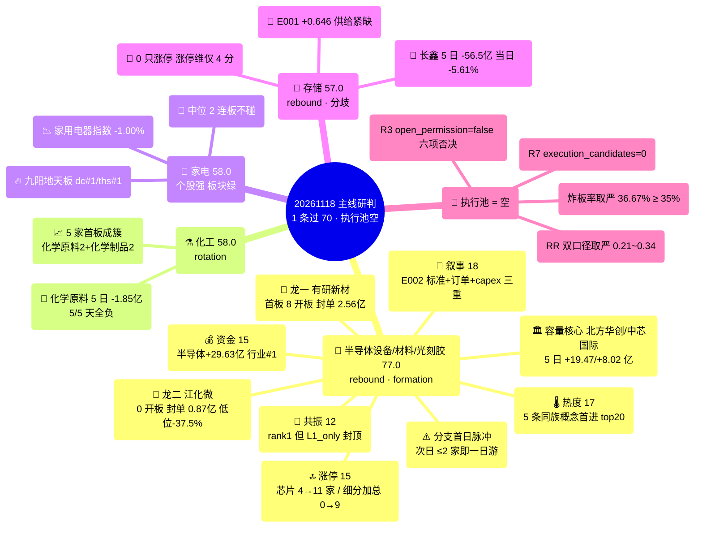

# 2026年11月18日 · **主线研判**

> **数据源新鲜度**: 🟡 partial
> **降级状态**: ✅ true（R1/R3/R4/R7 四源带 degraded 标记 + 锚表停 2 周 + 妖股素材包空段）
> **置信度**: 0.66

## 一句话结论

**全场只有 1 条线够 70 分——半导体设备·材料·光刻胶（77.0），但它是「研究级主线」不是「可交易主线」：R1 判无主线（轮动结构）+ 主跌第 5 天仓位上限 0.10、R3 六项否决、炸板率取严 36.67% 破 35% 红线、R7 执行候选 0 只、本线 layer=rebound（60 日 -22.6%/距高 -26.8%）+ stage=formation（分支首日 0→9 家），执行池置空；妖股赛道「梗有热度、无本尊」，只留 2 只 dual_role 候选。**

---

## 五维打分总览

| 主线 | 热度 | 资金 | 涨停 | 叙事 | 共振 | **总分** | 趋势层 | 持有上限 | 判定 |
|---|:--:|:--:|:--:|:--:|:--:|:--:|---|:--:|---|
| 🔬 半导体设备·材料·光刻胶（国产替代主链） | 17 | 15 | 15 | 18 | 12 | **77.0** | rebound | 3 天（实盘 0） | 研究级主线·唯一过 70 |
| ⚗️ 化工·氯化铵/纯碱（价格事件首板） | 8 | 10 | 14 | 16 | 10 | **58.0** | rotation | 0 天 | 次线·观察 |
| 🍳 家电·小家电（出口改善 + 地天板情绪） | 14 | 11 | 12 | 12 | 9 | **58.0** | trend（个股）／rotation（板块） | 0 天 | 次线·观察（中位不碰） |
| 💾 存储芯片/DRAM 原厂链 | 15 | 10 | 4 | 15 | 13 | **57.0** | rebound | 3 天 | 次线·分歧不进 |
| 🚫 执行池 | — | — | — | — | — | **空** | — | — | 六条理由同时成立 |

> 分数差不是叙事强弱差，是**盘面确认度差**：半导体链四源齐备（CV 1.00）但资金是「换环节」不是增量、涨停全首板无梯队、共振只有 L1；化工叙事维 16 分却在资金维只有 10（化学原料 5 日 -1.85 亿、5/5 天全负）；家电情绪最热（九阳 dc/ths 双第一）但板块指数 -1.00%、家数 4→3 缩量；存储叙事最硬（DRAM 供给紧缺）却 0 只涨停、龙头 5 日 -56.5 亿。

---

## 主线一 · 半导体设备·材料·光刻胶（国产替代主链）· **77.0 分**

**轴 = 上游·卖方**（设备、湿电子化学品、光刻胶配套、晶圆代工）——与传媒/AI 应用等下游·买方不共享筹码，D1 无需与家电/化工合并敞口；但与「AI 算力供应链·CPO/光模块」同属科技硬件大类，若同时取 CPO 必须按**同批筹码**处理。

### 推理深度三问

- **大资金意图**: 11-17 全市场主力**净流出 263.04 亿**（5 日 -1837.79 亿），但半导体**逆势净流入 29.63 亿（行业第一）**，且细分全线为正：设备 +19.05 亿、材料 +18.83 亿、集成电路制造 +18.08 亿（当日 **+5.82%** 为全行业涨幅第一）、中芯概念 +41.82 亿（概念榜第一）。同期数字芯片设计 **-29.25 亿**、电子大类 5 日 **-377.25 亿**、通信设备 -25.18 亿。这不是「新增资金进场」，是**同一批科技筹码换环节**：从已经打满的设计/PCB/光模块，切向还没被炒透、且有政策验收口径的设备+材料+制造。对手盘是这条链自己的高位票——中际旭创 -3.90%、新易盛 -4.08%、兆易创新 -3.88%、长鑫科技 -5.61%，**旧仓位在流出，新仓位在流入，方向相反、同一批钱**。
- **为什么走强**: 三轮交叉。**位置**上，本线是**反弹不是趋势**：龙一 有研新材 60 日 -22.55%、剔单日峰值后 -29.60%、距 60 日高 -33.19%，五只龙头中位 r60 -22.55% / dd60 -26.8%（n=5）→ `rebound`，上方全是解套盘，只能做第一波（所以持有上限 3 天，破 5 日线无条件走）。**催化**上，R4 E002（high 正面 0.732）给的是三条**可验证的实质变化**——工信部设备质量标准落地、光刻胶国产验证周期从 1-2 年缩到 6-12 个月、Yole 口径 2026 年先进封装收入首超传统封装；同日 E004（美商务部限制远程获取先进半导体）把第三国转口路径堵死，需求被强制留在境内。**筹码**上，钱确实落在细分里：设备 5 日 +39.53 亿（4/5 天正、20 日 +71.46 亿）是本周唯一持续为正的科技分支；有研 14.89 亿为全场单票第一，龙虎榜单一上榜原因净买 +2.62 亿（沪股通 +0.89、机构 0.00 → 纯游资+外资）。
- **逻辑够不够硬**: **四源全真（CV 1.00）**——R3 rank1 + R4 两条 high + R7 行业前四全本线 + R2 77 分。但硬度**只够到「研究级」**，缺口有三处：① **共振维封顶**——L2 真人话语层连续 12 个交易日 0 条、L3 WeFlow 永久下线，真等级只到 L1_only，R3 明写「4 条主题全部不构成强共振、任何一条都不得被下游当作已确认主线」；② **宽度是分支首日**——细分加总 0→9（电子化学 3 + 环保设备 3 + 光学光电 2 + 计算机设 2 + 半导体 1），题材矩阵口径虽是 4→11 的扩张，但「分支层面第一天」意味着必须先看次日承接；③ **涨停结构无梯队**——全为首板、零连板（唯一 3 板华东重机属国产芯片分支、行业为机床制造），有研 8 次开板 = 烂板。**证伪路径**：次日电子化学/环保设备封板 <2 家，或半导体设备单日转为净流出 → 本线立即降出 main_lines，按一日游处理。

### 板块宽度（两套口径分开报，绝不混算）

| 口径 | 指标 | 数值 | 读法 |
|---|---|:--:|---|
| 细分（limit_list_d） | 电子化学 / 环保设备 / 光学光电 / 计算机设 / 半导体 | **3 / 3 / 2 / 2 / 1** | 细分 ≥3 家合力门槛成立（9 家加总） |
| 细分（limit_list_d） | 11-16 同口径加总 | **0 家** | 分支首日：0 → 9 |
| 题材矩阵（lianban） | 芯片 11-13 → 11-17 | **4 → 11 家（+175%）** | 题材层连续上榜、扩张 |
| 大类（stock_basic） | 半导体 200 只 涨占比 / 均值 / 中位 | **0.535 / +0.41% / +0.25%** | 过半上涨，但不是普涨（涨≥5% 仅 0.080） |

> **为什么两个口径看起来矛盾**：题材矩阵里的「芯片」包含设计/设备/材料/封测全部名字，它连续在榜说明**题材没死**；细分加总只数四个制造环节，0→9 说明**这一支是今天才点火的**。两者都对，结论是「老题材内部换马车」——宽度判定不因此降级（家数扩张 + 资金同向），但**首日分支必须先用次日承接确认**，不能直接当主升期做。

### 题材持续性交叉验证（lianban.net 题材×涨停家数矩阵）

| 校验项 | 结论 | 证据 |
|---|:--:|---|
| 连续上榜 ≥2 日 | ✅ 通过 | 芯片 11-04=36 / 11-05=8 / 11-06=2 / 11-09=2 / 11-10=3 / 11-11=4 / 11-12=2 / 11-13=4 / 11-17=11（近 9 个观测日 8 次在榜，11-13→11-17 连续） |
| 单日 ≥20 家（过热） | ✅ 未过 | 最高 11 家（11-04 的 36 家是本轮起点，已隔 9 个交易日） |
| 家数趋势 | ✅ expanding | 4 → 11，+175%；细分视角 0 → 9 |
| 家数 vs 资金方向 | ✅ 一致 | 家数扩张 + 设备/材料/制造三细分资金全正；按 skill 口径以家数为准（收盘事实），本次不冲突 |
| 小主线 5~9 家门槛 | 🚫 不算力 | 『算力』题材 11-17 仅 5 家 → 落在 5~9 区间，**不给仓位**（skill 明文）；本线 11 家 > 9 不受此限 |

### 趋势层与生命周期

| 项 | 值 | 说明 |
|---|---|---|
| `layer` / `layer_state` | **rebound / ""** | 龙一 60 日 -22.55%、剔峰 -29.60%、距高 -33.19% |
| `holding_days_max` | **3 天**（结构上限） | 只做第一波、破 5 日线无条件走；实盘为 0（R1 仓位上限 0.10 + R3 拒开仓） |
| 龙头中位数 | r60 **-22.55%** / dd60 **-26.8%** / 剔峰 **-29.6%**（n=5） | 五只全在深跌修复区，无一只 trend |
| 逐票分层 | 有研/江化微/北方华创 = rebound；西陇/中芯 = rotation | 中芯 dd60 -17.04%（未到 -20% 深跌线）→ rotation，位置全链最优 |
| 窗口 | 60 交易日 · `as_of`=**20261117** · `short_history`=false | 21/21 候选可算，无 `unknown`；未看到未来 K 线 |
| `stage` | **formation（启动/形成期）** | age_days=1 / leader_height=1 / money_persist_days=1 / break_rate=0.3667 · conf 0.60 |
| 生命周期读数 | 「分支首日，不是教科书式 early_up」 | persist=1 是因为设备/材料/制造三细分 11-16 全为负，只有 11-17 单日转正 → 资金持续性未确认 |

### 候选龙头（带动性 > 辨识度 > 身位，v1.3）

| 角色 | 代码 | 名称 | 涨幅 | 连板 | 板型 | 角色属性 | 收盘位置/VWAP | 收盘口径 RR |
|---|---|---|:--:|:--:|---|---|---|:--:|
| 👑 龙一 | `600206.SH` | 有研新材 | +10.01% | 1 | 反复开板回封（8 次开板，封单 2.56 亿） | emo_branch | 1.0 / 收上 VWAP 38.68 | R4 2.32 · R7 **0.34** 🚫 |
| 🥈 龙二 | `603078.SH` | 江化微 | +10.00% | 1 | 午前封板·0 开板（封单 0.87 亿） | emo_branch | 1.0 / 收上 VWAP 23.72 | 无卡片 🚫 |
| 🥉 龙三 | `002584.SZ` | 西陇科学 | +10.01% | 1 | 早盘首封·开板 1 次（封单 0.81 亿） | emo_branch | 1.0 / 收上 VWAP 7.77 | 无卡片 🚫 |
| 候补·容量核心 | `002371.SZ` | 北方华创 | +4.09% | 0 | core 未封板（收盘位置 0.93） | core_capacity | 0.93 / 收上 VWAP 558.52 | R4 2.32 · R7 **0.21** 🚫 |
| 候补·中军 | `688981.SH` | 中芯国际 | +6.59% | 0 | core 未封板·冲高回落（0.70） | core_capacity | 0.70 / 收上 VWAP 112.35 | R4 2.67 · R7 **0.23** 🚫 |

> **为什么龙一是有研而不是 3 板的华东重机**：华东重机 3 板 0 开板、封单 2.71 亿，是全链唯一身位票，但它的行业是**机床制造**、只靠「国产芯片」概念标签，与材料/设备/光刻胶没有产业链关系；有研则是**当日材料链唯一四确认样本**（涨停 + 主力净流入 14.89 亿 + 龙虎榜净买 2.62 亿 + 板块进钱 18.83 亿），人气从 44.0 跳到 4.5 是全场最大跳升。按 v1.3「带动性 > 辨识度 > 身位」，有研占龙一，华东重机单列身位股（只可打板/竞价确认，**禁止低吸**）。
>
> **为什么江化微是龙二而不是封单更厚的西陇**：情绪龙头认法按「封单额 → 开板次数 → 首封时序」排序，江化微封单 0.87 亿 > 西陇 0.81 亿，且**全天 0 开板** vs 西陇 1 次；西陇的优势只有首封更早（开盘半小时内）与 dc#10 首进，按第三序不足以反超。
>
> **为什么北方华创/中芯国际只算候补**：core 口径强度两票都不达标（北方 +4.09% < 主板 5% 门槛；中芯 +6.59% < 科创板 7% 且收盘位置 0.70 < 0.8）——核心票不靠涨停计强度，但**当日强度确实不足**，只能当容量锚，不能当情绪龙。

### 有研新材（龙一）· 思维链

- **买入理由（仅条件式，非盘前指令）**: ① **带动性当日生成**——材料链唯一「涨停 + 主力净流入 + 龙虎榜净买 + 板块进钱」四确认，主力 +14.89 亿为全场单票第一（东财独立通道复核差额 0.00）；② **筹码有外资腿**——龙虎榜净买 +2.62 亿（买 5.92 / 卖 3.30，沪股通 +0.89、机构 0.00），不是纯游资对倒；③ **辨识度存量在表**——半导体材料锚表 TOP3（68.5，155 日在榜）。
- **风险点**: ① **烂板**——8 次开板、封成比 0.054（封单 2.56 亿 / 成交 47.51 亿），次日竞价一档就能打穿；② **单日脉冲**——5 日主力仅 +9.87 亿、正日 1/5，14.89 亿是集中一天打进来的；③ **止损距太远**——R7 用 10 日低档 31.77 算，距收盘 **-19.22%**，远超 -10% 硬区间；④ RR5 0.34 < 2；⑤ PE_TTM 117.8，基本面不提供托底。
- **止损条件**: R2 **不设买卖点**（红线 3）。若 D1 采用，唯一可用的失效线是**当日均价线 38.68 / 5 日线 38.24 下方**——跌破即视为「材料链四确认样本失效」，全链降级，而不是单票止损的问题。
- **可验证假设**: 24h 内可证真/证伪——**证真**：次日有研不高开超 3%、且 30 分钟内不破 38.68，同时电子化学另有 ≥1 只封板 → 材料链承接成立；**证伪**：低开且 30 分钟内主力净额转负，或电子化学封板 ≤1 家 → 一日游确认，本线降出 main_lines。

### 江化微（龙二）· 思维链

- **买入理由（仅条件式，非盘前指令）**: ① **结构最干净**——0 开板、封单 0.87 亿、换手仅 4.24%（筹码没换手 = 卖方少）；② **位置最低**——距 60 日高 -37.54%、5 日仅 +4.38%，是全链唯一「低位 + 封板质量好」的组合；③ 湿电子化学品是光刻胶国产验证周期缩短的直接受益环节。
- **风险点**: ① **量能不足**——成交 3.88 亿，链内偏小，撑不起大资金；② **换手过低**（4.24%）意味着没有充分换手，次日一旦承接不上会直接低开；③ 无龙虎榜记录 → 无席位证据；④ R4/R7 均未出该票 RR 卡片，**RR 记 null**。
- **止损条件**: 不设；若 D1 采用，以**当日 VWAP 23.72 / 5 日线 23.57** 为失效线，跌破视为「低位首板承接失败」。
- **可验证假设**: **证真**：次日平开或小幅低开后 30 分钟内回到 23.72 上方，且电子化学仍有 ≥2 家封板；**证伪**：低开 >2% 且全天不收复 23.57 → 分支退潮，本票退回观察池。

### 北方华创（候补 · 容量核心）· 思维链

- **买入理由（仅条件式，非盘前指令）**: ① **本周唯一持续净流入的科技分支的龙头**——设备 5 日 +39.53 亿（4/5 天正、20 日 +71.46 亿），个股 5 日 +19.47 亿且 5/5 天全正；② 4136.8 亿流通为全链最大，回踩承接位天然是它；③ 收盘位置 0.93 + 收上 VWAP 558.52，尾盘没有被砸。
- **风险点**: ① **涨幅不达标**（+4.09% < 主板 5%），core 强度 2/3；② 止损距 -14.48% 超硬区间、RR5 0.21；③ 距 60 日高 -27.63%，仍在修复第一段中段，上方 589（20 日高）是压力；④ 「设备总龙没涨停」容易被误读成板块走弱。
- **止损条件**: 不设；D1 若采用，回踩口径失效线为 **5 日线 554.97**，跌破即退出容量核心候选。
- **可验证假设**: **证真**：次日设备链仍有 ≥2 家封板且北方华创守住 554.97 → 容量核心成立，后续回踩 554.97 附近才是低吸位；**证伪**：设备单日转为净流出或跌破 546.39（5 日低）→ 设备分支资金腿断，本线只剩材料腿。

### 本线风险清单

1. **分支首日脉冲**：细分加总 0→9，次日电子化学/环保设备跌回 ≤2 家即判一日游（skill 明文），本线直接降出 main_lines。
2. **龙一是烂板**：有研 8 次开板、封成比 0.054，是「反复开板后回封」型，不是强封板；它若次日低开且主力净额转负，全链的「四确认」样本失效。
3. **资金是换环节不是增量**：半导体大类 5 日 -72.04 亿、数字芯片设计单日 -29.25 亿；一旦设备/材料单日转负，资金维立刻归零。
4. **E005 是压制项**：SemiAnalysis 把 2028 加速器 capex 下修 28%、HBM 与电力需求同步下修——这条腿决定「反抽高度」，不决定「方向」。
5. **炸板率取严 36.67%** ≥35% 硬红线：次日高开一律按分歧兑现处理，不接秒板、不接二次冲高。
6. **阶段与仓位**：主跌第 5 天 repair_window、仓位上限 0.10，三判据（广度>0.55 / 昨涨停红盘率>60% / 板块级涨停潮≥3 只）未成立前，本线只作研究。
7. **锚表停 20261102**：辨识度层是存量证据，不构成当日排序依据（有研/西陇在表只说明它们「是这个题材的代言人」，不说明今天该买谁）。

---

## 次线一 · 化工·氯化铵/纯碱（价格事件驱动首板）· **58.0 分**

**热度 8 / 资金 10 / 涨停 14 / 叙事 16 / 共振 10** ｜ layer=`rotation` ｜ `holding_days_max=0` ｜ stage=`formation`（conf 0.60）

**这是主跌期唯一「不依赖高位股」的低位题材**：氯化铵创年内新高、周涨 12.5%，联碱停车产能 490 万吨、全年产量减 200 万吨，双环毛利率仅 4.9% → 价格每涨 100 元/吨对利润是倍数级弹性。盘面 5 家首板成簇（化学原料 2 + 化学制品 2 + 北交所佳先股份涨停另计），双环 9:30 首封、封单 0.43 亿。

**但它只配 58 分**：① 化学原料 5 日 **-1.85 亿（5/5 天全负）**、化学制品 +0.49 亿（此前 5 日全负）→ 无行业资金确认；② 化工原料大类 261 只涨占比 0.421、均值 -0.06%，**板块整体没涨**；③ 无连板、无板块指数、容量小（双环流通 25.3 亿，落在 20-50 亿警惕区）；④ 联合化学 20cm 属光刻胶链（归主线一，不重复计入本线）。

> **D1 口径**：只做低位首板验证，不接 20cm（联合化学 5 日已 +30.4%）；无行业资金确认前不给仓位。

---

## 次线二 · 家电·小家电（出口改善 + 地天板情绪）· **58.0 分**

**热度 14 / 资金 11 / 涨停 12 / 叙事 12 / 共振 9** ｜ layer=`trend`（个股层）／`rotation`（板块层） ｜ `holding_days_max=0` ｜ stage=`climax`（兜底判定，实为分歧加速）

**情绪最热、板块最冷**：九阳股份地天板且 dc#1/ths#1（换手 16.35%、开板 2 次、封单 2.23 亿、龙虎榜 1 日净买 +1.84 亿）、小熊 2 板 0 开板、长虹美菱 2 板 0 开板、海立首板 → 细分 4 家涨停，11-16 亦为 4 家。但**家用电器概念指数 -1.00%**、大类 92 只涨占比 0.457 / 中位 -0.45%，题材矩阵家数 4→3 缩量。

R3 判「个股强、板块指数绿 = 个股行情不是板块行情，按纪律 §2 不构成可交易主线」；R4 判「涨的是低位小票不是龙头（美的/格力/海尔没动）」；且九阳龙虎榜**3 日累计口径 -0.37 亿**，与 1 日口径 +1.84 亿方向相反 = 分歧极大。

> **D1 口径**：中位 2 连板（小熊/长虹美菱）不碰；九阳 60 日 +247%、距高 0.0% 的妖性票只可竞价确认，不可低吸；板块指数为绿 → 不构成可交易主线。

---

## 次线三 · 存储芯片/DRAM 原厂链 · **57.0 分**

**热度 15 / 资金 10 / 涨停 4 / 叙事 15 / 共振 13** ｜ layer=`rebound` ｜ `holding_days_max=3` ｜ stage=`climax`（兜底判定）

**叙事最硬、价格最烂**：E001（DRAM 全年供给紧缺、三星 Q3 存储均价同比 +270%、满产）正面 0.646，E005（HBM 需求下修）负面 0.337 → 净 **+0.309 判分歧**。股价：长鑫科技 -5.61%、5 日主力 **-56.5 亿**、距 60 日高 -41.4%；兆易创新 -3.88%、5 日 -21.2 亿、距高 -52.9%；江波龙距高 -52.7%。**11-17 存储链 0 只涨停** → 涨停维只有 4 分。

R3 rank3 明写「人气回流而价格与资金未确认，按纪律 §5 不进」。

> **D1 口径**：只认原厂（长鑫），不认模组（江波龙增收不增利）；资金由负转正前只作研究观察。

---

## 妖股赛道 · 羊年窗口 · **梗有热度，无本尊**

素材包的「涨停池 / 龙虎榜」两段生成器返回**无数据**，已用本地 `limit_list_d`（37 只 U）+ `top_list`（93 行）重建后做联想。

| 层 | 标的 | 11-17 表现 | 判定 |
|---|---|:--:|---|
| L1 羊族本尊 | `001317.SZ` 三羊马（唯一 10cm 主板含「羊」） | **-4.15%** 未涨停 | 未启动 |
| L1 20cm | `300740.SZ` 水羊股份 | -2.05% | 硬过滤排除 |
| L2 同音 yáng | `002242.SZ` 九阳股份 / `600261.SH` 阳光照明 / `002652.SZ` 扬子新材 | **+10.02% / +10.04% / +10.00% 三只涨停** | 有赚钱效应，但三只各有实质归属（家电出口 / 照明设备名字套利 / 装修建材）→ 名字梗是**放大器**不是发动机 |
| L3 拆字「美」 | `000521.SZ` 长虹美菱（2 板 0 开板） | +9.98% | 梗 + 板块双确认 |
| 谐音「狼→朗」 | `002029.SZ` 七匹狼 / `002612.SZ` 朗姿股份 | -7.90% / +1.51% | 联想链断裂 |
| 拆字「群」 | `601366.SH` 利群股份 | -0.52% | 未启动 |

**保留 2 只候选（均为 dual_role 的主线票，不为数量造票）**：

| 代码 | 名称 | meme_layer | 赚钱效应证据 | 仓位口径 |
|---|---|---|---|:--:|
| `000521.SZ` | 长虹美菱 | 拆字「美」+ 家电出口共振 | 2 板 0 开板、封单 0.99 亿、龙虎榜净买 +0.86 亿 | 竞价确认，轻仓 ≤5% |
| `002242.SZ` | 九阳股份 | 同音「阳」+ 地天板情绪 | dc#1/ths#1、封单 2.23 亿、龙虎榜 1 日净买 +1.84 亿（3 日 -0.37 亿） | 只做竞价弱转强，不低吸 |

**监管切换**：R4 八条 top_events 无题材级监管事件（关注函/警告/特停）；但阳光照明 8/14 板已属交易所点名的名字套利票 → 该层扩散空间被压缩，`regulatory_switch_triggered=false`。

**赛道结论**：按「无合格对象允许为空、不为数量造票」，本轮只留 2 只，且不给开仓资格（R3 open_permission=false + 炸板率 36.67%）。

---

## 执行池 = 空（理由六条）

| # | 否决项 | 证据 |
|:--:|---|---|
| 1 | R1 仓位上限 **0.10** | 崩溃退潮型 + 情绪 25.1（恐惧）+ 阶段 main_down 第 5 天 repair_window → 只许低位首板/低位补涨 |
| 2 | R3 `open_permission=false` | 六项否决同时成立（R1 无主线 / 炸板率破线 / L2 断更 12 日 / R7 execution=0 / 阶段主跌 / R3 只给研究资格） |
| 3 | 炸板率取严 **36.67%** ≥35% | R1（limit_list_d U/Z）35.09% vs R7（stk_limit 交易所限价）36.67% → 取严，候选砍半 |
| 4 | R7 `execution_candidates=0` | 3 张研究卡 RR5 0.21~0.34、止损距 -10.76%~-19.22% 全部不过线 |
| 5 | 本线 `layer=rebound` + `stage=formation` | 分支首日 0→9，次日承接未验证；反弹只做第一波，不能盘前预设 |
| 6 | RR 双口径打架 | R4 近端整数关止损口径 2.32/2.67 vs R7 10 日低档口径 0.21/0.23/0.34 → 按「盈亏比优先」取严；且盘前无价，不虚构入场价 |

> 纪律「计划外不出手」「盈亏比优先于胜率」生效 → **执行池置空**。候选不为凑数。

---

## 主线板块剔除清单（10 项）

| 板块/标的 | 剔除理由 | 处置 |
|---|---|:--:|
| AI 算力供应链 · CPO/光模块 | R3 negative high：CPO 概念 #3 但 -1.43%（连续 4 个观测日为负）；中际旭创 -3.90% / 新易盛 -4.08% / 东山精密 -5.49%；三巨头 5 日主力合计 **-94.0 亿**；R4 三腿对冲净 -0.343 | 🚫 拦截 |
| 人形机器人 / 机器人概念 | R3 negative high：概念连续 5 个观测日居前 5、涨幅连续 4 日为负；宇树 -11.97%、兆威跌停；lianban 22→26→13→4→2 家数塌缩 | 🚫 拦截 |
| 文化传媒 / 短剧 AI 影视 | 传媒 -6.24%、单日净流出 55.31 亿（行业流出第一）、影视 ETF -8.17%，lianban 11-16=5 后掉榜 | 🚫 拦截 |
| 商业航天 | lianban 11-10=6 / 11-09=6 后连续 4 个观测日掉出榜单，热榜排名下滑且涨幅 -1.80% | 🚫 拦截 |
| IT 服务 · 华为算力（华胜天成） | 封单 3.11 亿但主营 IT 集成毛利率仅 8.5%；北投科技开板 14 次/封单 0.06 亿 = 烂板；IT 服务板块涨幅 -1.46% | 🟡 降级观察 |
| 消费电子 · AI 眼镜 | E007 出货 +263% 硬，但资金拉杂毛（瀛通两连板后自曝相关收入不足 1%、捷荣未披露占比），歌尔 -0.38%、立讯 -1.75% | 🚫 拦截 |
| 电网设备 / 固态电池 | 顺钠 2 板开板 12 次、摩恩电气封单 4.45 亿但换手 1.19%；无 R4/R3 支撑；lianban 智能电网仅 1 日 2 家 | 🚫 拦截 |
| 阳光照明（名字套利） | 8/14 板老套利票、换手 26.68%、龙虎榜单一原因净买 +2.07 亿（三条理由同一席位口径，不可相加）；R3/R4 均列 excluded | 🚫 拦截 |
| 长鑫科技（存储龙头） | R4 判分歧、5 日主力 -56.5 亿、当日 -5.61%，RR 1.52 不过线；已并入次线三作观察 | 🟡 降级 |
| 瀛通通讯 / 兆易创新 / 江波龙 / 捷荣技术 / 大洋生物 | R4 excluded_pool 逐票理由（收入占比<1% / 5 日 -21.2 亿破位 / 模组增收不增利 / 无法验证 / 流通 17.3 亿容量过小） | 🚫 拦截 |

---

## 观察储备（7 只 · 主线 5 只上限外）

| 代码 | 名称 | 归属 | 观察理由 |
|---|---|---|---|
| `002242.SZ` | 九阳股份 | 家电 / yáng 族 | 地天板 + 双榜 #1 + 龙虎榜 1 日净买 1.84 亿；但 60 日 +247%、换手 16.35%、3 日口径 -0.37 亿 → 只做竞价确认 |
| `000521.SZ` | 长虹美菱 | 家电 / 拆字「美」 | 2 板 0 开板、封单 0.99 亿、流通 41.5 亿；中位连板 → 只观察 |
| `002959.SZ` | 小熊电器 | 家电 | 2 板 0 开板、封单 0.39 亿、PE 20.9；中位连板 → 只观察 |
| `000707.SZ` | 双环科技 | 化工 | 氯化铵唯一首板验证（9:30 首封、封单 0.43 亿）；流通 25.3 亿偏小，等行业资金确认 |
| `301209.SZ` | 联合化学 | 光刻胶链（归主线一） | 20cm 首板、封单 0.52 亿、龙虎榜净买 0.69 亿；5 日已 +30.4%、距高 -20.7% → 位置偏高只观察 |
| `002685.SZ` | 华东重机 | 国产芯片（身位） | 3 板 0 开板、封单 2.71 亿、距 60 日高 0.0%；行业机床制造、纯概念承接 → **身位股**，只可打板/竞价确认，禁止低吸 |
| `300604.SZ` | 长川科技 | 半导体设备/测试 | +7.13%、5 日主力 +6.84 亿（R7 观察池）；设备链第二梯队，等回踩 |

---

## 与其他 R/D/E 的关系

- **依赖**：R1_style（温度 + 仓位上限）· R3_sentiment（共振维 + 六项否决）· R4_news（叙事维 + 八条事件）· R7_capital_flow（资金维 + 逐票闸门）
- **被消费**：D1（执行池与逐票门禁）· E1（复盘与 observation_tracking 回填）· R5（对 leaders 逐票画像）
- **给 D1 的四条硬约束**：① 本线只给**研究资格**，不得占 execution_pool 主位；② 若竞价三判据成立且材料链 10:00 前仍有 ≥3 家封板，可按「低位首板」给单票小仓（≤5%），优先级 江化微/西陇科学 > 有研新材（只做标尺）> 北方华创/中芯国际（core 回踩口径）；③ 「设备总龙没涨停」不是板块走弱证据，容量票按 core 口径单判；④ 与 CPO/光模块**同批科技硬件筹码**，不可叠加敞口。

---

## 数据源审计

| 源 | 日期 | 状态 | 备注 |
|---|---|:--:|---|
| R1_style.json | 2026-11-18 | 🟡 | degraded · conf 0.472 · 无主线（轮动结构）· 仅作温度输入 |
| R3_sentiment.json | 2026-11-18 | 🟡 | degraded · 4 主题真等级 L1_only · open_permission=false |
| R4_news.json | 2026-11-18 | 🟡 | degraded · news_major 正文全空 · 群聊 0 条 · kol_confirm 误标 |
| R7_capital_flow.json | 2026-11-18 | 🟢 | ok · execution_candidates=0 · 两融 T+1 · 北向停抓 |
| tushare/limit_list_d | 2026-11-17 | 🟢 | 124 行 = U37 + Z20 + D67 · 另回看 5 个交易日 |
| tushare/daily + daily_basic | 2026-11-17 | 🟢 | 5573 只全市场收盘 · circ_mv/pe_ttm 同日 |
| tushare/stock_basic | 2026-11-17 | 🟢 | 5580 只 · 大类映射（半导体 200 / 家用电器 92 / 化工原料 261） |
| tushare/top_list | 2026-11-17 | 🟢 | 93 行 · 按 (ts_code, reason) 分桶去重 · 1 日与 3 日口径分列 |
| 东财行业/概念资金流 | 2026-11-17 | 🟢 | 1081 行 · 含 11-10 至 11-17 逐日序列 |
| kb/research.db 趋势层 | 2026-11-17 | 🟢 | 145 万行 · as_of=20261117 · 21/21 候选可算 |
| lianban.net 题材矩阵 | 2026-11-17 | 🟢 | 10 观测日 · 题材×涨停家数 |
| theme_anchors/latest | 2026-11-02 | 🟡 | stale · 597 概念 · 2 周未重建 · 仅作辨识度存量参考 |
| yaogu/llm_context | 2026-11-18 | 🟡 | partial · 涨停池/龙虎榜段「无数据」· 已用本地 limit_list + top_list 补齐 |
| factor/weekly_ir_scan | — | 🟡 | 设计内跳过 · 脚本未实现（**非故障**） |

---

## 不确定性 / 自我反证

1. **本报告最脆弱的一环是「主线资格」本身**：77.0 分里叙事 18、热度 17 都建立在**首日**证据上（5 条概念首次进榜、电子化学 3 只首板、E002 当日发布）。若次日承接失败，这些分数会同时失效——这不是「打分会波动」，是**分支首日的结构性脆弱**。我把它写成 formation 而不是 early_up，就是为了不掩盖这一点。
2. **「连续上榜」是靠题材矩阵过关的，不是靠细分加总**：细分口径 0→9 意味着制造环节的火是今天才点的。如果只看细分，这就是一日游；只看题材矩阵，会误以为已经连续走强。两个口径都列在报告里，判断依赖「老题材换马车」这个解读——**这个解读本身可能就是错的**：也可能只是超跌反抽。
3. **资金维 15 分可能是高估**：半导体大类 5 日仍是 -72.04 亿、20 日 -108.28 亿。我给的 15 分是「今日行业第一 + 细分全线为正」，但严格按「增量资金」口径只值 10-11 分。差值来自「换环节」这个判断，它需要次日设备/材料继续净流入才能成立。
4. **有研与华东重机的龙一位次存在争议空间**：华东重机 3 板、0 开板、封单 2.71 亿，是链内唯一身位票；我用「行业机床制造 + 纯概念标签 + 无材料链带动性」把它降到身位股。如果市场认的是「板高最高即龙头」，我的排序会被证伪——但按 v1.3 的带动性优先口径，这个降级是有依据的，不是偏好。
5. **RR 双口径打架，我选择取严**：R4 事件卡给北方华创 2.32、中芯 2.67，R7 逐票闸门给 0.21/0.23。两个口径的差别在**止损档位**（近端整数关 vs 10 日低），不是算术错误。取严的结果是「全部不过线」，可能过度保守；但在 main_down 第 5 天 + 仓位上限 0.10 的环境下，保守的代价远小于追高的代价。
6. **家电 58 分可能偏低**：九阳 dc#1/ths#1、地天板、封单 2.23 亿，情绪强度是全市场第一。但板块指数 -1.00%、家数 4→3、龙虎榜 3 日口径 -0.37 亿——三项都指向「个股行情」。我按纪律 §2 不给它主线资格，只在次线里记 58 分。
7. **妖股赛道今日几乎无本尊**：羊族本尊三羊马未涨停，3 只 yáng 族涨停全部依附实质板块。我保留 2 只 dual_role 候选，但它们的主线属性（家电）才是真买点依据，梗只是加分——如果把它们当纯妖股做，就是模式外的钱。
8. **未做因子层**：`scripts/factor/weekly_ir_scan.py` 从未实现，属 skill 声明的设计内跳过，不是数据故障——但意味着本次打分**没有量化因子验证**，纯定性排序。

---

## Sub-Agent 元数据

- skill: analyze_main_sectors_v1
- artifact: `data/research/20261118/R2_main_sectors.json`（34.1 KB，机读数据契约）
- 生成耗时: 约 40 分钟（含妖股素材包本地重建、宽度双口径现算、21 票趋势层）
- model: deepseek-v4.1-flash
- 真源模块: `src/research/trend_layer.py` · `src/research/mainline_lifecycle.py`
- 校验: `tests/checks/check_r2_cross_validation.py 20261118` 通过（1 条主线、CV 1.00、4 个 consensus_themes）
- 交付说明: 本文件为人读正文唯一来源，由 `scripts/research/publish_unit_md.py` 发布至 `chzl_kg/投研交易/主线研判/20261118.md`；本 skill 未直接写 KG 路径
