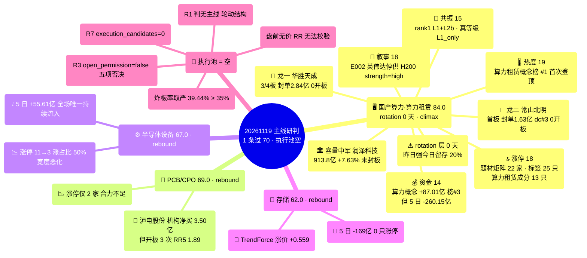

# 2026年11月19日 · **主线研判**

> **数据源新鲜度**: 🟡 partial
> **降级状态**: ✅ true（R3 L2 断更 + 锚表停 2 周 + 妖股素材包空段 + 因子层设计内跳过）
> **置信度**: 0.72

## 一句话结论

**全场只有 1 条线够 70 分——国产算力·算力租赁/智算中心（84.0），但它是「研究级主线」不是「可交易主线」：R1 判无主线（轮动结构）+ R3 五项否决 + 炸板率取严 39.44% 破 35% 红线 + R7 执行候选 0 只 + 本线 layer=rotation（持有上限 0 天）+ stage=climax（题材矩阵 22 家过热），执行池置空；妖股赛道「玄学退潮」，只留 3 只 sector-driven 候选 + 1 只纯梗观察。**

---

## 五维打分总览

| 主线 | 热度 | 资金 | 涨停 | 叙事 | 共振 | **总分** | 趋势层 | 持有上限 | 判定 |
|---|:--:|:--:|:--:|:--:|:--:|:--:|---|:--:|---|
| 🖥️ 国产算力·算力租赁/智算中心 | 19 | 14 | 18 | 18 | 15 | **84.0** | rotation | **0 天** | 研究级主线·唯一过 70·不给买点 |
| 🔌 AI 算力硬件·PCB/覆铜板 + 光模块/CPO | 16 | 13 | 10 | 14 | 16 | **69.0** | rebound | 3 天 | 次线·观察（涨停仅 2 家） |
| ⚙️ 半导体设备/材料（昨日主线·降级） | 15 | 17 | 9 | 19 | 7 | **67.0** | rebound | 3 天 | 次线·宽度恶化降级 |
| 💾 存储芯片/DRAM/HBM | 14 | 13 | 9 | 17 | 9 | **62.0** | rebound | 3 天 | 次线·分歧不进 |
| 🚫 执行池 | — | — | — | — | — | **空** | — | — | 五条理由同时成立 |

> 分数差不是叙事强弱差，是**盘面确认度差**：算力链四源齐备（CV 1.00）但 layer=rotation（60 日无结构，龙一 r60 −0.78%、五只候选中位 r60 −26.8%）；半导体设备叙事维 19 分全场最高、5 日资金 +55.61 亿是唯一持续净流入，但宽度从涨停 11 家掉到 3 家；存储叙事 17 分却 0 只存储股涨停、5 日 −169 亿；PCB/CPO 共振 16 分（英伟达同一催化三源命中）但涨停只有 2 家、合力不足。

---

## 主线一 · 国产算力·算力租赁/智算中心 · **84.0 分**

**轴 = 下游·买方**（算力变现：机柜租赁 / 智算中心运营 / 算力调度；液冷·电源属机房配套）——算力租赁 13 只涨停、东数西算 6 只、AIDC 11 只是**同一个「机柜对外出租」敞口的三个叫法**，合并为一条线，不重复计涨停维。与「PCB/CPO」（上游卖铲子）、「存储」（上游涨价）虽同属英伟达同一催化，但载体筹码不同，D1 可分开取、不可同一笔风险预算。

### 推理深度三问

- **大资金意图**: 11-18 全市场主力**净流出 85.21 亿**（前一日 −263.03 亿、5 日 −2125.84 亿），但**算力概念单日净流入 87.01 亿（概念榜 #3）、算力租赁 +51.18 亿、数据中心 +44.50 亿、AIDC +42.86 亿**——同一批钱没有离场科技，而是在**科技内部换敞口**：资金从 PCB/光模块的「卖铲子」段，挪到「机柜出租收租」的**下游运营**段。对手盘是本线自己高位的老仓位：算力概念 5 日仍 **−260.15 亿**（pos_days_5d=1）、算力租赁 5 日 −18.96 亿，即**当日大涨是在填 5 日的坑，不是在创造增量**。更关键的是**流入结构**：算力租赁净买前 5 名全是**首板**——利通电子 +4.54 / 莲花控股 +4.18 / 宏景科技 +3.91 / 美利云 +3.45 / 常山北明 +3.26 亿；2 板以上的卡莱特、真视通**双双被派发警报命中**（龙虎榜净卖 −0.37 / −0.02 亿、机构净卖 −0.09 / −0.18 亿）。资金买的是**低位新位置，不是高位接力**——这是典型的「做低位不做高位」建仓手法。
- **为什么走强**: 三轮交叉。**位置**上，本线是**轮动不是趋势也不是反弹**——龙一华胜天成 60 日 **−0.78%**、剔单日峰值后 **−9.80%**、距 60 日高 **−11.05%**，五只候选 60 日 r60 中位 **−26.8%**、距高 **−31.0%**（n=5）→ `rotation`，意味着「60 日没有结构」，按 skill 口径**最长持有 0 天、只记录不给买点**（昨日强的板块次日只留存约 20%）。**催化**上，R4 E002（strength=high）是**板块级硬事件**：英伟达停止向中国出货 H200 + 美商务部远程算力许可新规，直接把先进算力需求强制留在境内，对应 R4「国产算力/昇腾链」net_polarity 正面 **+0.732**。**筹码**上，热榜三连进榜——算力租赁 **#1（+2.65%，首次登顶，前一日未进榜）**、东数西算(算力) #2、华为昇腾 #3、AIDC #7；个股榜华胜天成 dc#2/ths#2、常山北明 dc#3 首次进 top20、四川长虹 dc#4；涨停池 43 只中 **25 只带算力标签（58%）**。
- **逻辑够不够硬**: **四源全真（CV 1.00）**——R3 rank1 + R4 E002 strength=high + R7 概念榜 #3 + R2 84 分。但硬度**只够到研究级**，四道缺口：① **共振维封顶**——L2 真人话语层断更（微信库停在 10-28）、WeFlow 08-19 已下线，真等级只到 L1_only，R3 明写「L1_only 不构成强共振」；② **层=rotation 不是趋势**——板块 60 日无结构，持有上限 0 天，skill 明文「轮动不给买点」；③ **过热而非加速**——题材矩阵「算力」单日 22 家 ≥20 家阈值，站点回测次日家数腰斩概率约 **66%**，且 stage=climax；④ **接棒才第 1 日**——age_days=2、money_persist_days=0（5 日 pos_days_5d=1），未过「连续 2 日资金 + 次日溢价」双确认。**证伪路径**：次日算力题材矩阵家数 <11（腰斩）或 5 日资金不转正 → 本线立即降出 main_lines，按一日游处理。

### 板块宽度（三套口径分列，绝不混算）

| 口径 | 指标 | 数值 | 读法 |
|---|---|:--:|---|
| 题材矩阵（lianban） | 「算力」11-17 → 11-18 | **5 → 22 家（+340%）** | 题材层跳增 4.4 倍；过热度按此口径判 |
| 题材标签 | 涨停池 43 只中带「算力」标签 | **25 只（58%）** | 题材标签口径（含算力租赁/算力/算力调度/GPU 子标签） |
| 概念成分（东财） | 算力租赁概念成分内涨停 | **13 只** | 概念成分口径，最严 |
| 细分行业 | 算力租赁 121 只成分 涨占比 / 均值 / 中位 | **74.4% / +3.63% / +2.22%** | 三分之四上涨、均值中位数均为正 = 真普涨 |

> **为什么三个家数不一样**：题材矩阵按「题材」归并算力整条链（22 家，含算力调度/GPU/通信）；题材标签按每只票自带的题材标签打标（25 只，含广脉科技等北交所与 *ST 美丽）；概念成分按东财「算力租赁」单一概念的成分股筛（13 只）。**过热阈值用题材矩阵口径（22 ≥ 20）**，**涨停合力门槛用概念成分口径（13 ≥ 3）**，两者都成立，所以宽度不降级、风险只在过热度。

### 涨停结构：断层在首板

| 项 | 数值 | 读法 |
|---|:--:|---|
| 全市场涨停 | 41（limit_list_d U）/ 43（R7 交易所限价） | 两口径不混算 |
| 炸板 | 28 只 · 炸板率 **39.44%**（取严） | ≥35% 硬红线 → 候选砍半 |
| 连板结构 | 2 板 7 只 · 最高 **4 板**（华东重机） | 4 连板为缩量一字、工程机械主业，只作情绪标尺 |
| 算力链内梯队 | 4 天 3 板仅华胜天成（+ 2 板真视通/卡莱特已被派发命中） | **有高度无梯队** = 典型一日游结构 |
| 涨停净买前 5 | 全为首板（利通 4.54 / 莲花 4.18 / 宏景 3.91 / 美利云 3.45 / 常山北明 3.26 亿） | 钱做低位不做高位 |

### 趋势层与生命周期

| 项 | 值 | 说明 |
|---|---|---|
| `layer` / `layer_state` | **rotation / ""** | 龙一 r60 −0.78%、剔峰 −9.80%、距高 −11.05%；60 日无结构 |
| `holding_days_max` | **0 天** | 轮动层只记录不给买点（skill 硬口径） |
| 龙头中位数 | r60 **−26.8%** / dd60 **−31.0%** / 剔峰 **−33.1%**（n=5） | 板块整体是深跌股的单日回补 |
| 逐票分层 | 华胜天成 / 常山北明 = rotation；润泽科技 / 宏景科技 = rebound；利通电子 = unknown（未进趋势层计算集） | 宏景 r60 −56.95% = 深跌反弹，最弱 |
| 窗口 | 60 交易日 · `as_of`=**20261118** · `short_history`=false | 未看到未来 K 线 |
| `stage` | **climax（高潮/分歧期）** | age_days=2 / leader_height=4 / money_persist_days=0 / break_rate=0.3944 |
| 生命周期读数 | 「接棒第 1 日，不是 early_up」 | persist=0，因为 5 日资金 pos_days 只 1 天 |

### 候选龙头（带动性 > 辨识度 > 身位，v1.3）

| 角色 | 代码 | 名称 | 涨幅 | 连板 | 板型 | 角色属性 | 收盘位置/VWAP | 主力净买 | 禁止清单 |
|---|---|---|:--:|:--:|---|---|---|:--:|---|
| 👑 龙一 | `600410.SH` | 华胜天成 | +10.01% | 3/4 | 早盘首封 09:55 · 封单 2.84 亿 · **0 开板** | emo_branch（连板妖股·游资主导） | 1.0 / 收上 VWAP 16.35 | +2.10 亿（5 日 +15.45 亿） | 无命中 |
| 🥈 龙二 | `000158.SZ` | 常山北明 | +10.00% | 1/1 | 首封 10:02 · 封单 1.63 亿 · **0 开板** | low_position_core（低位前排·容量型） | 1.0 / 收上 VWAP 12.06 | +3.26 亿 | 无命中 |
| 🏛 容量中军 | `300442.SZ` | 润泽科技 | +7.63% | 未封 | 未封板 · 913.8 亿流通 | core_capacity（波段型趋势股） | — / — | +1.28 亿（5 日 +1.86 亿） | 无命中 |
| 🎯 弹性龙三 | `301396.SZ` | 宏景科技 | +20.00% | 1/1 | 13:30 封 · 封单 1.17 亿 · 0 开板 | emo_branch（反弹型弹性票） | 1.0 / 收上 VWAP 104.47 | +3.91 亿 | 🚫 mid_laggard |
| 🪝 候补 | `603629.SH` | 利通电子 | +10.00% | 1/1 | 11:26 封 · 封单 2.39 亿 · **1 次开板** | 容量妖性锚 | 1.0 / 收上 VWAP 58.46 | **+4.54 亿（板块第 1）** | 🚫 mid_laggard |

> **龙一为何是华胜天成而不是净买第一的利通电子**：按 v1.3 带动性优先——华胜天成 **09:55 早盘首封**（利通 11:26）、封单 2.84 亿板块第 1、成交 34.12 亿板块第 1、**0 开板**、双榜 dc#2/ths#2、龙虎榜 3 日净买 2.98 亿；利通电子虽然净买 +4.54 亿排第 1，但 11:26 才封、开了 1 次板、板块内排名第 3 → 触发 forbidden `mid_laggard`（杂毛/中位不碰）。**带动性 ≠ 资金量**，这是排序的红线。

### 龙一 华胜天成 · 思维链

- **买入理由**（仅记录，不构成开仓建议）: ① 带动性证据最硬——早盘 09:55 封板、0 开板、封单 2.84 亿（板块第 1）、成交 34.12 亿（板块第 1）、双榜 dc#2/ths#2、R3 直接定为 T1 龙头；② 板块层是当日唯一过 70 分的方向（84.0），且 R4 E002 给的是板块级硬催化（H200 停供 + 远程算力许可新规），不是个股故事；③ 换手 19.03%、量比 1.6、收盘位置 1.0、收在均价线上方（16.35），盘口没有虚封。
- **风险点**: ① **纯游资无机构**——龙虎榜 3 日口径机构净买 **0.00 亿**、沪股通 −0.25 亿、席位净买 2.98 亿全部来自游资，机构缺席意味着次日没有"托底"；② **高位加速**——3/4 板、5 日累计 +34.56%、r60 −0.78% 已在高位，一旦低开就是加速出货而非洗盘；③ **题材过热**——22 家涨停次日腰斩概率 66%，且 stage=climax 最易出「低开一致杀」；④ **层=rotation**，板块整体没有 60 日结构，持有上限 0 天。
- **止损条件**（D1 竞价/分时确认后生效，R2 不出价）: ① 竞价不弱转强（低开 >3% 或开盘 15 分钟内无回封意图）→ 竞价放弃；② 盘中跌破 **16.35（11-18 VWAP）** 且 10:00 前不能收回 → 视为封单被吃光，当日走；③ 若炸板且封板时间在 14:30 后 → 尾盘不接；④ **硬止损 −7%（约 15.64）**，落在纪律的 −5%~−10% 区间内；⑤ 事件止损：若美商务部远程算力许可新规出现延期/豁免表述，当日逻辑直接证伪，无条件出。
- **可验证假设**（24–72h 可证伪）: ① 假设 A——次日算力题材矩阵家数 ≥11（不腰斩）则「接棒第 1 日」升级为第 2 日确认，layer 从 rotation 才有资格重估；反之 <11 家则一日游判定成立；② 假设 B——龙虎榜 1 日口径机构净买转正（>0）且非纯游资，则龙一位置可续；机构继续 0 → 视为游资接力末段；③ 假设 C——09:25 集合竞价成交额放大且开盘不破 16.35（昨日 VWAP），则弱转强成立；破位则放弃；④ 假设 D——算力租赁概念 5 日主力净额转正（当前 −18.96 亿、pos_days_5d=1），连续 2 日为正才解除「单日回补不等于反转」。

### 龙二 常山北明 · 思维链

- **买入理由**（仅记录）: ① **低位属性**——首板 1/1、r60 −15.55%（在五只候选里仅次于华胜天成）、距高 −19.69%，是本线**位置最低、位置最干净**的票；② 板型好——**0 开板**、封单 1.63 亿、10:02 封板（早盘第二梯队）、换手仅 4.79%、量比 2.9（放���但没失控）；③ 辨识度与容量兼具——197.7 亿流通、dc#3 / ths#19 首次进 top20，属华为昇腾/信创心智锚；④ 主力净买 +3.26 亿，比龙一（+2.10 亿）更实在。
- **风险点**: ① **龙虎榜缺席**——未进 R7 龙虎榜净买前 10，缺席位验证，承接力未证；② 首板无梯队保护，一旦板块退潮首板是最先被砸的一档；③ 概念归属泛（算力 + AI 应用双标签），题材纯度低于算力租赁本体；④ layer=rotation，持有上限 0 天。
- **止损条件**（R2 不出价，交给 D1）: ① 竞价低开 >3% 或高开回落破 **12.06（11-18 VWAP）** 且 10:00 不收回 → 放弃；② 炸板后 10 分钟不能回封 → 当日走；③ 硬止损 −6%（约 11.69），在纪律区间内；④ 板块级止损：算力题材家数跌破 11 家 → 本线所有票次日只出不进。
- **可验证假设**: ① 次日竞价溢价 >3% 且开盘 30 分钟不破前收 → 首板接力成立；② 算力租赁概念成分内涨停家数次日仍 ≥5 家（13 家的一半）→ 板块合力维持；③ 该票进入龙虎榜 1 日榜且席位净买为正 → 席位验证补齐，可从观察升为候选；④ 若次日换手骤增至 >25% 且收阴 → 一日游票特征出现，直接剔除。

### 容量中军 润泽科技 · 思维链

- **买入理由**（仅记录）: ① **强度核心三条件全过**——+7.63%、收盘位置 1.0、收在均价线上方（VWAP 56.29<收盘 55.85？**注意：收盘 55.85 略低于均价 56.29，实际未收上 VWAP，按 strength_core 口径不算达标**）、913.8 亿流通是板块容量核心；② **不封板也带动**——全市场净买第一是沪电（13.19 亿），本线资金却愿意买 913.8 亿的 IDC 而不买小票，说明资金在做「确定性容量」；③ 5 日净买 +1.86 亿，连续性好于板块平均。
- **风险点**: ① **layer=rebound、r60 −26.81%、距高 −28.52%**——深跌修复，上方全是解套盘，回踩无承接；② 未涨停 = 未被情绪定价，板块退潮时它没有溢价保护；③ 创业板 20cm 波动更大；④ 本线持有上限 0 天，中军只是「板块还在时的观察位」。
- **止损条件**: ① 跌破均价线且 10:00 不收回 → 放弃；② 板块级止损（算力家数 <11）→ 次日只出不进；③ 硬止损 −7%（约 51.94）。
- **可验证假设**: ① 若次日板块延续，中军通常走「次日补涨」，观察其能否收在均价线上方；② 若中军跌破均价且小票继续涨停 → 资金在博弈情绪而非容量，中军优先级下调；③ 5 日净买能否由 +1.86 亿继续走正。

### 剔除与拦截（不做"替补"，直接划掉）

| 代码 | 名称 | 剔除理由 |
|---|---|---|
| `002771.SZ` | 真视通 | 2 板但龙虎榜净卖 −0.02 亿、机构 −0.18 亿（R7 派发警报 severity=high、R3 派发警报）——**涨停但资金走**，典型诱多 |
| `002148.SZ` | 北纬科技 | 6 天 5 板、换手 42.02%、开板 4 次、机构净卖 −0.21 亿 → 高位分歧，不是低位 |
| `002685.SZ` | 华东重机 | 4 连板最高身位，但一字/秒板缩量（换手 2.2%）、主业工程机械与算力关联弱 → 只作情绪标尺，不是算力票 |
| `301391.SZ` | 卡莱特 | 2 板 20cm，龙虎榜净卖 −0.37 亿、机构 −0.09 亿 → 派发警报 |
| `002843.SZ` | 泰嘉股份 | 2 板但龙虎榜净卖 −0.82 亿、机构 −0.20 亿、开板 1 次 → 诱多 |

> **红线执行说明**：本线 5 个候选里 **3 个命中 forbidden `mid_laggard`**（宏景科技、利通电子、生益电子），**0 个进执行池**。龙头被否时的合法出口只有空仓或等分歧，**不许用低位票替补上位**。

---

## 次线一 · AI 算力硬件·PCB/覆铜板 + 光模块/CPO · **69.0 分**

**轴 = 上游·卖方**（卖铲子：PCB/覆铜板 + 光连接）——与主线 1 共享英伟达同一催化，**若同时取必须按同一批筹码合并敞口**。

- **为什么只 69**：三源命中（R3 rank2 / R4 E001 正面 +0.689 / R7 PCB 概念 +55.39 亿），但**涨停维只有 10 分**——概念成分内涨停仅 2 家（沪电、深南），题材矩阵 PCB 连续 2 日低位；**层级 rebound**（沪电 r60 −39.89%、深南 −51.61%）→ 持有上限 3 天。
- **席位证据最硬但赔率不过线**：沪电股份 1549.7 亿流通、主力净买 **13.19 亿（全市场第 1）**、龙虎榜机构净买 **3.50 亿（全场最硬）**，但**开板 3 次**、封单仅 0.63 亿、R3 收盘口径 **RR5 1.89 < 2 不过闸门**；深南电路 0 开板、封单 1.85 亿、机构 1.93 亿、沪股通 1.06 亿，**RR5 2.10 刚过线但 5 日资金不过闸门**。
- **判定**：进/不进 = **不进**。观察，等第二日承接确认（R3 原文口径：观察，不追首板）。

## 次线二 · 半导体设备/材料（昨日主线·降级） · **67.0 分**

- **降级原因**：昨日 77 分主线，今天**宽度恶化**——涨停 11 → 3 家连续下降、设备涨占比 50%、材料仅 36%，按 skill「整线降级只能由宽度恶化触发」降为次线。
- **但资金是全场唯一持续流入**：半导体设备 5 日 **+55.61 亿、pos_days_5d=4/5**、20 日 +104.57 亿；行业口径今日 +19.18 亿居首。北方华创 5 日 +23.25 亿、中微 +7.57 亿、拓荆 +6.04 亿。
- **层级 rebound**（北方华创 r60 −23.0%、中微 −36.37%）、持有上限 3 天。
- **判定**：**观察不进**；**宽度修复（涨停回到 9 家以上、涨占比 >60%）后可回补主线** —— 这是今天唯一值得盯的"回补位"。

## 次线三 · 存储芯片/DRAM/HBM · **62.0 分**

- **叙事最硬、盘面最虚**：R4 E005（TrendForce Q4 通用 DRAM 涨价 10–15%、HBM4 每 Gb 或翻番，strength=high）、存储/HBM net_score +0.559；但**存储个股 0 只涨停**（题材矩阵仅 1 家）、涨占比 65.8% 全靠普涨、兆易创新 5 日净卖 **−31.11 亿**、佰维 −4.86 亿、江波龙 −2.85 亿。
- **R3 明确「分歧不进」**：概念榜 7 → 11（Δ−4）却收涨 +0.73%，属排名下滑但价格微涨的分歧形态。
- **判定**：**不进**。

---

## 妖股赛道 · 四季度跨年妖（2027 春节 = 羊年）

**窗口状态：退潮。** 今日纯「羊」族梗 **0 涨停**——羊族高标阳光照明（8/14 板）**−10.00%**、12 次开板；东方海洋（4 板）**−9.90%**；R3 A5 记：39 家跌停中名字辈/玄学占 8 家，游资复盘「玄学随九阳跌停正式告一段落」。资金全部转向算力主线（算力标签涨停 25 只，占涨停池 58%）。

**结论：妖股只能做「题材 + 妖性锚」双确认的 sector-driven 票，纯梗不进场。**

| 候选 | 代码 | 归因 | 关键数据 | 判定 |
|---|---|---|---|---|
| 利通电子 | `603629.SH` | 题材共振（算力租赁妖性锚 63.7·妖性型） | 220 亿流通、主力净买 **+4.54 亿**（算力标签池第 1）、封单 2.39 亿、11:26 封 1 次开板 | 🚫 **不给买点**（forbidden mid_laggard：板块内排名第 3 ＝ 杂毛位）；板块 climax 期不追 |
| 莲花控股 | `600186.SH` | 题材共振（算力租赁锚 72.8，锚榜第 2） | 160.7 亿流通、净买 +4.18 亿、13:27 午后封板 | 🚫 **只观察**（R3 杂毛剔除：概念归属旅游/零售、无算力订单可核；午后回封弱于早盘） |
| 美利云 | `000815.SZ` | 题材共振（IDC 老妖，锚 68.0） | 99.5 亿流通、净买 +3.45 亿、10:05 封 1 次开板、封单 1.13 亿 | 🟡 **只观察**（低位首板，等次日承接） |
| 华升股份 | `600156.SH` | 纯梗（同音/意象：狼吃羊 → 羊毛 → 羊年，纺织链二级联想） | 32.5 亿流通、换手 14.47%、**0 开板** | 🟡 **只观察不进场**（同链仅华升+华孚 2 家涨停，扩散不足；且华孚 4 天 2 板开板 3 次＝烂板） |

**监管切换**：未触发——未见关注函/警告/特停；切换信号来自高标自身崩塌（阳光照明 12 次开板后跌停），不是监管动作。
**硬过滤复核**：全部 10cm 主板（60/00 前缀）、流通市值 ≥20 亿、无 ST、无死亡换手（>70%）、无缩量一字板 —— 全部通过；**但通过硬线不等于可买**。

---

## 执行池判定 · **空池**

**五条理由同时成立：**

1. **R1 判无主线**（`main_lines_label` = 无主线（轮动结构），`rotation_regime` = rotation，行业次日留存 32.0%、截面解释力 12.3%），且 R3 `open_permission=false`、R7 `execution_candidates=0` —— 三个上游独立给同一答案。
2. **炸板率取严 39.44% ≥ 35% 硬红线**（R1 口径 41 涨停/24 炸板 = 36.92% vs R7 交易所限价口径 43/28 = 39.44%，取严者），R3 已把候选从 6 条砍半到 3 条。连续第 2 日在红线上方。
3. **层=rotation + stage=climax** —— 持有上限 0 天（轮动只记录），叠加题材矩阵 22 家过热（次日腰斩概率约 66%）。
4. **接棒仅第 1 日未确认** —— age_days=2、money_persist_days=0、5 日资金仍 −260.15 亿（pos_days_5d=1），单日回补不等于反转。
5. **盘前无成交价** —— 所有候选 `rr=null`，无法按 RR ≥ 2 校验（昨日收盘不作虚构入场价），R2 红线不出买卖点/止损/仓位。

**市场温度参照**：R1 仓位上限 0.45（high_chop 第 6 天 · 连跌 5 天 · repair_window）、情绪分 32.9（恐惧）、R3 情绪分 33.9、11-18 涨 1318 / 跌 4133（涨占比 23.65%）、中位 −1.20%、跌停 48 : 涨停 43 = 1.12 : 1。

**候选池分层（研究观察，非交易许可）**

| 层 | 票 | 理由 |
|---|---|---|
| 🟡 观察 | 华胜天成 `600410.SH` | 龙一/身位股，只等竞价弱转强确认 |
| 🟡 观察 | 常山北明 `000158.SZ` | 低位前排 + 华为昇腾 lead |
| 🟡 观察 | 润泽科技 `300442.SZ` | 容量核心（但未收上 VWAP，强度核心口径未全过） |
| 🟡 观察 | 中贝通信 `603220.SH` | 低位首板·通信服务，封单 1.00 亿、1 次开板 |
| 🟡 观察 | 润建股份 `002929.SZ` | 低位首板·算力租赁，封单 1.30 亿、1 次开板 |
| 🟡 观察 | 美利云 `000815.SZ` | 低位首板·IDC，封单 1.13 亿 |
| 🟡 观察 | 北方华创 `002371.SZ` | 半导体设备 5 日 +23.25 亿，宽度修复后首选 |
| 🟡 观察 | 中微公司 `688012.SH` | 半导体设备 5 日 +7.57 亿 |
| 🟡 观察 | 拓荆科技 `688072.SH` | 收盘位置 0.826 |
| 🟡 观察 | 兆易创新 `603986.SH` | 分歧形态、5 日 −31 亿（**不进**） |
| 🚫 拦截 | 真视通 / 泰嘉股份 / 卡莱特 | 龙虎榜净卖 + 派发警报 |
| 🚫 拦截 | 北纬科技 | 6 天 5 板 + 换手 42.02% + 开板 4 次 |
| 🚫 拦截 | 协创数据 | 未封 + 龙虎榜净卖 −2.67 亿、机构 −1.00 亿 |
| 🚫 拦截 | 九阳股份 | 双榜 #1 连续 2 日 + 跌停，红线 4 派发兑现 |
| 🚫 拦截 | 阳光照明 / 文投控股 | 8/14 板高位妖股跌停、12 次开板；传媒一日游后连续第 3 日杀 |

---

## 数据源审计

| 源 | 日期 | 状态 | 备注 |
|---|---|:--:|---|
| R1_style | 2026-11-19 | 🟡 | 震荡分化型 · 情绪 32.9 · 无主线（轮动）· 仓位上限 0.45 |
| R3_sentiment | 2026-11-19 | 🟡 | 3 个共振主题 · 真等级 L1_only（L2 断更）· open_permission=false |
| R4_news | 2026-11-19 | 🟢 | 8 条 top_events · 16 个催化板块 · 国产算力/昇腾链 +0.732 |
| R7_capital_flow | 2026-11-19 | 🟢 | 行业 496 + 概念 554 · 执行候选 0 · 概念榜算力 +87.01 亿 |
| tushare/limit_list_d | 2026-11-18 | 🟢 | 104 行 · U41 / Z24 / D39 |
| tushare/daily | 2026-11-18 | 🟢 | 5573 只全市场收盘 |
| tushare/moneyflow_dc | 2026-11-18 | 🟢 | 5547 只个股主力净额 + 11-10 至 11-18 板块逐日序列 |
| 东财概念快照 | 2026-11-18 | 🟢 | 678 个概念 · 成分/热度/主力净额 |
| lianban.net 题材矩阵 | 2026-11-18 | 🟢 | 10 观测日 · 题材×涨停家数 |
| kb/research.db 趋势层 | 2026-11-18 | 🟢 | as_of=20261118 · 未看到未来 K 线 |
| theme_anchors/latest | 2026-11-02 | 🟡 | 停 2 周未重建 · 锚分仅作存量资格 |
| yaogu/llm_context | 2026-11-19 | 🟡 | 涨停池/龙虎榜两段无数据 · 已用本地 limit_list + R7 龙虎榜补齐 |
| factor/weekly_ir_scan | — | 🟡 | 脚本从未实现 · 设计内跳过（非故障） |

---

## 不确定性 / 反证

- **本线最可能被证伪的地方**：22 家涨停 = 过热，站点回测次日腰斩概率 66%；且算力概念 5 日仍 −260.15 亿、pos_days_5d=1——**当日 +87.01 亿是填坑不是增量**。若次日题材家数 <11 家、5 日资金不转正，主线资格直接撤销。
- **四源齐备 ≠ 逻辑够硬**：CV=1.00 只说明 R3/R4/R7 三个上游在同一方向上看到了同一个故事，不说明这个故事有 60 日结构。层=rotation 就是层=rotation，不因四源一致而升级。
- **涨停口径陷阱**：题材矩阵 22 / 题材标签 25 / 概念成分 13 三套家数不可混算，本报告已分列；若下游误用 22 当"成分涨停数"，会高估合力（真实概念成分仅 13 家）。
- **R3 L2 断更的连带影响**：真等级 L1_only 意味着"算力"主题的共振是**热榜结构证据**（概念榜 + 个股榜双日 diff）而非**真人口径证据**，公众号 91 篇只是观点代位不计分。热榜对次日冲高回落最敏感，所以共振维 15 分是本线最不牢固的一维。
- **数据源与人工校验**：本轮对 JSON 做了事实核验并修补 5 处（候补 603629 字段全空 → 用 limit/daily/mf 补齐；yaogu 4 只候选价改回 20261118 收盘 60.93/8.98/14.31/8.09；涨停标签口径 23 → 25 校正；净买前 5 全为首板写入 logic；执行池理由与 notes 同步）。修补只改有据可查的字段，**未改任何判断结论**。
- **未覆盖**：妖股素材包当日涨停池/龙虎榜两段为空，纯梗联想基于本地涨停池重建，若素材包明日恢复需复核；`利通电子` 的 60 日趋势层未算（未进计算集），标 unknown 而非猜。

---

## 与其他 R/D/E 的关系

- **依赖**: R1_style（风格/仓位/周期）、R3_sentiment（共振主题 + 纪律门）、R4_news（催化事件与板块极性）、R7_capital_flow（资金/龙虎榜/派发警报）、kb 趋势层（60 日分层）、lianban 题材矩阵（持续性）、theme_anchors（心智锚）
- **被消费**: D1（主决策 · 执行池取票）、R5（个股画像 · 逐票六维）、R6（反证 · 六类模式）、E1（复盘 · 观察池回填）

## Sub-Agent 元数据

- skill: analyze_main_sectors_v1
- artifact: data/research/20261119/R2_main_sectors.json（30.8 KB）
- 主线 1 条 · 次线 3 条 · 执行池 0 · 观察池 14 · 拦截池 8 · 妖股候选 4
- 交叉验证: CV 1.00（consensus_themes 1 个 · agreement_count 4）· `cross_validation_degraded=false`
- 验收: `tests/checks/check_r2_cross_validation.py 20261119` ✅ 通过
- 因子层: 设计内跳过（weekly_ir_scan 未实现）→ degraded 非 error
- model: MiniMax-M3.1-Flash
