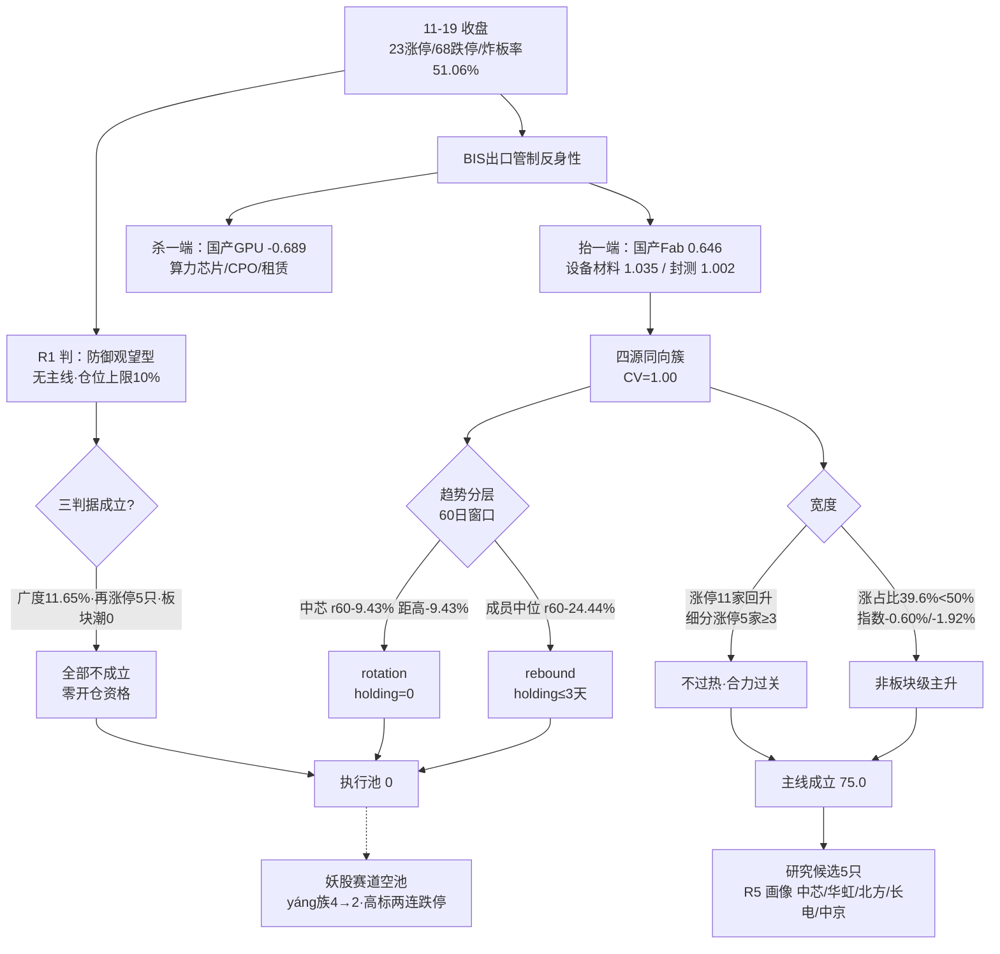

# 2026年11月20日 · **主线研判**

> **数据源新鲜度**: partial（R1 degraded · 18 日涨停池缺数 · 心智锚表过期）
> **降级状态**: false（主证据链完整，局部缺口已在审计表标注）
> **置信度**: 0.58（四源同向但强度仅 L1_only，层判定与阶段判定方向相反）

## 一句话结论

**市场没有可交易主线，只有一条「窄口抱团」的半导体国产制造端值得研究** — 芯片题材连续 3 日上榜、资金 5/20 日双正、叙事全表最强，但炸板率 51.06%、三判据全不成立、龙头层判定 rotation（不给买点），故主线成立 75 分、执行池 0 只、妖股赛道空池。

## 详细分析

**一、先认市场：这不是「有主线」，这是「有钱但没环境」。** 11-19 收出 23 涨停 / 68 跌停 / 24 炸板，炸板率取严 51.06%（R1 官方口径 23 涨停；R7 用 stk_limit 补录 15 只封死跌停后为 28 涨停/25 炸板=47.17%，两者都远高于 35% 硬红线），全市场涨 649 跌 4876、上涨占比 11.65%、中位 −2.55%，最高连板只有 3 板。R1 据此判「防御观望型 + 情绪 19.2 极恐 + 无主线（轮动结构，行业次日留存 28.0%、截面解释力 9.83%）+ 仓位上限 0.10」，并定位当日为连跌 6 天后的第 7 天 repair_window。三判据（开盘广度 >0.55、昨涨停红盘率 >60%、板块级涨停潮 ≥3 只）在 11-19 三条全部不成立。所以按纪律 §1「先认市场再认个股」，今日没有任何一张票能被授予开仓资格——这不是保守，是判据没到。

**二、再认主线：半导体国产制造端是唯一四源同向簇，但只是「窄口抱团」。** R3 把它排到 rank1（启动日 11-17，今日第 3 个交易日，连板层已成形），R4 给半导体设备/材料 net 1.035（全表最强，E003 伯恩斯坦把 2027 年全球晶圆制造设备支出上调到 2170 亿美元、同比 +39%；E004 无锡 50 亿先进封装产线奠基双正腿叠加）、封测/先进封装 1.002，R7 给集成电路制造 +24.23 亿（5 日 +42.58、20 日 +56.48 双正）、半导体设备 +18.55 亿（5 日 +56.83、20 日 +144.54 双正）、封测 +14.94 亿（5 日 +4.85，链内唯一由负转正）。四源同名同向，交叉验证 3/3=1.00。

但两个否决点必须同步说清：一是共振真等级只到 **L1_only**（L2 真人话语层连续 14 个交易日断更、L3 WeFlow 永久下线，只有公众号观点代位），按红线 3 不得标强共振；二是板块指数仍是绿的（先进封装 −0.60%、芯片概念 −1.92%），半导体 53 只成分股当日涨占比仅 39.6%、均值 +0.19% —— 涨停家数回升但**涨占比没过 50%**，这是「几只票被资金点名」而不是「板块级主升」。

**三、方向内分叉是今天最容易被骗的地方。** E001（美 BIS 穿透审查晶圆代工封测、台积电三星暂停部分对华先进制程出货）对整条半导体不是利好，它是「杀一端、抬一端」：依赖海外流片的国产 GPU 端 R4 给 −0.689（high 负面）、AI 算力芯片设计 −0.482、AI 算力硬件/算力租赁 −0.516，盘面印证得极狠 —— 沐曦股份 −14.72%、寒武纪 −1.58%、润泽科技 −8.65%、华胜天成 −0.71%，资金端华为概念 −105.58 亿、计算机 −55.15 亿、通信网络设备 −3.11%。所以任何把「半导体」当整体主线买入的做法，都会在 GPU 这一端被打穿。只做国产 Fab / 设备 / 封测这一条硬制造腿。

**四、位置不对：整条线是深跌后的第 3 日反弹，不是趋势主线。** 用 60 日窗口判层（前复权，as_of=11-19）：龙头中芯国际 r60 −9.43%、距 60 日高 −9.43% → **rotation**；成员中位 r60 −24.44% → rebound。华虹宏力 −24.44%、北方华创 −23.81%、长电科技 −35.06%、中京电子 −19.67%（距 60 日高 −40.58%）。层判定写进 JSON 后 holding_days_max 直接给 0（龙头层轮动不给买点），反弹成员最多 3 天且破 5 日线无条件走。同时主线生命周期函数给出 `early_up`（运行 3 天 + 资金 3 日正 + 3 板高度），但这只量主线自身、没量市场温度——两个标签方向相反，本报告选择两条都记录、不做强行统一，执行上以市场温度为优先。

**五、结构上正在发生高低切换，这是唯一有用的盘面信息。** 连板端已经有出货痕迹：3 板身位股盛剑科技封单只有 0.28 亿（占成交 11.7%）、龙虎榜净卖 −0.13 亿（net_rate −5.42%）；江化微 2/3 板但首封在下午 1 点 6 分（尾盘封板）、龙虎榜净卖 −0.96 亿（net_rate −3.30%）。反过来首板端在净买：中京电子首板、上午 10 点 27 分先封、0 开板、封单 1.01 亿、龙虎榜净买 +1.05 亿（net_rate 11.51%，全榜单最高一档）。这说明资金在从「高度」撤、向「首板」切——明日可参与位是承接位而非接力位。

### 五维打分表（0–20 × 5 = 100）

| 维度 | 得分 | 硬依据 | 扣分原因 |
|---|---|---|---|
| 热度 | 16 | 光刻胶概念 13→#1、光刻机 18→8、大基金持股 #4 新进、先进封装 #11 新进；盛剑 dc 47→11、中京 新进#5、长电 #19、大港 #18 | 全市场情绪 19.2 极恐，热度是「相对强」不是「绝对热」 |
| 资金 | 16 | 集成电路制造 +24.23 亿（5日+42.58/20日+56.48）· 半导体设备 +18.55 亿（5日+56.83/20日+144.54，pos 4/5）· 封测 +14.94 亿（5日+4.85 转正） | 母行业半导体 5 日 −96.28 亿 = 子行业分化，只有制造/设备双正 |
| 涨停 | 14 | 芯片题材 11 家（11-17 11→11-18 3→11-19 11 回升）；T1 细分 5 家（半导体3+元件1+环保1）；全市场 23 只里半导体链 7 只占 30.4% | 板块指数仍绿、炸板率 51.06%、绝对家数 11<20 |
| 叙事 | 19 | R4 半导体设备/材料 1.035 全表最强、封测 1.002 双正腿、Fab 0.646；公众号 12 条 Fab/设备看多 + 6 条先进封装 | 事件属「反身性」，同一批新闻在 GPU 端是利空 |
| 共振 | 10 | R3 rank1 L1+L2b、early；L1 涨停宽度 + 热榜同向 | 真等级 L1_only（L2 断更 14 日/L3 下线）→ 红线3；光刻胶 #1 属反复霸榜（17→14→19）不加分 |
| **合计** | **75.0** | ≥70 主线线 · 但只到「研究级」 | |

### 趋势分层与阶段（每条线必带，缺字段=未完成）

| 对象 | r60 | 距60日高 | 剔峰值后 | 层 | 最长持有 |
|---|---|---|---|---|---|
| 中芯国际（龙一） | −9.43% | −9.43% | −16.91% | **rotation 轮动** | 0 天（不给买点） |
| 华虹宏力（龙二） | −24.44% | −24.44% | −35.56% | rebound 反弹 | 3 天 |
| 北方华创（中军） | −23.81% | −23.81% | −30.73% | rebound 反弹 | 3 天 |
| 长电科技（封测核心） | −35.06% | −35.06% | −40.96% | rebound 反弹 | 3 天 |
| 中京电子（首板） | −19.67% | −40.58% | −27.00% | rebound 反弹 | 3 天 |
| 江化微（次线龙一） | −29.54% | −29.54% | −35.94% | rebound 反弹 | 3 天 |

> 窗口自适应已核查：上述 6 票在库内均有 ≥61 根 K 线，`window_days=60`、`short_history=false`，`as_of=20261119`（禁止看未来 K 线）。线层按龙头判 rotation；成员中位 rebound。两种层并存，故 JSON 写 `layer=rotation / holding_days_max=0`，同时把每票层单独落盘供 D1 取用。
>
> 生命周期：`stage=early_up`（age 3 天 / 3 板 / 资金连续 3 日正），函数口径写「最佳参与窗口」；但该函数不含市场温度，本日按 R1 capitulation 第 7 天降级为「只研究不进场」，冲突已写入 `stage_conflict_note`。

### 候选龙头（每条 3–5 只 · 核心/情绪双层分开认）

| 角色 | 代码 | 名称 | 收盘 | 涨幅 | 板型 | core/emo 强度 | 认定依据 | 态度 |
|---|---|---|---|---|---|---|---|---|
| 龙一 | 688981 | 中芯国际 | 122.25 | +6.21% | 无板 | core 2/3（收盘位 0.94 ✓ / ≥VWAP 119.9 ✓ / 涨幅 6.21<7 ✗） | 带动性第一：主力单票 +11.52 亿全场第一、流通 2445 亿容量第一、dc 人气 #19 | **进（仅研究）· RR 0.02 无赔率** |
| 龙二 | 688347 | 华虹宏力 | 199.86 | +8.05% | 无板 | core 2/3（涨幅 8.05 ✓ / 收盘位 0.60 ✗ / VWAP ✓） | 国产 Fab 第二标的，主力 +7.09 亿、5 日 +21.87；R4+R7 双确认 | 观察·单日已透支 |
| 中军 | 002371 | 北方华创 | 592.02 | +3.13% | 无板 | core 1/3（涨幅 3.13 ✗ / 收盘位 0.63 ✗ / VWAP ✓） | 设备子链唯一双正载体（pos_days 5/5）、E003 WFE 直接受益 | 观察·滞后补涨位 |
| 候选 | 600584 | 长电科技 | 55.47 | +4.74% | 无板 | core 2/3（涨幅 4.74 ✗ 差 0.26pct / 收盘位 0.86 ✓ / VWAP ✓） | 封测核心（R4 1.002 全表第二）、距 60 日高 −32.5% 链内最低位置 | 观察·位置最好赔率待算 |
| 情绪分支 | 002579 | 中京电子 | 12.17 | +10.04% | 首板 | emo 全过（10:27 先封 / 0 开板 / 封单 1.01 亿 / 换手 13.33% / 龙虎榜 +1.05 亿 net_rate 11.51%） | 全链唯一「首板+净买+早封+零开板」四条件同时成立的票 | 不进（须明日三判据确认才可打板） |

### 剔除清单（先划掉，再看剩下的）

| 代码 | 名称 | 剔除理由（禁止清单命中） |
|---|---|---|
| 603324 | 盛剑科技 | 3 板身位最高，但龙虎榜净卖 −0.13 亿（net_rate −5.42%）+ 封单仅 0.28 亿 → 席位转净卖的出货形态，打板命中禁止清单 |
| 603078 | 江化微 | 2/3 板但下午 1 点 6 分尾盘才封 + 龙虎榜净卖 −0.96 亿（net_rate −3.30）→ 高位换手博弈 |
| 002242 | 九阳股份 | R3 红线4 霸榜派发：人气 #1 连续 3 日、封单 2.23→0.64 亿衰减 71%、13 次开板、换手 23.74% |
| 000678 | 襄阳轴承 | 9 次开板 / 换手 32.73% / 机构与外资双卖、游资单边净买 1.93 亿；前一日跌停 → 情绪票接力 |
| 002771 | 真视通 | 3 连板缩量一字（换手 2.36%、成交 0.61 亿）→ 情绪股非妖；所属算力题材 11-18 22 家→11-19 4 家崩塌 |
| 688825 | 长鑫科技 | 5 日主力 −45.46 亿、MA20 下方、距 60 日高 −37.4% → 回购事件正腿、资金反腿 |
| 002077 / 600520 / 301348 | 大港 / 三佳 / 蓝箭 | 封单 0.51–0.57 亿偏薄，或 2 次开板，或 20cm 情绪脉冲非板块核心 |

### 次级与丢弃

| 方向 | 分 | 结论 | 原因 |
|---|---|---|---|
| 光刻胶/湿电子化学品 | 54.0 | 次线·观察 | 与主线同催化剂轴但涨停票不重叠（电子化学 2 + 跟风 3）→ R3 判可独立，但敞口同源，D1 须合并仓位上限；电子化学品 5 日 −7.5 亿资金不连续 |
| 存储/DRAM/HBM | 46.0 | 丢弃 | E005 长鑫回购 25–50 亿（0.700 high 正）是强事件，但存储芯片 5 日 −102.90 亿、20 日 −228.58 亿，个股长鑫 5 日 −45.46 亿 → 事件正、资金反 |
| PCB/覆铜板 | 33.0 | 丢弃 | E006 PCB 短缺至 2028 年（0.600 high 正）叙事强，但印制电路板 5 日 −115.03 亿、当日涨停 0 只 → 叙事单腿 |
| 人形机器人·减速器/轴承 | 33.0 | 拦截 | 催化在（Optimus 1–2 月演示）资金不在：机械设备 −31.98 亿、汽车零部件 7 只跌停并列第一；L1 侧只有情绪票移动 |
| 算力芯片/CPO/算力租赁 | 18.0 | 禁止 | 反身性负腿：国产 GPU −0.689、算力租赁 −0.516；算力题材 22→4 家崩塌；沐曦 −14.72%、润泽 −8.65% |
| 贵金属/黄金 | 12.0 | 丢弃 | E008 −0.700 高负面：法巴预计 12/1/3 月连续加息，金银铜重挫，紫金 −2.61%/主力 −14.78 亿 |

## 首推票思维链（研究首选 · 中京电子 002579 · **不构成买入**）

**① 买入理由（若明日三判据成立）** — 它是全链唯一同时满足四条件的票：上午 10 点 27 分先封（早于 10 点 30 分的情绪分水岭）、0 次开板、封单 1.01 亿占成交 11.0%、换手 13.33% 未失控；龙虎榜净买 +1.05 亿、net_rate 11.51% 是全榜最高一档。而同时刻连板端在净卖（盛剑 −0.13 亿、江化微 −0.96 亿）——这是资金从高度撤向首板切的直接证据。题材上它同时挂「先进封装」（心智锚表内第 3 位、anchor 74.9）与「存储芯片」（表内第 1 位），不是单梗票。

**② 风险点** — 首板在 51.06% 炸板率的环境里，次日炸板是常态而非例外；流通 71 亿属中盘，没有小盘票的弹性；它挂在 元件/先进封装 这一格，而母行业「半导体」5 日仍 −96.28 亿，只要资金单日转出就无承接；更关键的是 R1 三判据今天全不成立，任何买入都属「计划外出手」。

**③ 止损条件** — 若明日打板入场，止损必须落在 −5% 至 −8% 硬区间（首板常规带），且**跌破当日分时均价线即离场、不等收盘**；封单在 10 分钟内衰减超过 50% 视为炸板前兆，直接撤单不补。若走半路，入场价不得高于当日 VWAP 上浮 3%。

**④ 可验证假设** — 「高低切换」是否成立，明日可以用三个可观测指标验收：一是昨日首板（中京/大港/三佳）的红盘率是否 ≥60%；二是 3 板身位股盛剑科技是否断板或炸板（若它反而加速，说明切换假设证伪、资金仍在高度端）；三是芯片题材涨停家数是否维持 ≥8 家（低于 5 家则家数趋势转 shrinking，本条线结论作废）。

## 关键证据

- 证据 1（资金双正 + 子行业分化）：集成电路制造 +24.23 亿（5 日 +42.58、20 日 +56.48）、半导体设备 +18.55 亿（5 日 +56.83、20 日 +144.54，pos_days 4/5）、封测 +14.94 亿（5 日 +4.85 由负转正）；母行业半导体今日 +30.51 亿但 5 日 −96.28 亿 · 来源 R7_capital_flow.json
- 证据 2（叙事全表最强）：半导体设备/材料 net 1.035（E003 伯恩斯坦 WFE 2027 2170 亿美元 +39%、E004 无锡 50 亿先进封装）、封测/先进封装 1.002（E002+E004 双正腿）· 来源 R4_news.json sector_cross_summary
- 证据 3（题材家数连续 3 日 + 回升）：芯片 11-17 11 家 → 11-18 3 家 → 11-19 11 家；单日最高 11 家 <20 家（不过热）；家数 3→11 与资金双正同向 · 来源 data/raw/20261119/lianban_mainline.json
- 证据 4（涨停结构）：全市场 23 只涨停中半导体链 7 只（30.4%），细分口径 T1 占 5 只（半导体3: 三佳/大港/蓝箭 + 元件1: 中京 + 环保设备1: 盛剑）；首板 18/23=78.26% · 来源 data/raw/20261119/limit_list_20261119.json
- 证据 5（高低切换）：3 板盛剑净卖 −0.13 亿（rate −5.42）、江化微净卖 −0.96 亿（rate −3.30）；首板中京净买 +1.05 亿（rate 11.51）· 来源 top_list_20261119.json（90 行，按 ts_code+reason 分桶去重后取值）
- 证据 6（宽不过 50%）：半导体 53 只成分涨占比 39.6%、均值 +0.19%、中位 −0.35%；先进封装指数 −0.60%、芯片概念指数 −1.92% · 来源 kb/research.db market_daily_bars + R3 板块指数
- 证据 7（方向内分叉反证）：国产 GPU −0.689 / 算力租赁 −0.516；沐曦 −14.72%、寒武纪 −1.58%、润泽 −8.65%、华胜天成 −0.71%（龙虎榜 −0.94 亿）· 来源 R4 + R3 N2 + R7

## 数据源审计

| 源 | 状态 | 抓取时间 | 记录数 | 备注 |
|---|---|---|---|---|
| R1_style.json | 🟡 degraded | 11-20 早间 | 1 | 自身 conf 0.472，只作温度输入（仓位上限 0.10 / 无主线 / 第7天修复窗） |
| R3_sentiment.json | 🟢 ok | 11-20 早间 | 3 主题 | conf 0.45；真等级 L1_only（L2 断更 14 日 / L3 下线） |
| R4_news.json | 🟢 ok | 11-20 早间 | 8 事件 / 15 板块 | conf 0.66；双正腿集中在设备材料与封测 |
| R7_capital_flow.json | 🟢 ok | 11-20 凌晨 | 10 板块 | 板块与概念口径分开取，按单日循环未做大区间拉取 |
| limit_list_20261119 | 🟢 ok | 11-19 盘后 | 115（U23/Z24/D68） | 与 R7 stk_limit 口径差 5 只涨停（28 vs 23），炸板率取严 51.06% |
| limit_list_20261118 | 🔴 error | — | 0 | 全库 0 行（抓取失败），连板 streak 由 limit_times 字段还原，置信度下降 |
| lianban_mainline | 🟢 ok | 11-19 盘后 | 10 日矩阵 | 芯片/算力/机器人家数序列来源；阶段=冰点期、温度 5.0 |
| top_list_20261119 | 🟢 ok | 11-19 盘后 | 90 | 多原因重复行按 ts_code+reason 分桶去重，未跨原因求和 |
| theme_anchors latest | 🟡 stale | 11-02 | 597 概念 | 过期 12 个交易日；表内以妖性型锚为主、缺容量型核心（中芯/华虹/北方/长电均不在表），核心锚按舆情口径定锚并登记回写需求 |
| kb/research.db bars | 🟢 ok | 11-19 收盘 | 5573 | 趋势分层专用（前复权），as_of=20261119，无未来 K 线 |
| factor_snapshot | ⚪ degraded | — | 0 | weekly_ir_scan.py 从未实现、目录从未生成 → 设计内跳过，非故障 |

## 不确定性 / 反证

1. **最大的自我怀疑：把「窄口抱团」当主线，是不是在给没有主线的市场硬找主线？** 反方证据很硬：R1 判无主线（轮动结构，行业留存 28.0%）、板块指数仍绿、半导体涨占比只有 39.6%、母行业 5 日 −96.28 亿。正方证据也很硬：四源同向、连续 3 日题材上榜、资金制造/设备双正、叙事全表最强。我选择把它记为「主线成立但只到研究级」而不是「无主线」——因为家数回升 + 资金双正是可核验事实，而「窄口抱团」这个词本身就承认了宽度不足。若明日芯片家数掉到 5 家以下、或集成电路制造单日转净流出，本条结论应当直接作废，而不是等解释。
2. **层与阶段方向相反，我没有强行统一。** `layer=rotation / holding=0` 说「不给买点」，`stage=early_up` 说「最佳参与窗口」。两者用的是两套证据（前者 60 日位置，后者主线年龄+资金持续），本报告两条都记录，执行上取更保守的那条。任何人拿 `early_up` 单独引用都会得出「猛干龙头」的结论，那是错的。
3. **口径风险已暴露两次。** 一是炸板率 51.06% vs 47.17% 两个口径（R1 limit_list_d vs R7 stk_limit 补录），本报告取严；二是概念口径（芯片 11 家）与行业口径（T1 细分 5 家）严禁混算，两者在 JSON 里分列。若下游把 7 只（含 T2 电子化学 2 只）当 T1 宽度用，会高估宽度。
4. **数据缺口会影响连板判断。** 20261118 涨停池全库 0 行，`streak` 只能靠 limit_times 字段还原（真视通/全筑/盛剑各 3 板、京蓝/华升 2 板）。如果 18 日其实还有别的连板票被漏，今日的「3 板梯队」结构判断会偏乐观。
5. **R6 尚未跑。** 本线未过反证闸门，唯一待验证命题是「窄口抱团能否在母行业 5 日 −96.28 亿的背景下独立走强」。若 R6 给出 hard_reject，以 R6 为准，本报告不得申诉。

## 妖股赛道（四季度跨年妖 · 2027 羊年）· **空池**

LLM 联想结论：同音族 yáng（阳/洋/扬/杨/央/漾/养/秧/祥）共 110 只、10cm 主板 89 只，是羊年窗口最大名字族。但赚钱效应在**衰减**而不是扩张：

| 观测点 | 事实 | 判读 |
|---|---|---|
| 家数序列 | yáng 族涨停 11-17 4 只（长虹美菱/九阳/扬子新材/阳光照明）→ 11-19 只剩 2 只 | 扩散未发生 |
| 高标反馈 | 阳光照明 11-17 涨停 +10.04% → 11-18 −10.00% → 11-19 −9.94% | 名字辈龙头连续两个跌停 = 死亡反馈 |
| 生肖直球 | 三羊马（名字直接含「羊」）11-13 起连续 7 日下跌，48.95→36.20（−26.0%） | 最直白的锚在崩 |
| 拆字族 | 群兴玩具 / 完美世界 / 美邦服饰 无一涨停，全在跌 | 拆字未启动 |
| 狼字辈 | 16 只、10cm 11 只，11-19 涨停 0；七匹狼 −3.61%、朗姿 −2.38% | 狼吃羊叙事未联动 |
| 当日 2 只涨停 | 襄阳轴承 9 次开板/换手 32.73%；九阳 13 次开板/封单衰减 71% | 全是烂板，命中硬过滤 |

结论：梗还在、赚钱效应消失、高标两连跌停——本轮窗口炒作已结束，**候选池空**，不给打板/竞价标的。硬过滤（10cm 主板 / 流通 ≥20 亿 / 非 ST / 非死亡换手 / 非烂板）本身也会把当日 2 只 yáng 票全部划掉。观察位：扬子新材（yáng 族唯一未跌，但流通 <20 亿）、长虹美菱（两连板后横盘，属家电 sector-driven 非 pure meme）；拦截位：三羊马（生肖锚在崩，禁止左侧埋伏）、九阳股份（红线4 派发）。

> 素材包 `yaogu_llm_context_20261120.txt` 的「涨停池 / 龙虎榜」两段为空（生成器未接当日 limit_list），本段由 `limit_list_20261119.json`（23 只 U）与 `top_list_20261119.json`（90 行）独立重建。

## 与其他 R/D/E 的关系

- **依赖**：R1_style.json（温度/仓位上限/无主线判定）、R3_sentiment.json（共振等级与 T1/T2/T3 处置）、R4_news.json（板块 net_score 与事件双正腿）、R7_capital_flow.json（单日/5日/20日资金双正）、`data/raw/20261119/`（涨停池/题材矩阵/龙虎榜）、`kb/research.db`（趋势分层）、`src/research/trend_layer.py`、`src/research/mainline_lifecycle.py`
- **被消费**：D1（canghai-plan）取 `main_lines[].leaders` 与 `cross_validation_score` 做执行池候选；R5（个股画像）取 5 只研究候选做六维深挖（`candidate_pool.derive_from_file` 已验证解析出 中芯/华虹/北方/长电/中京）；R6（反证）取 `cross_validation` 与 `risks` 做反证靶；E1 复盘取 `score_dims` 与 `stage` 做对错归因
- **给 D1 的两条硬提示**：① T1 与 T2 同一催化剂轴（BIS 反身性），必须合并敞口上限，不得双线各自满额；② 所有候选 `research_only=true`、`execution_pool=[]`，若 D1 要开仓必须自行过三判据 + 逐票 RR≥2 + R6 闸门，本产物不提供任何开仓授权

## Sub-Agent 元数据

- skill: analyze_main_sectors_v1
- artifact: `data/research/20261120/R2_main_sectors.json`（22.9 KB，`check_r2_cross_validation.py 20261120` 通过：CV=1.00、consensus 2、degraded=false）
- 生成耗时: 约 9 分钟（含 4 次上游解析、6 票趋势分层、5 票 core/emo 强度计算、妖股素材重建）
- model: deepseek-v4.1-flash
