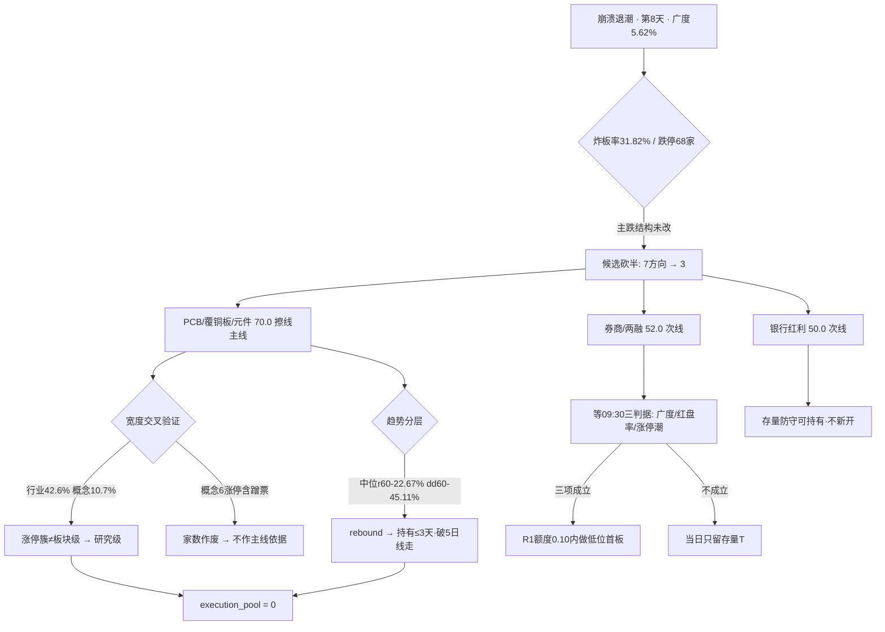

# 2026年11月23日 · **主线研判**

> **数据源新鲜度**: partial · **降级状态**: false · **置信度**: 0.55
> **上游口径**: R1 崩溃退潮型 / 仓位上限 10% / 无主线；R3 三条主题全部 L1_only；R4 8 条事件；R7 40 行业净流入表

## 一句话结论

崩溃退潮第 8 天，全场只有一条**可研究方向**——PCB / 覆铜板 / 元件（70.0 分擦线、`rebound` 层、研究级）；**可交易主线 = 0**，执行池 = 0，五条否决同时成立。

## 一、先定温度：为什么今天不存在“可交易主线”

| 指标 | 11-20 读数 | 判定 |
|---|---|---|
| 全市场涨占比 | 5.62%（涨 313 / 跌 5236，中位 **-5.08%**） | 🔴 主跌 |
| 涨停 / 跌停 | 30 / 68（R7 权威口径；tushare 口径 28 / 58） | 🔴 跌停是涨停的 2.27 倍 |
| 炸板率 | **31.82%**（U30/D68/Z14）；tushare 口径 20.00% | 🟡 首次回落至 35% 红线下，但原因是封板家数被压到 30 家，不是情绪修复 |
| 最高板 | 4 板（真视通 / 盛剑科技，后者 4 次开板） | 🔴 无高度、无梯队 |
| 成交额 | 14311 亿（+1165 亿 / +8.86%） | 🟡 放量下跌＝派发而非承接 |
| 昨日涨停次日溢价 | 均值 -3.40% / 中位 -5.08%，再涨停 3 只 | 🔴 接力意愿极低 |
| 隔夜外压 | NVDA **-14.01%** / 费半 **-10.73%** / 纳指 -5.28% | 🔴 AI 硬件链同轴压制 |

- **大资金意图**: 11-20 全市场主力 **-521.86 亿**（20 日 -4460 亿，仅 7 日为正），钱只去两处——PCB/元件（3 日 3/3 连续净流入）和防御端（白酒/水电/大行，后者多为小单接）。这不是普跌里的“洗盘”，是**减仓后只留一个窄口**的配置动作，对手盘是接下跌的散户小单（半导体超大单 -54.88 亿 / 小单 +86.92 亿）。
- **为什么走弱**: 位置（连跌 7 天、修复窗口第 8 天）＋ 催化（美股 AI 硬件崩盘属硬负事件）＋ 筹码（跌停 68 家、再涨停仅 3 只）三维全部指向负反馈；R1 情绪 22.1、R3 情绪 21.1，都落在“恐惧”极值下沿。
- **逻辑够不够硬**: 不够硬到可以开仓。三判据（开盘广度 >0.55、昨涨停红盘率 >60%、板块级涨停潮 ≥3 只）在 11-20 全部不成立，盘前无法预判，只能等 09:30–10:00 重新确认。**本日结论按“计划外不出手”执行**。

## 二、五维打分总表（每维 0–20 · 总分 100）

| 方向 | 热度 | 资金 | 涨停 | 叙事 | 共振 | 总分 | 结论 |
|---|:--:|:--:|:--:|:--:|:--:|:--:|---|
| **PCB / 覆铜板 / 元件** | 17 | 16 | 15 | 14 | 8 | **70.0** | 🟡 擦线主线 · 研究级（rebound 层） |
| 券商 / 两融 + 非银 | 11 | 8 | 3 | 17 | 13 | 52.0 | 👀 次线 · 等价格确认 |
| 银行 / 红利 / 防御口袋 | 12 | 10 | 3 | 13 | 12 | 50.0 | 👀 次线 · 存量防守口径 |
| 农业 / 乡村振兴 / 水产 | 12 | 9 | 7 | 10 | 11 | 49.0 | ❌ 丢弃（单源 L1 + 宽度 13.3%） |
| 制冷空调 / 名字辈反包 | 9 | 7 | 5 | 5 | 5 | 31.0 | ❌ 丢弃（个股点名） |
| AI 应用 / 数字媒体 | 10 | 8 | 3 | 5 | 4 | 30.0 | ❌ 丢弃（伪板块涨幅） |
| 机器人（人形/减速器） | 8 | 2 | 6 | 6 | 6 | 28.0 | ❌ 丢弃（假扩散：8 涨停 vs 15 跌停） |
| 半导体 / 国产算力 | 6 | 2 | 3 | 11 | 5 | 27.0 | ❌ 丢弃（事件正、资金反、宽度塌） |

> 打分口径提醒：**分数只回答“今天是不是主线”，不回答“能撑几天”**。撑几天由下面第三节的趋势分层单独判，两者不得互相替代。

## 三、主线 · PCB / 覆铜板 / 元件（70.0 · 擦线 · 研究级）

### 3.1 为什么是它：20261120 唯一“四腿同向”的方向

| 腿 | 证据 |
|---|---|
| 涨停簇 | 印制电路板 5 只 + 元件 6 只 = **11 只涨停**（全市场 30 只）；首板 5/6 扩散，唯一 2 连板中京电子；封单 2.04 / 1.67 / 1.21 亿，0 开板 4 只 |
| 资金 | 印制电路板 **+20.39 亿**（40 行业第 1）、元件 **+18.72 亿**（第 2）；3 日 **3/3 连续**（+69.92 / +67.92 亿）；超大单 +18.99 / 小单 -15.51（机构买、散户卖） |
| 席位 | 超声电子龙虎榜 **+4.41 亿**（全场净买第一，机构 +0.43 / 沪股通 +1.49）；东方海洋 +3.14 亿（第 2，非本线） |
| 消息 | 全球电子协会 11-22 预警：玻纤布/树脂/铜箔/覆铜板全线供不应求，常规材料紧张**至少到 2027H1**；AI 服务器板 20 层→40 层；兴森科技拟回购 4–5 亿、科翔获章建平家族 13.35 亿重仓 |

- **大资金意图**: 不是“抄 PCB 的底”，是**在 AI 硬件整链杀估值时挑一条有真实材料约束的子链做窄口**。对手盘很明确：超大单在买、小单在卖（印制电路板 小单 -15.51 亿），龙虎榜沪股通 +1.49 亿说明外资在首板当天就进场。配置逻辑是“卖铲子的上游涨价”，而不是“算力总量扩张”。
- **为什么走强**: 位置（行业 45 只中位距 60 日高 **-45.11%**，深跌）+ 催化（材料短缺是硬供给约束、有 2027H1 时间锚）+ 筹码（首板群 4 只 0 开板、封单厚）。三维里**催化最硬、位置最差**——这决定了它只能做第一波。
- **逻辑够不够硬**: 产业逻辑本身硬（3 源独立：上证报/财联社/东财业绩预告 + 章建平家族持仓），但**共振腿最软**——R3 三条主题全部 L1_only（L2 真人话语层 0 字节、L3 永久下线），按红线不得当“已确认主线”。可能的证伪路径只有三条：①材料涨价证伪（下游拒绝接受 CCL 提价）②AI 服务器订单下修 ③5 日资金由正转负。

### 3.2 但它是“反弹”，不是“趋势”（趋势分层 · 铁律）

| 层判据 | 读数 | 结论 |
|---|---|---|
| 行业 45 只中位 `r60` | **-22.67%** | 深跌 |
| 中位 `dd60`（距 60 日高） | **-45.11%** | 上方全是解套盘 |
| 中位 `r60_ex_pulse`（剔单日峰值） | **-34.21%** | 没有“一根阳线堆出来的假趋势” |
| 成员分层分布 | rebound **36** / rotation 9 / trend 0 | 整线 `rebound` |
| 龙一超声电子 | `r60` +28.54% / `dd60` -31.95% → **rotation** | 单票也不给买点 |

> `layer = rebound`，`holding_days_max = 3`。**反弹不是趋势主线**：深跌板块单日走强是因为上方真空、没人卖，不是因为有人买（超声电子换手 19.95%、成交 21.35 亿是首板一次性放量）。口径：只做第一波、持有 ≤3 天、**破 5 日线无条件走**，禁止按趋势票拿波段。

### 3.3 宽度交叉验证：涨停簇 ≠ 板块级（本日最大发现）

| 口径 | 成员数 | 红盘率 | 中位涨幅 | 涨停 / 跌停 | 判定 |
|---|:--:|:--:|:--:|:--:|---|
| 印制电路板（行业） | 47 | **42.6%** | **-1.02%** | 5 / 0 | 🟡 相对抗跌，未过 50% 宽度线 |
| 元件（行业） | 63 | 34.9% | -2.4% | 6 / 0 | 🟡 同上 |
| PCB概念（含蹭票） | 244 | **10.7%** | **-5.88%** | 6 / 3 | 🔴 宽度完全不成立 |
| 全市场基线 | 5572 | 5.6% | -5.08% | 30 / 68 | — |

- 行业口径：涨停序列 `0 → 2 → 1 → 5`（扩张）、零跌停、中位 -1.02% 对全市场 -5.08% 有 **+4.06pp 超额** → **相对宽度成立**。
- 概念口径：244 只成员里只有 10.7% 收红、中位 -5.88%，6 只涨停里 1 只主业不在元件（光华科技=电子化学/化工原料）→ **标签计数虚高**。
- 结论：按 skill 硬规则，**“5–11 家涨停扩张”不得作为板块级扩散依据**，只能按“个股点名 + 资金窄口”研究。`theme_persistence` 里 `breadth_check.pass = false` 已落盘。

### 3.4 龙头候选（3–5 只 · 带动性 > 辨识度 > 身位）

| 角色 | 代码 / 名称 | 板型 | 核心数据 | 通道 |
|---|---|---|---|---|
| 龙一 | `000823.SZ` 超声电子 | 首板 U · 0 开板 | 封单 1.67 亿 / 成交 21.35 亿 / 换手 19.95%；主力 +8.11 亿（全场第 2）；LHB +4.41 亿（全场第 1） | ❌ 不进 |
| 龙二 | `002579.SZ` 中京电子 | 2/2 板 · 0 开板 | 封单 2.04 亿（全链最厚）/ 成交 9.9 亿；人气 ths 25→8、dc 5→3 | ❌ 不进 |
| 候补 | `002916.SZ` 深南电路 | 无板 -0.59% | 主力 +3.38 亿 / 5 日 +9.05 亿（3/5 正）/ LHB 3 日 +1.96 亿（机构 +0.69）；业绩预告归母 +74%–78% | ❌ 不进 |
| 候补 | `002463.SZ` 沪电股份 | 无板 -0.96% | 成交 64.84 亿（全链第 1）/ 主力 +3.27 亿 / 5 日 +13.82 亿（3/5 正）；流通 1552 亿 | ❌ 不进 |
| 候补 | `605058.SH` 澳弘电子 | 首板 · 0 开板 | 封单 0.86 亿（成交占比 16.9%）/ 10:04 首封 / 流通 61 亿 | ❌ 不进 |
| 剔除 | `301132.SZ` 满坤科技 | 20 cm 首板 | 封单 1.21 亿，但**机构净卖 -0.06 亿 = 诱多** | — |
| 剔除 | `603386.SH` 骏亚科技 | 首板 1 次开板 | 封单 0.63 亿占成交 16%，质量低于澳弘 | — |
| 剔除 | `002199.SZ` 东晶电子 | 首板 | 封单 0.29 亿 / 成交 0.4 亿，流通 22 亿贴硬线 | — |
| 剔除 | `300903.SZ` 科翔股份 | 未封板 +3.63% | 收盘位置 0.49、收盘 55.95 < VWAP 56.70 → 冲高回落；5 日 -9.47%（事件正腿、价格反腿） | — |

> 角色判定口径：**情绪龙头**（`emo_branch`）= 板高最高 + 封单最厚 + 开板最少 → 中京电子；**核心票**（`core_capacity`）= 一提 PCB 先说谁 + 容量 → 沪电/深南。龙一给超声电子是因为它在当天**同时**具备带动性（10:00 首封、5 只首板群随之封板）、辨识度（dc 新进 #8）与席位第一。

### 3.5 思维链 · 超声电子（`000823.SZ` · 研究首推票，非执行票）

- **买入理由**: ①材料短缺是硬供给约束（全球电子协会：紧张至 2027H1，AI 板 20→40 层），PCB 是算力链里唯一“上游涨价”子链；②11-20 首板当天主力 +8.11 亿（全场第 2）、LHB +4.41 亿（全场第 1，机构 +0.43 / 沪股通 +1.49），成交 21.35 亿为全链第一，收盘位置 1.0、收盘高于 VWAP 17.99 → core 强度 3/3。
- **风险点**: ①RR 结构性差：涨停价 = 5 日高，RR5 分母归零（0.00）、RR20 0.73，止损距 -11.99% 已越 -10% 硬区间；②5 日主力仅 2/5 正、板块 20 日 -234.58 亿仍在失血 → 窄口回流随时结束；③隔夜 SOX -10.73%/NVDA -14.01%，同轴外压可能让首板次日直接高开低走。
- **止损条件**: 研究级证伪线（不做交易指令）：①**板块层**——印制电路板次日红盘率跌破 30% 或涨停家数回落 ≤2 家 → 整线降级；②**个股层**——若 D1 采纳且入场，止损参考 `16.29`（R7 stop10，-11.99%），并须先按次日目标价重算 RR 过 ≥2 才可下单。
- **可验证假设**: 24–72 小时内可观测 —— ①09:30–10:00 元件/印制电路板是否出现 **≥3 只**板块级涨停潮（成立=窄口延续，不成立=一日游）；②印制电路板当日红盘率能否从 42.6% 抬到 **>50%**；③板块 5 日主力净流入能否由 -4.18 亿翻正。三项里两项不成立 → 本线在 E1 复盘中判失败。

### 3.6 思维链 · 中京电子（`002579.SZ` · 情绪龙头）

- **买入理由**: ①PCB 链唯一 2/2 板，封单 2.04 亿全链最厚、0 开板，抛压极小；②人气斜率全场最大（ths 25→8，Δ+17；dc 5→3），R4 三源高置信点名。
- **风险点**: ①无龙虎榜级席位背书（R7 未把它纳入候选）→ 承接全靠情绪；②2 板以上接力在主跌段属模式外（跌停 68 家的市场里做高度）；③5 日元件板块资金 -17.87 亿，趋势未确认。
- **止损条件**: 断板即认输——击穿 `12.70` 视为形态破位（R3 估算约 -5.2%）；未测算 RR（R7 未纳入 gate）→ **不得进 execution**，若 D1 采用须重新测算。
- **可验证假设**: ①次日竞价高开幅度是否在 +3%–+7% 的“可持续”区间（>+8% 属兑现风险）；②板上换手能否维持在 10%–20%（>25% 视为派发）；③是否出现同链第二只 2 板（出现=梯队，没出现=孤票）。

### 3.7 交叉验证（CV）与红绿灯

| 源 | 命中 | 证据 |
|---|:--:|---|
| R3 共振 | ✅ | rank1 主题，但真等级 **L1_only** → 不构成强共振 |
| R4 催化 | ✅ | 印制电路板 medium（net 0.161）、电子布/玻纤 medium 正面（0.421） |
| R7 资金 | ✅ | top_inflow **#1 / #2**，3 日 3/3 连续 |
| CV 分 | **1.00** | 三源同名同向 = D1 排序权重，**不等于开仓许可** |

## 四、次线两条：观察，不进场

### 4.1 券商 / 两融（52.0 · 叙事最强、资金最空）

| 维度 | 读数 | 说明 |
|---|---|---|
| 叙事 | R4 券商/两融 net **1.330**（全表最强三腿：融资保证金 100%→80%、创业板+科创板做市、沪深降费 27.58 亿） | 硬政策、但 11-30 才实施 |
| 资金 | R7 **40 行业净流入榜无“证券”** | 当日零资金证据 |
| 价格 | 证券 50 只红盘率 **12.5%**、中位 -1.27%、涨停 0 | 政策未出时券商仍在跌 |
| 趋势层 | rotation（中位 r60 -8.84%、dd60 -14.36%） | 轮动层不给买点 |

- **大资金意图**: 政策是“流动性宽松”，不是券商盈利改善；资金没有提前埋伏（11-20 券商还在跌），周一高开的多头是**预期买家**而非配置盘。
- **为什么走强**: 不成立（此处为走弱）—— 位置（60 日 -8.84%）＋ 催化（周末消息，未定价）＋ 筹码（无涨停、无席位）——三维里只有催化一维成立。
- **逻辑够不够硬**: 政策本身硬（3 事件叠加、时间锚 11-30），但**缺价格与资金双确认**，只能观察。证伪路径：高开后 30 分钟内回落、或证券红盘率次日仍 <50%。

### 4.2 银行 / 红利 / 防御口袋（50.0 · 全场唯一趋势层）

| 项目 | 读数 |
|---|---|
| 趋势层 | **trend**（42 只成员中位 r60 **+8.38%**、dd60 -1.86%、27/42 trend）→ 全市场唯一 trend 板块 |
| 宽度 | 红盘率 **54.8%**、中位 **+0.19%**（保险 60% / +0.54%）→ 唯一过 50% 的板块 |
| 资金 | 国有大型银行 +2.73 亿（40 行业第 16）；保险 +2.75 亿但超大单 -1.57 亿；水电 +4.02 亿（3 日 / 5 日连续正） |
| 缺口 | **涨停 0**、热榜缺席、大行 3 日 -7.8 亿 → 无情绪载体 |

- **大资金意图**: 减仓型配置资金找“不跌的资产”，不是进攻。小单在买（保险 小单 -5.31 意味着小单卖出？实际是超大单流出、小单净流出更少 → 机构在减，散户在扛）。
- **为什么走强**: 纯相对抗跌——全市场中位 -5.08% 的对照下 +0.19% 就是“强”。位置贴 60 日高、催化是降费+主动 ETF 360 亿。
- **逻辑够不够硬**: 对**存量高股息持仓**是“可以继续持有”的硬依据（唯一 trend + 唯一过 50% 宽度）；对**新开仓**不构成买点——涨停 0 意味着打板/半路通道全不适用，低吸在跌停 68 家的市场里赔率低。

## 五、丢弃的五条线（含宽度假信号案例）

| 方向 | 分 | 丢弃主因 |
|---|:--:|---|
| 农业 / 乡村振兴 / 水产 | 49 | 好当家 4/7 板 + 金新农 3/6 + 万向德农首板，情绪端成立；但种植业与林业 30 只**红盘率仅 13.3%**、中位 -2.42%；R3 判 single_source（55 篇公众号无农业专属观点）→ 单源不授共振身份 |
| 制冷空调 / 名字辈反包 | 31 | 制冷空调设备 140 只红盘率 **8.6%**、中位 -5.55%，只有冰山冷热一只被封（2 次开板）；R3 已判“名字辈整体接盘期 = 模式外，拦截” |
| AI 应用 / 数字媒体 | 30 | 数字媒体 4 只涨停，但“其他数字媒体 +15.0%”是 1–2 只 20 cm 成分股拉出的**伪板块涨幅**；数字媒体全体 5 日 -26.74 亿 |
| 机器人 | 28 | **假扩散典型**（详见 5.1） |
| 半导体 / 国产算力 | 27 | 事件正腿（阿里 CEO 国产芯片口径）、资金反腿（半导体 -109.45 亿，超大单 -54.88 / 小单 +86.92 派发）、宽度塌（190 只红盘率 3.7%） |

### 5.1 机器人：为什么“家数连续 3 日 + 回升”仍然作废

| 交叉验证项 | 读数 | 是否成立 |
|---|:--:|:--:|
| 题材矩阵家数 | 11-19 2 家 → 11-20 4 家（连续、expanding） | ✅ 家数成立 |
| 成分股红盘率 | 1257 只成员 **4.1%** | ❌ |
| 成分股中位涨幅 | **-5.63%** | ❌ |
| 涨停 / 跌停 | 8 / **15**（跌停多于涨停） | ❌ |
| 资金 | R7 40 行业榜无机器人相关前置流入 | ❌ |

> 三条任一不成立，家数结论即作废——这里是四条不成立。**涨停簇宽度 ≠ 板块宽度**：8 只涨停只是个股点名，4.1% 红盘率意味着整个板块在崩。

## 六、妖股赛道（羊年梗）：本日是负反馈，空池

| 羊族（yáng）成员 | 11-20 结果 |
|---|---|
| 阳光照明（阳） | 3 连板 → **跌停 -9.96%**，18 次开板 |
| 泰嘉股份（泰） | 2 连板 → **跌停 -9.99%** |
| 扬子新材（扬） | **跌停 -10.00%**，流通 20.3 亿贴硬线 |
| 群兴玩具（群·含羊部件） | **跌停 -10.04%**，换手仅 2.3% |
| 东方海洋（洋） | 首板 +9.97%、0 开板、封单 2.02 亿、LHB +3.14 亿 —— **唯一存活** |

- 羊族涨停:跌停 = **1:4** → 梗未被资金认可，属退潮不属启动。
- 东方海洋的存活归因是**水产避险 + 低位反包**（sector-driven），R3 已按“名字辈模式外”拦截 → 不给妖股席位，只列观察。
- 纪律对齐：无跟风赚钱效应 = 不做（§纪律 ⑦）；退潮期不硬做。

## 七、今天怎么走：决策树

## 关键证据

- **证据 1**：印制电路板 +20.39 亿 / 元件 +18.72 亿，3 日 3/3 连续净流入，超大单 +18.99 / 小单 -15.51 → 机构买、散户卖 · 来源 `R7_capital_flow.json`
- **证据 2**：全球电子协会 11-22 预警，常规材料紧张至少至 2027H1，AI 板 20 层→40 层 → 硬供给约束 · 来源 `R4_news.json`
- **证据 3**：印制电路板 47 只红盘率 42.6%、中位 -1.02%、涨停 5 跌停 0；PCB概念 244 只红盘率 10.7%、中位 -5.88% → 行业与概念口径背离，宽度未过 50% · 来源 `_work/r2_breadth_all.json`
- **证据 4**：行业 45 只成员中位 `r60` -22.67%、`dd60` -45.11%，36/45 落 rebound 层 → 反弹口径 · 来源 `_work/r2_sector_layer.json`
- **证据 5**：机器人 1257 只成员红盘率 4.1%、中位 -5.63%、涨停 8 / 跌停 15 → 家数假扩散 · 来源 `_work/r2_breadth_all.json`
- **证据 6**：羊族 11-20 涨停:跌停 = 1:4（阳光照明 3 板跌停）→ 梗失效 · 来源 `_work/limit_20261120.json` + `toplist_20261120.csv`

## 数据源审计

| 源 | 日期 | 状态 | 备注 |
|---|---|:--:|---|
| tushare/limit_list_d | 2026-11-20 | 🟢 | 93 行（U28/D58/Z7），叠加 R7 stk_limit 权威补录 U30/D68/Z14 |
| tushare/ths_index + ths_member | 2026-11-20 | 🟢 | 12 个行业/概念口径成分股，用于宽度交叉验证 |
| eastmoney/moneyflow_ind_dc（经 R7） | 2026-11-20 | 🟢 | 40 行业单日/3日/5日/20日序列 |
| ths/dc 热榜（经 R3） | 2026-11-20 | 🟢 | 概念榜 14→#2、个股 rank_momentum_up |
| wechat_official_20（经 R4/R3） | 2026-11-22 | 🟢 | 55 篇公众号语义归并（匿名聚合） |
| wechat_cli_5groups | 2026-11-23 | 🔴 | 0 字节 → L2 真人层断更，共振只到 L1_only |
| weflow-analytics | 2026-11-23 | 🔴 | 永久下线 |
| kb/research.db market_daily_bars | 2026-11-20 | 🟡 | 146.8 万行；002463.SZ 日线缺失 → layer 记 unknown |
| data/rules/theme_anchors/latest.json | 2026-11-02 | 🟡 | 多日未更新、缺容量型核心锚，PCB 锚人工定 |
| data/rules/yaogu_memes/yaogu_llm_context_20261123.txt | 2026-11-23 | 🟡 | 名称库 3123 只完整；涨停池/龙虎榜段落为空，已用本地池重建 |
| tushare/top_list | 2026-11-20 | 🟢 | 73 行席位数据 |

## 不确定性 / 反证

- **自我 pushback 一**：`CV = 1.00` 容易读成“三源确认”。但 R3 真等级只有 L1（L2 断更、L3 下线），R4 net 仅 0.161（负面腿 -0.441 同轴对冲）→ 这不是强共振，只是“没有反证的三源同名”。若 D1 把它当强共振，就会在跌停 68 家的市场里做一条 rebound 线。
- **自我 pushback 二**：PCB 的“11 只涨停”在概念口径 244 只里对应只有 10.7% 红盘率。行业口径 42.6% 也**没过 50%**。我给 70.0 擦线而非更高，是因为热度/资金两维确实全场第一；若把宽度折价打进去，真实分数更接近 65——即“次线”而非“主线”。这条 5 分差要 D1/R6 复核。
- **自我 pushback 三**：只有 1 条擦线主线 + 2 条次线，与 R1 的“无主线”口径看似冲突。实际不冲突：R1 用“行业 ≥8 家涨停”代理，R2 用五维加权；两者都指向**不可交易**。本文件所有 5 只候选 `research_only = true`。
- **待 R6 验证项**：①PCB 5 日/20 日资金仍为负（-4.18/-234.58 亿）→ 是否属“资金退潮期的一次窄口反弹”②深南/沪电 RR20 达标（2.36/2.99）但 RR5 全部 <0.35 → 是否只能做隔日不做日内 ③羊族 11-19 涨停数未补录（影响梗强度对比）。

## 与其他 R/D/E 的关系

- **依赖**: `R1_style.json`（温度/仓位上限）、`R3_sentiment.json`（共振主题与 distribution_alert）、`R4_news.json`（sectors_catalyzed / top_events）、`R7_capital_flow.json`（40 行业资金 + gate RR）
- **被消费**: D1（canghai-plan）取 `main_lines.leaders` 5 只研究候选 + `secondary_lines` 防守口径；R5 对这 5 只做六维画像；R6 反证本文件全部结论（R6 `hard_reject` 优先于本文件）；E1 复盘 `theme_persistence.breadth_check` 与 `可验证假设`
- **不要误读**: `main_lines_count = 1` 是**研究候选层级**，不是可交易确认；`execution_pool = []` 表示零开仓资格

## Sub-Agent 元数据

- skill: analyze_main_sectors_v1@1.3
- artifact: `data/research/20261123/R2_main_sectors.json`（33.4 KB）
- work artifacts: `_work/r2_breadth_all.json` / `_work/r2_sector_layer.json` / `_work/r2_layer.json` / `_work/toplist_20261120.csv`
- 生成耗时: 约 12 分钟（含 12 个成分股口径的宽度交叉验证与趋势层复算）
- model: deepseek-v4.1-flash
- 校验: `tests/checks/check_r2_cross_validation.py 20261123` ✅ 通过（main_lines 1 / consensus 2 / degraded false）
