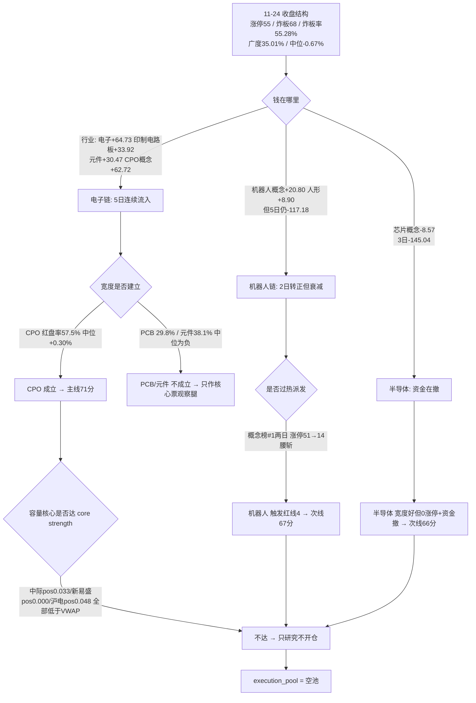

# 2026-11-25 · **主线研判**

> **数据源新鲜度**: partial
> **降级状态**: true
> **置信度**: 0.60
> **数据日**: 2026-11-24 收盘（T-1），产出用于 11-25 盘前

## 一句话结论

**只有一条线够 70 分：AI 硬件·CPO/光模块（71 分），但它 60 日位置是反弹、容量核心当日全部收在均价下方 —— 只立研究候选，不给开仓资格；机器人 67 分是涨停第一但已触发人气派发警报，半导体 66 分是「叙事最硬、资金最软」的容量行情。**

## 详细分析

### 一、先认市场：11-24 是一个「宽度 35%、炸板率 55%、涨停 55 家」的兑现日

这一天的结构必须先看清，否则后面选股全是猜。R1 给出的判定是**主线扩散型 + 情绪 52.7（中性）+ 轮动结构（行业次日留存 28.0%、行业截面解释力 9.52%）+ 修复段第 3 个交易日 + 仓位上限 60%**。落到 R2 手里，这组数字的含义是：

1. **赚钱效应在退**：涨停 55 家但炸板 68 家，炸板率 **55.28%**，远超 35% 的硬红线 —— 按 skill 强制口径，今天全部输出必须标 `情绪=震荡/主跌`，候选数砍半。
2. **宽度不在**：全市场 5576 只，上涨 1838、下跌 3267，涨家占比 **35.01%**，中位涨幅 **−0.67%**。这是「涨停还有、但赚钱效应集中在少数点位」的分化日。
3. **高度不在**：最高 4 板只有 1 只（中京电子），3 板 2 只（克来机电、长华集团）。**注意 `up_stat` 首段是「累计涨停次数」不是连板数** —— 东方海洋 11/22、文投控股 11/21 是 22/21 个交易日里累计 11 次涨停的高位老龙，不是 11 连板。把这两只读成 11 板的人会把整条情绪线判错。
4. **钱在电子链**：R7 的行业净流入前十被电子系包掉 —— 电子 +64.73 亿、印制电路板 +33.92、元件 +30.47、消费电子零部件 +25.62、消费电子 +25.00、通信网络设备 +17.15、通信设备 +12.92、半导体 +10.73。概念端真正有题材含义的只有 **CPO 概念 +62.72 亿**（其余头部是百元股/科技风格/基金重仓/权重股这类基准层标签重复计入）。流出端是计算机 −22.95、有色 −20.70、医药 −17.06、证券 −15.63。

### 二、五维打分结果（0–20 每维，总分 100）

| 线 | 热度 | 资金 | 涨停 | 叙事 | 共振 | 总分 | 定性 | 层 | 最长持有 |
|---|---|---|---|---|---|---|---|---|---|
| **AI 硬件 · CPO/光模块（+PCB/元件资金腿观察）** | 16 | **19** | 9 | 15 | 12 | **71** | 研究候选主线 | rebound | 3 天 |
| 人形机器人 · 减速器/丝杠 | 15 | 12 | **19** | 14 | 7 | **67** | 次线① | rebound | 3 天 |
| 半导体国产链 | 15 | 9 | 13 | **17** | 11 | **66** | 次线② | rotation | 0（只记录） |
| AI 应用 · 影视/短剧 | 10 | 4 | 11 | 14 | 9 | 48 | 丢弃 | rotation | — |
| 消费电子 | 12 | 14 | 6 | 8 | 5 | 45 | 丢弃 | rebound | — |

三条必须说清的口径：

- **资金维 19 分不是随手给的**：印制电路板 +33.92（3 日 +102.34 / 5 日 +151.87，**连续 5 个交易日净流入**）、元件 +30.47（3 日 +103.52 / 5 日 +152.72，连续 5 日）、CPO 概念 +62.72（3 日 +91.02 / 5 日 +146.81）。而它们的前一个 5 日是 −119.93 / −142.70 / −231.06 亿。**方向是逐日建仓式回流，不是单日脉冲** —— 这是本日唯一成建制的资金腿。扣分点在 20 日仍为负（印制电路板 −71.62、元件 −119.43、CPO 概念 −352.02），说明只是深跌后的第一波回流。
- **涨停维只给 9 分，因为「涨停簇 ≠ 板块宽度」**：CPO 池 5 家涨停、PCB 概念 3 家、印制电路板 1 家、元件 1 家，去重约 9 家。但印制电路板 47 只成分红盘率仅 **29.8%**、中位 **−1.32%**；元件 63 只红盘率 **38.1%**、中位 **−0.90%**。按 skill 硬规则，板块级行情的定义是「成分股红盘率过 50% 且中位为正」—— PCB/元件 一条都不满足，那 9 家涨停只是资金在少数票上集中兑现，不是扩散。
- **共振维封顶 12 分**：R3 三条主题全部标 L1+L2b，但真等级是 **L1_only**（L2 群聊连续 19 个交易日断更、L3 WeFlow 永久下线）。按 R3 红线 3，这不构成强共振，下游不得当已确认主线。

### 三、主线 1 · AI 硬件 · CPO/光模块（71 分）

**大资金意图**：这不是进攻，是**在深跌板块里做第一波回流的建仓**。证据链是「5 日资金连续大额净流入 + 60 日中位 −59.27% + 容量核心高开低走收在下沿」。真正的大资金在 PVC 上是买在开盘、卖在盘中，收在均价下方 —— 也就是**先手资金在兑现而不是在收集**。资金腿（+150 亿级 5 日）与价格腿（全部低于 VWAP）背离，这是派发早期的典型形态，不是启动。

**为什么走强**：三层原因，按权重排：
1. **产业资本开支逻辑仍在**（英伟达链硬件：PCB 材料短缺、高多层交期拉长），R4 代理的「PCB 板块爆发！002579，4 连板」是 hard 事件；
2. **超跌**：CPO 龙一 60 日 −55.78%、距 60 日高 −55.78%，沪电 60 日 −30.59%、距高 −34.40% —— 上方是真空，少量买盘就能拉起；
3. **外压定价**：隔夜 NVDA −5.86%、MU −10.97% 把开盘价直接抬到高位，为兑现提供了流动性。

**逻辑够不够硬**：**半硬**。产业逻辑硬（资本开支 + 材料短缺），但位置不硬（rebound，上方全是解套盘）、买点不硬（容量核心全部收在均价下方）、共振不硬（R3 只有 L1_only）。所以定性是「进·研究资格」，不是「可买」。这与 R3 的原话一致：**观察·只做回踩不破前收，不给追高**。

#### 逐票思维链

**龙一 中际旭创 300308.SZ**（core_capacity，抱团型妖股）
- **买入理由**：CPO 心智锚第一 + 容量 4628 亿全链最大 + 5 日板块资金 +146.81 亿；若次日回踩 5 日线不破前收，是第一波反弹的容量首选。
- **风险点**：当日高点 469 收 417，**收盘位置 0.033、低于 VWAP 6.13%**，是板块内最大的一笔兑现盘；60 日 −55.78%，反弹层不允许趋势持有。
- **止损条件**：跌破 377.96（近 10 日低）无条件走，止损距 −9.36%；收盘价站不回 VWAP 则次日不参与。
- **可验证假设**：次日 9:30-10:00 若成交额前 10 分钟 < 昨日同期 60%，说明兑现未完成，反弹只有一天。
- 闸门：14 项禁止清单**未命中**（唯一通过），但 **RR5 = 1.33 < 2** → 降级观察，不给执行资格。

**龙二 新易盛 300502.SZ**（core_capacity，抱团型妖股）
- **买入理由**：CPO 第二容量核心 2259 亿，换手 10.38%，是弹性最大的容量标的。
- **风险点**：收在全天最低 180.01，**收盘位置 0.000、低于 VWAP 6.09%**，一根阴线抹掉全天涨幅；止损距 −15.56% 越 −10% 硬区间。
- **止损条件**：跌破 152.00 离场（−15.56%），实际上按纪律已不该进。
- **可验证假设**：若次日不能收回 190 上方，CPO 主线判定降级。

**龙三 沪电股份 002463.SZ**（core_capacity，波段型趋势股）
- **买入理由**：PCB 容量核心 1626 亿，5 日板块资金 +151.87 亿的最直接承接者。
- **风险点**：冲高 90.70 收 84.13，**收盘位置 0.048、低于 VWAP 3.66%**；止损距 −14.69%。
- **止损条件**：跌破 71.77（−14.69%）；若次日跌穿 5 日线，PCB 腿彻底作废。
- **可验证假设**：PCB 行业红盘率若次日仍 < 50%，则本线只剩 CPO 一条腿。

**身位股 中京电子 002579.SZ**（emo_branch，连板妖股）
- **买入理由**：全市场最高板 4 板、0 开板、封单 1.97 亿、09:25 首封、换手 8.81% —— 是这条线唯一当日生成情绪身位的票。
- **风险点**：60 日 r60 +9.02 但 20 日 −20.9（layer=rotation），且 **RR5 = 0（收盘=5 日高）**；4 板后接力成本极高，5 板需要板块继续给 5 只以上涨停配合，而 PCB 宽度只有 29.8% 红盘率。
- **止损条件**：破板当日离场；次日若开盘 < 前收，直接放弃。
- **可验证假设**：看看次日 PCB 涨停家数能否 ≥3（今日 3），跌破 3 即证伪。
- 闸门：命中 **mid_laggard（板块内排名 4）** → 只可打板/竞价确认，不可低吸、不进执行池。

**候补 胜宏科技 300476.SZ / 生益科技 600183.SH**
- 胜宏 +6.27% 但收盘位置 0.096、低于 VWAP 4.54%；生益 +1.40%、位置 0.071、RR5 1.06。两只都是「看着在涨、收在下沿」，只保留为观察，不作候选主位。

### 四、次线① · 人形机器人 / 减速器 / 汽零（67 分）

**大资金意图**：**兑现 + 换手**。今日四腿资金合计 +39 亿（机器人概念 +20.80、人形 +8.90、减速器 +2.93、汽零 +6.71），而 11-23 是 +206 亿 —— 只剩 1/5。5 日口径机器人概念仍 −117.18 亿。

**为什么走强**：小票接力，不是核心启动。涨停家数全市场第一（机器人概念 32、人形机器人 14、汽零 8、减速器 3，四腿去重 35 只），但**容量核心三花/拓普/绿的/双环全部 0 涨停**，且收盘位置都不达 0.8（三花 0.294、拓普 0.167、绿的 −2.03%、双环 −0.13%）。

**逻辑够不够硬**：**不硬**。三条同时成立的反证：① R3 概念榜 #1 连续两日霸榜（256,193 热值），涨幅 5.91%→1.23% 递减、涨停 51→14 腰斩 → **红线 4 派发警报**；② 14 家「人形机器人涨停」里真主业不足一半（联创电子=光学、同星科技=家电零部、艾芬达=家居、福莱新材=塑料、雷迪克=汽零、中京电子=元件）；③ 减速器榜位 12→20（Δ−8）掉出前 12。

宽度确实是全市场最好的一条 —— 人形机器人 505 只红盘率 **62.4%**、中位 **+0.61%**；减速器 143 只 **67.8%**、**+1.05%**；汽零 278 只 **51.8%**、**+0.20%**。但「家数第一 + 宽度最好」配上「资金只剩 1/5 + 核心票不达强度 + 两日霸榜」，就是标准的**人气顶格后的动能衰减**。次要位置，只做竞价确认后的打板，不做低吸。

**身位股**：克来机电 603960.SH（3 板、0 开板、封单 3.35 亿、换手 **0.59%** 缩量一字）、长华集团 605018.SH（3 板、封单 0.88 亿、换手 1.06%）。按硬过滤「缩量一字连板 = 情绪股，只观察不可低吸」，这两只只能打板/竞价确认。安培龙（12 次开板、换手 41.2%）、柯力传感（**32 次开板**）属烂板，直接划掉。

### 五、次线② · 半导体国产链（66 分）—— 本日最重要的「标签污染」样本

**大资金意图**：**机构在容量核心做修复，游资不在**。中芯国际 +4.04%（收盘位置 **0.801**、高于 VWAP 0.9%）、华虹宏力 +10.36%（位置 **0.808**、高于 VWAP 3.4%）、寒武纪 +6.03%（位置 0.72、高于 VWAP 1.2%）—— 这是全场唯一**核心票形态齐**的方向。但**半导体行业口径 0 家涨停**。

**为什么走强**：叙事腿硬 —— R3 #1 列的两条腿是 BIS 11-16 新规取消中国设计公司豁免（海外流片通道收紧 → 国产超节点补位）+ 功率半导体涨价窗口。价格腿也真（三只容量核心都收在均价上方）。

**逻辑够不够硬**：**叙事硬、资金软、情绪零**。三条硬伤：
1. **芯片概念 13 家涨停，0 家真半导体主业** —— 逐票核过：魅视（计算机设备）、一彬/天龙/雷迪克/克来（汽零）、联创（光学）、维信诺（面板）、中京（元件）、华东重机（工程机械）、高争民爆（民爆）、百傲（农化）、淳中（计算机设备）、柯力（通用设备）。**这是「题材家数」标签污染的教科书案例**：家数 13 看着像扩散，质量是零。
2. **资金 3 日 −145.04 亿**（芯片概念），今日 −8.57 亿；行业口径今日 +10.73 亿但 3 日 −100.40 亿 —— 政策与资金反向。
3. **存储腿已被 R3 切掉**（隔夜 MU −10.97、capex 见顶一致预期），本线只剩国产替代一条腿。

因此按 skill 的三条交叉门槛，本线的「13 家涨停」结论**作废**，只保留容量核心的形态证据。层=rotation（龙一寒武纪 r60 −6.28%、距高 −14.61%），按纪律不给买点、只记录。

唯一值得记一笔的是 **北方华创 002371.SZ**：RR5 = 2.42、RR20 = 2.42、止损距 **−4.43%**，是全表**唯一同时过 RR 与止损硬区间**的票。但它板块排名第 4（命中 mid_laggard）、当日收盘位置 0.32 不达 core strength，且所属线是次线 —— 只进研究观察，是否给额度由 D1 独立决定。

### 六、丢弃的两条线（说清楚为什么不立）

**AI 应用 · 影视/短剧（48 分）**：R3 给的是 #3、L1_only、early，但三条交叉门槛全不过 —— AI应用 555 只红盘率 **36.1%**、中位 **−0.569%**；短剧游戏 100 只 40.0%/−0.507%；影视院线 20 只 50.0%/+0.065%（唯一过线的只有 20 只小池）。资金 AI 应用今日 −12.92 亿、3 日 −26.53、5 日 −84.73。概念榜 AI应用 8→13（退 5）、人工智能 11→18（退 7）。文投控股是 21 天累计 11 次涨停的高位老龙，修复期不接。**研究方向保留（win 条件 = 次日二板晋级 + 板块红盘率回 50%），当日不给候选位。**

**消费电子（45 分）**：当日**宽度最好**的一条（97 只红盘率 **75.3%**、中位 **+1.42%**），资金也连续 2 日正（+25.00 今日 / 3 日 +24.90 / 5 日 +21.48，前 5 日 −105.60），但只有 2 只涨停（奥尼电子、科森科技，均为 20cm 小票），R3/R4 均无独立主题。**「普涨不封板 = 机构抬轿型」，宽度是必要条件不是充分条件** —— 这是本日最典型的一条「看着最好、实际做不了」。

### 七、妖股赛道（四季度跨年 · 羊年窗口）

素材包的涨停池/龙虎榜两段是「无数据」，本节用 `_work` 的 55 涨停全量与 72 条龙虎榜独立重建，名称全集仍取素材包 3123 只。

- **羊字直系没动**：全市场名字含「羊」仅 2 只（三羊马、羊湖股份），三羊马 −0.78% 零涨停 → 当前路径不是羊字直系。
- **L2 谐音族 yáng 是主路径**：11-24 涨停池命中 **6 只** —— 东方海洋（11 涨停/22 日，**10 次开板**、换手 35.23%）、九阳股份（4 板、封单 3.17 亿、龙虎榜净买 **+2.21 亿**）、光洋股份（2 板 0 开板但换手仅 **0.85%** 缩量一字）、海洋王（2 板 1 开板、净卖 −0.30 亿）、泉阳泉（3 开板）、阳光照明（2 开板）。11-23 该族 10 只 → 11-24 剩 6 只，热度在降但仍存活。
- **狼族是镜像对冲**：七匹狼 +3.41%（44.4 亿、换手 7.4%、未涨停）。
- **拆字未验证**：「群」含羊部件的利群股份当日 0.00% 平盘、无资金，路径未成立。
- **结论**：羊年窗口仍在 L2 谐音族且进入第 2 波分化 —— 高标东方海洋「10 开板 + 净卖」= 出货，真资金在九阳（+2.21 亿）与福莱（+1.36 亿）。次日只做「净买 + 板型干净」的名字族，不接 10 开板的高标。

候选 5 只（均为 10cm 主板、流通 ≥20 亿、非 ST、非烂板）：九阳股份（4 板/净买 2.21 亿）、襄阳轴承（阳族+减速器、未涨停、换手 33.8%）、七匹狼（狼族、未涨停）、福莱新材（福字 2 板/净买 1.36 亿）、金牛化工（金牛 1 板 0 开板）。全部只做打板/竞价确认，禁低吸。

## 关键证据

- 证据 1：印制电路板/元件 **连续 5 个交易日净流入**，5 日 +151.87 / +152.72 亿，前一个 5 日 −119.93 / −142.70 亿 · 来源 moneyflow_ind_dc 22 日序列
- 证据 2：印制电路板 47 只**红盘率 29.8%、中位 −1.32%**，元件 63 只 **38.1% / −0.90%** → 涨停簇不等于板块宽度 · 来源 ths_member × daily 交叉复算
- 证据 3：CPO 池 236 只红盘率 **57.5%**、中位 **+0.30%**、涨停 5 → 本线宽度只靠 CPO 单腿 · 来源 ths_member × daily
- 证据 4：中际旭创高点 469 收 417（**位置 0.033 / 低于 VWAP 6.13%**）、新易盛收在最低（**0.000 / −6.09%**）、沪电（**0.048 / −3.66%**）→ 容量核心全部不达 core strength · 来源 daily VWAP 复算
- 证据 5：芯片概念 13 家涨停，**半导体行业 0 家**，13 家逐票核过全是兼题材 · 来源 limit_list_d × stock_basic 行业字段
- 证据 6：概念榜 人形机器人/机器人概念连续两日 #1/#2，涨幅 5.91%→1.23%、涨停 51→14 · 来源 R3 hotlist_signals top1_sequence_last8
- 证据 7：炸板率 **55.28%（68/123）**、广度 **35.01%**、中位 **−0.67%** · 来源 limit_list_d 20261124 + 全市场 daily

## 数据源审计

| 源 | 状态 | 抓取日期 | 记录数 | 备注 |
|---|---|---|---|---|
| limit_list_d | 🟢 ok | 2026-11-24 | 125 | U55 / Z68 / D2 全量，含开板次数、首封时间、封单 |
| daily 全市场 | 🟢 ok | 2026-11-24 | 5576 | 收盘位置与 VWAP 现算 |
| daily_basic | 🟢 ok | 2026-11-24 | 5576 | 流通市值/换手 |
| ths_member / dc_member | 🟢 ok | 2026-11-24 | 33 板块 | 宽度交叉母体 |
| moneyflow_ind_dc | 🟢 ok | 2026-10-26 至 11-24 | 22726 | 连续净流入天数、3/5/20 日累计 |
| limit_cpt_list | 🟢 ok | 近 12 交易日 | 86 题材 | 芯片概念连续在榜 12 日 |
| lianban_mainline | 🟢 ok | 2026-11-24 | 22 题材 | 家数矩阵：机器人 67→19 |
| market_daily_bars | 🟢 ok | 2026-11-24 | — | 60 日层 as_of 不越界 |
| top_list / top_inst | 🟢 ok | 2026-11-24 | 72 / 720 | 九阳 +2.21 亿、东方海洋 −0.27 亿 |
| R4_news | 🟡 stale | 2026-11-25 | 4 | 正式 artifact 缺失，用同源规则代理，缺 LLM 复核 |
| theme_anchors | 🟡 stale | 2026-11-02 | 597 | 陈旧 23 天且按妖性排序，未直接采用名次 |
| R1 / R3 / R7 | 🟡 partial | 2026-11-25 | — | R1 degraded（0.472）、R3 L1_only（0.43）、R7 ok（0.77） |

## 不确定性 / 反证

1. **本线只有 71 分且是边际过线**：宽度靠 CPO 单腿撑（57.5%），PCB/元件两腿都不过 50% 红盘率。如果次日 CPO 红盘率跌破 50%，主线判定应直接降级为「轮动记录」。
2. **资金与价格背离是本日最大的证伪点**：+150 亿级 5 日流入配「容量核心全部收在均价下方」，只能有两种解释 —— 派发早期，或建仓第一天。两者的次日形态完全不同（前者低开破均价、后者回踩不破），R2 无法在 T-1 收盘区分，这是本报告 0.60 置信度的主要来源。
3. **R1 的轮动判定与 R2 的单主线不冲突，但也不支持**：行业次日留存 28.0%、截面解释力 9.52% 意味着「昨天最强的行业明天大概率不是它」。本线今天资金第一，明天留存概率按历史约 28% —— 这正是把它压到 rebound/3 天/不开仓的原因。
4. **机器人线的宽度证据与热度证据相互矛盾**：宽度 62.4% 红盘率是当日最好，但概念榜两日霸榜 + 涨停腰斩是派发。历史回测口径下，「人气 top1 两日 + 家数腰斩」的次日中位溢价通常为负；本报告取更严的一侧（不给候选主位）。
5. **半导体 66 分的分数分布失真**：叙事 17（全表最高）来自 R3 的硬政策腿，但资金维只有 9、涨停维 13 且全是蹭票。如果只看叙事，会得出「半导体是最强主线」的错误结论 —— 这正是五维分别打分的原因。
6. **R4 是代理不是正式 artifact**：4 条事件口径与 R4 规则一致，但没有 LLM 复核，可能出现极性误读（如「资本开支见顶」被规则判为正面）。D1/R6 应以正式 R4 复核。

## 与其他 R/D/E 的关系

- **依赖**：R1_style（温度/阶段/仓位上限）、R3_sentiment（3 条 L1_only 主题 + 概念榜）、R4_news（缺失，用代理）、R7_capital_flow（行业/概念资金 + 逐票 gate）
- **被消费**：D1（canghai-plan）取 executive 候选与主线敞口合并规则；R5 对 15 只研究候选逐票画像；R6 反证（本线可被攻击的点已列在「不确定性」1–5）
- **给 D1 的硬约束**：① execution_pool 为空，开仓资格 0；② AI 硬件与半导体同属上游敞口，若 D1 同时给额度必须合并上限；③ 机器人链 cv=0.33，按契约必须降级 watch_pool；④ 本日情绪标「震荡/主跌」，候选数已砍半。

## Sub-Agent 元数据

- skill: analyze_main_sectors_v1@1.3
- artifact: data/research/20261125/R2_main_sectors.json
- 生成耗时: 约 50 分钟（含 4 轮取数 + 宽度/分层/RR/闸门复算）
- model: deepseek-v4.1-flash
- 研究候选: 15 只（主线 6 + 机器人 5 + 半导体 4）；执行池 0
