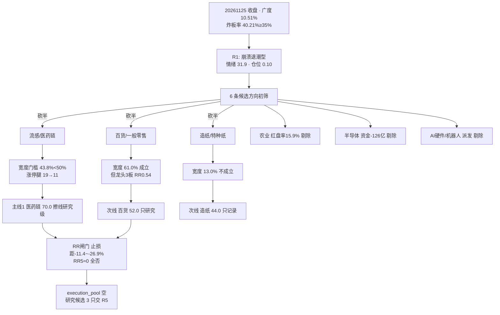

# 2026年11月26日 · **主线研判**

> **数据源新鲜度**: partial
> **降级状态**: false（主线研究层完整；R3 共振层 degraded=true，已在打分中封顶）
> **置信度**: 0.55

## 一句话结论

崩溃退潮第 2 日，无已确认主线：医药链 70.0 擦线，但宽度 43.8% 否决涨停腿，全部 RR 不过闸，执行池为空。

## 详细分析

**先认市场，再认个股。** 20261125 是一根缩量普跌：涨停 58 / 跌停 49 / 炸板 39（R7 权威口径），炸板率 40.21%，xtick 口径 39.36%、R1 limit_list_d 口径 37.04% —— 三口径全部站在 35% 硬红线之上，因此今天所有候选方向必须砍半。广度 567 涨 / 4588 跌（涨家占比 10.51%），全市场中位 -3.68%，成交 13829 亿缩量 -16.43%。资金侧更直白：主力 -490.23 亿，电子 -209.37 亿（超大单 -116.70 / 小单 +166.52 = 派发）、半导体 -126.22 亿，而昨日前十池 16 只里 14 只当日反手转负。这不是恐慌换手，是承接盘枯竭。

**R1 已定调，R2 只做证据层的确认。** 风格=崩溃退潮型、情绪 31.9（恐惧）、阶段=高位震荡·单日杀跌后第 2 天、仓位上限 0.10、主线判定=「无主线（轮动结构）」（行业次日留存 16.0%、截面解释力 29.24%）。所以今天 R2 的任务不是硬凑主线，而是把 6 条候选方向压到 3 条、再用宽度与 RR 两道闸门逐条筛，允许空池。

**候选压到三条，靠的不是热度，是四腿是否同时成立。** ①流感/医药链：概念涨停家数并列第一（13）+ 板块逆势正涨幅（+0.58% vs 中位 -3.68%）+ 概念资金净流入为正且结构健康（+8.75 亿，超大单 +9.54 / 小单 -8.88）+ 官媒与自媒体同日多篇，四腿全在，且 12/13 首板、身位极低。②消费防御·百货/一般零售：当日唯一「题材连续 2 日上榜（lianban 零售 1→4，expanding）+ 宽度成立（THS 百货 41 只红盘率 61.0%、中位 +0.975%、零跌停）」的组合，资金端新零售概念 +11.22 亿居全概念第一。③造纸/特种纸：资金 5 日连续为正（+6.10 / +7.04 亿）且超大单正 / 小单负（换手健康），但宽度只有 13.0% 红盘率，只作资金观察腿。其余 3 条方向按宽度或身位直接丢掉：农业（11 家涨停但红盘率 15.9%、且 7 只是兼标签蹭票）、半导体/存储（华为 HBM 正面被加息与 -126 亿派发压过）、AI 硬件与人形机器人（R3 已判派发）。

**给分只回答「今天是不是主线」，不回答「这条逻辑能撑多久」。** 医药链五维 16/15/11/16/12 = 70.0，刚好擦线。它在热度、资金、叙事三腿都够硬，但涨停维被主动从 19 压到 11 —— 因为 THS 流感 185 只红盘率 43.8% / 中位 -0.35%、化学制药 161 只 30.8% / -1.10%，按 skill「涨停簇宽度 ≠ 板块宽度」的门槛，13 家涨停只能算个股点名，不是板块级扩散。再叠加题材仅在 11-25 首次上榜（前 11 个交易日 limit_cpt 无记录），属一日游风险最高档。因此这条线的定性是**擦线·研究级未确认**：`main_line_status` 明确写未确认、`tradable_today=false`、执行池为空，只保留研究候选给 R5 画像。

**次线百货只研究，不进池。** 它的宽度是全场最好的（61.0% 红盘率、+0.975% 中位），但龙头杭州解百是 3 板玄学（财神庙重开）、已进中位区，RR 0.54 且止损距 -26.8% 越出硬区间；板块口径（THS 百货 / 一般零售）仍是 rotation（中位距 60 日高 -24.7 ~ -33.6）。它够格做研究样本，不够格做交易标的。造纸同理：资金腿全场最干净，但 13.0% 红盘率意味着只有青山纸业一只票在涨。

## 主线一 · 医药链（70.0 · 擦线·研究级未确认）

### 五维打分

| 维度 | 分 | 支撑证据 | 扣分理由 |
|---|---|---|---|
| 热度 | 16 | 流感概念 #4（新进，+0.58%，top10 唯二正涨幅）；青蒿素 #5 新进 +1.42%；仿制药一致性评价 #14 新进；个股飙升榜 亨迪 #2 / 康芝 #4 / 金迪克 #8 / 拓新 #9 / 哈三联 #24 | 概念榜 #1-#3 全是跌幅榜（人形机器人 -5.77 / 创新药 -0.80 / CPO -5.58），医药只是跌市里的逆势孤岛 |
| 资金 | 15 | 今日五腿全正：流感 +8.75 亿（超大单 +9.54 / 小单 -8.88 健康）、中药概念 +8.62 亿（超大单 +10.78，全概念超大单第 2）、化学制药 +4.69 亿（+5.37 / -5.25 健康）、医药生物 +4.24 亿、医药商业 +2.55 亿 | 5 日口径全负：流感 -18.12 / 中药 -10.51 / 化学制药 -20.73 / 医药生物 -81.25 → 单日新钱对存量撤离，属对抗不属趋势 |
| 涨停 | 11 | 13 家涨停（化学制药 6 + 医药商业 4 + 中成药 3），12/13 首板，最高仅 2 板；封成比四只算硬：天圣 5.91% / 特一 1.76% / 拓新 1.64% / 亨迪 0.99% | 宽度门槛否决：THS 流感 185 只红盘率 43.8%、中位 -0.35%；化学制药 30.8% / -1.10%；封成比中位仅 0.4%（偏弱） |
| 叙事 | 16 | R4 E20261126_005 流感进入流行季（high 正面，净分 +0.602，仅次于银行回购 +0.689）；赛诺菲 410 亿美元收购呼吸药企；财联社 / 证券时报 / 财闻私享同日多篇 | 无政策级新腿，本质是季节性 + 事件驱动，不是产业趋势 |
| 共振 | 12 | R3 resonance_top_themes #1，early_or_late=early | 真等级只有 L1_only（L2 群聊 0 字节、L3 WeFlow 下线、L2b 公众号仅观点代位）→ 按 R3 红线封顶 12 |

### 三个必答问题

**大资金意图。** 这不是配置盘。证据是结构而非金额：流感概念 +8.75 亿里超大单 +9.54 亿、小单 -8.88 亿（超大单正、小单负 = 换手健康），中药概念超大单 +10.78 亿，化学制药超大单 +5.37 / 小单 -5.25。但 5 日口径四条腿全负（医药生物 -81.25 亿）。合起来读：**存量在撤、短线资金借流感季做一次防御性脉冲**，目的是在退潮日找一个「有真实催化 + 身位低」的避风港，不是建仓一条产业主线。

**为什么走强。** 三件事同时发生：① 催化是真的（流感进入流行季 + 赛诺菲 410 亿美元收购呼吸药企，属新增信息而非旧题材回收）；② 它是全市场唯一逆势正涨幅的概念（+0.58%，同期全市场中位 -3.68%），在普跌日形成稀缺性；③ 身位极低，13 家涨停里 12 家首板、最高 2 板，没有高位老龙包袱。稀缺性 + 低身位 + 真催化，是退潮日唯一还能走出涨停潮的组合。

**逻辑够不够硬。** 分开看：叙事硬（官媒 + 并购 + 季节三腿同向）、资金半硬（单日正、5 日负）、宽度不硬（43.8% 红盘率）、持续性不硬（题材仅 1 日上榜）。四条里两条硬两条不硬，所以它只能是 70 分擦线，而不是 80+ 的主线。70 分靠热度和叙事撑起，涨停维被门槛主动压了 8 分。

### 龙头梯队

| 角色 | 代码 | 名称 | 板/身位 | 首封 | 开板 | 封单(亿/占流通) | 换手 | 流通(亿) | 收盘位置 | 收盘口径 RR | 结论 |
|---|---|---|---|---|---|---|---|---|---|---|---|
| 龙一 | 002728 | 特一药业 | 1 板 | 09:31 | 0 | 0.74 / 1.76% | 2.78% | 41.9 | 1.0（涨停） | RR5 0.03 / 止损 -14.25% | 观察·竞价确认 |
| 弹性核心 | 301211 | 亨迪药业 | 1 板（20cm） | 09:33 | 0 | 0.46 / 0.99% | 4.65% | 46.4 | 1.0（涨停） | RR5 0.00 / 止损 -20.79% | 只打板·不低吸 |
| 候补 | 000908 | 石药景峰 | 1 板 | 09:32 | 0 | 0.19 / 0.45% | 1.26% | 42.3 | 1.0（涨停） | RR5 0.00 / 止损 -11.43% | 只观察·成交 0.52 亿太薄 |

龙一认定走的不是「谁封得早」而是「谁在带动」：09:25 天圣点板 → 09:31 特一接力 → 09:32 石药景峰 → 09:33 亨迪 → 09:39 拓新，整条链的首板潮由这个时序定序；特一同时是 R3 两条腿（流感 T1 龙二、中药 T2 龙一）合并后的唯一名字，且容量 41.9 亿可承接，故为龙一。天圣身位最高（2 板、封成比 5.91%、0 开板）但流通仅 15.3 亿，撞 20 亿硬线，只能作情绪参照。

### 首推票思维链 · 特一药业（002728）

- **买入理由。** 流感季唯一「真催化 + 首板最硬 + 心智锚第一」三件套：09:31 首封、0 开板、封单 0.74 亿（占流通 1.76%）、换手仅 2.78%（无换手抛压），官媒点名 30 万手封板；同时是 R3 两腿合并后的唯一龙头，辨识度不需要再争。
- **风险点。** ① 宽度不成立：化学制药 161 只只有 30.8% 红盘、中位 -1.10%，它涨的是自己的板，不是板块的板；② 资金 5 日 -20.73 亿，今日 +4.69 亿属逆流；③ 题材只上榜 1 日，次日无历史承接参考；④ 情绪 31.9 恐惧 + 炸板率 40.21%，任何高开都可能是先手兑现（R3 明写「高开 >3% 只认 09:30-10:00 回踩不破板价」）。
- **止损条件。** 竞价 ≤+3% 且不破板价 8.35 才有试仓资格；收盘口径止损 10 日低 7.16（-14.25%）越出 -5~-10% 硬区间，竞价口径止损 8.01（-6.0%）才合规。破 8.01 无条件走，不设「再等一天」。
- **可验证假设。** 若医药链是真扩散，次日 10:00 前流感相关涨停家数应 ≥8 家、化学制药红盘率应回到 50% 以上；若 10:00 前涨停家数 <5 且红盘率仍 <40%，即证伪「板块级扩散」，本线当日作废、不留隔夜。

### 纪律检查（禁止清单 + RR 双闸门）

| 票 | 禁止清单 | 竞价口径 RR | 止损距 | 结论 |
|---|---|---|---|---|
| 特一药业 | 未命中（in_plan 研究候选，非 ST/非高位老龙/非玄学） | 1.28 | -6.0%（竞价口径） | 降 watch（RR<2） |
| 亨迪药业 | 未命中 | 1.40 | -6.9% | 降 watch（RR<2） |
| 石药景峰 | mid_laggard（rank=候补） | — | -11.43% | 不进 |

三只票全部 RR<2，按纪律 §4「盈亏比优先于胜率」一律降 watch，不进 execution。这不是保守，是盘前无价时不虚构入场价：涨停票的收盘价天然等于 5 日最高，收盘口径 RR≈0 是结构性的，唯一可算的是竞价口径，而竞价口径最好的一只也只有 1.40。

### 剔除清单

| 代码 | 名称 | 剔除理由 |
|---|---|---|
| 002872 | 天圣制药 | 板型全链最硬（2 板 / 0 开板 / 封成比 5.91%），但流通 15.3 亿 < 20 亿硬线，小盘硬板不可承接 |
| 301089 | 拓新药业 | 20cm 首板零开板，但流通 19.1 亿 < 20 亿；同逻辑已由亨迪占位 |
| 002900 | 哈三联 | 流通 19.2 亿 < 20 亿；成交 0.80 亿容量不足 |
| 002864 | 盘龙药业 | 流通 19.6 亿 < 20 亿；封单/流通 0.93% 弱封 |
| 002275 | 桂林三金 | 14:08 才最终封住、开板 5 次、封成比 0.33% —— 烂板，不因 78 亿容量破例 |
| 300086 | 康芝药业 | 封成比 0.18%、开板 2 次、换手 15.2% —— 弱封高换手 |
| 000756 | 新华制药 | 10:20 才首封、开板 3 次 —— 尾板弱封 |
| 002038 | 双鹭药业 | 开板 7 次、封成比 0.12% —— 极端烂板 |
| 600829 | 人民同泰 | 10:10 才封、开板 4 次、封成比 0.09% —— 尾盘偷袭 |
| 603122 | 合富中国 | 封成比 0.10%、换手 12.9%，且属医疗服务不同腿 |

### 宽度证据

| 口径 | 成员数 | 红盘率 | 中位涨幅 | 涨停 | 跌停 | 炸板 | 今日资金(亿) | 5日资金(亿) | 60日层 |
|---|---|---|---|---|---|---|---|---|---|
| THS 流感 | 185 | 43.8% | -0.35% | 14 | 0 | 3 | — | — | rebound |
| DC 流感 | 132 | 43.9% | -0.41% | 10 | 0 | 3 | +8.75 | -18.12 | rotation |
| DC 化学制药 | 161 | 30.8% | -1.10% | 8 | 0 | 3 | +4.69 | -20.73 | rotation |
| DC 中药概念 | 146 | 46.6% | -0.12% | 9 | 0 | 4 | +8.62 | -10.51 | trend/pullback |
| DC 医药商业 | 32 | 56.7% | +0.40% | 1 | 0 | 1 | +2.55 | -1.10 | trend/near_high |
| DC 医药生物 | 512 | 26.6% | -1.44% | 13 | 1 | 6 | +4.24 | -81.25 | rotation |

三条主口径（流感 THS / DC、化学制药）全部 <50% 红盘率且中位为负 → **13 家涨停只能报「个股点名」，不能报「板块最强」**。只有医药商业与 THS 中药两个小口径过线，但它们成员只有 32 / 68 只，撑不起主线宽度。

## 次线一 · 消费防御·百货/一般零售（52.0）

当日唯一同时满足「题材连续 ≥2 日 + 宽度成立」的组合：lianban 零售矩阵 11-24 1 家 → 11-25 4 家（expanding），THS 百货 41 只红盘率 61.0%、中位 +0.975%、零跌停；一般零售 60 只 50.0% / +0.084 擦线。资金端新零售概念 +11.22 亿（40 个概念里第 1）、一般零售 +4.93 亿、百货 +4.35 亿（3 日 +4.11 / 5 日 +6.62 全正）。

**但它的叙事是空的。** 龙头杭州解百（600814）3/3 板、09:30 首封、0 开板、封单 2.46 亿（占流通 4.0%，全市场涨停里第一档），题材却是「财神庙重开」纯玄学；3 板已进中位区，竞价口径 RR 0.54、止损距 -26.8%，双重越线。国芳集团（601086）首板 0 开板、封单 0.76 亿、成交 5.01 亿是本线唯一可承接容量票，但 r60 +44.49 而 dd60 -40.8 = 涨过又回落，上方全是套牢盘。中央商场（600280）开板 1 次、封单 0.51 亿，属跟风。

| 角色 | 代码 | 名称 | 板 | 封单(亿/占流通) | 流通(亿) | 60日层 | RR | 结论 |
|---|---|---|---|---|---|---|---|---|
| 龙一 | 600814 | 杭州解百 | 3 | 2.46 / 4.0% | 61.4 | trend/near_high | 0.54 | 不进（玄学 + 中位） |
| 龙二 | 601086 | 国芳集团 | 1 | 0.76 / 1.06% | 71.6 | rotation | 0.00 | 观察（容量腿） |
| 候补 | 600280 | 中央商场 | 1 | 0.51 / 1.62% | 31.8 | rotation | 0.00 | 不进（mid_laggard） |

结论：**降级为研究样本，不给额度**。它的价值在于证明「资金在防御端找低位资产」，而不是提供今天的买点。

## 次线二 · 造纸/特种纸（44.0 · 只记录）

资金是防御端最干净的一组：造纸 +5.70 亿（超大单 +6.26 / 小单 -3.03 = 换手健康）、特种纸 +5.59 亿，5 日 +6.10 / +7.04 全正——在当日板块里属少数 5 日为正的。但宽度完全没建立：THS 造纸 24 只红盘率 13.0%、中位 -2.47%，DC 26 只 12.5% / -2.50，只有青山纸业 1 只涨停（2/3 板）。资金腿成立、宽度腿不成立、叙事腿为空，按 skill 只能记录，不进主线也不入候选。

## 丢弃池（覆盖与缺口）

| 方向 | 估算分 | 丢弃理由 |
|---|---|---|
| 乡村振兴/农业 | 40.0 | 11 家涨停看着最强，但 THS 442 只红盘率 15.9% / 中位 -2.25%、DC 154 只 17.0% / -2.25%；11 只涨停里 7 只是兼标签蹭票（证通电子=计算机设备、荣联=IT服务、中视传媒=影视、青山纸业=造纸、福瑞达=化妆品、家家悦=零售、丽人丽妆=化妆品）。叠加金新农 6 连板、好当家 6/10 高位，按纪律 §2 不接高位 |
| 半导体/存储 | 45.0 | 华为 ISSCC 自研 HBM（E007，+0.732）是正面硬腿，但同日被英伟达治理危机（E002，-0.689）与加息预期对冲成净分 +0.043 分歧；资金是全场最大派发：电子 -209.37 亿、半导体 -126.22 亿（超大单 -70.97 / 小单 +89.54），板块 -7.97% |
| AI 算力硬件 CPO/PCB | 38.0 | 昨日前十池 16 只 14 只转负、板块口径 10 只全部转负；PCB 5 日 +70 亿的存量正被当日 -36.55 亿兑现。R3 已列 excluded（派发） |
| 人形机器人 | 33.0 | 概念 #1 三日霸榜后 -5.77%、涨停家数 19→3，红线 4 派发警报；小鹏 IRON 量产是旧消息复述，无新腿 |
| 银行/大金融 | 42.0 | R4 E004 三大行回购增持贷款签约超 4600 亿，是当日净分最高的正面腿（+0.689），但银行不在 R7 资金 top10、当日 0 涨停、无宽度 → 叙事强、盘面弱，只能作 D1 的指数稳定器观察 |

缺口如实记录：农业是本日最可能的「系统漏抓」——12 家涨停 + 概念资金 +6.34 亿 + 逆势未深负（-2.03% vs 中位 -3.68%）三腿已在手，但成分股宽度与高位身位两道硬线优先否决。若明日农业继续扩散，应回溯这是宽度门槛的代价而不是遗漏。

## 妖股赛道 · 空池（yáng 族退潮）

素材包的涨停池 / 龙虎榜段落为空（生成器按当日取数无果），本节用 20261125 涨停池 51 只 + 龙虎榜 77 条独立重建。结论是**空池**，理由三条：

| 名字 | 梗层 | 昨日表现 | 判定 |
|---|---|---|---|
| 九阳股份 002242 | 谐音 阳→羊 | 5/7 板、封单 2.74 亿、流通 293.7 亿 | 唯一活口，但开板 7 次 + 换手 14.18% = 烂板，硬过滤第 5 条剔除 |
| 桂发祥 002820 | 拆字 祥（羊旁） | 首板涨停 | 流通 17.8 亿 < 20 亿硬线剔除 |
| 东方海洋 002086 | 同音 洋 | -4.41%，换手 45.8% | 名字梗已证伪 |
| 阳光照明 600261 | 同音 阳 | -9.90%（接近跌停） | 接刀风险极高 |
| 百洋股份 002696 | 同音 洋 | -7.52% | 同族无扩散 |
| 艾芬达 301575 | — | -10.26% | 20cm 且已崩 |

yáng 族集体转负、高标只剩一只烂板、同族零扩散 → 按「退潮期不硬做」出空池，不占主线 3 条上限。素材包生成器需要在盘前回退 T-1 取涨停池与龙虎榜，否则每天这个段落都会是空的。

## 关键证据

- **证据 1：宽度门槛否决 13 家涨停**。THS 流感 185 只红盘率 43.8% / 中位 -0.35%，化学制药 161 只 30.8% / -1.10%，医药生物 512 只 26.6% / -1.44% —— 三条主口径全部 <50% 且中位为负。来源：`r2_metrics.json`（tushare ths_member/dc_member + 20261125 全市场日线）。
- **证据 2：题材仅 1 日上榜**。limit_cpt 近 12 个交易日里，流感 / 化学制药 / 创新药 / 医药电商 都只在 11-25 首次出现（up_nums 13/8/9/8），前 11 日无记录；而零售在 lianban 矩阵是 11-24 1 家 → 11-25 4 家连续扩张。来源：`r2_limit_cpt_hist.json` + `data/raw/20261125/lianban_mainline.json`。
- **证据 3：资金是单日新钱对 5 日撤离**。流感 +8.75 / 中药 +8.62 / 化学制药 +4.69 / 医药生物 +4.24 亿为正，但 5 日 -18.12 / -10.51 / -20.73 / -81.25 亿；全市场主力 -490.23 亿、电子 -209.37 亿、半导体 -126.22 亿。来源：`R7_capital_flow.json` sector_flows / concept_flows。
- **证据 4：RR 全否**。收盘口径特一 RR5 0.03（止损距 -14.25%）、亨迪 0.00（-20.79%）、石药景峰 0.00（-11.43%）、杭州解百 0.00（-26.83%）；竞价口径 1.28 / 1.40 / — / 0.54 亦全部 <2。来源：`r2_rr.json`（kb/research.db 前复权日线，as_of 20261125）+ R3 归一化口径。
- **证据 5：炸板率三口径均越线**。R7 stk_limit 39/58=40.21%、xtick 39.36%、R1 limit_list_d 37.04%，跌停 49 只、广度 10.51%。来源：`R3_sentiment.json` discipline_gate + `R1_style.json` market_structure。

## 数据源审计

| 源 | 状态 | 日期 | 记录数 | 备注 |
|---|---|---|---|---|
| R1_style.json | 🟢 ok | 2026-11-26 | 1 | 风格/情绪/仓位/阶段齐全，limit_list_d 口径与 R7 差 7 涨停 |
| R3_sentiment.json | 🟡 partial | 2026-11-26 | 3 主题 | degraded=true：L2 群聊 0 字节（本地库停 2026-10-28）、L3 WeFlow 已下线、dc 人气榜 0 行 → 共振封顶 12 分 |
| R4_news.json | 🟢 ok | 2026-11-26 | 8 事件 | input_freshness=partial（RSS 部分源缺失，不影响 E005 流感腿） |
| R7_capital_flow.json | 🟢 ok | 2026-11-26 | 496 板块 + 40 概念 | 北向停抓（2026-10-28 起），两融 T+1（最新 20261124） |
| lianban_mainline.json | 🟢 ok | 2026-11-25 | 16 题材 | 医药 12 / 零售 4 / 农业 5 / 算力 4 / 机器人 3 |
| limit_list_d | 🟢 ok | 2026-11-25 | 124（U51/Z30/D43） | 官方漏收 7 涨停 / 6 跌停 / 9 炸板，故采用 R7 权威口径 58/49/39 |
| ths_member + dc_member | 🟢 ok | 2026-11-25 | 26 口径 | 流感/化学制药/中药/医药商业/百货/一般零售/乡村振兴/造纸等 |
| breadth_matrix | 🟢 ok | 2026-11-25 | 26 行 | 红盘率/中位/涨停/跌停/炸板/资金/60日层齐备 |
| kb/research.db 日线 | 🟢 ok | 2026-11-25 | 1,484,674 根 | 前复权，max(trade_date)=20261125，RR 与 trend_layer 均以此为准 |
| theme_anchors/latest.json | 🟢 ok | 2026-11-25 | 597 概念 | 流感锚：百花医药/哈药股份/海南海药/华盛昌（前 4 名均未参与本日涨停潮） |
| yaogu_llm_context_20261126 | 🟡 partial | 2026-11-26 | 3123 名称 | 涨停池/龙虎榜为空段，已用 _work 独立重建 |
| 因子层 factor_snapshot | 🟡 degraded | — | 0 | weekly_ir_scan.py 未实现，设计内跳过（非故障） |

## 不确定性 / 反证

1. **最容易被明天打脸的一条：医药链只是 1 日行情。** 它今天的四腿同时成立很容易让人写成「新主线」，但宽度 43.8% 与题材仅上榜 1 日两条证据都指向「个股点火」。如果明日 10:00 前医药链涨停家数 <5、化学制药红盘率仍 <40%，本判断即被证伪，且不应事后解释为「分歧低吸机会」。
2. **70.0 是擦线分，不是安全边际。** 我在涨停维上主动扣了 8 分（19→11），如果换一个更宽松的打分者，它会变成 78 分的「主线」；分数可争，宽度数据不可争。R6 反证若有异议，应直接引用 43.8% 这个数字，而不是争论维度权重。
3. **反过来可能的错：对百货太苛刻。** 它是当日唯一「连续 2 日 + 宽度 61%」的组合，我用玄学叙事与 3 板中位把它压到 52 分。若明日它走出第 4 板且带动 3 只以上首板，那说明退潮日的资金确实只在防御端抱团，我的叙事维给 9 分偏低。
4. **农业可能是系统漏抓。** 12 家涨停 + 概念资金 +6.34 亿 + 逆势未深负三腿齐全，被宽度（15.9% 红盘率）与高位身位（金新农 6 连板）两道硬线否决。这两条线本身是可辩护的，但要承认：如果明日农业扩散，这是规则代价，不是数据错误。
5. **妖股空池的判断依赖「梗在退潮」。** 若九阳股份烂板后仍能弱转强（开板 7 次次日再板），说明羊年梗的承接比数据看起来强，空池会显得过于保守。这一条留给 E1 复盘。

## 与其他 R/D/E 的关系

- **依赖**：`R1_style.json`（风格/情绪/仓位/阶段）、`R3_sentiment.json`（三条共振主题 + 竞价池资格）、`R4_news.json`（8 事件与板块极性）、`R7_capital_flow.json`（行业/概念资金、涨停权威口径）、`data/raw/20261125/lianban_mainline.json`（题材家数连续性）、`kb/research.db`（60 日趋势分层与 RR）。
- **被消费**：D1（canghai-plan）取 `main_lines[0].leaders` 与 `secondary_lines`、`execution_pool` 为空、`cross_validation` 与 `consensus_themes`；R5（analyze_stock_profile_v1）经 `src/research/candidate_pool.py` 取到 3 只研究候选（特一药业 / 亨迪药业 / 石药景峰）；R6（analyze_devil_advocate_v1）读 `width.breaks_skill_gate` 与 `risks`；E1 复盘读 `theme_persistence.breadth_check` 与 `discarded_candidates`。
- **交接要点**：`tradable_today=false`、`execution_pool=[]` 是本日最强的信号，不要被 70.0 的分数误导；任何开仓必须独立过 `forbidden_filter` 与 `risk_reward` 双闸门，并通过竞价确认。

## Sub-Agent 元数据

- skill: analyze_main_sectors_v1
- artifact: data/research/20261126/R2_main_sectors.json（45.1 KB）
- 生成耗时: 约 25 分钟（含 tushare 成分拉取、26 口径宽度矩阵、RR/禁止清单/生命周期复算）
- model: deepseek-v4.1-flash
- 验收: `tests/checks/check_r2_cross_validation.py 20261126` 通过（CV=1.00、consensus=2、degraded=false）；`candidate_pool.derive` 取出 3 只
