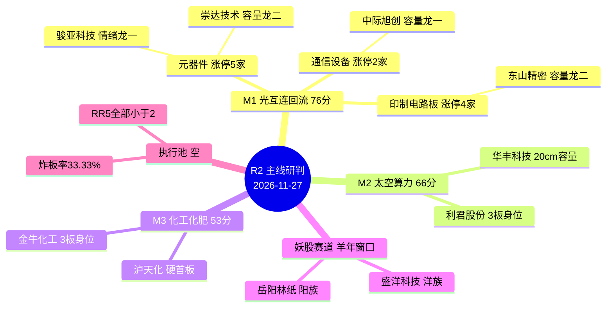
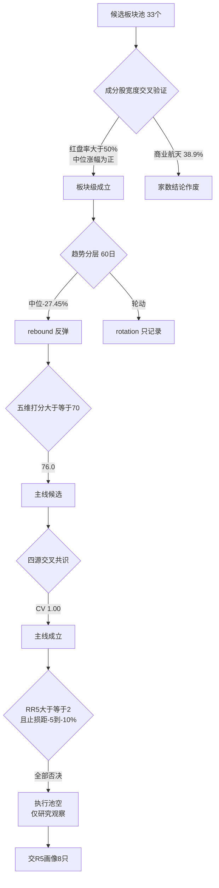

# 2026-11-27（周五） · **主线研判**

> **数据源新鲜度**: ok
> **降级状态**: false（因子层为设计内跳过，非故障）
> **置信度**: 0.62

## 一句话结论

唯一 ≥70 的光互连回流是深跌反弹不是主升，赔率与结构双双不过闸 —— 执行池空，只给研究观察。

## 详细分析

### 一、今日板块排序（五维打分 0–20×5，核心主线门槛 70）

| 排名 | 板块 | 热度 | 资金 | 涨停 | 叙事 | 共振 | 总分 | 层级 | 生命周期 | 交易状态 |
|:--:|---|:--:|:--:|:--:|:--:|:--:|:--:|---|---|---|
| 1 | **光互连回流·CPO/PCB/通信设备** | 18 | 19 | 13 | 14 | 12 | **76.0** | rebound（持有≤3日） | formation 形成期 | 🟡 研究级·未确认 |
| 2 | 太空算力/商业航天/6G | 15 | 11 | 11 | 17 | 12 | 66.0 | rebound | formation 形成期 | 🔴 次线·只记录 |
| 3 | 国产算力/昇腾链 | 16 | 8 | 12 | 19 | 7 | 62.0 | rotation | mid_up 主升中期 | 🔴 次线·只记录 |
| 4 | 化工/化肥 | 9 | 11 | 15 | 6 | 12 | 53.0 | rotation | mid_up 主升中期 | 🔴 次线·只记录 |

**轴标签**：M1 与 M2 同属**上游·卖方**（算力硬件 / 卫星通信），共用通信设备筹码（盛洋、共进、澳弘同时命中 6G 与 PCB 标签）。按 skill 上游/下游分轴硬约束，这批硬件筹码**只认一次**，不拆成第二条硬件主线 —— M2 的涨停维因此从 15 压到 11、不授主线身份。

### 二、为什么 M1 是「回流」而不是「主升」（三问）

- **大资金意图**：R7 显示钱只回流 CPO/PCB 一条链 —— 行业净流入元件 +45.27 亿（#1）、印制电路板 +44.12 亿（#2）、通信 +42.22 亿（#3），5 日口径分别 +108.49 / +109.91 亿（前 5 日还是 -140.83 / -115.03 亿的反向）。但 10 日口径仍是负的（元件 -32.34 亿），20 日更负（-74.73 亿）。这是**抱团资金池被买回来**，不是增量新钱入场。对手盘是 11-25 杀跌时割掉的一批筹码，现在被原路接回 —— 买回来的是筹码而不是信仰。
- **为什么走强**：位置（超跌）+ 催化（E005 三部委 6G 方案与 SpaceX 百万颗卫星获 FCC 批准）+ 筹码（板块内 5 只首板零 2 板以上真龙）三维交叉。11-25 CPO 板块 -5.58%、PCB -6.00%，11-26 回流 +3.9%~+5.2%。**没有 2 板以上的接力结构，说明买的是跌深而不是买的新逻辑**。
- **逻辑够不够硬**：硬事件有（三部委 6G 实施方案 + FCC 批准，属政策与时间锚双硬），但共振腿是软的 —— R3 三条主题真等级全部只有 L1_only（L2 群聊 0 字节永久断更、L3 WeFlow 永久下线，L2b 公众号仅观点代位不计入枚举）。四源交叉 1.00 分（R3 #1 + R4 PCB/元件 high + R7 元件/印制电路板双 #1/#2），但**四源共识 ≠ 赔率可做**：五只候选 RR5 全部 <2，最强的东山精密也只有 0.94。

### 三、宽度交叉验证（题材家数必须过成分股门槛）

| 板块 | 成分数 | 红盘率 | 中位涨幅 | 涨停 | 跌停 | 跨标签票 | 判定 |
|---|:--:|:--:|:--:|:--:|:--:|:--:|---|
| 元器件（行业） | 67 | 86.6% | +2.86% | 5 | 0 | 4 | ✅ 板块级成立 |
| 印制电路板（行业） | 48 | 91.7% | +3.80% | 4 | 0 | 4 | ✅ 板块级成立 |
| 通信设备（行业） | 94 | 55.4% | +0.20% | 2 | 0 | 1 | 🟡 勉强 |
| CPO 概念 | 101 | 63.0% | +0.67% | 2 | 0 | 2 | 🟡 题材级勉强 |
| PCB 概念 | 215 | 58.6% | +0.54% | 5 | 0 | 5 | 🟡 题材级勉强 |
| 商业航天（概念） | 332 | 38.9% | -0.63% | 9 | 0 | 5 | ❌ **宽度不成立** |
| 卫星互联网（概念） | 104 | 47.1% | -0.04% | 2 | 0 | 2 | ❌ 宽度不成立 |
| 6G 概念 | 51 | 76.5% | +1.29% | 1 | 0 | 1 | 🟡 宽度过关但无涨停簇 |
| 化工原料（概念） | 94 | 53.2% | +0.16% | 5 | 0 | 0 | 🟡 勉强 |
| 氮肥（概念） | 6 | 83.3% | +5.32% | 3 | 0 | 0 | ⚠️ 小样本，不作板块级 |

**关键读数**：M1 是**板块级成立、题材级不成立** —— 行业口径宽度（元器件 87%、印制电路板 92%）高于概念口径（59%~63%），说明标签内还有大量成员没参与。

**M2 被宽度一票否决**：商业航天 332 只成分红盘率只有 38.9%、中位 -0.63%，9 家涨停里 5 只同时跨 ≥3 个板块标签（盛洋、崇达、澳弘、顺灏、鹿山）。按 skill 三条交叉门槛（红盘率 ≥50% / 中位为正 / 概念资金净流入）全不成立，**家数结论作废** —— 这是标签计数，不是扩散。6G 概念宽度过关（51 只红盘 76%）但只有 1 家涨停，无簇。

### 四、趋势分层：为什么 76 分仍然不能做（60 日结构，as_of 2026-11-26）

`src/research/trend_layer.py` 判定（判据唯一真源，本文件全部数值经该函数独立复算一致）：

| 票 | 角色 | 60日涨幅 | 距60日高 | 剔单日峰值后60日 | 分层 | 最长持有 |
|---|---|:--:|:--:|:--:|---|:--:|
| 中际旭创 | 龙一（容量核心） | -49.15% | -54.28% | -55.81% | 🔴 rebound | 3 日 |
| 东山精密 | 龙二（容量核心） | -62.00% | -63.85% | -65.45% | 🔴 rebound | 3 日 |
| 骏亚科技 | 龙一（情绪） | +4.91% | -33.12% | -4.65% | 🟡 rotation | 0 日 |
| 崇达技术 | 龙二（情绪/容量） | +13.54% | -39.90% | +3.19% | 🟡 rotation | 0 日 |
| 快克智能 | 候补 | -27.45% | -35.39% | -34.05% | 🔴 rebound | 3 日 |

板块内全体龙头的 60 日涨幅中位数 -27.45%、距高中位数 -39.90%。**这是深跌反弹，不是趋势主升** —— 判据是位置不是涨幅：中际旭创 11-26 涨 5.18% 看着强，但它上方还有 54% 的套牢盘，涨停簇里 5 只全是首板，没有任何一只打出高度。

**阶段与结构冲突**：主线生命周期函数读 formation（首日回流、最高 5 板但属另一线、资金连续流入仅 1 天），而结构读 rebound。以结构为准 —— 允许研究，不允许按主升买。

### 五、候选票：板型 · 龙头认定 · 盈亏比 · 禁止清单（四项齐全）

| 票 | 角色 | 板型 | 龙头认定（过纪律 §2 几条） | 收盘价 | 涨幅 | 盈亏比 RR5/RR20 | 止损距 | 禁止清单命中 |
|---|---|---|---|:--:|:--:|:--:|:--:|---|
| 中际旭创 300308.SZ | 龙一 | 容量核心（未封板） | 辨识度（心智锚）+ 容量（成交 197.06 亿全市场第一）+ 带动性 | 430.18 | +5.18% | 0.74 / 2.96 | -12.14% | 无（allowed） |
| 东山精密 002384.SZ | 龙二 | 容量核心 | 容量（成交 88.17 亿）+ 主力 +8.68 亿 | 72.52 | +3.90% | 0.94 / 4.37 | -8.94% | 无（allowed） |
| 骏亚科技 603386.SH | 龙一（情绪） | 首板·秒板厚封 | 板高+封单最厚(40.0%)+开板最少(0)+首封最早(09:31) | 14.52 | +10.00% | 0.46 / 0.69 | -12.26% | 无（allowed） |
| 崇达技术 002815.SZ | 龙二（情绪/容量） | 首板·容量 | 成交 21.09 亿（板内最大），但封单比仅 5.5% | 15.26 | +10.02% | 0.27 / 0.80 | -14.81% | 无（allowed） |
| 快克智能 603203.SH | 候补 | 低位首板 | 封单 32.3%，但主业非 PCB、60 日 -27.45% | 30.95 | +9.99% | 0.24 / 1.06 | -10.82% | 🔴 mid_laggard（板内排名 4） |

**五只全部不过赔率闸**：止损距硬区间是 -5%~-10%，只有东山精密（-8.94%）勉强在内，而它的 RR5 仅 0.94 —— 止损够窄了，但 5 日空间已被吃掉。**止损距与 RR 必须同时过，单过一项不算过闸。**

### 六、每票思维链（研究观察，不构成开仓授权）

#### ① 中际旭创 300308.SZ · 龙一（容量核心）

- **买入理由**：①市场口语心智锚（"一提 CPO 先说中际旭创"）+ 容量硬证据（成交 197.06 亿全市场第一、主力净流入 +16.9 亿）+ 热股榜在榜第 9 位且从第 15 位上升；②它是当日唯一"带动性"标的 —— 未封板却带动元件 5 只 + 印制电路板 4 只涨停簇。
- **风险点**：①60 日 -49.15%、距 60 日高 -54.28%，上方全是套牢盘，第一波反弹空间被压制；②RR5 0.74 < 2、止损距 -12.14% 越出 -10% 硬区间；③消息双面：E002 英伟达停止向东南亚四国发货服务器已把光模块/CPO 净分抵到仅 +0.164。
- **止损条件**：跌破 5 日线（11-26 收盘 430.18 为基准）无条件离场；或 09:27 竞价高开 >2% 而 10:00 前封单不增 → 按回流一日游处理，当日只做日内 T。
- **可验证假设**：次日（11-27）若 CPO 板块红盘率 <50% 或元件板块涨停数从 5 掉到 ≤2，则"回流"判定为一日游、主题降级；若 09:30-10:00 出现至少 1 只 2 板且封单比 >20%，则反弹升级为接力结构。

#### ② 东山精密 002384.SZ · 龙二（容量核心）

- **买入理由**：①容量二号（成交 88.17 亿）、主力净流入 +8.68 亿、热股榜第 14 位；②PCB 端受 E005 6G 方案正面腿覆盖比光模块更强（R4 光模块净分被 E002 抵掉 74%，PCB/元件仍 +0.646）。
- **风险点**：①60 日 -62.00% 为本组最深，距高 -63.85%；②RR5 0.94 < 2（虽 RR20 4.37，但 5 日空间已吃掉）；③收盘位置 0.587 未上沿、低于上沿口径，属冲高回落结构。
- **止损条件**：回踩不破 5 日线且不放量滞涨可留观察；有效跌破 5 日线离场，止损价参考 66.04（-8.94%，在硬区间内）。
- **可验证假设**：次日 PCB 概念（215 只成分）红盘率若仍 >58%、中位涨幅维持 >0.5%，则板块级成立可延续；若中位转负，则宽度崩溃、回流结束。

#### ③ 骏亚科技 603386.SH · 龙一（情绪）

- **买入理由**：①PCB/CPO 涨停簇里唯一一只"真硬板"：09:31 首封、0 开板、封单/成交 40.0%（元器件 5 只里唯一 >30%）、流通 47.4 亿；②它是市场对"能不能有第二板"分歧的天然载体。
- **风险点**：①仅首板、无身位，板块内无 2 板以上真龙可依附；②RR5 0.46 / RR20 0.69 双低、止损距 -12.26% 越界；③流通 47.4 亿属 20–50 亿警惕区间（不刻意回避，但需小仓）。
- **止损条件**：只做竞价确认的打板，不低吸；炸板破 5 日线无条件走，封单比从 40% 掉到 <15% 即视为承接失败离场。
- **可验证假设**：次日 09:25 竞价若高开 ≤2% 且竞价量能放大到当日 1.5 倍以上，有弱转强预期；若开盘直接高开 >5% 但封单不增，属追高盘不接。

#### ④ 崇达技术 002815.SZ · 龙二（情绪/容量）

- **买入理由**：①R4 first_board_candidates 首推（E005 直接受益）；②成交 21.09 亿是 PCB 簇内最大，容量真实存在。
- **风险点**：①封单/成交仅 5.5% + 换手 18.32% + 1 次开板 = 典型烂板（筹码在换手不在锁仓）；②RR5 0.27 是五只里最低，止损距 -14.81% 越界最远；③10:11 才首封，晚于全市场首板中位。
- **止损条件**：不追；只等"低开不破昨收 + 30 分钟封单回补"的弱转强形态，炸板即走不摊平。
- **可验证假设**：次日若低开后 30 分钟内封单回补至成交额 10% 以上则板质修复；若继续放量不封，则确认烂板剔除。

#### ⑤ 泸天化 000912.SZ · 化工/化肥线硬首板（次线观察对象）

- **买入理由**：①化工是**当日唯一"连续 2 日上榜且家数扩张"的题材**（题材矩阵 11-25 2 家 → 11-26 8 家），符合 skill 持续性硬门槛；②09:36 首封、封单/成交 37.9%、0 开板，是该线最硬的低位首板。
- **风险点**：①R4 零催化（化工/化肥无任何事件覆盖）→ 纯资金驱动，无承接则断；②化学制品行业 5 日净流出 -33.73 亿仍在持续，机构钱未到；③氮肥仅 6 只成分，小样本代表不了板块级。
- **止损条件**：只做竞价弱转强确认，不追高；跌破 5 日线无条件走。
- **可验证假设**：次日化工题材矩阵家数若从 8 家继续扩张至 ≥8 家且红盘率维持 >53%，则低位首板扩散成立；若家数掉到 ≤3 家，则一日游作废。

### 七、执行池为空：四重否决（不给票，不给价）

| # | 否决理由 | 证据 |
|:--:|---|---|
| 1 | **无已确认可交易主线** | R1 明写"无主线（轮动结构，行业次日留存 16.0%、解释力 10.5%）"；R3 `open_permission=false`；唯一 ≥70 的 M1 结构上是 rebound（核心票 60 日 -49%~-62%） |
| 2 | **赔率全否** | M1 五只候选 RR5 = 0.74 / 0.94 / 0.46 / 0.27 / 0.24（另有 4 只板内排名 3+ 已被 mid_laggard 剔除），止损距 -8.94%~-14.81% 越出硬区间；全池唯一 RR5>2 的是次线中国卫星（2.44），但它 +1.99% 无身位、收盘位置 0.424，且 layer=rebound |
| 3 | **情绪位置不允许** | 修复段第 2 个交易日 = 验证/分歧日；炸板率 33.33%（三口径取严）逼近 35% 砍半线。R1 原话："不追开盘价、只做低开承接与分歧转强，转弱即按一日反抽、当日只做日内 T" |
| 4 | **盘前不虚构入场价** | 09:27 竞价未出，任何执行价都是假设 → 盘前不给执行价、不给仓位 |

**研究观察池（交 R5 画像，不构成开仓授权）**：中际旭创、东山精密、骏亚科技、崇达技术（光互连）｜利君股份、华丰科技（太空算力）｜金牛化工、泸天化（化工/化肥）。D1 若取用须逐票重过 forbidden_filter 与 risk_reward 双闸门 + 09:27 竞价确认。

**已按禁止清单剔除的板内中位/杂毛**：中京电子、生益科技、超声电子、沪电股份、快克智能、盛洋科技、中国卫星、金正大、赤天化 —— 全部命中 `mid_laggard`（板内排名 ≥3 不碰）。

### 八、妖股赛道（四季度跨年妖 · 羊年窗口）：只做低位首板，不接高标

**素材包分析结论**：11-26 名字族出现真扩散 —— yáng 族 6 只涨停（岳阳林纸 +10.09%、襄阳轴承 +10.02%、盛洋科技 +9.95%、中央商场 +9.93%、东方海洋 +9.91%、华阳国际 +10.02%），九阳股份 +8.66% 炸板，利群股份 +2.88% 未涨停。这是本窗口**第一次"名字族同时出 5+ 涨停"**，赚钱效应成立。

**但监管切换已触发**：E20261127_006「克来机电 5 连板收监管工作函」→ 纯概念高标被清算，R4 对"纯概念跟风杂毛"给净分 -0.904（今日最干净的负面方向之一）。**只做低位首板，不接高标。**

| 候选 | 梗层 | 硬过滤 | 板质 | 参与方式 |
|---|---|---|---|---|
| 盛洋科技 603703.SH | 谐音（洋=yáng）+ 卫星/6G 题材共振 | ✅ 主板 · 流通 34.9 亿 · 首板 | 09:25 秒板、封单/成交 107.5%、0 开板 —— 板质最硬 | 🟡 双重身份（主线 2 + 妖股），主线角色优先；只打板不低吸 |
| 岳阳林纸 600963.SH | 谐音（阳=yáng）+ 造纸同族 | ✅ 主板 · 流通 61.3 亿 · 首板 | 13:15 午后板、封单比 7.2%、0 开板 | 🟡 打板/竞价确认，轻仓 ≤5%；造纸无消息腿，不押逻辑 |
| 襄阳轴承 000678.SZ | 谐音（阳=yáng）+ 轴承链 | ✅ 主板 · 流通 100.9 亿 · 首板 | 11:18 首封、封单比 4.9%、0 开板 | 🟡 换手 26.4% 偏高，只做竞价弱转强，破均线必走 |
| 利群股份 601366.SH | 拆字（"群"含羊） | ✅ 主板 · 流通 30.8 亿 · **未涨停** | 赚钱效应来自同族已涨停 5 只 | 🔴 等它自己涨停才参与，不低吸未启动的拆字票 |

**硬过滤剔除**：东方海洋（换手 41.7%、8 次开板、封单比 2.1% → 烂板）｜中央商场（2 板但 5 次开板）｜杭州解百（4 板但 8 次开板、封单比 0.6% → 烂板高标，监管清算期不接）｜华阳国际（流通 16.0 亿 < 20 亿硬线）｜九阳股份（已炸板，319 亿大盘股不是玄学载体）｜克来机电（5 连板收监管工作函 → 高标清算）。

### 九、剔除池（7 条，逐条给理由，不为凑数保留）

| 板块 | 分数 | 剔除理由 |
|---|:--:|---|
| 半导体/存储（HBM/DRAM） | 40 | 半导体概念红盘率 36.4%/中位 -0.58%、资金 -43.53 亿（5 日 -340.41 亿）、半导体行业 -25.67 亿（5 日 -252.29 亿）；E004 GFHK 下调 2027 年 DRAM 合约价涨幅至 6/3/0/0 → 存储链净分 -0.646；E001 的 HBM 正面腿被资金腿完全否定 |
| 银行/大金融（防御） | 35 | **当日唯一"趋势贴新高 + 宽度 93%"的板块**（42 只红盘率 92.9%、中位 +0.81%、layer=trend near_high），E003 四大行回购增持 6000 亿 high 正面、R7 银行 +1.78 亿/5 日 +8.87 亿；但 0 家涨停、无身位、弹性不足，证券 -9.44 亿派发 → 超短无赚钱效应，仅作防御参考，**不授主线身份** |
| 人形机器人 | 33 | 350 只成分红盘率 19.7%、中位 -1.57%，涨停 4 家但炸板 3 家；资金 -9.75 亿/5 日 -78.82 亿；R3 判 late 已退位（11-24/11-25 概念 #1 → 11-26 #6）；E006 同一事件把克来机电 5 连板送进监管工作函 → 高标被清算 |
| 黄金/贵金属（避险） | 30 | 贵金属 13 只红盘率 100%、中位 +4.56%、黄金概念 +18.95 亿；但仅 1 家涨停（黄金股 3 家炸板）→ 无涨停簇、无身位，属避险配置不是超短主线 |
| 造纸/包装 | 29 | 涨停 4 家（山鹰 09:25 秒板封比 5.2 倍、顺灏 09:25 封比 99.9%、岳阳林纸、大胜达）但无涨价/事件消息、R7 行业资金 top10 无造纸；最高板青山纸业 2 板封单比 1.1%/3 开板属烂板 → 低位补涨读数，不做主题 |
| 流感/医药 | 28 | E007 中疾控流感中流行 medium 正面，但医药链 11-25 12 家涨停 → 11-26 仅 2 家（掉出主线）；流感概念 133 只红盘率 15.0%、中位 -1.57% → 宽度崩塌，昨日结论已被证伪 |
| 农业/渔业 | 26 | 渔业 3 家涨停（东方海洋/好当家/中水渔业）但东方海洋换手 41.7%/8 开板、好当家换手 27.9% → 高换手投机；题材矩阵农业 4→4 家无扩张，R4 零催化 |

### 十、跨源交叉验证（4 源共识）

| 主题 | R2 | R3 | R4 | R7 | 共识数 | 综合分 | 结论 |
|---|:--:|:--:|:--:|:--:|:--:|:--:|---|
| 光互连/CPO/PCB/通信设备 | ✅ 主线 | ✅ #1 | ✅ high | ✅ 元件#1/印制电路板#2 | **4** | 0.91 | 共识成立，可执行性不成立 |
| 太空算力/商业航天/6G | ✅ 次线 | ✅ #2 | ✅ high | ❌ 5 日 -48.65 亿未进 top10 | 3 | 0.70 | 三源共识；宽度否决 → 只记录 |
| 国产算力/昇腾链 | ✅ 次线 | ❌ 仅 watch（cap_granted=false） | ✅ 净分 1.214 全市场最高 | ✅ 算力概念 +41.30 进 top10 | 3 | 0.68 | 消息先行、资金未到 |

`cross_validation_degraded=false` —— R1/R3/R4/R7 全部 status=complete，三源交叉可算；R3 的 `resonance_strength_cap`（L2/L3 永久断更）已按透传口径降低共振维权重，未判为降级。

## 关键证据

- 证据 1：R7 行业资金净流入元件 +45.27 亿（#1）、印制电路板 +44.12 亿（#2）、通信 +42.22 亿（#3），5 日分别 +108.49 / +109.91 亿，但 10 日 -32.34 亿、20 日 -74.73 亿仍为负 → 资金是回流不是累积 · 来源 R7 资金面 artifact · `main_force.sector_flows`
- 证据 2：商业航天概念 332 只成分红盘率 38.9%、中位 -0.63%、9 家涨停里 5 只跨 ≥3 标签 → 宽度不成立，家数结论作废 · 来源 tushare dc_member + daily 交叉复算 · `theme_persistence.breadth_check`
- 证据 3：中际旭创 60 日 -49.15%、距 60 日高 -54.28%、剔单日峰值后仍 -55.81% → rebound，持有上限 3 日 · 来源 kb/research.db 前复权日线 · `src/research/trend_layer.py`
- 证据 4：M1 五只候选 RR5 = 0.74 / 0.94 / 0.46 / 0.27 / 0.24，止损距 -8.94%~-14.81% 越出 -5%~-10% 硬区间 · 来源 kb 日线高 5/高 20 + 收盘 · `research_only` 与 leaders `rr`
- 证据 5：E20261127_005 三部委《新一代通信网建设实施方案》落地 6G + SpaceX 百万颗卫星获 FCC 批准 → PCB/元件 与 6G/卫星互联网 净分均 +0.646；E20261127_002 英伟达停止向东南亚四国发货服务器 → 光模块/CPO 净分被抵到 +0.164 · 来源 R4 消息面 artifact · `sectors_catalyzed`
- 证据 6：E20261127_006 克来机电 5 连板收监管工作函 → 妖股赛道监管切换触发，只做低位首板不接高标 · 来源 R4 消息面 artifact · `yaogu_track.regulatory_switch_basis`
- 证据 7：R3 三条主题真等级均为 L1_only（L2 群聊 0 字节永久断更、L3 WeFlow 永久下线），`discipline_gate.open_permission=false` → 下游不得当已确认主线 · 来源 R3 情绪共振 artifact · `resonance_top_themes`
- 证据 8：Tushare limit_list_d 官方漏收 —— 65U/29Z/5D vs R7 stk_limit 70U/35Z/9D，差 5 涨停/6 炸板/4 跌停；涨停簇在评分理由里引 R7 口径（9 家）、宽度判定用 limit_list_d 口径（7 家），两口径已分别标注 · 来源 tushare limit_list_d + R7 · `data_gaps`

## 数据源审计

| 源 | 状态 | 抓取日期 | 记录数 | 备注 |
|---|---|:--:|:--:|---|
| R1_style.json（上游） | 🟢 ok | 2026-11-27 | 1 份 | 震荡分化型 / 情绪 54.9 / 无主线 / 仓位上限 0.45 |
| R3_sentiment.json（上游） | 🟢 ok | 2026-11-27 | 3 主题 | 真等级均 L1_only，distribution_alert 为空 |
| R4_news.json（上游） | 🟢 ok | 2026-11-27 | 8 事件 | 15 个板块催化，净分最高 国产算力/昇腾链 +1.214 |
| R7_capital_flow.json（上游） | 🟢 ok | 2026-11-27 | 70 板块 | 行业 top10 + 概念 top10 + 5日/10日序列 |
| tushare limit_list_d（8 交易日） | 🟢 ok | 2026-11-27 | 99 行/日 | 2026-11-26：65 涨停 / 29 炸板 / 5 跌停，逐票可核 |
| tushare dc_member（33 板块） | 🟢 ok | 2026-11-27 | 33 板块 | 行业口径与概念口径分别标注，不混算 |
| tushare daily（全市场） | 🟢 ok | 2026-11-27 | 5578 行 | 涨 1766 / 跌 3642 / 中位 -0.79% |
| tushare moneyflow_ind_dc | 🟢 ok | 2026-11-27 | 23484 行 | 6 日序列，逐日单拉（避免大区间解析截断） |
| tushare limit_cpt_list | 🟢 ok | 2026-11-27 | 12 日 | 题材×涨停家数矩阵，用于连续上榜校验 |
| kb/research.db 前复权日线 | 🟢 ok | 2026-11-27 | 1490252 行 | 60 日分层 + 盈亏比，as_of 20261126 截断禁未来 K 线 |
| lianban_mainline 题材矩阵 | 🟢 ok | 2026-11-26 | 12 日 | T-1 数据，用于化工"连续 2 日上榜且扩张"校验 |
| 因子层 factor_snapshot | 🟡 degraded | — | 0 | 设计内跳过（该因子层从未实现），非故障 |
| R3 L2 群聊 / L3 WeFlow | 🔴 error | 2026-11-27 | 0 | L2 群聊库停更、L3 已下线 → 共振维度先天只有 L1 |

## 不确定性 / 反证

1. **共识强但不可做，是本日最大的反证风险**：四源交叉 1.00 分（全市场唯一）却给出空执行池。若 D1 或执行侧认为"共识 + 涨停簇 9 家"就足以开仓，这是把共识当成了授权 —— 本文件的立场是：共识只证明"市场在买这条链"，不证明"这条链现在能赚钱"。5 只候选 RR5 全 <2 是硬事实。
2. **涨停簇家数存在双口径**：R7 stk_limit 权威口径 9 家 vs 本文件逐票 limit_list_d 口径 7 家，差异源于 Tushare 官方漏收 5 只涨停。两者不可混算，已在评分理由与 `data_gaps` 分别标注。下游若引用"9 家涨停簇"须带口径。
3. **心智锚未回写表**：`theme_anchors/latest.json`（数据日 2026-11-02）里 CPO 锚是妖性型小票（天洋新材、中京电子、合锻智能、澳弘电子），不含中际旭创。本文件用市场口语锚（"一提 CPO 先说中际旭创"）而非退回当日资金榜选核心 —— 符合 skill「不得退回资金榜」的硬约束，但锚表本身未更新，属已知遗留。
4. **炸板率卡在 33.33%**：三口径（33.33% / 30.61% / 30.85%）取严后距 35% 砍半线仅 1.67 个百分点。若 11-27 开盘炸板率越线，全池候选数必须砍半且只做日内 T —— 这是一个会在盘中触发、但盘前无法预判的开关。
5. **阶段与结构冲突未解**：生命周期函数读 formation、60 日结构读 rebound。以结构为准（更保守）。若 11-27 出现 2 板真龙 + 资金连正 2 日，结构可能升级为接力，届时 holding_days_max 可从 3 日上调。
6. **L2/L3 永久断更是结构性缺口**：共振维度先天只有 L1，任何"强共振"结论在本管线下都不可得 —— 这压低了全部板块的共振分（主线仅 12/20），也意味着无法排除"群里正在讨论但我们看不到"的方向。
7. **R4 数据卫生问题**：R4 在 06:31 落盘、R3 在 06:45 落盘，R4 的 kol_confirm 字段误标"未比对(R3 本日未落盘)"。本轮已用 R3 原文复核，不影响结论，但字段本身未修正。

## 与其他 R/D/E 的关系

- **依赖**：`R1_style.json`（style=震荡分化型 / main_lines_label=无主线 / position_cap=0.45 / 修复段第 2 个交易日）、`R3_sentiment.json`（resonance_top_themes 3 条 / distribution_alert 空 / open_permission=false）、`R4_news.json`（top_events 8 条 / sectors_catalyzed 15 板块 / sector_cross_summary 净分）、`R7_capital_flow.json`（sector_flows / concept_flows / market_breadth 70U/35Z/9D）
- **被消费**：
  - R5 个股画像：本文件 `research_only.candidates` 8 只（光互连 4 + 太空算力 2 + 化工 2），仅为研究观察，D1 取用须逐票重过双闸门
  - R6 反证：`main_line_status=research_only_not_confirmed`、`stage_conflict_note`、`theme_persistence.breadth_check`（商业航天宽度否决）、`yaogu_track.regulatory_switch_triggered=true` 均为反证重点
  - D1 决策：`main_lines_count=1`（唯一 ≥70 但 rebound）、`execution_pool=[]` + 四重否决理由、`execution_candidates` 无票可给、妖股赛道候选与参与方式
- **不消费**：本文件不引用 R5/R6 产出（R2 位于其上游），避免循环论证。

## Sub-Agent 元数据

- skill: analyze_main_sectors_v1
- artifact: `data/research/20261127/R2_main_sectors.json`
- 方法: llm_5dim_v1.3（五维定性 + 成分股宽度交叉验证 + trend_layer + lifecycle 确定性函数）
- 复算说明: 全部宽度数值、60 日分层、盈亏比、14 项禁止清单闸门结果均以独立脚本从原始数据重算并逐项比对一致；分层与闸门直接调用 `src/research/trend_layer.py` 与 `src/research/forbidden_filter.py`
- 交付校验: `tests/checks/check_r2_cross_validation.py 20261127` 4/4 通过（CV=1.00、consensus_themes=3、degraded=false）
- 用 model: MiniMax-M3.1-Flash
