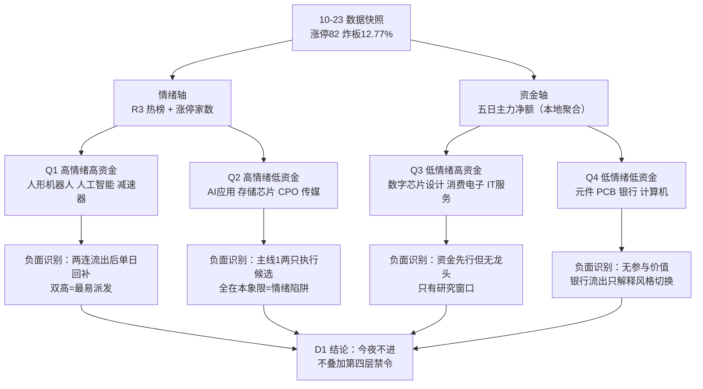

# 2026年10月26日 · **反证 / Devil's Advocate**

> 数据源新鲜度：partial · 降级状态：true · 置信度 0.30
> 只读磁盘 R1/R2/R3/R4/R7 + R7 同源快照，未调用 Tushare / XTick / WeFlow / hithink / vibe-trading，未派生子 agent。
> R5 当日缺失 → 模式三、模式七降级；空 hard_reject 不代表全票通过。

## 🔴 一句话结论

十条反证全部指向同一件事：资金是单日堆积，不是五日沉淀；霸榜硬否决未成立，今夜不进。

## 🧭 详细分析

**市场在为什么付钱。** 10-23（周五）是全市场一次政策底深V：涨停 82 家、跌停 6 家、炸板率 12.77%、昨日涨停池溢价 +3.38%（中位 +4.55%），成交 1.97 万亿放量 4310 亿，创业板 +4.16%。买单集中在两个方向——机器人 43 家涨停（板块第 1）、人工智能 29 家（板块第 2）。但全市场主力资金当日只净流入 2.80 亿，五日 -964.20 亿、十日 -2,462.13 亿、二十日 -4,982.78 亿。指数是被宽基 ETF 和空头回补抬起来的，不是被主力买起来的。

**现在处在哪一段。** R1 判 high_chop（高位震荡）：裸指标本来指向 main_up，状态机把「main_down → main_up」判为非法跳级并降级，理由是 10-22 还有 48 家跌停、4–5 板完全真空、2 板层十日 -9.20%。R2 独立给出同样结构——主线① stage=mid_up 但最高身位只有 2 板，主线② 被覆盖为 climax。两个 agent 用不同方法得出同一结论：这是修复第二天，不是主升第一天。

**反证的核心不是「涨太多」，而是「资金结构假连续」。** 把 R2 引用的单日净额，用 R7 同日快照还原成五日序列，五条口径全部翻转或腰斩：人工智能当日 +114.30 亿（全市场概念第 1），但前一日是 -115.88 亿，五日合计只有 +21.70 亿；AI 应用五日 -28.38 亿；计算机行业五日 -6.78 亿，而 R2 引用的是单日 +40.80 亿。个股层面同型：天娱数科五日 +12.11 亿里 94.8% 来自 10-23 单日、前四日合计仅 +0.63 亿；达实智能 92.6%；粤芯半导 10.36 亿单日 > 五日合计 6.07 亿（前四日 -4.29 亿）。R2 的 `r7_capital_match=true` 因此只能降格为「单日反手买入」。

**霸榜出货的硬否决为什么不成立。** 模式六是唯一硬否决权，条件是合取：①标的所属板块命中 R3 霸榜 alert；②该票近五日主力净流出。今日 ① 命中 4 只（宇树/兆威/埃斯顿/福莱，人形机器人热榜连霸两日第 1、热度 +119%），但 ② 全部不成立——六只机器人类候选五日净额为正（+2.65 ~ +10.41 亿）。这不是漏判：兆威 5/5 日为正、埃斯顿 5/5 日为正，资金确实没走。所以按 skill 的保守化设计降级 strong_suggest，交 D1 显式处理。`hard_reject=0` 是合取未成立的结论，不是「审核通过」。

**今日动作。** 不进。R1 已把总仓压到 55%、单票 15%、持仓 3 只；R2 十二条全标 research_only、execution_pool 为空；R3 execution_candidates 为空；R7 十条研究候选全部 research_only。三条独立上游都在同一方向上收手，R6 不再叠加第四层禁令（模式五校准），只做两件事：把「五日净流入」改写成「单日脉冲」，并给每只执行候选一个可失效的锚。

### 推理深度三问（主线② 具身智能/人形机器人）

- **大资金意图**：不是新开仓，是在六板高标上做最后一段加速。43 家涨停的家数制造了广度幻觉，但高度全部压在 6 板大业股份（已收监管工作函、腱绳未量产）与 2 板襄阳轴承（当日开板 10 次）身上。唯一干净的一笔是宇树 4.04 亿封单 0 开板，但那是 14:15 的尾盘投机板时段——新增资金选择了最不需要承接的时间窗口。
- **为什么走强**：叙事密度（Optimus 量产线 + 人形机器人 6 项国标 + 王兴兴物理 AI 表态 + 出口 12.2 倍）压过订单密度。R3 逐字记录卖方自己的证伪：工厂场景任务成功率约 60%，进生产系统要 98%。这是「叙事硬度 > 订单硬度」的标准样本。
- **逻辑够不够硬**：中偏弱。产业方向真实（量产线、国标、数据基座都在推进），但兑现节奏被自己否掉；资金层面 10-21、10-22 连续两日净流出 -42.61 亿，10-23 单日回补 71.43 亿——两连流出后的单日反抽，不是五日沉淀。

## 🧩 六类反证模式执行情况

| 模式 | 状态 | 条目 | 本次处理 |
|---|---|:--:|---|
| 1 数据源冲突 | 🟢 executed | 5 | 用 R7 同日快照还原 R2 单日净额为五日序列，逐条复核 capital_match |
| 2 一致性检查 | 🟢 executed | 1 | R1 风格标签与可交易结构错配（连板情绪型 vs 4–5 板真空） |
| 3 估值×主线临界 | 🔴 skipped | 0 | R5 当日缺失，不拿 10-23 的 PE/PB 冒充 10-26 临界判断 |
| 4 历史类比 | 🟡 degraded | 0 | 磁盘无可用历史失败事件库，不编造；不读 chzl_kg markdown 反推 |
| 5 昨日预期错误连锁 | 🟢 executed | 1 | 昨日 4 只观察对象全部涨停但盘后收益 0，记「反证过度保守」校准项 |
| 6 霸榜出货硬约束 | 🟡 executed_partial | 2 | 条件①命中、条件②全部不成立 → 降级 strong_suggest，hard_reject 0 |
| 7 基本面红旗 | 🔴 degraded | 0 | R5 缺失 + 本次禁 MCP，F1–F12 与 ST 双轴无法核验 |
| 8 解套盘假繁荣 | 🟡 degraded | 1 | 无 cyq 筹码分布；涨停 82 家未达 100+ 门槛，不启用 0.6 上限条款 |
| 9 高位触板赌博 | 🟢 executed | 1 | 执行候选最高 2 板；6 板大业 extreme_tail_risk 已被 R2 剔除 |
| 10 跨资产背离 | 🟢 executed | 1 | A 股半导体修复 vs 美股半导体 20 日 -18%~-29% + 油价 116.72 |

共 10 条（门槛 ≥5）：strong_suggest 7 / soft_suggest 3 / hard_reject 0。

### R6_M1_01 · 天娱数科 · 五日 12.11 亿里 94.8% 是单日

被挑战的假设：R2 记「5 日主力净流入 12.11 亿（4/5 日为正）」，据此把天娱认定为 AI 应用龙一，支持首板隔日模板。

反证：五日分解为 +0.50 / +0.54 / +1.20 / **-1.61** / **+11.48**。前四日合计只有 +0.63 亿，10-22 还是净流出。所谓「4/5 日为正」在量级上等价于「一天买、四天不买」。同日开板 2 次、换手 17.93%、成交 23.1 亿，封单 3.27 亿在 130.6 亿流通盘上不算厚。

处理：`strong_suggest` — 执行理由必须改写为「单日脉冲 + 前四日无净流入」；仓位按单票上限一半，失效位 8.03。

### R6_M1_02 · 达实智能 · 同构，且封单只有 0.85 亿

被挑战的假设：龙二可承接主线①第二棒。

反证：五日 +0.62 / +0.94 / -0.34 / -0.76 / +5.79 = +6.25 亿，单日占 92.6%，前两日合计 -1.10 亿；开板 3 次、换手 26.5%、封单 0.85 亿（龙一的三分之一）。

处理：`strong_suggest` — 龙二只在龙一封住且板块涨停 ≥15 家时有意义；天娱不封或 AI 应用涨停掉到 5 家以下，直接放弃。

### R6_M1_03 · 主线① 板块级「资金确认」是镜像

被挑战的假设：R2 记 `r7_capital_match=true`（人工智能 +114.30 亿全市场概念第 1）。

反证：人工智能五日 +0.37 / +20.37 / +2.54 / **-115.88** / **+114.30** = +21.70；-115.88 与 +114.30 基本对冲，五日净额约等于零。AI 应用五日 -28.38（-67.21 后 +50.34，只回收四分之三）。计算机 -6.78、软件开发 -1.72、垂直应用软件 -2.66，与 R2 引用的单日 +40.80 / +22.64 / +15.72 方向相反。R2 自己的 `independence_note` 也写了：三源不能按三个独立源计。

处理：`strong_suggest` — 可证伪锚：10-26 人工智能概念再现单日净流出 >50 亿，主线①当日降级为情绪线。

### R6_M1_04 · 主线② 两个概念口径差 75.67 亿

被挑战的假设：机器人双概念进前 6，climax 段位可继续作第一梯队。

反证：人形机器人五日 +104.13（10-21 -15.73、10-22 -26.89、10-23 +71.43，单日占 68.6%）；机器人概念五日只有 +28.46（两日流出 -100.81 亿后单日回补 59.91）。同族两口径差 75.67 亿，选哪个决定「资金是否持续」的结论。R3 已判 late、sustainability 1 日、红线4 降级。

处理：`strong_suggest` — D1 引用时必须写明 BK1184 或 BK1090，并写成「两连流出后的单日回补」。

### R6_M1_05 · 半导体是「子行业好、整链差」

被挑战的假设：半导体 +68.69 / 电子 +66.52 分列行业前二，低位修复有资金基础。

反证：半导体五日 +10.96、数字芯片设计 +87.92，但电子五日 -47.38、元件 -88.52、PCB -72.96；存储芯片概念五日 -29.15（10-20 -30.80 / 10-22 -44.39）；半导体十日 -115.17、二十日 -580.74。R4 同日把长鑫（五日 -18.10 亿）、汇顶、华天降级或剔除。

处理：`soft_suggest` — 该线 research_only 且无封板龙头，不建议提名执行；研究引用只取数字芯片设计口径。

### R6_M2_01 · 风格叫「连板情绪型」，但今天没有梯子

被挑战的假设：R1 判连板情绪型（情绪浓度 72），可支撑连板接力/打板。

反证：4–5 板完全真空、6 板仅 2 只且其一收监管工作函、2 板层十日 -9.20%；主线① 最高身位 2 板且是借势，主线② stage=climax；R2 的通道写死「低吸，不打板」。风格标签与可交易结构相反。

处理：`strong_suggest` — 今日「连板情绪型」唯一可表达形式是首板隔日 + 分歧低吸；D1 若出现打板/接力/一字竞价条目即与本条冲突，须写 override 并说明梯子缺口。

### R6_M5_01 · 昨日反证的方向性误判（过度保守）

被挑战的假设：昨日 R6 以 0 条反证 + 零预算处理 4 只观察对象是保守正确的。

反证：E1 20261023 显示 4 只观察对象（天娱/睿能/好上好/天奇）当日全部涨停，等权 +9.99%。但 `post_plan_reference_return_pct=0.0`、参考时点 14:00 后已封板，`capturable_opportunity_pct=null` —— 这是不可捕捉的描述性错失，不是可实现收益。两个结构也不同：昨日拦的是「高位换手+监管提示」，今日质疑的是「单日资金堆积+霸榜」。

处理：`soft_suggest` — 今日不得叠加第三次同向保守（R1 半仓、R2 全 research_only、R3 空执行池），R6 的 strong_suggest 只用于改写理由与失效位；反向也不得拿昨日 9.99% 当今日追高理由。

### R6_M6_01 / M6_02 · 霸榜 alert 命中，资金条件不成立

见下节合取表。兆威 5/5 日为正（+4.67 亿），宇树上市日 +6.09 占 58.5%、10-21/22 两日 -1.66 亿后单日回补。两只都降级 strong_suggest：兆威可保留执行提名但只做分歧回踩；宇树维持执行资格外（14:15 尾盘板命中禁止项 9）。

### R6_M10_01 · 半导体修复缺外部配合

美股半导体近 20 日英特尔 -29.3%、美光 -18.9%、AMD -18.1%；Brent 116.72 创五月新高、金价跌破 4000、通胀预期 4.7% 压制成长分母。周五 A 股半导体 +3.47% 与 30 日跌幅榜高度重合，R1 判为空头回补。处理：`soft_suggest` — 只用于下调主线③持续性权重。

## 🚫 霸榜出货 hard_reject 合取核验

规则：①所属板块命中 R3 `distribution_alert` + ②该票近五日主力净流出，两条同时成立才硬否决。R5 当日缺失，条件②用 R7 同源五日聚合替代并逐条标注「非 canonical 字段」。

| 票 | 线/角色 | 执行资格 | ①霸榜 | ②五日主力（亿） | 结论 |
|---|---|:--:|:--:|---:|---|
| 天娱数科 | AI应用 龙一 | ✅ | 未命中 | +12.11（94.8% 单日） | 不触发（M1_01 强建议） |
| 达实智能 | AI应用 龙二 | ✅ | 未命中 | +6.25（92.6% 单日） | 不触发（M1_02 强建议） |
| 兆威机电 | 机器人 龙二 | ✅ | **命中** | +4.67（5/5 日为正） | **条件②不成立 → 强建议** |
| 宇树科技 | 机器人 龙一 | ❌ 禁止项9 | **命中** | +10.41（上市日占 58.5%） | 条件②不成立；维持剔除 |
| 埃斯顿 | 机器人 候补 | ❌ mid_laggard | **命中** | +4.35（5/5 日为正） | 不触发；R2 已剔除 |
| 福莱新材 | 机器人 候补 | ❌ mid_laggard | **命中** | +2.65（龙虎榜机构净卖 -1.67） | 不触发；见 D01 |
| 能科 / 多伦 | AI应用 候补 | ❌ mid_laggard | 未命中 | +0.99 / +2.25 | R6 不改判 |
| 兆易 / 粤芯 / 大港 / 晶丰 | 半导体 候补 | ❌ mid_laggard | 未命中 | +25.89 / +6.07 / +2.85 / +1.18 | 该线 research_only |
| 华天科技 | 已剔除 | ❌ | **命中（个股）** | +9.45（仅 2/5 日为正，10-23 -1.09） | 不触发；不扩为芯片族出货 |

**结论：hard_reject = 0。** 4 只命中霸榜 alert 的机器人候选，五日主力净额全部为正；条件②统一不成立。这是合取未成立，不是审核通过，也不构成「可以放心买」的理由——它们的共同问题是「正得没有结构」（单日占比 47%~95%）。

## 📉 四象限负面识别

两条轴都是五日口径量化值，不是看多/看空判断。情绪轴：热榜前 10 或板块涨停 ≥15 家为高；资金轴：同名概念/行业五日主力净额 >0 为高。

| 象限 | 对象（五日净额 / 当日） | 负面识别 | 动作 |
|---|---|---|---|
| 高情绪×高资金 | 人形机器人 +104.13 / +71.43；机器人概念 +28.46 / +59.91；人工智能 +21.70 / +114.30；减速器 +48.46 / +22.19 | 人形机器人 10-21/22 两日流出 -42.61 亿后单日回补；人工智能 -115.88 与 +114.30 对冲，五日≈0 | 可研究，不做无条件接力 |
| 高情绪×低资金 | AI应用 -28.38 / +50.34；存储芯片 -29.15 / +26.47；CPO -92.10 / +2.70；传媒 -59.31 | **主线① 两只执行候选（天娱/达实）全在本象限**；CPO 四家护盘+两家回购仍流出 92 亿 | 不进执行 |
| 低情绪×高资金 | 数字芯片设计 +87.92 / +62.46；消费电子 +44.29；IT服务 +8.00 | 资金先行但无封板龙头，最高身位是重组一字（已剔除） | 只作研究窗口 |
| 低情绪×低资金 | 元件 -88.52 / -27.75；PCB -72.96；银行 -33.18 / -29.91；计算机 -6.78 / +40.80 | 华正新材业绩最硬却炸板，正是本象限样本；银行流出只是防御盘撤退的镜像 | 不参与 |

未归类：商业航天（榜 15→10 但无观点层与涨停佐证）、券商（仅华林单票首板，板块级 L1 缺失）。

## 🧬 三只反证对象的思维链

以下「被挑战的买入理由」是复述上游假设供反证，不是 R6 的买入结论。

### 天娱数科 · 002354.SZ · 降级观察 / 不进

- **被挑战的买入理由**：AI 应用心智锚第 3（75.2）+ DC 人气第 3 + 09:37 早盘首封 + 3.27 亿封单 + 5 日主力净流入 12.11 亿，构成「辨识度 + 资金」双确认的首板隔日标的，模板=首板隔日。
- **风险点**：五日资金的 94.8% 来自 10-23 单日，前四日合计 +0.63 亿且 10-22 净流出；同板块 AI 应用五日 -28.38 亿、计算机 -6.78 亿，板块不提供 β；开板 2 次、换手 17.93%，封单在 130.6 亿流通盘上不厚。R3 L2 群聊 0/5，游资群是否已在兑现无法验证。
- **失效条件（非卖单，是反证失效线）**：次日跌破 8.03（前日涨停价）且 30 分钟不收回 → 首板结构破坏；或人工智能概念当日涨停家数掉到 5 家以下 → 1 板广谱扩散退化为单点。两条任一成立，R2 的「主线① 龙一」假设作废。
- **可验证假设**：次日人工智能概念涨停 ≥15 家且天娱保持 DC 人气前 10 → 扩散成立；同时 AI 应用概念当日主力净额必须为正，否则「单日脉冲」判定升级为「派发」。

### 兆威机电 · 003021.SZ · 观察（可保留提名）/ 不进追高

- **被挑战的买入理由**：2 板身位（3/5）+ 09:43 早盘首封 + 5/5 日主力净流入 4.67 亿（全候选最连续）+ 191 亿容量，是机器人线「资金-叙事」唯一同向的票，模板=总龙锁仓。
- **风险点**：所属板块命中霸榜 alert（热榜连霸两日第 1、热度 +119%），R3 已判 late、sustainability 1 日；当日开板 5 次、5 日 +50% 创新高；同板块人形机器人 10-21/22 两日流出 -42.61 亿证明板块层面已在派发。个股资金连续是唯一支撑，而这正是模式六要求 D1 显式处理的点。
- **失效条件（非卖单）**：机器人概念次日高开低走且涨停跌破 20 家 → 板块 β 消失，个股资金连续性不足以独立支撑；或兆威次日 2 板加速被打开且封不回，即视为分歧转一致失败。
- **可验证假设**：次日兆威若走分歧回踩且量能不放大到 10-23 的 1.5 倍，则「资金连续」仍然有效；若放量滞涨，5/5 日连续即被证伪为「接力盘换手」，此前所有基于资金连续性的判断同步作废。

### 宇树科技-W · 688836.SH · 维持剔除 / 不进

- **被挑战的买入理由**：总龙地位（G1 累计下线 1–2 万台）+ DC 人气第 1 + 4.04 亿封单 0 开板 + 5 日主力净流入 10.41 亿，是机器人线唯一干净卡位，可作次日弱转强首选。
- **风险点**：14:15 首封属尾盘投机板时段，forbidden_filter 判 late_speculation，R2 已置 execution_eligible=false；上市日 +6.09 亿占五日净额 58.5%，10-21/22 两日 -1.66 亿，10-23 的 4.89 亿是涨停日回补；28.08% 换手 + 187.7 亿流通，次新无筹码沉淀。板块层面霸榜两日，R3 已降级。
- **失效条件（非卖单）**：次日不能在 5 日线上方承接（低开或冲高回落至 5 日线下）→ 总龙首板假设作废；竞价若出现核按钮式低开且 30 分钟不修复，机器人线当日整体降级。
- **可验证假设**：次日开盘 30 分钟内站上 5 日线且机器人概念涨停 ≥20 家 → 弱转强成立；任一不满足，宇树只作为情绪观察指标，不作为标的。

## 🔍 关键证据

- 全市场主力：当日 +2.80 亿、五日 -964.20 亿、二十日 -4,982.78 亿（R7）。指数上涨与主力净额方向背离，是本轮所有反证的母体。
- 人工智能概念：-115.88 亿（10-22）→ +114.30 亿（10-23），五日 +21.70 亿 ≈ 对冲；R2 引用的是后一半（R7 同源概念日快照）。
- 人形机器人：五日 +104.13 亿，其中 10-21/22 两日 -42.61 亿，10-23 单日 +71.43 亿占 68.6%（同源聚合）。
- 个股单日化：天娱 94.8%、达实 92.6%、粤芯 170.7%（单日 10.36 > 五日 6.07）、晶丰 103.3%、大港 108.4%（同源聚合）。
- 龙虎榜 28 条风险线索、81 只上榜：价涨净卖 8 / 机构派发 6 / 高换手净卖 9 / 下跌净卖 10（R7）。大业 -5,599 万 / 换手 33.42%、凡拓机构净卖 -8,119 万 / 换手 39.32%、福莱机构净卖 -1.67 亿，三只均已被 R2 剔除或降级，剔除方向正确。
- 执行面已被上游收口：R2 execution_pool=[]（逐票 execution_eligible 仅天娱/达实/兆威）、R3 execution_candidates=[]、R7 execution_candidates=[]。

## 数据源审计

| 源 | 日期 | 状态 | 记录数 | 备注 |
|---|---|:--:|---:|---|
| R1 风格 | 2026-10-23 | 🟡 | 1 | degraded（北向缺失/两融单市场/KOL 0-5 群），analysis_status=completed |
| R2 主线板块 | 2026-10-23 | 🟡 | 12 | partial（concept_5d 空、板块封板率缺测），generated_at 存在约 2 分钟时钟偏差 |
| R3 情绪热度 | 2026-10-23 | 🟡 | 5 | degraded（L2 群聊 0/5 群、WeFlow 下线），热榜与涨停口径可用 |
| R4 消息面 | 2026-10-23 | 🟢 | 8 | complete，事件 8 条 / 个股 22 只 / 冲突 4 条 |
| R5 个股画像 | — | 🔴 | 0 | 当日缺失；模式三/模式七降级，不沿用 10-23 画像 |
| R7 资金面 | 2026-10-23 | 🟡 | 20 | partial（北向降权、概念级序列缺），龙虎榜 28 条线索 |
| R7 概念日快照 | 2026-10-19~10-23 | 🟢 | 5000 | 同源二次加工（只读聚合），非新抓数据 |
| R7 个股日资金 | 2026-10-19~10-23 | 🟢 | 30142 | 同源二次加工，非 R5 canonical 字段 |
| E1 观察池 | 2026-10-23 | 🟢 | 4 | 仅用于模式五；post_plan 收益 0，不可捕捉 |

未抓新数据、未调 MCP、未读账户与持仓。数据子集全部落在 `data/research/20261026/`，与 `chzl_kg` 人读层一一对应。

## ⚠️ 不确定性 / 反证

**R6 今日的最大不确定性是自己。** 昨日我给出 0 条正式反证，4 只观察对象当日全部涨停——虽然盘后收益为 0、不可捕捉，但方向性上说明「上游非 complete 就全盘沉默」的机制会在极端日变成系统性漏判。今日我选择在 R2 partial 的情况下仍产出 10 条反证，代价是 formal_review_status 只能写 partial、置信度只有 0.30；收益是不再把「资金单日化」这种可量化、可复核的结构性问题埋在上游降级里。这个取舍必须写明，不能靠置信度掩盖。

**方法论的边界**：五日资金是 `_r7_data` 日快照的本地聚合，与 R5 的 canonical `main_force_5d_net_wan` 不是同一字段，我没有声称等价，也没有因此升级 hard_reject。模式六的双条件里，② 在 R5 缺失时严格说是「未确认」而不是「已确认不成立」；但因为 R7 同源五日净额为正且 5/5 日为正（兆威、埃斯顿），方向证据强于缺失证据，降级 strong_suggest 比硬否决更诚实。

**反向风险**：人形机器人热榜连霸可能继续一周，单日回补也可能变成新一轮加速。若 10-26 机器人概念再现 +50 亿以上净流入且涨停 ≥40 家，本报告的「单日反抽」判定即被证伪，那时 D1 应当放弃 M1_04 / M6_01 的降级约束，而不是继续引用本报告。

**未覆盖**：模式三（估值）与模式七（F1–F12 财务红旗）完全没跑，执行候选的商誉、质押、经营现金流、审计意见全是未知项；模式四没有历史库；模式八缺筹码分布。这四项未知不能因为报告很长就被忽略。

## 🔗 与其他 R/D/E 的关系

- 依赖：R1 风格 / R2 主线板块 / R3 情绪热度 / R4 消息面 / R7 资金面 + R7 同源快照（本地聚合）+ 20261023 R6 与 E1 观察池（仅模式五）。R5 缺失且未替代。
- 被消费：D1（main_decision）按 severity 处理——7 条 strong_suggest 必须接受或在 `meta.d1_override[]` 记理由；3 条 soft_suggest 记入 `r6_soft_notes`。
- hard_reject 为空，D1 不得读作「全部通过」：`consumer_guard.empty_hard_rejects_means_all_clear=false`。
- 若未来 hard_reject 成立：只剔除执行资格，可留研究观察；禁止龙二/弹性核心/低位补涨升票替补，禁止以「等分歧买点」保留执行（v1.3 用户钦定）。
- E1 复盘时请核对两条可证伪锚：人工智能概念次日主力净额、机器人概念次日涨停家数。

## Sub-Agent 元数据

- skill: analyze_devil_advocate_v1
- artifact: data/research/20261026/R6_devil_advocate.json
- 反证条目: 10（strong_suggest 7 / soft_suggest 3 / hard_reject 0）
- 评估对象: 12 只研究候选 / 3 条主线 / 3 只执行级龙一龙二
- 模式覆盖: 1/2/5/6/9/10 已执行；3/7 跳过（R5 缺失）；4/8 降级
- 上游可用性: R4 complete（1/6），R2 partial，R1/R3 degraded，R7 partial，R5 missing
- 置信度: 0.30（仓库口径 0.20 + 0.10×complete 数）
- 生成耗时: 约 18 分钟（含 3 次五日聚合复核）
